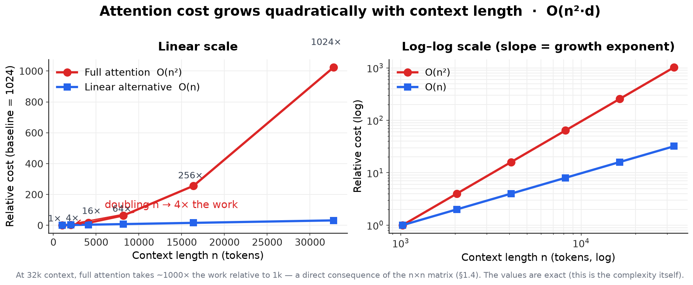
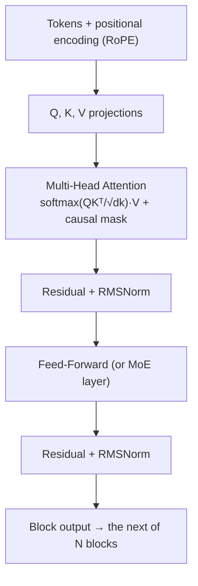
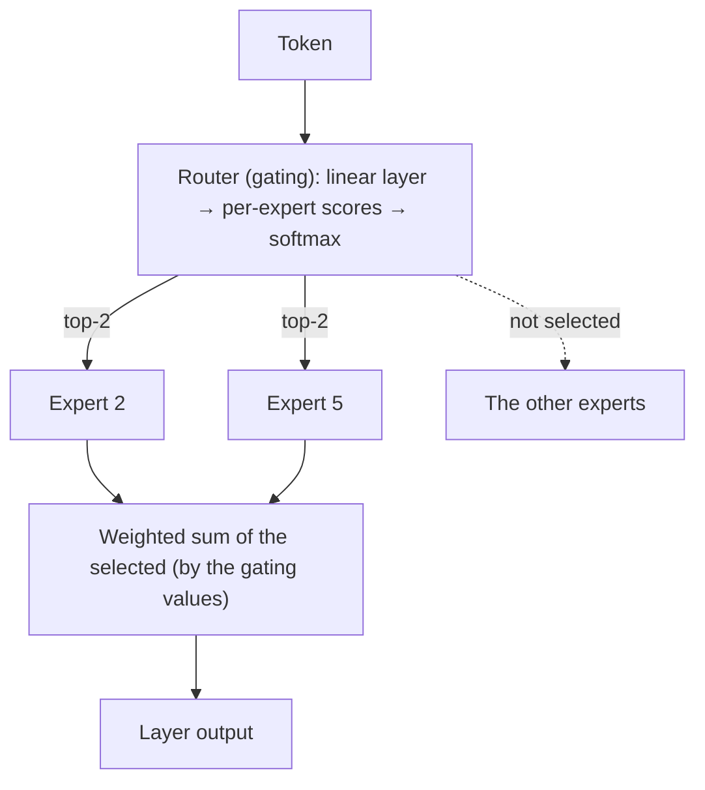
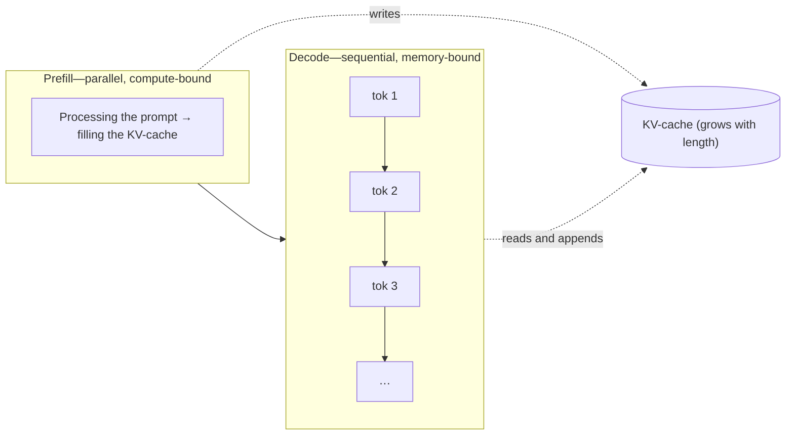
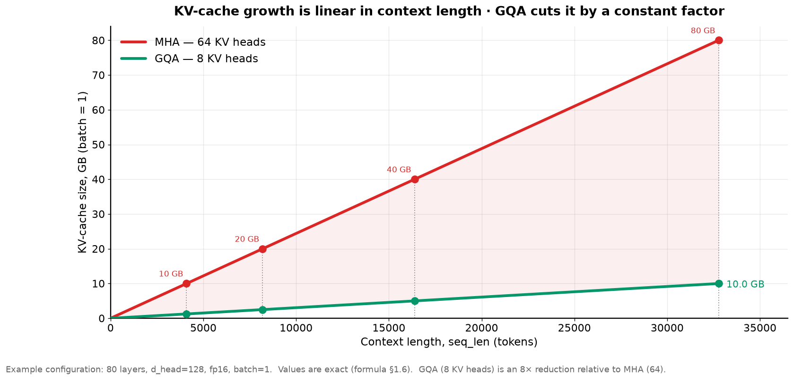
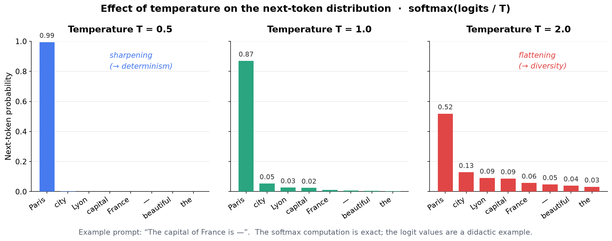

<!-- SPDX-FileCopyrightText: 2026 Aleksandr Drobiazkin
     SPDX-License-Identifier: CC-BY-SA-4.0 AND MIT
     Source: https://github.com/Drobiazkin/ai-agent-architecture
     Dual-licensed, and the boundary is exactly the fence: a fenced code block tagged
     with a language (python, java, sql, bash, yaml, xml, json), comments inside it
     included, is MIT. Everything else — the prose, the tables, the formulas, and the
     mermaid diagrams, which are illustrations expressed as text — is CC-BY-SA-4.0.
     Full terms: LICENSE, LICENSE-CODE, and NOTICE in the repository root. -->

# Part I. The Language Model as a Component

# Chapter 1. The Language Model as an Architectural Component

## 1.1 Why you need to understand the model's internals

A language model can be treated as an external service that takes a request and returns a response. For a prototype that is enough; for designing a system it is not. The model has nonfunctional properties that shape the architecture built around it, and they do not reduce to the input and output format:

- cost and latency depend nonlinearly on input length—a consequence of the quadratic complexity of attention (§1.4);
- answer quality degrades not only when the context window overflows but also when it fills up with irrelevant material (§1.8);
- reproducibility of the output is not guaranteed and is governed by decoding parameters (§1.7);
- the choice between a dense and a sparse (Mixture-of-Experts) architecture sets the memory and compute requirements for serving (§1.5, §1.6).

Each of these properties drives design decisions: the context budget, the choice of model, the serving strategy, latency requirements. So the goal of this chapter is not to train a model from scratch (for that, see the sources) but to build a minimally sufficient model of its internals from which these properties follow. The organizing idea of the chapter: a language model is a component with a defined set of properties (collected in §1.10), and much of what follows in this book (prompt design, RAG, agents, operations) is about managing the probabilistic nature of that component.

**Definition.** A large language model (LLM) is a parameterized function that, given a sequence of tokens, computes a probability distribution over the next token, and is applied autoregressively: the chosen token is appended to the input and the computation repeats. All observable model behavior grows out of this single operation, performed by a model with billions of parameters trained on trillions of tokens. What matters is that the model computes a *distribution* (not a single answer)—from which follow both the nondeterminism of the output (§1.7) and the absence of any built-in signal of truthfulness (§1.9).

*Sources for the chapter as a whole:* S. Raschka, *Build a Large Language Model (From Scratch)* (2024)—an implementation from scratch; J. Alammar & M. Grootendorst, *Hands-On Large Language Models* (2024)—intuition; Chip Huyen, *AI Engineering* (2025)—the engineering frame; Stanford CS336—the academic course.

## 1.2 Tokenization

**Token**—the smallest unit the model operates on: not a character and not a word, but a **subword**, an entry in a vocabulary built by an algorithm of the **BPE (Byte-Pair Encoding)** family. The algorithm has two stages. Training the tokenizer (once, before the model itself is trained) starts from a base alphabet and iteratively merges the most frequent pair of adjacent units into a new one until the vocabulary reaches a target size (usually 30,000–130,000); the result is an ordered table of merges. Applying it segments text against that table deterministically: frequent words and morphemes encode to a single token, rare ones get split. That is how a fixed vocabulary covers an unbounded language without a special "unknown" token.

**Byte-level BPE.** Modern models (starting with GPT-2) apply BPE not over Unicode characters but over UTF-8 **bytes**. This guarantees that *any* string is representable: an unseen character, an emoji, or corrupted input decomposes into a sequence of byte tokens. The consequence—true out-of-vocabulary does not exist; the "unknown" is simply encoded more expensively (more tokens). For Cyrillic this also explains the fragmentation: a character outside the basic Latin range takes several bytes, and therefore potentially several tokens.

**Alternative tokenization algorithms.** Although BPE dominates modern LLMs (the GPT and LLaMA families), other powerful approaches exist, both historically and architecturally. What separates them is the mathematical criterion by which characters are merged into subwords or split apart.

**1. WordPiece (used in BERT, DistilBERT)**
If BPE is a "greedy" algorithm that merges pairs of characters purely by their **absolute frequency** in the text, WordPiece (developed at Google) takes a probabilistic approach. It scores adjacent token pairs $A$ and $B$ with a metric close to pointwise mutual information (PMI):
$$Score = \frac{P(AB)}{P(A) \times P(B)}$$

| Symbol | What it is | How it is computed | Live value |
|---|---|---|---|
| $N$ | corpus size in tokens | — | 100 in the walkthrough below; for BERT, on the order of $10^9$ |
| $P(A)$, $P(B)$ | the share of token $A$ (or $B$) among all tokens of the corpus | $count(A) / N$ | $40/100 = 0.4$ |
| $P(AB)$ | the share of positions where $A$ stands immediately before $B$ | $count(AB) / N$ | $10/100 = 0.1$ |
| $Score$ | dimensionless rank of a pair; the pair with the highest one gets merged | $P(AB) / (P(A) P(B))$ | $0.1 / 0.16 = 0.625$ |

**In plain terms:** the metric asks not "how often does this pair occur" but "how many times more often than if $A$ and $B$ became neighbors by chance." The denominator $P(A) \times P(B)$ is exactly the expected share of the pair under independence: absent any pull toward each other, the tokens would land side by side at precisely that rate. Hence the scale: $Score = 1$—no relationship, coincidence; $Score \gg 1$—these two hold on to each other; $Score < 1$—they avoid each other's company. (A sequence of $N$ tokens has exactly $N-1$ pairs, not $N$, but at $N$ in the thousands and above this does not affect the ranking.)

**A footnote on implementations.** In the teaching implementation from the HuggingFace LLM Course (ch. 6.6) the score is computed on raw counts, $count(AB) / (count(A) \times count(B))$, without dividing by $N$. That is the same metric up to a constant factor of $N$: on a fixed corpus $N$ is a constant, the ranking of pairs does not change, and neither does the choice of which pair to merge.

Looking for this formula in production code, though, is pointless: there are no probabilities there, and no score either. Google never opened the original WordPiece training algorithm, and the course honestly flags its walkthrough as a guess based on published papers. HuggingFace's `tokenizers` library sidesteps the problem radically: its `WordPieceTrainer` builds an ordinary BPE inside, trains it, and only then converts the result into a WordPiece vocabulary (`WordPiece::from_bpe`)—the pair to merge is chosen by raw `count`, and by nothing else. A vocabulary trained by that trainer came out of the BPE criterion, and the PMI metric from the formula above plays no part in it. `min_frequency`, which cuts off rare pairs (more on it below), lives there too and defaults to zero—the filter is off until someone turns it on explicitly. The metric describes WordPiece as an algorithm; the popular implementation of its training does not reproduce it.

**How it works under the hood (the iterative loop):**

    vocab = get_base_alphabet() # [a, b, c, ..., z, а, б, в...]
    text = load_gigantic_corpus()

    # Spin the loop until we have the vocabulary size we want
    while len(vocab) < 30000:
    # 1. Count the frequencies of all tokens and pairs in the current text

    stats = compute_statistics(text)

    best_score = -1
    best_pair = None
    
    # 2. Find the ONE best pair on this iteration
    for pair in stats.pairs:
        if pair.count < min_frequency:
            continue # Throw out the rare junk
            
        score = calculate_wordpiece_score(pair, stats)
        
        if score > best_score:
            best_score = score
            best_pair = pair
            
    # 3. Add the best pair to the vocabulary
    new_token = merge(best_pair[0], best_pair[1])
    vocab.add(new_token)
    
    # 4. UPDATE THE TEXT: replace the pair with the new token
    text = replace_in_text(text, best_pair, new_token)

The algorithm does not stop at one merge. It runs in a loop, gradually growing the vocabulary from the base alphabet up to the target size (for example, `vocab_size = 30,000`).
1. **Gathering statistics:** The whole training corpus is scanned, and probabilities $P$ (the share of the total token count) are computed for all existing tokens and their pairs.
2. **Ranking:** A Score is computed for every pair.
3. **Merging:** Exactly **one pair** with the maximum Score is selected. It is merged into a new token $AB$ and added to the vocabulary.
4. **Re-segmentation (the critical step):** The algorithm walks the entire text and mechanically replaces every adjacent $A$ and $B$ with the new single token $AB$.
5. **Repeat:** The loop starts over on the updated text. Thanks to the re-segmentation a "snowball effect" appears: on the early iterations `про` and `грам` merge (into `програм`), and on later iterations the new token `програм` can merge with `мист`, forming `программист`. The loop stops when the vocabulary reaches the limit.

**Engineering nuances of the WordPiece metric:**
* **The popularity penalty:** The denominator $P(A) \times P(B)$ keeps the algorithm from merging frequent but independent letters (for example, "а" and "о"). The Score comes out high only if the tokens occur *together* far more often than *separately*. That forces the algorithm to isolate meaningful morphemes.
* **Protection against rare events (rare event bias):** The same denominator also works against the algorithm: it inflates the score of pairs whose parts almost never occur apart, the limiting case being a pair that occurred exactly once. To keep the algorithm from stuffing the vocabulary with junk, real code applies the `min_frequency` hyperparameter: pairs occurring fewer than 2–5 times are excluded from the computation.

**The popularity penalty in numbers.** A hypothetical corpus, $N = 100$ tokens. The junk pair `а`+`о` stands adjacent 10 times, the morpheme pair `про`+`грам` 5: the junk is **twice as frequent**, and greedy BPE would have merged it without a second thought. But "а" and "о" do just fine on their own—40 occurrences each—whereas "про" and "грам" occur 5 times each and only next to each other:

$$Score(а, о) = \frac{10/100}{(40/100) \times (40/100)} = \frac{0.1}{0.16} = 0.625$$

$$Score(про, грам) = \frac{5/100}{(5/100) \times (5/100)} = \frac{0.05}{0.0025} = 20$$

The denominator $0.4 \times 0.4 = 0.16$ collapses the junk pair: the twice-rarer `про`+`грам` wins by a factor of 32. And $0.625 < 1$—"а" and "о" turn up as neighbors even *less* often than chance (16 pairs expected, 10 observed), so the metric does not merely withhold encouragement from the merge, it positively records the absence of a relationship. The winning `про`+`грам` is what opens the "snowball effect" from step 5 above: once it is the token `програм`, later iterations will grow it into `программист`.

**Why the metric needs a lower bound.** Take a pair whose parts occur only together (like `про`+`грам`): $count(A) = count(B) = count(AB) = c$. The metric collapses:

$$Score = \frac{c/N}{(c/N) \times (c/N)} = \frac{N}{c}$$

For a perfectly welded pair the score is **inversely proportional to its frequency**: the rarer, the higher. One-off junk ($c = 1$) gives exactly $Score = N$, the corpus size: on a toy $N = 100$ that is 100 against 20 for a genuine morpheme. And the gap between them equals $N / (N/c) = c$—the frequency of the morpheme itself: **the more useful and frequent the morpheme, the more badly it loses to one-off junk.** BERT's corpus is BooksCorpus (800M words) plus English Wikipedia (2.5B words), so $N$ is on the order of $10^9$ tokens: a pair whose parts occur nowhere else in the corpus would score on the order of $N$—a billion, that is.

That is an upper bound, not a fact about how BERT was trained. The condition "the parts occur only together" does not hold for a real typo on a corpus that size: its pieces are workaday Latin subwords, they turn up everywhere, $count(A)$ and $count(B)$ are enormous, and its score comes out negligible instead—the very "popularity penalty" from the point above. The threshold protects against perfectly welded junk: a rare name, a fragment of a URL, a random sequence that surfaces nowhere else.

Hence a correction to the common formulation "the denominator tends to zero, so the score tends to infinity": logically it does not close, because the numerator $P(AB)$ goes to zero along with the denominator, and "the denominator is small" implies nothing on its own. The score of a rare pair does not run off to infinity—it takes the finite value $N$, which grows with the corpus. The practical conclusion is the same, but now it is proved: the lower bound is not an empirical hack but a forced correction to a metric that by construction ranks the rarest of the welded pairs first.

**2. Unigram Language Model (used in ALBERT, T5)**
Unlike BPE and WordPiece, which build the vocabulary bottom-up (from letters to words), Unigram works **top-down**.
* **Initialization:** The algorithm starts from a giant vocabulary that includes every possible subword from the training corpus.
* **Optimization:** A probability is computed for each subword. The algorithm then iteratively prunes the tokens whose removal costs the least in overall corpus likelihood.
* **Decoding:** At inference time the same word can be split in different ways. Unigram uses the Viterbi algorithm to find the mathematically most probable segmentation path for a given word.

**3. SentencePiece (the engineering standard for multilinguality)**
An important point: SentencePiece is **not an algorithm but a framework** (a Google library) inside which you can run either BPE or Unigram. Its main architectural innovation is dropping pre-tokenization.
Standard tokenizers first split text on whitespace and punctuation, which breaks on languages without spaces (Chinese, Japanese) or languages with rich morphology. SentencePiece works on the raw byte/character stream and treats the space as an ordinary character (usually replacing it with the meta-character `_` or `U+2581`). This lets the model learn for itself whether the space is a meaningful separator in a given context.

**An engineer's iron rule:**
The tokenizer and the network weights are **a single, unbreakable binary contract**. The model does not understand text; it understands only the IDs from its own particular vocabulary. Feeding a LLaMA model (which uses BPE) tokens cut by BERT's tokenizer (WordPiece) will destroy the semantics entirely (garbage in, garbage out). To count tokens, trim context, or assemble prompts you must instantiate the tokenizer strictly from the target model (for example, via `AutoTokenizer.from_pretrained(model_name)`). Where the resulting array of IDs goes next, and what happens at the CPU/accelerator boundary—§1.6.

**Special and control tokens.** Beyond subwords, the vocabulary holds service tokens: beginning and end of sequence (BOS/EOS), padding (pad), and, in chat models, **role and turn markup** (separator tokens of the form `<|im_start|>`, `<|im_end|>`, and analogues). Out of these a **chat template** is built—the exact structure in which the roles (system/user/assistant) are presented to the model. This is a practically important and often underrated skill: the model was trained on a *specific* markup format, and hand-assembling a prompt with the wrong separators degrades quality, sometimes into incoherence. The rule: use the tokenizer's stock chat template rather than constructing the markup by concatenating strings.

Multimodal models (VLMs) integrate non-text data through **special anchor tokens** (for example, `<image>`). The images themselves are processed by a separate vision encoder (for example, ViT) and split into **visual patches**—fragments that are projected into vectors and, at the tensor level, embedded into the shared sequence.

**Assembling a multimodal sequence (under the hood)**
When a VLM takes an image and text as input, it forms a single array of embeddings. Take a concrete model—LLaVA-1.5, whose numbers are used throughout the rest of the section. At the tensor level the assembly looks like a concatenation of vectors:

$$E_{seq} = [E_{BOS}] \oplus \Phi(V_{patches}) \oplus E_{text} \oplus [E_{EOS}]$$

**Two stages, not one.** The confusion around `<image>` dissolves once you separate in time what the developer writes from what the model receives.

*Stage 1 — the prompt string (`<image>` is present here).* The developer submits text with a single placeholder token:

```
USER: <image>
What is in the picture? ASSISTANT:
```

`<image>` (id 32000) is the one visual marker. There is no image yet at this stage—only a note that says "the picture goes here."

*Stage 2 — the model input (`<image>` is already gone).* During embedding assembly this single token is **replaced** by the 576 patch vectors $\Phi(V_{patches})$: the marker is removed and the image block takes its place. That is why $E_{seq}$ has no separate `<image>` term—$\Phi(V_{patches})$ sits exactly where it was: not a neighbor of the anchor but its replacement.

Where:
* **[BOS] (Begin of Sequence):** Always stands at the start. In the Transformer architecture it does not "initialize the hidden state" (as in the old RNNs) but exhibits the **attention sink** property: softmax's excess attention emergently accumulates on the initial positions (Xiao et al., StreamingLLM, 2023), which stabilizes the attention mechanism. This is not a role assigned to the token but a consequence of the architecture; the [BOS] token's K/V are simply cached first during prefill, as for any token.
* **$\Phi(V_{patches})$:** Visual patches passed through a projection adapter (an MLP or a Q-Former). The adapter is what brings the dimensionality of the visual features to the dimensionality of the LLM's text embeddings ($D_{model}$). The patches themselves arise geometrically: a ViT cuts the image with a regular grid of squares of fixed size $P \times P$ pixels and linearly projects each square into a single vector. Typical $P$ is 14, 16, or 32; in a model's name it is the second number (`ViT-L/14`—"Large, patch 14"). Hence the main consequence, which we will come back to below: the number of patches is not a constant of the model but a function of the input resolution and $P$.
* **[EOS] (End of Sequence):** Placed at the end of training examples. At inference (generation) time the appearance of this token is a strict, deterministic trigger to stop the autoregressive loop (autoregressive decoding).

Inside the model's hidden space (embedding space) there is no difference between text and image. The identifiers `[BOS]` and `[EOS]` are converted into standard trainable vectors of the same dimensionality $D_{model}$ as the projected visual patches. Thanks to that mathematical alignment, self-attention ($Softmax(QK^T / \sqrt{d})V$) can compute attention weights among service tokens, printed words, and image fragments seamlessly, handling them as one continuous context.

**$\oplus$ is gluing, not addition.** The symbol $\oplus$ denotes **concatenation**—assembling a sequence end to end. The rejected alternative is element-wise addition of vectors. *Adding* → means writing the sum into the same array cells: the shape does not change, but text and image get mixed into the same numbers, and the addends cannot be recovered from the sum—self-attention further up the stack would then be fundamentally unable to separate the image from the words. *Gluing* → means lengthening the sequence: each modality takes its own positions and stays separately addressable. That makes the $D_{model}$ requirement from the paragraph above read exactly: the vectors' width has to match so the rows line up in one table (element-wise `+` also requires matching shape, §A.3)—but matching width does not mean the vectors get added.

At the PyTorch level the assembly is one operation, a glue along the token axis:

    # The numbers are LLaVA-1.5 (ViT-L/14 @ 336px + Vicuna-7B).
    e_bos      # [  1, 4096]
    v_patches  # [576, 4096]  <- (336/14)^2 = 24 x 24 = 576 patches after the adapter; <image> lands here
    e_text     # [ 20, 4096]  <- a prompt of a nominal 20 tokens
    e_eos      # [  1, 4096]

    E_seq = torch.cat([e_bos, v_patches, e_text, e_eos], dim=0)
    # E_seq.shape == [598, 4096]

**How to read the shapes.** The first number is `seq`, the count of token rows; the second is $D_{model}$, the width of one token's vector (4096 in Vicuna-7B—the base LLM in LLaVA-1.5; the same numbers as in the trace in §1.4). `dim=0` is the index of the axis along which the growth happens; here it is the token axis. The arithmetic: 1 + 576 + 20 + 1 = **598** rows, and 4096 stays 4096. *In plain terms:* gluing extends the table downward but does not widen it sideways—there are more tokens, and each token's vector is unchanged. And unlike `+`, concatenation does not require matching size along the axis it grows on (576 and 20 coexist perfectly well)—only along all the others.

**The cost of an image in tokens.** Of those 598 rows, 576 are the image: 96% of the sequence against 3% for the prompt text. An image costs not "one embedding" but on the order of 576 tokens, and for attention that is quadratic in the full length (§1.4). That is what gives meaning to the choice of adapter, named $\Phi(V_{patches})$ in the walkthrough above. The **MLP** (a small fully connected network) in LLaVA-1.5 works per patch: 576 patches in yield 576 vectors out—the count does not change, the adapter only fits the width. A **resampler**, rather than passing patches through one-to-one, runs them through a fixed set of trainable **query vectors**: cross-attention, in which each query "reads out" from all the patches what it needs—and returns exactly as many rows as it has queries, regardless of the input resolution. The original **Q-Former** (BLIP-2) has 32 queries; the **Qwen-VL** adapter (officially, a Position-aware Vision-Language Adapter; single-layer cross-attention) has 256. The spread of 32 against 256 under identical mechanics is precisely the resampler invariant: with a fixed-query adapter the count of visual tokens is set by the adapter, not by the input resolution; with a per-patch MLP it is the reverse—the count is inherited wholesale from the resolution. Choosing an adapter is choosing the cost of an image in tokens, not an implementation detail.

**Where 576 comes from: grid arithmetic.** The invariant above says what the adapter does with the patch count, but not where that count came from. And it comes from pure geometry: the encoder cuts the image with a grid of $P \times P$ squares and returns one vector per square. How many sequence positions that costs takes two steps to work out:

$$N_{patches} = \frac{H \times W}{P^{2}}, \qquad N_{slots} = \frac{N_{patches}}{m^{2}} + k$$

| Symbol | What it is | Live value |
|---|---|---|
| $H, W$ | height and width in pixels **after** the resize for the encoder, not those of the original file | 336 × 336 in LLaVA-1.5: the input is hard-fixed (`crop_size: 336×336`) |
| $P$ | the side of a square patch in pixels | 14 in CLIP ViT-L/14-336 and in Qwen2-VL; 16 in ViT-B/16; 32 in ViT-B/32 |
| $N_{patches}$ | how many vectors the encoder returns | $336 \times 336 / 14^{2} = 24 \times 24 = 576$ |
| $m$ | the side of the block of patches the adapter merges into one token | $m = 1$—no merging (LLaVA-1.5, the MLP works per patch); $m = 2$—four neighboring patches collapse into one (Qwen2-VL) |
| $k$ | how many service positions go to the framing | $k = 2$ in Qwen2-VL (`<\|vision_start\|>` and `<\|vision_end\|>`—two real positions); $k = 0$ in LLaVA-1.5: there is no closing token, and `<image>` is replaced by the visual vectors rather than added to them |
| $N_{slots}$ | the resulting cost of an image in positions | 576 in LLaVA-1.5; 66 in Qwen2-VL on a 224×224 input |

*Live numbers.* LLaVA-1.5: $336 \times 336 / 14^{2} = 576$ patches, no merging ($m = 1$), no framing ($k = 0$)—exactly **576 positions** per image. Qwen2-VL on a 224×224 input: $224 \times 224 / 14^{2} = 16 \times 16 = 256$ patches, 2×2 merging gives $256 / 4 = 64$ tokens, plus the pair of delimiters—**66**. The Qwen2-VL authors quote that last figure themselves, and it includes both service tokens: even the model's developers count the delimiters into the budget rather than setting them aside.

*In plain terms:* the first fraction is "how many squares fit into the image," and nothing more; the second formula is a correction for what the particular architecture does with those squares (glues them four at a time or not, spends two positions on boundary markup or not).

**Consequence: resolution is a budget line item.** In $N_{patches} = HW/P^{2}$ the resolution sits in the numerator as a **product**, so doubling the *side* of the image quadruples the patch count. And attention is quadratic in sequence length (§1.4)—so that factor of four becomes ×16 the work wherever the visual part dominates. Even without a doubling the count is sobering: 576 visual positions on top of a 1000-token prompt give $seq = 1576$—the length grew by 58%, the attention work by a factor of about $(1576/1000)^{2} \approx 2.5$. **Invariant:** resolution is a parameter of the context budget, not only of image quality; resizing down to the lowest resolution at which the task still works cuts $seq$ and the quadratic price behind it. A caveat: this knob does not always exist, and the reason is the input, not the adapter. LLaVA-1.5's input is fixed, and an image costs 576 patches whether it holds a schematic or an empty background; in models with dynamic resolution (Qwen2-VL) $N$ grows with the resolution up to a set ceiling—and there resolution really is a knob you can turn.

**Fertility and multilinguality.** *Fertility*—the average number of tokens per word—is a measurable property of the pair "tokenizer × language": close to one for English, substantially higher for Cyrillic. It directly sets cost and the *effective* context length: at an equal window size in tokens, Russian text exhausts it faster, so less meaning fits into the window. Which is why cost and context-budget estimates for a Russian-language system are made by counting tokens with the specific model over a representative sample of documents, not by counting characters: the phrase "автоматизация процессов" (23 characters) encodes to 6–9 tokens against 2–3 for "process automation," and across hundreds of thousands of documents that difference determines both the bill and how many fragments will fit into the window during retrieval (Part III). Made in advance, such an estimate makes cost and capacity predictable before launch.

**Pitfalls that lead to bugs.** Several practical traps follow directly from how tokenization works:
- *Numbers.* Multi-digit numbers are split into tokens inconsistently (one digit at a time, or in groups), which makes arithmetic and exact digit manipulation unreliable; for tasks involving numbers this gets designed for (check the result, move the computation out to an external tool).
- *Whitespace and boundaries.* In most tokenizers a leading space is part of the token (` the` and `the` are different tokens). Hence the sensitivity to boundaries: breaking in the middle of a "natural" token keeps the model from continuing optimally—a problem solved at the decoding level (token healing, §5.3).
- *Code.* Source code tokenizes inefficiently unless the tokenizer was adapted for it (indentation, long identifiers), which inflates both length and cost.
- *Glitch tokens.* Rare strings that made it into the vocabulary but barely occurred during training (the `SolidGoldMagikarp` example, Rumbelow & Watkins, 2023) trigger anomalous behavior—a demonstration that the model's picture of text is mediated by the vocabulary.

**Vocabulary size as a trade-off.** A larger vocabulary shortens sequences (cheaper for attention, §1.4) but grows the embedding and output-projection matrices—memory for parameters (§1.6). This is a design decision made when the model is built; when you use it, what matters is the consequence: vocabulary size is fixed together with the model and determines its fertility. Tokenization also interacts with **structured output**: because the model emits tokens, constraining the output by a grammar or a schema (constrained decoding, §5.3) operates at the token level and accounts for which tokens are admissible at each position.

**Comparing segmentation approaches.**

| Approach | Advantage | Drawback |
|---|---|---|
| By characters | Tiny vocabulary, no unknown words | Very long sequences, weak signal per unit |
| By words | Short sequences | Huge vocabulary, unknown words on rare vocabulary |
| Subwords (BPE / WordPiece / Unigram) | Balance of coverage and length, no true OOV (byte level) | Splitting artifacts, unevenness across languages |

*Tools.* For counting and inspecting tokens, use `tiktoken` (OpenAI models) and the specific model's tokenizer via the `transformers` library; the key requirement is to use the same tokenizer the target model uses.

*Sources.* R. Sennrich, B. Haddow, A. Birch, "Neural Machine Translation of Rare Words with Subword Units" (2016)—BPE. M. Schuster, K. Nakajima, "Japanese and Korean Voice Search" (2012)—WordPiece. Y. Wu et al., "Google's Neural Machine Translation System" (2016)—the likelihood criterion of WordPiece. J. Devlin et al., "BERT: Pre-training of Deep Bidirectional Transformers" (2018)—BERT's corpus and vocabulary. HuggingFace LLM Course, ch. 6.6, "WordPiece tokenization"—the teaching implementation of the metric on raw counts. T. Kudo, "Subword Regularization" and SentencePiece (2018)—Unigram LM. A. Karpathy, "Let's build the GPT Tokenizer" (2024). Rumbelow & Watkins, "SolidGoldMagikarp" (2023). H. Liu, C. Li, Y. Li, Y. J. Lee, "Improved Baselines with Visual Instruction Tuning" (arXiv:2310.03744, 2023)—LLaVA-1.5: CLIP-ViT-L-336px + a two-layer MLP connector. J. Bai et al., "Qwen-VL" (arXiv:2308.12966, 2023)—Position-aware Vision-Language Adapter: single-layer cross-attention, compression of the visual run to 256, delimiters ``/`</img>`. J. Li, D. Li, S. Savarese, S. Hoi, "BLIP-2" (arXiv:2301.12597, 2023), §3.1—Q-Former: 32 queries of dimensionality 768. S. Zhang, Q. Fang, Z. Yang, Y. Feng, "LLaVA-Mini" (2025)—24×24 = 576 visual tokens in LLaVA-1.5. A. Dosovitskiy et al., "An Image is Worth 16x16 Words: Transformers for Image Recognition at Scale" (arXiv:2010.11929, 2021)—ViT and the patch grid $N = HW/P^2$. P. Wang et al., "Qwen2-VL: Enhancing Vision-Language Model's Perception of the World at Any Resolution" (arXiv:2409.12191, 2024)—dynamic resolution, 2×2 patch merging, delimiters `<|vision_start|>`/`<|vision_end|>`, the authors' own estimate "224×224 at patch_size=14 → 66 tokens." The vocabulary and geometry were checked against vendor artifacts: `llava-hf/llava-1.5-7b-hf` (`added_tokens.json`—only `<image>` 32000 and `<pad>` 32001; `config.json`—`image_size: 336`, `patch_size: 14`), `liuhaotian/llava-v1.5-7b` (`config.json`—`mm_use_im_start_end: false`), `Qwen/Qwen2-VL-7B-Instruct` (`config.json`—`vision_start_token_id: 151652`, `vision_end_token_id: 151653`; `preprocessor_config.json`—`patch_size: 14`, `merge_size: 2`).

## 1.3 Embeddings and the vector space

**Embedding**—a mapping of a token or a fragment of text into a **dense vector** of fixed dimensionality `d` (typically 384, 768, 1024, 1536, 4096) under which geometric proximity of the vectors corresponds to semantic proximity of the objects. The basis is the **distributional hypothesis** (Firth, 1957): the meaning of a unit comes from the contexts it is used in, so units from similar contexts get similar vectors.

**Two different notions worth keeping apart.** *The model's internal embeddings*—the transformer's first layer, mapping a token identifier to a vector, which attention then enriches with context; part of the language model itself. *Embedding models*—separate models that encode a *whole fragment* into a single vector for search; RAG is built on them (Part III).

**Where these vectors physically live.** The distinction is not only structural but hardware-level—and that is the most reliable way to keep from confusing them. An embedding model's vectors are *data*: they lie in a vector store (pgvector, Qdrant, Milvus), that is, in the RAM or on the SSD of an ordinary database server, next to the ANN index graph (§8.3). The model's internal embeddings are *computation*: they arise in accelerator memory (HBM[^t-hbm], §1.6) inside the inference process and never leave it. Different hardware, different processes, different ops teams.

**What is permanent here and what is instantaneous.** Inside the model itself, "embedding" names two different things, and they need pulling apart. Permanent is the **embedding matrix**—a lookup table of size `V × d_model`, one row per vocabulary token; these are trainable weights, they sit in accelerator memory for the whole life of the process and count toward the "model size" (§1.6). Its volume:

```
Embedding matrix (bytes) = V · d_model · bytes
```

- `V`—vocabulary size; in Llama 3, 128,256 tokens.
- `d_model`—the dimensionality of the model's internal vector; in Llama 3 8B, 4096.
- `bytes`—bytes per number; at bf16, 2.

Substituting: 128,256 · 4096 · 2 = 1,050,673,152 bytes ≈ 0.98 GB—almost a gigabyte of weights for the lookup table alone (and that is without the output projection: in Llama 3 8B it is a separate matrix of the same size, the weights are not tied, §1.2). Instantaneous is that table's **output**: one token's vector is 4096 · 2 = 8 KB of activations, which live within a single forward pass and are freed after it. The ratio of permanent to instantaneous here is exactly `V`: one row against the table's 128,256. *In plain terms:* what sits in accelerator memory forever is a **vocabulary of vectors**, while a particular token's vector is a consumable: computed, passed up the stack, thrown away. What survives across decode steps is not it but the KV-cache (§1.6).

A vector in a RAG index is built exactly the other way around: in pgvector it takes `4 · d + 8` bytes, that is ≈4 KB at `d` = 1024 (bge-m3), and it is written to disk once—to lie there for months, until the embedder changes and everything is reindexed (§8.8). Per vector, both cases come to the same order of magnitude (kilobytes), but the lifetimes differ by orders: milliseconds against months.

**≠ Do not confuse: RAG vectors never reach the model at all.** The commonest misconception about RAG is that the retrieved vectors get "fed" to the model. They do not. A fragment's vector is needed for exactly one operation—comparison against the query vector during nearest-neighbor search (§8.1); once the neighbors are found, the vector has done its job. What goes into the context is the **text** of the fragment, pulled from storage by identifier. That text then travels the whole path over again: the model's tokenizer (§1.2) → token identifiers → the model's embedding matrix → its internal vectors. So the fragment makes a loop, "text → embedder vector → (search) → text → model vector," and the two vector spaces never touch once: the only thing they exchange is text. Hence a practical consequence that disposes of a needless question: the embedder's dimensionality (1024) and the model's `d_model` (4096) need not match and usually do not—there is nothing to reconcile, they never meet.

Below, the discussion is mostly about the second kind.

**How tokens turn into a single vector: pooling.** An embedding model emits one vector per token; to get a single vector for the fragment, the vectors are aggregated. The main strategies: *mean pooling* (averaging over the tokens—a common choice), *CLS pooling* (the vector of the special token in BERT-like models), *last-token pooling* (the last token's vector in decoder embedders). Pooling is part of a given model's architecture; what matters practically is that it affects quality and cannot be swapped out at will.

**Why vector proximity reflects meaning: contrastive training.** This is not a self-evident property but the result of training. An embedder is trained with a contrastive objective on pairs: the vectors of semantically close texts are pulled together, distant ones pushed apart under a chosen measure. Technically, negative examples are often taken *within the batch* (in-batch negatives), and quality depends heavily on how "hard" the negatives are. After training, the proximity of directions becomes an estimate of semantic proximity—and that is what justifies using cosine similarity rather than an arbitrary function.

**InfoNCE—the loss function that creates this geometry.** The standard contrastive objective is called **InfoNCE** (Oord et al., 2018; noise-contrastive estimation—telling a real signal from admixed noise). For a query $q$, its relevant document $d^+$, and a set of negatives $d_j^-$:

$$L = -\log \frac{\exp(\mathrm{sim}(q, d^+)/\tau)}{\exp(\mathrm{sim}(q, d^+)/\tau) + \sum_{j=1}^{N} \exp(\mathrm{sim}(q, d_j^-)/\tau)}$$

* $q$, $d^+$, $d_j^-$—the vectors of the query, of the relevant document (the positive, exactly one per query), and of the irrelevant ones (negatives, $j = 1..N$); with in-batch negatives $N = B - 1$, where $B$ is the batch size.
* $\mathrm{sim}$—the similarity measure; in practice the cosine between L2-normalized vectors, dimensionless, range $[-1, 1]$.
* $\tau$—the **temperature**, dimensionless, typically 0.01–0.05: in E5 it is 0.01 (L. Wang et al., 2022, §4.1), in SimCSE 0.05 (T. Gao et al., 2021, table D.1). The mechanics are exactly those of decoding temperature (§1.7)—divide by $\tau$ before softmax—but the job and the scale differ: there, $T$ on the order of unity governs the diversity of generation at inference; here, $\tau$ is one to two orders of magnitude smaller and decides which negatives make it into the gradient during training at all.
* $L$—the loss in nats; zero means "the positive was identified without error."

**In plain terms.** This is the ordinary cross-entropy of the task "guess which of the $N+1$ candidates is the real one," and the penalty is charged for exactly one thing: the model failing to separate the positive from the negatives **by cosine**. Two things follow. First, about the measure: the cosine sits *inside* the loss, so training optimizes not "meaning in general" but precisely the quantity written into $\mathrm{sim}$; the requirement below (see "Normalization and similarity measures")—that the search measure must match the training measure—is not a convention of convenience but a condition of correctness. Second, about the negatives: what puts meaning into the vectors is not the positive but the crowd it had to be told apart from.

**Live numbers: what τ actually does.** Suppose the cosine to the positive is 0.80, to one hard negative 0.75, and the batch holds another 30 easy negatives with a cosine of about 0.10.

* $\tau = 0.1$ → logits 8.0, 7.5, 1.0. Denominator: $2981 + 1808 + 30 \times 2.72 = 4871$. The easy negatives supply 1.7% of the denominator—little, but not zero. $L = -\ln(2981/4871) \approx 0.49$.
* $\tau = 0.01$ → logits 80, 75, 10. The positive leads the hard negative by a factor of $e^{5} \approx 148$, while all 30 easy ones together contribute $30 \cdot e^{-70} \approx 10^{-29}$ of the denominator—for the gradient they simply are not there. $L = \ln(1 + e^{-5}) \approx 0.0067$, and that loss is generated entirely by the single hard negative.

Shifting τ by an order of magnitude is not "slightly different sharpness" but a decision about how many negatives take part in the gradient at all. The property has been proved formally: contrastive losses are **hardness-aware**—the closer the negative, the harder it gets pushed away. The gradient with respect to a negative is proportional to $\exp(\mathrm{sim}/\tau)$: the penalty grows with proximity not linearly but **exponentially**, and τ sets the steepness of that growth (F. Wang, H. Liu, 2021, §3.1). Which is exactly why a cosine gap of a mere 0.05 turned into a factor of 148 above, and why the easy negatives fell through to $10^{-29}$: what enters the gradient is not proximity itself but its exponential. In the limit $\tau \to 0$ InfoNCE degenerates into a triplet loss with zero margin and looks **only at the nearest negative** (ibid., §3.2). The flip side is the "uniformity-tolerance dilemma" (ibid., §4): an excessively small τ crushes the nearest neighbors, and those are precisely the ones most often semantically akin to the query.

**Batch size is a quality hyperparameter, not a performance one.** This follows straight from the denominator: it holds $B - 1$ negatives, so a bigger batch = more candidates the positive must be told apart from = a harder task = a stronger signal. Measurably: in E5 pretraining the average score across six sets rises $45.8 \to 50.2 \to 51.6$ as the batch goes $1\text{K} \to 8\text{K} \to 32\text{K}$ (L. Wang et al., 2022, table 5)—almost 6 points from batch size alone; the final configuration uses $B = 32\,768$. The engineering consequence is counterintuitive for a backend developer: you cannot trim the batch here "to save memory"—what gets trimmed is the model's quality. Working around that is exactly what **GradCache** (Gao et al., 2021) exists for—a technique that breaks the encoder's backward-pass dependency along the batch axis, which makes it possible to compute a 32K batch in memory it does not wholly fit into.

**A failure mode: false negatives.** Hard negatives are obtained by mining: run the query over the corpus with the current model and take the top of the results. The trap sits exactly where the payoff is: the top of the results is the very place the *genuinely* relevant documents lie, merely unlabeled. In numbers: the RocketQA authors hand-labeled the top results that carried no positive label in MS MARCO and found that **70% of them are in fact positives** (Qu et al., 2021, §1). Plug such a document into the formula as $d^-$ and it will honestly push a relevant document away from the query—and at a small τ it will pour almost the entire gradient of the step into doing so. Unfiltered mining poisons retrieval the more precisely the sharper τ is.

The fix is the same in spirit as WordPiece's `min_frequency` (§1.2)—do not trust raw statistics:

* *Filtering by a teacher.* RocketQA rescores candidates with a cross-encoder (§7.4) and keeps as negatives only those the teacher confidently predicted to be negative (in their implementation, with a score below 0.1).
* *A rank cutoff.* In `sentence-transformers` this is what the `range_min` parameter of `mine_hard_negatives` is for—the minimum rank from which a candidate is considered a negative at all; its purpose is documented outright as "skip the most similar texts, so as not to label as a negative what is in fact a positive." There is no canonical value—the default is 0, meaning the filter is off—so the rank window gets tuned on your own data.

A practical invariant: in a dataset for contrastive fine-tuning (see "Domain adaptation" below) the negatives are not filler but half the signal. Query-positive pairs without thought-through, filtered negatives produce a model that never learned to *tell anything apart*.

**Asymmetry and instruction prefixes—a practical pitfall.** Many modern embedders are *instruction-tuned* and asymmetric: query and document are encoded with different prefixes (for example, `query:` and `passage:`, or an instruction like "represent this sentence for search"). If the prescribed prefix is not supplied, search quality degrades *silently*—no errors, no warnings. This is one of the commonest practical mistakes: using a model without the input format it was built for. The rule—apply exactly the query and document format the model card specifies.

**Normalization and similarity measures.** With L2-normalized vectors (brought to unit length) the dot product equals cosine similarity—which is why search normally normalizes and uses the cosine or an equivalent dot. The measures: *cosine* (the angle, invariant to length—the standard for semantics); *dot product* (accounts for length—when length carries meaning); *Euclidean distance* (on normalized vectors, monotonically related to the cosine). The chosen measure is fixed when the index is configured (Chapter 8) and must match the one the model was trained on.

**Anisotropy.** Raw embeddings from language models suffer from *anisotropy*—they occupy a narrow cone in the space, so arbitrary pairs look similar and proximity separates poorly. Specialized embedding models correct this through training (contrastive training among others), yielding a more evenly distributed space. The practical conclusion: for search, take a dedicated embedding model rather than pulling vectors out of a generative one.

**Dimensionality as a trade-off.** A larger `d` holds more distinctions but linearly increases memory and the cost of searching the index (§8). *Matryoshka Representation Learning* trains an embedding so that it can be **truncated** to a smaller dimensionality with a controlled loss of quality—a flexible trade of "memory and speed ↔ accuracy" without retraining (truncating 1024→256 for a cheap first pass, for example).

**Evaluation and model choice.** The standard reference point is the **MTEB**[^t-mteb] benchmark (retrieval, semantic textual similarity, clustering, reranking, and other tasks); pick a model by *the* task that matches your target one (for RAG, retrieval), and always check it on *your own* data rather than by the leaderboard alone, since domain and language specifics decide. For Russian-language systems, strong Russian support is critical: many top English-oriented models have worse fertility and quality on Russian, which you verify on monolingual and cross-lingual pairs.

**Domain adaptation.** The most powerful lever on retrieval quality in a narrow domain is *fine-tuning the embedder* on query-relevant-document pairs from that domain (the pairs come from click and feedback logs, or are generated synthetically and then checked). This often buys more than switching the retrieval pattern (Chapter 7).

**Application.** The practical point of all the above is semantic search: each fragment of the corpus is encoded into a vector and stored in a vector store (pgvector, for example); the query "how do I return a defective item" is encoded into a vector and matched against the nearest fragments even if the document used different wording—"the procedure for filing a complaint about substandard goods." The value is that search runs on meaning rather than on word overlap, so the material gets found when the query's vocabulary and the document's diverge. The limitation is of the same nature: literal terms, codes, and part numbers, where an exact match matters, can be missed by semantic search—which is what motivates hybrid search (§7.3). The operational consequence: vectors from different models are incomparable, so changing the embedder means fully reindexing the corpus (§8.8), and a model is chosen with long use in mind; to save memory, vectors are additionally quantized (§8; this is quantization of index vectors—not to be confused with quantization of model weights, Chapter 22) with the quality loss kept under control.

*Sources.* T. Mikolov et al. (2013)—word2vec. N. Reimers, I. Gurevych, "Sentence-BERT" (2019). N. Muennighoff et al., "MTEB" (2022). A. Kusupati et al., "Matryoshka Representation Learning" (2022). A. van den Oord, Y. Li, O. Vinyals, "Representation Learning with Contrastive Predictive Coding" (2018)—InfoNCE. L. Wang et al., "Text Embeddings by Weakly-Supervised Contrastive Pre-training" (2022)—E5. F. Wang, H. Liu, "Understanding the Behaviour of Contrastive Loss" (2021)—temperature and hard negatives. T. Gao, X. Yao, D. Chen, "SimCSE: Simple Contrastive Learning of Sentence Embeddings" (2021)—temperature 0.05. Y. Qu et al., "RocketQA" (2021)—false negatives. L. Gao et al., "Scaling Deep Contrastive Learning Batch Size under Memory Limited Setup" (2021)—GradCache.

## 1.4 Attention and the transformer *(a long-form section)*

This is the core of the architecture: the attention mechanism sets both the model's capabilities and its computational cost.

**The problem attention solves.** Earlier architectures processed text recurrently (RNN, LSTM): token by token, carrying a hidden state along. That imposed two limits: the sequence cannot be parallelized, since each step depends on the previous one (slow training), and information about long-range dependencies decays as it is carried through the state (the beginning of a long text "washes out" by the end). Attention removes both limits: it lets every position address any other directly in one step, and it is computed in parallel for the whole sequence.

**Scaled dot-product attention.** Every position is projected by three trainable matrices into three vectors: **Query (Q)**, **Key (K)**, and **Value (V)**. The computation is given by the formula:
```
Attention(Q, K, V) = softmax( Q·Kᵀ / √d_k ) · V
```
Step by step:
1. `Q·Kᵀ`—the matrix of pairwise dot products between queries and keys. A dot product measures how well two vectors' directions agree, that is, how well one position's query matches another's key; the result is a score of how much each position should take each other position into account.
2. Dividing by `√d_k`—scaling, and the justification is rigorous: with independent components of unit variance, the variance of a dot product grows linearly with dimensionality `d_k`, so its magnitude is on the order of `√d_k`. Without the normalization, a large `d_k` makes softmax's arguments large, the distribution degenerates (one weight close to 1, the rest close to 0), the softmax gradient goes to nearly zero, and training stalls. Dividing by `√d_k` brings the variance back to one and keeps softmax in its working range.
3. `softmax`—turns the scores into weights summing to one: a position's attention distribution over all positions.
4. Multiplying by `V`—a weighted sum of values: the new representation of a position is a blend of the values of the positions its attention is spread across.

**Multi-head attention.** One set of Q/K/V captures one kind of relationship. So the computation is run in `h` **heads** in parallel: `d_model` is split into `h` subspaces of dimensionality `d_head = d_model / h`, attention is computed independently in each, the results are concatenated and passed through an output linear projection. Different heads specialize in different relationships—syntactic links, coreference, long-range topical dependencies—which raises expressiveness at the same total dimensionality.

**The causal mask.** In a generative (decoder-only) model, position `i` must not take future positions `> i` into account: otherwise predicting the next token would become trivial, and generation incorrect. Before softmax, the matrix elements corresponding to future positions are filled with `−∞`, which gives zero weight after softmax. The causal mask is what makes autoregression (§1.6) correct.

**The KV-cache as a consequence.** During autoregressive generation the keys and values of already-processed positions do not change, so they are cached and reused at every step rather than recomputed. This cache (KV-cache) is the biggest consumer of memory at inference after the weights themselves (§1.6), and its size is exactly what motivates the attention variants below.

**Attention variants and what motivates them.** What follows are ways to economize on KV-cache memory while holding quality:
- **MHA (multi-head attention)**—the base variant: every head has its own K and V. Maximum expressiveness and maximum KV-cache.
- **MQA (multi-query attention)**—all heads share a single set of K, V. Minimum KV-cache at the price of a noticeable loss of quality.
- **GQA (grouped-query attention)**—the compromise: heads are split into groups, and within a group they share a set of K, V. Substantially less KV-cache at quality close to MHA; used in Llama 2 (the larger 34B/70B variants), in all sizes of Llama 3, in Mistral, and others.
- **MLA (multi-head latent attention)**—compressing K, V into a low-dimensional latent representation from which they are reconstructed; shrinks the KV-cache further. Used in DeepSeek-V2/V3.

**Positional encoding and RoPE.** Attention itself is order-invariant (an operation over a set), so positional information is supplied separately. The modern standard is **RoPE (Rotary Position Embedding)**: the Q and K vectors are rotated by an angle proportional to the position, so that the dot product between positions `i` and `j` depends on their difference `i − j`—that is, the *relative* position is what gets encoded. The mechanics in two lines: the vector's components are grouped into pairs, and each pair is rotated in its own plane by an angle θ_i·pos with its own frequency θ_i (fast frequencies encode local order, slow ones long-range context); and since rotating Q by α and K by β changes their dot product as a function of the difference (α − β), attention sees only the relative offset. RoPE's practically significant property is its ability to extrapolate to lengths not seen during training; context is extended by interpolating the frequencies (NTK-aware scaling, YaRN[^t-yarn]), but that too has a limit—beyond the training lengths quality degrades (related to §1.8).

**Complexity and its practical consequences.** The matrix `Q·Kᵀ` has size `n×n` at length `n`, so attention's computational complexity and intermediate memory are **O(n²·d)**: doubling the context length quadruples attention's work. The direct practical consequences:
- feeding all available text into the context does not scale—cost and latency grow quadratically, so retrieving what is relevant (RAG, Part III) beats "load everything" not only on quality (§1.8) but on compute as well;
- quadratic growth is a target for optimization. **Sliding-window attention** limits attention to a window of the last `w` positions: a row of the attention matrix shrinks from `n` to `w`, so the table holds `n` rows × `w` columns—**O(n·w)** cells instead of `n²`. The factor `d` (the dimensionality of one position's vector) enters both estimates identically and therefore cancels in the comparison: written out in full it is `O(n·w·d)` against `O(n²·d)` above. The linearity arises precisely because `w` is a constant of the architecture rather than a property of the request (Longformer, Beltagy et al., 2020); in Mistral 7B, `w = 4096`. Hence the live count: the saving equals `n/w` and appears only once the context is longer than the window. At an arbitrary length `n = 32,768` (the number here is for illustration only) one head's table compresses from `32,768² ≈ 1.07 billion` cells to `32,768 × 4096 ≈ 134 million`—exactly 8×; at `n ≤ 4096` the window cuts nothing off and saves nothing. The price is usually stated as losing *direct* access to distant positions—and the word "direct" carries the whole meaning here (see the next paragraph); **sparse attention** limits the matrix to a prescribed pattern of connections.

**The window does not cut off distant context: the receptive field grows with depth.** The window limits not what a token *knows* but where it looks directly—and that limit is applied afresh at every layer. In Mistral 7B, the state of position `i` at layer `k` sees the previous layer's states in the range `i − w … i` (Jiang et al., 2023). But the previous layer's states have already absorbed their own `w` neighbors: at layer 1 position `i` gathered `i − 4096 … i`; at layer 2 it looks at those same nearest neighbors, and each of them carries another 4096 positions back—the total view doubles to 8192. So over `L` layers a **receptive field** accumulates—the maximum distance from which information is capable of reaching a position at all:

$$R = w \cdot L$$

| Symbol | What it is | In Mistral 7B |
|---|---|---|
| `w` | Window width: how many positions back a token looks directly at one layer | 4096 |
| `L` | The number of layers; the window is applied afresh at each | 32 |
| `R` | The top layer's receptive field, in tokens | 4096 × 32 = 131,072 ≈ 131k |

*In plain terms:* a token at the top layer carries traces of 131 thousand preceding tokens, although at no layer did it look further back than 4096. The information travels not in one jump but as a relay—layer by layer, through the neighbors' intermediate representations. The relay analogy is convenient but breaks down on the main point: in a relay an *object* is handed over, whereas here a token's vector at each layer is a weighted average of `w` neighbors (step 4 of the trace below)—on each handoff the content is not copied but blended into a mixture.

**Hence the limit of applicability.** The paper itself calls the 131k a *theoretical attention span*, and the word is chosen precisely: `w·L` sets where information is *capable* of reaching, not the length over which it arrives still distinguishable. A distant ancestor's contribution washes out the more blendings it has been through—which is why a sliding-window model is not equivalent to a full-attention model at the same length. The gap here is of the same nature as the one between a window's stated and effective size (§1.8): there is no published norm for exactly how much quality sags beyond `w`—the amount depends on the model and the task. The engineering conclusion: `w·L` is an upper bound on the view, not a working length; if a system leans on connections beyond the window, measure the view on your own task (§4.3).

**FlashAttention—an important clarification.** FlashAttention (Dao et al., 2022) is often put in the same row as the variants above, but it is *not* an approximation and not a change of architecture: it computes **the same** result exactly. It is an IO-aware algorithm: the computation is broken into blocks (tiling), and the full `n×n` matrix is never materialized in the GPU's slow memory (HBM)—what is needed gets recomputed in fast memory. As a result, HBM traffic and memory consumption drop from quadratic to linear in `n`, which speeds up both training and inference on long sequences dramatically. The FlashAttention-2/3 versions develop the same principle.

**Comparing the attention variants.**

| Mechanism | Idea | Effect |
|---|---|---|
| MHA (multi-head) | Each head has its own K/V | Baseline; maximum KV-cache |
| MQA (multi-query) | One set of K/V for all heads | Minimum KV-cache, loss of quality |
| GQA (grouped-query) | Groups of heads share K/V | Less KV-cache at quality close to MHA |
| MLA (multi-head latent) | K/V compressed into a latent space | Less KV-cache still |
| Sliding-window | Attention within a window of the last `w` positions | `O(n·w·d)` instead of `O(n²·d)`; long-range links not directly but by accumulation across layers (`w·L`) |
| FlashAttention | Exact computation without materializing `n×n` | Dramatically faster and leaner (a systems optimization, not an architectural one) |



**A diagram of the transformer block.**


**A full transformer** is a stack of `N` such blocks (in large models, tens to hundreds), closed off by a linear projection into the vocabulary (which gives the logits, §1.7). **Residual connections** (adding a block's input to its output) and **normalization** (RMSNorm[^t-rmsnorm]) are what make depth like that trainable, preventing the gradient from vanishing as the signal passes through many layers.

### Deep Dive: linear layers and the block's computational flow

Attention above was given conceptually; here—*which operations* the block actually consists of, because the architectural consequences (cost, memory, what the GPU does) are visible only at this level. The full vocabulary of operations is Appendix A; here—how the transformer reduces to them.

**The linear layer is the basic element.** Everything a transformer calls a "projection" is a **linear layer**: `y = xW (+ b)`, that is, a **matrix multiplication** of the input by a trainable weight matrix `W`. The key realization: **the model's parameters are exactly these weight matrices.** A "7B-parameter model" = the total size of all the `W` in its linear layers (plus the embeddings). A linear layer does not "understand" anything—it multiplies by a matrix.

**Where the linear layers are in the block** (almost the entire mass of weights sits in them). The notation `a → b` reads "the layer takes a vector of `a` numbers and returns a vector of `b` numbers"; its weight matrix has shape `a × b`, that is, `a·b` parameters:
- **The Q, K, V projections**—three linear layers `d_model → d_model` (the result is cut into `h` heads of dimensionality `d_head = d_model/h`).
- **The output projection** of attention—a linear layer `d_model → d_model`.
- **FFN**—in the classic variant, *two* linear layers: `d_model → d_ff` (usually `d_ff ≈ 4·d_model`) and back, `d_ff → d_model`, with a nonlinearity between them. Most modern open-weight models (Llama, Mistral, Qwen, Gemma) use the **gated variant (SwiGLU)** with *three* matrices: gate and up projections `d_model → d_ff`, whose results are multiplied element-wise (with an activation on the gate branch), then a down projection `d_ff → d_model`; to hold the parameter budget across three matrices, theoretical parity gives `d_ff ≈ 8/3·d_model`; in practice models take more—for the Llama-3-8B configuration used below, `d_ff/d_model = 14336/4096 = 3.5`. The FFN holds the greater part of the block's parameters—and it is exactly what MoE replaces (§1.5).

**A legend for the notation.** Before reading the formulas—what each symbol means. Every number in the third column is real, taken from the open Llama-3-8B, so that concrete quantities stand behind the letters:

| Symbol | What it is | In Llama-3-8B |
|---|---|---|
| `seq` | Sequence length in tokens. The only quantity that depends on the request—everything else is fixed by the architecture | from 1 to 8192 |
| `d_model` | The model's "width": how many numbers are in the vector representing one token inside the block | 4096 |
| `h` | The number of attention heads | 32 |
| `d_head` | The piece of the vector that goes to one head: `d_model / h` | 4096/32 = 128 |
| `d_ff` | The FFN's inner width (wider than `d_model`) | 14336 |
| `x` | The block's input—not a "variable" but a whole table `seq × d_model`: one *row* per token, `d_model` numbers in the row | e.g., 1000 × 4096 |
| `Wq, Wk, Wv, Wo, W1, W2` | Trainable weight matrices—the very "model parameters" from the paragraph above. Fixed after training | each ~4096 × 4096 or 4096 × 14336 |

**How to read the shapes.** The notation `seq × d_model` is a table's shape: rows × columns. There is one rule, and it explains every step below: multiplying tables `(a × b) · (b × c) → a × c` is allowed when the "inner" sizes match—they collapse, and the "outer" ones remain. An example: `(1000 × 4096) · (4096 × 4096) → 1000 × 4096`—a thousand tokens went in, a thousand came out, but every vector was recomputed. The `ᵀ` symbol (transpose) swaps rows and columns; it is used to line shapes up. Nothing else from linear algebra is needed to read the trace (the full vocabulary is Appendix A).

**A trace of the flow** (the input is `x` of shape `seq × d_model`); after each step's formula comes its reading in words:

1. `Q,K,V = xWq, xWk, xWv` → three tables `seq × d_model`, each cut into heads → `h × seq × d_head`.
   *In plain terms:* each token's vector is multiplied by three different weight matrices—producing three "readings" of one token: Q—"what I am looking for," K—"what I can be found by," V—"what I hand over if I am picked" (the roles from the conceptual description above). Cutting into heads is literally slicing a vector of length 4096 into 32 pieces of 128 numbers: from there on, every head works with its own piece independently (and therefore in parallel).
2. `scores = Q·Kᵀ / √d_head` → a table `h × seq × seq`.
   *In plain terms:* for every pair of tokens, the dot product of one's "query" and the other's "key" is computed—one number, a measure of their compatibility. The pairs are "everyone with everyone," hence the `seq × seq` table in each head: at 1000 tokens that is 1,000,000 numbers per head—**this is the physical origin of the quadratic price of long context** (§1.4). The transpose `Kᵀ` here is purely technical: `(seq × d_head) · (d_head × seq) → seq × seq`—the shapes were lined up. Dividing by `√d_head` is a normalization of scale: dot products of long vectors are big numbers, and the next step's softmax "saturates" on big numbers (emitting nearly pure 0/1 and losing the ability to tell shades apart); the division brings the numbers back into the working range.
3. `weights = softmax(scores)`—leaves the shapes unchanged.
   *In plain terms:* every row of the compatibility table turns into a set of positive weights summing to 1—the token's "attention budget," spread over all the tokens visible to it. What was a "raw compatibility number" has become a "share of attention."
4. `attn = weights·V` → `h × seq × d_head`, the heads are concatenated back → `seq × d_model`.
   *In plain terms:* the token's new vector is a *weighted average* of the V vectors of all visible tokens with the weights just computed: the token "collects" information from those it looks at, in proportion to its attention. Assembling the heads is the inverse of the cut in step 1: 32 pieces of 128 numbers are glued back into one vector of length 4096.
5. `out = attn·Wo` → `seq × d_model`.
   *In plain terms:* until this point the heads worked in isolation, each on its own piece; multiplying by the output matrix `Wo` mixes their results together—one head's result can influence any coordinate of the final vector.
6. `x = x + out`; RMSNorm.
   *In plain terms:* the residual connection—attention's output does not *replace* the token's vector but is *added* to it: the block edits the draft rather than rewriting it (which is why the signal is not destroyed across dozens of blocks). Normalization levels the scale of the numbers before the next stage.
7. FFN: `x·W1 → activation → ·W2` → `seq × d_model` (in SwiGLU, three matrices: `(activation(x·W_gate) ⊙ x·W_up)·W_down`, where `⊙` is element-wise multiplication of two tables of the same shape).
   *In plain terms:* every token, *independently of the rest*, is run through an expansion (4096 → 14336), a nonlinearity, and a compression back (14336 → 4096). The division of labor inside the block is exactly this: attention (steps 1–5) is the only place where tokens exchange information; the FFN "digests" what was collected inside each token separately. The activation (the nonlinearity) is what makes a stack of layers more expressive than one big multiplication: without it, two linear layers would collapse mathematically into one.
8. `x = x + ffn`; norm—the same residual edit as in step 6.

**The takeaway.** The whole block reduces to a small number of matrix multiplications (the projections, attention's two, and the FFN's two or three) combined with softmax, normalization, and element-wise operations. From this the key properties follow: computational cost (FLOPs) is dominated by matrix multiplication, which is why accelerators (GPU/TPU) are optimized for exactly that; the `seq²` factor in step 2 is the source of the quadratic price of long context (§1.4); the sizes of the `W` matrices set the parameter count and the memory for the weights (§1.6). Picturing the model as a stack of matrix multiplications wrapped in an attention mechanism and nonlinearities is the base level from which the architectural consequences are derived. The individual operations are covered in Appendix A.

*Sources.* A. Vaswani et al., "Attention Is All You Need" (2017)—the primary source. J. Alammar, "The Illustrated Transformer"—the best visual intuition. J. Su et al., "RoFormer" (2021)—RoPE. T. Dao et al., "FlashAttention" (2022). I. Beltagy, M. E. Peters, A. Cohan, "Longformer: The Long-Document Transformer" (2020)—sliding-window attention, the `O(n·w)` complexity and the `ℓ·w` receptive field. A. Q. Jiang et al., "Mistral 7B" (2023)—SWA in practice: `w = 4096`, 32 layers, a theoretical attention span of ≈131k. Stanford CS336, lectures 3–4. S. Raschka (2024)—attention implemented by hand.

## 1.5 Dense versus Mixture-of-Experts

**Where a block's parameters are concentrated.** The bulk of a transformer block's weights is held not by attention but by the **feed-forward network (FFN)**—the fully connected layers after attention (§1.4): two in the classic variant, three in the gated SwiGLU. The Mixture-of-Experts (MoE) idea is to replace one large FFN with a set of **experts** (several smaller FFNs) plus a **router**, which for each token selects only `k` experts out of the total (typically top-1 or top-2). ≠ Do not confuse this with **Model Routing** (§2.2, §11.3): the MoE router is a trainable layer *inside* the forward pass, choosing experts for each token at each layer; Model Routing is an *application* component, choosing a whole model for a whole request. One word, two non-adjacent levels of the stack.

**A dense model**—all parameters are active when processing every token. **MoE (Mixture of Experts)**—for each token only a small share of the parameters is active (the selected experts), while the rest take no part in the computation. The difference is captured by two quantities:
- **Total parameters (total)**—how many weights are stored; this sets knowledge capacity and memory requirements.
- **Active parameters (active)**—how many take part in computing one token; these set the computational cost and the speed of inference.

In a dense model these quantities are equal. In an MoE the active parameters are an order of magnitude below the total. That is MoE's key idea: **separate the model's capacity (parameter count) from the cost of processing a token (FLOPs)**—get more parameters without a proportional growth in compute. An example: DeepSeek-V3 stores 671 billion parameters but activates ≈37 billion per token.

**The mechanics of routing.**

The router is a linear layer (gating) that computes a score for each expert from the token; after softmax the `k` experts with the highest scores are selected, and their outputs are combined with weights taken from the gating values. The choice of `k` is a trade-off: top-1 (Switch Transformers) minimizes compute, top-2 raises quality at the price of a bigger bill.

The accompanying mechanisms and characteristic failures:
- **Load balancing.** Left to itself, the router tends to concentrate tokens on a few experts, overloading them and leaving the rest undertrained. The classic remedy is an **auxiliary loss** (a penalty for uneven expert usage); a newer approach is **balancing without an auxiliary loss** (DeepSeek-V3 adjusts routing biases instead of penalizing), which removes the interference the auxiliary term injects into the main training.
- **Expert capacity and token dropping.** Each expert is assigned a limited capacity; once it is exceeded, the tokens over the limit are not processed by the selected expert (they are skipped, or pass through the residual connection). This follows directly from unbalanced routing and lowers quality.
- **Shared experts.** Some experts are made permanently active: they carry general knowledge, while the routed ones specialize in the narrow (the DeepSeekMoE scheme, often combined with a larger number of smaller—fine-grained—experts).
- **Training instability.** Training the router and the experts jointly is prone to divergence; stabilizing techniques are applied (regularizing the router's logits, for instance).

**Expert parallelism and its price.** The experts are spread across different devices (**expert parallelism**), which makes it possible to train and serve very large models. The price is twofold: first, **all** experts must be in memory even though only `k` are active per token—so MoE's memory requirements are high despite the small number of active parameters; second, routing generates heavy inter-device traffic (all-to-all communication), since the experts selected for a token may sit on other devices.

**The key practical paradox.** MoE is **cheaper on compute** (few active parameters) but **hungrier for memory** (all the experts are stored) and harder to serve (routing, inter-device communication, balancing at inference—the tokens of one batch scatter across different experts, producing imbalance). So "cheaper" as applied to MoE refers to FLOPs, not to the total cost of deployment.

**The architectural choice.**

| Criterion | Dense | MoE |
|---|---|---|
| Latency (small batch) | More predictable, often lower | Higher overhead (routing, memory) |
| Throughput (large batch) | More expensive for the quality delivered | Wins (capacity at low FLOPs) |
| Memory for weights | By model size | Large (all experts are stored) |
| Reasoning (math, logic) | Often stronger at equal total | — |
| Knowledge-heavy tasks | — | Often stronger (more total parameters) |
| Fine-tuning and serving | Simpler | Harder (instability, expert parallelism) |

The practical design consequence: a system sensitive to latency at small batch (an online agent) usually gains from a dense model of moderate size—predictable latency and simple serving; a high-throughput load on knowledge-heavy tasks (batch processing) justifies MoE—large capacity at low FLOPs. The choice directly sets the accelerator memory requirements and the serving model (§1.6).

*Sources.* N. Shazeer et al., "Outrageously Large Neural Networks: The Sparsely-Gated MoE Layer" (2017)—the origin. W. Fedus et al., "Switch Transformers" (2021)—the simplification to top-1 and the scaling. "DeepSeek-V3 Technical Report" (2024)—MLA, DeepSeekMoE, balancing without an auxiliary loss. Meta, "Llama 4" (2025)—the first MoE generation of the Llama family. S. Raschka, "The Big LLM Architecture Comparison" (2025)—dense and MoE on current models. Stanford CS336, lecture 4.

## 1.6 The generation loop and inference

**The setup. A request's path: from JSON to the accelerator.** Everything described below starts from an array of identifiers already sitting in accelerator memory. How it got there is an architecturally significant question, because the answer draws a boundary: **before the model, ordinary deterministic code runs on the CPU, and only after it does probabilistic computation on the accelerator begin**. The path of a single call: an HTTP request with a JSON body → assembling the turns with the stock chat template (§1.2) → the tokenizer turns the string into an array of integers, indices into the vocabulary (§1.2) → counting the length and checking it against the window (§1.8) → copying the array into accelerator memory. The first four steps are executed by the host process: not a single matrix multiplication, not a gram of nondeterminism. This is the same **harness** (§10.2)—the deterministic wrapper around a probabilistic core—only seen at the scale of one call rather than an agent loop: there it parses tool calls and imposes budgets, here it lays text out into numbers and decides whether to let the request onto the accelerator at all. The boundary artifact between the two worlds is the tokenizer's output: an array of integers, and nothing else.

**What the move costs.** The array of identifiers crosses the "host → accelerator" boundary over a bus—in a typical server, PCIe (in tight couplings like Grace Hopper, the faster NVLink-C2C, but the conclusion does not change). The copy time:

$$t_{copy} = \frac{n \times b}{BW_{bus}}$$

Where:
* **$n$**—the prompt length in tokens. Take a deliberately long context: $n$ = 100,000.
* **$b$**—the size of one identifier in bytes. The `nn.Embedding` layer takes indices of type Int/Long, and the stock HF tokenizer with `return_tensors="pt"` returns int64, so $b$ = 8 B.
* **$BW_{bus}$**—the bus's one-way bandwidth, B/s. For PCIe 5.0 x16 that is ≈64 GB/s (16 lanes at 32 GT/s—gigatransfers per second per lane).

Live numbers: 100,000 × 8 B = **800 KB**; 800 KB ÷ 64 GB/s ≈ **12.5 µs**. In plain terms: *the entire hundred-thousand-token prompt moves into the accelerator in about ten microseconds—the move itself costs nothing.* The reason is that at this boundary the prompt is no longer text but numbers, and there are few numbers: even a million-token window gives 8 MB against the tens of gigabytes of weights permanently resident in the accelerator. The design consequence: there is nothing to economize on in delivering the prompt—TTFT (§2.3) grows with input length not because of the bus but because of prefill, that is, because of the arithmetic.

≠ Do not confuse the "host↔accelerator" bus with the accelerator's own memory (**HBM**, §22.5): these are different channels, and the bottleneck is the second. PCIe connects the CPU to the accelerator, fires **once per request**, and hauls hundreds of kilobytes. HBM connects the accelerator's memory to its own compute units, works **at every decode step**, and re-reads all the weights and the whole KV-cache—gigabytes. Hence the gap in width: on an H100 SXM, HBM3 bandwidth is 3.35 TB/s against ≈64 GB/s for PCIe 5.0 x16, roughly **50 times** more—and even that is not enough (why, below). So from here on the section is about batching and the KV-cache, not about the bus.

**Autoregression.** The model generates text one token at a time: it computes the next token's distribution → picks a token (§1.7) → appends it to the input → repeats. From the sequential nature of the process follow two inference phases with fundamentally different computational profiles:

- **Prefill**—processing the whole input prompt. All the prompt's tokens are available at once, so the phase runs in a single parallel pass and is **compute-bound**: the arithmetic load is large and the accelerator's compute units are busy.
- **Decode**—generating the answer token by token. Each step depends on the previous one, so the phase is **sequential** and **memory-bandwidth-bound**.



**Why decode is bound by memory rather than compute.** For every generated token, all the model's weights and the whole KV-cache have to be read out of accelerator memory (HBM), while comparatively little arithmetic is performed (processing one token). The ratio of computation to data read (*arithmetic intensity*) is low, so memory bandwidth becomes the bottleneck and the compute units idle. This is the key difference between decode and prefill, and the explanation of why batching (below) is so effective: it lets the weights be read once and applied to many sequences at once, raising arithmetic intensity. The link to latency: prefill's duration sets the time to first token (TTFT, which grows with prompt length), and decode sets the time per subsequent token (TPOT); more in §2.3.

**KV-cache.** So that attention over all previous positions need not be recomputed at every decode step, the Keys and Values already computed are cached and reused (§1.4). This speeds up generation radically, but the cache **grows linearly with sequence length** and is **the biggest consumer of accelerator memory after the model's weights**. Its size:
```
KV-cache (bytes) ≈ 2 · n_layers · n_kv_heads · d_head · seq_len · batch · bytes
```
The factor 2 is for Key and Value. A concrete example (a configuration at the level of a 70B model with GQA: 80 layers, 8 KV heads, `d_head` = 128, fp16): one token takes 2·80·8·128·2 ≈ 320 KB, so a sequence of 8192 tokens occupies ≈2.5 GB, and a hundred parallel sessions of that length—hundreds of gigabytes for the cache alone. Hence a direct consequence for capacity planning: accelerator memory is split between the weights and the KV-cache, and the cache's volume grows as the product of the number of parallel sessions and the context length—that, and not the size of the weights alone, is what limits how many sessions can be served at once. Shrinking the KV-cache is the goal of the GQA/MQA/MLA attention variants (§1.4) and of cache quantization.



**Serving optimizations (in detail—Chapter 22):**
- **Continuous batching**—dynamically adding new requests to the batch as slots free up, without waiting for all the sequences of the current batch to finish. Because sequences finish at different times, a static batch idles on the longest one; continuous batching removes that idle and is the main lever on accelerator utilization. Implemented in vLLM[^t-vllm] (following Orca's ideas).
- **PagedAttention**—managing the KV-cache in fixed-size blocks (pages) through an indirection table instead of contiguous allocation. This eliminates memory fragmentation (internal and external) and lets different sequences share common pages (a shared prompt prefix, for example, with copy-on-write). The technique carries the principle of paged memory over from operating systems; it underlies vLLM.
- **Speculative decoding**—a small "draft" model proposes several tokens ahead, and the main model checks them in one parallel pass, accepting the longest matching prefix. The speedup comes from the check putting to work the compute units that idle during decode (the check is compute-parallel, whereas ordinary decode is memory-bound); the size of the speedup is set by the share of accepted tokens, that is, by how closely the draft and main models agree.
- **Prefill/decode disaggregation**—separating the two inference phases across different accelerator pools (or interleaving them via chunked prefill): compute-bound prefill and memory-bound decode get in each other's way inside a shared batch, and splitting them removes the interference, improving both latency and utilization (§22.5).
- **Quantization**—storing the weights and/or the cache at reduced precision (Chapter 22) to save memory.

**In sum.** LLM inference has a "throughput—latency—memory" profile rather than the profile of computational business logic: prefill is compute-bound, decode is memory-bound, and accelerator memory is split between the weights and a growing KV-cache. These properties set cost, latency, and the ceiling on parallel sessions (§2).

*Sources.* W. Kwon et al., "Efficient Memory Management for LLM Serving with PagedAttention" (2023)—vLLM. Chip Huyen, *AI Engineering* (2025), the chapters on inference. Y. Leviathan et al., "Fast Inference from Transformers via Speculative Decoding" (2023).

## 1.7 Decoding strategies

**The setup.** The transformer's last layer emits **logits**—one number per vocabulary token; `softmax` turns them into a probability distribution over the next token (§1.4, §1.6). The way a particular token gets chosen from that distribution is what is called a *decoding strategy*; it is what sets how deterministic the output is.

**Greedy selection and why it is not enough.** The simplest strategy is **greedy**: take the most probable token (argmax). It is deterministic in its choice, but on open-ended generation it leads to degeneration—repetition, looping, monotony. The cause was established empirically (Holtzman et al., 2019): maximum-likelihood sequences do not coincide with natural text—human speech regularly picks a token that is not the most probable one, and greedy likelihood maximization drifts systematically into monotony. **Beam search** (keeping the `b` most probable sequences) raises likelihood and suits tasks with a single correct answer (machine translation, for example), but on open-ended generation it amplifies the same problem—producing smooth yet monotonous text. So open-ended generation is run by *sampling* from the distribution rather than by maximization.

**Shaping the distribution before sampling:**
- **Temperature `T`**—before softmax the logits are divided by `T`: `softmax(logits / T)`. The mechanics: softmax raises e to the power of each logit, so its output is determined by the *gaps* between logits; dividing by `T < 1` stretches those gaps (the leader pulls away even further—the distribution sharpens), dividing by `T > 1` compresses them (the candidates converge—the distribution flattens, and the probability of less likely tokens rises). Hence the limits: at `T → 0` the gaps are infinite and only the argmax remains (the greedy limit); at `T = 1` the distribution is unchanged. The main regulator of the "predictability ↔ diversity" balance (see the figure).
- **Top-k**—sampling only from the `k` most probable tokens, the rest zeroed out. The drawback is that `k` is fixed: when the model is confident, the surplus options let noise in; when it is not, the cutoff clips off apt continuations.
- **Top-p (nucleus sampling)**—sampling from the smallest set of tokens whose total probability is ≥ `p` (Holtzman et al., 2019). The set is adaptive: it narrows where the model is confident and widens where it is not—which is how top-p removes top-k's rigidity.
- **Min-p**—a newer threshold, set relative to the probability of the most probable token (everything below a fixed fraction of the peak is cut off); more robust than top-p at high temperatures.



**Repetition penalties.** A separate family of parameters suppresses looping: *presence penalty* (a penalty for a token appearing at all, regardless of frequency), *frequency penalty* (a penalty proportional to the number of occurrences), *repetition penalty* (a multiplier on the logits of tokens already seen), *no-repeat-ngram* (an outright ban on emitting an n-gram a second time).

**The order of operations.** The parameters are applied in a definite sequence: first the repetition penalties on the logits, then temperature scaling, then the top-k / top-p truncation, then sampling. The order affects the result—a practically significant detail when reproducing behavior across different implementations.

**Structured / constrained decoding.** At the token-selection stage you can **forbid** every token that violates a given grammar or JSON schema by masking its logits (setting them to `−∞` before sampling). This guarantees syntactically valid output—critical when the result is handed to a parser or to a tool call—and is more reliable than a request to "return JSON" with no guarantee. The mechanism is covered in detail in §5.3; an important caveat: it guarantees the *structure*, not the *correctness* of the content (§5.6).

**Practical choice.** For field extraction, classification, and tool calls, use a low temperature (≈0–0.3), often together with constrained decoding—this returns predictability to a probabilistic core where the result has to be machine-processable. For generating text and ideas, temperature and top-p go up for the sake of diversity. That said, even for "deterministic" tasks a small nonzero temperature is sometimes preferred over pure greedy, to avoid degenerate repetition. Finally, choosing `T = 0` is deterministic only in the sense of token selection and **does not guarantee bit-identical output** across runs (§2.4).

**A comparison.**

| Strategy | Determinism | Diversity | Typical use |
|---|---|---|---|
| Greedy | Maximum | Minimum | Extraction, classification |
| Low-T + top-p | High | Low | Tool-calling, structured output |
| High-T + top-p | Low | High | Creative work, brainstorming |
| Constrained | Schema guaranteed | Bounded by the grammar | Output to a parser/tool |

*Sources.* A. Holtzman et al., "The Curious Case of Neural Text Degeneration" (2019)—nucleus sampling and why greedy/beam degrade. Anthropic/OpenAI documentation on sampling parameters and structured outputs.

## 1.8 The context window and its failure modes

**The context window**—the maximum number of tokens the model processes in one call (the prompt together with the generation). It is a finite budget: its size was fixed during training (positional encoding is trained up to some maximum length, §1.4), and going beyond it requires extrapolating positions (RoPE scaling) at a cost in quality.

**One budget for input and output.** Why the window covers both the prompt and the answer follows directly from autoregression (§1.6): every generated token **is appended to the input** and takes the next position in the sequence. To the model, its own token is indistinguishable from one that arrived in the prompt—it spends the same position out of the same trained range (§1.4). So input and output are not two quotas but one:

$$T_{in} + T_{out} \le W$$

Where:
* **$T_{in}$**—the input, in tokens: everything that goes into the request—the system instruction, the tool definitions, the history, the retrieved chunks, the query itself. A cached prefix takes up room too: prompt caching (§2.2) changes a token's price, not its presence in the window. In the API response this is the `input_tokens` field.
* **$T_{out}$**—the output, in tokens: everything the model produced during the call, including the internal reasoning of reasoning models—models that emit a long chain of reasoning before the answer and bill it as output tokens (§13.8). The `output_tokens` field.
* **$W$**—the window, in tokens: a constant of the model, fixed during training. For Claude Sonnet 4.5 and Claude Haiku 4.5 it is 200,000; for the Sonnet 4.6 generation and newer, 1,000,000.
* **`max_tokens`**—a request parameter, in tokens: the ceiling you yourself put on $T_{out}$. For Claude Sonnet 4.5, no more than 64,000.

Live arithmetic on Claude Sonnet 4.5: 200,000 − 64,000 = **136,000**. That is what remains for the input if you asked for the largest answer this model allows. In plain terms: the room for the answer is not handed out on top of the window—it is subtracted from it, and every token added to the input is one token fewer the model will get to generate.

**The reserve is planning, not validation.** An essential detail: `max_tokens` is not booked in advance. On Claude 4.5 models and newer, a request in which $T_{in}$ + `max_tokens` exceeds the window is **accepted**—the limit fires not at validation but as generation actually happens (on earlier models, by contrast, a validation error came back). So subtracting $W$ − `max_tokens` gives not a refusal threshold but the boundary up to which the requested answer volume **is guaranteed** to fit. Step over it and you get not an error on the input but a cutoff on the output—the case below.

**More context does not mean better.** Even when all the material fits into the window, answer quality can fall, for three reasons:
1. **Positional bias (lost in the middle).** Models use information at the beginning and the end of the context more fully and the middle less well; a fact placed in the middle of a long context may go unaccounted for (Liu et al., 2023). The empirics of this effect (the U-shaped curve, the measurement methodology) are covered in detail in §4.3.
2. **Attention dilution (context rot).** As the token count grows, attention is spread thinner (the cause is softmax normalization: the attention budget is fixed by summing to 1 and gets divided among ever more tokens; the derivation—§4.3), while irrelevant material adds noise; reasoning quality degrades as the window fills, even at a formally sufficient length.
3. **The quadratic cost** of processing with length (§1.4).

**Effective length versus stated length.** A stated window size (128k, say) is an upper bound on processing, not a length at which quality holds: models often degrade on hard tasks long before the limit. So the *effective* context length is measured on the specific task (§4.3) rather than assumed equal to the stated one.

**Behavior on overflow: two different failures.** From the *input* side, behavior depends on the implementation: an explicit error (at Anthropic, a 400 "prompt is too long" if the input alone will not fit the window) or silent truncation of the input (trimming the start or the end). Silent truncation is dangerous because it removes part of the prompt unnoticed, so overflow handling gets built into the system explicitly.

The symmetric and more insidious failure is on the *output* side: the prompt fit, the call was accepted, generation started—and broke off mid-word. There is no error: the answer arrives with a success code and looks genuine right up to the point of the break. The only sign is the stop-reason field (`stop_reason` at Anthropic, `finish_reason` at OpenAI), and it distinguishes two cases whose cures are opposite:
- **Hit the requested ceiling**—`stop_reason: "max_tokens"`, at OpenAI `finish_reason: "length"`: generation used up the `max_tokens` it was given. Cured by raising the limit, or by continuing the answer in a follow-up call.
- **Hit the window itself**—`stop_reason: "model_context_window_exceeded"` (Anthropic, Claude 4.5 models and newer): there is physically no room left. Raising `max_tokens` is pointless—what needs cutting is the input.

**An engineer's iron rule:** check the stop reason on every call, *before* reading the response body. A handler that parses `content` straight away will not notice a budget cutoff—it will see a plausible stump. For structured output this is exactly the truncated JSON from §5.1: an invalid tail comes not from a network failure but from an exhausted budget, and the only thing telling them apart is the stop reason.

**Behind both failures lies one physical cause.** An error on the input and a cutoff on the output look like two quirks of implementation, but what they protect is the same thing: **room for the KV-cache in accelerator memory**. The window is bounded twice over. From above—by the trained length of the positional encoding (§1.4); that is a quality limit, and crossing it gives degradation, not a crash. From below—by the physical volume of memory for the cache (§1.6); that limit is hard, since the cache grows linearly with sequence length, and accelerator memory running out is not degradation but a process dying. Hence the right reading of both failures: **the length check is a software fuse placed ahead of a hardware failure**. Cheap arithmetic on the host (§1.6: length is counted before the copy into the accelerator) stands ahead of an expensive crash, which is why it is done there.

**What the engine actually computes.** The KV-cache formula from §1.6 is not a back-of-the-envelope estimate: the inference engine computes it literally, right at startup. Take Qwen3-8B with its stock window of 40,960 tokens:

$$2 \times n_{layers} \times n_{kv\_heads} \times d_{head} \times seq\_len \times batch \times bytes = 2 \times 36 \times 8 \times 128 \times 40\,960 \times 1 \times 2 = 6{.}04 \cdot 10^{9}\ \text{bytes} \approx 5{.}62\ \text{GiB}$$

The legend (notation from §1.6, values from the model's `config.json`): the factor **2**—for Key and Value; **$n_{layers}$** = 36—the number of layers; **$n_{kv\_heads}$** = 8—the number of KV heads, four times fewer than the attention heads (32 against 8)—that is GQA, §1.4; **$d_{head}$** = 128—the dimensionality of one head; **$seq\_len$** = 40,960—the full window in tokens; **$batch$** = 1—one session, exactly the minimum the engine checks at startup; **$bytes$** = 2—bytes per number in bf16 (`torch_dtype: bfloat16`). In plain terms: to serve **one single** request across the full window takes 5.62 GiB of accelerator memory for the cache alone—on top of the model's weights, which live in the same place and are not going anywhere.

That is precisely the number vLLM (§22.2) prints when it **refuses to start**: "*5.62 GiB KV cache is needed, which is larger than the available KV cache memory (4.89 GiB)*"—and it offers either to give the cache a larger share of memory (`gpu_memory_utilization`) or to cut the window down (`max_model_len`). The engine would rather not come up at all than come up and die on memory at the first long request.

An incidental lesson lies in which model that log was taken from: not the 8B but Qwen3-**4B**, on a 16 GiB card. The number is the same, and that is no coincidence: the 4B has the same attention geometry (36 layers, 8 KV heads, $d_{head}$ = 128), and the formula holds no "parameter count" factor at all—the model is half the size, and it needs **the same** 5.62 GiB for the cache. KV-cache volume is set by the depth and width of attention, not by the number of weights; a smaller model frees memory under the weights, but not under the cache.

**Why refuse rather than try.** The KV-cache pool is **shared** across all sessions on the accelerator (§1.6), so running out of memory would hit not the one culprit but every neighbor sharing the accelerator at that moment. Hence three echelons of checks, and not one of them is left to "we'll catch the exception":
- **at startup**—does even one session at the full window fit; if not, the engine does not come up (the case above);
- **on accepting a request**—does this input fit; if not, refusal on the host side, before the accelerator (at Anthropic that is the 400 "prompt is too long," the case above). What exactly goes into that check—only the input, or the input together with the requested `max_tokens`—is a matter of implementation policy, not of arithmetic: as shown above, Claude 4.5 models and newer do not book the output in advance;
- **at runtime**—when blocks run short, the engine **evicts** a sequence: its KV blocks go to the neighbors, and it is later recomputed from scratch (in vLLM V1 this is the `RECOMPUTE` mode, taken as the default because it is cheaper than swapping the cache out to RAM). The request is delayed but does not fail.

The engineering consequence for design: silent truncation and an explicit error are not two vendor quirks but two ways of not letting accelerator memory run out. The choice between them is your system's to make: if you do not make it, the provider will—silently, and not in your favor.

Hence the consequences that lay the foundation of Parts II–III: context is **curated**, not filled with arbitrary material (context engineering, Chapter 4); critical information goes at the edges of the window, not in the middle; replacing retrieval (RAG) by feeding all available text into a long window is a false economy—retrieving a few relevant fragments (Part III) is usually both more accurate and cheaper than supplying a whole document, on cost (quadratic growth) and on quality (dilution) alike. For example, rather than supplying an 80-page regulation in full, you index it, retrieve 3–5 relevant fragments, and put them at the start of the context with an explicit instruction—cheaper, faster, more accurate.

*Sources.* N. Liu et al., "Lost in the Middle: How Language Models Use Long Contexts" (2023); Chroma Research, "Context Rot" (2025). Anthropic, Claude API documentation: "Context windows" (the window as the sum of input and output; overflow behavior, `model_context_window_exceeded`), "Handling stop reasons", "Models overview" (windows and output ceilings by model). OpenAI, API reference—`finish_reason`. The KV-cache check at startup, eviction with recomputation (`RECOMPUTE`), and the `gpu_memory_utilization`/`max_model_len` parameters—the vLLM documentation; the startup refusal text is quoted verbatim from vLLM, issue #38516 (Qwen3-4B on an RTX 5080, 16 GiB). The Qwen3-8B and Qwen3-4B configurations (layer count, KV heads, `head_dim`, `max_position_embeddings`, `torch_dtype`)—the models' `config.json` on Hugging Face. The empirics and the measurement methodology—§4.3.

## 1.9 Why the model hallucinates, and what "knowing" means

**Hallucination**—a confidently generated statement that is factually wrong or invented. This is not a defect of implementation but a consequence of how the model works: it was trained to predict a *plausible continuation*, not to establish truth. The training task (predicting the next token over a corpus) holds no notion of factual correctness; plausibility and truth correlate but do not coincide, and where they part ways the model confidently produces plausible falsehood.

**The sources of hallucination** differ, and separating them is useful:
- *A gap in knowledge*—the fact was absent from the training data or never took hold; the model fills in something plausible.
- *Staleness*—parametric knowledge is frozen as of the cutoff date and does not reflect later changes.
- *Faulty interpolation*—a plausible but wrong combination of disconnected facts.
- *Prompt-induced*—following a false premise in the input, and **a tendency to agree with the user's framing** (sycophancy): the model gravitates toward confirming the view it was handed.

**Calibration.** As a rule the model is *poorly calibrated* with respect to factual correctness: an answer's confident tone does not match the probability of its being right, and there is no built-in "I don't know" signal. This is the core of the trust problem in LLM systems.

**A measurable definition.** Calibration is the agreement between stated confidence and the actual share of correct answers: a perfectly calibrated model that answered "80% confident" is right in exactly 80% of such cases. The standard measure of the discrepancy is **ECE (Expected Calibration Error)**, the average calibration error: answers are sorted into confidence bins, in each bin the actual accuracy is compared against the stated confidence, and the gap is averaged across bins, weighted by the number of examples.

$$ECE = \sum_{m=1}^{M} \frac{|B_m|}{N} \bigl| \mathrm{acc}(B_m) - \mathrm{conf}(B_m) \bigr|$$

The symbols: `M`—the number of confidence bins, in practice 10–15 (Guo et al. use 15; 10 is taken below, that is, intervals 0.0–0.1, …, 0.9–1.0); `B_m`—the set of answers whose confidence landed in bin `m`; `N`—the total answers in the measurement; `|B_m|/N`—the bin's weight, that is, the share of traffic in it; `acc(B_m)`—the share of actually correct answers in the bin, 0–1; `conf(B_m)`—the average stated confidence in the bin, 0–1. ECE is dimensionless and reads in percentage points.

Live numbers—a notional example: the figures were picked to illustrate the mechanics of the calculation, not measured. Suppose there are `N` = 1000 answers in all, the bins below 0.7 are empty, and the remainder is distributed like this:

| Bin | `conf` | `acc` | Gap | Bin weight | Contribution |
|---|---|---|---|---|---|
| 0.7–0.8 | 0.75 | 0.65 | 0.10 | 200/1000 = 0.2 | 0.020 |
| 0.8–0.9 | 0.85 | 0.75 | 0.10 | 300/1000 = 0.3 | 0.030 |
| 0.9–1.0 | 0.95 | 0.80 | 0.15 | 500/1000 = 0.5 | 0.075 |

ECE = 0.020 + 0.030 + 0.075 = **0.125**. In plain terms: averaged over traffic, the model promises roughly 12.5 percentage points more confidence than it delivers. This is a notional quantity from a teaching example, not anyone's measurement—the real numbers come below, with a citation. The structure of the measurement matters too: half the mass sits in the 0.9–1.0 bin, and the gap there is the largest—a shift of mass into the upper bins is the typical pathology of an aligned model.

**The breaking mechanism: calibration is destroyed by alignment.** Poor calibration is not innate but acquired, and that is a matter of principle. A base (pretrained) model is calibrated almost perfectly: its only task is to predict the next token's distribution, and the probability in that distribution honestly reflects the frequency observed in the corpus. Alignment for dialogue (RLHF, §21.6) destroys that calibration: measured on a subset of MMLU, ECE is ≈0.007 for the pretrained model against ≈0.074 for the same model after post-training—an order of magnitude worse (GPT-4 Technical Report, 2023, fig. 8). The cause is direct: the reward model was trained on human preferences, and people prefer answers that sound confident and helpful; maximizing such a reward presses the output into the upper confidence bins regardless of whether the model knows the answer or not. From which it is clear that sycophancy (above) and the loss of calibration are not two independent defects but one root: both are side effects of optimizing for human approval. The consequence for an architect: a chat model from any provider is a model *after* alignment, its confidence is inflated systematically and by construction; a prompt will not cure it, since the instruction "report your uncertainty honestly" is fighting what was wired in by gradient.

**Calibration is not the same as discrimination.** These are different properties, and a cascade leans on the second, not the first. ECE answers whether confidence matches correctness *on average*. Discrimination is a signal's ability to *separate* correct answers from incorrect ones; it is measured by AUROC[^t-auroc]. A model that assigns every answer a confidence of 0.85 and is right in exactly 85% of cases is perfectly calibrated (ECE = 0) but useless for escalation: AUROC = 0.5, there is nowhere to draw a threshold—the signal is identical on the correct and the incorrect. So the signals below are judged by AUROC, not by ECE.

**Three confidence signals, in descending order of reliability.**
- *Sample agreement*—the most reliable. The same request is run `k` times, and the measure of confidence is how well the answers agree (the entropy across them). This is self-consistency from §3.4, applied as a *gauge* rather than an improver. The price—×k calls. The size of the win: on GSM8K arithmetic, moving from a single verbalized estimate to five samples aggregated by agreement lifts AUROC from 54.8% (the level of a coin flip) to 92.7% (Xiong et al., 2023; GPT-3.5 with CoT). A development of the technique is *semantic entropy*: the samples are first clustered by meaning and only then is entropy computed across the clusters, so that paraphrases of one answer do not count as disagreement (Farquhar et al., Nature, 2024).
- *Logprob*—the logarithm of the probability the model assigned to the answer's own tokens: that same post-softmax distribution from §1.7, only on a logarithmic scale (where a sequence's probabilities add rather than multiply). Cheap (one call), but it measures the wrong thing: this is confidence in the *next token*, not in a statement's truth. The textbook example from Xiong et al.—"Chocolate milk comes from brown cows": every token is highly probable in its place, and the statement is false. An engineering caveat: what the returned logprob actually is depends on the engine—vLLM by default hands back "raw" log probabilities computed at `T = 1` regardless of the sampling temperature, but that is a configurable mode (`logprobs_mode`), not a universal law; if you lean on logprob as a signal, check this against your own engine's documentation.
- *Verbalized confidence* ("90% confident")—the worst estimator: it is style, not probability. The values cluster in the 80–100% range and are multiples of five—the model reproduces the human manner of *talking* about confidence, not its own distribution (Xiong et al., 2023).

A caveat, for honesty: there is no unconditional leader among the three—on hard tasks all of them are weak, and in the same measurement the gap between the verbalized estimate and the methods with access to the logits came out narrow (AUROC 0.522 against 0.605). A confidence signal is an instrument with a known error, not an oracle.

**An engineer's iron rule:** a model's raw confidence number is not a probability. A cascade threshold (§2.2, §20.3) or a guardrail (§19.5) that compares that number against a constant is escalating on an uncalibrated instrument. Set the threshold from *your own* labeled set: run a representative sample of traffic, record whether each answer was right, build the ECE and AUROC of the chosen signal—and only then pick the cutoff point, by the matrix of error costs (§2.2), not by the beauty of the number. This is the same logic as "validating the judge against humans" (§9.4): before building a decision on an instrument's reading, tie the instrument to reality.

**Two kinds of knowledge** (the distinction drives the choice between RAG and fine-tuning, Parts III and VII):
- **Parametric knowledge** is fixed in the weights during training: static as of the cutoff, not updated, with no traceable source.
- **Non-parametric knowledge** is supplied into the context at runtime (RAG): current, checkable, and sourced.

Hence the two themes running through the book: grounding the answer on retrieved facts with a source instead of leaning on memory (**RAG**, Part III), and measuring when and how far the model departs from the facts (**evaluation**, Part VI), since a confident wrong answer is visually indistinguishable from a right one. A separate case is a *knowledge conflict*, where the retrieved context contradicts the model's parametric prior (covered in §6.7).

A practical principle: do not design a system on the assumption that parametric knowledge is factually accurate—for facts, use grounding (RAG) and checking (evaluation), and lean on the model for what concerns form, style, and reasoning.

*Sources.* Surveys of LLM calibration and hallucination (2023–2025); the "parametric and non-parametric knowledge" frame—Chip Huyen, *AI Engineering* (2025). ECE—M. P. Naeini et al. (2015); the standard form and its popularization—C. Guo et al., "On Calibration of Modern Neural Networks" (2017). Calibration before and after post-training—OpenAI, "GPT-4 Technical Report" (2023), fig. 8. The confidence signals and their comparison—M. Xiong et al., "Can LLMs Express Their Uncertainty? An Empirical Evaluation of Confidence Elicitation in LLMs" (2023). Semantic entropy—S. Farquhar, J. Kossen, L. Kuhn, Y. Gal, "Detecting hallucinations in large language models using semantic entropy", Nature (2024).

## 1.10 In sum: the component's contract

The chapter's material reduces to the thing it was laid out for—**a set of properties of the language model as an architectural component**. When designing a system on top of a model, the following properties, and the places they are managed, matter:

| Property | What it means | Where it is managed |
|---|---|---|
| Input and output are text | Not strictly typed; the output needs validation | Structured output (Chapter 5) |
| Nondeterminism | One input → different outputs | Decoding (§1.7); evaluation (Chapter 17) |
| Cost ∝ tokens, nonlinear in length | Long context grows quadratically more expensive | Context engineering (Chapter 4); RAG (Part III) |
| Latency: prefill + decode | A "throughput—latency—memory" profile | Serving (Chapter 22) |
| A finite window and degradation in the middle | More does not mean better | Curating the context (§1.8, §4.3) |
| Parametric knowledge is static and not guaranteed | Facts go stale and get invented | RAG (Part III); evaluation (Chapter 17) |
| Weak calibration | Confidence ≠ correctness | Guardrails (Chapter 19); evaluation |
| Dense or MoE changes the resource requirements | total ≠ active parameters | Model choice; serving (§1.6, Chapter 22) |

The rest of the book is methods for managing the rows of this table: designing prompts and context (Part II) orders the input; RAG (Part III) grounds knowledge; agents and orchestration (Part IV) organize the actions of a nondeterministic core; integration (Part V) embeds the system into existing infrastructure; production (Part VI) restores predictability at the boundaries—evaluation, observability, guardrails, cost; your own models (Part VII) change the component itself. Command of this set of properties replaces treating the model as an unpredictable "black box" with working with it as a component that has known nonfunctional characteristics.

**In the Margins: Chapter 1**

[^t-mteb]: **MTEB**—Massive Text Embedding Benchmark: a composite benchmark of embedding models across dozens of datasets by task type (Muennighoff et al., 2022). → §7.6.
[^t-yarn]: **NTK-aware scaling, YaRN**—techniques for interpolating RoPE frequencies that stretch the working context length without full retraining; YaRN (Peng et al., 2023) develops NTK interpolation. → §1.8.
[^t-hbm]: **HBM**—High Bandwidth Memory: stacked memory on the accelerator's substrate. Its bandwidth is the bottleneck of the decode phase: every generation step re-reads the weights and the KV-cache. → §1.6, §22.5.
[^t-rmsnorm]: **RMSNorm** (Zhang & Sennrich, 2019)—a simplified LayerNorm: normalization by the root-mean-square value with a trainable scale, without subtracting the mean—cheaper for the same stabilizing effect. → Appendix A (§A.3).
[^t-vllm]: **vLLM**—an open-source LLM inference server (PagedAttention, continuous batching); the industry reference point for self-hosting. → Chapter 22.
[^t-auroc]: **AUROC**—the area under the ROC curve: the probability that a randomly chosen correct answer receives a higher score from the confidence signal than a randomly chosen incorrect one. 0.5—the signal does not tell correct from incorrect (a coin flip), 1.0—it separates them perfectly. It measures *discrimination*, not calibration: a perfectly calibrated signal can have AUROC = 0.5.

---
