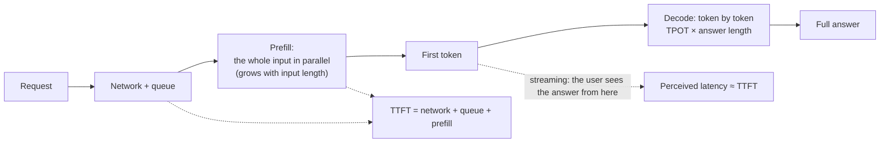
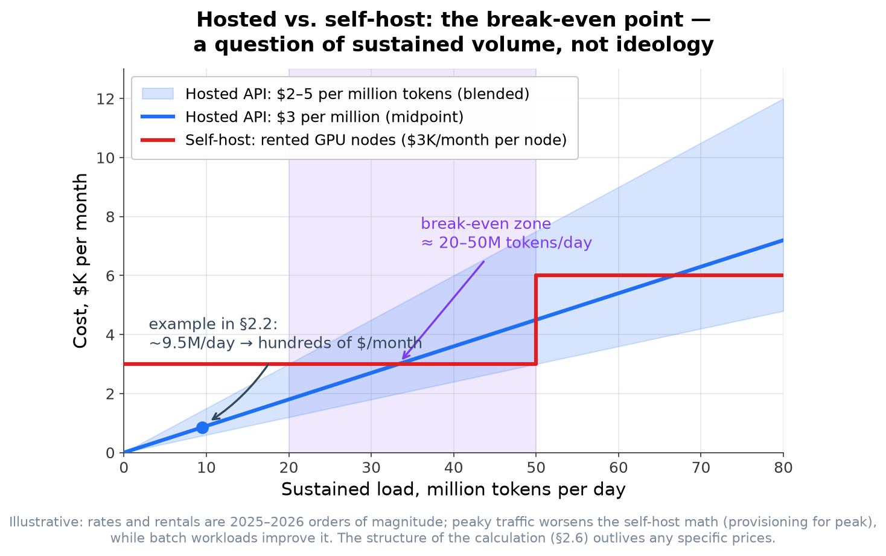

<!-- SPDX-FileCopyrightText: 2026 Aleksandr Drobiazkin
     SPDX-License-Identifier: CC-BY-SA-4.0 AND MIT
     Source: https://github.com/Drobiazkin/ai-agent-architecture
     Dual-licensed, and the boundary is exactly the fence: a fenced code block tagged
     with a language (python, java, sql, bash, yaml, xml, json), comments inside it
     included, is MIT. Everything else — the prose, the tables, the formulas, and the
     mermaid diagrams, which are illustrations expressed as text — is CC-BY-SA-4.0.
     Full terms: LICENSE, LICENSE-CODE, and NOTICE in the repository root. -->

# Chapter 2. Economics and Nonfunctional Properties of LLMs

Chapter 1 gave the component's *contract*. This chapter turns its nonfunctional properties—cost, latency, determinism, reliability—into **budgets**: the currency design actually gets done in. The framing mirrors the latency and error budgets that SRE apportions across SLOs: scarce resources get allocated to each feature. The difference is that one of the resources is trust in a probabilistic component.

## 2.1 Three budgets

Every design decision in an LLM system trades off three scarce budgets:

- **Cost** (tokens → money),
- **Latency** (time to an answer),
- **Determinism/quality** (how far the answer can be trusted without a human checking it).

These resources conflict. Cutting cost usually means a smaller model and, with it, lower quality; raising quality through extended reasoning, a larger context, or orchestration raises cost and latency; raising reliability through checks and guardrails adds latency. Design work, then, is not an abstract "make it good" but a deliberate allocation of these resources to a specific feature against its requirements (SLO): an online feature in a conversational interface needs a hard latency budget, while for background batch data processing cost is the dominant constraint. This chapter is about measuring and allocating those three budgets.

## 2.2 The cost model

**Billing by token, with an asymmetry.** API cost is counted per token, and **output tokens usually cost several times more than input tokens**. The reason is technical (§1.6): input is processed in the prefill phase (in parallel, cheap per token), while output is generated in decode (sequentially, more expensive per token). The practical takeaway: long *answers* hit the bill harder than long *prompts*.

**Input caching.** A static prefix resubmitted on every call (system prompt + constant context) is billed far below ordinary input through **prompt caching**. That makes it economically worthwhile to move the stable part of the context into a cacheable prefix.

**The cost of context.** The per-token rate is linear, but a long context means more input tokens on *every* call—and in an agent loop the context also grows from step to step. Attention's quadratic complexity (§1.4) sits on the provider's side (where it drives latency); in token billing, context gets more expensive linearly, but on every single call.

**The agent multiplier is the main cost trap.** An agent loop of `K` steps is `K` model calls, each with a growing context. Cost grows superlinearly. This is exactly why the book's running principle ("don't add complexity before the task proves it necessary") is also about money: a multi-agent swarm on a task that one call would have handled can cost tens of times more with no gain in quality.

**Model tiers.** Providers offer a lineup: small and cheap, mid-range, frontier—with a 10–50× spread in price. Sending every request to the frontier model is wasteful. Hence the pattern:

> ### Pattern: Model Routing / Cascade
> **Context.** The request stream is heterogeneous in difficulty: most are simple, a minority are hard.
> **Problem.** How do you hold cost and latency down without sacrificing quality on the hard requests?
> **Forces.** The frontier model is accurate but expensive and slow; the cheap one is the reverse. Sending everything to the frontier is wasteful; sending everything to the cheap model is risky.
> **Solution.** A (cheap) classifier scores difficulty and **routes**: simple → cheap model, hard → frontier. The **cascade** variant: the cheap model first, then a check (confidence/validator/judge); on failure, escalate to the frontier.
> **Mechanics.** Routing implements the general pattern of picking a branch by request content; the cascade implements escalation after a check. The key risk: classifying or checking must not cost more than the savings it buys.
> **Example.** Classifying support inquiries: the cheap model closes 80% of the routine ones, the 20% that are hard escalate. The savings are often multiples.
> **Resulting Context.** Cost and latency down by a multiple; the price is pipeline complexity and the risk of routing errors (a simple request went to the cheap model and failed there).
> **When to Use.** Clearly heterogeneous load and sensitivity to cost. **When Not.** A uniformly hard stream—there is nothing to route.
> **Related Patterns.** Adaptive RAG (the same idea applied to retrieval, Chapter 7); Evaluator-Optimizer (check before escalating).
> **Sources.** Chip Huyen, *AI Engineering* (2025)—model routing/cascades; S. Jeong et al., "Adaptive-RAG" (2024)—the same difficulty-routing idea applied to retrieval (Chapter 7).

### Deep Dive: the routing classifier—anatomy of a component

The word "classifier" in the card above is easy to skim past, yet it is a distinct artifact that carries the whole construction—here, in Adaptive RAG (§7.9), in the Routing pattern (§11.3), in gateway cascades (§20.3), and in ADR-4 of the capstone (§26.4). Let's take it apart as a component: what it can be built from, where its "knowledge" comes from, and how it fails.

**Three implementations, in ascending order of cost.** (1) **A heuristic over observable features**—deterministic code: request length, presence of code or attachments, language, client type, channel. Free and instant, but it sees only the request's form, not its meaning. (2) **A trained classifier over embeddings**—the request is run through an embedding model (Chapter 7—the same one used in retrieval), and a lightweight head (logistic regression, a small MLP) emits a class. The cost is one embedding call (on the order of hundredths of a cent and tens of milliseconds), but it requires labeled data. (3) **A prompted cheap LLM call**—a junior model instructed to "score the difficulty/category," with structured output (Chapter 5). The most flexible and the most expensive option: a full LLM call on every request, hundreds of milliseconds of latency—the very "cost of classification" the card named as the key risk.

**Where the labels come from.** The classifier needs to know "what counts as simple," and there is nowhere to get that except your own traffic. The primary source is historical traces (Chapter 18), labeled after the fact: run a sample of requests through both models and label where the cheap one succeeded (the judgment comes from an LLM judge or a human, Chapter 17). The cascade has the more convenient arrangement: it *generates the labels itself*—every request that passes the check on the cheap model is a confirmed example of "simple," every escalation an example of "hard." So a mature router often starts life as a cascade and only later, once it has accumulated labels, acquires an upfront classifier that removes the double call.

**Calibration is a matrix of error costs, not accuracy.** The router's two errors are asymmetric: "hard → cheap" costs *quality* (the user got a bad answer), "simple → frontier" costs only *money*. So the decision threshold is set not at maximum accuracy but by the ratio of those costs: when a quality error is expensive, the threshold shifts toward the frontier and you accept overpaying for false positives. This is the ordinary threshold logic of a binary classifier (precision/recall), applied to money.

**The failure mode is silent.** The fundamental difference from tool errors (§12.4): a bad route has *no feedback loop*. A tool that fails returns an error—the model sees it and adapts. A misrouted request does not fail: the cheap model confidently produces a mediocre answer, and no component in the pipeline learns that it was the router that erred. Detection is external only: offline eval on a labeled sample (Chapter 17), monitoring route shares and per-route quality in telemetry (Chapter 18), canaries. A separate risk is **traffic drift**: the classifier was trained on yesterday's request distribution; a new category of inquiries quietly goes the wrong way, and you can spot it only in the metrics, not in the exceptions. The cascade is partly protected (its check *is* the built-in signal); the upfront router is not.

**A worked cost estimate.** For an auto-reply feature for support inquiries (≈1,500 input and 400 output tokens per request, 5,000 requests per day), the monthly cost is estimated as the number of tokens times the rate times the volume; the estimate then shows that cost coming down through (a) caching the stable system prompt and (b) routing 80% of requests to the cheap model. An estimate like this accompanies any feature proposal, turning it into a measurable decision.

Two corrections move the bill materially. First, in **reasoning models**[^t-reasoning] the internal reasoning is billed as output tokens, so a call to one costs more than an ordinary call for the same visible answer (§13.8). Second, many providers offer a **batch tier** at a significant discount for asynchronous processing with no latency guarantees—which suits background loads, not online ones.

**The crossover to self-host.** At high *steady* volume, serving an open-weight model yourself can come out cheaper than paying per API call; at low or spiky volume, hosted wins. Where the crossover sits turns on hardware utilization. Details in §2.6 and Chapter 22.

*Sources.* Chip Huyen, *AI Engineering* (2025)—cost/serving; provider pricing pages; Google SRE Book (Beyer et al., 2016)—the budget and SLO framing.

## 2.3 The latency model

**Two metrics instead of one.** "LLM latency" breaks into:
- **TTFT (time to first token)**—time to the first token of the answer. Dominated by the prefill phase, grows with the length of the *input*.
- **TPOT (time per output token)** / generation speed (tokens/s)—dominated by decode.

Total time ≈ `TTFT + TPOT × answer_length`. The direct levers follow: shorter input → lower TTFT; shorter answer → lower overall tail. Caching a stable prefix (§2.2) lowers TTFT further by shrinking the volume of prefill. Reasoning models run higher latency, because a significant share of the generation goes to internal reasoning before any useful answer appears (§13.8).

**Live numbers.** The legend: **TTFT**—time to the first token, set by prefill and growing with input length; **TPOT**—time per output token; **answer_length**—how many tokens are to be generated. Databricks' reference points: TPOT = 100 ms/token is 10 tokens/s per user, ≈450 words per minute—that is, faster than a person reads; TTFT in the same source was measured at 114 ms for Llama2-70B on 4×A100-40GB with a 512-token input and a batch of 1. The TTFT figure is tied to its own configuration and will be higher on a long input—but the order of magnitude holds: fractions of a second, single digits in heavy cases. Substitute the upper bound—let the model generate across the entire standard window of Qwen3-8B (40,960 tokens, §1.8): 0.114 s + 40,960 × 0.1 s ≈ 4,096 s ≈ **68 minutes**. TTFT drowns in the rounding here—thousandths of a percent of the second term—so the total comes down entirely to generation; that is a general property of long answers, not a quirk of this example. In plain terms: at a generation speed comfortable for reading, the ceiling on output is measured not in seconds but in an hour.

**`max_tokens` bounds occupancy, not just the bill.** This shows why output gets capped hard. §20.4 works through `max_tokens` as a lever on the bill and as space taken away from the input in the shared window (§1.8); when you serve the model yourself it has a third role—the parameter sets **how long a request holds its slot and its KV-cache blocks**. A correction to the common phrasing "a long generation monopolizes the GPU": under continuous batching (§1.6) the accelerator serves the neighbors the entire time, so there is no monopoly on a GPU cycle—memory is the scarce thing. An hour of an occupied session is an hour during which its cache blocks are unavailable to anyone else, and the number of concurrent sessions runs up against exactly that cache capacity (§1.6). An unset `max_tokens` is an unset upper bound on holding shared memory: in multi-tenant serving you set it not only for the bill but for the neighbors.



**Streaming hides latency.** Stream tokens to the user as they are generated and *perceived* latency drops to TTFT—the user sees that it "started" without waiting for the end. This is a UX pattern, mandatory for chat interfaces.

**The latency of an agent loop.** `N` sequential model calls add up to `N` network round trips, and their latencies sum, as in any chain of synchronous calls. Hence the standard way to cut response time: run independent steps in parallel (the Parallelization pattern, Chapter 11). A six-step sequential orchestration on the user path is six latencies stacked, some of which can usually be parallelized.

**Batching: throughput versus latency.** Continuous batching (§1.6) raises the accelerator's throughput but adds queueing time—the standard trade of "throughput ↔ single-request latency." The online and batch serving paths get separated, because their priorities differ.

**A worked latency budget.** For a user-facing agent with an SLO of p95 = 3 s, the budget decomposes by stage: retrieval (say, ≤300 ms), model calls (≤2 s in total, some in parallel), tool calls (≤500 ms), guardrails (≤200 ms). Go over it and you cut the number of steps, parallelize the independent ones, and apply caching. This is the standard latency-budget decomposition, applied to the stages of an LLM pipeline.

*Sources.* Chip Huyen, *AI Engineering* (2025)—latency/serving metrics; W. Kwon et al. (2023)—vLLM/PagedAttention. Databricks, "LLM Inference Performance Engineering: Best Practices" (2023)—the TTFT/TPOT definitions, the total-time formula, the 100 ms/token reference point (10 tokens/s, ≈450 words per minute), and the 114 ms TTFT measurement for Llama2-70B on 4×A100-40GB.

## 2.4 Determinism and reproducibility

**Even T=0 is not bit-for-bit deterministic.** Setting temperature=0 makes token selection greedy but **does not guarantee identical output across runs**: floating-point operations are non-associative, GPU kernels depend on batch size, hardware differs, and the provider's backend changes imperceptibly. You cannot rely on bitwise reproducibility of the output.

**The source of the noise is the shape of the batch, not "randomness."** The stock explanation ("the GPU computes in parallel, atomic additions arrive in random order") is wrong for the forward pass: forward-pass kernels are deterministic—the same input on the same hardware gives bitwise the same result, and as a rule there is no atomic addition in them at all (Thinking Machines Lab, 2025). The real chain has four links.

1. **Floating-point addition is non-associative:** $(a+b)+c \neq a+(b+c)$. With a finite mantissa the result depends on the order of summation, and the divergence settles into the low-order bits.
2. **The kernel picks the summation order to fit the shape of the batch.** The reduction (for matrix multiplication, the contraction over the shared dimension $k$; for attention, over the KV-cache length) is cut into tiles, and the split is chosen to fit the current batch size for the sake of accelerator utilization. A different batch → a different split → a different addition order → different low-order bits in the logits. Standard kernels lack the property needed here, **batch invariance**—"the result for my row does not depend on who else is riding in the same batch." Exactly three operations are affected, the ones containing a reduction: RMSNorm (activation normalization, §A.3), matrix multiplication, and attention.
3. **Batch size is set by continuous batching (§1.6)**—that is, by the traffic of your batch-mates in that millisecond. Hence a formulation worth saying in full: **at T=0 your output depends on how many other people's requests arrived at the server at the same moment as yours.** That is the main cause of nondeterminism in public APIs, not the model's "creative temperament."
4. **The greedy choice flips only on a near-tie.** argmax is stable as long as the gap between the first and second logit is appreciably larger than the noise; at the overwhelming majority of positions it is, and the noise is not visible at all. Occasionally the top-2 converge to within a hair—and then those very low-order bits decide the outcome. There is no numeric threshold here: it differs at every position, and the primary source does not give one.

**A seed does not cure this mechanism.** A seed pins the sampler's pseudorandom number generator, but at T=0 sampling degenerates into argmax—there is nothing there to pin, and the noise enters higher up the pipeline, in the forward pass itself. So a seed reproduces the choice at T>0 on an unchanged backend, and cancels neither the batch dependence nor the divergence across versions and backends.

**Why the divergence is "rare, but total."** A run matches the reference only if not a single position flipped:

$$P_{\text{match}} = (1 - p)^{N}$$

* $P_{\text{match}}$—the probability that a run matched the reference bit for bit; dimensionless, 0.078 in the measurement below.
* $p$—the probability of an argmax flip at a single position (the share of positions where the top-2 converged closer than the noise); dimensionless, ≈ 0.0025 here.
* $N$—the generation length in tokens; 1,000 here.

*Live numbers.* Thinking Machines Lab ran Qwen3-235B-A22B-Instruct-2507 a thousand times at T=0 on a single prompt, 1,000 tokens each: the result was **80 distinct answers**, the most frequent one appearing 78 times out of 1,000. Substitute $N = 1000$ and $P_{\text{match}} = 78/1000 = 0.078$: $(1-p)^{1000} = 0.078$, from which $p = 1 - 0.078^{1/1000} = 1 - e^{-2.551/1000} \approx 0.0025$—a quarter of a percent, that is, one near-tie roughly every 390 tokens.

*In plain terms.* At an individual token a flip is nearly impossible, but length raises that near-impossibility to a power: at a thousand tokens a bitwise match becomes the exception rather than the rule. The caveat without which the formula lies: $p$ here is an average over positions, and the real distribution is extremely uneven. At most positions the top-2 gap is large and $p \approx 0$; the whole mass sits at the rare branch points. Averaging is fine for an estimate, but it does not describe "smooth noise."

The branching itself is visible in the same data. All 1,000 runs went identically up to the 102nd token; at the **103rd**, 992 runs continued with "Queens, New York" and 8 with "New York City." From there autoregression takes over (§1.6): the chosen token returns to the input and changes the conditioning of the entire remainder—one flipped position diverts not the neighboring word but **the whole rest of the sequence**. Out of a handful of such points grow 80 different answers.

**Nondeterminism correlates with load.** Since batch size is a function of other people's traffic, the probability of divergence is not a constant of the model but a function of the provider's load profile. What that looks like in practice: an eval that is green on quiet traffic (night, a dev stand, a batch of one request) and flaky at peak—without a single line of code changed. "Doesn't reproduce for me" here is not an excuse but a literal description of the environment.

**The engineer's iron rule:** test reproducibility under the batch pressure the system actually runs under in production—or accept the flap as a property of the environment rather than a bug. Bitwise reproducibility is a property you buy, not a given: batch-invariant kernels exist (the Thinking Machines Lab library, integrated into SGLang[^t-sglang]) and deliver 1,000 identical runs out of 1,000, but they cost throughput: on the authors' Qwen3-8B, 26 s → 42 s after optimizing the attention kernel (the unoptimized variant: 55 s); on SGLang, from +24% to +55% latency depending on the attention backend and the context length. That price is justified where bit-for-bit matters substantively (on-policy RL, for example, where sampling and training must compute bit-for-bit identically or training diverges), and unjustified in an application agent, for which checking properties is enough.

**The consequence for testing.** Because output is nondeterministic even at zero temperature, a pointwise `assertEquals(expected, actual)` does not apply. What is needed is a check of the output's *properties*—evaluation (Chapter 17): schema validity, relevance, groundedness, not an exact string match. This is the fundamental reason LLM systems need a testing discipline of their own.

**Model version drift is an operational risk.** The provider updates the model under the same name—behavior shifts silently, and prompts tuned against the previous version can degrade. The countermeasure is the one applied to any external dependency: pin the model version (where the provider allows it) and run the eval set on every version change (regression testing). Changing the model is a deployment, not a spontaneous update.

*Sources.* H. He et al. (Thinking Machines Lab), "Defeating Nondeterminism in LLM Inference" (2025)—batch invariance, the Qwen3-235B experiment, batch-invariant kernels and their price. LMSYS/SGLang, "Towards Deterministic Inference in SGLang and Reproducible RL Training" (2025)—the integration and the overhead measurements. Google SRE Book (2016)—regressions and change management.

## 2.5 Reliability: the LLM as an unreliable external dependency

A language model called over the network is an **unreliable external dependency**, and the standard resilience patterns developed for any external service apply to it (the canonical source: M. Nygard, *Release It!*).

**Failure modes:** rate limit (429), timeouts, provider unavailability (5xx/outage), refusal by the content filter, a "context length exceeded" error, invalid or truncated output, latency degradation under load. The insidious combination: the connection drops in the middle of a *streaming* generation with structured output—what is left in your hands is syntactically invalid partial JSON, and catching it is the job of a post-hoc validator with a retry (§5.5), not of the parser on the happy path.

**Applicable resilience patterns:**
- **Retry with exponential backoff and jitter**—for transient errors (429/5xx; on a 429, time the pause by the `retry-after` header, see below).
- **Circuit breaker**—fail fast during a provider outage instead of piling up a queue.
- **Timeout + graceful degradation**—on a timeout, return a cached, partial, or deterministic fallback instead of hanging.
- **Bulkhead and client-side rate limiting**—stay inside the provider's quotas, isolate workloads from one another.
- **Idempotent agent actions**—retries are the norm here, so operations with side effects must be idempotent (keyed by operation, as in the saga pattern).

> ### Pattern: Fallback Model
> **Context.** A feature's availability depends on an external LLM provider that can degrade or go down.
> **Problem.** How do you keep working when the primary model/provider fails?
> **Forces.** One provider = a single point of failure and vendor lock-in; several providers = complexity (different APIs, different behavior, different prompts).
> **Solution.** Keep a secondary model (from another provider or self-served) and switch to it when the primary fails or times out. Abstract the call behind a single provider-agnostic interface (the JVM frameworks Spring AI and LangChain4j, for example, provide such abstractions).
> **Mechanics.** A wrapper with a circuit breaker: primary → on the open state → secondary. Bear in mind that models behave differently, so the fallback needs prompts and tests of its own.
>
> ```mermaid
> flowchart TB
>   Req["Request"] --> A["Primary model"]
>   A -->|success| Out["Answer"]
>   A -->|"timeout / 5xx / 429"| R{"Retries exhausted?"}
>   R -->|"no"| A2["Retry: pause by retry-after,<br/>otherwise exponential + jitter"] --> A
>   R -->|"yes"| CB["Circuit breaker open"] --> FB["Fallback model<br/>(another provider / your own tier)"]
>   FB -->|success| Out2["Answer (possibly weaker)"]
>   FB -->|failure| Deg["Degradation: cache · template · queue for later"]
> ```
> **Resulting Context.** Resilience to a provider outage and less lock-in; the price is maintaining prompts/evals twice over and the risk of degraded quality on the fallback.
> **When to Use.** The feature is availability-critical. **When Not.** Internal or non-critical scenarios where waiting out the recovery is simpler.
> **Related Patterns.** Circuit Breaker; Model Routing (the fallback as the "cheap tier"); Graceful Degradation.
> **Sources.** M. Nygard, *Release It!* (2nd ed., 2018)—circuit breaker, bulkhead, timeout; the Spring AI/LangChain4j docs—provider-agnostic abstractions.

What matters is that none of these patterns are specific to a language model—they apply to any external dependency. What is distinctive about the model as a dependency is that it is less reliable, more expensive, and nondeterministic, which makes resilience discipline here mandatory rather than optional.

**How a retry to a model differs from a retry to a service.** The caveat above is true at the level of mechanics and misleading at the level of economics. Retrying an ordinary REST endpoint costs latency and someone else's CPU; retrying a model costs money—and costs the most at exactly the moment the provider is degrading. Three mechanisms Nygard does not have, because there a retry is free for the caller.

**Mechanism 1: a 429 arrives along several axes at once.** The provider limits not "requests" but several independent counters. Anthropic has three—requests per minute (RPM), input tokens per minute (ITPM), and output tokens per minute (OTPM); exceeding *any* of them yields a 429 stating which limit was hit. OpenAI's axes are its own (requests and tokens per minute plus daily ones), and the documentation states outright: whichever limit is exhausted first is the one that fires. The practical consequence for a client-side limiter: a bucket that counts *calls* will faithfully keep catching 429s on long prompts—the token axis was hit, and the bucket cannot see it. You have to count tokens.

And here is a vendor divergence you must not carry over by analogy. OpenAI reserves the token quota *before* execution: the limit is computed as the maximum of `max_tokens` and an estimate from the request's character count, so an inflated `max_tokens` eats quota even if the answer came out short. Anthropic is the opposite: OTPM is counted in real time from the tokens actually produced, `max_tokens` does not enter the limit calculation at all, and inflating it costs nothing as far as limits go. The same setting punishes you at one provider and is free at another—the same vendor specificity as the economics of prefix caching (§20.2). A useful side effect of that same cache: at Anthropic, tokens read from the cache do not count toward ITPM on most models—the cache improves not only the bill but also throughput within the same limit.

**Mechanism 2: a 429 usually comes with a ready answer to "when."** The provider returns a `retry-after` header—the number of seconds until the window resets. Anthropic's documentation leaves no room: "The number of seconds to wait before retrying. Earlier attempts will fail." Blind exponential backoff when the reset window is known is not caution but a series of attempts guaranteed to fail. The rule: if the header arrived, time the pause by it; exponential backoff with jitter stays for the cases where the provider named no window (5xx, 529 "overloaded," a dropped connection).

**Mechanism 3: the failed attempt has already been consumed.** A drop at the 900th output token out of 1,000 rolls back neither the input nor those 900: there is no useful result, and there is consumption. The ratio of the cost of failure to the cost of success:

$$\frac{C_{fail}}{C_{success}} = \frac{N_{in} + k \varphi N_{out}}{N_{in} + k N_{out}}$$

Where:
* $N_{in}$—input tokens in the request; in the §2.2 example, 1500.
* $N_{out}$—output tokens in the full answer; there too, 400.
* $k$—how many times more an output token costs than an input token (§2.2). Across the whole Claude lineup as of mid-2026, exactly 5 ($5/$25 per million for Opus 4.8, $3/$15 for Sonnet 4.6, $1/$5 for Haiku 4.5).
* $\varphi$—the share of the answer that got generated before the drop (0…1).
* The numerator and denominator are expressed in notional units of the input-token price; the ratio is dimensionless.

Live numbers. A drop at 90% of the answer ($\varphi = 0.9$): numerator $1500 + 5 \times 0.9 \times 400 = 3300$, denominator $1500 + 5 \times 400 = 3500$, ratio $3300 / 3500 = 0.94$—the failed attempt consumed 94% of a successful one and delivered nothing. The retry will spend the full 3500 all over again: 6800 instead of 3500 for one delivered answer.

On a long context it is worse, and the prefill/decode asymmetry (§2.2) is to blame. An input of 100,000 tokens, the same 400-token answer, a timeout right after prefill—not a single output token ($\varphi = 0$): $100000 / 102000 = 0.98$. An attempt that produced **not one** useful token consumed 98% of a successful one. In plain terms: you pay first and foremost for processing the input, and that happens in full regardless of whether the request survived to an answer; the longer the input relative to the answer, the closer the cost of failure gets to the cost of success, and the less "try once more" differs from "make another full request." A caveat on billing: whether the provider refunds a request cut off mid-generation is vendor-specific, there is no reliable public rule here, and it gets checked against the provider's documentation and your own invoice. What does not depend on the vendor: a *retry* is a full new request with a full prefill, and it is billed in full.

**The retry storm and the inversion of the circuit breaker's meaning.** The chain closes on itself: latency degrades → timeouts → retries → load grows → the bill spikes at exactly the moment quality is at rock bottom. The SRE book describes the dynamics in numbers: 100 retries per second in the first second turn into 200, then 300, and an ever-smaller share of the requests does useful work. More dangerous is that retries at different layers do not add, they multiply:

$$A = \prod_{i=1}^{L} a_i$$

Where:
* $L$—the number of layers, each retrying on its own.
* $a_i$—attempts at layer $i$ (the one original plus retries).
* $A$—attempts reaching the bottom layer per single user action. The unit is attempts.

The primary source's live numbers: three layers (frontend, backend, JavaScript), each doing 3 retries, that is 4 attempts—one user action produces $4^3 = 64$ hits on the database. In an LLM stack one such layer is easy to overlook, because it is on by default: the official Anthropic SDKs retry transient errors on their own with an exponential pause—**twice by default**, that is 3 attempts—and they respect `retry-after`. An application that conscientiously wraps the call in "three attempts" gets $3 \times 3 = 9$ hits on the provider per request; add a retry at the gateway (§20.6) and it becomes 27. Before adding a retry of your own, find out how many the library already does, and leave exactly one level.

Hence an inversion worth naming outright. In Nygard the circuit breaker protects the *callee*—it keeps you from finishing off a failing service. Your traffic will neither save nor kill the model provider: the capacity is someone else's. The breaker here protects **the caller's wallet**—it stops paying for attempts at the moment their expected return is close to zero. The mechanics are the same, the motivation is different, and the tuning follows from the motivation: the threshold is set by the budget's burn rate, not by the provider's health.

**The engineer's iron rule:** set the retry budget in tokens and as a share of traffic, not as a number of attempts per request. A "3 attempts" limit does not bound the storm—under full degradation it authorizes tripling both the load and the bill. The second, independent breaker from the SRE book is a client-side budget: the share of retries in the overall request stream is kept below 10%, and when it goes over, retries stop until recovery. The carry-over to the model is direct, with one correction: count the share in tokens, not in requests (§2.2)—you pay for tokens.

*Sources.* M. Nygard, *Release It!* (2018); Google SRE Book (2016)—"Handling Overload" (the retry budget: 3 attempts per request, retry share below 10%) and "Addressing Cascading Failures" (attempts multiplying across layers, $4^3 = 64$; the storm growing 100 → 200 → 300 requests per second); the Anthropic documentation—Rate limits (the RPM/ITPM/OTPM axes, `retry-after`, ITPM with the cache taken into account), Errors (the SDKs' default retries, 529), and Pricing (the ratio of output price to input price); the OpenAI documentation—Rate limits (the limit axes, quota reservation by `max_tokens`).

## 2.6 Hosted versus self-host: a decision framework

Not an ideological choice but an engineering trade-off along axes:

| Axis | Hosted API | Self-host (your own infrastructure) |
|---|---|---|
| Cost at scale | Per call; grows linearly with volume | Capex + utilization; cheaper at high steady volume |
| Latency | Depends on the provider and the network | Under the operator's control |
| Data residency/compliance | Data leaves the premises | Data never leaves the perimeter |
| Customization | Limited | Full (fine-tuning open-weight models, Chapter 21) |
| Model choice / lock-in | The provider's catalog, lock-in | Any open-weight model |
| Operational burden | Minimal | Running GPU inference (vLLM and the like) |

Self-host presumes a mature infrastructure practice: orchestrating GPU workloads and operating inference servers. With that in place it is realistic, but it is not justified for low or spiky volume, where hosted is simpler and cheaper.

**The middle tier: managed inference for open models.** Between the table's poles sits a third option—serverless GPU inference of open-weight models at specialized providers (Together, Fireworks, Baseten, and the like): open weights and freedom to pick the model (including your own LoRA adapters), without owning GPU infrastructure. It covers the case of "we need a specific open or fine-tuned model but have no team to run vLLM"; on residency and compliance, though, it sits closer to hosted (the data goes to the tier's provider) than to self-host.

**The break-even point (an illustrative calculation).** Orders of magnitude: renting a node with one server-class GPU runs a few thousand dollars a month; the break-even point ≈ rent / blended price per million hosted tokens. At $3,000/month and a blended rate of $2–5 per million, that is 0.6–1.5 billion tokens per month—that is, **20–50M tokens per day of sustained load**—several times more than a typical single feature (the §2.2 example: ~9.5M tokens per day, which at a blended rate of $1–2 per million comes to on the order of $300–600 a month on the API). Hence the practical conclusion: self-host rarely pays for itself on one feature—what pays for it is a *portfolio* of workloads at high utilization; a spiky profile makes the bill worse (you provision for the peak), background batch workloads make it better. The figures are illustrative; the structure of the calculation is not.



**The hybrid (the standard 2026 pattern).** A hosted frontier model for hard, rare tasks + a self-hosted small model for high-frequency narrow tasks (field extraction, for example). Cost optimized while quality is preserved where quality is needed. Details in Chapter 22.

*Sources.* Chip Huyen, *AI Engineering* (2025)—build vs buy, the economics of serving.

## 2.7 Specifying a feature in budgets (the architect's artifact)

The chapter's material comes together in an artifact—a **nonfunctional specification for a feature**, adapted to the peculiarities of a language model:

> **Template: NFR specification for an LLM feature**
> - **Latency:** SLO p95 (TTFT and total), streaming yes/no.
> - **Cost:** budget per request and per month; model tier; caching.
> - **Quality:** eval thresholds (faithfulness/relevance/schema validity), a gate in CI.
> - **Determinism:** the required level; temperature; pinning the model version.
> - **Availability:** the target + a failure strategy (fallback model, degradation).
> - **Security/compliance:** data residency, guardrails (Chapter 19).

The filled-in specification goes to design review. It turns the intent to "add an LLM" into an engineering decision with measurable properties—the thing missing from most pilot projects, the ones that never make it into production.

*Sources.* Google SRE Book (2016)—SLO/SLI/budgets; Chip Huyen, *AI Engineering* (2025).

**In the Margins: Chapter 2**

[^t-reasoning]: **Reasoning model**—a model trained to produce a long internal chain of reasoning before answering (the o-series, DeepSeek-R1 and successors); the reasoning is billed as output tokens. → §13.8; ⇐ Glossary.
[^t-sglang]: **SGLang**—an open-source LLM inference server (a program that holds the model on the accelerator and serves a stream of requests); known for RadixAttention prefix caching. → Chapter 22.

---
