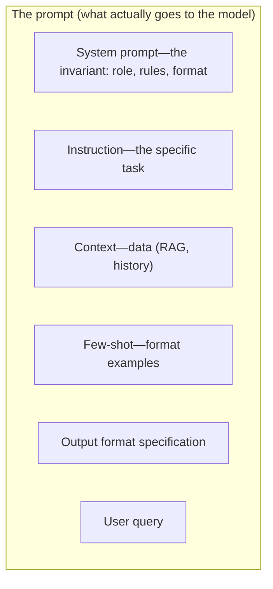
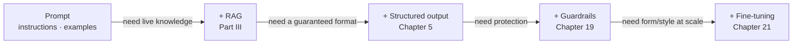

<!-- SPDX-FileCopyrightText: 2026 Aleksandr Drobiazkin
     SPDX-License-Identifier: CC-BY-SA-4.0 AND MIT
     Source: https://github.com/Drobiazkin/ai-agent-architecture
     Dual-licensed, and the boundary is exactly the fence: a fenced code block tagged
     with a language (python, java, sql, bash, yaml, xml, json), comments inside it
     included, is MIT. Everything else — the prose, the tables, the formulas, and the
     mermaid diagrams, which are illustrations expressed as text — is CC-BY-SA-4.0.
     Full terms: LICENSE, LICENSE-CODE, and NOTICE in the repository root. -->

# Part II. The Interface to the Model

Part I treated the model as a component with a defined set of properties (§1.10) and budgets (Chapter 2). Part II is about its **interface**—how intent is communicated to the model and how its output is constrained. Three chapters: designing the prompt (Chapter 3), designing the context (Chapter 4), and structured output with reliable parsing (Chapter 5).

# Chapter 3. Prompt Engineering as Contract Design

## 3.1 The framing: a prompt as an interface specification

Basic prompt engineering is usually understood as "writing good prompts." For system design, a different framing matters more: a prompt is an interface specification for a probabilistic component that (a) is nondeterministic, (b) reads instructions and data in a single text channel, and (c) may satisfy a requirement only partially. The job, then, is not to hunt for lucky wordings but to *specify* the input, *constrain* the output, and *handle* the cases of incomplete or incorrect execution. The sections that follow work through the tools for each of these three tasks; their limits are drawn in §3.7—and beyond those limits lie RAG[^t-rag] (knowledge), structured output (format guarantees), and guardrails (safety).

## 3.2 Anatomy of a prompt

A production prompt is not a query string but an assembled structure. Its components and their roles:

Component order matters: because of positional bias (§1.8), the model attends more fully to the beginning and the end. The typical layout puts the invariant and the required format at the start (the system part), and critical data at the beginning or end of the user part—never in the middle.

**Instructions and data share one channel.** The defining property of this interface: the model receives both instructions and data as a single text stream and does not tell them apart automatically. So the boundaries between them must be drawn explicitly—with delimiters (XML tags, labeled blocks), marking untrusted content (user input, retrieved documents, tool results) as data. This improves clarity and doubles as the first line of defense against prompt injection (Chapter 19), in which instructions embedded in the data hijack control.

**Instruction hierarchy.** Part of the same problem is addressed at the level of model training: modern models are trained to rank instruction sources by priority—system above developer, developer above user, and content from tools and data below all of them (E. Wallace et al., "The Instruction Hierarchy," OpenAI, 2024; the line of work continues to evolve through 2025–2026). This improves resistance to data attempting to hijack control, but like any learned defense it is probabilistic and yields to an adaptive attack (§19.5)—structurally isolating untrusted content remains mandatory.

## 3.3 A catalog of prompting patterns

Mini-patterns, each with its conditions of applicability:

- **Role / Persona priming**—assigning a role ("a support specialist who answers strictly according to policy"). Narrows the answer space. *When:* almost always useful in the system part.
- **Few-shot / demonstrations**—defining format and behavior through examples rather than verbal description. The number of examples, their selection (representativeness, edge-case coverage), and their order all matter—each measurably affects the result. *When:* format-sensitive tasks, a specific output style. *When not:* if the model handles the task from the instruction alone, examples just burn tokens.
- **Chain-of-Thought (CoT)**—instructing the model to produce intermediate reasoning steps. Improves accuracy on multi-step tasks (§3.4). *The price:* extra tokens and latency.
- **Decomposition**—splitting one large prompt into a sequence of narrow steps (the Prompt Chaining pattern, Chapter 11). Each step is easier to specify and to verify.
- **Output format specification**—describing the schema (a soft measure) or enforcing it (a strong one, Chapter 5). For output that feeds a parser or a tool, use enforcement.
- **Delimiters and structure**—explicitly separating instructions from data (see §3.2); doubles as the first line of defense against prompt injection (Chapter 19).
- **Prefilling**—supplying the beginning of the model's response turn to shape how it continues (an opening brace `{` forces JSON; a heading sets the structure). An effective way to constrain the form of the output without any external mechanism.
- **Permission to refuse**—explicitly allowing the model to answer "not enough information" or "I don't know." Reduces the tendency to fabricate on unanswerable inputs (§1.9), and matters especially in RAG, where the answer must rest on the context (§6.7).
- **Positive framing over negative**—stating what the model *should* do works more reliably than the prohibition "don't do X": the model follows a prescribed action more faithfully than a negation.

## 3.4 Chain-of-Thought, in depth

**What it is.** Chain-of-Thought (CoT) is a technique in which the model generates intermediate reasoning steps before the final answer. Wei et al. (2022) showed that this markedly improves accuracy on arithmetic, logic, and multi-step tasks.

**Why it works.** The explanation comes down to compute per token. In a single forward pass the model performs a fixed amount of computation—a transformer is not a CPU with a loop: within one pass there is no mechanism to repeat a computation an arbitrary number of times (a fixed number of layers, one pass through each)—so a task that requires many steps has no room to be "folded" into a single step. CoT moves the intermediate steps out into output tokens, increasing the amount of *sequential* computation: each generated reasoning step becomes part of the input for the next. The intermediate reasoning acts as the external scratchpad the model lacks within a single pass.

**Variants:**
- **Zero-shot CoT** (Kojima et al., 2022)—an instruction to reason step by step is enough, no examples needed.
- **Few-shot CoT**—examples with the reasoning explicitly shown.
- **Self-consistency** (Wang et al., 2022)—generate several reasoning chains (at elevated temperature) and take the majority answer; more expensive, but more accurate on hard tasks.

**When to use it.** CoT pays off on tasks that require multi-step inference (calculation, logic, planning); on simple extraction or classification tasks it only spends tokens and latency for no gain.

**The shifting landscape (2025+).** Reasoning models—specialized at first (the o-series, DeepSeek-R1), by 2026 the standard operating mode of most frontier models—are trained with reinforcement learning to carry out extended reasoning *internally*; for them, an explicit "reason step by step" instruction is often redundant and sometimes hurts the result. The lever you control is no longer whether CoT appears in the prompt but the model's internal reasoning budget (§13.8).

*Sources.* J. Wei et al., "Chain-of-Thought Prompting Elicits Reasoning in LLMs" (2022); T. Kojima et al., "Large Language Models are Zero-Shot Reasoners" (2022); X. Wang et al., "Self-Consistency Improves Chain of Thought Reasoning" (2022).

## 3.5 The system prompt as an invariant

**What goes into the system prompt**—the long-lived role, hard constraints, output format, safety rules: everything that does not change from request to request. What does not belong there: volatile data (that belongs to the request context) and, critically, **secrets**. The system prompt is subject to leakage (prompt leakage, OWASP risk LLM07[^t-owasp], Chapter 19), so keys, connection strings, and internal addresses have no place in it—access control is implemented outside the model.

**Stability and caching.** A stable system prompt is the ideal candidate for prompt caching (§2.2): its constant part goes into the cacheable prefix.

## 3.6 Prompts as code

Prompts are production artifacts and demand to be treated as such: versioning, templating (variables instead of string concatenation), change review, testing through evaluation (Chapter 17). A prompt change is a deployment: it can alter system behavior just as a code change can. Hence the standard change-management discipline applies—pinned versions, review, regression testing, canary rollouts. Editing a prompt directly in production, outside the deployment process, carries the same risk of uncontrolled behavior change as any change that bypasses the pipeline.

## 3.7 The limits of prompt engineering

Being honest about the limits is what positions Part II as a whole. A prompt **cannot**:
- reliably carry a large body of changing knowledge → that is **RAG** (Part III);
- guarantee a valid output schema → that is **structured output** (Chapter 5);
- fully prevent prompt injection → that takes **guardrails** (Chapter 19);
- durably instill, at scale, a new form/style/tool-calling format → that is **fine-tuning** (Chapter 21).

The sequence (the same ladder): **prompting first; escalate only when it hits a wall.** Most tasks are covered by a good prompt plus RAG; fine-tuning and multi-agent are the top of the ladder, climbed only on proven need. Prompt engineering is the cheap, instant, reversible first tool—which is exactly why it comes first.

*Sources.* J. Wei et al. (2022), T. Kojima et al. (2022), X. Wang et al. (2022); Z. Sprague et al., "To CoT or not to CoT?" (2024)—a meta-analysis: CoT's gains are concentrated in math and symbolic tasks; the Anthropic/OpenAI prompting documentation; Chip Huyen, *AI Engineering* (2025).

**In the Margins: Chapter 3**

[^t-rag]: **RAG**—Retrieval-Augmented Generation: relevant knowledge is retrieved from external sources and fed into the context, instead of hoping the model "remembers." → Chapter 6; ⇐ Glossary.
[^t-owasp]: **OWASP LLM07**—an entry in the "OWASP Top 10 for LLM Applications," the ranked list of LLM-application risks from the Open Worldwide Application Security Project; LLM07 is system prompt leakage. → §19.3.

---
