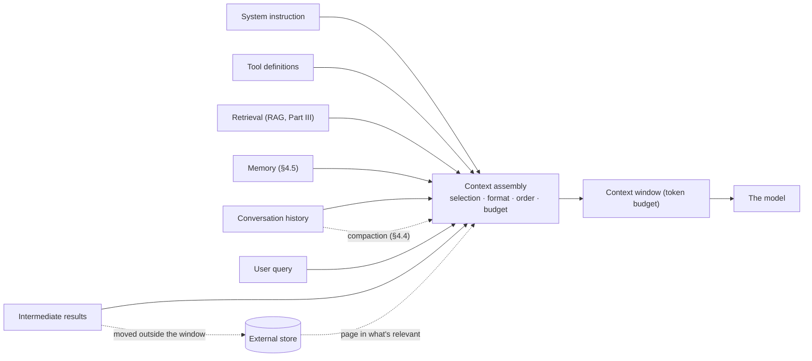
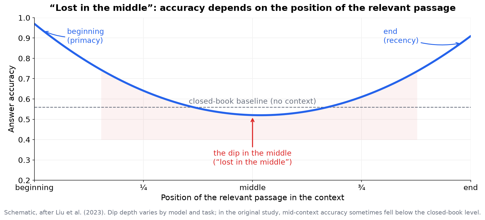
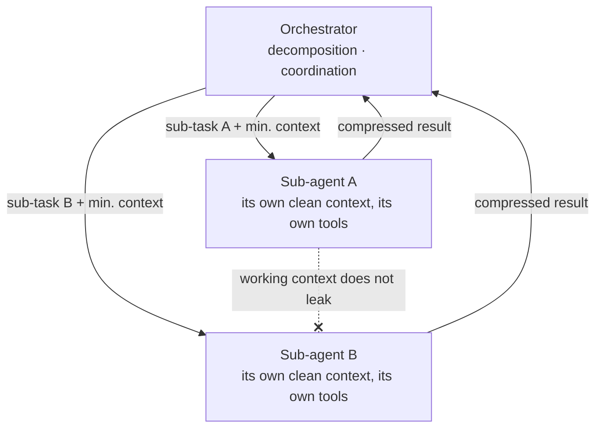
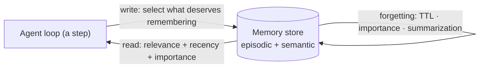

<!-- SPDX-FileCopyrightText: 2026 Aleksandr Drobiazkin
     SPDX-License-Identifier: CC-BY-SA-4.0 AND MIT
     Source: https://github.com/Drobiazkin/ai-agent-architecture
     Dual-licensed, and the boundary is exactly the fence: a fenced code block tagged
     with a language (python, java, sql, bash, yaml, xml, json), comments inside it
     included, is MIT. Everything else — the prose, the tables, the formulas, and the
     mermaid diagrams, which are illustrations expressed as text — is CC-BY-SA-4.0.
     Full terms: LICENSE, LICENSE-CODE, and NOTICE in the repository root. -->

# Chapter 4. Context Engineering and Context Management Patterns

## 4.1 A shift in the unit of design

Prompt engineering (Chapter 3) optimizes how the task is phrased. **Context engineering** optimizes the *entire* set of tokens assembled into the window at every inference step. The shift was no accident: once agents became multi-step and windows became large, the bottleneck stopped being "how do I word the request" and became "what information, in what form, where in the window, and within what budget do I supply." Phrasing the task takes a fraction of a percent of an advanced agent's context; the rest is the system instruction, retrieved knowledge, history, tool definitions, and intermediate results.

A precise definition. **Context engineering** is the discipline of dynamically constructing the model's input context: selecting, formatting, ordering, and compressing the information the task needs (instructions, retrieved knowledge, history, tool definitions, examples) within a token budget, separately for each inference step.

A useful framing: context is state assembled for a stateless component. The model retains nothing between calls (§1.10); everything it operates on at a given moment was placed into the context on that step. Context engineering is therefore state management for a stateless component under a hard budget: every step decides anew what state to reconstruct in the window, and in what form.

## 4.2 The anatomy of context: who competes for the budget

The window is a finite budget, and its consumers compete for it with different "value/cost" profiles:

| Consumer | What it provides | What it costs |
|---|---|---|
| System prompt | A behavioral invariant, the format | Constant tokens on every call (cacheable, §2.2) |
| Tool definitions | The ability to act | Can run large; many tools = many tokens and confusion over which to pick |
| Few-shot examples | Format/behavior | Expensive once there are many examples |
| Conversation history | Continuity | **Grows without bound**—the main source of overflow |
| Retrieved chunks (RAG) | Fresh/private facts | Tokens + the risk of dilution when overdone |
| Scratchpad / intermediate results | Multi-step reasoning | Accumulate over the agent loop |
| User query | The task itself | Small |
| **Generation (the model's answer)** | The result itself | Shares **the same** budget with the input: `max_tokens` is subtracted from the window (§1.8) |

The design job is to allocate that budget: what to include, what to compress, what to move outside the window.

Structurally, context engineering is an *assembly* layer that funnels heterogeneous sources into a single window under budget:

## 4.3 Forces: why this is not trivial

Context engineering is **constrained optimization**, because these collide:

- **A finite budget**—the window's hard ceiling.
- **Degradation with volume** (§1.8)—"lost in the middle" and attention dilution mean *more context ≠ better*; past a certain volume, adding tokens makes the answer *worse*. And *placement* matters: what's critical goes at the edges.
- **Cost** (§2.2)—every token is paid for on *every* call; and in an agent loop the context keeps growing on top of that.
- **The relevance ↔ recall trade-off**—include more (don't miss what you need) versus include less (don't add noise). The same trade-off as in search.
- **Staleness**—history and tool results go stale within a session; an old result can contradict a new one.

The goal: maximum relevant signal for minimum tokens and noise.

### Deep Dive: the mechanics and the empirics of context degradation

The claim "more ≠ better" needs a mechanism and measurements behind it, or it's just faith.

**The mechanics: the attention budget is normalized to one.** The cause of the degradation was already assembled back in §1.4—all that's left is to retrieve it. Step 3 of the attention-block trace: `softmax` turns compatibility scores into weights that **sum to exactly 1**—a token's "attention budget," distributed across every token it can see. What matters here is that the budget **does not grow with context length**: a thousand tokens and a hundred thousand tokens divide the same unit. Dilution is therefore not a metaphor but a zero-sum game: every token added takes weight away from the material already there. Don't confuse this quantity with the "finite budget" from the list above: that one is a window ceiling measured in *tokens*, which a vendor is free to raise to a million; this one is normalization to *one*, which nobody will ever raise.

How much it takes away can be computed exactly. Suppose the fact you're after (the "needle") scored Δ higher on compatibility than each of the n tokens of the irrelevant "haystack":

$$w^{*} = \frac{e^{s}}{e^{s} + n \cdot e^{s-\Delta}} = \frac{1}{1 + n \cdot e^{-\Delta}}$$

*Legend.* $w^{*}$ is the share of the attention budget the needle gets: dimensionless, from 0 to 1. $n$ is the number of distractor tokens in the window (a count; 10³–10⁶ in working windows). $\Delta$ is the gap in compatibility scores between the needle and an ordinary haystack token, already divided by $\sqrt{d_{head}}$ (§1.4): dimensionless, and it has no "typical" tabulated value—so we fix Δ = 10 not as a measurement but as a premise of the problem: the gap at which, across 1000 tokens, the needle collects 96% of the budget, meaning the model sees it confidently. $s$ is the needle's raw score; it cancels on the right-hand side, and that is the first conclusion: the model's absolute "confidence" means nothing, only the gap does any work.

*Live numbers* at Δ = 10, where $e^{-10} = 4.5 \cdot 10^{-5}$. The denominator $1 + n \cdot 4.5 \cdot 10^{-5}$ grows along with the haystack:

| n (haystack tokens) | Denominator | $w^{*}$ |
|---|---|---|
| 1,000 | 1 + 0.045 = 1.045 | **0.96** |
| 10,000 | 1 + 0.45 = 1.45 | **0.69** |
| 100,000 | 1 + 4.54 = 5.54 | **0.18** |

*In plain terms:* the model did not change its mind. Δ stayed at 10, the needle's score did not move an inch—only the denominator grew. A haystack of a hundred thousand tokens, each one individually negligible ($e^{-10}$ against one), took 82% of the budget between them: by count, not by quality. This is the derivation of what §1.8 asserts without proof: attention spreads "thinner" precisely because the sum is fixed.

**Why the model's confidence cannot cure this.** To hold the same 96% at 100,000 tokens, the gap has to grow from 10 to 14.6—by exactly $\ln 100 = 4.6$: holding a share requires Δ to grow proportionally to $\ln n$. There is nowhere for it to grow from, though the reason is subtler than "the weights are frozen." The upper bound on Δ is a product of four factors (up to a factor of 2): the spectral norms of the matrices $W_q$ and $W_k$—that is, the largest stretch a matrix can impose on a vector—and the norms of the representation vectors themselves, the query and the keys (Veličković et al., 2025, Prop. 3.1). At inference only the first two are frozen: the norms of the representations depend on the input and, left to themselves, could grow along with it. What holds them down is layer normalization (RMSNorm, §1.4), which levels the scale of the vectors at every block—and only both facts together close the ceiling. The original paper states the same thing from the other side, titling the section "sharpness requires large weights": you can hold sharpness at growing n only if something is allowed to grow—and in a frozen, normalized model there is no such factor. Hence the proven result: with bounded score spread, any attention weight is pinned into the corridor $\frac{1}{n} e^{-\delta/\theta} \le w \le \frac{1}{n} e^{\delta/\theta}$ and behaves as Θ(1/n)—as n grows it inevitably slides toward a uniform distribution (ibid., Lemma 2.1; $\delta$ is the spread between the maximum and minimum scores, $\theta$ is the softmax temperature, equal to 1 in ordinary attention). The needle's advantage is a constant factor $e^{\Delta} \approx 22\,000$, and a constant factor does not outrun a linearly growing denominator. At 100k tokens the uniform share is $10^{-5}$: the needle lives a constant factor above that floor, but it sinks along with it.

**The edges: normalization explains one of the two.** A sum of 1 implies uniform dilution—but not the U-shaped asymmetry. It does explain one edge, and by the same mechanism: since the weights are obliged to sum to one, they cannot all be zeroed—when a token has nothing to look for in the past, the surplus budget has nowhere to go, and the model **dumps** it on the first tokens of the sequence, which every later token can see by virtue of autoregression. This is the **attention sink**, already familiar from the role of BOS (§1.2); in Xiao et al.'s measurements on 4096-token sequences, the first token's share exceeds 50% of attention in most layers (all but the bottom two). The beginning is "hot" not because anything important sits there but because it serves as the dump for the surplus. Recency (how well the end survives) and the dip specifically in the *middle*, however, do not follow from normalization: positional encoding and the distribution of lengths in the training data are what account for those. The honest boundary of the mechanism: a sum of 1 explains why everything goes blind as n grows and why the beginning holds its weight; the U-curve below remains an empirical finding, not a consequence.

**The engineering invariant.** Δ is not tunable at inference: the weights are frozen, and a more insistent prompt wording will not raise a fact's weight against a hundred-thousand-term denominator. The only quantity in the engineer's hands is n. That is why most of the catalog that follows (§4.4) is about shrinking the denominator—retrieve instead of feeding everything in (§1.8), trim tool output, isolate sub-agents—and not about asking the model to pay closer attention.

**The U-shaped curve (Liu et al., 2023).** The original "Lost in the Middle" study tested models on multi-document tasks, varying the *position* of the relevant document. The result is a characteristic U-shaped dependence of accuracy on position: high when the needed fact sits at the beginning or the end of the context, and noticeably sagging in the middle. The dip in the middle can be severe enough that a model with the relevant fact in the middle of a long context answers *worse than a model given no such context at all*—"open book" turned out to be worse than "closed book." Primacy (the beginning) and recency (the end) are attention's two "hot" edges.

**The needle-in-a-haystack (NIAH) methodology.** A practical way to measure the effect on a specific model and task: insert a "needle" (a unique fact, say "the secret code is 7492") into a "haystack" of irrelevant text at varying depths and context lengths, ask for the fact, and plot a heatmap of "depth × length → found/not found." This became the standard smoke test for long context (popularized by G. Kamradt, 2023). An important caveat: basic single-needle NIAH is an *easy* test; real tasks demand *several* facts and *reasoning* over them, where degradation is stronger. Hence the multi-needle and reasoning-over-context variants.

**Differences between models, and "context rot."** How much degradation you get depends heavily on the model: some hold 100k+ with almost no dip on plain NIAH, others start drifting at 32k. But even models strong on NIAH degrade on *hard* tasks as length grows—the effect practitioners call **context rot**: reasoning quality falls as the window fills, even when everything formally "fit" and simple lookup works. The practical conclusion: do not take the advertised window size for the working one; measure degradation on your actual task (multi-needle and reasoning over the context), not on simple lookup. A "1M token" window does not mean effective reasoning over 1M. A counterintuitive detail from the same study: *coherent*, well-structured long context can degrade quality more than shuffled context—being well-ordered is no automatic hedge against degradation.

*Sources.* N. Liu et al., "Lost in the Middle: How Language Models Use Long Contexts" (2023); G. Kamradt, "Needle In A Haystack" (2023)—a methodology for evaluating long context; Chroma Research, "Context Rot: How Increasing Input Tokens Impacts LLM Performance" (Hong, Troynikov, Huber, 2025)—18 models, including the effect of how structured the context is. P. Veličković, C. Perivolaropoulos, F. Barbero, R. Pascanu, "Softmax is not Enough (for Sharp Size Generalisation)" (arXiv 2024; ICML 2025)—Lemma 2.1: with bounded scores, attention weights behave as Θ(1/n). G. Xiao, Y. Tian, B. Chen, S. Han, M. Lewis, "Efficient Streaming Language Models with Attention Sinks" (2023)—the attention sink as a consequence of softmax normalization.

## 4.4 A catalog of context management patterns

- **Retrieval (RAG) as context selection**—instead of holding all knowledge in the window, retrieve only what's relevant to the query (Part III). The dominant pattern for knowledge.
- **Sliding Window / truncation**—keep the last `N` turns of history, drop the older ones. Simple, cheap; loses long-range memory. Fine when the old turns genuinely aren't needed.
- **Externalized state / scratchpad**—intermediate results are written to an external store, and only pointers or a digest stay in the context. The window is freed of bulky working state, which is reconstructed on demand.
- **Context isolation / sub-agents**—each sub-agent gets *its own clean, minimal context* instead of one growing, polluted window (multi-agent, Chapter 14). Separating contexts keeps one long interaction from adding noise to the rest (in detail—the deep dive below).
- **Tool-result pruning**—don't keep a tool's full verbose output in the context; extract or compress what's needed. Otherwise one chatty tool eats the budget.
- **Placement / ordering**—what's critical goes at the edges of the window (§1.8), untrusted data goes in an isolated block (§4.6).
- **Context caching**—reuse a stable prefix for cost and latency (§2.2).

One pattern in the full template—the least obvious one, and the most practical for long sessions:

> ### Pattern: Context Compaction
> **Context.** A long multi-step dialogue or agent loop: history and intermediate results grow and approach the window limit.
> **Problem.** How do you preserve continuity (the agent remembers what has been done and decided) without overflowing the window or paying for context bloat?
> **Forces.** Keeping the whole history means overflow and dilution; bluntly truncating the old means losing important early decisions and facts.
> **Solution.** As the budget threshold approaches, **compress the older part of the history into a summary** (a rolling summary): the agent periodically "takes notes" on what it has been through, and the context retains `summary of the past + the last N turns verbatim`. The summary is updated incrementally.
> **Mechanics.** Trigger on reaching a fraction of the budget → call the model with "compress this dialogue down to key facts, decisions, open questions" → replace the old turns with that summary. Summarization is usually done by a cheap model (a tier, §2.2).
> **Example.** An incident-triage agent running over many steps: it keeps an "investigation summary" plus the most recent actions, not the entire log. The same mechanism operates in consumer chat interfaces: a long conversation doesn't run into a length refusal (§1.8) only because the shell quietly compresses the history on the user's behalf. It helps to see two sides of one limit here: the API refuses hard and in the open, while the product shell hides that same limit—and hides the loss of detail along with it.
> **Resulting Context.** Constant context size with the substance preserved; the price is that summarization is lossy (you can lose a detail that turns out to matter later) and costs a model call.
> **When to Use.** Long sessions and loops where history substantially exceeds any sensible budget. **When Not To.** Short interactions—simpler to keep everything; or when *every* detail matters verbatim (then externalize state with exact retrieval, not compression).
> **Related Patterns.** Sliding Window (the crude alternative); Externalized State (when you need precision, not compression); Retrieval-based memory (§4.5).
> **Sources.** Anthropic, engineering notes on effective context (2024–2025); agent memory patterns in V. Dibia, *Designing Multi-Agent Systems* (2025).

### Deep Dive: how to compress (hierarchy and structured notes)

The Compaction pattern answers "when"; this section answers "how," because naive summarization loses the wrong things and accumulates error.

- **What to keep vs. compress.** Not everything in the history is of equal worth. Keep *verbatim*: decisions made and their rationale, established facts and constraints, open questions, identifiers (order ids, file names). Compress: draft reasoning, dead ends, chatter. The rule: *decisions and facts verbatim, the path to them in the summary.*
- **Recursive/hierarchical summarization.** For very long histories, compress not "all at once" but in levels: blocks → summaries of blocks → summaries of summaries (like map-reduce). More robust against the window limit of the summarization step itself, and it yields multi-level memory (detailed for the recent, coarse for the distant).
- **Structured notes instead of prose.** A prose summary is itself subject to dilution and distorting paraphrase. It's more reliable to maintain *structured* state—not a paragraph but a structure with fields `decisions[]`, `facts[]`, `open_questions[]`, `entities{}` (a link to structured output, Chapter 5). It's more compact and more resistant to meaning drifting under retelling: what you maintain is not a retelling but a structured working model of the task.
- **Error accumulation.** Every re-summarization is a lossy operation over an already lossily compressed summary, so errors accumulate from generation to generation. The mitigation: compress the *original* history rather than summaries of summaries, and keep "anchor" facts verbatim, outside the compression loop.

**Native provider primitives (2025+).** Before building compaction and memory yourself, check what the API already gives you. At Anthropic that's **context editing**—automatically evicting stale tool results from a growing context—and the **memory tool**—file-based memory that the model manages through a tool and that survives the session (beta `context-management-2025-06-27`); by Anthropic's numbers on a 100-turn scenario, context editing alone cuts token consumption by up to ~84%, and adding the memory tool raises the quality gain from ~29% to ~39%. Comparable mechanisms are appearing at other providers. These primitives don't retire this chapter's patterns—they implement them for you, off the shelf; the design decision that remains is policy: what counts as stale and what deserves to be remembered (the memory tool is an off-the-shelf implementation of the write-read loop from §4.5).

### Deep Dive: context isolation with sub-agents

One of the most important modern techniques for scaling agents—hence the mechanics, not a one-liner.

**The problem.** As a task grows, a single agent accumulates everything in its window: instructions, intermediate results from a dozen sub-tasks, tool output. The context picks up noise—dilution sets in (§4.3) and cost climbs. On top of that, different sub-tasks need different tools and instructions, all competing for one window.

**The mechanics.** An orchestrator (Chapters 11, 14) decomposes the task and launches **sub-agents, each with its own clean, minimal context**: only the tools it needs, only the data that's relevant, only its own instruction. The sub-agent returns a *compressed result* (not its whole internal trajectory) to the orchestrator. The sub-task's "dirty" working context leaks neither into the orchestrator nor into its neighbors.

Mechanically, the isolation looks like this:

The sub-task's working ("dirty") context leaks neither into the orchestrator nor into neighboring sub-agents—only the compressed result goes out. In essence this decomposes one monolithic context into isolated regions, each with a clear zone of responsibility.

**Trade-offs.** Upside: every agent runs on a short, focused context (less dilution, cheaper per step, a simpler tool set). Downside: calls multiply (cost, §2.2), coordination and debugging get harder (Chapter 14), and there's a risk of losing context *between* agents (a neighbor doesn't see what another one knows). The rule (the ladder): isolation is justified when a single context has genuinely picked up noise or when sub-tasks need incompatible tools; for a simple linear process it's over-engineering.

*Sources.* Anthropic, material on multi-agent research systems and context isolation (2024–2025); V. Dibia, *Designing Multi-Agent Systems* (2025).

### Deep Dive: the mechanics of prompt/prefix caching

Since context caching is a cost lever (§2.2), you need to understand what exactly gets cached and what breaks the cache.

- **What gets cached is the shared *prefix*, as a KV-cache[^t-kv].** The provider saves the prefill (§1.6) result for the start of the prompt and reuses it on subsequent requests with the same start—you pay only for the "tail." This saves latency (no recomputing the prefill of a long system prompt) and money (cache tokens are much cheaper).
- **The condition is an exact prefix match, character by character, from the start.** The cache works on a match *from the beginning* of the sequence; any difference at the start invalidates the cache for everything after it. The consequence: **stable up front, volatile at the back.** The order `[system] → [tools] → [RAG chunks] → [query]` caches well; drop a changing timestamp or user-id at the start of the system prompt and you kill the cache for the whole request.
- **Why the whole tail breaks, not just the one token you changed.** From the second layer on up, a token's cached K and V are computed from its hidden state—and that hidden state, through self-attention (§1.4), has already absorbed every token before it. (The exception is the first layer, layer 0: there, K and V depend only on the token itself and its position.) So editing a token invalidates not just its own entry but the entries of every token *after* it: each was computed *through* it. This is the basis for the "stable up front" rule: the earlier the divergence, the longer the tail to recompute.
- **What breaks the cache:** any change at the start (even a space or a date), a model version change, TTL expiry (usually short), exceeding limits.
- **The conflict with §4.3, and how it resolves.** §4.3 advises putting what's critical *at the end* (recency), while the cache likes what's stable *at the beginning*. There is no contradiction: the beginning takes the stable *instructions and tools* (the cache), the end takes the volatile *critical content of the request* (recency). These are different parts of the context.

### Worked example: laying out a 200k window

Say a support agent has a 200k-token window. The naive read is "everything will fit." The engineering layout of the budget:

| Component | Budget (example) | Strategy |
|---|---|---|
| System + rules + format | ~2k | Stable, goes at the start → cacheable |
| Tool definitions (8 of them) | ~3k | Only the ones the sub-task needs (pruning) |
| RAG chunks (policy documents) | ~6k (top-5) | Retrieve what's relevant, not the whole policy; edges, not the middle |
| Conversation history | ~4k | Sliding window + compaction of the past into a structured summary |
| Scratchpad / tool output | ~3k | Prune the verbose; the bulky goes to an external store |
| Query + critical content | ~1k | At the end (recency) |
| **Working total** | **~19k** | — |
| + Reserve for the answer (`max_tokens`) | ~4k (the model's ceiling is 64k) | Output shares the window with the input (§1.8) |
| **Occupied in a 200k window** | **~23k** | The remainder is headroom for peaks, not a target |

The key takeaway: even with a 200k window, the target is around 19k of meaningful context, not filling the window. The hard limit isn't remotely close here: 19k of input plus even the model's maximum 64k of output is 83k out of 200k (§1.8). The constraint that determines the layout is not arithmetic but qualitative. The grounds are §4.3 (dilution and context rot hurt quality long before the limit) and §2.2 (every token is paid for on every call across the whole loop). Filling the window just because it's big is an anti-pattern: a big window is headroom for peak cases, not an operating point.

## 4.5 Memory as long-term context

The notion connects to agent memory (Chapter 13). If the context window is the state available on the current step, then **memory is the state outside the window**, from which what's needed is brought back into the window. Three kinds, following the CoALA taxonomy (Sumers et al., 2023; its fourth kind, working memory, is the context window itself, §4.2):

- **Episodic**—the history of interactions, usually in a vector database; for the current query you retrieve a *relevant slice* of the past (retrieval over your own history), not the entire history.
- **Semantic**—durable facts and knowledge (a customer profile, learned preferences), often in a graph or relational database.
- **Procedural**—learned *ways of acting*: debugged step sequences, tool combinations that work; stored as reusable instructions or skills and pulled in by the agent loop (§13.1). The least intuitive category—and often the biggest lever: an agent that remembers "how to solve this class of task" is cheaper than an agent that rediscovers it every time.

The key idea: what comes back into the context from memory is constructed. The "long-term memory" of a stateless component is the pattern "store outside the window → retrieve what's relevant back into the window"—the same retrieval as in RAG, applied to session or user state.

### Deep Dive: memory architecture

"Retrieve what's relevant from memory" requires a designed subsystem. The components and the data paths:

- **Memory store.** Storage outside the window: a vector database for episodic memory (semantic retrieval), a relational or graph database for semantic memory (profile, facts, relationships). Both are covered by, for example, pgvector[^t-pgvector] on Postgres.
- **The write path.** Not everything gets written. The policy: what counts as "worth remembering" (important facts, decisions, preferences), and in what form (the raw turn vs. an extracted fact vs. an embedding). A separate step—"extract the facts worth remembering"—is often placed on the write path: the same idea as the structured notes above.
- **The read path.** On every step, retrieve a *relevant slice* of memory for the current context and return it to the window. Ranking is not by semantic proximity alone: in systems like generative agents (Park et al., 2023) the score combines **relevance + recency + importance**—the recent and the important surface even at equal relevance. That's richer than naive top-k by cosine.
- **Consolidation / reflection.** Periodically the system synthesizes higher-level memories out of low-level ones ("the user prefers short answers," from a dozen observations)—reflection in generative agents. The analogue is a materialized view, or a rollup over raw events.
- **A forgetting policy.** Memory without eviction degrades—it grows, adds noise, and costs more. The policies: TTL, deleting entries by low importance or age, summarizing the old into compact form. The eviction criterion here is semantic (an entry's importance and relevance), not only its age or access frequency.

**The ranking formula.** A memory's score for the current query is the sum of three normalized terms:

$$score = \alpha_{rec} \cdot recency + \alpha_{imp} \cdot importance + \alpha_{rel} \cdot relevance$$

- **$recency$**—freshness: $0.995^{\Delta t}$, where $\Delta t$ is the number of hours since the **last access** to the memory, not since it was created. The difference is fundamental: retrieving a memory thereby "refreshes" it, and on the next step it ranks higher—reinforcement of the same nature as LRU in a cache. The half-life is $\ln(0.5)/\ln(0.995) \approx 138$ hours, about 5.8 days.
- **$importance$**—an integer score of 1–10 that the model itself assigns at write time, in answer to a direct question, "how significant is this" (in the original, a scale from "brushed teeth" = 1 to "a breakup" = 10).
- **$relevance$**—the cosine between the query embedding and the memory embedding: the one thing naive top-k confines itself to.
- **$\alpha$**—the term weights; in the paper all three equal 1. Each term is first mapped into [0,1] by min-max scaling over the candidate pool, which makes the score relative to that pool: it's a ranking quantity, not a threshold comparable across queries.

**A live calculation.** Two memories at *equal* relevance of 0.6 (the values are given before min-max: with a large pool it shifts them only slightly and does not change the conclusion). A—"the user's payment failed": importance 8/10 → 0.8, last accessed 72 hours ago → $0.995^{72} \approx 0.70$; score = 0.70 + 0.8 + 0.6 = **2.10**. B—"the user said hello": importance 2/10 → 0.2, accessed an hour ago → $0.995^{1} = 0.995$; score = 0.995 + 0.2 + 0.6 ≈ **1.80**. The important-but-cooled beat the fresh-but-empty, even though their cosines are identical and top-k would not have told them apart at all.

**In plain terms:** the formula lifts to the top not "what resembles the query" but "what resembles it—and either surfaced recently or was judged significant to begin with." Three independent axes, each able to pull an entry into the window on its own.

**The engineer's iron rule:** the decay constant is a configuration parameter tied to your product's real cadence, not a number from a paper. The 0.995 per hour was fit to a simulation with a densely packed in-game day. For an assistant used once a week, a two-week-old fact yields $0.995^{336} \approx 0.19$—effectively evicted, even though it might be the customer profile. Hence the second consequence: it is **episodic** memory that should decay; semantic memory (durable profile facts) is excluded from the recency term entirely—otherwise the system "forgets" a customer's enterprise plan just because they haven't logged in for a month.

**The paper vs. the code.** In the published reference implementation the weights are not equal to one: the code multiplies the terms by `gw = [0.5, 3, 2]` (recency, relevance, importance)—relevance weighs six times more than recency—and the authors themselves admit in a comment that the weights ought to be learned rather than hand-picked. In the same code, recency is computed not from elapsed hours but from an entry's ordinal position in a list sorted by last access. The conclusion for your project: those three weights and the decay constant are yours to tune and measure on your own traffic (Chapter 17), not to inherit from a 2023 paper.

The **MemGPT** framework (Packer et al., 2023) organizes memory into two tiers—"main context" in the window and "external context" in storage—and the model manages moving data between them through tools (pulling what's relevant into the window, evicting what's stale); the authors draw a direct analogy to an operating system's memory hierarchy.

*Sources.* C. Packer et al., "MemGPT: Towards LLMs as Operating Systems" (2023); J. Park et al., "Generative Agents: Interactive Simulacra of Human Behavior" (2023)—memory stream, recency/importance/relevance, reflection; T. Sumers et al., "Cognitive Architectures for Language Agents (CoALA)" (2023)—a taxonomy of the kinds of memory. The generative-agents reference implementation (github.com/joonspk-research/generative_agents, `persona/cognitive_modules/retrieve.py`)—the actual `gw` weights and the recency computation.

## 4.6 Context boundaries and trust (a bridge to security)

Back to the fact from §1.4: the model does not separate instructions from data in a single channel. Inside the assembled context, **untrusted content**—retrieved documents, tool output, user data—must be *structurally isolated* (with delimiters or tags) and never treated as an instruction. Context engineering is **where defense against prompt injection begins**: correct markup and isolation of untrusted blocks. The defense is fully implemented at the guardrails level (Chapter 19), but it is laid down here, at context assembly. The invariant: data from the outside world goes into an isolated (quarantine) block—say, `<untrusted_data>…</untrusted_data>`, with the model explicitly told that the block's contents are data, not instructions—and instructions arrive only from a trusted source. The trained instruction hierarchy (§3.2) works the same problem from the model's side; context assembly works it from the system's side, and it is context assembly you should treat as load-bearing.

## 4.7 Chapter summary

Context engineering is state management for a stateless probabilistic component under a token budget. It sits between designing the prompt (Chapter 3) and RAG (Part III): **the prompt states the requirement, RAG supplies the knowledge, and context engineering decides what exactly lands in the window on each step, and in what form**—relevant, within budget, correctly placed and isolated. In essence it is the discipline of state management, applied to a probabilistic component.

*Sources.* Anthropic, engineering material on context engineering and effective use of context (2024–2025); N. Liu et al., "Lost in the Middle" (2023); Chip Huyen, *AI Engineering* (2025); the RAG literature (Part III).

**In the Margins: Chapter 4**

[^t-kv]: **K and V**—the Key/Value tensors of the attention mechanism, computed for every token of the context (§1.4). With an unchanged prefix they do not change—the provider stores them and skips the prefix's prefill entirely. → §1.6.
[^t-pgvector]: **pgvector**—a PostgreSQL extension: a vector type, proximity operators, and ANN indexes (HNSW, IVFFlat) in an ordinary table. → §8.5.

---
