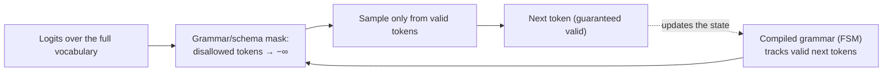
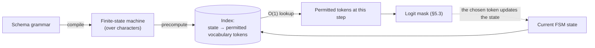

<!-- SPDX-FileCopyrightText: 2026 Aleksandr Drobiazkin
     SPDX-License-Identifier: CC-BY-SA-4.0 AND MIT
     Source: https://github.com/Drobiazkin/ai-agent-architecture
     Dual-licensed, and the boundary is exactly the fence: a fenced code block tagged
     with a language (python, java, sql, bash, yaml, xml, json), comments inside it
     included, is MIT. Everything else — the prose, the tables, the formulas, and the
     mermaid diagrams, which are illustrations expressed as text — is CC-BY-SA-4.0.
     Full terms: LICENSE, LICENSE-CODE, and NOTICE in the repository root. -->

# Chapter 5. Structured Output and Reliable Parsing

## 5.1 The problem: the boundary between probabilistic and deterministic

The model emits free-form text. Downstream components—a parser, a tool call, a database write, UI rendering—demand **typed, valid data**. The boundary between these two worlds is exactly where most agentic systems break in production.

The naive approach—"ask for JSON and parse it"—does not survive production, for concrete reasons: the model wraps the JSON in prose ("Here's the answer: …"), fences it in markdown (```json), leaves trailing commas, invents or omits fields, puts in the wrong type (a string where a number belongs), truncates output at the token limit (§1.8). Every one of these cases is an unhandled exception in the parser—or worse, silently wrong data flowing further downstream.

At its core, this is contract enforcement at a trust boundary: the output comes from a probabilistic component that *can* violate the required shape. Structured output is the set of techniques that brings model output into conformance with a schema you can rely on. It matters because structured output is the junction where the nondeterministic core (§1.10) meets deterministic code; the tighter the junction, the fewer production incidents.

## 5.2 The spectrum of techniques: from weak to guaranteed

The techniques line up in order of increasing guarantee (and, as a rule, cost/complexity):

| Level | Technique | What it guarantees | Cost / limitation |
|---|---|---|---|
| 1 | **Prompt only** ("return JSON matching this schema…") | Nothing (it's a request) | Prose, fences, invalid JSON |
| 2 | **Few-shot format examples** | Nothing, but noticeably more reliable | Tokens spent on examples |
| 3 | **Post-hoc parsing + repair (reask)** | Validity after retries | Extra model calls, latency |
| 4 | **JSON mode** (provider-side) | Syntactically valid JSON | Valid JSON ≠ *the right schema* |
| 5 | **Constrained / grammar decoding** (schema-guided) | Conformance to the *schema* at generation time | Requires logit access; small overhead |
| 6 | **Function / tool calling** | A structured call against a declared schema | Specialized for invoking functions (Chapter 12) |

The practical takeaway: do not rely on levels 1–2 anywhere the output feeds a parser or a tool. Level 3 (validation + reask) is the minimum, and the best available option is level 5 (constrained decoding) or level 6 (tool calling) for actions.

## 5.3 How constrained decoding works (in depth)

This is the single most powerful technique of the lot, and its mechanics are worth understanding because they are a direct generalization of §1.7.

Recall: at every decoding step the model produces **logits**—a score for each token in the vocabulary, which softmax turns into a distribution (§1.7). Constrained (grammar-guided) decoding inserts one step between the logits and the sampling: a **compiled grammar** (a finite-state machine / pushdown automaton[^t-pda] for JSON plus your schema) tracks which tokens are *permitted* next given what has been generated so far, and **masks the logits of every disallowed token to −∞** before the choice is made. After the mask, the model *physically cannot* pick a token that breaks the structure.



This is the same "mask the invalid logits" principle from §1.7, scaled up to a full grammar: not "forbid one character," but "at every step, allow only what leads to a schema-valid document." The essential subtleties:
- **You need access to the logits.** That is why constrained decoding is available out of the box on self-hosted stacks (Outlines, GBNF grammars in llama.cpp, XGrammar in vLLM)[^t-grammar-stack] or from providers who implement it themselves (structured outputs with a JSON schema). With a pure black box that lacks the feature, it is simply unavailable—you fall back to level 3.
- **The overhead is small**; modern implementations compile the grammar efficiently.
- **It guarantees structure, not semantics** (see §5.6)—the key limitation.

### Deep Dive: token alignment and FSM indexing

The mechanics of §5.3 (grammar-driven logit masking) hide a nontrivial engineering problem that matters when choosing a constrained-decoding engine for self-hosting.

**The token alignment problem.** A grammar or regex defines valid *character strings*. But the model generates *tokens*—subword units, each covering *several* characters and potentially straddling grammar boundaries. A single valid next character can begin hundreds of different tokens; a single token can "leap across" several grammar characters at once. So the naive "allow the valid characters" doesn't work—at every step you need to know *which vocabulary tokens* keep the generation on a valid path through the automaton. That is the alignment between the character-level grammar and the token vocabulary.

**The Outlines contribution (Willard & Louf, 2023)—indexing the FSM against the vocabulary.** The naive solution is to scan the entire vocabulary (tens to hundreds of thousands of tokens) at every step, checking each token for compatibility with the grammar. Expensive on *every* generated token. The Outlines idea: compile the grammar into a finite-state machine (FSM) and **precompute an index** mapping each FSM state to its set of permitted tokens. Masking at each step then becomes an O(1) lookup—"permitted tokens for the current state"—rather than a vocabulary scan. This is what made grammar-guided decoding practical speed-wise (later engines—XGrammar and others—build on the same idea with JSON-specific optimizations).




**Token healing.** An adjacent subtlety: greedy tokenization can "break the boundary" at the seam between the fixed prefix and the generation. Example: if the context ends with `"url": "htt`, the model would naturally continue with the token `https`, but the boundary has already cut off `htt` as a separate token—the optimal continuation is unreachable. **Token healing** rolls back the last token(s) of the prefix and regenerates so that the tokenization matches the "natural" one. The technique was popularized by Microsoft Guidance; it matters for the correctness of constrained/template-driven generation at boundaries.

**The limits of grammars.** Not everything can be constrained cheaply. A flat object with enums compiles into a compact automaton. But unbounded recursion (arbitrarily nested JSON with no depth limit) requires a pushdown automaton (a context-free grammar), not a finite one, and indexing it efficiently is harder; a deep or recursive schema bloats the automaton. One more reason to keep the schema flat and bounded (§5.4): not just for the model's quality, but for the cost of the constraint engine itself.

### Deep Dive: when constrained decoding hurts

Guaranteeing the structure is not free where *quality* is concerned:

- **An over-complicated schema strangles the model.** Constrained decoding forces the model to emit only tokens that lead to a valid structure. If the schema is rigid and "unnatural" for the task, the model's distribution gets herded into a narrow corridor, forcing it to pick tokens that would not otherwise have been picked—and that can degrade the *content* (filler hallucinations in required fields). A simple schema with enums is fine; a baroque schema with a dozen required nested fields is a way to get a valid but bad answer.
- **Why a rigid schema imposed early gets in the way of reasoning.** Force the final schema *from the very first token* and the model loses its "room to think" (§3.4: CoT works by spilling the reasoning out into tokens). It has to emit the answer fields immediately, without having reasoned. Hence two remedies: two-step (§5.5) and a reasoning field inside the schema (§5.5).

*Source:* Z. Tam et al., "Let Me Speak Freely? A Study on the Impact of Format Restrictions on Performance of LLMs" (EMNLP 2024)—empirical evidence for reasoning degrading under format restrictions.

## 5.4 Schema design as contract design

Design the output schema as a contract: reliability depends on it directly.

- **Keep the schema simple and, where possible, flat.** Deeply nested structures come harder to the model; every level of nesting raises the probability of an error. The same "don't complicate the contract without need" principle.
- **Enums for categorical fields.** If a field draws from a fixed set of values (status, category), declare it as an enumeration. The model is then obliged to choose from the set—sharply more reliable than free text, and it removes the entire class of "the model wrote the status slightly differently." One of the cheapest and most powerful techniques there is.
- **Required/optional fields and default values**—explicitly, as in a contract.
- **Field descriptions in the schema act as inline instructions.** A good JSON schema with a `description` on each field is both a specification for the validator and documentation that *the model reads*. A dual-purpose schema.
- **Be careful with types.** The model garbles numbers because of tokenization (§1.2)—avoid critical arithmetic in the output where you can; for dates, state the format explicitly (ISO 8601), or you will get a mishmash.
- **Always validate post-hoc with a real validator** (JSON Schema, Pydantic; on the JVM—Jackson + Bean Validation or a schema library)—even under constrained decoding, as defense-in-depth. The grammar guarantees the structure, but the validator catches edge cases and serves as a second line.

**Vendor schema limits (check them against the documentation as of your implementation date).** Provider-side structured outputs constrain the schema not only by common sense but by hard implementation limits that shift from release to release: for OpenAI, the 2024–2025 ballpark is on the order of a hundred properties per schema, a handful of nesting levels, and caps on the total size of names and enum values; support for JSON Schema's composite features (composition, recursion) is limited and differs between providers. More consequential than the limits is another gotcha: **the value-validation keywords—`pattern`, `minLength`, `minimum`, `format`—may be accepted in the schema by the provider yet not enforced during generation**; checking them falls entirely to the post-hoc validator from the bullet above—not knowing this costs weeks of debugging "the schema is right there, where are the invalid values coming from?" Gemini has its own set of restrictions: an overly complex schema is rejected with an `InvalidArgument` error, and an enum comes back as a string. The rule: verify the semantics of every keyword and the limits against the provider's documentation—not against the JSON Schema spec, and not from memory.

## 5.5 Reliability patterns

- **Constrained Decoding**—a structural guarantee at generation time (§5.3); the strongest single technique when you have logit access.
- **Two-step generate-then-format**—first let the model reason freely (CoT, §3.4), then format the result into the schema with a *separate* constrained call. It pulls reasoning and formatting apart: a rigid schema imposed too early gets in the way of reasoning, and a late formatting step relieves that tension. More expensive (two calls), but better on hard tasks.
- **Validate-then-Retry**—the baseline pattern when constrained decoding is unavailable:

> ### Pattern: Validate-then-Retry (Reask)
> **Context.** The model's output feeds a parser or a tool, but constrained decoding is unavailable (a black box with no schema feature).
> **Problem.** How do you get schema-valid output without a guarantee at generation time?
> **Forces.** Parsing it straight breaks on invalid output; accepting invalid output breaks downstream; retrying forever costs money and latency.
> **Solution.** Generate → validate against the schema → on failure, **hand the model the validator's error text and ask it to fix the output** (reask), with a **cap on the number of attempts**. Given a concrete error message, the model usually repairs its own output.
> **Mechanics.** `generate → validate → (invalid?) → append(error) → regenerate`, with an attempt counter (typically 1–3), then a fallback (deterministic handling or escalation). Idempotency matters if the downstream action has already partly happened.
> **Example.** A number of frameworks (Spring AI and LangChain4j, for instance) build the pattern in: the typed converter runs validation and the reask internally.
> **Resulting Context.** Reliability without logit access; the price is extra calls (cost/latency) and the absence of a *guarantee* (after N attempts it can still fail → you need a fallback).
> **When to Use.** A black box with no constrained mode. **When Not To.** When constrained decoding or tool calling is available—they give the guarantee more cheaply than reasks do.
> **Related Patterns.** Constrained Decoding (a guarantee instead of retries); Fallback (what to do once the attempts run out, §2.5); Two-step generate-then-format.
> **Sources.** B. Willard, R. Louf, "Efficient Guided Generation for Large Language Models" (2023, Outlines); provider documentation on structured outputs and function calling.

### Technique: the reasoning field first (the CoT ↔ structured output bridge)

A cheap alternative to two-step when you need a single call with a guaranteed schema: **move the reasoning inside the schema itself, as the first field.**

```json
{
  "reasoning": "string—a step-by-step analysis before the answer",
  "category": "enum",
  "answer": "…"
}
```

Because JSON fields are generated in order, the model fills `reasoning` first (getting its "room to think," §3.4) and only then the structured answer, now leaning on its own reasoning. This embeds CoT directly into structured output in a single call. Caveats: the `reasoning` field burns tokens (cost/latency) and is usually discarded after parsing; field order matters (reasoning goes *before* the answer fields, or there is no point).

### The tension: streaming ↔ structured output

A real production problem people often forget. Streaming (§2.3) hands over tokens as they are generated, for the sake of perceived latency. But **partial JSON is invalid**: until the closing `}` arrives, you cannot parse or validate it, and you cannot render it "halfway." The conflict: either streaming (good latency, but nothing to validate or use until the end) or structured output (validatable, but the user waits for the full answer).

Practical resolutions: (1) stream only free-form text *to the human reader*, and generate the structured part with a separate non-streaming call (see two-step); (2) use **incremental / partial-JSON parsers** that close off unfinished structures on the fly (off-the-shelf libraries exist)—for progressive rendering; (3) stream *by field* (some APIs deliver structured output in fragments). The choice depends on whether the output is for a human (streaming matters) or for code (validity matters more).

### On the empirical evidence (honestly)

How much any given technique lifts reliability depends on the model, the task, and the schema; there is no "universal percentage." The order of the effect, reproducible in reports and in practice: moving from "prompt only" to validate-with-reask removes most *parsing* errors; constrained decoding / JSON-schema mode removes them *entirely* by construction (§5.3) as far as structure goes; enums and a flat schema noticeably cut *value* errors in categorical fields. But no technique touches factual correctness (§5.6)—that is a separate axis, measured by evals (Part VI). The moral: measure format reliability and content correctness *separately*, with different metrics.

## 5.6 The semantic gap: structure ≠ correctness

The critical caveat you cannot skip. Constrained decoding guarantees that the JSON is **well-formed and conforms to the schema**—but the *field values* can still be a hallucination. The model will hand you a flawlessly valid `{"order_status": "SHIPPED", "tracking": "…"}` in which the status is simply invented.

Hence a clean split of responsibility:
- **Structured output solves the parsing/integration problem**—"the output plugs into my code."
- It **does not solve the accuracy problem**—"the output is *right*."

Accuracy is the job of grounding (RAG, Part III) and evaluation (evals, Part VI). Never confuse "it parsed" with "it's correct." This is one of the classic traps: a team adds structured output, sees valid JSON, relaxes—and ships confidently wrong data in perfect packaging. Structured output closes the *format* boundary, not the *truth* boundary.

## 5.7 Implementation on the JVM

The JVM ecosystem gives you typed output with almost no extra effort:
- **Spring AI:** structured-output converters (`ChatClient….entity(MyRecord.class)`, `BeanOutputConverter`) generate the schema from the Java type, put it in the prompt, and parse the response back into a record or POJO. Where the model supports schema-guided output, that is what gets used. For actions—`@Tool` (tool calling, Chapter 12).
- **LangChain4j:** `AiServices` with a typed return value—you declare a Java interface that returns a POJO, and the framework takes on the schema, the parsing, and the reask.
- **Validation:** Jackson for parsing and Bean Validation (`@NotNull`, `@Pattern`, …) as the post-hoc line (§5.4).

At the code level this comes down to "declare the return type, get a typed result," and Validate-then-Retry is often already implemented inside the converter. The §5.6 caveat still holds: type-safe output does not mean correct output.

## 5.8 Summary—the boundary is closed

Structured output is how you close the boundary between a probabilistic model and the deterministic consumption of its output. The spectrum runs from asking for JSON (weak) to constrained decoding (a structural guarantee) and tool calling (a guarantee for actions). But structure does not equal correctness: the format is guaranteed, the truth is not.

That closes Part II—the interface to the model: **designing the request sets the requirement** (Chapter 3), **context engineering assembles the input** (Chapter 4), **structured output closes the output boundary** (Chapter 5). What remains unsolved is the correctness of the *content*, which format does not provide. Part III is devoted to it: RAG—grounding the model's output in verifiable facts.

*Sources.* B. Willard, R. Louf, "Efficient Guided Generation for Large Language Models" (2023)—the FSM approach to constrained decoding (Outlines). OpenAI and Anthropic documentation on structured outputs and function calling; GBNF grammars in llama.cpp; XGrammar (2024) for efficient grammar-guided decoding. Spring AI and LangChain4j documentation on structured output.

**In the Margins: Chapter 5**

[^t-pda]: **Pushdown automaton**—a finite-state machine with a stack. The stack is the reason it turns up here: JSON's nesting (an object inside an array inside an object) requires remembering the depth, which an automaton without a stack cannot do.
[^t-grammar-stack]: What's what here: **llama.cpp**—a local inference runtime; **GBNF**—its grammar format (GGML BNF); **Outlines** and **XGrammar**—constrained-decoding libraries with a precomputed vocabulary index; **vLLM**—an inference server that integrates them. → Chapter 22.

---
