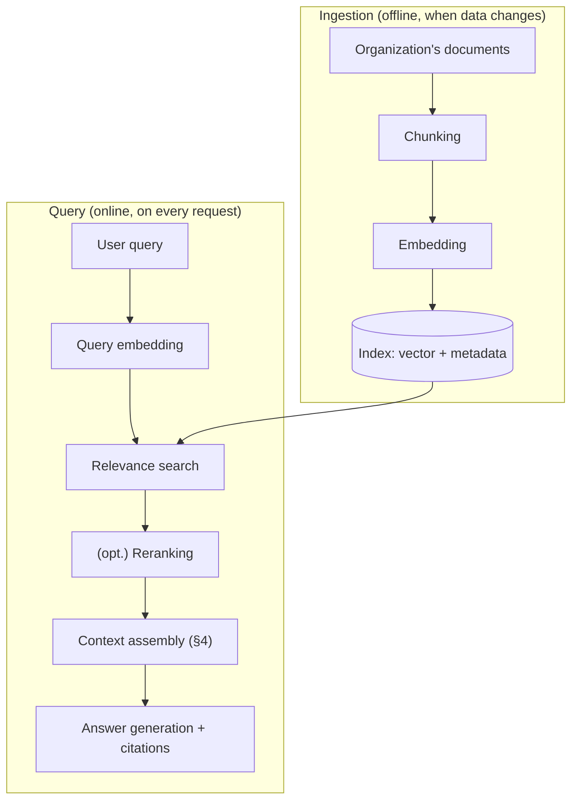

<!-- SPDX-FileCopyrightText: 2026 Aleksandr Drobiazkin
     SPDX-License-Identifier: CC-BY-SA-4.0 AND MIT
     Source: https://github.com/Drobiazkin/ai-agent-architecture
     Dual-licensed, and the boundary is exactly the fence: a fenced code block tagged
     with a language (python, java, sql, bash, yaml, xml, json), comments inside it
     included, is MIT. Everything else — the prose, the tables, the formulas, and the
     mermaid diagrams, which are illustrations expressed as text — is CC-BY-SA-4.0.
     Full terms: LICENSE, LICENSE-CODE, and NOTICE in the repository root. -->

# Part III. Grounding Knowledge: RAG

Part II tamed the interface. But structured output guarantees *format*, not *truth* (§5.6), and the model's parametric knowledge is static, unverifiable, and prone to hallucination (§1.9)—it also holds none of the organization's private data and knows nothing of access control. Part III is about grounding the answer in data that is retrievable, verifiable, and access-controlled. Four chapters: framing RAG (6), a catalog of retrieval patterns (7), vector indexes and infrastructure (8), and evaluating RAG quality (9).

# Chapter 6. Retrieval-Augmented Generation: The Framing

## 6.1 The problem RAG solves

Back to §1.9. The model's parametric knowledge is baked in at training time, which makes it **static** (it stops at the cutoff date), **unverifiable** (no source—there is no way to check where a "fact" came from), and **prone to hallucination** (the model confidently produces plausible falsehood). On top of that it **holds no private data** belonging to the organization (none of it was in the training set) and **takes no account of access control** (the model has no idea that a particular user is not allowed to see a particular document).

The architectural question: how do you make a probabilistic component answer from data that is *fresh*, *private*, *verifiable*, and *access-controlled*? **RAG is the architectural answer.** It does not improve the model's memory—it replaces reliance on memory with reliance on retrieved data.

## 6.2 What RAG is

**Retrieval-Augmented Generation (RAG)**—a pattern in which *retrieved* relevant data is fed into the model's context at inference time, and the answer is formed from that data rather than (only) from parametric memory. Structurally it is two phases:

- **Retrieve**—find the data relevant to the query.
- **Generate**—generate an answer conditioned on that data.

And two pipelines, offline and online:

Notice that retrieval is exactly what Part II called *context selection* (§4.4). RAG is the concrete, dominant implementation of context engineering for knowledge.

One qualification the diagram needs: the vectors live only inside the search block. What reaches generation is the retrieved *text*—the model re-cuts it into tokens and builds its own internal vectors; it never sees the RAG vectors at all (§1.3).

## 6.3 RAG versus the alternatives—the architect's key decision

Three ways to give the model knowledge or behavior it lacks by default—one of the main design forks:

| Axis | RAG | Fine-tuning (Chapter 21) | Long context |
|---|---|---|---|
| Data freshness | Update the index and you're done | Requires retraining | Per request |
| Volume of knowledge | Huge (the entire corpus) | Limited, "blurs" | Only what fits the window |
| Verifiability / citations | Yes (there is a source) | No | Yes (the data is in the prompt) |
| Access control | Yes (RBAC[^t-rbac] at retrieval) | No (the knowledge sits in the weights, for everyone) | On the assembly side |
| Cost | Index + retrieval per request | Expensive training, cheap inference | An expensive long prompt |
| What it's for | *Knowledge* (facts, documents) | *Form* (style, schema, tone) | Small / one-off |

The rule (the same ladder `Prompt → RAG → Fine-tune`): for *knowledge*, almost always RAG; fine-tuning is for *form*, not facts (§1.9, Chapter 21); long context is for a small one-off injection, not for a knowledge base (§1.8: dilution and cost). The two are often combined: RAG for knowledge plus a small fine-tuned model for the form of tool calls.

## 6.4 Anatomy of a RAG system

Every component is a failure surface, and it pays to see them separately:

1. **Ingestion pipeline**—load → chunking[^t-chunking] → embedding → indexing (+ metadata for filtering/RBAC).
2. **Retrieval**—embed the query → search → (opt.) reranking.
3. **Augmentation**—assemble what was retrieved into the context (placement, isolation, §4).
4. **Generation**—an answer conditioned on the context, ideally with citations.

Most RAG problems in production are a *retrieval* failure (components 1–2), not a generation failure—hence §6.5–6.6.

## 6.5 Retrieval is the bottleneck (the key shift)

Naive RAG misses at retrieval, by widely circulated industry estimates, in **on the order of 30–40%** of cases in production (the figure floats and traces back to no single primary source—all the more reason to measure it on your own data, Chapter 9), and it misses **silently**: the model confidently generates an answer from the *wrong* retrieved fragments, and the output is indistinguishable from a correct one. The key shift: **the bottleneck is not generation but retrieval.** Modern models generate well; what breaks is *what* gets handed to them. The practical consequence: retrieval quality is treated as a measurable SLO (Chapter 9), and improving it (Chapter 7) is the main lever on the quality of a RAG system.

## 6.6 Deep Dive: RAG failure taxonomy

Let's break "RAG doesn't work" down into concrete failure modes:

| Failure mode | What happens | Mitigation |
|---|---|---|
| **Recall miss** | The relevant document is not retrieved | Hybrid search, query rewriting (Chapter 7) |
| **Precision miss** | Irrelevant noise gets retrieved | Reranking, filters (Chapter 7) |
| **Bad ranking** | What you need is there, but not in the top-k | A reranker (Chapter 7) |
| **Silently wrong context** | The model confidently answers from the *wrong* fragments | The most dangerous one; surfaced only by evaluation (Chapter 9) and citations (§6.7) |
| **Unfaithfulness** | The model ignores or distorts the context, or hallucinates beyond it | A separate axis (§6.7); the faithfulness metric (Chapter 9) |
| **Chunk fragmentation** | The fact you need is cut in two by a chunk boundary; the chunk makes no sense out of context | Chunking strategies, contextual retrieval (Chapter 7) |
| **Staleness** | The index has fallen behind the source | A reindexing pipeline |
| **Security** | Something the user may not see gets retrieved (an access-control breach at retrieval); index poisoning | RBAC/ABAC at retrieval (Chapters 8, 19) |
| **Indirect injection** | A legitimately accessible but maliciously crafted document carries an instruction that hijacks the model/agent | Isolating retrieved content as data (§4.6); taint-tracking and the rule of two (§12.5); Chapter 19 |

The key point: "improve RAG" is not one action but targeted work on a specific *measured* failure mode (Chapter 9). Without measurement you are fixing blind.

## 6.7 Deep Dive: grounding and faithfulness—two orthogonal axes

The critical distinction, and the one most often confused. The quality of a RAG system is **two independent axes**, and they have to be measured *separately*:

- **Retrieval quality**—did we pull the right documents? (context recall—did we miss what we needed; context precision—did we drag in noise).
- **Faithfulness / groundedness**—did the answer use what was retrieved *correctly*, without inventing beyond it?

They are orthogonal, and all four combinations are real:
- Good retrieval + faithful → the ideal.
- Good retrieval + not faithful → we pulled the right thing and the model hallucinated anyway (a generation problem).
- Bad retrieval + faithful → the model *honestly* restated the *wrong* chunks (a retrieval problem, masked by a confident tone).
- Bad retrieval + not faithful → everything is broken.

Two conclusions follow. First: you cannot fix "RAG" in general—you have to know *which axis* sagged (Chapter 9 measures both separately). Second, a design one: **citations as a design goal.** Make the model name *which chunk* backs each claim (through structured output, Chapter 5: a `citations` field with source ids). That buys three things at once—verifiability (the user can check), fewer hallucinations (the model is "pinned" to a source), and faithfulness debugging (you can see where a claim came from). Citability is not decoration but an architectural requirement for trusting RAG.

### Deep Dive: knowledge conflict (parametric vs. retrieved)

RAG assumes the model will prefer the retrieved context to its own memory. In practice that is not guaranteed—what arises is a **knowledge conflict**: what does the model do when the context *contradicts* its parametric prior?

Two symmetric failures:
- **The model ignores the context in favor of the prior.** If a retrieved fact contradicts something firmly fixed in the weights (common knowledge), the model may ignore the context and answer from memory—with a fact that is stale, or wrong for this particular organization. The stronger the prior and the more "surprising" the context, the higher the risk. This bears directly on the case where an organization's internal policy diverges from the generally accepted one.
- **The model blindly trusts wrong context.** The reverse: a wrong, stale, or poisoned fragment gets retrieved—and the model faithfully reproduces the error. Faithfulness, in this case, works against correctness.

Design measures: **prioritize the context explicitly** in the instruction ("answer *only* from the documents; if they are not enough, say 'I don't know'"); **citations** (above) make a fallback onto memory visible (a claim without a source = a flag); **retrieval freshness/quality/security** (Chapters 7–8) closes half the problem (wrong context); **admitting uncertainty**—the system is obliged to say "that is not in the documents" rather than filling the gap with the prior (checked with a golden set containing unanswerable questions, Chapter 9).

The architectural conclusion: RAG does not switch parametric knowledge off, it competes with it. You design the system so that the context wins the conflict, and you measure that.

*Source.* S. Longpre et al., "Entity-Based Knowledge Conflicts in Question Answering" (2021); context-faithfulness research (2023–2024).

### Deep Dive: RAG versus long context—do 1M+ windows make RAG itself obsolete?

A live argument: if windows are growing to 1M+, why retrieve at all—"just stuff the whole corpus into the context"? The answer: long context *changes* RAG's design but does not abolish it:

- **Cost (§2.2).** Feeding 1M tokens on *every* request is linearly expensive, permanently; retrieving the relevant 5k is orders of magnitude cheaper. Under a stream of requests this is the decisive argument.
- **Latency (§1.6, §2.3).** A long prefill hits TTFT; a short retrieved context is faster.
- **Accuracy (§1.8).** Dilution and lost-in-the-middle: quality *drops* as irrelevant content grows. Less but more relevant is often *more accurate*, not just cheaper.
- **Scale.** An organization's corpus (terabytes) does not fit any window at all—retrieval is mandatory.
- **Access and freshness.** RBAC at retrieval (Chapter 8) and index updates without retraining—properties a long window does not give you on its own.
- **"What about prompt caching?"** A prefix cache (§2.2, §20.2) removes part of the cost of resending the corpus, but the argument does not save the day: the cache is invalidated on every corpus update; every user has their own RBAC slice—there is no common cacheable prefix to assemble; the TTFT of the uncached tail remains; and the quality degradation from dilution (§1.8) a cache does not cure at all.

What long context *does* change: you can afford **larger chunks** and a **less aggressive top-k** (20 rich fragments instead of 5 narrow ones), suffering less from fragmentation (§7.6). A long window, in other words, is *extra budget* that makes the RAG pipeline gentler, not unnecessary. Empirically (Xu et al., 2023) RAG and long context are *complementary*: RAG gives comparable quality more cheaply, and the combination is best.

The conclusion: the thesis "the window is big → RAG is unnecessary" does not survive scrutiny. Economics, accuracy, scale, and access control keep RAG mandatory; a long window merely tunes its parameters.

*Source.* P. Xu et al., "Retrieval meets Long Context Large Language Models" (2023).

## 6.8 Implementing the retrieval layer (a bridge to Chapter 8)

The retrieval layer is an additional index over the data. At the start you can build it without a dedicated infrastructure component: **pgvector in Postgres** for vector search; hybrid search as a combination of pgvector and Postgres full-text search; a cache for embeddings and answers (including semantic caching, §2.2)—in Redis, for example. Fragment metadata (owner, clearance, date) in a relational database gives you filtering and access control (RBAC/ABAC) at retrieval time, by way of the access-management system. The infrastructure details (ANN, HNSW, parameters, the conditions for moving out to a specialized store like Qdrant or Weaviate) are Chapter 8.

The opposite end of the build-vs-buy scale is **managed retrieval**: provider offerings that hide ingestion, chunking, embeddings, and the index behind a single API (Amazon Bedrock Knowledge Bases, Vertex AI Search, OpenAI vector stores / file search, Azure AI Search). You start faster and without infrastructure of your own; the price is limited control over exactly the levers Chapter 7 is made of (chunking, hybrid, reranking), opacity about retrieval quality, and your data tied to the provider; the access-control model (§8.7) has to be expressible by the provider's means. The working rule: managed for a fast start and ordinary corpora; your own layer when retrieval quality becomes a product differentiator or the data demands it (privacy, specific filtering).

## 6.9 Chapter summary

RAG grounds the probabilistic component in retrievable, verifiable, access-controlled data instead of leaning on static parametric memory. The bottleneck is retrieval, not generation (§6.5). Quality is two orthogonal axes—retrieval quality and faithfulness (§6.7)—measured separately (Chapter 9). Next: **Chapter 7—the patterns that improve retrieval; Chapter 8—the infrastructure; Chapter 9—the measurement.**

*Sources.* P. Lewis et al., "Retrieval-Augmented Generation for Knowledge-Intensive NLP Tasks" (2020)—the original RAG paper. Y. Gao et al., "Retrieval-Augmented Generation for Large Language Models: A Survey" (2023)—a map of the field. Chip Huyen, *AI Engineering* (2025)—the engineering frame.

**In the Margins: Chapter 6**

[^t-rbac]: **RBAC / ABAC**—Role-/Attribute-Based Access Control: access by role versus access by attribute (department, clearance, project). In RAG it is checked at *retrieval*, not at generation. → §8.7.
[^t-chunking]: **Chunking**—splitting documents into fragments for indexing; fragment size and boundaries are a design decision in their own right. → §7.6; ⇐ Glossary.

---
