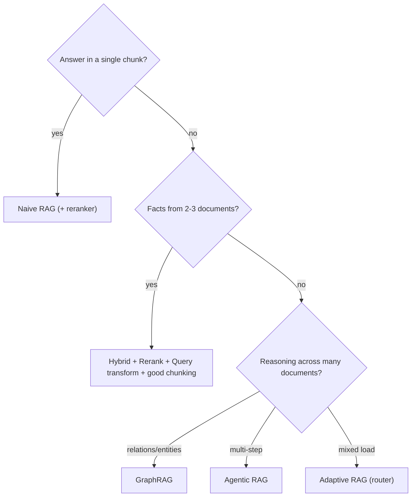
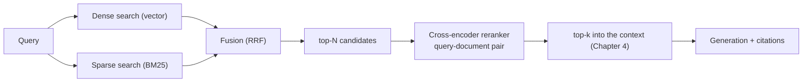
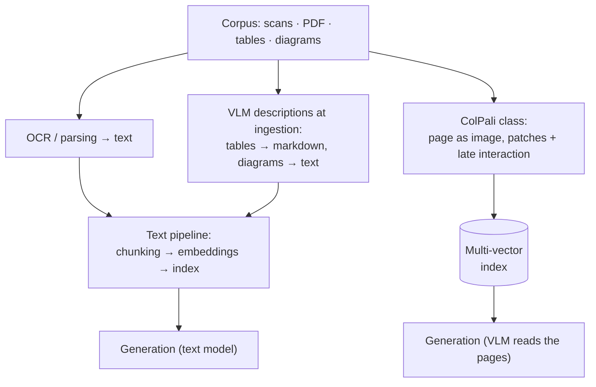
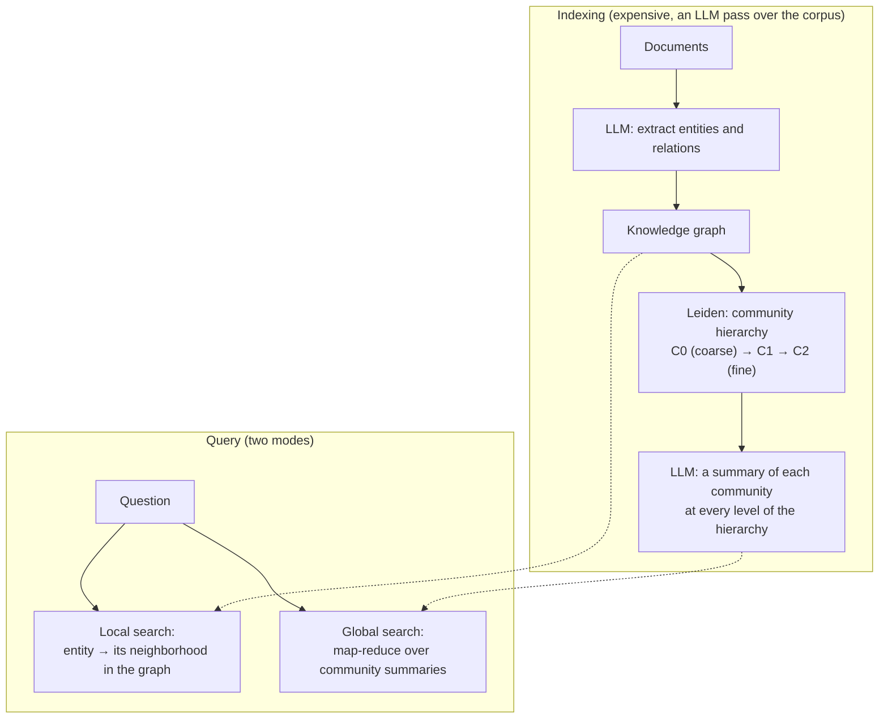
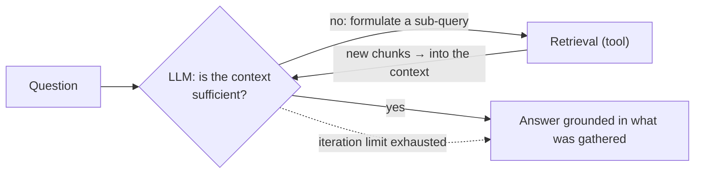

<!-- SPDX-FileCopyrightText: 2026 Aleksandr Drobiazkin
     SPDX-License-Identifier: CC-BY-SA-4.0 AND MIT
     Source: https://github.com/Drobiazkin/ai-agent-architecture
     Dual-licensed, and the boundary is exactly the fence: a fenced code block tagged
     with a language (python, java, sql, bash, yaml, xml, json), comments inside it
     included, is MIT. Everything else — the prose, the tables, the formulas, and the
     mermaid diagrams, which are illustrations expressed as text — is CC-BY-SA-4.0.
     Full terms: LICENSE, LICENSE-CODE, and NOTICE in the repository root. -->

# Chapter 7. A Catalog of Retrieval Patterns

## 7.1 The retrieval pattern ladder

The patterns are ordered by increasing complexity; the principle running through all of them is to climb exactly as far as measurement (Chapter 9) says you must, and not to pick the complicated option up front.

The practical rule: **the default is Hybrid + Reranker + competent chunking.** That closes off most of the problems. GraphRAG, Agentic, and multi-query are the top of the ladder, and you climb up there on proven need—otherwise you buy 10× the cost with no gain in accuracy.

## 7.2 Pattern: Naive RAG (the baseline)

> **Context.** Simple question-answering over a corpus; the answer usually sits in one fragment.
> **Solution.** One pass: embed the query → dense top-k search → feed it into the context → answer.
> **When to Use.** The answer is localized in a single chunk, the corpus is small, accuracy requirements are moderate. **When Not To.** Exact terms and codes (dense search loses them—§7.3), multi-document or multi-step questions.
> **Role.** This is the *baseline* against which every improvement is measured (Chapter 9). You start here, you measure, and you climb the ladder only to where a failing metric points.

## 7.3 Pattern: Hybrid Search

> **Context.** Queries carry both semantics ("how do I file a return") and exact tokens—error codes, SKUs, names, IDs—that must not be lost.
> **Problem.** Dense (vector) search catches meaning beautifully but misses exact rare terms; keyword search catches the exact thing but does not understand a paraphrase. How do you get both?
> **Forces.** Dense: semantics, robustness to synonyms, but it blurs rare exact tokens. Sparse (BM25[^t-bm25]): exact term matching, but blind to meaning.
> **Solution.** Run **both** searches—dense (vector) and sparse (BM25/full-text)—and **fuse** their results into a single ranked list.
> **Mechanics—fusion via RRF.** The most dependable way to merge two lists is **Reciprocal Rank Fusion**: each document accrues `Σ 1/(k + rank_i)` over its positions in each list (k is a constant, e.g. 60)[^t-rrf-k]. RRF works *on ranks*, not on raw scores, so it needs no normalization of incomparable scales (cosine vs BM25 score)—a large practical convenience.
> *Reading the formula:* `rank_i` is the document's position in the i-th list (1 is first place); the term `1/(k + rank_i)` is the "points" for that position—a reciprocal, so a high position earns more points, but the damper k keeps it from earning overwhelmingly more. A mini-example at k = 60: a document that came back 1st on BM25 and 5th on vector search earns `1/(60+1) + 1/(60+5) ≈ 0.0164 + 0.0154 = 0.0318`—both scales contributed comparably, even though adding their raw scores (BM25 ≈ 12.7 and cosine ≈ 0.83) would have been meaningless.
> **Implementation Example.** Vector search supplies the dense candidates (pgvector, say), full-text search supplies the sparse ones (`tsvector`/`ts_rank` in Postgres, say), and RRF is computed in SQL or in the application; one relational database covers both branches.
> **Alternative to Fusion.** If the score scales are calibrated and comparable, a weighted (convex) combination of normalized scores stands in for RRF, with a coefficient `α` tuning the dense and sparse contributions; RRF is preferred where calibration is out of reach, since it requires no normalization.
> **Resulting Context.** A noticeable rise in recall on mixed queries; the price is two searches and fusion logic.
> **When to Use.** Almost always for real corpora—they always hold both meaning and exact tokens. **When Not To.** Purely semantic short FAQs with no terminology.
> **Related Patterns.** Reranking (the next step after fusion); Query transformation.
> **Sources.** G. Cormack et al., "Reciprocal Rank Fusion outperforms Condorcet…" (2009); S. Robertson, H. Zaragoza, "The Probabilistic Relevance Framework: BM25 and Beyond" (2009).

## 7.4 Pattern: Reranking

> **Context.** The first-stage search returned top-N candidates, but their order is inaccurate—what you need may be sitting at position 15, and only top-5 will fit into the context.
> **Problem.** How do you get an accurate relevance ordering when fast vector search is lossy?
> **Forces.** The key distinction here is between two architectures (expanding on §1.3):
> - **Bi-encoder** (the search model) encodes query and document *independently* into vectors and compares them by cosine. Fast and scalable (the vectors are precomputed), but **lossy**—there is no query↔document interaction.
> - **Cross-encoder** (the reranker) feeds the **[query, document] pair jointly** into the model and emits a relevance score. Accurate (it sees the interaction), but **expensive**—it runs on every pair and cannot be precomputed.
> **Solution.** Two stages: the bi-encoder cheaply pulls top-N (say, 50), the cross-encoder reranks precisely down to top-k (say, 5). **Reranking works precisely because it restores the query-document interaction the bi-encoder threw away for speed.**
> **Mechanics/Placement.** After retrieval (dense or hybrid), before generation. Latency grows (a cross-encoder pass over N candidates), but N is small—tens—so it is tolerable. The reranker is a separate small model (self-hosted) or an API.
> **Resulting Context.** Top-k accuracy rises noticeably; the price is extra latency and one more component, the reranker.
> **When to Use.** Almost always, if top-k accuracy matters. **When Not To.** Ultra-low latency outweighs accuracy, or the corpus is so small that ranking is beside the point.
> **Related Patterns.** Hybrid Search (before the rerank); Naive RAG (without one).
> **Sources.** R. Nogueira, K. Cho, "Passage Re-ranking with BERT" (2019); N. Reimers, I. Gurevych, "Sentence-BERT" (2019)—bi- vs cross-encoder.

The combined default pipeline—hybrid search followed by reranking—looks like this:

Choosing `N` is a trade-off: a larger `N` raises the odds that the relevant document survives to the reranking stage (first-stage recall), but it drives the cross-encoder's cost up linearly. Beyond cross-encoders there are **LLM rerankers** (the model ranks a list of documents by relevance, listwise): more flexible, but pricier and slower. Practical reference points (mid-2026): the default open pairing is BGE-reranker-v2 over BGE-M3 embeddings; from the APIs, Cohere Rerank. Confirm the choice on your own golden set (Chapter 9), not on someone else's benchmarks.

### Deep Dive: late interaction (ColBERT)—the third retrieval paradigm

Between the bi-encoder (fast, lossy) and the cross-encoder (accurate, expensive) sits a third paradigm—**late interaction**—that dissolves their dilemma.

**The idea (ColBERT, Khattab & Zaharia, 2020).** Instead of one vector per document (bi-encoder) or a joint pass over the pair (cross-encoder), ColBERT encodes query and document into a *set* of vectors—one per token (**multi-vector**). Relevance is the **MaxSim** operation: for each query token, take the maximum similarity across all document tokens, then sum the maxima. It is "late" because the query-document interaction happens *late* (at the level of precomputed token vectors) rather than early (a joint pass, as in a cross-encoder).

**Where it sits on the spectrum.** More accurate than a bi-encoder (it keeps token granularity instead of compressing to a single vector), yet more scalable than a cross-encoder (document vectors are *precomputed*—no pair pass on every query). The price is **memory**: a vector per document token is expensive (an order of magnitude more than a single vector); hence the storage optimizations (compression of token vectors, PLAID[^t-plaid]).

**When to consider it.** When a bi-encoder plus reranker falls short on quality, a cross-encoder over the whole corpus is unrealistic, and the memory budget for multi-vector is there. ColBERT is often used either as a strong retriever or as a reranker. It is, in essence, one more point on the "quality ↔ memory ↔ speed" curve.

*Source.* O. Khattab, M. Zaharia, "ColBERT: Efficient and Effective Passage Search via Contextualized Late Interaction over BERT" (2020).

## 7.5 Family: query transformation

Sometimes the problem is not the index but the query itself—it is murky, conversational, or lexically far from the documents. A family of techniques that rewrite the query before searching:

- **Query rewriting**—reformulate a conversational or incomplete query into a good search query (resolve pronouns against the history, strip the noise).
- **HyDE (Hypothetical Document Embeddings)**—generate a *hypothetical answer* to the query and search on the embedding of the *answer* rather than the question. The idea: a hypothetical answer is lexically closer to real documents than a question is (it bridges the "question ↔ document phrasing" gap).
- **Multi-query**—generate several variants of the query and union the results (raises recall).
- **Decomposition**—break a complex multi-part question into sub-queries and search on each.
- **Step-back**—generalize the query to pull in broader context (useful when a narrow question needs background knowledge).

*When:* a lexical gap between query and document; complex, multi-part, or conversational queries. *The price:* an extra model call (or several) for the transformation—cost and latency. *Source.* L. Gao et al., "Precise Zero-Shot Dense Retrieval without Relevance Labels" (2022, HyDE); the Gao et al. survey (2023).

## 7.6 Deep Dive: chunking

Chunking is an ingestion-time decision, but it sets the ceiling on retrieval quality: you cannot retrieve what was badly cut. Strategies, in increasing order of quality:

- **Fixed-size**—cut every N tokens. Simple, but it tears meaning apart mid-sentence, mid-thought.
- **Recursive / structural**—cut along the structure: headings, paragraphs, and for code, functions and classes via the AST (not by characters). Respects the boundaries of meaning.
- **Semantic**—cut where the embeddings of neighboring sentences *shift* (a topic boundary). The cut rule is not an absolute threshold but a **percentile of the document's own distribution**: cosine distances ($1-\cos$) are computed between the embeddings of neighboring sentence groups, and a cut goes wherever the distance exceeds the 95th percentile of the distances within *that same* document. 95 is the default in both of the going implementations (`SemanticSplitterNodeParser` in LlamaIndex, `SemanticChunker` in LangChain); lower the threshold and you get more cuts and smaller chunks. *Worked numbers:* a 200-sentence document has 199 seams; the 95th percentile cuts off the top 5%—about 10 cuts and about 11 chunks of roughly 18 sentences each. Which means the percentile directly sets the **number** of chunks, not the "quality of the boundary": it is a granularity knob, and it should be tuned as a granularity knob. The threshold is relative out of necessity: absolute cosine values are not comparable across embedders—anisotropy (§1.3) squeezes the vectors into a narrow cone, so "distance 0.3" under one model does not mean what it means under another, and a hardcoded constant transfers neither to another model nor to another corpus.
- **Parent-document (small-to-big)**—index small, precise chunks (for an accurate *hit*), but feed the larger *parent* fragment into the context (for *intelligibility* at generation time). It resolves the conflict "a small chunk is found more precisely but is poorer in context." The mechanics in one line: *child* chunks go into the vector index (256 tokens, for example), each carrying a `parent_id` field; the search runs over the children, while the context is assembled from the parent (2048 tokens, for example), pulled by `parent_id` out of ordinary storage and **deduplicated**—several children of one parent landing in top-k must yield a single parent, or the same text will occupy the window twice.
- **Contextual retrieval (Anthropic, 2024)**—before embedding, attach to each chunk a short LLM-generated blurb that situates it within the document ("This is the returns section of policy X, covering defective goods"). It works because an isolated chunk is often unintelligible without the document's context. The size of the gain has been measured: on Anthropic's runs the miss rate (the needed fragment absent from top-20) falls from 5.7% to 3.7%—**35% in relative terms**; fold the same blurb into the BM25 branch of the hybrid (§7.3) as well and it drops to 2.9% (−49%); add a reranker on top (§7.4) and you get 1.9% (−67%). The absolute percentages are deceptive and have to be read on the relative scale: the baseline already doesn't miss 94% of the time, so "−2 percentage points" is a third of every failure that was left. The price is one model call per chunk at ingestion.

**Why "a call per chunk" doesn't bankrupt you: prompt caching.** Naively, contextual retrieval looks unaffordable: to write the blurb for a chunk, the model needs the whole document—which means the document is fed in again for every one of its chunks. What saves it is that the document goes into the **cacheable prefix** (§2.2): it is written to the cache once, and every subsequent call *reads* it. Anthropic's pricing is set as multipliers on ordinary input: a cache write costs 1.25 of the input price, a cache read 0.1 (§20.2). Only the tail of the prompt changes—the chunk itself. Indexing cost is computed in two steps. First, the cost of a single document. Dividing by $10^{6}$ here is not decoration but a unit conversion: our lengths are in tokens, while the price list is quoted per million tokens:

$$C_{doc} = \frac{(L_{doc}+L_{ins}) \cdot p_{w} + n \cdot \big( (L_{doc}+L_{ins}) \cdot p_{r} + L_{chunk} \cdot p_{in} + L_{ctx} \cdot p_{out} \big)}{10^{6}}$$

Then multiply by the number of documents in a million tokens of corpus, $10^{6}/L_{doc}$. The two factors of $10^{6}$ cancel exactly, and a clean fraction is left:

$$C_{1M} = \frac{10^{6}}{L_{doc}} \cdot C_{doc} = \frac{(L_{doc}+L_{ins}) \cdot p_{w} + n \cdot \big( (L_{doc}+L_{ins}) \cdot p_{r} + L_{chunk} \cdot p_{in} + L_{ctx} \cdot p_{out} \big)}{L_{doc}}$$

| Symbol | What it is | Value in Anthropic's calculation |
|---|---|---|
| $L_{doc}$ | document length, tokens | 8000 |
| $L_{ins}$ | wrapper instruction, tokens | 50 |
| $L_{chunk}$ | chunk size, tokens | 800 |
| $L_{ctx}$ | length of the generated blurb, tokens | 100 |
| $n$ | chunks per document, $L_{doc}/L_{chunk}$ | 10 |
| $p_{w}$ | cache write, $ per 1M tokens | 0.30 |
| $p_{r}$ | cache read, $ per 1M tokens | 0.03 |
| $p_{in}$ | ordinary input, $ per 1M tokens | 0.25 |
| $p_{out}$ | output, $ per 1M tokens | 1.25 |
| $C_{doc}$ | cost of one document, $ | 0.0081 |
| $C_{1M}$ | cost of a million tokens of corpus, $ | 1.01 |

The prices are the Claude 3 Haiku price list—the model Anthropic actually ran the numbers on. An honest caveat about the source: the model was retired in April 2026 and its rows are gone from Anthropic's current price list—there is nowhere to check the base $0.25/$1.25 today, these are figures from the 2024 price list. Something else is verifiable, and it is enough: the cache multipliers are still in the price list, and the calculation itself reproduces Anthropic's published figure to within a percent. Substituting, for one document:

- writing the document to the cache, once: `8050 × 0.30/10⁶ = $0.0024`
- 10 cache reads (one per chunk): `10 × 8050 × 0.03/10⁶ = $0.0024`
- 10 chunks as ordinary input: `10 × 800 × 0.25/10⁶ = $0.0020`
- 10 blurbs on the output: `10 × 100 × 1.25/10⁶ = $0.0013`
- total $C_{doc} \approx$ `$0.0081` per document; a million tokens of corpus holds `10⁶/8000 = 125` documents → $C_{1M}$ = `8080/8000` = **≈ $1.01** (Anthropic publishes $1.02)

*Reading the formula in plain terms:* the blurb costs one model call per chunk, but the document is not fed into that call again—it is read from the cache, and the dominant term, "document × number of chunks," gets roughly eight times cheaper (`0.25/0.03`). Eight, not the nominal ten, because the Haiku 3 table is rounded to cents: a read by the multiplier is `0.1 × 0.25 = 0.025`, while the price list says $0.03 (the same penny-sized discrepancy on the write: `1.25 × 0.25 = 0.3125` → $0.30). And the rounding works in our favor: with exact multipliers (`0.3125` for a write, `0.025` for a read) the same calculation gives $0.97, and it is the price list's rounding that lifts the estimate to $1.01—that is, nudges it toward the published figure. The remaining cent up to $1.02 cannot be reconstructed from Anthropic's published data; the gap between the rounded calculation and the publication is within a percent and does not affect the shape of the conclusion. Without the cache, the same calculation gives `10 × 8850 × 0.25/10⁶` of input plus output ≈ `$0.023` per document, or **$2.92** per million—nearly three times more. The cache here is not an optimization layered on top of a working scheme; it is what makes the scheme economically sensible in the first place, and that is the non-obvious engineering point of the technique. What is worth carrying into your own calculation is not the absolute figures (the model is gone, and cache structure differs across providers—§20.2) but the shape: "document × number of chunks" dominates, and the cache is exactly what removes it.

**Parameters and problems.** Size is usually 256–1024 tokens; **overlap** (the shared span between neighboring chunks) preserves boundary context. The numbers here are empirical rather than derived, and you can see it right in the source. Microsoft's chunking guidance for Azure AI Search recommends, **as a starting point, a 512-token chunk (≈ 2000 characters) and 25% overlap—those very 128 tokens**; the same page's defaults for built-in splitting (2000 characters, overlap 500) give the same 25%. But in the table of techniques on that same page, in the description of fixed-size splitting, an overlap of "for example, 10–15% of the content" is mentioned in passing—with no status as a recommendation at all. One vendor page, two inconsistent numbers—the best proof there is no law here: take 25% as a starting point and tune it to your data. Overlap costs you twice, and the second half of the bill is not obvious: the index grows roughly in proportion to the overlap, and **near-duplicates** arrive in top-k—two neighboring chunks sharing a stretch of text—which silently eat the context budget and dilute it (§1.8). Hence the rule: if there is overlap, deduplication after retrieval is mandatory. The main affliction is **fragmentation**: the fact you need is severed by a boundary, or the chunk is unintelligible outside its document (cured by parent-document and contextual retrieval). And always **attach metadata** to the chunk—source, owner, clearance, date—because you need it for filtering, citations (§6.7), and RBAC at retrieval time (Chapter 8).

**The engineer's iron rule:**
Chunking is an **index-time** decision: size, overlap, and strategy are baked into the vectors already sitting in the index, and there is no extracting them after the fact. So changing any of the three is not a config edit but a **full reindex of the corpus**—the same class of migration cost as changing the embedder (§1.3, §8.8). Two practical consequences follow. First: chunking parameters are tuned on the golden set (Chapter 9) *before* the corpus is loaded, not after. Second: on a corpus that has grown, the cost of the experiment "let's try 512 instead of 1024" is counted in hours of reindexing and in the embedding bill, not in minutes of config editing—which is why such experiments are planned in batches, not one at a time.

*Sources.* Anthropic, "Contextual Retrieval" (2024)—the miss rates, the calculation's parameters (chunk 800, document 8k, instruction 50, blurb 100 tokens), and the $1.02-per-million result. The cache multipliers (write 1.25, read 0.1 of input)—Anthropic's current price list (§2.2, §20.2); the Claude 3 Haiku base rates—the 2024 price list; the model was retired in April 2026 and is absent from the current price list. The 95th-percentile default—the `SemanticSplitterNodeParser` (LlamaIndex) and `SemanticChunker` (LangChain) implementations. The 512/25%/128 overlap—Microsoft, chunking guidance for Azure AI Search, section "Content overlap considerations." The Gao et al. survey (2023).

### Deep Dive: multimodal RAG (scans, tables, diagrams)

A corporate corpus rarely consists of clean text: scanned PDFs, tables, diagrams, screenshots. The classic pipeline—OCR/parsing into text → chunking → text embeddings—loses table structure (naive chunking slices tables across the grain of their meaning) and is blind to diagrams; on corpora like these that is the leading source of retrieval misses, and neither hybrid search nor a reranker cures it. Two ways out beyond the text pipeline:

- **VLM descriptions at ingestion**—a vision-language model converts images and tables into structured text (markdown tables, textual descriptions of diagrams), after which the ordinary text pipeline takes over. A practical first step: it preserves the whole text infrastructure, and the cost is one-time, at indexing.
- **Retrieval over page images** (the ColPali/ColQwen family, 2024–2025)—the page is encoded *as an image*: visual patches play the role of tokens, with late interaction on top of them (§7.4). Indexing without any OCR pipeline at all; robustness to layout, tables, handwriting. The price: memory for the multi-vectors (the same pain as ColBERT), the generator must be able to read page images in its context, and the infrastructure is younger than the text one.

The choice: clean text → the classic pipeline; layout and tables are critical → VLM descriptions as the first rung; the ColPali class—when measurement (Chapter 9) shows that retrieval quality on visual documents is bounded by OCR losses specifically.

*Sources.* M. Faysse et al., "ColPali: Efficient Document Retrieval with Vision Language Models" (2024); the ColQwen models (2025); §7.4—late interaction.

### Deep Dive: choosing an embedding model (the foundation that affects everything)

Retrieval quality is bounded by embedding quality, yet the embedding model is often chosen at random. The axes of the choice:

- **Domain fit.** A model trained on the general web encodes a specific domain (legal, in-house jargon) worse; evaluate it on that domain's data, not against the general leaderboard.
- **The MTEB benchmark**—the standard starting point (retrieval, clustering, and other tasks), but a reference point, not the final criterion: the top row of MTEB does not guarantee the best result on your particular task. Reference points as of mid-2026: at the top of the leaderboard, Gemini Embedding and the open Qwen3-Embedding; among API models, Cohere embed-v4 and OpenAI text-embedding-3-large are widespread; the open default is BGE-M3. When comparing, account for MTEB's move to v2 (v1 and v2 scores are not comparable). The names go stale fast—the axes of choice from this list go stale more slowly.
- **Multilingualism.** A Russian-language system needs a model with strong Russian support (many strong English-language models are weaker in Russian); check both monolingual and cross-lingual retrieval on Russian pairs.
- **Dimensionality and length.** A larger `d` is richer but costs more in memory and search (Chapter 8); the maximum input length caps the chunk size. **Matryoshka embeddings** let you truncate the dimensionality without retraining (flexibility along "memory ↔ quality").
- **Fine-tuning the embedder**—the most powerful lever on in-domain retrieval quality: fine-tuning the embedding model on domain pairs (query, relevant document) often buys more than switching retrieval patterns. It needs labeled pairs (from clicks and feedback, or synthetic ones with review).
- **The operational consequence (§1.3, §8.8).** Changing the embedder means a full reindex, so the choice is made with long-term use in mind.

The practical order: a strong multilingual model as the base → measurement on the golden set (Chapter 9) → if the domain is specific and the data exists, fine-tune the embedder. This is the foundation: no reranker compensates for base embeddings that do not reflect the domain.

*Source.* N. Muennighoff et al., "MTEB" (2022); Matryoshka Representation Learning (2022); the literature on domain fine-tuning of embedders.

## 7.7 Pattern: GraphRAG

> **Context.** The questions require "connecting the dots" across many documents: supply chains, org structures, who-knows-whom links, citations.
> **Problem.** Vector search retrieves *similar* fragments, not the *relations* between entities; it will never assemble "through which subcontractors is A connected to B."
> **Solution.** At ingestion, extract **entities and relations** into a knowledge graph; at query time, walk the graph (traverse the relations) rather than only search for similarity.
> **Mechanics (the Microsoft GraphRAG variant).** Indexing: an LLM extracts entities and relations → a graph is built → **community detection** (the Leiden algorithm) carves it into a hierarchy of communities → an LLM writes a summary of each community. Query: **local search**—the neighborhood of a specific entity (pinpoint questions)—or **global search**—map-reduce over the community summaries (questions "about the whole corpus," which fragment-based RAG cannot answer even in principle). Indexing is expensive (an LLM pass over the corpus); the cheaper variant **LazyGraphRAG** (2024) defers the LLM work from indexing to query time.
> **Resulting Context.** It answers multi-step relational questions; the price is expensive entity extraction and *graph maintenance* (schema, updates, extraction quality).
> **When to Use.** Relational, multi-document questions where relations matter more than similarity. **When Not To.** Ordinary factoid QA—GraphRAG is pricier there and no more accurate (a common mistake is reaching for a graph where hybrid would have done).
> **Source.** Microsoft Research, "GraphRAG" (2024).

The full pipeline is the only multi-stage one in this chapter, so let's draw it:

**What Leiden actually does.** Community detection partitions a graph into groups of vertices with many edges inside and few between. The formal criterion is **modularity**: the fraction of edges falling inside communities minus its expectation for a random graph with the same vertex degrees; the higher it is, the more "real" the partition. Maximizing modularity exactly is NP-hard, so greedy algorithms do the work: the classic **Louvain** (2008) alternates local moves of vertices between communities with aggregation (a community collapses into a supervertex and the process repeats—hence the hierarchy of levels). Louvain has a documented defect: it can produce an *internally disconnected* community—a bridge vertex moved off into a neighboring group, and the remaining pieces are formally counted as one community while having no path to each other. **Leiden** (Traag, Waltman, van Eck, 2019) inserts a refinement phase between the move and the aggregation and *guarantees* that every community is connected, while running faster besides. For GraphRAG that guarantee is not an abstraction: the summary of a disconnected "community" would describe two unrelated groups of entities as one, poisoning global search. The hierarchy of levels gives you a granularity knob: global search over C0 is cheap and broad-brush, over C2 pricier and more detailed; you pick the level to fit the query's token budget.

## 7.8 Pattern: Agentic RAG

> **Context.** The question is multi-step: a single search pass cannot in principle assemble the necessary context (you need to fetch one thing, understand it, refine, fetch another).
> **Problem.** A static `retrieve → generate` does not adapt when the first retrieval wasn't enough.
> **Forces.** A single pass is cheap and fast but inflexible; a model-driven loop is flexible but expensive and slow.
> **Solution.** Let **the LLM drive the retrieval loop**: retrieve → judge sufficiency → reformulate or fetch more → repeat until it's enough. This is already an agent on top of retrieval (the bridge to Part IV). In the trained variant (**Self-RAG**, Asai et al., 2023) the model itself decides *when* to retrieve and *critiques* the retrieved passages for relevance.
> **Mechanics.** Retrieval becomes a tool (tool calling, Chapter 12) that the model uses in a loop, with an **iteration limit** (otherwise you risk an infinite loop).
> **Resulting Context.** It handles multi-step questions; the price is latency and cost (several calls plus several retrievals).
> **When to Use.** Multi-step questions where one pass is not enough. **When Not To.** A simple factoid—that's over-engineering.
> **Related Patterns.** Adaptive RAG (route only the hard ones *into* agentic); the agent patterns of Part IV.
> **Source.** A. Asai et al., "Self-RAG: Learning to Retrieve, Generate, and Critique through Self-Reflection" (2023).

The loop is structurally identical to Evaluator-Optimizer (§11.6)—generation and evaluation alternate until sufficiency or the limit:

**Worked example: what the loop costs.** Say one Naive RAG pass is ~2000 input tokens (the question plus the top-k chunks) and ~300 output; at a rate of $1/M input and $4/M output that comes to ≈ $0.0032. A 3-iteration agentic loop *accumulates* context: each iteration is a full call carrying everything retrieved so far, so the input grows in steps of ~2k → 4k → 6k (~12k in total) plus ~0.9k of output for the intermediate decisions and the answer ≈ **$0.0156—five times more expensive**—and 3–4× slower (the iterations are sequential and cannot be parallelized: each sub-query depends on the previous result). Notice the *superlinearity*: the cost of k iterations grows as O(k²) in input tokens—the same arithmetic of accumulating context as in a long conversation (§4.4). Hence the practical conclusion: an iteration limit is not only protection against non-termination (§10.5) but a budget lever as well, and routing only the hard queries into agentic (Adaptive RAG, §7.9) is what makes the pattern economically viable at volume.

**Self-RAG: how "decides" and "critiques" work on the inside.** Prompt-based Agentic RAG keeps the loop outside, in the harness (§10.2): instruction, tool call, check. Self-RAG moves control *inside decoding*. Special **reflection tokens** are added to the model's vocabulary, and the fine-tuned model emits them in the ordinary generation stream, like any other token: `Retrieve` (is retrieval needed right now), `ISREL` (is the retrieved passage relevant to the question), `ISSUP` (is the generated claim supported by the passage—in effect a built-in faithfulness check, Chapter 9), `ISUSE` (the answer's overall usefulness). Training has two stages: first a *critic* model labels the training corpus with these tokens, then the *generator* is fine-tuned to predict the labels along with the text. At inference the tokens do double duty: `Retrieve` switches retrieval on mid-generation, while the probabilities of `ISREL`/`ISSUP`/`ISUSE` serve as scores for ranking candidate segments generated against different passages (segment-level beam search)—the model itself picks the continuation better supported by sources. The price of the elegance is that this is a *fine-tuned* model needing access to the vocabulary and the logits: you cannot do this against a hosted API, so Self-RAG is a pattern for self-hosted deployments (Chapter 22), while in the hosted world the prompt-based variant with an external loop rules.

## 7.9 Pattern: Adaptive RAG

> **Context.** The query stream is heterogeneous: simple factoids and hard multi-step questions mixed together. Running everything through expensive agentic/graph is wasteful; running everything through naive is risky on the hard ones.
> **Solution.** A classifier judges the query's complexity and **routes** it to the appropriate strategy: simple → naive/hybrid, hard → agentic/graph. This is exactly Model Routing (§2.2) applied to retrieval—a cost/quality optimizer.
> **Resulting Context.** A balance of cost and quality across the whole stream; the price is the cost and the errors of the classification itself. The anatomy of the classifier (implementations, labeling, the silent failure mode) is the Deep Dive in §2.2.
> **When to Use.** An explicitly heterogeneous stream. **When Not To.** A uniform load—there is nothing to route.
> **Source.** S. Jeong et al., "Adaptive-RAG…" (2024).

## 7.10 Summary and decision frame

The catalog, in increasing order of complexity and cost:

| Pattern | Solves | Cost | Take it when |
|---|---|---|---|
| Naive | The baseline | Minimal | The answer is in one chunk; the start |
| Hybrid Search | Missing exact tokens | Low | Almost always (the default) |
| Reranking | A bad top-k ordering | Medium | Almost always (the default) |
| Query transform | The query-document gap | +a call per query | Murky or complex queries |
| Contextual chunking | Fragmented or unintelligible chunks | +a call per chunk (ingest) | Isolated chunks lose their meaning |
| GraphRAG | Relational multi-doc questions | High | Relations matter more than similarity |
| Agentic RAG | Multi-step questions | High | One pass is not enough |
| Adaptive RAG | A heterogeneous load | +a router | A mixed stream of complexity |

**The decision frame:** start with Naive (the baseline) → measure (Chapter 9) → by default, **Hybrid + Rerank + competent chunking** → and only if measurement shows a shortfall on a specific class of questions do you reach for query transform, graph, agentic, or adaptive. Complexity is earned by the demonstrated failure of the simple solution, not chosen in advance.

*Sources.* The Y. Gao et al. survey (2023); the primary sources for each pattern (see the individual sections); V. Traag, L. Waltman, N. J. van Eck, "From Louvain to Leiden: Guaranteeing Well-Connected Communities" (2019)—the mechanics of community detection (§7.7); Chip Huyen, *AI Engineering* (2025).

**In the Margins: Chapter 7**

[^t-bm25]: **BM25** (Okapi BM25)—the classic of lexical ranking: TF-IDF with term-frequency saturation and normalization by document length. "Sparse" search = matching on words, not on meaning. ⇐ Glossary.
[^t-rrf-k]: The `k` constant in RRF is a damper: it keeps first place in one list from automatically outweighing consistently high (but not first) positions in the others. Working on ranks rather than scores does away with normalizing incomparable scales. ≠ A notation warning: the letter k is overloaded throughout this book—the RRF constant, retrieval's top-k, HNSW's ef_search candidates (§8.3), the k in recall@k (Chapter 9), and, earlier still, top-k sampling during decoding (§1.7) and the top-k experts in MoE routing (§1.5)—six different quantities; the meaning is fixed by context.
[^t-plaid]: **PLAID** (Santhanam et al., 2022)—a storage and search engine for late-interaction models: it compresses ColBERT's token vectors (centroids + residuals) and speeds up search by an order of magnitude. → §7.4 (Deep Dive).

---
