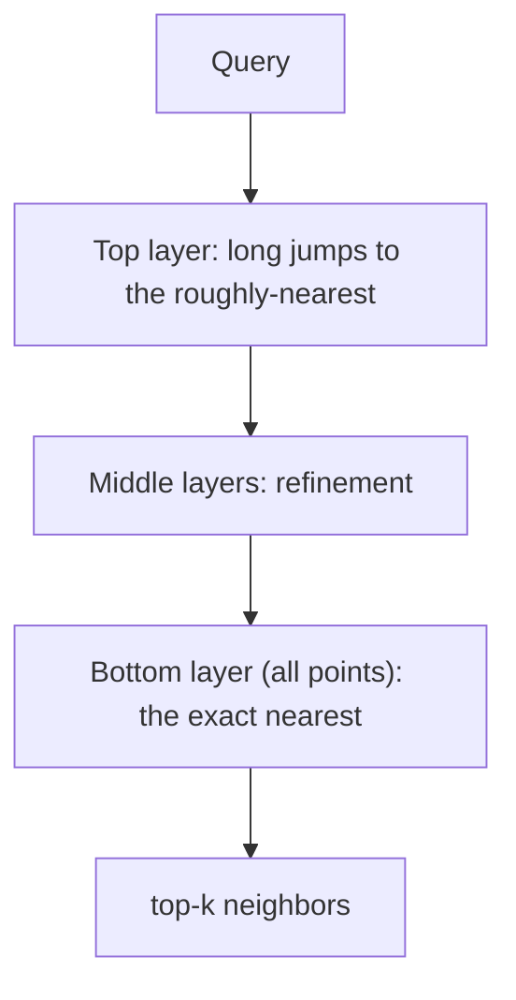
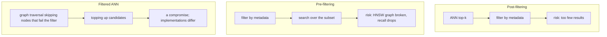

<!-- SPDX-FileCopyrightText: 2026 Aleksandr Drobiazkin
     SPDX-License-Identifier: CC-BY-SA-4.0 AND MIT
     Source: https://github.com/Drobiazkin/ai-agent-architecture
     Dual-licensed, and the boundary is exactly the fence: a fenced code block tagged
     with a language (python, java, sql, bash, yaml, xml, json), comments inside it
     included, is MIT. Everything else — the prose, the tables, the formulas, and the
     mermaid diagrams, which are illustrations expressed as text — is CC-BY-SA-4.0.
     Full terms: LICENSE, LICENSE-CODE, and NOTICE in the repository root. -->

# Chapter 8. Vector Indexes and Retrieval Infrastructure

The retrieval layer rests on a special kind of index over the data, and most of this chapter comes down to choosing the index structure and tuning it to the load. What makes it peculiar: "distance" here means geometric proximity in a high-dimensional space, and the index itself is *approximate* by construction.

## 8.1 The problem: nearest-neighbor search in high dimensions

Retrieval reduces to **nearest-neighbor search**: given a query vector, find the vectors in the corpus closest to it. Exact (brute-force) search costs `O(N·d)` per query: compare the query against each of the `N` vectors of dimension `d`. At millions of vectors the latency is unacceptable. So you need **ANN—Approximate Nearest Neighbor**: trading hit accuracy for speed. The operative word is *approximate*: an ANN index can, by construction, miss the true nearest neighbor. That is not a defect but a deliberate trade-off (§8.4).

## 8.2 Deep Dive: the curse of dimensionality

Why not reach for a familiar tree (a kd-tree) and stop thinking? Because in high dimensions (embeddings run to `d` = hundreds or thousands) the **curse of dimensionality** takes over: distances *concentrate*—the gap between the nearest and the farthest neighbor collapses, and almost everything ends up roughly equidistant. Tree structures (kd-tree, ball-tree), efficient in 2–3D, degrade into a brute-force scan: you have to walk nearly every branch. That is exactly why vector search got its own *purpose-built* ANN structures (graph-based and clustering-based) instead of reusing a database's spatial indexes. Grasping this explains why pgvector adds HNSW/IVFFlat rather than building an ordinary B-tree over a vector.

**The concentration criterion.** "Collapses" is not a metaphor but a theorem with a checkable condition. Beyer et al. (1999) state it this way: concentration sets in if the *relative* spread of distances—the variance, normalized by the distance's own average scale—tends to zero as dimension grows:

$$\lim_{d \to \infty} var\left( \frac{D_d^p}{E[D_d^p]} \right) = 0 \quad \Longrightarrow \quad \lim_{d \to \infty} P\left[ D_{max} \le (1 + \varepsilon) D_{min} \right] = 1$$

Where:
* $d$—the vector's dimension; embeddings run 384–4096, and from here on we take $d = 1536$.
* $D_d$—the distance from the query to a random corpus point at dimension $d$, in units of the metric (for L2 in the cube $[0,1]^{1536}$, about 16; the arithmetic is below).
* $p$—the exponent constant, $0 < p < \infty$; for squared Euclidean distance $p = 2$. It does not affect the substance.
* $E[\cdot]$ and $var(\cdot)$—the mean and the variance over the corpus. Dividing by $E[D_d^p]$ makes the quantity dimensionless: it is the spread of distances *as a fraction of their own scale*.
* $P[\cdot]$—the probability of an event; here, the fraction of queries for which the bracketed inequality holds.
* $D_{min}$, $D_{max}$—the distances from the query to the nearest and to the farthest of the $n$ corpus points; $n$ is **fixed**—the theorem is about $d$ growing with the corpus held constant, not the other way around.
* $\varepsilon$—the relative margin; the statement holds for any arbitrarily small $\varepsilon > 0$.

One caveat about citation accuracy: in the original the theorem is stated for an abstract index $m$ along which the sequence of distance distributions converges; dimension is its canonical case, and from here on we write $d$.

*In plain terms:* if, as dimension grows, distances stop differing from one another as a fraction of the average distance, then with probability tending to one the farthest point in the corpus lies no more than $(1 + \varepsilon)$ times as far as the nearest. Not "the far neighbor is a bit closer" but "far and near are indistinguishable": the word "nearest" stops singling anything out.

**Live numbers.** Uniform random points in the cube $[0,1]^d$ are exactly the case where the condition holds. Per coordinate, $E[(u - v)^2] = 1/6 \approx 0.167$ and $var = 7/180 \approx 0.039$. The coordinates are independent, so at $d = 1536$: $E[D^2] = 1536 / 6 = 256$, $var(D^2) = 7 \cdot 1536 / 180 \approx 59.7$, standard deviation $\sqrt{59.7} \approx 7.7$. The relative spread of the squared distance is $7.7 / 256 \approx 3\%$, and of the distance itself (the square root roughly halves the deviation)—**about 1.5%**, that is, $D \approx 16 \pm 0.24$. The whole corpus lies in a thin spherical shell around the query.

A direct simulation ($n$ = 200,000 points, averaged over several runs) confirms the estimate: at $d = 1536$ it gives $E[D] = 16.05$ and $\sigma = 0.224$, a spread of 1.4%, with $D_{min} \approx 15.0$ and $D_{max} \approx 17.0$. The same simulation exposes the mechanism of concentration in a single comparison: as dimension grows, the **absolute** spread does not change at all—$\sigma = 0.224$ at $d = 100$ and at $d = 3072$ alike, and the gap $D_{max} - D_{min} \approx 2.0$ likewise stays put—while the distance itself grows as $\sqrt{d/6}$: from 4.08 to 22.70. The contrast $(D_{max} - D_{min}) / D_{min}$ is a frozen constant divided by a growing denominator, so it melts away roughly as $1/\sqrt{d}$: 0.70 at $d = 100$, 0.13 at $d = 1536$, 0.09 at $d = 3072$. What collapses is not the spread—what collapses is its *share* of the distance.

**Why a tree ends up worse than a brute-force scan, not merely slower.** A kd-tree saves work in exactly one way—**pruning branches**: if the ball around the query with radius "out to the best candidate found so far" does not intersect a cell, that whole branch goes unread. But once contrast has collapsed, that radius nearly equals the distance to *all* the points at once, and the ball intersects practically every cell. There is nothing left to prune—the tree walks almost every leaf, doing the same work as a brute-force scan (the same $N$ distance computations), plus chasing pointers instead of running linearly through memory: sequential access, prefetching, and vectorization are all lost. Hence the result of Weber, Schek, and Blott (1998): above roughly **10** dimensions a simple sequential scan beats partitioning and clustering indexes on average. The tree here is not "slower"—it strictly loses to the `O(N·d)` brute-force scan (§8.1), and that is the concrete reason not to drag a spatial index into vector search.

**The paradox—and its resolution.** An attentive reader is obliged to trip here: if at $d = 1536$ everything really is equidistant, then HNSW's greedy descent (§8.3) is doomed exactly as the kd-tree is—yet it works. The theorem's premise resolves the contradiction. Beyer's condition holds for points whose coordinates behave independently (uniform noise); real embeddings do not behave that way. The model was trained to *pull* semantically close texts toward one another, so the vectors occupy not the cube's full volume but a thin **low-dimensional surface** inside it (a manifold—a surface embedded in a space of higher dimension: 1536 coordinates, but only dozens of independently varying directions). This is not a retrofitted excuse: Beyer et al. themselves put both exceptions in a separate section of their paper—clustered data (their section 4.1) and *implicitly low dimensionality* (their section 4.2).

The gap between the **nominal** dimension (how many numbers are in the vector) and the **intrinsic** one (intrinsic dimension—how many independent directions are actually in play) is measurable. LID estimates (local intrinsic dimensionality—the intrinsic dimension measured locally, in the neighborhood of each point) on standard corpora:

| Corpus | Nominal $d$ | LID (mean) |
|---|---|---|
| MNIST | 784 | 14.0 |
| Fashion-MNIST | 784 | 15.6 |
| GLOVE | 100 | 18.0 |
| GLOVE-2M | 300 | 26.1 |
| SIFT | 128 | 21.9 |

The curse acts on the nominal dimension, while the ANN graph navigates the intrinsic one—which is why HNSW stays alive at $d = 1536$. Chen et al. (2024) show this most directly: for *random* vectors the relative contrast (the ratio of the mean distance to the distance to the nearest neighbor; a value of 1 means "everything is equidistant, search is meaningless") collapses to 1 already at $d \approx 512$–$768$, whereas for text embeddings at the same dimensions it holds within 1.75–2.05. The same nominal $d$—the opposite outcome; the whole difference is in the distribution of the data, not in the dimension.

**The operational consequence.** Whether ANN works is a property of *your data*, not a guarantee of the algorithm. Within a single corpus, queries with high local dimensionality consistently take more time to reach the same recall, and on the hardest corpus (GLOVE-2M) not every implementation manages recall close to one (Aumüller & Ceccarello, 2019). But this cannot be carried across corpora, and the authors state the prohibition separately: LID by itself does not explain performance differences across datasets—SIFT, at LID 21.9, turns out in practice to be markedly easier than its LID predicts. Which only sharpens the conclusion: on data with honestly high intrinsic dimensionality—hashes, random vectors, poorly trained embeddings—HNSW's recall will sag just as the kd-tree's pruning does, and tuning `ef_search` will not cure it; but there is exactly one way to learn this about your own corpus—measuring recall against brute-force ground truth (§8.4) on *your* vectors. No published LID estimates for the typical 1536-dimensional embeddings of the latest generation could be found—all the more reason to measure intrinsic dimension and contrast on your own corpus instead of taking "dozens" on faith.

*Sources.* K. Beyer, J. Goldstein, R. Ramakrishnan, U. Shaft, "When Is 'Nearest Neighbor' Meaningful?" (ICDT, 1999)—theorem 1 and sections 4.1–4.2 on the exceptions. R. Weber, H.-J. Schek, S. Blott, "A Quantitative Analysis and Performance Study for Similarity-Search Methods in High-Dimensional Spaces" (VLDB, 1998)—the ~10-dimension threshold. M. Aumüller, M. Ceccarello, "The Role of Local Intrinsic Dimensionality in Benchmarking Nearest Neighbor Search" (SISAP, 2019)—the LID table, LID's effect on the cost of recall within a corpus, and the caveat that it does not carry across corpora. Z. Chen, R. Zhang, X. Zhao, X. Cheng, X. Zhou, "Exploring the Meaningfulness of Nearest Neighbor Search in High-Dimensional Space" (arXiv preprint, 2024)—relative contrast of embeddings versus random vectors.

## 8.3 Deep Dive: families of ANN indexes

Three main approaches, like different index types for different profiles:

**HNSW (Hierarchical Navigable Small World)**—graph-based, the dominant default. It builds a multilayer proximity graph: the upper layers are sparse (long "jumps"), the bottom one holds every point (a dense graph). Search is a greedy descent: start at the top layer, hop to the nearest neighbor, descend layer by layer.

Tuning parameters: **M**—the number of links per node (higher M → higher recall and more memory); **ef_construction**—the size of the candidate list during construction (higher → a better graph, a longer build); **ef_search**—the list size at query time (higher → higher recall, higher latency). Profile: high recall and a fast query, but **heavy memory** (the graph lives in RAM) and a **slow build**.

**IVF (Inverted File)**—clustering-based. K-means partitions the space into `nlist` (Voronoi) cells; a query searches only the `nprobe` nearest cells rather than the whole corpus. Parameters: **nlist** (the number of cells), **nprobe** (how many cells to probe—more → higher recall, slower). Profile: a fast build, less memory than HNSW; recall/speed is tuned through nprobe.

**PQ (Product Quantization)**—compression. It splits a vector into sub-vectors and encodes each with a code from a small codebook, cutting memory sharply (vector → $m$ bytes: the exact arithmetic and the mechanics of the speed are in the deep dive below). Often combined: **IVF-PQ** (clustering + compression) for billion scale. Profile: dramatically less memory, paid for in recall.

**DiskANN and disk-based indexes**—a graph on SSD for billions of vectors on a single node, when it all will not fit in RAM.

| Index | Recall | Query latency | Build | Memory | When |
|---|---|---|---|---|---|
| HNSW | High | Low | Slow | High (RAM) | The default: quality + speed, memory available |
| IVFFlat | Medium-high (nprobe) | Medium | Fast | Medium | Fast build, memory savings |
| IVF-PQ | Medium (compression loses some) | Low | Medium | Very low | Billions of vectors, memory is expensive |
| DiskANN | High | Medium (disk) | Slow | Low (RAM) | Billions on a single node |

*Sources.* Y. Malkov, D. Yashunin, "Efficient and robust ANN search using HNSW graphs" (2016/2018); H. Jégou et al., "Product Quantization for Nearest Neighbor Search" (2011); S. Subramanya et al., "DiskANN" (2019); J. Johnson et al., "Billion-scale similarity search with GPUs" (2017, FAISS).

The table's qualitative labels translate into orders of magnitude like this: at typical parameters HNSW holds recall@10 in the high 90s with millisecond search over millions of vectors; IVF shifts the balance toward less memory and greater sensitivity to parameters; PQ variants sacrifice recall for a multiple-fold saving. The specific numbers depend critically on the data and the parameters—take them from a benchmark on *your* vectors (methodology: ann-benchmarks) instead of carrying them over from someone else's table.

### Deep Dive: HNSW mechanics from the inside (including the pain of deletion)

HNSW is the default, so it pays to understand *why* it is fast and where it hurts.

**Small-world and layers.** HNSW builds a graph with the "small-world" property: most nodes are connected by short paths through a small number of "long-range" links (as in "six degrees of separation"). Layering adds a hierarchy: a node lands on layer `l` with *exponentially decaying* probability, so the upper layers are sparse (few nodes, long jumps) and the bottom one is dense (every node). Search starts at the top (coarse navigation in big jumps) and descends, refining. The "small-world + hierarchy" combination gives **logarithmic** search complexity instead of linear—that is where the speed comes from.

**Greedy search with backtracking (ef).** On each layer, a greedy walk: move to the neighbor closest to the query. But pure greed gets stuck in local minima, so the search maintains a **dynamic candidate list of size `ef`** (a beam/backtracking, in effect): higher `ef_search` → a wider search, higher recall, higher latency. This is the main recall ↔ speed trade-off knob at query time.

**Construction.** Inserting a node: find its `M` nearest neighbors (with that same search) and link to them on every layer where it is present. Hence `ef_construction` (the quality of the neighbor search at insertion) and `M` (the graph's degree): higher means a better graph, but costlier memory and build.

**Deletion—the real operational downside.** HNSW **supports deletion poorly**: removing a node risks breaking connectivity (paths ran through it), which lowers recall. In practice deletion is **soft** (a tombstone: mark it deleted, filter at retrieval) with a **periodic full rebuild** of the index to purge physically. The consequence: where data gets deleted or changed often (GDPR deletion requests, document rotation), the rebuild strategy is planned up front, on the understanding that a vector index is not a table you can cheaply delete a row from; deletion here takes a separate operation.

*Source.* Malkov & Yashunin (2016/2018); the pgvector/FAISS documentation on deletion limitations.

### Deep Dive: the quantization spectrum (memory is often the main limit)

Memory for vectors is a common limit at scale; quantization cuts it, paying in recall. The spectrum, by aggressiveness:

- **Scalar quantization (SQ)**—a component as int8 instead of float32. ~4× savings, a small recall loss. The cheap default.
- **Product quantization (PQ)**—split the vector into sub-vectors, encode each with an index into a trained codebook. High compression (vector → $m$ bytes at $k^* = 256$—96 bytes at $d$ = 1536, $m$ = 96; the arithmetic is in the deep dive below), a more noticeable recall loss; often paired as IVF-PQ for billions (§8.3). Rescoring candidates with full vectors (see the next item) applies to PQ as well—comparing methods is only fair when both are equally two-stage.
- **Binary quantization (BQ) + rescoring**—the most aggressive and the most fashionable (2024): a component → *1 bit* (its sign), similarity by Hamming distance. Up to ~32× savings and a very fast search. The precision loss is offset by **rescoring**: pull candidates with the binary vectors (coarse, cheap), then re-score the top-N with the *full* (float) vectors. The two-stage "coarse-binary → exact-full" gives nearly full recall on a fraction of the memory—conceptually the same move as retrieve-then-rerank (§7.4), but at the level of the vector's representation.

| Method | Memory savings | Recall loss | When |
|---|---|---|---|
| Scalar (int8) | ~4× | Small | The cheap default |
| Product (PQ) | High: $4d/m$ at $k^*=256$ (64× at d=1536, m=96) | Noticeable | Billions of vectors |
| Binary + rescoring | ~32× | Small (with rescoring) | Memory is the main limit, speed is needed |

The conclusion: when memory (rather than latency or quality) becomes the constraint, quantization is the first lever; **binary + rescoring** today gives the best memory ↔ quality trade-off for many cases. Recall (§8.4) is measured at every compression level—that is the price of compression.

*Source.* Jégou et al. (2011, PQ); materials on binary quantization + rescoring in vector databases (2024).

### Deep Dive: PQ mechanics from the inside (compression and ADC)

PQ is the main lever at billion scale, so it pays to be able to compute *how much* it actually saves, to understand why a compressed index turns out to be fast as well, and to know where it breaks silently. All three answers come out on paper, before any benchmark.

**The arithmetic of compression.** The vector is cut into $m$ disjoint sub-vectors ($d$ must be divisible by $m$). For each piece, *separately*, its own **codebook** is trained—a set of $k^*$ typical representatives (centroids). The vector itself is then not stored: what is stored is $m$ numbers—"which of the $k^*$ stock shapes each piece resembles."

$$L = m \cdot \log_2 k^* \text{ bits}, \qquad \text{compression} = \frac{32d}{m \cdot \log_2 k^*} \;=\; \frac{4d}{m} \;\;(\text{only when } k^* = 256)$$

* $d$—the embedding's dimension, typically 1536 (§1.3);
* $m$—how many pieces the vector is cut into; **this is the tuning knob**;
* $D^* = d/m$—the dimension of one piece;
* $k^*$—the codebook size for one piece; 256 by convention—and the short form $4d/m$ holds **only** at that value (why: below);
* $L$—the code length of one vector;
* 4—bytes per component of the original float32;
* 32 = 4 bytes $\times$ 8 bits—the conversion factor: it brings the original vector's bytes and the code's bits to a common unit.

Live numbers at $d = 1536$, $m = 96$: a piece holds $D^* = 16$ components; $\log_2 256 = 8$ bits—**exactly one byte**, and that is precisely why $k^* = 256$ became the convention: a centroid's number is addressed by a byte with no bit packing. The vector's code = $96 \times 8 = 768$ bits = **96 bytes**, against the $1536 \times 4 = 6144$ bytes of the original vector. Compression: $6144 / 96 = 64\times$.

The same place shows both where the short form comes from and where it stops. At $k^* = 256$ the factor $\log_2 k^* / 8 = 1$ collapses, and $4d/m$ is all that remains of the general formula. Move $k^*$ and it starts lying: at $k^* = 1024$ a piece costs $\log_2 1024 = 10$ bits = 1.25 bytes, the code = $96 \times 1.25 = 120$ bytes, compression = $6144 / 120 = 51.2\times$, not 64×. The short form would have overstated it by 25%. $4d/m$ is not a law of PQ but the arithmetic of one particular convention, "a centroid = exactly a byte"; outside it you compute with $32d / (m \log_2 k^*)$.

In plain terms: what is left of the vector is 96 bytes of pointers into a table of stock shapes—64 times less than it weighed. The knob works like this: larger $m$ → a longer code → weaker compression, but a more accurate approximation and higher recall; smaller $m$ → more aggressive and coarser. The codebooks themselves weigh $k^* \cdot d$ float32 = $256 \times 1536 \times 4 \approx 1.5$ MB per index—a one-time quantity, negligible across millions of vectors.

**ADC: why PQ is not only small but fast.** The §8.3 table gives PQ "low latency," and that is not a consequence of small size in itself—a separate mechanism is responsible for the speed: **ADC (asymmetric distance computation)**. It is "asymmetric" because only the database is encoded and the **query is not quantized**: a live query vector is compared against a document's code (which is also more accurate—quantization noise enters once, not twice). The scheme: once per query, a table is computed of the squared distances from each piece of the query to all the centroids of the corresponding codebook—$m \times k^* = 96 \times 256 = 24{,}576$ numbers at a cost of $k^* \cdot d = 256 \times 1536 \approx 393$ thousand operations. After that, the distance to **any** document is $m = 96$ table reads and additions; not a single multiplication over $d$. In the original's own words: "only $m$ additions are required per distance calculation."

Live numbers on a corpus of $n = 10$ million: the scan costs $n \cdot m = 10^7 \times 96 = 960$ million additions, while building the table costs 393 thousand—0.04% of the work (the original also gives the break-even point: the table stops being noticeable once $n > k^* D^* = 256 \times 16 = 4096$). An exact brute-force scan on the same data is $n \cdot d = 10^7 \times 1536 \approx 15.4$ billion multiply-adds. So there are two wins at once: $d/m = 16$ times less arithmetic, and it is additions instead of multiplications; and 64 times less memory traffic (96 bytes against 6144 per vector). Since the scan is bound by memory bandwidth rather than by the ALU, the second is what decides: "small" and "fast" are one property of PQ, not two. A caveat from the same paper: what stops you from growing $k^*$ past 256 is not only the lengthening code but also the volume of the centroids ($k^* \cdot d$ floats), which is efficient only as long as it fits in cache.

**The failure mode: distribution drift.** A codebook is not a constant of the algorithm but a model **trained on data**: $m$ independent k-means runs over a *sample* of the corpus. The sample is small and hard-capped by default: FAISS trims the training set to `max_points_per_centroid` = 256 points per centroid, that is, to $256 \times 256 = 65{,}536$ vectors—however many millions sit in the corpus (and below `min_points_per_centroid` = 39 per centroid it emits a warning). The original paper puts it plainly: a codebook is "to some extent, still adapted to the data distribution to represent"—it is fitted to the distribution it was shown.

Hence a failure mode specific to PQ. A new document domain arrives—a different language, a different subject area—its vectors land far from every centroid, quantization error grows, recall drops. **And no error is raised at any point**: the index does not crash, queries answer, codes get written, the metrics are green. The only detector is measuring recall against brute-force ground truth (§8.4), and *on the new domain separately*, not on the pooled sample. IVF's cells are also built by k-means over a sample and also drift, but IVFFlat stores full vectors: distances inside the probed cells stay exact, and re-clustering needs nothing beyond what already sits in the index. With PQ the loss is baked into the stored representation itself.

The cost of the fix is the key point for a migration plan. Drift is cured by retraining the codebooks and **re-encoding the whole corpus**, but there is nothing to re-encode from: a PQ code is irreversible, the vector cannot be recovered from it—which is exactly why the index takes 96 bytes instead of 6144. So you need the original float vectors, which PQ exists in order not to store—meaning a fresh run of the embedder over the corpus. That is the same class of cost as switching the embedding model (§8.8).

**The invariant.** Choosing PQ means accepting not only the "64 times less memory ↔ lower recall" trade-off but also an obligation: either the original vectors sit in cold storage, or the plan carries a budget for re-embedding the entire corpus. The first is cheaper and has a second, rarely named bonus—those same vectors are what rescoring needs (above, in §8.3). And recall gets measured whenever a new domain arrives: distribution drift keeps quiet.

*Sources.* H. Jégou, M. Douze, C. Schmid, "Product Quantization for Nearest Neighbor Search" (IEEE TPAMI, 2011)—the split into $m$ sub-vectors, $l = m \log_2 k^*$, "$k^* = 256$ and $m = 8$ are often a reasonable choice," ADC/SDC, Table II (a cost of $k^*D$ for the table, $nm$ for the scan), codebook training by Lloyd's algorithm; the FAISS sources (`Clustering.h`: `min_points_per_centroid` = 39, `max_points_per_centroid` = 256).

## 8.4 Deep Dive: the universal trade-off

ANN has no free lunch—it has a trade-off surface between four quantities: **recall ↔ query latency ↔ memory ↔ build time**. You cannot maximize all of them: raising ef_search increases recall and latency; moving to PQ lowers memory and recall. Tuning ANN means picking a point on that surface for a specific load profile.

The key engineering move people so often skip: **measuring recall@k against brute-force ground truth.** Because ANN is approximate, you have to know *how much* recall was given up for speed. For that you assemble a small set of queries, compute the exact neighbors by brute force (offline, once), and measure what fraction of them the ANN index finds at the current parameters. Without this, tuning proceeds blind and the size of the loss is unknown.

## 8.5 Deep Dive: pgvector

**pgvector** is the pragmatic default: it stores vectors *in Postgres*. That buys transactions, JOINs against business tables, access control through the mechanisms you already have, and—above all—**no new datastore** until you actually need one.

- **Index types:** HNSW and IVFFlat (the same families from §8.3).
- **Parameters:** HNSW—`m`, `ef_construction` (at index creation), `hnsw.ef_search` (at query time, via SET); IVFFlat—`lists` (at creation), `ivfflat.probes` (at query time).
- **Distance operators:** `<=>` cosine, `<#>` (negative) inner product, `<->` Euclidean (L2). The operator you pick matches the similarity measure you chose (§1.3).

**When pgvector is enough, and when to move out to a dedicated database (Qdrant/Weaviate/Milvus):** pgvector covers the start and mid-scale beautifully, especially where the tie-in with relational data and filtering is valuable. Moving out makes sense at: very large scale (hundreds of millions and up), heavy load with hard latency requirements, or a need for the advanced capabilities of dedicated databases (complex filtering with ANN, sharding, built-in hybrid engines). The rule: **start with pgvector and move out on proven need.**

*Source.* The pgvector documentation.

## 8.6 Deep Dive: hybrid search infrastructure and the filtering pitfall

Hybrid (§7.3) is implemented inside one relational database: pgvector (dense) + Postgres full-text search (`tsvector` with a GIN index, sparse) + an RRF merge in SQL or in the application.

But there is an **important pitfall—how metadata filtering interacts with ANN.** You often need a search *with a filter*: "the nearest chunks, but only from sales-department documents, no older than a year." It naively looks trivial, but ANN and the filter conflict:
- **Post-filtering** (ANN top-k first, then filter by metadata)—can return *too few*: if 2 survive the filter out of the top-50 and you need 5, the result is short and the search has to be widened.
- **Pre-filtering** (select by metadata first, then search among the survivors)—"breaks" the HNSW graph: the traversal assumes the full graph, and on a subset connectivity is broken and recall drops; the alternative is a brute-force scan over the subset.

Real systems use **iterative / filtered ANN** (a graph traversal that skips nodes failing the filter and tops up candidates), and different vector databases implement this differently and with differing quality. A concrete reference point: pgvector 0.8.0 (October 2024) formalized it as `hnsw.iterative_scan` (modes strict_order / relaxed_order) with a top-up budget of `hnsw.max_scan_tuples`—filtered ANN went from "implicit behavior nobody talks about" to a tunable parameter with documented semantics. The practical conclusion: **filtering with ANN is neither free nor trivial**; where the filter is highly selective, recall (§8.4) gets checked precisely *with the filter on*, not only on a clean search.

## 8.7 Deep Dive: RBAC/ABAC at retrieval (a bridge to security)

A critical and underrated topic. The index holds chunks from documents at *different clearance levels*, and a query is obliged to return only what a particular user is *allowed* to see. Skip this and you have an access-control breach at retrieval: the agent will retrieve and display (or use in its answer) a confidential chunk the user has no rights to.

Approaches:
- **Filtering on an ACL in the metadata**—attach an owner/clearance/access list to every chunk and filter at query time by the user's rights. Simple, but see §8.6 (filter + ANN).
- **Postgres Row-Level Security (RLS)**—RLS policies on the chunk table: the user physically does not see rows outside their rights. Powerful and dependable, because access is enforced at the database level rather than in application code (which you can forget to write).
- **An index per tenant/level**—separate indexes/collections for isolated groups (hard isolation, paid for by duplicated infrastructure).

Integration with the access-management system: the user's roles and rights from the token map onto a filter predicate or an RLS policy. The key invariant: **access control is applied at retrieval, not at generation**—you cannot rely on the model to "just not show" what is off-limits: the model is not a security mechanism.

## 8.8 Operational concerns

- **Reindexing when the embedding model changes.** Vectors from different models are not comparable (§1.3)—switching the embedder means a *full* reindex of the corpus. This goes into the migration plan as an expensive operation.
- **Build cost and incremental updates.** HNSW builds slowly; plan for incremental insertion and rebuilds.
- **Freshness and staleness.** A pipeline that keeps the index in agreement with the source (§6.6, the "staleness" mode).
- **Capacity planning.** Memory for the HNSW graph and for the vectors themselves is a new consumer of RAM, counted when you size capacity; the arithmetic is below.

### Deep Dive: capacity planning in bytes

The threshold for moving out of pgvector in §8.5 is stated in rows—"hundreds of millions." In rows it is deceptive: you pay in bytes, and you can hit a node's ceiling two orders of magnitude earlier. This is napkin arithmetic, done before you buy hardware.

**What a vector weighs.** pgvector stores the `vector` type densely, without compression:

$$S_{vec} = 4d + 8$$

* $S_{vec}$—bytes per vector.
* $d$—the embedding's dimension (§1.3), a count: 1536 for the common OpenAI models (text-embedding-3-small, ada-002), 1024 for BGE-M3.
* 4—bytes per component: each number is stored as `float32`.
* 8—bytes of the value's header (length and dimension).

At $d = 1536$: $4 \cdot 1536 + 8 = 6152$ bytes. **In plain terms:** one chunk costs ~6 KB before any index at all.

**What the graph weighs.** Malkov and Yashunin give the average memory per element directly:

$$S_{graph} = (M_{max0} + m_L \cdot M_{max}) \cdot b$$

* $M_{max0}$—the cap on links for a point on layer zero (the dense one, where *all* the points live, §8.3). The authors recommend $2M$, that is, 32 at $M = 16$ (in pgvector this parameter is spelled with a lowercase `m`, default 16).
* $M_{max}$—the same for the upper, sparse layers; equal to $M$ = 16.
* $m_L$—the factor that normalizes the level draw for a new point: the level is drawn as $\lfloor -\ln(U) \cdot m_L \rfloor$, where $U$ is uniform on (0,1). The authors recommend $1/\ln M = 1/\ln 16 \approx 0.36$. It is the scale of the draw, and only that: $m_L$ is not the number of layers per point. Layers thin out exponentially—$e^{-1/m_L}$ = ~1/16 of the points reach layer 1, ~1/256 reach layer 2—so nearly the whole mass of links sits on layer zero.
* $b$—bytes per link. For the authors it is 4: they cap the index at roughly four billion elements and store a neighbor as a 32-bit number. **In pgvector the figure is different**—there a link is written as an `ItemPointerData`, Postgres's standard pointer to a row ("a page number plus an offset within it"), and that takes 6 bytes. Below, the authors' arithmetic is reproduced first at $b$ = 4, then recomputed for pgvector at $b$ = 6.

Substituting at $M$ = 16: $(32 + 0.36 \cdot 16) \cdot 4 = 37.8 \cdot 4 \approx 151$ bytes. A convergence check: across the whole working range $M$ = 6–48 the formula gives 61–434 bytes—which is exactly the estimate the authors published, "about 60–450 bytes per object, *not counting the data itself*." Of those ~38 links per point, layer zero holds 32, and the entire superstructure above it holds $0.36 \cdot 16 \approx 6$.

*A caveat about the upper term.* It is overstated. The average number of upper layers per point is the sum of the probabilities of landing on layer 1, on layer 2, on layer 3, and so on: $\sum_{k \ge 1} 16^{-k} = 1/15 \approx 0.067$—that is, ~1 link from above, not 5.8. The figure agrees with the authors' own formulation for the choice $m_L = 1/\ln M$—"average single element overlap between the layers," an overlap of one element between layers. The original's arithmetic is nevertheless kept here: it gives an upper bound—for capacity planning an error in that direction is safe—and it reproduces the published range. Anyone computing more precisely takes ~33 links instead of ~38: the graph comes out ~12% lighter, which does not affect the section's conclusion.

**Recomputed for pgvector.** The same ~38 links, but at 6 bytes each: $(32 + 0.36 \cdot 16) \cdot 6 \approx 227$ bytes per element. That is the figure used in the arithmetic from here on. **In plain terms:** the graph is roughly 38 neighbor references per point, and it does not depend on $d$ at all.

**Hence the section's main conclusion.** 227 bytes against 6152—the graph is ~3.7% of the footprint. Which means **`m` is not a memory lever**: doubling it costs another ~3.5% of RAM and pays for itself in recall; cutting it to save memory is pointless. Memory is the *vectors*, and there are exactly two levers against them, both already named. The first is quantization (§8.3): `halfvec` stores a component in two bytes instead of four ($2d + 8$ = 3080 B, ~2×), and `binary_quantize` into the `bit` type stores it in one bit ($d/8 + 8$ = 200 B, ~30×, with mandatory rescoring of candidates against full vectors). The second is trimming the dimension (§7.6, Matryoshka): 1536 → 768 halves the bill with no retraining of the embedder and no reindexing from another source.

**The whole corpus.** $N$ = 10 million chunks, $d$ = 1536, $m$ = 16: vectors $10^7 \cdot 6152$ B ≈ 61 GB, graph $10^7 \cdot 227$ B ≈ 2.3 GB.

And that is a lower bound—in pgvector it is understated by roughly a factor of two. The HNSW index does not reference the table row; it keeps its **own full copy** of each vector inside its element (the `Vector data` field in the `HnswElementTupleData` struct, `src/hnsw.h`). So the table is ≈61 GB *and* the index is ≈63 GB on top of it. Storage granularity piles on: a Postgres page is 8 KB, an index element at $d$ = 1536 is over 6 KB, two will not fit in a page, so in effect a whole page goes on each vector. The result: on the order of an estimated 130–150 GB instead of the naive 61; the exact figure you take from `pg_relation_size` on your own data rather than from this back-of-the-envelope (the same discipline as with recall, §8.4). That same 8-kilobyte limit also explains the 2000-dimension ceiling on `vector` for HNSW ($4 \cdot 2000 + 8 = 8008$ B—right up against the page): $d$ = 3072 (text-embedding-3-large) cannot be indexed as `vector` at all and requires `halfvec` (whose ceiling is 4000).

**The invariant: capacity here is a cliff, not a slope.** An HNSW traversal is random access across a graph: dozens of hops per query into unpredictable places in the index. While everything sits in RAM, a hop costs on the order of 100 ns and the search fits inside milliseconds (§8.3). The moment the vectors plus the graph stop fitting in the node's RAM, every cache miss turns into an SSD read—on the order of 100 µs, a thousand times more expensive—and a hundred hops then gives an estimated tens of milliseconds instead of one. The degradation is not gradual: the index does not "slow down a bit," it falls through by an order of magnitude or more, all at once, out of nowhere. The practical consequence: 10 million chunks is fifty times short of the "hundreds of millions" from §8.5, and yet a 64-gigabyte node is already finished on them. Plan in bytes, and take the decision from §8.3: either shrink the vector (quantization, Matryoshka) or take an index designed to live on disk (DiskANN)—HNSW was never built for it.

*Sources.* Y. Malkov, D. Yashunin, "Efficient and robust approximate nearest neighbor search using Hierarchical Navigable Small World graphs" (2016/2018)—the graph memory formula and "60–450 bytes per object" (§4.2.3), the four-byte link in the same place, the recommendations $M_{max0} = 2M$ and $m_L = 1/\ln M$ with "average single element overlap" (§4.1), the level draw (alg. 1). The pgvector documentation and source code (`src/hnsw.h`)—the sizes of the `vector`/`halfvec`/`bit` types, storing links as `ItemPointerData` (`HNSW_NEIGHBOR_TUPLE_SIZE`), the default value of `m` (`HNSW_DEFAULT_M` = 16), the 2000-dimension limit (`HNSW_MAX_DIM`). The PostgreSQL source code (`src/include/storage/itemptr.h`)—the size of `ItemPointerData`: "designed to be six bytes long."

## 8.9 Chapter summary

Vector search is a special kind of index; ANN is *approximate* by construction and sits on a trade-off surface of recall ↔ latency ↔ memory ↔ build (§8.4), tunable to the load. HNSW is the default (quality and speed, paid for in memory), pgvector the pragmatic store to start with. Mandatory in production: hybrid, metadata filtering (accounting for its conflict with ANN, §8.6), and **access control at retrieval** (§8.7). Recall is measured against ground truth, filters included.

*Sources.* Malkov & Yashunin (2018, HNSW); Jégou et al. (2011, PQ); Johnson et al. (2017, FAISS); the pgvector documentation; the survey by Gao et al. (2023).

---
