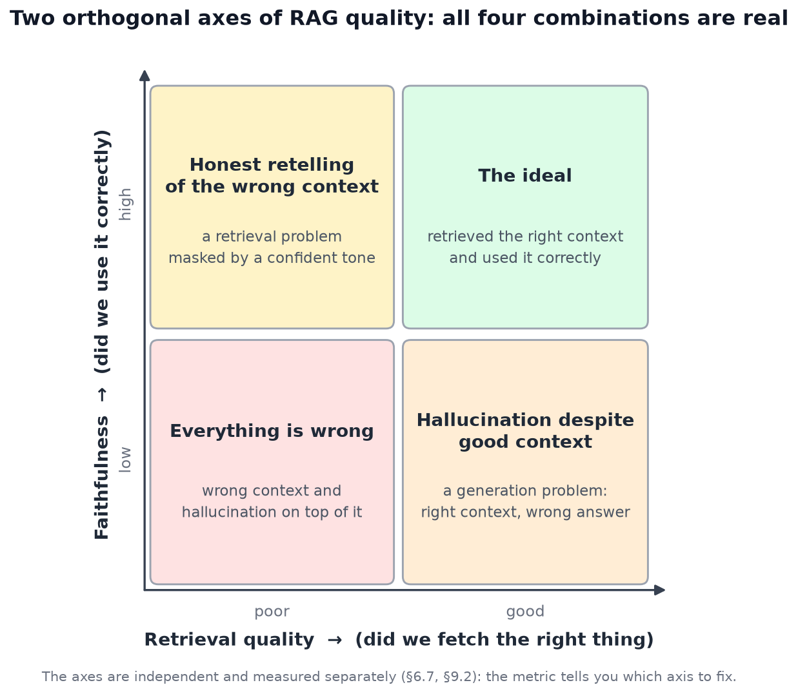
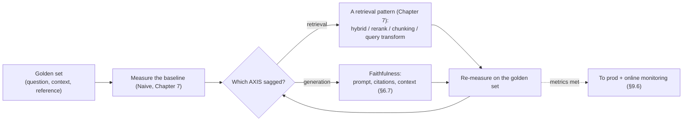

<!-- SPDX-FileCopyrightText: 2026 Aleksandr Drobiazkin
     SPDX-License-Identifier: CC-BY-SA-4.0 AND MIT
     Source: https://github.com/Drobiazkin/ai-agent-architecture
     Dual-licensed, and the boundary is exactly the fence: a fenced code block tagged
     with a language (python, java, sql, bash, yaml, xml, json), comments inside it
     included, is MIT. Everything else — the prose, the tables, the formulas, and the
     mermaid diagrams, which are illustrations expressed as text — is CC-BY-SA-4.0.
     Full terms: LICENSE, LICENSE-CODE, and NOTICE in the repository root. -->

# Chapter 9. Evaluating RAG Quality

Chapter 6 established it: retrieval is the silent bottleneck, and quality is two orthogonal axes. This chapter is about how to *measure* them, because fixing RAG without measuring (§6.6) is done blind. At bottom this is regression-testing and SLO discipline applied to a probabilistic system.

## 9.1 Why measure: eval-driven RAG

Naive RAG misses silently on a noticeable share of queries (§6.5), and a confident wrong answer is indistinguishable by eye from a correct one. The only way to manage quality is to **measure it as a metric**. Hence eval-driven RAG development: pin down what "good" means as measurable metrics, measure a baseline, and iterate against the metrics. Since quality is two axes (§6.7), you measure *both separately*—otherwise it is unclear *what* to fix.

## 9.2 Deep Dive: a two-axis metric framework

We measure retrieval and generation separately (this is essentially the RAGAS framework):

**The retrieval axis—"did we pull the right thing?"**
- **Context Recall**—the share of the relevant information that retrieval actually *pulled* (did we miss what was needed). Low → a recall problem (§7.3, §7.5).
- **Context Precision**—is what we pulled relevant, and is it well ranked (did we drag in noise, is the needed thing buried). Low → you need a reranker/filters (§7.4).
- **Classic IR metrics** (when you have labeled relevance judgments): **Hit Rate** (did we find at least one relevant item in the top-k), **MRR** (how high the first relevant one sits), **NDCG**[^t-ndcg] (the quality of the whole ranking).

**The generation axis—"did we use it correctly?"**
- **Faithfulness / Groundedness**—does *every claim* in the answer rest on the retrieved context, with nothing invented beyond it. Low → the model hallucinates despite good context (a generation problem, §6.7).
- **Answer Relevancy**—does the answer address *the question asked* (and not a neighboring one).
- **Answer Correctness**—does it match the reference (when a reference exists).

| Axis | Metric | What it diagnoses | Where to fix |
|---|---|---|---|
| Retrieval | Context Recall | Missed something relevant | Hybrid, query transform, chunking |
| Retrieval | Context Precision | Noise / bad ranking | Reranking, filters |
| Generation | Faithfulness | Hallucination beyond the context | Prompt, citations, temperature |
| Generation | Answer Relevancy | Answer off the question | Prompt, query rewriting |

Keeping them separate is exactly what gives you a diagnosis: low Context Recall with high Faithfulness means "the model honestly restated an incomplete context" → fix *retrieval*, not generation.

### Deep Dive: how the metrics are actually computed

"Faithfulness" and "context precision" sound abstract; knowing the *algorithm* is what lets you trust the number and debug it. Here is how RAGAS (and its analogues) does it:

- **Faithfulness.** (1) Break the answer into atomic *claims*—with a separate LLM call. (2) For each one, ask the judge: "does this follow from the retrieved context?" (yes/no). (3) `faithfulness = (confirmed claims) / (total claims)`. The metric is the share of the answer that actually rests on the context. Debugging: you can see *exactly which* claims went unconfirmed.
- **Answer Relevancy.** (1) From the generated answer an LLM works *backward* and produces several questions this answer would be answering. (2) The similarity of those questions to the *original* one gets computed (embeddings). (3) High similarity → the answer is on point; low → it drifted off. Catches "answered the wrong question" without a reference.
- **Context Precision.** Looks at the *ranking*: do the relevant chunks sit *above* the irrelevant ones in the retrieved list (going by the positions of the relevant ones). Low → you need a reranker (§7.4).

A faithfulness micro-example. The answer: "A return is filed within 14 days; for electronics the window is 30 days; the courier comes free of charge." The decomposition: (1) "a return—14 days"—present in the context ✓; (2) "for electronics—30 days"—present ✓; (3) "courier free of charge"—absent from the context ✗. Faithfulness = 2/3 ≈ 0.67, and you can see immediately *which* claim was invented—that is exactly what separates a diagnosable metric from eyeballing it.
- **Context Recall.** Requires a reference answer: every claim in the *reference* is checked for *attributability* to the retrieved context. `recall = (reference claims covered by the context) / (total reference claims)`. Low → retrieval missed what was needed (§7.3/7.5).

The key observation: almost all of these metrics *use an LLM themselves* (to break text into claims and to check entailment)—which makes them LLM-as-judge under the hood (§9.4), with every calibration requirement that carries. So "RAGAS = 0.82" is not an absolute but a *measurement made by a measuring instrument*, and it has to be validated (see below).

*Source.* S. Es et al., "RAGAS" (2023).

## 9.3 Deep Dive: the golden set

The foundation of any evaluation is a **golden set** (golden dataset): a curated collection of tuples `(question, relevant context, reference answer)`. It is the regression test suite for RAG; without it, evaluation is impossible.

How to build it:
- **From real queries**—collect actual user questions (the most valuable source—it reflects the real load).
- **Expert labeling**—an SME marks up which context is relevant and what the ideal answer is.
- **LLM generation + human review**—have the model generate questions from the documents, then validate them with a human, *without exception* (otherwise the eval inherits the generator's errors).

Requirements: **coverage** (easy factoids *and* hard multi-step ones, edge cases, questions with no answer in the corpus—to check that the system admits "I don't know" instead of inventing); enough **size** for statistical significance, though the quality of the examples matters more than their count. A golden set is versioned and grows along with the system. The external reference point for the retrieval side is **BEIR** (Thakur et al., 2021), a heterogeneous IR benchmark: useful for sanity-checking baseline retrieval quality before you have domain labels, but it does not replace a golden set of your own.

## 9.4 Deep Dive: LLM-as-judge for RAG

Faithfulness and relevancy are semantic properties; a boolean assert cannot check them. The answer is **LLM-as-judge** (in detail in Chapter 17): hand the judge the question, the context, the answer, and a *rubric*, and ask for a score.

- **Faithfulness through a judge:** break the answer into claims and ask of each one, "is this confirmed by the retrieved context?"—the share confirmed is the faithfulness. This operationalizes "did it make something up."
- **Answer Relevancy through a judge:** score how well the answer addresses the question actually asked.
- **Reference-free vs reference-based:** faithfulness/relevancy can be measured *without a reference* (the judge sees only question + context + answer)—which is convenient, and a reference is not always needed. Correctness requires one.
- **Calibrating the judge is mandatory** (Chapter 17): explicit scoring steps, a strict mode for pass/fail, and validation against human labels on a subsample—otherwise you are trusting an uncalibrated instrument.

In production: light/cheap metrics on 100% of traffic + an expensive LLM judge on a sample (Chapter 17), so you are not paying to evaluate every request.

### Deep Dive: statistical rigor and validating the judge

An eval is a measurement, and a measurement has error. Academic honesty demands you reckon with it.

- **The variance of an LLM judge.** The judge is nondeterministic (§2.4) and noisy: the same answer can draw a different score from run to run. Mitigation: average over several runs for decisions that matter; pin the judge to a low temperature; prefer binary/discrete verdicts over continuous ones (they hold up better).
- **Sample size and significance.** A metric moving from 0.80 to 0.83 on 30 examples is probably noise. To tell a real improvement from a chance one you need a golden set of sufficient size and, ideally, **confidence intervals** or a significance test on the difference. The rule: an improvement that fits inside the spread does not count as an improvement. This is standard statistical-significance discipline applied to evaluation.
- **Validating the judge against humans (eval the evaluator).** Before you trust an LLM judge, you have to show that it agrees with a human: label a subsample by hand and compute **agreement** (Cohen's kappa[^t-kappa], for instance) or the correlation "judge ↔ humans." Low agreement means the judge's rubric needs fixing, not that its numbers deserve trust. Skip this step and the SLO rests on an uncalibrated instrument.
- **Regression mode.** A golden set with thresholds in a CI gate (§9.5) catches *regressions* when the prompt, the model, or the embedder changes (§2.4); pin the baseline and set an alert on a drop.

The conclusion: treat evaluation as a measuring system that has error—average out the judge's noise, check the significance of differences, and *validate the judge itself against humans* before building decisions on its numbers. Otherwise "faithfulness 0.9" is a number with no confidence interval and no calibrated instrument behind it.

*Source.* L. Zheng et al., "Judging LLM-as-a-Judge with MT-Bench and Chatbot Arena" (2023); the classical statistics of rater agreement.

## 9.5 Deep Dive: the eval-driven RAG loop (ties Chapters 6–9 together)

Here is the working loop that stitches all of Part III together:

This operationalizes the "ladder" (§7.1): you climb the retrieval patterns **not at random but on the strength of a measurement**—the metric tells you *which axis* sagged and therefore *which* pattern to apply. That is exactly how the principle "start simple, add complexity on proven need" turns from a slogan into a process.

## 9.6 Online evaluation and monitoring

Offline evals (a golden set as a CI gate before deploy) are necessary but not sufficient. In production, add **online evaluation**: sample real traffic, run the judge over it, track **quality drift** over time (the corpus changes, queries drift, the model gets updated—§2.4). The signals: faithfulness dropping, "not found" rising, anomalies in retrieval latency. This is the bridge to observability (Chapter 18): tracing the RAG pipeline + quality metrics on a dashboard.

## 9.7 Summary of the chapter and of Part III

Evaluating RAG means measuring **the two orthogonal axes separately** (retrieval quality and faithfulness) on a **golden set** with an **LLM judge**, and using the measurement to decide *which pattern* (Chapter 7) to apply. That closes Part III: **RAG = ground it (Chapter 6) → improve it with patterns (Chapter 7) on the right infrastructure (Chapter 8) → guided by measurement (Chapter 9), iteratively.** Format was settled in Part II; knowledge and its correctness, in Part III. Next comes Part IV: how to make this grounded component *act*, by applying the patterns of orchestration and reliability.

*Sources.* S. Es et al., "RAGAS: Automated Evaluation of Retrieval Augmented Generation" (2023); the Y. Gao et al. survey (2023); Chip Huyen, *AI Engineering* (2025); the classic IR metrics (MRR, NDCG, recall@k).

**In the Margins: Chapter 9**

[^t-ndcg]: **NDCG**—Normalized Discounted Cumulative Gain: a relevant document's contribution is discounted by the logarithm of its position, and the sum is normalized against the ideal ordering (1.0 = the best possible). Penalizes "the right thing is there, but at the bottom of the list."
[^t-kappa]: **Cohen's kappa**—the agreement of two raters, corrected for chance matches: κ = (p₀ − pₑ)/(1 − pₑ). Fairer than a raw percentage of matches, especially when the class distribution is skewed.

---
