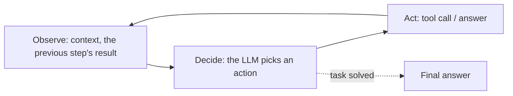

<!-- SPDX-FileCopyrightText: 2026 Aleksandr Drobiazkin
     SPDX-License-Identifier: CC-BY-SA-4.0 AND MIT
     Source: https://github.com/Drobiazkin/ai-agent-architecture
     Dual-licensed, and the boundary is exactly the fence: a fenced code block tagged
     with a language (python, java, sql, bash, yaml, xml, json), comments inside it
     included, is MIT. Everything else — the prose, the tables, the formulas, and the
     mermaid diagrams, which are illustrations expressed as text — is CC-BY-SA-4.0.
     Full terms: LICENSE, LICENSE-CODE, and NOTICE in the repository root. -->

# Part IV. Action: Agents and Orchestration

Parts I–III turned the model into a reliable, grounded component. Part IV makes it *act*. The central thesis: an agent system is a distributed system in which the control logic of one node is a probabilistic model. So the familiar distributed-systems patterns apply to it directly—orchestration and choreography, compensations, idempotency, tolerance of partial failures—augmented by two new dimensions: **nondeterministic control flow** and **nontermination**. Five chapters: the agent as a distributed system (10), a catalog of agent patterns (11), tool calling as a contract (12), memory and reasoning strategies (13), multi-agent systems and a taxonomy of failures (14).

# Chapter 10. The Agent as a Distributed System

## 10.1 What an agent is

**Agent**—a system in which a language model serves as the decision-making core of an **observe → decide → act** loop and holds the autonomy to choose which actions to take and when to stop. It stands opposed to a **workflow**—a system whose sequence of steps is fixed in advance by a graph: the model is called at individual steps but does not decide what the next one will be.

The distinction is not binary; it forms a spectrum of autonomy—from "the model fills in one step of a fixed graph" to "the model determines the entire sequence of actions on its own." What matters about an agent system is that it is **a distributed system in which the control logic of one node is nondeterministic**. It follows that the known results about distributed systems apply to it—partial failures, coordination, state consistency—while what is specifically new is that the control flow is probabilistic and not laid down statically.

## 10.2 Augmented LLM—the basic building block

The basic building block of an agent is the **augmented LLM**: a model extended with tools (tool calling, Chapter 12), memory (Chapter 13), and retrieval (Part III). The control loop spins on top of it:



This is the ReAct loop (in detail, Chapter 13): reasoning interleaves with action until the task is solved or the budget runs out. Note that, unlike a workflow, *the number and order of iterations are not fixed in advance*—the model chooses them.

Who executes this loop is not a rhetorical question. The model itself is a pure function "tokens → tokens": it executes nothing, holds no state between calls, and cannot stop its own loop. All of that is done by the **harness** (agent harness; also host application, runtime)—the *deterministic* application code that assembles the context and feeds it to the model, parses the returned tool calls and executes them, carries state across iterations, and imposes budgets and timeouts (§10.5). The agent of §10.1's definition is always a pair: **the LLM as the nondeterministic decision-making core + the harness as the deterministic execution scaffolding**. The split carries architectural meaning: everything that must be guaranteed—authorization, limits, logging, approval gates (§10.6)—lives in the harness, because a probabilistic core cannot be trusted with guarantees.

## 10.3 Workflow vs agent—the fundamental decision

The first and foremost architectural decision of this part. The trade-off:

| | Workflow (the graph is fixed in advance) | Agent (the model decides) |
|---|---|---|
| Predictability | High | Low |
| Cost/latency | Lower, controllable | Higher (many calls), variable |
| Reliability/debugging | Simpler | Harder |
| Flexibility | Low | High |

A practical principle: prefer a workflow until the task genuinely needs an agent's dynamism. An observation from practice: most systems called agents are in fact workflows with one or two points of autonomy. Full autonomy is justified only on proven need, because every extra degree of autonomy lowers predictability and raises cost and risk. The "autonomy ↔ reliability" trade-off runs through the entire part.

## 10.4 Deep Dive: the agent as a distributed system

An agent system has the properties and failure modes of a distributed system, plus a nondeterministic decision node. The mapping is direct:

| Distributed-systems property | How it shows up in an agent | Standard mechanism to address it |
|---|---|---|
| Partial failures | A tool call failed and the loop carried on | Explicitly check the result of every action |
| Retries and idempotency | A step repeats; the side effect must not be duplicated | Idempotent operations under an idempotency key |
| Timeouts | A tool or the model does not respond | A per-step timeout + a fallback path (§2.5) |
| State management | Working state between steps | External state storage, compaction (§4) |
| Coordination | Several agents or workers (Chapter 14) | Orchestration or choreography |
| Observability | Reconstructing the sequence of steps and decisions | Distributed tracing across steps (Chapter 18) |
| Compensations | Rolling back a multi-step process on failure | Compensating operations (the saga pattern) |

What is fundamentally new compared with a classic distributed system is **the nondeterminism of the control flow itself**. In a deterministic system the transition graph is laid down statically, and you can reason about it formally: prove termination, enumerate reachable states. In an agent the next step is chosen by the model at runtime—no static graph exists. Hence two classes of problem that deterministic systems do not have: the control loop may fail to terminate (§10.5), and actions are executed by a nondeterministic component that may err or be manipulated (§10.6). The remaining failure modes, and the methods for addressing them, coincide with those common to distributed systems.

## 10.5 Deep Dive: the control loop and nontermination

In a deterministic system whose transitions follow a fixed graph, termination is guaranteed by construction. The agent loop offers no such guarantee: the model can loop (repeating the same action), drift from the original goal over a long trajectory, or refine a solution endlessly without converging. This is a failure class specific to systems with nondeterministic control.

The remedies are external limits on the loop. Conceptually they are the same limits applied to any repeated operation involving external calls (a retry cap and a timeout), but here they act at the level of the decision loop rather than the individual call:
- **An iteration limit and a step budget**—a hard upper bound on the number of cycles.
- **A cost or token budget**—stop when it runs out (§2.2).
- **A progress check**—detect the absence of progress (passing through the same states again) and abort or escalate. The mechanics when state is free text: compare action signatures—the tool name plus a hash of the normalized arguments—for an exact repeat; a softer heuristic is high embedding similarity across consecutive observations.
- **A timeout on the task as a whole**, not just on an individual step.
- **Escalation to an operator** when the budget runs out, instead of a silent failure or an endless loop.

**A hierarchy of budgets: which limit must fire first.** The limits above are not independent fuses but an ordered system, and the order comes from arithmetic, not taste. The notation runs through the whole section:

* $N_{max}$—the iteration limit, count. The order of magnitude for a ReAct loop with tools is tens, not hundreds; there is exactly one hard reference point in vendor documentation: LangChain's `AgentExecutor` defaults to `max_iterations = 15` (this is the classic `AgentExecutor`—it lives in the `langchain-classic` package: LangChain 1.x moved the agent part over to LangGraph, so the current documentation does not carry this value under the old name).
* $t_{model}$—the time of one model call within an iteration, seconds; on the order of a few seconds.
* $t_{step}$—the tool's execution time within an iteration, seconds; bounded above by the per-step timeout.
* $T_{task}$—the timeout on the task as a whole, seconds.
* $k$—the number of iterations the loop has run, count; here and to the end of the section, $k$ counts iterations and nothing else.
* $\Delta$—how many observation tokens one step adds to the context, tokens; for a retrieval pass, thousands (in the example in §7.8, about 2000).
* $k_{rep}$—how many consecutive *identical* action signatures the detector requires before declaring a loop, count; the value is derived below, typically 3.
* $m$—how many consecutive observations the embedding heuristic compares, count; typically 3.

One iteration takes $t_{model} + t_{step}$ of wall-clock time. Hence a two-sided condition on $T_{task}$:

$$N_{max} \times (t_{model} + t_{step})_{\text{typ}} \;<\; T_{task} \;<\; N_{max} \times (t_{model} + t_{step})_{\text{max}}$$

*In plain terms:* the task timeout must be large enough for a healthy loop to spend its step limit, and small enough that a pathologically slow loop gets killed before it counts up to that limit.

Live numbers. Let $N_{max} = 20$; at typical latencies $t_{model} \approx 2$ s and $t_{step} \approx 1$ s an iteration takes 3 s, while in the worst case $t_{model} \approx 10$ s and $t_{step}$ runs into the per-step timeout of 30 s—40 s in total. The bounds: $20 \times 3 = 60$ s and $20 \times 40 = 800$ s, so $T_{task}$ is chosen inside the interval (60 s, 800 s)—300 s, for example. Both violations, checked. At $T_{task} = 900$ s even the worst-case loop reaches $N_{max}$ in 800 s—the timeout is unreachable, a dead setting, and the iteration counter is left as the only real limiter. At $T_{task} = 45$ s it is $N_{max}$ that becomes the dead setting: the loop is amputated by the clock without ever reaching its step limit, and a healthy long task stops being distinguishable from a looping one.

The roles in this system divide up as follows: $N_{max}$ is the **routine** limiter—it fires in the expected degenerate case (the model circling), gives a cheap, unambiguous diagnosis, "out of steps," and does not depend on latencies; $T_{task}$ is the **emergency kill**. The 800-s ceiling and the verdict that "900 s is a dead setting" hold only while every step stays within the per-step timeout; on exactly that assumption $T_{task}$ looks redundant. Its real job is where the assumption breaks and a single step breaches the per-step bound: a model call with no timeout, a tool that ignores cancellation, a hung external call. Such a step does not fit inside 800 s, the iteration counter freezes on it and cannot see it at all—and only $T_{task}$ finishes the task off. How easy it is to end up with no kill is shown by that same vendor documentation: `max_iterations = 15` with `max_execution_time = None`—the step counter is set, the clock is off.

The fourth limit—the token budget—behaves unlike all the others: it alone grows **superlinearly** with the number of iterations, because every iteration feeds the model the whole accumulated context (the same arithmetic as in §7.8). If a step adds $\Delta$ observation tokens, the total input across $k$ iterations is $\Delta \times k(k+1)/2$, that is, $O(k^2)$. At $\Delta \approx 2000$ tokens (the order of magnitude from the example in §7.8): 20 iterations—$2000 \times 210 = 420\,000$ input tokens; 40 iterations—$2000 \times 820 = 1\,640\,000$, almost four times as much for a doubled limit. The practical consequence: the cost budget can bind before $N_{max}$ does, and raising the iteration limit "just in case" gets quadratically more expensive.

**The signature detector, failure mode one: a false positive.** Signature comparison has two failure modes, and both get closed explicitly. The false positive: legitimate status polling—`check_status(order_id=42)` while waiting for the transition to `SHIPPED`—produces a byte-identical signature on every iteration and gets killed as "stuck" while working exactly as designed. Two remedies. The first: require not one repeat but $k_{rep}$ consecutive identical signatures—a repeat counter, not to be confused with the iteration counter $k$. The value of $k_{rep}$ is derived, not assigned: the detector spends $k_{rep}$ iterations of the budget confirming a loop, so the sensible range is $k_{rep}/N_{max} \lesssim 0.15$; at $N_{max} = 20$ that gives $k_{rep} = 3$ (15% of the budget on the diagnosis), whereas $k_{rep} = 10$ all but nullifies early detection: confirming a loop eats 10 of the 20 iterations, so any gain over $N_{max}$ survives only for loops that begin in the first half of the budget—the value of early detection falls in proportion to $k_{rep}$. The second: mark idempotent reads and polls in the tool's metadata (the slot already exists, §12.5)—for those, a repeated signature is normal, not a symptom. Polling exempted from the detector is not left unsupervised: $N_{max}$ and $T_{task}$ still hold it—but precisely as fuses, not as a diagnosis.

**Failure mode two: a false negative.** The model really is stuck, but it rephrases the arguments on every turn: `"yesterday"` → `"2026-07-15"` → `"July 15"`. Semantically this is one and the same call, but the hash yields three different values—an exact-repeat detector sees nothing. Normalizing the arguments (dates to ISO, case, key order) pushes the boundary out but does not close it: you can rephrase things the normalizer knows nothing about, too. This is exactly the case the embedding heuristic is for—it compares the meaning of the observations rather than their bytes: it fires when cosine similarity (§1.3) stays above a threshold across the last $m$ consecutive observations ($m = 3$—by the same budget-share arithmetic as $k_{rep}$).

**You cannot take the cosine threshold off the shelf.** The absolute value of the threshold does not carry across embedders, and that is geometry, not a matter of taste: a transformer's representation spaces are **anisotropic**—the vectors occupy a narrow cone, so the average cosine similarity of *random* pairs is far from zero (Ethayarajh, 2019: in GPT-2's last layer the anisotropy is such that two random words give, on average, "almost perfect" cosine similarity). Contrastive training of the embedder (§1.3) weakens the effect but does not remove the model-specific character of the scale. The working recipe is the one Ethayarajh proposed for measurement: measure not the raw similarity but the excess over your own embedder's **baseline**—over the average similarity of observations known to be different, taken from your own traces (Chapter 18). A threshold of the form "cos > 0.95" means something only after such a calibration: where random pairs average 0.1, it means "practically the same thing"; where the baseline is 0.8, it means merely "a little closer than two arbitrary texts."

Hence the order in which to apply them—by price, not by coverage. Signatures are computed locally, cost one hash per step, and catch the dumb case—turn them on always, and first. Embeddings catch the paraphrasing case but add one embedder call per agent step—turn them on when the traces (Chapter 18) show real loops that slipped past the signatures. And a subtlety: the similarity heuristic is a probabilistic detector on top of a probabilistic loop, so its verdict is good enough for escalation but not for silently killing the task; $N_{max}$ and $T_{task}$ remain the hard, deterministic ones.

**What the harness does at the moment of exhaustion.** "Escalation to an operator" as a one-line bullet hides the main thing: when the budget runs out, the trajectory is **half executed**. An agent stopped at step twenty of twenty has already created the request, already reserved the goods, and possibly already charged the money. To cut the loop off silently is to leave those side effects without an owner: an unfinished saga with no coordinator. So budget exhaustion is not a `return` but the same rollback the harness runs for a failed step: walk back through the **step log**—that same saga log the orchestrator keeps, with a defined compensation for every step (Preface)—run the compensations for the reversible actions, and route the irreversible ones into a **decision card for a human** (§10.6). A compensation is itself a network call and can fail: it is idempotent and retried with backoff (§2.5), and one that cannot be recovered escalates into the same decision card for a human as the irreversible actions. The distinction comes from the same place: the reversible is undone by a compensating operation, the irreversible is not compensated at all, so a human decides on it. Hence a requirement on the harness that is cheaper to build in up front than to add after an incident: the step log is kept from the first iteration, and a compensation is defined for every action *at the moment it executes*, rather than reconstructed after the fact from the trace. Once the budget is gone, it is too late to work out what exactly the agent got up to.

The essential point: because the transition graph is formed by the model at runtime, termination is not guaranteed by default and must be imposed from outside—by budgets and timeouts at the level of the control loop.

*Sources.* K. Ethayarajh, "How Contextual are Contextualized Word Representations?" (EMNLP 2019, arXiv:1909.00512)—representation anisotropy and the baseline correction. LangChain, the `AgentExecutor` reference (the `langchain-classic` package)—the defaults `max_iterations = 15` and `max_execution_time = None`. C. Richardson, *Microservices Patterns* (2018), Chapter 4—the step log and saga compensations (the source the book ties the step log to in the Preface).

## 10.6 Deep Dive: reliability and the reversibility principle

Actions are executed by a nondeterministic component that can err or be driven out of its normal behavior by instructions embedded in the input data (prompt injection, Chapter 19). Hence the design principles that raise reliability (formulated, among other places, in Anthropic's recommendations):

- **Prefer reversible actions to irreversible ones.** A reversible action can be undone by a compensating operation; an irreversible one (sending a message, charging money, publishing, deleting) cannot.
- **Human confirmation (human-in-the-loop) before actions with significant consequences.**
- **A minimal set of permissions and tools (least privilege)**—the link to the excessive agency class of risks (Chapter 19).

The rationale. In a deterministic system, trust rests on the code having been written and tested by a developer. In an agent, the role of the code that picks the action is played by a probabilistic model whose behavior can be distorted by the input data. So defense in depth is built around it: reversibility provides the rollback when a decision is wrong, human confirmation catches the error before irreversible consequences land, and restricting permissions shrinks the blast radius. The split by reversibility matches the standard split in the saga pattern: compensating operations apply to reversible steps; for irreversible ones the answer is prior confirmation, not compensation (you cannot unsend a sent message). Honoring that split is what separates an agent fit for production from a demo prototype.

Human confirmation is not a line in a checklist but a pattern in its own right, with its own mechanics and its own failure modes; the rest of the book refers to it in short as the **human-gate**.

> ### Pattern: Human-in-the-Loop Gate (human-gate)
>
> **Context.** The agent executes actions with consequences; some of them are irreversible (sending messages, charging money, deleting, changing configuration), and the decision is made by a probabilistic model whose behavior can be distorted by an injected instruction (Chapter 19).
> **Problem.** How do you get the benefit of autonomy on reversible actions without accepting the risk of an irreversible mistake or a compromised action?
> **Forces.** Autonomy buys speed and scale, but the cost of a mistake on an irreversible action is asymmetrically large. Blanket manual confirmation kills throughput and the reviewer's attention. Confirmation requests without context invite mindless approval.
> **Solution.** A deterministic **gate** at the point between "the model requested an action" and "the action executed" (§12.2): actions are classified by reversibility and risk, the flagged ones are held until a human decides explicitly, the rest execute autonomously.
> **Mechanics.** (1) Classification: static labeling of the tool (risk metadata, §12.5) plus rules on the arguments (amount, recipient, environment). (2) A review queue with an SLA and safe behavior on timeout—reject, not "approve on expiry." (3) A decision card for the human: exactly what will be done, the agent's justification, a preview of the outgoing content, the provenance of the data in the context (has it been contaminated by an untrusted source, §12.5). (4) The decision and its author are written to the log (audit); a rejection goes back to the agent as an observation, not as a silent cutoff. (5) Gate metrics: the approval rate and the time to decide—approvals approaching 100% with seconds spent per decision signal that oversight is degrading (**automation complacency**—the canonical name from the literature on the human in automation; colloquially, rubber-stamping) and that the classification of actions needs revisiting.
> ```mermaid
> flowchart TB
>   Act["The model requested an action"] --> Cls{"Classification:<br/>reversibility · risk · arguments"}
>   Cls -->|"reversible / low risk"| Exec["Execute autonomously"]
>   Cls -->|"irreversible / high risk"| Q["Review queue (SLA)"]
>   Q --> H{"Human decision"}
>   H -->|"approved"| Exec
>   H -->|"rejected"| Obs["Return to the agent as an observation"]
>   Q -->|"timeout"| TO["Safe refusal<br/>(not 'approve on expiry')"] --> Obs
>   Exec --> Log[("Log: action · decision · author")]
>   H --> Log
> ```
>
> **Example.** In the scenario from the Preface, processing the refund and notifying the warehouse go through the gate (they are irreversible), while checking the order status executes autonomously (a read). The reviewer sees the refund amount, the draft notification, and the source of the request.
> **Resulting Context.** An irreversible error is caught before the consequences land; the "rule of two" (§12.5, §19.4) is satisfied cheaply. The price: latency on gated actions, load on the reviewers, and the degradation of their attention when gating is excessive.
> **When to Use.** Irreversible or expensive actions; configurations close to the lethal trifecta (§12.5); the early stage of trusting an agent. **When Not To.** Fully reversible actions with cheap compensation—the gate only eats throughput; reversibility and auditing are enough there.
> **Related Patterns.** Levels of agency (§10.7—the gate is precisely the mechanism of level L2); the rule of two (§12.5); Orchestrator-Workers (the gate on irreversible steps, §11.5); Evaluator-Optimizer (§11.6—an automatic evaluator as a pre-filter ahead of the human).
> **Sources.** Anthropic, "Building Effective Agents" (2024)—checkpoints involving a human; Meta, "Agents Rule of Two" (2025)—confirmation as the way out of the trifecta; OWASP Top 10 for LLM Applications (2025)—Excessive Agency mitigations; R. Parasuraman, V. Riley, "Humans and Automation: Use, Misuse, Disuse, Abuse" (1997)—automation complacency and the degradation of oversight.

## 10.7 Levels of agency

How much autonomy[^t-agency] you grant is a design decision in its own right, driven by the cost of an error and the blast radius—not a choice of "agent on or off."

| Level | Who decides / executes | Blast radius[^t-blast] | When |
|---|---|---|---|
| **L0—Suggest** | The LLM *suggests*, the human executes everything | Zero | High risk, getting started, an untrusted domain |
| **L1—Reversible-only** | The LLM executes *only what is reversible* | Bounded (compensable) | Medium risk |
| **L2—Approval-gated** | The LLM executes; the irreversible goes through the human-gate | Controlled | Production with consequences (the typical choice) |
| **L3—Full autonomy** | The LLM executes everything | Maximal | Low risk / sandbox / internal |

The scale is this book's didactic frame (industry analogues differ in the number of levels; the substance is not in the numbers but in the axes "who executes" and "how large is the blast radius"). The level is chosen by the cost of an error. The working default for running an agent inside an organization is **L2** (reversible actions autonomous, irreversible ones through confirmation): a direct application of the reversibility principle of §10.6.

## 10.8 Chapter summary

An agent is a distributed system with a nondeterministic control node. The two key design decisions—workflow or agent (§10.3) and the level of autonomy (§10.7)—are settled by the cost of an error. The methods that make distributed systems reliable (idempotency, compensations, timeouts, tracing) apply directly (§10.4); what is specifically new is two dimensions: the control loop may fail to terminate, which external budgets address (§10.5), and actions are executed by a nondeterministic component, which demands reversibility, human confirmation, and restricted permissions (§10.6). Next comes the catalog of patterns such systems are built from.

*Sources.* Anthropic, "Building Effective Agents" (2024); V. Dibia, *Designing Multi-Agent Systems* (2025); C. Richardson, *Microservices Patterns* (2018)—orchestration, choreography, compensations, and idempotency as general distributed-systems patterns.

**In the Margins: Chapter 10**

[^t-blast]: **Blast radius**—the maximum damage from a single mistaken or compromised action; bounding it is the goal of the levels of autonomy and of least privilege. → §12.5, Chapter 19.
[^t-agency]: **Agency** and **autonomy** are used interchangeably in this book: agency is the property of the system (hence "levels of agency" and the OWASP risk Excessive Agency, Chapter 19), autonomy the measure of that property. This is one axis, not two: agency *is* the autonomy granted. ⇐ Glossary (Excessive Agency).

---
