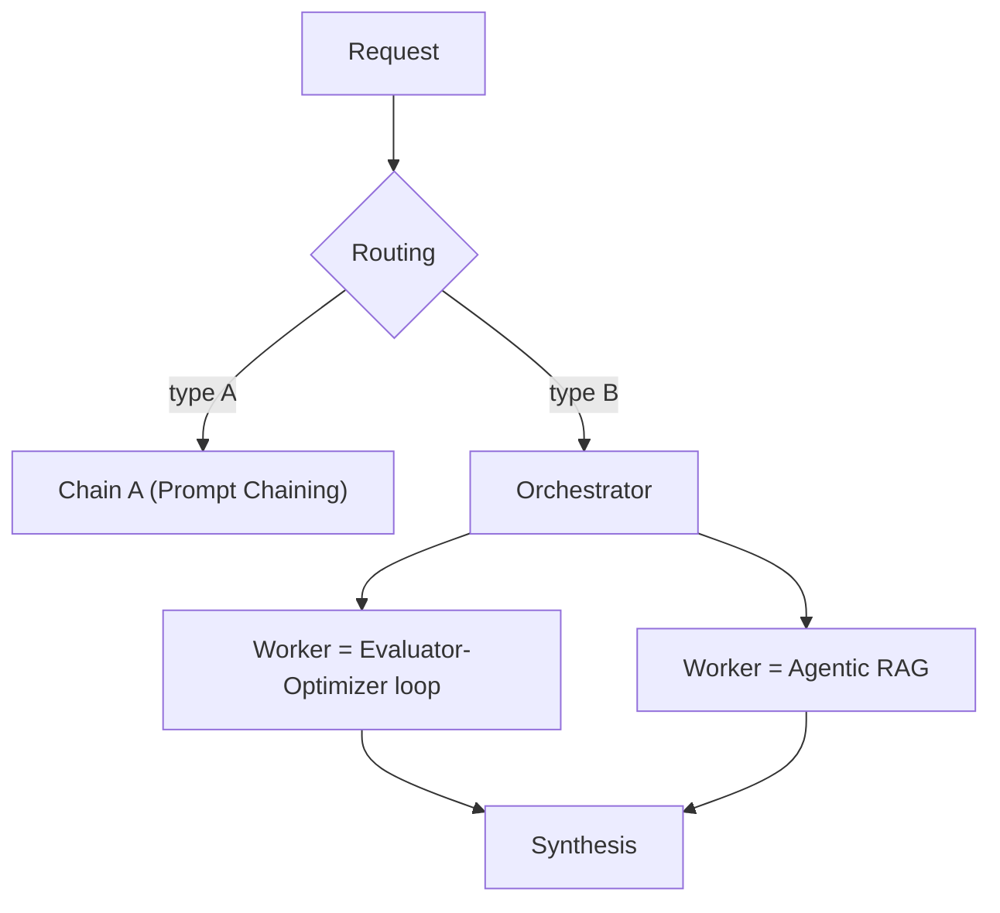

<!-- SPDX-FileCopyrightText: 2026 Aleksandr Drobiazkin
     SPDX-License-Identifier: CC-BY-SA-4.0 AND MIT
     Source: https://github.com/Drobiazkin/ai-agent-architecture
     Dual-licensed, and the boundary is exactly the fence: a fenced code block tagged
     with a language (python, java, sql, bash, yaml, xml, json), comments inside it
     included, is MIT. Everything else — the prose, the tables, the formulas, and the
     mermaid diagrams, which are illustrations expressed as text — is CC-BY-SA-4.0.
     Full terms: LICENSE, LICENSE-CODE, and NOTICE in the repository root. -->

# Chapter 11. A Catalog of Agent Patterns

## 11.1 The ladder and composition

Patterns split into **workflow patterns** (a deterministic graph, laid down by the developer) and **agentic autonomy** (the model decides the flow). The Anthropic canon has five patterns; the first three are workflows at heart, the last two introduce autonomy. The key property: **they compose**—a real system is assembled from them like building blocks (§11.7). You climb the ladder from the simple (chaining) to the autonomous (orchestrator-workers) only when you have to (§10.3).

## 11.2 Pattern: Prompt Chaining

> **Context.** The task decomposes into a *fixed* sequence of steps, each running on the output of the one before.
> **Problem.** One mega-prompt does everything badly (too many goals at once) and is hard to verify and debug.
> **Solution.** Break it into a chain of narrow LLM calls: the output of step N is the input of step N+1. Between steps you can insert programmatic checks (a gate: is the intermediate result valid—if not, abort).
> **Mechanics.** The deterministic graph is fixed up front (by the developer, not the model)—that makes it a workflow; structurally it matches a sequential pipeline.
> **Example.** "Extract entities → check them against a reference catalog → compose the answer": three narrow calls instead of one broad one.
> **Resulting Context.** Higher quality and better debuggability (every step is narrow and checkable); the price is latency (the steps run in sequence) and more calls.
> **When to Use.** The decomposition is fixed and linear. **When Not To.** The number or order of steps depends on the data → Orchestrator-Workers (§11.5).
> **Related Patterns.** Orchestrator-Workers (the dynamic version); Evaluator-Optimizer (checking a step).
> **Source.** Anthropic, "Building Effective Agents" (2024).

## 11.3 Pattern: Routing

> **Context.** The input is heterogeneous: different request types need different handling, a different model, or a different prompt.
> **Problem.** One handler for everything is either overloaded or suboptimal (an expensive model on an easy request, a generic prompt on a specific one).
> **Solution.** A classifier determines the input's type and **routes** it to the right branch (a specialized prompt, tool, or model).
> **Mechanics.** Structurally this is a content-based router. The classifier is a cheap LLM or a trained classifier (for the component's anatomy, see Deep Dive §2.2). The branching is fixed up front, which makes it a workflow. It connects to Model Routing (§2.2) and Adaptive RAG (§7.9)—the same move in different layers.
> **Example.** Incoming requests → {refund, complaint, product question} → a branch of its own for each.
> **Resulting Context.** Every branch is optimal; the price is the cost of classification and its errors (misrouting: an easy request went down the wrong branch).
> **When to Use.** The input has clearly distinguishable categories. **When Not To.** A homogeneous stream.
> **Related Patterns.** Model Routing (§2.2), Adaptive RAG (§7.9).
> **Source.** Anthropic (2024).

## 11.4 Pattern: Parallelization

> **Context.** The task splits into *independent* subtasks (sectioning), or you need several independent attempts at the same one (voting).
> **Problem.** Running independent parts one after another piles up latency for nothing; a single attempt may be unreliable.
> **Solution.** Two variants: **Sectioning**—hand out independent subtasks in parallel and gather the results (scatter-gather). **Voting**—run one task several times (safety checks with different prompts, say) and aggregate by majority or consensus—the same idea as self-consistency in prompting (Wang et al., 2022; §3.4), lifted to the orchestration layer.
> **Mechanics.** Structurally this is scatter-gather. The split is fixed up front, which makes it a workflow.
> ```mermaid
> flowchart TB
>   In["Task"] --> Split["Split / replicate"]
>   Split --> W1["LLM 1"]
>   Split --> W2["LLM 2"]
>   Split --> W3["LLM 3"]
>   W1 --> Agg["Aggregator (gather / vote)"]
>   W2 --> Agg
>   W3 --> Agg
> ```
> **Resulting Context.** Lower wall-clock latency (§2.3) and/or higher reliability (voting); the price is cost (several calls) and the aggregation logic.
> **Deep Dive—partial failures.** Scatter-gather breeds a problem familiar from distributed systems: one of the N parallel branches *silently* failed or returned garbage. Naive "gather whatever showed up" aggregation silently loses part of the result. The remedy is the standard distributed-systems approach: track the status of *every* branch explicitly, define a policy for coming up short (wait, retry, degrade), and do not treat the aggregate as complete until every branch is confirmed (or knowingly accept a partial result).
> **When to Use.** Independent subtasks, or you need reliability through redundancy. **When Not To.** The steps depend on each other (you need chaining).
> **Related Patterns.** Evaluator-Optimizer (voting as a form of checking).
> **Source.** Anthropic (2024).

## 11.5 Pattern: Orchestrator-Workers

This is **the catalog's first pattern to introduce agentic autonomy**: the LLM decides *which* steps are needed. The Preface demonstrates the format at length on this very pattern (with a diagram and a full example); what follows is the working card, so the chapter stands on its own when read for reference.

> ### Pattern: Orchestrator-Workers
>
> **Context.** The task does not decompose into a fixed set of steps up front: the number and nature of the subtasks depend on the input and are known only at runtime.
> **Problem.** How do you execute a task with dynamic decomposition while preserving reliability, observability, and the ability to roll back—the properties saga orchestration routinely provides?
> **Solution.** An LLM **orchestrator** analyzes the task at runtime, generates a list of subtasks, and hands them out to **workers** (each a separate LLM or tool call with a narrow responsibility), then gathers and synthesizes the results. Architecturally this is **Saga orchestration** (in Richardson's terms) with two differences: the coordinator is nondeterministic, and the set and order of steps are determined dynamically rather than by a state machine.
> **Mechanics.** A step log (much like a saga log); idempotency of the worker step keyed by task; a timeout and a compensation for every step; a mandatory **iteration limit/budget**—a nondeterministic coordinator can loop forever (§10.5). Unlike Chaining (§11.2), the graph is not fixed, so observability is built on the trajectory (§17.5, Chapter 18).
> **Resulting Context.** The flexibility of dynamic decomposition while auditing, idempotency, and rollback survive. The price: a nondeterministic plan (two runs on the same input can produce different decompositions—test by trajectory, §17.5), cost (every worker is a model call), and latency.
> **When to Use.** The decomposition genuinely depends on the input, the number of subtasks varies, and there are reliability/audit requirements. **When Not To.** A fixed decomposition—a static workflow (§11.2) is cheaper, more predictable, and easier to debug.
> **Related Patterns.** Prompt Chaining (the static alternative, §11.2); Routing (the degenerate case—the orchestrator only picks a branch, §11.3); Evaluator-Optimizer (checking step quality, §11.6); Human-in-the-Loop Gate (irreversible steps, §10.6); Trajectory Evaluation (§17.5).
> **Sources.** Anthropic, "Building Effective Agents" (2024)—orchestrator-workers. C. Richardson, *Microservices Patterns* (2018), Chapter 4—saga orchestration, compensations, idempotency. V. Dibia, *Designing Multi-Agent Systems* (2025)—supervisor/handoff orchestration.

## 11.6 Pattern: Evaluator-Optimizer

> **Context.** The first-pass answer is not good enough, but you can *evaluate* it and improve it iteratively.
> **Problem.** A single generation does not reach the quality you need; you need a "produce → check → improve" loop.
> **Solution.** Two LLMs in a loop: a **generator** produces the answer, an **evaluator** critiques it against criteria and returns feedback; the generator reworks it. Repeat until it clears the threshold or hits the **iteration limit**.
> **Mechanics.** ≈ a retry with a quality check. The evaluator is a separate call with a rubric (a relative of LLM-as-judge, Chapters 9/17). An iteration limit is *mandatory* (otherwise you get an infinite loop, §10.5).
> ```mermaid
> flowchart LR
>   Gen["Generator"] --> Ev{"Evaluator: threshold met?"}
>   Ev -->|no, within the limit| Gen
>   Ev -->|yes / limit| Out["Result"]
> ```
> **Example.** Draft a reply to a customer → the evaluator checks tone, completeness, and compliance with policy → rework. Or iterative improvement of code or a translation.
> **Resulting Context.** Higher quality on tasks with a clear evaluation criterion; the price is cost and latency (several rounds).
> **When to Use.** There is a measurable quality criterion and iteration is worth something. **When Not To.** The criterion is unclear, or the first pass is already good enough.
> **Related Patterns.** Voting (§11.4), Reflection (Chapter 13), LLM-as-judge (Chapters 9/17).
> **Source.** Anthropic (2024).

## 11.7 Deep Dive: composing patterns

The central idea of a "pattern language": real systems are **assembled out of patterns**—they do not pick one. Examples of composition:

- **Router → Chains.** The router (§11.3) sends a request into one of several chains (§11.2), each tuned to its own type.
- **An orchestrator whose workers are Evaluator-Optimizers.** The orchestrator (§11.5) hands out subtasks, and each worker internally runs a generator-evaluator loop (§11.6) for quality.
- **Parallelization inside a chain step.** A chaining step that itself hands out subtasks in parallel (§11.4) and aggregates them.
- **Agentic RAG (§7.8) as a worker.** The orchestrator tells a worker to "find the information," and that worker is an agentic RAG loop.



Designing an agent system means *composing* these blocks to fit the task, not choosing one pattern. The same discipline of restraint applies: every added layer of autonomy or pattern raises cost, latency, and risk, so you compose when the task requires it, not by default.

## 11.8 Deep Dive: what here is a workflow and what is an agent

Drawing the line clearly pays off—it determines how predictable the system is:

- **Workflow patterns** (the graph is fixed up front, the flow is deterministic): Prompt Chaining, Routing, Parallelization. Predictable, cheaper, easier to debug. Most "agents" running in production are these.
- **Agentic autonomy** (the *LLM* decides the flow at runtime): Orchestrator-Workers (dynamic decomposition) and the ReAct control loop itself (Chapter 13). More flexible, but nondeterministic—with every consequence from §10.4–10.6 (nontermination, a nondeterministic actor).

The practical takeaway: know *which* parts of your system are workflow and which are autonomous. Introduce autonomy surgically, and only where a fixed graph genuinely cannot cope. The more of the system you hold inside deterministic workflow patterns, the more predictable, cheaper, and safer it is; fence the autonomous stretches with budgets (§10.5) and a human gate (§10.6).

## 11.9 Summary and a decision framework

| Pattern | Type | Solves | Take it when |
|---|---|---|---|
| Prompt Chaining | Workflow | A fixed sequence | The decomposition is linear |
| Routing | Workflow | Heterogeneous input | The categories are distinguishable |
| Parallelization | Workflow | Independent parts / reliability | It parallelizes, or you need redundancy |
| Orchestrator-Workers | Autonomy | Dynamic decomposition | The steps depend on the input |
| Evaluator-Optimizer | Workflow loop | Iterative quality | There is an evaluation criterion |

*A workflow loop is an intermediate form between the two poles of §11.8: bounded autonomy. At runtime the evaluator decides whether to keep iterating (the model picks the next step), but the space of choice collapses to "another iteration or stop" inside a fixed template and a hard cap on cycles.*

**The decision framework:** start with the simplest pattern that covers the task (usually chaining or routing) → introduce autonomy (orchestrator-workers) only once a fixed graph has demonstrably failed to cope → compose (§11.7) to fit the task's real shape → cap every autonomous stretch with a budget (§10.5), and put irreversible actions behind a human gate (§10.6). Complexity goes in on proven need, not in advance.

*Sources.* Anthropic, "Building Effective Agents" (2024)—the five patterns; V. Dibia, *Designing Multi-Agent Systems* (2025)—orchestration patterns; C. Richardson, *Microservices Patterns* (2018)—the basis for mapping onto sagas/EIP[^t-eip].

**In the Margins: Chapter 11**

[^t-eip]: **EIP**—Enterprise Integration Patterns (Hohpe, Woolf, 2003): the canonical catalog of messaging patterns (router, splitter/aggregator, dead letter channel); Routing and Parallelization are their direct relatives.

---
