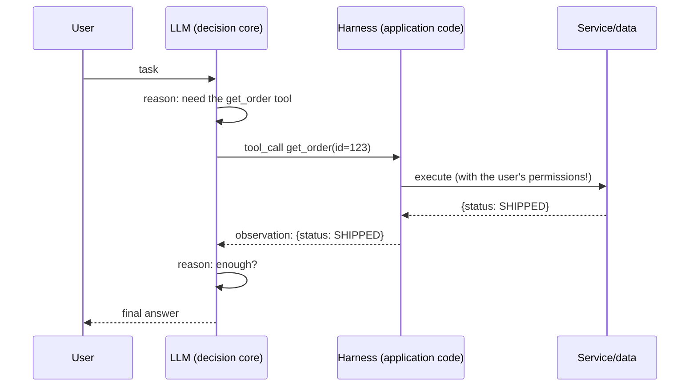
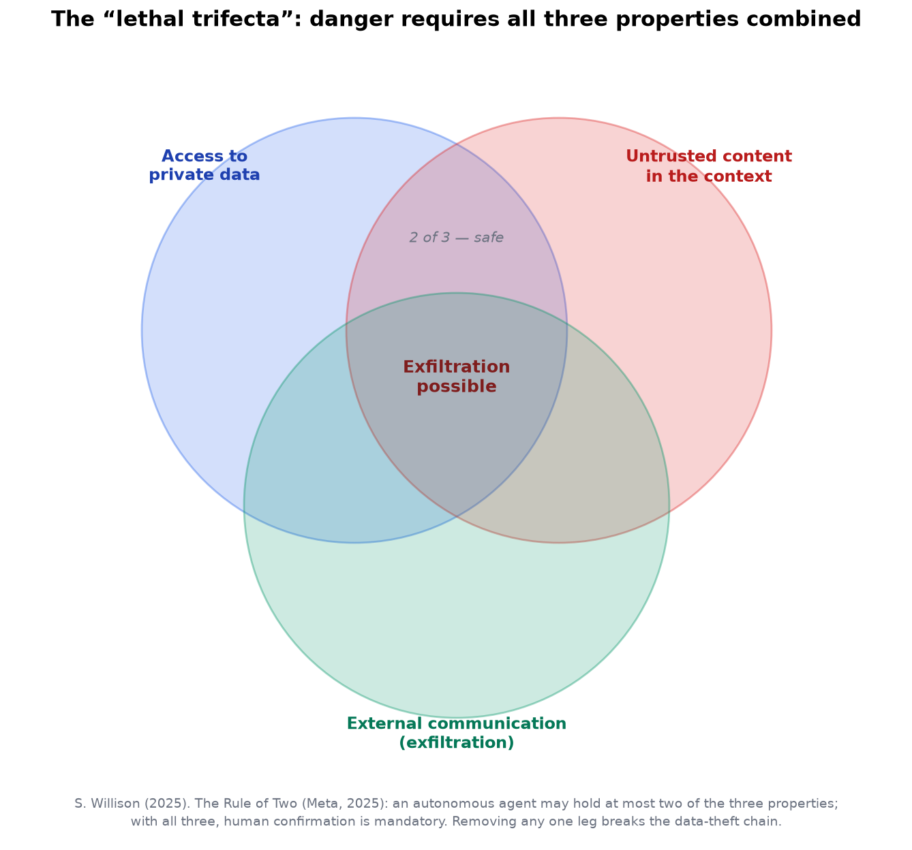
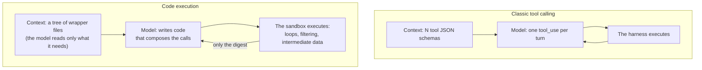

<!-- SPDX-FileCopyrightText: 2026 Aleksandr Drobiazkin
     SPDX-License-Identifier: CC-BY-SA-4.0 AND MIT
     Source: https://github.com/Drobiazkin/ai-agent-architecture
     Dual-licensed, and the boundary is exactly the fence: a fenced code block tagged
     with a language (python, java, sql, bash, yaml, xml, json), comments inside it
     included, is MIT. Everything else — the prose, the tables, the formulas, and the
     mermaid diagrams, which are illustrations expressed as text — is CC-BY-SA-4.0.
     Full terms: LICENSE, LICENSE-CODE, and NOTICE in the repository root. -->

# Chapter 12. Tools and Tool Calling as a Contract

Tool calling lets a nondeterministic model *initiate* calls into the application's functions: the model composes a structured call request, and the harness (§10.2)—deterministic application code—executes it. Two threads run through this chapter: a tool's interface is a contract the model reads, and its quality determines whether the calls come out correct; and tools are the agent's main security surface, because they are how it acts on the outside world.

## 12.1 What tool calling is

**Tool calling (function calling)**—a mechanism in which tools are *declared* (name, description, parameter schema); the model, handed a task, *decides* which tool to call and with what arguments, and returns a structured call; the harness (§10.2) executes it and returns the result into the context; the model continues. The direction of the call here is the reverse of the familiar one: the calling side is the nondeterministic model, and the executing side is deterministic application code.

## 12.2 The mechanics of tool calling

How it works:
1. **The tools are described in the context**—their schemas (name, parameters, types) are handed to the model as a specification (a relative of structured output, Chapter 5).
2. **The model returns a structured call**—it executes nothing; it *composes a request*: "call X with arguments Y." Constrained/structured decoding (§5.3) guarantees the call conforms to the tool's schema.
3. **The harness (§10.2) dispatches** the call to a real function and executes it.
4. **The result goes back into the context** as an *observation*, and the loop (§10.2) continues.

A few API-level details matter in practice:
- **The wire format.** Call and result travel as separate message-block types: the model returns a call-request block (`tool_use`, carrying a name and arguments), and the application returns a result block (`tool_result`), matched to it by call id. Binding request to result explicitly is what lets several calls coexist within one turn.
- **Steering the choice (`tool_choice`).** Providers expose a mode: the model decides for itself (`auto`), must call some tool (`required`/`any`), must call one specific named tool, or is barred from calling anything (`none`). This is a lever of determinism: where a call is mandatory, `required` removes the "the model answered with text instead of a call" outcome.
- **Parallel calls.** In a single turn the model can request several independent calls, executed in parallel, which cuts wall-clock latency (§2.3) for independent actions (the analogue of Parallelization, §11.4, but initiated by the model itself). The flip side: parallel calls complicate rollback on partial failure (some calls went through, some did not).
- **Native versus emulated.** Native function calling (the model is trained to return structured calls, and decoding is constrained by the schema) is more reliable than emulating it through the prompt—asking for `CALL tool(...)` and then parsing the text.

**Critical for security (§12.5): the model does not perform the action—it requests it; the harness performs it.** That split is the control point: between "the model requested a call" and "the call happened" sit argument validation, authorization, and, where needed, human confirmation.

## 12.3 Deep Dive: agent-computer interface (ACI) as contract design

A tool's name, its description, and its parameter schema are **the contract the model reads**. A bad tool interface makes the model call the wrong tool or pass the wrong arguments. Anthropic frames this as a requirement to invest in the **agent-computer interface (ACI)** as much as in the interface for a human (HCI).

Principles for designing a tool interface:
- **Clear, unambiguous descriptions.** The model reads a tool's description as documentation; ambiguity leads to the wrong choice.
- **Informative parameter names and descriptions** and **constraints through types and enums** (Chapter 5): the stricter the schema, the fewer wrong calls.
- **Poka-yoke (mistake-proofing by construction).** Design the interface so that a wrong call is *hard to make*: requiring absolute paths instead of relative ones, for instance, eliminates the whole "wrong working directory" class of errors. Make the tool hard to use incorrectly rather than only documenting correct use.
- **A small set of well-designed tools beats a pile of overlapping ones.** An excess of tools blurs the choice (**tool confusion**): the model loses track of which one to call. Order of magnitude: up to a couple dozen well-separated tools are usually manageable; past that the curve of selection errors climbs fast—a signal to group them, impose a hierarchy, or select tools dynamically (which has a dead-end failure mode of its own: if the retriever left the needed tool out of the candidates, the model will not recover—unlike the recoverable loop errors of §12.4).
- **A compact, structured result** instead of a verbose dump—otherwise it burns context budget (§4.4, tool-result pruning). The result is part of the contract too.
- **Examples in the description** help the model the same way examples in documentation help a developer.

**Selecting tools at scale.** As the number of tools grows, the model's choice degrades (tool confusion) and their schemas take up more and more context (§4.4). Beyond curating the set, there are structural techniques: grouping and tool namespaces; and **dynamic selection**—retrieving into the context only the subset of tool definitions relevant to the specific task (retrieval over a tool catalog) instead of presenting all of them at once. This carries the logic of context selection (Part III, §4.4) over to the tool definitions themselves.

What separates designing for a model from designing for a human is that the consumer is probabilistic: given a bad contract it errs and, unlike a human, does not ask a clarifying question—it silently calls wrong.

## 12.4 Deep Dive: tool errors and the feedback loop

Tools fail (wrong arguments, an external error, "not found"). What differs from classical error handling: **the caller can *reason* about the error.** Return the error *usefully*—as an observation with a clear message—and the model often recovers on its own: it retries with corrected arguments, tries another tool, or gives up cleanly. This is a **feedback loop**: error → the model adapts.

In practice:
- **Errors come back as observations, not as exceptions that topple the loop.** The model fixes a message like "parameter date must be in YYYY-MM-DD format"; an unhandled stack trace ends the loop.
- **Telling recoverable errors from terminal ones.** Return a recoverable error (a malformed argument) so the model can retry with a fix; return a terminal one (access denied, resource missing) so the model stops trying rather than looping on fixing the unfixable. Blurring these two categories is a common cause of useless retry loops. Put it in the contract: an explicit `retryable` field (or error classes along the lines of HTTP 4xx/5xx—a bad request versus a failing executor) in the tool's result, so the distinction is drawn by the loop's code and not by the model's reading of an error string.
- **Bounding the loop** (§10.5): cap the attempts, or the "fix → error → fix" sequence runs off to infinity.
- **Validate tool arguments as untrusted input:** the model can generate invalid or dangerous arguments. The schema (Chapter 5), a validator, and the security checks (§12.5) apply before execution. The model is not a trusted source of arguments.

## 12.5 Deep Dive: tool security (a bridge to Chapter 19)

Tools are where the agent gains a *real ability to act on the world*, which makes them its main attack and risk surface.

**Lethal trifecta.** The most compact frame for assessing the risk was proposed by S. Willison (2025): the danger of data exfiltration arises when **three** properties coincide within one agent session—(1) access to private data, (2) untrusted content present in the context, and (3) the ability to communicate externally (to send data out). Any *two* of the three are safe; all three together let an attacker who controls the untrusted content make the agent pull private data and send it out. The mechanism is indirect prompt injection (Chapter 19): instructions embedded in data hijack the behavior of a model that does not tell instructions from data (§1.4, §3.2). The trifecta is not the mechanism itself but a trust-boundary frame indicating *when* an injection escalates from a "weird answer" into a leak.

The combination is real and has been observed in systems already in operation; the communication channel is often non-obvious—an outbound HTTP request, an image loaded from a URL with the data in its parameters, even a rendered clickable link (the click becomes the leak channel). Incidents of this class have been analyzed publicly: access to private repositories through the GitHub MCP server via an instruction planted in a public issue; exfiltration from enterprise assistants through the parameters of an image URL (the "zero-click"[^t-zeroclick] class).

**The Agents Rule of Two.** A practical budget proposed by Meta (2025) and endorsed by Willison: within a single session an autonomous agent must hold no more than **two** of the trifecta's three properties; if a task genuinely requires all three, the agent **must not run autonomously**—it needs human confirmation or another reliable check before any consequential action. Removing any one of the three "legs" breaks the theft chain: no private data—nothing to steal; no external channel—nowhere to send it; no untrusted content—nothing to plant the command with.

**Taint tracking as a deterministic measure.** The trifecta implies a concrete architectural measure: treat the presence of untrusted content as a *taint event*—once the agent has taken in attacker-controlled input, the rest of the turn counts as tainted. In the tainted state, actions with exfiltration potential (outbound HTTP, sending messages, opening a PR, rendering a clickable link) are blocked or require explicit confirmation. Tools carry metadata (`reads_private_data`, `sees_untrusted_content`, `can_exfiltrate`), and the runtime forbids all three from meeting in a single execution path.

The concrete controls that implement this frame:
- **Least privilege and a minimal tool set (§10.6).** Grant only the necessary tools, with the narrowest scope; a tool kept around "just in case" widens the blast radius. This maps to the OWASP class LLM06 (Excessive Agency).
- **Audit the set, not the individual tools.** Tools that are harmless on their own combine into an attack channel: reading a file plus an outbound call is an exfiltration path. Assess the agent's tools *as a whole* against the trifecta, not each tool in isolation.
- **A tool result is untrusted data, not instructions.** Isolate a tool's output (a web page, file contents, an API response) in the context (§4.6) and never let text from a result steer the agent (indirect injection, OWASP LLM01).
- **Authorization at the tool level (the "confused deputy" problem).** A tool must apply the permissions of the *user* the agent is acting for, not the agent's own. To the question "what privileges is this call executing with?" the answer must be "those of a specific user." Otherwise the agent becomes a *confused deputy*: through the agent, a user performs an action they have no right to. Pass the user context through into the tool's execution and check authorization *at the point of execution*. How that delegation is expressed technically (token exchange, on-behalf-of, the agent's own identity) is the Deep Dive in §15.7.
- **Human confirmation on dangerous and irreversible tools (§10.6).**

An important caveat. Safety training, guardrails, and the instruction hierarchy *reduce* an injection's success rate but do not *eliminate* it: an adaptive attacker finds a way around by working through variants (shown, in particular, in the work on adaptive attacks against published defenses). The defense therefore has to be **architectural**—constraining the trifecta, taint-gating, and human confirmation—not merely "model-level." Tools are the agent's security perimeter; what makes them peculiar is that the calling side (the model) is nondeterministic and can be driven out of normal behavior by a planted instruction, so authorization and validation are enforced by the tool's *executor*, not by the model. Chapter 19 covers this in detail.

**The industry frame: OWASP Top 10 for Agentic Applications (the 2026 edition, published in December 2025).** The discipline described here is fixed in an industry taxonomy as well: alongside the LLM Top 10 (§19.3), OWASP released a separate list of agentic-system risks (ASI01–ASI10). Among the categories: hijacking the agent's goal (ASI01 Agent Goal Hijack), tool misuse, misuse of the agent's identity and privileges, compromise of the agentic supply chain, unexpected code execution, memory and context poisoning (ASI06), and insecure inter-agent communication (ASI07); the full list is at genai.owasp.org. The document's through-line is **Least-Agency**: give an agent the minimum level of autonomy the task requires—a direct generalization of least privilege onto the axis of autonomy (§10.7). The categories map onto this part's material almost one to one: goal and non-termination—§10.5; tools and privileges—this section; memory—Chapter 13; inter-agent communication—Chapter 14.

*Sources.* S. Willison, "The Lethal Trifecta for AI Agents" (2025); Meta, "Agents Rule of Two" (2025); K. Beurer-Kellner et al., "Design Patterns for Securing LLM Agents against Prompt Injections" (arXiv:2506.08837, 2025); OWASP Top 10 for LLM Applications (2025) and Top 10 for Agentic Applications (2026)—(c) the OWASP Foundation, licensed under CC BY-SA 4.0 (https://creativecommons.org/licenses/by-sa/4.0/); the categories (LLM01 Prompt Injection, LLM06 Excessive Agency, LLM10 Unbounded Consumption, and ASI01–ASI10 in §12.5) are reproduced as published, the mapping to this book's sections is added; N. Hardy, "The Confused Deputy" (1988).

## 12.6 Deep Dive: scaling the tool surface—code execution and Skills

§12.3 ended on the point that as the number of tools grows, both sides of the contract degrade: the schemas eat context, and the model's choice blurs (tool confusion). Dynamically selecting definitions is a palliative with a dead-end failure mode of its own. In 2025–2026 the industry produced two structural answers, and both change the very shape of the contract.

### Code execution: tools through code

**Code execution** (also "code mode"; the idea traces back to **CodeAct**—Wang et al., 2024, with the industrial form in Anthropic, "Code execution with MCP," 2025) inverts the mechanics of §12.2: instead of presenting the model with JSON schemas and getting one structured call per turn, the harness presents the tools as a **code API**—a tree of wrapper files (TypeScript modules generated from those same MCP schemas, for instance)—and the model *writes code* that calls those wrappers. The code runs in a sandbox (§19.6); only the result of the run comes back into the context.

Why this works shows in each of four mechanical consequences:

1. **Progressive disclosure instead of presenting everything.** The schemas are not loaded into the context all at once—the model discovers tools as files (listing a directory, reading a specific wrapper) and reads only the ones it needs. Hundreds of tools stop costing context; Anthropic reports a reduction from ~150k to ~2k tokens on a real scenario (the order of magnitude matters more than the exact figure).
2. **Intermediate data does not pass through the model.** In the classic loop, every call's result is an observation in the context: a JSON blob thousands of lines long is paid for in tokens and dilutes attention (§4.4). In code, filtering and aggregation happen *in the sandbox*: the model gets the five rows it needs, not the whole dump.
3. **Loops and conditionals execute deterministically.** "Repeat for each of 40 items" in an agent loop means 40 model turns (§10.2), each with its own probability of error and the full price of a call; in code it is an ordinary `for` loop, executed in a single turn. Part of the control logic moves out of the probabilistic core into deterministic code—the same vector as all of §10.6.
4. **The native language of composition.** The model was trained on a colossal corpus of code; composing operations *as a program* is a more natural task for it than a long sequence of isolated JSON calls—which is CodeAct's original observation.

The price is symmetric with the gains: you need an execution sandbox as infrastructure (and model-written code inside it is untrusted by definition—the whole discipline of §19.6 is mandatory); generated code is harder to debug than a sequence of explicit calls in a trace (Chapter 18); a model weak at code loses the main advantage. The practical frame: single calls to narrow tools—classic tool calling; broad surfaces (hundreds of tools, large intermediate data, bulk operations)—code execution.

### Skills: competence as an artifact

A tool answers the question "what the agent *can do*." The question "how it is *normally done*"—procedural knowledge: sequences, conventions, templates—is answered by a **skill** (Agent Skills; an open format, Anthropic, 2025): a directory with a `SKILL.md` manifest—a YAML header (name, description) plus instructions in Markdown—and, where needed, supporting files and scripts. A skill is not executed by the harness as a function—it is *read by the model* as a procedure.

The mechanics are a three-stage progressive disclosure, and in it lies the whole point of the format:
1. The system prompt always carries only the **name and description** of each installed skill—tens of tokens apiece;
2. When the model recognizes that a task matches a description, the harness loads the **body** of `SKILL.md`—a few thousand tokens;
3. The files the body references (reference material, templates, scripts) are read **as needed**—as ordinary files, through tools.

Context budget is spent in proportion to relevance (§4.4): a hundred installed skills cost what one loaded skill costs. Compare the alternative—"sew every procedure into the system prompt"—which is paid for in full on every call.

Architecturally a skill is **externalized procedural memory** (§13.1): know-how pulled out of the weights and the prompt into a versioned git artifact that can be reviewed, tested, moved between agents, and rolled out like code. A procedure worked out by an agent (or a human) crystallizes into a file—instead of being relearned from scratch in every session.

Security follows from the nature of the format: a skill is instructions *loaded into the context*, which makes it an injection surface (Chapter 19); a skill with scripts is executable code. A third-party skill is an untrusted supply-chain component, under exactly the same discipline as a third-party MCP server (§15.7).

### Tools, Skills, MCP—three different axes

The three words often get conflated, because all three "give the agent capabilities." The axes are different:

| Axis | Tool (Chapter 12) | Skill | MCP (Chapter 15) |
|---|---|---|---|
| Nature | An executable contract: schema + function | A declarative procedure: instructions + resources | A protocol for connecting sources |
| Answers | "What can be done" | "How it is normally done" | "How to discover and call" |
| Who consumes it | The harness executes the call | The model reads it as text | The harness's client connects the server |
| Cost in context | The schema (always, or by selection) | Name+description always, body on demand | The server's tool schemas |
| Versioned as | Application code | A file in git | A server/spec version |
| Engineering analogue | An API method | A runbook | A connector standard (M+N, §15.1) |

They compose rather than compete: an MCP server supplies the tools, code execution changes how they are called, and a skill explains to the model in what order and by what conventions to use them.

## 12.7 Implementation on the JVM

- **Spring AI:** a method is annotated `@Tool`, the framework generates the schema from the signature (the way structured output comes from a type) and passes it to the model; calls are dispatched to the corresponding bean.
- **LangChain4j:** the same—typed tool methods with a schema derived from the signature.
- **MCP (Chapter 15):** `@McpTool` exposes a method as an MCP tool—the standard way to offer tools to any MCP-compatible agent (a contract-first integration layer).

In every case, authorization and validation (§12.4–12.5) are enforced *in the body of the tool method*: the framework only relays the call, and security stays on the application's side.

## 12.8 Chapter summary

Tool calling inverts the direction of the call: the calling side is the nondeterministic model, the executing side is the harness. A tool's interface (the ACI) is the contract the model reads, and its quality determines whether the calls come out correct: clear descriptions, strict schemas, poka-yoke, a small curated set of tools, compact results. Tool errors form a feedback loop that demands telling recoverable cases from terminal ones and bounding the number of retries. On broad surfaces the shape of the contract changes: code execution replaces a sequence of JSON calls with writing code in a sandbox, and Skills package procedural knowledge into versioned artifacts with progressive disclosure (§12.6). Tools are the agent's main security surface: the risk concentrates in the *lethal trifecta* (private data + untrusted content + external communication), bounded by the Rule of Two, taint tracking, least privilege, authorization with the user's permissions, and human confirmation on irreversible actions.

*Sources.* Anthropic, "Building Effective Agents" (2024)—ACI ("invest in the ACI as much as in the HCI"), poka-yoke; provider documentation on function calling (the `tool_use`/`tool_result` formats, `tool_choice`, parallel calls); X. Wang et al., "Executable Code Actions Elicit Better LLM Agents" (CodeAct, 2024); Anthropic, "Code execution with MCP" (2025) and "Agent Skills" (2025); tool security—the sources in §12.5 (Willison, Meta, Beurer-Kellner et al., OWASP); Spring AI, LangChain4j, MCP.

**In the Margins: Chapter 12**

[^t-zeroclick]: **Zero-click**—a class of attacks in which exfiltration requires no action at all from the victim: the client, for instance, renders an image on its own, and the attacking instruction has packed the stolen data into that image's URL. The countermeasure is control over outbound channels. → §15.7, Chapter 19.

---
