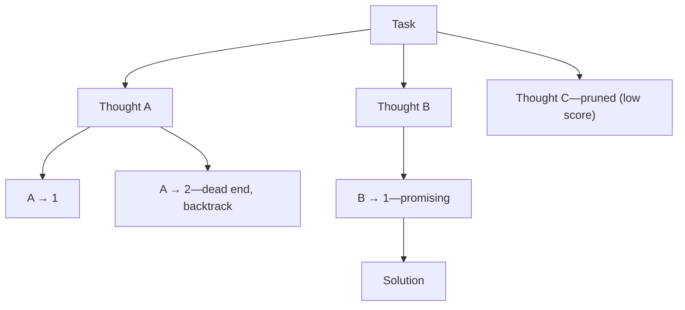
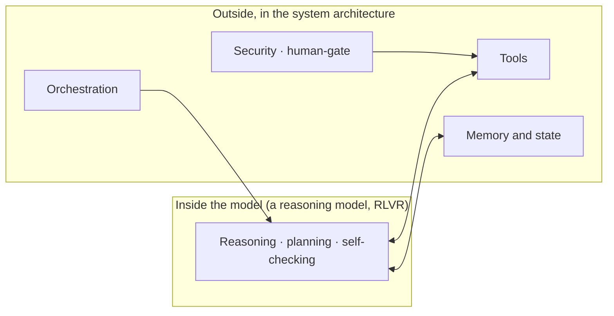

<!-- SPDX-FileCopyrightText: 2026 Aleksandr Drobiazkin
     SPDX-License-Identifier: CC-BY-SA-4.0 AND MIT
     Source: https://github.com/Drobiazkin/ai-agent-architecture
     Dual-licensed, and the boundary is exactly the fence: a fenced code block tagged
     with a language (python, java, sql, bash, yaml, xml, json), comments inside it
     included, is MIT. Everything else — the prose, the tables, the formulas, and the
     mermaid diagrams, which are illustrations expressed as text — is CC-BY-SA-4.0.
     Full terms: LICENSE, LICENSE-CODE, and NOTICE in the repository root. -->

# Chapter 13. Memory and Reasoning Strategies

## 13.1 Memory in the agent loop (in brief, see §4.5)

§4.5 works through the architecture of memory (the memory store, the write and read paths, consolidation and reflection, forgetting, the MemGPT framework). Here: its place in the loop, and the full taxonomy.

Agent memory divides along several axes. By content: **episodic** (the history of specific interactions), **semantic** (durable facts and knowledge), and **procedural** (learned ways of acting—debugged step sequences for a routine task, say). By horizon: **short-term**—the context window of the current session (Chapter 4)—and **long-term**—state outside the window, from which what's needed comes back into the context. Long-term memory feeds the *observe* phase of the loop (§10.2), returning the slice of the past relevant to the current step.

One architectural variant matters in particular: **memory as a tool**. Instead of retrieving implicitly, the agent manages memory explicitly, through read and write tool calls (the MemGPT approach, §4.5), deciding for itself what to save and what to load; managing memory becomes part of the agent's reasoning. The key idea does not change: the long-term memory of a stateless agent is the pattern "store outside the window → retrieve what's relevant into the window"—the same retrieval as in RAG, but over session and user state.

**When to consolidate: sleep-time compute.** Consolidation and reflection (§4.5)—reworking raw episodic memory into durable facts and procedures—cost LLM calls themselves, and in a synchronous loop they compete with the user's task for latency and the turn's budget. A 2025–2026 direction (the term **sleep-time compute** comes from Letta; the name has not settled yet, the mechanics are already practice) moves this work *into the background*: a separate process, idle between sessions, deduplicates episodes, generalizes what recurs into semantic facts, crystallizes debugged sequences into procedures (the natural form to offload them into is a skill file, §12.6), and demotes the weight of what has gone stale. The economics work out on their own: background reworking has no latency requirement, so it runs on a cheap tier at the batch rate (§2.2)—memory consolidation turns out to be a classic offline batch workload, familiar to any backend engineer. The analogy with how human memory consolidates during sleep is only scaffolding: what it shares with neurobiology amounts to exactly this much—the reworking is separated from acting.

For the mechanics, see §4.5; from here the chapter is about how the agent *reasons*.

## 13.2 Reasoning strategies—the family

A reasoning strategy sets *how* the agent structures thinking and planning inside the loop. They line up in order of increasing cost/complexity; you choose to fit the task (§13.7).

## 13.3 ReAct (Reason + Act)

**ReAct** (Yao et al., 2022)—the canonical agent loop: interleaving **Reason → Act → Observe**. The model reasons ("the order status is needed"), acts (a tool call), observes the result, reasons again—and so on until it has an answer. At the level of the trace this is alternating blocks of *Thought* (the reasoning), *Action* (the tool call), and *Observation* (the call's result).

**Why interleaving works.** Reasoning alone, without actions, has no access to external facts and tends to hallucinate; actions alone, without reasoning, have no planning. ReAct joins them: every observation informs the next round of reasoning, and the reasoning directs the next action. Grounding the reasoning in actual observations reduces hallucination compared with reasoning that gets no external check (CoT in its pure form). This is the dominant control-loop pattern (§10.2).

**Mechanics and the trade-off.** The model picks each step *dynamically* (agent autonomy, §11.8), under an iteration limit (§10.5). Flexible and reactive, but nondeterministic and one model call per step (cost and latency). The characteristic failures are getting stuck (repeating the same action) and goal drift over a long trajectory; hence the need to check progress and to bound the step budget (§10.5).

*Source.* S. Yao et al., "ReAct: Synergizing Reasoning and Acting in Language Models" (2022).

## 13.4 Plan-and-Execute

**Plan-and-Execute**—a strategy in which the agent *first builds a plan* of all the steps, *then executes* it, re-planning when things deviate. The contrast is with ReAct, which decides step by step. The prototype at the prompting level is Plan-and-Solve (Wang et al., 2023: "first devise a plan, then solve step by step"); the agent architecture generalizes it into an explicit planning phase followed by execution.

**The trade-off against ReAct:**
- Plan-and-Execute is **cheaper** (planning happens once, and execution needs fewer "thinking" calls), more **structured**, and holds up better on **long tasks** (an explicit plan reduces goal drift, §10.5).
- But it is **less adaptive**: the plan goes stale once reality has diverged; a step failure has to trigger a re-planning mechanism.

**Optimizing execution.** When the plan contains independent steps, run them in parallel: the LLMCompiler approach, for one, builds a graph of task dependencies and fires independent calls at the same time, cutting latency—the same reasoning as in Parallelization (§11.4).

**Which when.** ReAct—short reactive tasks with an unpredictable trajectory; Plan-and-Execute—long, relatively predictable multi-step tasks where structure and savings pay. The two are often combined: a plan on top, ReAct execution of the individual steps.

*Source.* L. Wang et al., "Plan-and-Solve Prompting" (2023); S. Kim et al., "An LLM Compiler for Parallel Function Calling" (2023)—LLMCompiler.

## 13.5 Reflection / Self-Critique

**Reflection**—the agent *analyzes its own* output or trajectory and improves the result. This is Evaluator-Optimizer (§11.6) applied to the agent's own reasoning. The development of it is **Reflexion** (Shinn et al., 2023): the agent reflects on *failures*, states the lesson in words, and retries with that lesson in hand, keeping the reflection in episodic memory across attempts (verbal "reinforcement" without updating weights).

**A serious limitation: self-correction without an external signal is unreliable.** The source of the feedback is what fundamentally matters. *Internal* self-correction—trying to fix an answer relying only on the model's own abilities, with no external signal—is unreliable on reasoning tasks: Huang et al. (2024) showed that quality after this kind of self-correction often *gets worse rather than better*. Tyen et al. (2024) sharpened the reason: models are bad at *finding* their own errors but are able to *fix* them once the error's location is pointed out from outside. The practical conclusion follows: reflection works when an *external* signal is available—an execution result, a failing test, a compiler error, a verifier's verdict. That is exactly what the success of Reflexion (an external signal of task success or failure) and of Evaluator-Optimizer (an external evaluator) rests on. Self-critique without an external check is a weak and potentially harmful technique.

**When.** Tasks with a *checkable* criterion that yields an external signal (code with tests, proofs, answers with a reference). **The price:** extra rounds (cost and latency).

*Sources.* N. Shinn et al., "Reflexion: Language Agents with Verbal Reinforcement Learning" (2023); J. Huang et al., "Large Language Models Cannot Self-Correct Reasoning Yet" (ICLR 2024); G. Tyen et al., "LLMs cannot find reasoning errors, but can correct them given the error location" (ACL Findings 2024).

## 13.6 Tree-of-Thought and search

**Tree-of-Thought (ToT)** (Yao et al., 2023)—instead of a single reasoning chain, the agent *explores several branches*, scores them, and backtracks, like a tree search. ToT has three components: *thought generation* (several candidates for the next reasoning step), *state evaluation* (the model itself heuristically scoring how promising each branch is), and *a search algorithm* (breadth-first or depth-first traversal, pruning unpromising branches). It applies to tasks where a single line of reasoning often hits a dead end and the solution space needs scouting (hard planning, puzzles). The generalization is Graph-of-Thoughts, where the intermediate results form a graph rather than a tree, allowing branches to merge.

**The price is high:** the number of calls grows as the product of branching, depth, and the cost of evaluation. Apply the strategy only when a single chain (CoT or ReAct) has demonstrably failed to cope.

*Source.* S. Yao et al., "Tree of Thoughts: Deliberate Problem Solving with Large Language Models" (2023); M. Besta et al., "Graph of Thoughts" (2023).

## 13.7 Deep Dive: choosing a reasoning strategy

The frame is the same ladder—"don't add complexity before you need it"—in order of increasing cost:

| Task | Strategy | Cost |
|---|---|---|
| A simple fact/classification | A single call (no strategy) | Minimal |
| Tool use, reactive | **ReAct** | Medium |
| Long multi-step, predictable | **Plan-and-Execute** | Medium |
| Self-correction against a criterion is needed | **Reflection** | Higher |
| Scouting the solution space is needed | **Tree-of-Thought** | High |

The rule: start with the cheapest option that covers the task; climb only when measurement (Chapters 9/17) shows it falling short. ToT and Reflexion are the top of the ladder, for hard cases—not a default choice.

## 13.8 Deep Dive: reasoning models change the calculus (2025+)

A major shift in the landscape. **Reasoning models**—specialized at first (the OpenAI o-series, DeepSeek-R1), and by 2026 the standard operating mode of most frontier models, open ones included—are trained to carry out a large share of the reasoning *internally*.

**How they are trained: RLVR.** At the base is **reinforcement learning with verifiable rewards (RLVR)**. Unlike RLHF, where the reward comes from a reward model trained on human preferences, RLVR computes the reward with a *deterministic verifier* that checks whether the answer is correct: matching against a reference in math, running unit tests in programming. The model produces a long reasoning chain as a sequence of actions and receives a signal about whether the outcome is right. OpenAI o1 (2024) was the first to show that reasoning quality scales with compute at inference time; DeepSeek-R1 (2025) demonstrated that a rule-based reward can elicit self-checking and reflection without dense human supervision (the GRPO[^t-grpo] algorithm—an extension of PPO[^t-ppo] that scores a group of answers to get a relative advantage).

**Inference-time scaling.** Hence the *inference-time scaling* regime: quality grows with the amount of compute spent per generation (longer reasoning chains, multiple samples), and this scaling differs in kind from pre-training scaling. The parameter you control becomes the internal reasoning budget, not hand-built CoT.

**Reasoning interleaves with action (2025–2026).** The first generation of reasoning models reasoned in a single block before answering; the next interleaves reasoning with tool calls: the model thinks, calls a tool, keeps reasoning over its result (interleaved thinking, "thinking with tools"). The control surface shifted too: instead of a hard token budget for reasoning, providers offer setting an *effort level*, within which the model itself decides how much to think about a given step. For the architect this means the boundary "reasoning inside, orchestration outside" has become porous to tools—part of the ReAct loop now runs inside a single model call—but the system still provides tool control, memory, budgets, and the human-gate.

**A caveat.** RLVR is most effective in domains where correctness is checkable (math, code); carrying it over to open-ended tasks with no verifier is a subject of active research. There is evidence (Yue et al., 2025) that RLVR mostly *redistributes probability mass across reasoning paths already present in the model* rather than extending its fundamental abilities, and that the gain saturates on finite data. Reasoning models amplify what the base already knows how to do; they do not create abilities out of nothing.

**The consequence for architecture.** The split is clean: **reasoning moves inside the model; orchestration stays outside, in the system architecture.** A reasoning model does not retire the tool-use loop, coordination, memory, the human-gate, or security (Chapters 10–12)—the system still provides all of it. Explicit ReAct prompting for the *reasoning* part is often redundant with a reasoning model, and sometimes makes the result worse (§3.4); at the same time, on simple tasks reasoning models tend to over-think, burning tokens and latency for no gain. The stronger the models' internal reasoning, the less external reasoning "scaffolding" is required—and the more the system's role in orchestration, state, and security matters.

*Sources.* OpenAI, "Learning to Reason with LLMs" (o1, 2024); DeepSeek, "DeepSeek-R1" (2025); Z. Shao et al., "DeepSeekMath" (2024)—the GRPO algorithm; N. Lambert, *RLHF Book*, the chapter on reasoning and inference-time scaling (2025); Y. Yue et al. (2025)—an analysis of the limits of RLVR; provider materials on interleaved thinking and adaptive effort levels (2025–2026).

## 13.9 Chapter summary

Memory (the architecture is in §4.5) feeds the loop with the relevant past; it divides into episodic, semantic, and procedural, and into short-term and long-term (§13.1). Reasoning strategies, in order of increasing cost: a single call → **ReAct** (reactive, with tools) → **Plan-and-Execute** (long, structured) → **Reflection** (self-correction, but only with an external signal) → **Tree-of-Thought** (scouting the solution space). Choose by the task, by what measurement shows (§13.7). The 2025+ shift: **reasoning moves inside reasoning models (trained through RLVR), while orchestration, state, and security remain the external architecture of the system** (§13.8).

*Sources.* S. Yao et al. (ReAct 2022; ToT 2023); N. Shinn et al. (Reflexion 2023); J. Huang et al. (2024); G. Tyen et al. (2024); L. Wang et al. (Plan-and-Solve 2023); OpenAI (o1 2024); DeepSeek-R1 (2025); Z. Shao et al. (GRPO 2024); Letta—sleep-time compute (2025), §13.1.

**In the Margins: Chapter 13**

[^t-ppo]: **PPO** (Proximal Policy Optimization, Schulman et al., 2017)—an RL algorithm: the "policy" here is the LLM itself (picking a token = an action), and updates are constrained so the policy cannot run far from the previous one. It requires a separate value model to estimate the advantage—how much better an action is than the expected level. → §21.6.
[^t-grpo]: **GRPO**—Group Relative Policy Optimization (Shao et al., 2024): the advantage is computed relative to the mean reward of a *group* of answers to the same prompt—no value model needed; cheaper in memory, the standard of the RLVR line. → §21.6.

---
