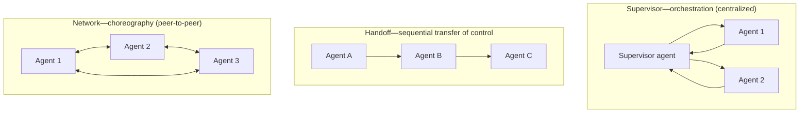
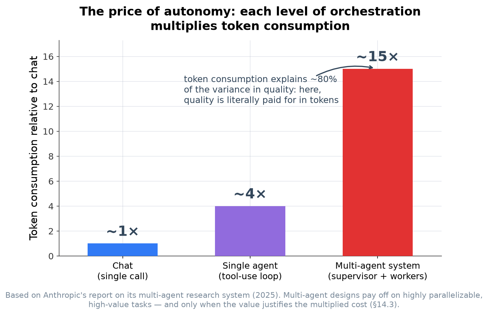
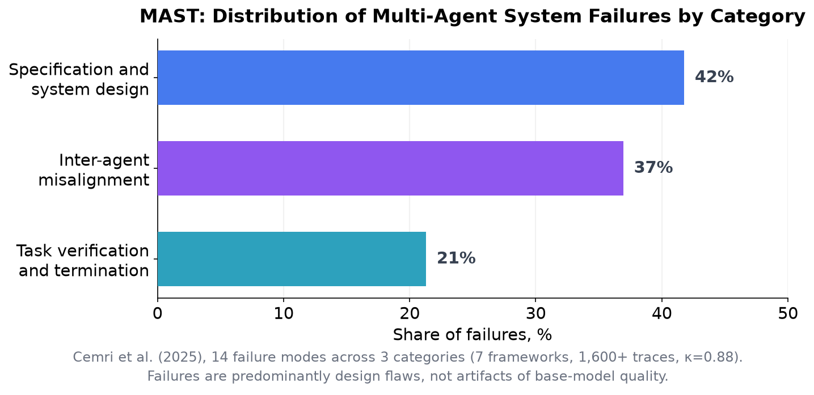

<!-- SPDX-FileCopyrightText: 2026 Aleksandr Drobiazkin
     SPDX-License-Identifier: CC-BY-SA-4.0 AND MIT
     Source: https://github.com/Drobiazkin/ai-agent-architecture
     Dual-licensed, and the boundary is exactly the fence: a fenced code block tagged
     with a language (python, java, sql, bash, yaml, xml, json), comments inside it
     included, is MIT. Everything else — the prose, the tables, the formulas, and the
     mermaid diagrams, which are illustrations expressed as text — is CC-BY-SA-4.0.
     Full terms: LICENSE, LICENSE-CODE, and NOTICE in the repository root. -->

# Chapter 14. Multi-Agent Systems and the Taxonomy of Failures

The closing chapter of Part IV: when to split a system into several agents, how to coordinate them (patterns of orchestration and choreography), and the full taxonomy of agent failures—the one that distributed-systems discipline clears away.

## 14.1 What a multi-agent system is and when you need one

**A multi-agent system**—several specialized agents coordinating to solve a task, instead of one agent. When to break it up:
- **The single agent's context is picking up noise** (§4.4, isolation with sub-agents): spread the sub-tasks across agents with clean contexts.
- **Sub-tasks require incompatible sets of tools or instructions**—specialize the agents.
- **Specialization improves quality**—a "researcher agent," an "executor agent," a "critic agent."

When **not** to split (the same ladder): you do not multiply agents until a single agent has demonstrably failed to cope. Every additional agent adds cost, coordination, and debugging difficulty. Multi-agent is not a goal but a tool for a proven need; most tasks are covered by one well-designed agent (Chapters 10–13), and multi-agent is the top of the ladder. Empirically, the quality gain of multi-agent systems over a single agent on common benchmarks is often small (Cemri et al., 2025, §14.4), which strengthens the argument against splitting without an explicit need.

## 14.2 Deep Dive: coordination patterns (orchestration vs. choreography)

Coordinating agents reproduces the general dichotomy of distributed systems—orchestration against choreography (Richardson):

- **Supervisor / Orchestrator (centralized)**—a lead agent coordinates the workers and collects the results. ≈ the **orchestration saga** (§11.5), scaled up to agents.
- **Handoff / Sequential**—an agent hands control to the next one. ≈ pipeline / partial choreography.
- **Network / Peer**—agents call each other directly, decentralized. ≈ **choreography**.
- **Hierarchical**—supervisors above supervisors. It pays off once a single supervisor can no longer hold the coordination (context, throughput); the price is that the second level itself becomes a bottleneck and a point of failure, and the trace grows longer by another level.

**The key trade-off is the same one as orchestration ↔ choreography:** a centralized supervisor is easier to reason about, debug, and observe (a single point of coordination), but it is a bottleneck and a single point of failure; a decentralized network is more flexible, but *harder to trace and analyze* (emergent behavior[^t-emergent], cyclic handoffs). The practical conclusion: **orchestration (supervisor) is the default preference**—it is more predictable and more observable; you move to choreography once centralization genuinely becomes the bottleneck. This is the same logic that governs the choice between an orchestration saga and a choreography saga. For agents communicating *across organizations* (different owners, a supervisor impossible), a protocol standard is taking shape—A2A (§15.6).

## 14.3 Deep Dive: the price of multi-agent

Be honest about the price, because multi-agent is seductive and overrated. It **multiplies**:
- **Cost**—each agent = LLM calls; coordination adds still more (§2.2). Concrete figures from Anthropic's report on a multi-agent research system (2025): ~15× the tokens relative to chat (a single agent—~4×), and token spend explained ~80% of the variance in quality—here you literally pay for quality in tokens.
- **Latency**—coordination round-trips between agents add up (§2.3).
- **Debugging and observability difficulty**—tracing behavior *across* agents is harder by a multiple (Chapter 18); emergent coordination bugs.
- **Context loss between agents** (§4.4)—an agent does not know what its neighbor knows; only what is passed explicitly gets passed. A subtle source of misalignment errors.

Both figures—15× and 4×—are quoted relative to chat, and that hides the one thing an architect who has already committed to an agent actually needs: multi-agent vs. a single agent = 15/4 ≈ **3.75×**. It is a rough estimate, not a measured ratio—15× and 4× are each a "typical" number from a different workload (research vs. chat), not one run across all three modes—but it does put the cost of coordination in perspective. The decomposition here is ours—from the two data points Anthropic measured, not something they published: ~4× above chat is the price of autonomy, the ReAct loop's context accumulating at O(k²) (§10.5); the remaining ~3.75× is the price of coordination in its own right: parallel workers plus a synthesis pass that re-reads all their results.

The conclusion (Anthropic's, and practice's): multi-agent is justified for *parallelizable* tasks of high value (broad research with independent sub-tasks, for instance), but only when the value justifies the multiplied cost. That same point dissolves the apparent contradiction with the data on multi-agent systems' weak gains on typical benchmarks (Cemri et al., §14.4): both results are true—the gain is small on sequential tasks and large on broadly parallelizable ones, which is exactly where Anthropic measured. **Multi-agent is a distributed system with every coordination cost, plus nondeterministic nodes.** You do not move to it by default: first exhaust what a single agent and the workflow patterns can do (§11.8).

## 14.4 Deep Dive: the full taxonomy of agent failures

Failures of agent systems can be cataloged systematically. The empirical basis comes from **MAST (Multi-Agent System Failure Taxonomy)** (Cemri et al., 2025)—the first empirically grounded taxonomy of multi-agent system failures, built on an analysis of more than 200 tasks across seven frameworks (over 1,600 annotated traces, annotator agreement κ = 0.88). MAST identifies 14 failure modes in three categories: (i) *specification and system design* (badly posed tasks, wrong assignment of roles, weak error handling), (ii) *misalignment between agents* (communication breakdowns, conflicting goals, context lost in the handoff), and (iii) *task verification and termination* (insufficient validation of the output, an error propagating down the chain).

The study's key finding: most failures are *design* failures (specification and coordination dominate) rather than a matter of base-model quality—in the authors' formulation, improving the model's capabilities is not enough to close out the whole taxonomy. This directly supports the position of §14.1 and §14.3: the price of multi-agent is not tokens alone but a whole class of coordination design failures.

Below is a composite practical catalog of agent failures (covering both the single agent and multi-agent), grouped by subsystem; most entries are distributed-systems failures with a nondeterministic surcharge.

| Category | Failure | Analog in distributed systems | Mitigation (and where in the book) |
|---|---|---|---|
| **Control loop** | Looping / nontermination | Infinite retry | Iteration cap, budget (§10.5) |
| | Goal drift over a long trajectory | State drift | Periodic re-grounding, a plan (§10.5, §13.4) |
| | Premature stop | Early exit | Termination criteria, a completeness check |
| **Tools/actions** | Hallucinated call / wrong arguments | Contract violation | Schema + validation (§5, §12.4) |
| | Silent partial failure under parallelism | Scatter-gather partial failure | Explicitly track every branch (§11.4) |
| | Silent success when a sub-step fails | Swallowed error | Propagate errors, check the result |
| | Dangerous composition of tools | Confused deputy, excessive privileges | Audit the *set*, least privilege (§12.5, §19) |
| **Reasoning** | Hallucination | — (LLM-specific) | RAG grounding (Part III), evals (Chapters 9, 17) |
| | A wrong plan | Wrong business logic | Plan-and-Execute + re-plan, evaluation (§13.4) |
| | Error cascade (compounding step by step) | Cascading failure | Checks between steps, evaluator (§11.6) |
| **Context/memory** | Context overflow | Working-state overflow | Compaction, sliding window (§4.4) |
| | Lost-in-the-middle degradation | — (LLM-specific) | Curation, placement (§1.8, §4) |
| | Stale memory | Cache staleness | Forgetting/refresh policies (§4.5) |
| | Context pollution | — | Isolation with sub-agents (§4.4) |
| **Coordination (multi-agent)** | Context loss between agents | State desync | Explicit handoff, shared state (§14.3) |
| | Cyclic/deadlocked handoffs | Deadlock | Supervisor instead of peer, limits (§14.2) |
| | Responsibility gap | Nobody owns the step | Clear boundaries of agent responsibility |
| **Security** | Prompt injection (direct/indirect) | Injection (SQLi / stored XSS) | Segregation, guardrails (§19) |
| | Excessive agency | Excessive privileges | Least privilege, human-gate (§10.6, §19) |

The table serves as a checklist during design and incident review: for each agent, determine which of these failures are possible and what covers them.

An industry security framework complements MAST's empirical taxonomy—the "OWASP Top 10 for Agentic Applications" (2026, §12.5): at least two of its categories cover the same modes as the table above (ASI06 Memory & Context Poisoning ↔ stale memory and context pollution; ASI07 Insecure Inter-Agent Communication ↔ context loss and deadlocked handoffs between agents). Running both frameworks is the practical move: MAST as quality diagnostics, OWASP as threat analysis.

## 14.5 Deep Dive: treating failures with distributed-systems discipline

The meta-conclusion of all of Part IV. As the table in §14.4 shows, the overwhelming majority of failures are **distributed-systems failures with a nondeterministic surcharge**. So the reliability discipline of distributed systems applies almost in full:
- **Idempotency** (agents retry often)—by task key (saga).
- **Timeouts and budgets**—on a step *and* on the whole loop (§10.5).
- **Compensations** for the reversible, a **human-gate** for the irreversible (§10.6)—you do not compensate the irreversible.
- **Circuit breaker and fallback** (§2.5)—for external dependencies and for the provider.
- **Observability/tracing**—by spans per step (Chapter 18).
- **Bulkhead**—isolating context and sub-agents (§4.4).

What is genuinely **new** beyond the classics (and these are three axes absent from deterministic systems):
1. **Bounding nondeterminism**—budgets on reasoning loops, because there is no transition graph (§10.5).
2. **Evals for probabilistic behavior**—tests have become distributions (Chapters 9, 17); `assertEquals` does not work.
3. **Guardrails for a manipulable actor**—defense against injection and excessive agency (Chapter 19), because the "code" of the decision can be knocked off course by data.

The frame in one phrase: **agent reliability = distributed-system reliability + the discipline of probabilistic control.** The first term is settled engineering practice; the second is the new one, and Part VI is devoted to it. Designing distributed systems covers a substantial share of what agent systems require, leaving the specifics of probabilistic control a separate but bounded layer.

## 14.6 Summary of the chapter and of Part IV

Multi-agent is a distributed system; coordination runs through orchestration (supervisor, more predictable) or choreography (peer, more flexible), with a preference for the first (§14.2); you do not multiply agents without proven need—the cost is a multiple (§14.3). The failure taxonomy (§14.4) is mostly distributed failures plus nondeterminism, predominantly design failures (MAST); they are cleared by existing discipline (idempotency, timeouts, compensations, observability, bulkhead) combined with the new discipline of probabilistic control (budgets, evals, guardrails, §14.5).

**Part IV in sum.** The model now *acts*: as a component (Part I), with a tamed interface (Part II) and grounded knowledge (Part III), organized by agent patterns (Chapters 10–11), armed with tools-as-contracts (Chapter 12), with memory and reasoning strategies (Chapter 13), coordinated and defended by distributed-systems discipline (Chapter 14). Next comes **Part V: integration** (MCP as the standard and the JVM stack, Spring AI/LangChain4j)—that is, how to embed all of this in a real organization's architecture.

*Sources.* Anthropic, "Building Effective Agents" (2024) and material on multi-agent research systems (2025)—coordination patterns, the price in tokens; V. Dibia, *Designing Multi-Agent Systems* (2025)—supervisor/handoff/network; M. Cemri et al., "Why Do Multi-Agent LLM Systems Fail?" (MAST, arXiv:2503.13657, 2025)—the empirical taxonomy of failures; C. Richardson, *Microservices Patterns* (2018)—orchestration vs. choreography, the basis for mapping the failures.

**In the Margins: Chapter 14**

[^t-emergent]: **Emergent behavior**—behavior of a system that is built into none of its components and arises out of their interaction; in multi-agent systems, the main source of failures invisible when agents are tested one at a time. → §14.4 (MAST, the misalignment category).

---
