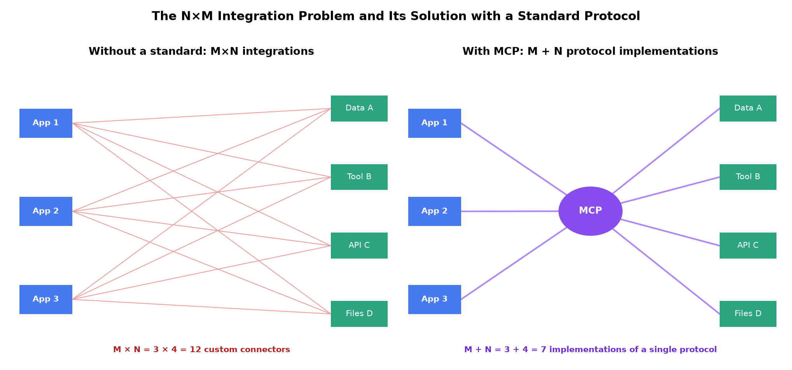
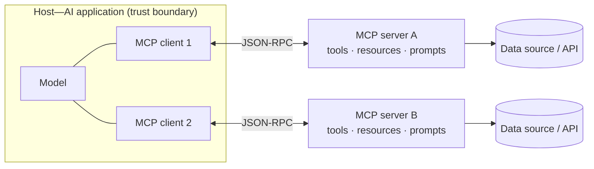
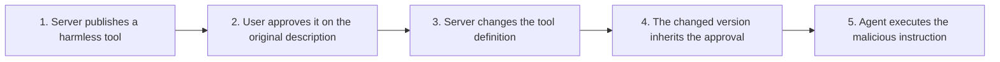

<!-- SPDX-FileCopyrightText: 2026 Aleksandr Drobiazkin
     SPDX-License-Identifier: CC-BY-SA-4.0 AND MIT
     Source: https://github.com/Drobiazkin/ai-agent-architecture
     Dual-licensed, and the boundary is exactly the fence: a fenced code block tagged
     with a language (python, java, sql, bash, yaml, xml, json), comments inside it
     included, is MIT. Everything else — the prose, the tables, the formulas, and the
     mermaid diagrams, which are illustrations expressed as text — is CC-BY-SA-4.0.
     Full terms: LICENSE, LICENSE-CODE, and NOTICE in the repository root. -->

# Part V. Integration: Embedding Into the Architecture

Parts I–IV built the agent as a system. Part V is about fitting that system into an existing architecture: through a standard protocol for integrating with tools and data (Chapter 15, Model Context Protocol) and through a concrete implementation layer on the JVM (Chapter 16). The shift in Part V is from the question "how is an agent built" to the question "how does an agent connect to the rest of the organization's landscape by contract rather than through one-off integrations."

# Chapter 15. Model Context Protocol (MCP)

Chapter 12 showed that a tool is a contract the model reads. MCP answers the next question: how to *standardize* that contract across different applications and different sources of tools and data, so that integrations get reused instead of rewritten for every pair. MCP is an open protocol Anthropic proposed in November 2024; since December 2025 the specification has been governed by the Linux Foundation (the Agentic AI Foundation, co-founded by Anthropic, Block, and OpenAI, with support from Google, Microsoft, and AWS)—for an architect making a multi-year bet on a protocol, that removes a substantial part of the vendor lock-in risk. The protocol is built on JSON-RPC 2.0 and standardizes how an AI application discovers and calls tools, reads data, and fetches prompt templates from external servers.

## 15.1 The N×M problem

Before the standard, integration suffered from the **N×M problem**: M AI applications, each of which needs access to N tools and data sources, require in the worst case M×N individual connectors—every "application ↔ source" pair implemented separately and incompatibly. As both sides grow, the number of integrations grows multiplicatively.

A standard protocol turns this into **M + N**: each application implements the client side of the protocol once, each source implements the server side once, and after that any client works with any server. MCP moves tool integration off the level of private, framework-specific abstractions and onto the level of **protocol interoperability**—with capability discovery, negotiation, and reuse across heterogeneous systems. The analogy, by role, is a standard peripheral interface: a device plugs into any host that supports the same connector, instead of a separate cable for every pair.

The protocol's infrastructure companion is the **MCP Registry** (the official server registry, in preview since September 2025; by the end of the year, on the order of two thousand entries with a discovery API). The registry settles the discovery question ("which servers exist and where to get them") but not the trust question: publishing to the registry is not an audit, and the discipline of §15.7—treating a third-party server as an untrusted supply-chain component—extends to registry servers as well.

## 15.2 Architecture: host, client, server

MCP defines three roles.

- **Host**—the user-facing AI application (for example, an IDE assistant, a chat application, an agent environment). The host holds the model and orchestrates the work.
- **Client**—the protocol component *inside* the host; it maintains a one-to-one connection with a server. Each connected server gets its own client.
- **Server**—a process that exposes capabilities (tools, data, templates); it wraps a specific tool or data source. The server **does not interact with the model directly**—all communication with the model is mediated by the host through the client.

Separating the roles matters for security and for reasoning about the system: the server is a potentially untrusted third-party component (§15.7), while the host remains the trust boundary and the point of control. The server sees only what the host passed to it through the client, and has no direct access either to the model or to the rest of the host's context.

## 15.3 Primitives

MCP describes capabilities through a small set of primitives; the terseness of the taxonomy is a deliberate decision that covers most practical cases.

**Server primitives:**
- **Tools**—executable operations with side effects: a call changes the state of the world (a database write, a message sent, an API call). Each tool is described by a JSON schema for its parameters and its result (kin to tool calling, Chapter 12). In short: *tools act*.
- **Resources**—*read-only* access to data: a user profile, a file's contents, a document, a configuration. A resource returns context but does not change state—a low-risk primitive. In short: *resources read*.
- **Prompts**—reusable parameterized templates that standardize routine interactions (for example, a code-review template with "language" and "file path" parameters). In short: *prompts standardize*. In practice servers most often expose tools, resources less often, and prompts almost never—even though prompts are exactly what lets you load the resources you need into the context explicitly, as part of a reproducible workflow.

**Client primitives** (capabilities the host provides and the server can request):
- **Roots**—the boundaries (filesystem or URI) within which the server is invited to operate; the host declares which areas the server has access to. An important caveat: in the base protocol, roots are a *declaration of expectation*, not isolation; honoring them is left to the server, and hard enforcement comes from outside the protocol—at the OS/container level.
- **Sampling**—the server can ask the client for *a call to the model* (a generation). This inverts the usual direction: the server uses the host's model without holding an access key of its own, and the host controls whether to allow the request and which model to apply.
- **Elicitation**—the server can ask the *user* for additional information mid-operation (for example, a missing parameter). Both client primitives keep the user and the host in the control loop.

## 15.4 The session lifecycle and capability negotiation

MCP works through a **stateful session**, not through one-off REST calls. A session opens with an `initialize` handshake, in which:
- **The protocol version is negotiated**—a version field (date strings of the form `2025-06-18`, `2025-11-25`) guarantees the two sides are compatible; if there is no compatible version, the connection terminates.
- **Capabilities are negotiated**—each side declares which primitives and features it supports (the server: tools, resources, prompts, subscriptions; the client: sampling, notification handling). Both sides must honor the declared capabilities for the duration of the session.

Session state enables **dynamic updates**: the server notifies the host that its capability set has changed (the tool list changed, say) through notifications. This is what separates MCP from a static tool catalog hardwired into the application.

## 15.5 Transports

The specification defines two transports over JSON-RPC:
- **stdio**—local, within a single machine: the server runs as a subprocess and the exchange goes through the standard I/O streams. Simple, and a fit for local integrations.
- **Streamable HTTP**—remote, over HTTPS (using SSE[^t-sse] for streaming from server to client). It replaced the early HTTP+SSE transport and targets remote, multi-client deployments.

Topology picks the transport: a local tool—stdio; a network service shared by several hosts—Streamable HTTP, with the corresponding authentication and encryption requirements (§15.7).

## 15.6 MCP and tool calling: where the line falls

MCP does not replace tool calling (Chapter 12); it standardizes its *transport and packaging*. The model still performs function calling—deciding which tool to call and with which arguments (§12.2). MCP defines how tools (and resources and prompts too) are *discovered, described, and invoked* across the "host ↔ server" boundary, uniformly for any compatible server. Put differently: tool calling is *the model's decision to call*; MCP is *the delivery standard* for getting tool definitions into the context and calls out to the executor. The tool-interface design principles from §12.3 (clear descriptions, strict schemas, compact results, a curated set) apply to MCP tools unchanged.

### Deep Dive: agent interoperability—A2A

MCP standardizes the "agent ↔ tools and data" axis. For the "agent ↔ agent" axis, **A2A (Agent2Agent)** is taking shape—a protocol Google proposed (April 2025) and handed to the Linux Foundation (June 2025). The mechanics: an agent publishes an **Agent Card**—a JSON manifest of its capabilities and its endpoint; interaction is organized around **tasks** with a lifecycle (submitted → working → input-required → completed/failed), with streaming and push notifications for long-lived operations—that is, the protocol is designed from the start for asynchronous, multi-minute agent tasks rather than a synchronous function call. The protocols are complementary: internally an agent uses tools over MCP; outward it exposes a task interface over A2A. For multi-agent systems (Chapter 14), A2A is a candidate standard for *cross-organizational* choreography, where supervisor orchestration is impossible: the agents have different owners. Caveats: the ecosystem is markedly younger than MCP's, and agent-to-agent communication is a risk class of its own (ASI07, §14.4)—authenticating agents, trusting someone else's Agent Card, taint through inter-agent messages; the disciplines of §15.7 apply here too.

*Sources.* A2A Project (Linux Foundation, 2025 specification); Google, the Agent2Agent announcement (2025).

## 15.7 Deep Dive: MCP security (a bridge to §12.5 and Chapter 19)

MCP widens the agent's attack surface, and its own threat model matters. The key observation: **MCP's very design—plugging in tools from different sources—makes the lethal trifecta easier to assemble** (§12.5). Mixing servers, a system readily combines access to private data, untrusted content, and external communication channels in a single session; so the Rule of Two and taint tracking (§12.5) apply to MCP directly.

Attack classes specific to MCP:
- **Tool poisoning.** Malicious instructions are planted in a tool's *description* or metadata—which the model reads but the user may never see—and the model follows them. Unlike a one-off injection, poisoning is not confined to a single session: it hits every agent that reads the poisoned tool. The specification explicitly directs that tool annotations be treated as untrusted unless the server itself is trusted.
- **Rug pull.** The server changes a tool's definition *after* the user has approved it. The approval covered the original configuration, and the base protocol has no mechanism for tracking definition changes or requiring re-approval—so the modified version inherits the trust. The class parallels attacks on package indexes (a package is uploaded harmless, then modified).

- **Tool shadowing and cross-server shadowing.** A malicious server registers a tool whose name or description matches a legitimate one, intercepting the calls; in cross-server shadowing, one server's tool description targets a *different* trusted server in the same session. Demonstrated (Invariant Labs, April 2025): through instructions embedded in a description, a malicious server made an agent pull message history out of a legitimate server and ship it outward over a trusted channel—transport encryption is no defense, because the leak happens above the encryption boundary, through the agent's legitimate access.
- **Return value poisoning.** A tool call's result carries planted instructions that hijack the reasoning that follows (indirect injection, §12.5).
- **Real CVEs (2025).** OS command injection through an untrusted connection (`mcp-remote`, CVE-2025-6514); configuration substitution in an IDE following the rug pull pattern (CVE-2025-54136) and execution via injection from an external source (CVE-2025-54135).

The defenses build up across several levels:
- **Authorization.** The 2025-06-18 revision of the specification classifies MCP servers as OAuth Resource Servers[^t-oauth-roles] and requires clients to implement Resource Indicators (RFC 8707), so that a token issued for one server cannot be used against another—and that same revision introduces elicitation (§15.3). The 2025-11-25 revision extends authorization: OIDC Discovery, incremental scope consent, OAuth Client ID Metadata Documents.
- **Definition integrity.** Pin approved tool descriptions by hash and reject mismatches; the ETDI[^t-etdi] proposal (Bhatt et al., 2025) binds tool definitions to signed tokens and versions them, so that any change invalidates the signature (not yet part of the core specification, but the principle is applicable today).
- **The user loop.** Showing the user what a tool is about to send outward is an effective defense against exfiltration; draw a clear visual line between what the user sees and what the model sees.
- **Server hygiene.** Input validation, rate limiting, output sanitization, access control on resources; treating a third-party MCP server as an untrusted supply-chain component.

### Deep Dive: agent identity—who exactly is acting

The authorization above answered the question "is this call allowed." The question one level down—**on whose behalf** it is made—has three bad default answers and one right one.

**Three candidate identities.** (1) *An application service account*: one account with broad rights across all users—a confused deputy waiting to happen (§12.5): the agent executes a narrowly privileged user's request with the system's rights, and any injection inherits those rights. (2) *The user's identity*: the agent is an invisible client; the rights are correct, but the action log cannot tell a human's actions from those of their agent—the audit goes blind, and compromising the agent equals compromising the user. (3) *The agent's own identity* (**non-human identity, NHI**—the established industry term for machine accounts: services, bots, now agents): with no link to a user, the agent cannot act on that user's behalf. The right answer is **the pair**: every action carries both *who initiated* it (the user) and *what executed* it (the specific agent)—and both identities land in the tracing spans (Chapter 18).

**The delegation mechanics—OAuth 2.0 Token Exchange (RFC 8693).** How to express "agent A acts on behalf of user B" technically: the harness exchanges the user's token at the authorization server for a *new* downstream token in which the subject is the user, the actor is the agent (the `act` claim), the scope is *narrowed* to what the next step needs, and the audience is a specific service (a resource indicator, RFC 8707 above). In the Microsoft ecosystem this flow is called **on-behalf-of**. The key discipline along the user → agent → MCP server → internal API chain: at every hop the token is *exchanged and narrowed*, not forwarded onward—the MCP specification explicitly forbids passing the user's token straight through (passthrough): a server must accept only tokens issued *to it*. Otherwise a token stolen at a far hop opens everything the user could reach.

**Where the agent's own identity comes from.** The same question as for any workload with no human at the keyboard, and the industry's answer is the same—**workload identity**: the platform (SPIFFE/SPIRE as the open standard, for example) issues the workload a short-lived cryptographic credential based on its *attributes* (which pod, which service, which code) rather than on a secret in a config file. An agent is no different from a microservice here—three things are different. First, **nondeterminism**: a microservice's rights can be derived from its code; an agent's rights are set *up front* and *from outside*—least privilege over the declared tool set (§12.5), not over observed behavior. Second, **duration**: an agent's trajectory can outlive a token's TTL—refreshing tokens mid-task falls to the harness. Third, **scale**: dozens of agents per organization quickly produce an explosion in the number of NHIs, and without a registry (Chapter 25) they turn into an unmanageable fleet of accounts—which is exactly why OWASP Agentic names agent identity abuse a risk category of its own.

The upshot: MCP introduces no new security *principles* beyond Chapters 12 and 19, but it makes following them critical, because it lowers the barrier to plugging in untrusted third-party tools. The discipline of the lethal trifecta and the Rule of Two (§12.5) is the base frame for MCP as well; identity and delegation are its foundation one level down.

## 15.8 Implementation on the JVM

The JVM platform has an official MCP Java SDK (built with the Spring team's involvement). **Spring AI** provides both client and server support for MCP: an application can act as an MCP client, connecting to external servers, or expose methods annotated `@Tool` as an MCP server—offering its capabilities to any MCP-compatible agent through a standard protocol rather than through a private integration. This lifts the contract-first approach to tools (Chapter 12) up to the level of cross-system integration.

## 15.9 Chapter summary

MCP is an open protocol (JSON-RPC) that standardizes how AI applications integrate with tools, data, and templates, turning the N×M problem into M+N. The architecture is three roles: the host (the application with the model), the client (the protocol component inside the host, one per server), and the server (which exposes capabilities without talking to the model directly). Capabilities are described by primitives—server-side (tools act, resources read, prompts standardize) and client-side (roots, sampling, elicitation)—negotiated in the `initialize` handshake within a stateful session; the transport is stdio locally or Streamable HTTP remotely. MCP does not replace tool calling; it standardizes its delivery (§15.6). The main caveat is security (§15.7): MCP makes the lethal trifecta easier to assemble and introduces attack classes of its own (tool poisoning, rug pull, shadowing), so it demands authorization (OAuth, RFC 8707), definition integrity, and treating servers as untrusted components. Organizationally the protocol is vendor-neutral (under the Linux Foundation since December 2025) and has acquired an official server registry (§15.1); the adjacent "agent ↔ agent" axis is covered by the A2A protocol (§15.6). Next, Chapter 16: assembling the full stack on the JVM.

*Sources.* Anthropic, the Model Context Protocol specification (modelcontextprotocol.io; revisions 2025-06-18, 2025-11-25)—architecture, primitives, lifecycle, transports; X. Hou et al., "Model Context Protocol (MCP): Landscape, Security Threats, and Future Research Directions" (2025); Invariant Labs, the tool poisoning and rug pull advisories (2025); M. Bhatt et al., "ETDI: Mitigating Tool Squatting and Rug Pull Attacks in MCP" (2025); S. Willison, "The Lethal Trifecta" (2025, §12.5); Linux Foundation / Agentic AI Foundation—the transfer of MCP governance (December 2025); MCP Registry (registry.modelcontextprotocol.io, preview 2025); identity and delegation—RFC 8693 (OAuth 2.0 Token Exchange), RFC 8707 (Resource Indicators), SPIFFE/SPIRE (workload identity); the Spring AI documentation on MCP.

**In the Margins: Chapter 15**

[^t-sse]: **SSE**—Server-Sent Events: a one-way streaming channel server→client over plain HTTP; simpler than WebSocket and sufficient for delivering events.
[^t-oauth-roles]: The OAuth role model: the **Authorization Server** issues tokens, the **Resource Server** accepts and validates them, the **Client** requests access. Classifying an MCP server as a Resource Server means it issues no tokens itself and trusts an external AS.
[^t-etdi]: **ETDI**—Enhanced Tool Definition Interface: an academic proposal to sign and version tool definitions; not part of the core specification—the practical equivalent is pinning approved descriptions by hash.

---
