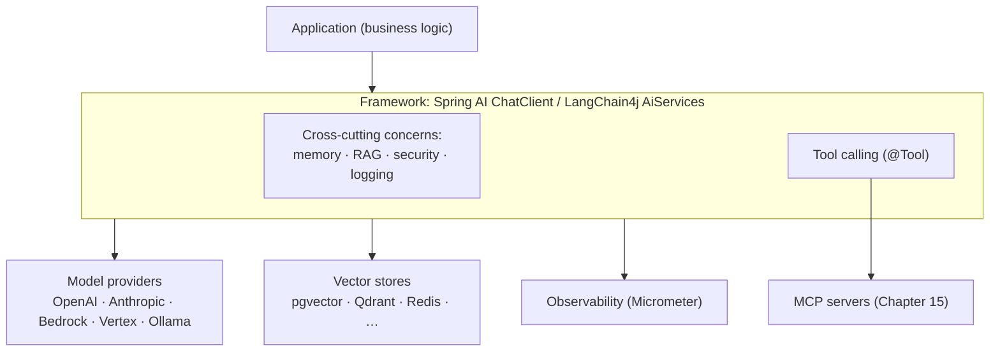

<!-- SPDX-FileCopyrightText: 2026 Aleksandr Drobiazkin
     SPDX-License-Identifier: CC-BY-SA-4.0 AND MIT
     Source: https://github.com/Drobiazkin/ai-agent-architecture
     Dual-licensed, and the boundary is exactly the fence: a fenced code block tagged
     with a language (python, java, sql, bash, yaml, xml, json), comments inside it
     included, is MIT. Everything else — the prose, the tables, the formulas, and the
     mermaid diagrams, which are illustrations expressed as text — is CC-BY-SA-4.0.
     Full terms: LICENSE, LICENSE-CODE, and NOTICE in the repository root. -->

# Chapter 16. Assembling the Stack on the JVM

The abstract patterns of Parts I–IV have concrete implementations on the JVM platform. This chapter maps the architectural concerns—calling the model, templating, structured output, RAG, tool calling, memory, orchestration, observability, MCP integration—onto the constructs of two mature frameworks: **Spring AI** (1.0 GA—May 2025, 1.1 GA—November 2025) and **LangChain4j** (1.0 GA—May 2025; the agentic module `langchain4j-agentic` is noticeably younger and still in active flux). The goal is not a list of API methods (which changes from release to release) but a durable "pattern → construct" correspondence—enough to assemble a full agent stack and choose tooling deliberately.

## 16.1 The two options and their philosophies

**Spring AI** follows Spring's idiom: auto-configuration, starters, beans, dependency injection. Its central construct is the **ChatClient**, a fluent, type-safe API for calling the model (close in spirit to WebClient and RestClient). Cross-cutting concerns (memory, RAG, filtering) are pulled out into **Advisors**—a chain of interceptors around the model call. The framework integrates tightly with Spring Boot and the Micrometer ecosystem.

**LangChain4j** is a framework-agnostic library that works with Quarkus, with Spring Boot, and with no framework at all. It offers two levels: low-level components (`ChatModel`, `ChatMemory`, `EmbeddingModel`, `EmbeddingStore`) for full control, and high-level **AI Services**—declarative interfaces with annotations (`@SystemMessage`, `@UserMessage`, `@Tool`, `@MemoryId`) from which the framework generates a proxy implementation. The declarative approach takes its cue from Spring Data JPA: the developer describes an interface, the library produces the implementation.

Both libraries put a single API over a range of model providers (OpenAI, Anthropic, Azure OpenAI, Amazon Bedrock, Google Vertex AI, local ones through Ollama) and vector stores, delivering portability and reducing vendor lock-in. On coverage of this book's patterns they are equivalent; they differ in style and in where they integrate.

## 16.2 Mapping the concerns onto constructs

The chapter's core value is the correspondence between the abstractions of Parts I–IV and concrete constructs.

| Concern (chapter) | Spring AI | LangChain4j |
|---|---|---|
| Calling the model, portability (Chapters 1–2) | `ChatClient` + provider auto-configuration | `ChatModel` / `AiServices` + a provider module |
| Prompt templates (Chapter 3) | `PromptTemplate`, system/user messages | `@SystemMessage` / `@UserMessage`, `PromptTemplate` |
| Structured output (Chapter 5) | mapping to a POJO (structured output) | the method's return type (POJO, enum, `Result<T>`), json mode |
| Vector store (Chapter 8) | `VectorStore` (a single API, SQL-like filter) | `EmbeddingStore` + `EmbeddingModel` |
| RAG (Chapters 6–7) | `QuestionAnswerAdvisor` (naive), `RetrievalAugmentationAdvisor` (modular) | `ContentRetriever`, `RetrievalAugmentor` |
| Tool calling (Chapter 12) | `@Tool` methods, calls dispatched to beans | `@Tool` methods, `ToolProvider` |
| Memory (Chapters 4, 13) | `MessageChatMemoryAdvisor`, `VectorStoreChatMemoryAdvisor` | `ChatMemory`, `@MemoryId`, `ChatMemoryStore` |
| Agents and workflows (Chapters 10–11) | agent patterns on top of ChatClient/advisors | `AiServices`, the `langchain4j-agentic` module |
| Observability (Chapter 18) | Micrometer (metrics, traces) | tokens and latencies emitted as metrics |
| MCP integration (Chapter 15) | MCP client and MCP server (OAuth2) | MCP support in tool calling |
| Evaluation (Chapters 9, 17) | Evaluation utilities (relevance, faithfulness) | integration with test infrastructure |

What the table means in practice: a pattern introduced abstractly in the earlier parts has a direct embodiment in both libraries; picking a construct is a question of framework style, not of whether the capability exists.



## 16.3 Deep Dive: interceptors versus declarative services

The two libraries embody different architectural styles of composition, and that difference matters more than any feature list.

**Spring AI: a chain of interceptors (Advisors).** Cross-cutting concerns take the shape of an ordered chain of advisors around the model call: before the call they run in ascending order, after it in descending order, sharing state through a context. Ready-made advisors cover memory (`MessageChatMemoryAdvisor`), RAG (`QuestionAnswerAdvisor`), filtering unsafe input (`SafeGuardAdvisor`), and logging; you add your own by implementing the interface. This is the classic interceptor pipeline: every layer observes and, where needed, transforms the request and the response. Advisors take part in the observability stack, so their execution shows up in metrics and traces.

**LangChain4j: a declarative proxy (AI Services).** Concerns are declared on the interface: the method's return type sets the output parser (a POJO, a collection, an enum for classification, `Result<T>` carrying sources and token spend), annotations set the message templates and the tools, and `@MemoryId` partitions memory per user. The library generates the implementation—business code stays declarative and testable (interfaces are easy to swap out in tests). An architecturally useful subtlety: RAG content appended to a message is stored in memory by default, but that behavior is switchable, so retrieved fragments need not bloat the history.

Both styles, illustrated (signatures trimmed to the essentials; check the current API against the documentation):

```java
// Spring AI: a chain of interceptors around the model call
ChatClient chat = ChatClient.builder(model)
    .defaultAdvisors(
        MessageChatMemoryAdvisor.builder(memory).build(),   // memory
        QuestionAnswerAdvisor.builder(vectorStore).build()) // RAG
    .build();
Ticket ticket = chat.prompt().user(question).call().entity(Ticket.class);
```

```java
// LangChain4j: a declarative interface; the library generates the implementation
interface SupportAgent {
    @SystemMessage("You are a support assistant; answer according to the policies.")
    Result<Ticket> classify(@MemoryId String userId, @UserMessage String question);
}
SupportAgent agent = AiServices.builder(SupportAgent.class)
    .chatModel(model)
    .chatMemoryProvider(memoryProvider)
    .contentRetriever(retriever) // RAG
    .build();
```

The difference comes down to *where* the composition lives: in Spring AI, in an explicit chain of interceptors (an imperative pipeline); in LangChain4j, in the interface declaration (a proxy that generates the behavior). Both models implement the same patterns of this book.

## 16.4 Deep Dive: agents and workflows on the JVM

The workflow-versus-agent distinction (§11.8) carries straight over into implementation, and both frameworks support the whole spectrum—from a single call to an autonomous loop.

**Deterministic workflows are preferable, and the code says so.** For processes that need control, the recommended approach on the JVM is to structure the process as a **state machine**: the nodes (steps) and the transition criteria are set programmatically. A node can be a call to an AI service (classifying a request through a guided dialogue, say) or purely algorithmic (a calculation, where a model has no business being). The benefits map directly onto §11.8: control, separation of responsibility (the model does not step outside the node's boundary), the ease of adding safety checks and privilege limits at every node, and the option of running small models on simple nodes and specialized ones on hard nodes. This is the engineering expression of the principle "hold as much as possible inside deterministic workflows."

**Autonomous patterns.** For agentic autonomy, Spring AI ships implementations of the canonical patterns (chaining, routing, parallelization, orchestrator-workers, evaluator-optimizer, Chapter 11) on top of ChatClient. LangChain4j has factored its agent functionality into the `langchain4j-agentic` module—a set of abstractions for multi-agent processes in which agents delegate tasks, share context, and coordinate. Either way, the discipline of Chapters 10 and 14 still holds: iteration limits, timeouts, reversibility, a human-gate.

**Curating tools and conditional RAG.** Both libraries reflect the concerns of §12.3 and §4.4: a tool included in a call spends tokens and raises the risk of an unintended invocation, so the tool set gets curated. LangChain4j explicitly supports *conditional* RAG—retrieval wrapped in a `@Tool` is invoked only when the model has judged the context necessary, which avoids pointless searches on simple queries (the same principle as Adaptive RAG, §7.9).

## 16.5 Deep Dive: production concerns on the JVM

Assembling the stack is not only about calls to the model but about operational properties (a bridge to Part VI).

- **Observability.** Spring AI integrates with Micrometer: metrics and traces for model calls, the vector store, and advisors out of the box (Chapter 18). In LangChain4j, tokens and latencies are emitted as metrics; provider and store calls are traced.
- **Blocking and the reactive stack.** A model call is seconds of waiting on the network. On a servlet stack it holds a pool thread for that entire time (the pool drains faster than it seems—do the arithmetic as concurrency × duration; Little's law and the platform's standard answer are worked through below); on a reactive one (WebFlux/Netty), a synchronous `call()` inside the event loop is a direct route to degrading the whole service. The rules: in a reactive pipeline, only the reactive/streaming variants of the API, or offload to a dedicated scheduler; there is no admissible form of a blocking model call in an event loop; a timeout on every network call (§2.5) is mandatory on any stack.
- **Persistent memory and multi-tenancy.** The default memory is simple (a window of messages), but in a multi-user, multi-pod environment the wrong strategy leads to an explosion in tokens, latency spikes, and context leaking between users. The remedies: partition memory by identifier (`@MemoryId` in LangChain4j, a conversation ID in Spring AI), a persistent store (`ChatMemoryStore` over a database), a sliding window, or summarization (§4.4). Memory is treated as a first-class architectural concern, not a detail.
- **Portability and model choice.** A single API lets you swap providers and apply Model Routing (§2.2): a cheap model on a simple node, a strong one on a hard node, inside a single application.
- **Security.** Authorization at the tool, with the user's privileges (§12.5); isolating untrusted data (§4.6); and, for MCP integration, OAuth2 and treating servers as untrusted (§15.7). The framework does not provide these properties automatically: they are designed in.

**How many threads a model call eats: Little's law.** "Concurrency × duration" is Little's law, and what it gives is not an intuition but an exact ceiling. For steady state:

$$L = \lambda \times W$$

Here $L$ is the average number of requests in processing at once (on a servlet stack that is exactly the number of busy pool threads, in threads); $\lambda$ is the rate of incoming requests (requests/s); $W$ is the **average** time to process one request end to end (s), dominated by the model call: seconds of network waiting against milliseconds of your own logic. The word "average" here is not a caveat but a condition: Little proves the equality for the mean time a job spends in the system, not for an arbitrary percentile—and that restriction resurfaces below. The pool is finite, so substituting "$L$ = pool size" turns the law into a throughput limit:

$$\lambda_{max} = \frac{L}{W}$$

**Live numbers.** Spring Boot brings up an embedded Tomcat with a pool of 200 worker threads by default (`server.tomcat.threads.max`; the value is baked into `ServerProperties`), and an agent call with a long generation takes, say, a measured $W = 8$ s. Then $\lambda_{max} = 200 / 8 = 25$ requests/s per pod—with the CPU idle: the ceiling is set not by computation but by 200 threads parked in `read()` on the provider's socket. Take a different profile—not a single 8-second call but the whole request under the §2.3 budget (an SLO of p95 = 3 s: retrieval, model calls, tools, guardrails): a disciplined agent yields $200 / 3 \approx 67$ requests/s—and that is a lower-bound estimate: the law works on the mean, and p95 is certainly larger than the mean, so the true ceiling is higher, but stays in the same order of magnitude. For comparison, on ordinary business logic at 50 ms the same pool would give $200 / 0.05 = 4000$ requests/s—a 60–160-fold gap against the agent profile, and it comes entirely out of $W$. The default of 200 is a constant that knows nothing about your $W$; it physically cannot be right for a millisecond profile and a second-scale one at the same time. And to serve 100 requests/s at $W = 8$ s takes $L = 100 \times 8 = 800$ simultaneously busy threads: 800 MB of address space for stacks alone (Linux/x64: 1024 KB per thread by default—reserved up front, physically consumed as pages get touched) plus an OS scheduler shuffling 800 threads.

In plain terms: the pool stops being a pool and becomes a limiter exactly when the desired rate, multiplied by the processing duration, exceeds the thread count. **The engineer's iron rule:** pool size is derived from the target $\lambda$ and the measured end-to-end duration of a request (§2.3), not taken from the framework's default. And it is more honest to measure at p99 than at the mean—a deliberate departure from the letter of the law: Little gives an average ceiling, but the pool has to survive the tail of the distribution; p99 here is a conscious margin on top of the $W$ the formula calls for.

**Virtual threads (Loom)—the platform's standard answer.** Since Java 21, a blocking network call inside a virtual thread does not hold an OS thread: the runtime **unmounts** the virtual thread (parking its stack on the heap) and frees the **carrier** OS thread for other work. The profile "thousands of concurrent requests, each of them waiting on the network nearly the whole time" is exactly the one Loom was built for. In Spring Boot (3.2+, on Java 21) this is switched on with a single key, `spring.threads.virtual.enabled=true`, after which Tomcat handles each request on a virtual thread; the worker pool is thereby bypassed and `server.tomcat.threads.max` no longer governs request concurrency (see spring-projects/spring-boot#41937)—the pool size simply stops being a variable in the formula above. The $\lambda$ ceiling shifts from the thread count to the real constraint—the provider's quota (rate limit, §2.5) and the HTTP client's connection pool. Virtual threads themselves are not pooled: one thread per task, and their number equals the number of tasks.

**The trap: pinning.** Before Java 24, a virtual thread blocked inside `synchronized` **nailed** the carrier thread to itself (pinning)—the carrier was not released, and the win went to zero: in the worst case concurrency collapsed to roughly the core count (the virtual-thread scheduler keeps by default as many carrier threads as there are available processors, though it may add compensating threads up to `jdk.virtualThreadScheduler.maxPoolSize`, default 256), which is lower than an ordinary 200-thread pool. JEP 491 (Java 24) rewrote the JVM's monitors and removed this case. The practical consequence: on Java 21–23, virtual threads help only if the HTTP client and the provider's SDK do not block under `synchronized` anywhere along the call path—check by running with `-Djdk.tracePinnedThreads=full` (in Java 24 the flag was dropped as unnecessary; diagnosis goes through the JFR event `jdk.VirtualThreadPinned`). Pinning has not vanished entirely even in 24+: native code (JNI, the Foreign Function & Memory API) still nails the carrier thread.

**A caveat, so this does not displace the rule above.** Virtual threads do not cure the reactive case: a blocking `call()` inside a Netty event loop is inadmissible on any version of Java, because what blocks there is not "a thread from a pool" but one of the few threads serving every connection at once. Loom is an **alternative** to the reactive stack (get simple blocking code back without paying for it in OS threads), not a patch on top of it. The choice frames like this: if the stack is servlet-based → turning on virtual threads lifts the $\lambda_{max} = L / W$ ceiling, at the price of auditing `synchronized` along the call path; if the stack is reactive → the rule stands: the reactive/streaming variants of the API, or offload to a dedicated scheduler.

## 16.6 Choosing and combining

Since both libraries implement the same patterns of this book, the choice turns not on what capabilities exist but on the fit with the ecosystem and the style:
- **Spring AI** is the natural fit where the application is already built on Spring Boot: auto-configuration, beans, starters, and one observability stack keep the integration effort to a minimum.
- **LangChain4j** suits a need for framework independence (Quarkus, plain Java) or for the declarative AI Services style; it also offers low-level access for full control.
- The libraries are not mutually exclusive: they get used together—LangChain4j's declarative AI Services for individual services inside a Spring application observed through Micrometer, for instance.

The decisive architectural principle stands unchanged: a framework implements patterns but does not stand in for design decisions—the choice of retrieval pattern (Part III), of the level of autonomy (§10.7), of the security boundaries (§12.5, Chapter 19), and of the memory strategy (§4.5) is the architect's, and the framework only embodies those choices idiomatically.

## 16.7 Summary of the chapter and of Part V

The abstract patterns of Parts I–IV have direct implementations on the JVM in Spring AI and LangChain4j: calling the model (ChatClient / AiServices), templates, structured output, the vector store, RAG, tool calling, memory, agent patterns, observability, MCP integration, and evaluation (§16.2). The libraries differ in composition style—a chain of advisor-interceptors against the declarative AI Services proxy (§16.3)—but cover the same set of patterns, so the choice comes down to the ecosystem rather than to capabilities (§16.6). Control over agent processes comes from structuring them as a state machine with deterministic and model nodes (§16.4), while the operational properties—observability, persistent memory, portability, security—are designed separately (§16.5, a bridge to Part VI).

**Part V in sum.** The agent built across Parts I–IV is now integrated: it connects to tools and data over a standard protocol (MCP, Chapter 15) and takes concrete shape on a JVM stack through a contract rather than through one-off integrations (Chapter 16). Next comes **Part VI: production**—how to operate this system reliably: evaluation, observability, security, cost, and latency.

*Sources.* Spring AI 1.0/1.1—the documentation and GA release materials (docs.spring.io/spring-ai; InfoQ, 2025): ChatClient, the Advisors API, vector stores, RAG, tool calling, memory, MCP, observability; LangChain4j—the documentation (docs.langchain4j.dev): AI Services, ContentRetriever/RetrievalAugmentor, ChatMemory, `@Tool`, the `langchain4j-agentic` module; comparative material on Spring AI and LangChain4j (2025). The JVM part of §16.5: J. D. C. Little, "A Proof for the Queuing Formula: L = λW," Operations Research (1961)—the law is proved for the mean time a job spends in the system; OpenJDK JEP 444 "Virtual Threads" (Java 21) and JEP 491 "Synchronize Virtual Threads without Pinning" (Java 24); Oracle, "Core Libraries: Virtual Threads," JDK 21—pinning and `jdk.tracePinnedThreads`; Oracle, the `java` Command Reference, JDK 21—the `-Xss` defaults; Spring Boot—Release Notes 3.2 (virtual threads) and the `ServerProperties` source (the Tomcat pool default of 200; the field javadoc reads only "Maximum amount of worker threads", while the nullifying of its effect under virtual threads is recorded in spring-projects/spring-boot#41937).

---
