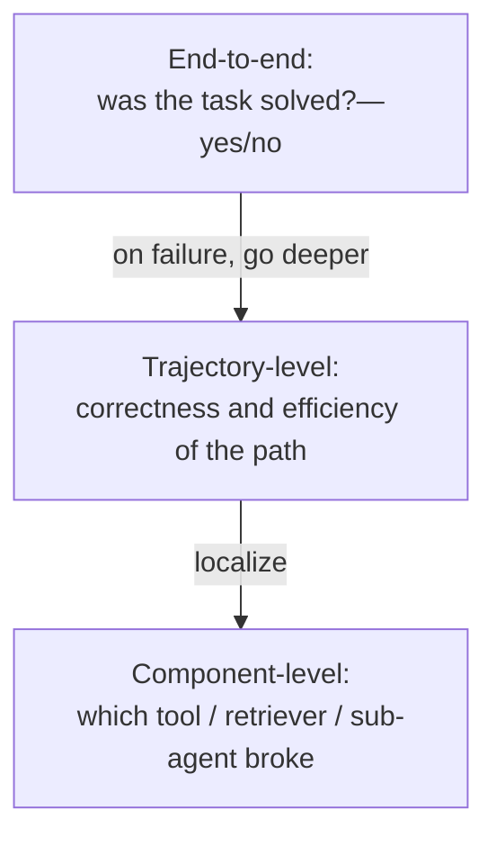
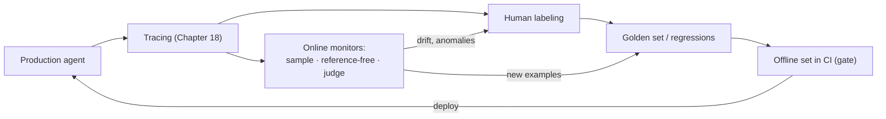

<!-- SPDX-FileCopyrightText: 2026 Aleksandr Drobiazkin
     SPDX-License-Identifier: CC-BY-SA-4.0 AND MIT
     Source: https://github.com/Drobiazkin/ai-agent-architecture
     Dual-licensed, and the boundary is exactly the fence: a fenced code block tagged
     with a language (python, java, sql, bash, yaml, xml, json), comments inside it
     included, is MIT. Everything else — the prose, the tables, the formulas, and the
     mermaid diagrams, which are illustrations expressed as text — is CC-BY-SA-4.0.
     Full terms: LICENSE, LICENSE-CODE, and NOTICE in the repository root. -->

# Part VI. Production: Operating the System

Parts I–V built the agent and integrated it. Part VI is about operating it reliably: measuring the quality of a nondeterministic system (Chapter 17, evaluation), seeing its behavior in production (Chapter 18, observability), defending it against manipulation and abuse (Chapter 19, security), and holding cost and latency inside a budget (Chapter 20). Part VI shifts the question from "how do I build it" to "how do I keep the system working, observable, secure, and economical under real load."

# Chapter 17. Evaluation: Building an Eval System

Chapter 9 applied evaluation to RAG. This chapter builds evaluation as a general production discipline for LLM and agent systems. The thesis: evaluation is not a supporting stage but the central control loop for a nondeterministic system; without it you cannot steer quality, and regressions go unnoticed.

## 17.1 Why evaluation is the central discipline

An LLM system behaves nondeterministically (§2.4): the same input yields a distribution of outputs, and a confident wrong answer is indistinguishable from a right one by eye. Classic equality testing (`assertEquals`) does not apply—the property under test is not "the output equals the expected value" but "the output *satisfies a criterion* at an acceptable rate." Tests therefore turn into *distributions*: evaluation measures the fraction of outputs that pass the criterion across a representative set, and tracks that fraction over time and across versions. This moves engineering practice from a single assert to statistical measurement—with golden sets, thresholds, confidence intervals, and drift monitoring.

## 17.2 Levels and types of evaluation

Evaluation combines three kinds of checks, differing in cost and in what they can measure.

- **Programmatic (deterministic) checks.** Exact, cheap, reproducible: conformance to schema and types (Chapter 5), exact match against a reference, presence of required fields, format bounds; for code—unit tests passing and the exit status; for actions—state changes and respect for access boundaries. Use them wherever the criterion *can be formalized*.
- **Model-based evaluation (LLM-as-judge).** For semantic properties that resist exact checking: relevance, faithfulness, tone, completeness, instruction following. The judge is a separate model call with a rubric (§17.3). Flexible, but nondeterministic and biased (§17.4), so it needs calibration.
- **Human evaluation.** Most reliable for subtle and subjective properties, and it serves as the *reference standard* against which automatic evaluations are calibrated. Expensive and it does not scale, so it runs on a subsample—to validate the judge and to label golden sets.

An orthogonal distinction—**with a reference or without**. Reference-based evaluation compares the output against a known correct answer (correctness). Reference-free evaluation judges the output against the question and the context with no reference (faithfulness, relevancy)—handy where a reference is expensive or missing, which is typical of production traffic (§17.6).

## 17.3 Deep Dive: LLM-as-judge

**LLM-as-judge** (Zheng et al., 2023)—using a model to evaluate another model's outputs against a given rubric; a scalable replacement for human labeling that reaches high agreement with experts on many tasks. Modes:
- **Pointwise**—the judge scores *one* output on a scale or against a pass/fail criterion.
- **Pairwise**—the judge compares *two* outputs and picks the better one; more reliable for ranking and for comparing versions, since a relative judgment comes easier than an absolute one.
- **Reference-anchored**—the judgment is tied to a fixed reference; per the original MT-Bench[^t-mtbench] work this is more reliable than judging from the prompt alone, because it anchors the judgment to a standard.

Building a judge in practice: an explicit rubric with step-by-step criteria; discrete verdicts (pass/fail or a short scale) hold up better than continuous ones; for faithfulness—break the answer into atomic claims and check each one (§9.2). The judge is a measuring instrument, and like any instrument it needs calibration (§17.4).

## 17.4 Deep Dive: judge biases and how to remove them

The judge is systematically biased, and that is an engineering problem of its own, not noise. The main biases:
- **Position bias**—in a pairwise comparison the judge disproportionately prefers the option in a particular slot (first or last). Confirmed systematically at scale (Shi et al., 2024/2025: around 150,000 judgments, 15 judges); its strength depends on the judge and the task, and it grows when the quality gap between the options is small. Removal: present the pair in *both* orders and average; a verdict that flips under the swap is a direct indicator of position bias. The price of this hygiene is concrete: both orders double the judge calls, and a full pairwise comparison of n candidates costs O(n²) comparisons; the judging budget is a Chapter 20–grade line item—you plan it, you don't discover it on the invoice.
- **Verbosity bias**—a preference for longer answers regardless of quality (Saito et al., 2023). Removal: a rubric that explicitly penalizes verbosity; length control.
- **Self-preference bias**—the judge inflates the scores of its *own* model's outputs. The strength of the effect scales linearly with how well a model can *recognize* its own text, and that ability runs higher in stronger models (Panickssery et al., 2024); in GPT-4 the bias is especially pronounced, and at bottom it is a preference for "familiar," low-perplexity[^t-perplexity] answers regardless of authorship (Wataoka et al., 2024; weak models sometimes show even the reverse bias). Removal: make the judge a *different* model from the one under evaluation; use an ensemble of judges.

An important caveat about the limits of removal. The standard moves—ensembling judges, reporting inter-judge agreement, reversing the order—reduce *variance* within the judge population, but they do not remove biases *common* to all judges. Automatic evaluation is therefore not self-sufficient and has to be anchored to a human.

Mandatory engineering practices:
- **Validate the judge against humans.** On a subsample—label by hand and compute agreement (Cohen's kappa) or the correlation "judge ↔ humans"; a divergence above a rough 20–25% means the rubric needs fixing, not that the numbers deserve trust (§9.4). A judge calibrated on dialogue is unfit for evaluating RAG, code, or agents without domain calibration.
- **Pin the judge's version.** A provider can update the model quietly, and the judge will start scoring differently with no warning (temporal drift). The judge model's version gets pinned—an engineering requirement, not an option.

## 17.5 Deep Dive: evaluating agents and trajectories

Evaluating an agent differs from evaluating a single call: the agent makes autonomous multi-step decisions (tool calls, reasoning, planning), so the final answer is only the last step of a long path. Scoring the outcome alone misses what matters: the agent can reach the right answer by *faulty* reasoning, or look busy and never solve the task, or solve it inefficiently—with superfluous calls, wrong arguments, loops, tokens burned for nothing.

Evaluation runs at **three levels**, which form a sequence that localizes the failure:

- **End-to-end**—was the task solved. Answers yes/no, but does not explain *where* it broke.
- **Trajectory-level**—was the path correct and efficient. Metrics: correctness of tool choice and arguments, plan quality versus plan *adherence* (an agent with a bad plan and high adherence conscientiously executes the bad plan all the way to a wrong answer), efficiency by step count, loop detection, alignment of reasoning and action.
- **Component-level**—which retriever, tool, or sub-agent broke.

Approaches to trajectory evaluation:
- **Matching against a reference trajectory**—a strict comparison of the sequence of steps and calls against an exemplar; suits well-defined workflows with known expected behavior.
- **A judge over the trajectory**—a model scores the trajectory against a rubric (efficiency, soundness); more flexible, used where strict ordering is not required.
- **Final-state evaluation**—check the terminal state (the database state and the final answer, for instance) rather than a trajectory match. This matters because the same goal is often satisfied by *different* correct paths; rigid trajectory matching wrongly rejects them. The approach is standard in agent benchmarks (τ-bench[^t-taubench] and kin).

The choice: deterministic checks for what can be formalized (tool correctness, state changes, access boundaries); a judge for what depends on content (reasoning quality, appropriateness). Tracing (Chapter 18) is the foundation: it shows *where* the metric fell, and it exposes new failure modes that have no metrics yet.

**Public agent benchmarks as a reference point.** τ-bench is not the only one; every major benchmark has its own axis, and knowing that axis helps when you read model releases and calibrate your own expectations:

| Benchmark | What it measures | How it checks | Why an architect cares |
|---|---|---|---|
| **τ-bench** (Sierra, 2024) | A conversational agent with tools and domain policies | Final database state; pass^k—stability across k runs | Closest to a support assistant (Chapter 26); pass^k is an exemplar of a stability metric |
| **SWE-bench** (Jimenez et al., 2024) | Code agents: real GitHub issues → a patch | The repository's tests run on the patch | Calibrates the choice of model for code tasks and long trajectories |
| **GAIA** (Mialon et al., 2023) | A general assistant: web search, tools, files | Exact answer, difficulty levels 1–3 | Evaluates the model+tools "assembly," not the model in a vacuum |
| **WebArena** (Zhou et al., 2023) | Browser tasks on replicas of real sites | A functional check of the result | A maturity gauge for computer/browser-use (outside this book's scope) |
| **AgentBench** (Liu et al., 2023) | Eight heterogeneous environments (OS, DB, knowledge graph…) | Environment-specific | A broad cross-section of one model's agentic abilities |

**pass^k under the hood.** τ-bench introduced the metric and defined it literally: **the probability that *all* k independent runs of one task succeed**, averaged over tasks. For an individual task with a single-run success probability $p$ this is simply a power:

$$\text{pass}^k = p^k$$

Here $p$ is the single-run success probability of a **specific** task (dimensionless, 0…1). Live values: Codex-12B on three HumanEval tasks measured $p = 0.9$, $0.17$, and $0.005$ (Chen et al., Figure 2)—each task has its own $p$, and they spread hundreds of times apart. $k$ is how many times you repeat the same task (1…8 in τ-bench).

In practice $p$ is unknown: all you have is $n$ runs actually performed on the task, of which $c$ succeeded ($c \le n$). From those the paper gives an unbiased estimator—alongside the mirror-image estimator for pass@k:

$$\text{pass}^k = \mathbb{E}_{\text{task}}\left[\frac{\binom{c}{k}}{\binom{n}{k}}\right], \qquad \text{pass@}k = 1 - \mathbb{E}_{\text{task}}\left[\frac{\binom{n-c}{k}}{\binom{n}{k}}\right]$$

Here $\mathbb{E}_{\text{task}}$ is the mean across all the benchmark's tasks: each task yields its own value of the fraction, you add them up and divide by the number of tasks (115 tasks in τ-retail, Table 1). In plain terms: the fraction $\binom{c}{k}/\binom{n}{k}$ is the chance that if you draw $k$ runs at random from the $n$ already done, every one you drew turns out to be a success; $\mathbb{E}_{\text{task}}$ averages that chance over tasks. A live number: at $n = 8$ runs with $c = 6$ successes, $\binom{6}{2}/\binom{8}{2} = 15/28 = 0.536$, whereas the naive substitution $(6/8)^2 = 0.5625$ overstates it. Hence the hard requirement $n \ge k$ (Chen et al., §2.1): you cannot compute pass^8 from five runs—the estimate is undefined, $\binom{5}{8} = 0$, there is nothing to divide by.

**The direction in k is the opposite—and this is where people slip.** pass@k is the probability that **at least one** of k runs succeeds: $\text{pass@}k = 1 - (1-p)^k$. The metric's name and its unbiased estimator entered common use with Chen et al., 2021—together with the HumanEval code-generation benchmark; the idea itself of measuring functional correctness over k attempts ("solved if at least one passes") is credited there to Kulal et al., 2019, where it goes by a different name—success rate at B, the fraction of tasks solved within a budget of B attempts. In plain terms: "how many tasks will I close if I'm allowed k attempts and I can pick the lucky one." It **rises** with k, whereas pass^k **falls**. The primary sources give both curves in live numbers: Codex on HumanEval solves 28.8% of tasks with one sample and 70.2% at 100 samples per task (up); gpt-4o on τ-retail—61.2% at k = 1 and around 25% at k = 8 (down). The rule for choosing: **pass@k fits where a cheap verifier exists and you can take the best of k** (ran the tests, accepted the patch); **pass^k fits where the user gets one run**, and a retry costs money and trust. For a support assistant (Chapter 26) only pass^k is valid; mixing the two up means making a production decision on an inverted number.

**Why 61% turns into 25% and not 2%.** Substitute the published success rate naively into $p^k$ and you get $0.612^8 \approx 0.02$—2%, twelve times below the published ~25%. The error is in the substitution itself: 61.2% is the **mean over tasks** ($\mathbb{E}_{\text{task}}[p]$, which is pass^1), not the $p$ of any real task. pass^k averages $p^k$ **over tasks** rather than raising the mean to a power, and for a convex $x^k$ it always holds that $\mathbb{E}[p^k] \ge (\mathbb{E}[p])^k$ (Jensen's inequality). A live number on real $p$—those same three HumanEval tasks (0.9, 0.17, 0.005): the mean $\mathbb{E}[p] = 0.358$, the naive eighth power $0.358^8 = 0.0003$; honest averaging of the powers gives $\mathbb{E}[p^8] = (0.9^8 + 0.17^8 + 0.005^8)/3 = (0.430 + 0.0000007 + 0)/3 = 0.143$. A 500-fold divergence, and it rests on a single task: the easy one ($p = 0.9$) survives eight runs 43% of the time and carries the whole aggregate, while the two hard ones contribute zero. The gap is a direct measure of **task heterogeneity**. In τ-bench you can see it head-on: Figure 7 (every τ-retail task run at least 40 times on gpt-4-turbo) shows the success probabilities of individual tasks smeared across the entire 0…1 range. Read it this way: a randomly drawn retail task passes all eight runs roughly a quarter of the time. That is a probability averaged over tasks, not the fraction of "reliable" tasks: the set itself stretches from the nearly failure-proof to the consistently failing (Appendix A openly describes hunting for tasks with zero success). The 61% mean describes no real task, and a benchmark aggregate does not decompose back into "per-step reliability." A caveat on the nature of the spread: in τ-bench the agent's temperature is 0.0 and the simulated user's is 1.0, so the main source of spread is the variety of user phrasings at unchanged intent; the work itself, though, attributes the stochasticity to sampling from both—the user and the agent (zero temperature does not guarantee determinism in practice). In your own system you determine the source of the spread separately—the cure depends on it.

**The engineering consequence.** The exponent tightens the requirement on a single step harder than intuition suggests: for *one* task to run clean in 9 cases out of 10 across eight repeats, you need $p \ge \sqrt[8]{0.9} = 0.987$—nearly 99% per run. Near that point the metric works as an amplifier: a one-point drop in $p$ (0.987 → 0.977) knocks pass^8 from 90% down to 83%, because the derivative $k\,p^{k-1}$ at $k = 8$ gives a coefficient of about 7. So you set the target level by pass^k at whatever k the business process dictates, and derive the requirement on the reliability of the individual step from that. The reverse order—"we've got a respectable 80% per run, that ought to do"—yields a system that, across eight repeats of one task, runs clean 17% of the time ($0.8^8 = 0.168$).

Two cautions. A public benchmark calibrates *the choice of model and harness*, but it does not replace a domain eval: your corpus, your policies, and your failure modes are not represented in it. And treat leaderboard figures with healthy skepticism: contamination of training data with benchmark tasks and optimizing "for the table" are documented phenomena; the gap between adjacent leaderboard rows is often smaller than one model's pass^k spread.

## 17.6 Offline versus online

Evaluation operates in two modes, and both are necessary.

- **Offline (before deployment).** A run over a *controlled* golden set with thresholds in a CI gate; it fires before every change to a prompt, a model, or the tool configuration, to catch a regression before deploy (§9.5). Gives reproducibility and comparability across versions.
- **Online (in production).** Evaluation on *real* traces, where the user supplies the input and there is no reference; hence reference-free metrics and traffic sampling. For multi-turn sessions—evaluate at the *thread* level: an individual message can look acceptable while the conversation as a whole never reaches the user's goal. Online evaluation tracks **quality drift** over time (corpus, queries, and model all change, §2.4) and pairs with gradual rollout (canary release, A/B) to compare versions on live traffic.

How the modes link up: offline guards against regressions on known cases, online catches what the golden set does not contain and feeds it back in as real examples (§17.8).

## 17.7 Deep Dive: statistical rigor

Evaluation is measurement with error, and conclusions demand statistical discipline (§9.4 extended to production scale).
- **Sample size and significance.** A metric moving on a small set is probably noise; to tell a real improvement from a chance one you need sufficient size and, ideally, confidence intervals or a significance test on the difference. An improvement that fits inside the spread does not count as an improvement. Orders of magnitude from the formula for a proportion's interval (n ≈ z²·p(1−p)/e²): confirming a success rate of ~0.9 to within ±3 percentage points takes n ≈ 385; *distinguishing* 90% from 85% at α = 0.05 with 80% power takes on the order of 700 examples per variant. Hence the practice: a set of a few dozen examples catches only crude regressions; release decisions run into the hundreds.
- **Judge variance versus judge bias.** The judge's nondeterminism (§2.4) produces *variance*—reduced by averaging and a low temperature; systematic *bias* (§17.4) is not cured by averaging and requires anchoring to a human. Keep these two sources of error apart.
- **Judge–human agreement.** Before you decide anything on the judge's numbers, check its agreement with human labels (kappa); low agreement voids the metric.
- **Regression mode.** A golden set with thresholds in CI pins the baseline; wire an alert to a drop (§9.5).

## 17.8 The architecture of an eval system

The elements above assemble into a closed loop.

- **Tracing is the foundation.** Every call and every agent step is logged (Chapter 18); without traces you can neither diagnose a failure nor gather data for evaluation.
- **Datasets out of production.** Real traces, run through human labeling, turn into golden sets and regression sets that reflect the actual load.
- **The offline set in CI.** Changes to prompts, models, and tools pass a gate with thresholds (§17.6) before deploy.
- **Online monitors.** Reference-free metrics and a judge work on a sample of production traffic, tracking drift and anomalies (retrieval latency, a rising share of "not found," falling faithfulness).
- **The human review loop.** Periodic manual review calibrates the judge as the agent drifts, and it exposes new failure modes, which become new metrics and new examples for the set.

The loop closes: production generates traces → traces become evaluation data → evaluation catches regressions and drift → the findings sharpen the prompts, the tools, and the golden set itself. Evaluation is not a one-off stage but a permanently running measurement subsystem.

## 17.9 Chapter summary

Evaluation is the central control loop for a nondeterministic system: tests become distributions rather than equality checks (§17.1). It combines programmatic checks, LLM-as-judge, and human evaluation, with a reference and without (§17.2). The judge is a measuring instrument with systematic biases (position, verbosity, self-preference) that are partly removable but still demand anchoring to a human, domain calibration, and a pinned version (§17.3–17.4). Agents are evaluated at three levels (end-to-end, trajectory, component) and by final state, because many paths are valid (§17.5). The offline gate guards against regressions, online monitoring catches drift (§17.6), and conclusions demand statistical rigor (§17.7). All of it assembles into a closed loop built on tracing (§17.8). Next comes Chapter 18: the observability that produces those traces.

*Sources.* L. Zheng et al., "Judging LLM-as-a-Judge with MT-Bench and Chatbot Arena" (2023); L. Shi et al., "Judging the Judges: A Systematic Study of Position Bias in LLM-as-a-Judge" (2024/2025); A. Panickssery et al. and K. Wataoka et al.—self-preference bias (2024); S. Saito et al.—verbosity bias (2023); agent benchmarks (§17.5): τ-bench (Sierra, 2024), C. Jimenez et al., "SWE-bench" (2024), G. Mialon et al., "GAIA" (2023), S. Zhou et al., "WebArena" (2023), X. Liu et al., "AgentBench" (2023); M. Chen et al., "Evaluating Large Language Models Trained on Code" (2021)—HumanEval and the unbiased pass@k estimator (§17.5); S. Kulal et al., "SPoC: Search-based Pseudocode to Code" (2019)—the original source of the idea of evaluating functional correctness over k attempts (§17.5); C. Huyen, *AI Engineering* (2025); offline and online evaluation practices, and agent trajectory evaluation (2025); the tooling landscape of eval platforms (Langfuse, Braintrust, Arize Phoenix, LangSmith, DeepEval—the roster changes fast, the selection criteria outlast the names).

**In the Margins: Chapter 17**

[^t-mtbench]: **MT-Bench**—a set of multi-turn prompts from the same Zheng et al. (2023) work that introduced LLM-as-judge; together with Chatbot Arena, the historical reference standard for pairwise judging.
[^t-perplexity]: **Perplexity**—a measure of how "surprised" a model is by a text: the exponential of the average next-token prediction error. The intuition: a perplexity of 20 means the model was choosing at each step as if among 20 equally likely continuations; the more predictable the text is to the model, the lower the perplexity. A "low-perplexity answer" = text the judge would likely have generated itself—hence the mechanism behind self-preference.
[^t-taubench]: **τ-bench** (Sierra, 2024)—an agent benchmark: a simulated user, tools, and a database (retail/airline); it checks the final database state rather than the trajectory; its pass^k metric measures the stability of success across k runs.

---
