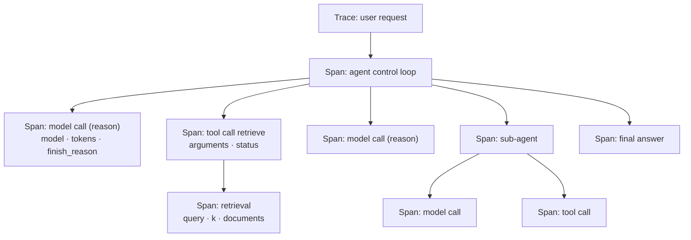
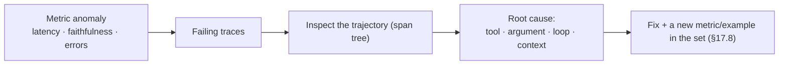

<!-- SPDX-FileCopyrightText: 2026 Aleksandr Drobiazkin
     SPDX-License-Identifier: CC-BY-SA-4.0 AND MIT
     Source: https://github.com/Drobiazkin/ai-agent-architecture
     Dual-licensed, and the boundary is exactly the fence: a fenced code block tagged
     with a language (python, java, sql, bash, yaml, xml, json), comments inside it
     included, is MIT. Everything else — the prose, the tables, the formulas, and the
     mermaid diagrams, which are illustrations expressed as text — is CC-BY-SA-4.0.
     Full terms: LICENSE, LICENSE-CODE, and NOTICE in the repository root. -->

# Chapter 18. Observability

Chapter 17 measures the system's *aggregate* quality. Observability answers the complementary question: what exactly did a *particular* run do—which steps, calls, and decisions produced the result. It is the primary signal both for debugging and for evaluation itself: without traces you can neither find the cause of a failure nor gather the data for evals (§17.8). Because agentic systems are nondeterministic and multi-step, observability is at once harder and more necessary than in classical services.

## 18.1 Why observability is harder for LLM systems

A model call produces substantially more telemetry than an HTTP request, and—more importantly—telemetry of a different *shape*. Prompts and responses are large blocks of text; a tool call's arguments have a different structure at every step; an agent's multi-step reasoning does not fit a fixed schema. Beyond the usual "which model was called and how long it took," you need token spend, the cost of the call, and the *quality* of the response (Chapter 17), which classical telemetry conventions do not cover at all. So observability for LLM systems is not APM carried over one to one but a discipline of its own, with its own semantics.

## 18.2 Three signals

Observability rests on three signals, as in classical distributed systems, but with LLM-specific content.
- **Traces**—the structure of an *individual* run: a tree of nested operations (spans) from input to response, reflecting the actual trajectory (§18.3). The main signal for debugging and the data source for evaluation.
- **Metrics**—*aggregates* over time: token spend, latency, cost, error and refusal rates, cache hits (§18.5). The basis for SLOs, alerts, and cost attribution.
- **Logs**—discrete events (tool errors, guardrail firings, escalations) tied to the trace's spans.

## 18.3 Deep Dive: tracing an agent—the span hierarchy

The key structure is the **trace** of a single run as a tree of **spans**. The root span is the whole request; nested inside it are the spans of the control loop (§10.2), and inside those, the individual calls to the model, to tools, to retrieval, and to sub-agents. The span tree *is* the trajectory made material (§17.5): it shows what happened and in what order, how long it took, and where it broke.

Every span carries attributes: for a model call—the model name, the number of input and output tokens, the stop reason (`stop` or `tool_calls`), latency; for a tool call—name, arguments, result, status; for retrieval—the query, the count and the identifiers of the documents retrieved. Nesting the spans preserves causality: a failed tool call is visible *inside* a specific loop iteration, not in isolation. That is exactly why a trace localizes a failure down to a specific step, which judging the outcome alone cannot do (§17.5).

## 18.4 Deep Dive: OpenTelemetry semantic conventions for GenAI

For telemetry to be comparable and portable across frameworks and vendors, span attributes get standardized. The industry standard is the **OpenTelemetry semantic conventions for GenAI**, developed by a dedicated group (the GenAI SIG[^t-sig]) since April 2024 under the CNCF umbrella. They set a single vocabulary for model calls, agent steps, vector-database queries, token spend, cost, and quality metrics.

- **Model-call attributes** (the `gen_ai.` prefix): `gen_ai.request.model` (the model), `gen_ai.usage.input_tokens` and `gen_ai.usage.output_tokens` (tokens), `gen_ai.response.finish_reasons` (the stop reason), `gen_ai.provider.name`, `gen_ai.operation.name`. With content capture enabled—`gen_ai.input.messages`, `gen_ai.output.messages`, `gen_ai.system_instructions` (§18.6).
- **Layers of the conventions.** Beyond model calls, the standard covers agent orchestration, tool calls over MCP, content capture, and quality metrics; conventions for multi-agent systems (agent tasks, actions, commands, memory) are under active development.
- **MCP integration** (Chapter 15): MCP spans carry `mcp.method.name`, `mcp.session.id`, `mcp.protocol.version`; when trace context is propagated (W3C Trace Context), the server span nests inside the client span, keeping the trace unbroken across the "host ↔ server" boundary.
- **Maturity.** Most of the conventions are experimental as of 2026, but the major observability platforms already support them; the key value is *portability*: instrument once, analyze in any compatible tool, with no vendor lock-in.

## 18.5 Metrics and cost attribution

An LLM system's aggregate metrics are its "golden signals":
- **Token spend**—input and output separately (output costs more, §2.2); the reasoning tokens of reasoning models are counted apart (§13.8).
- **Cost**—derived from tokens and the price rate; attributing it by feature, tenant, and user is critical if you want to see *what* is actually consuming the budget (Chapter 20).
- **Latency**—splitting TTFT from total time (§2.3); for agents, latency per step and for the whole task.
- **Error and refusal rates**—tool failures, model refusals, guardrail firings.
- **Cache hits**—how well prefix/prompt caching is working (§2.2), which directly affects cost and TTFT.

These metrics form the basis for SLOs (latency, availability), for alerts on anomalies, and—crucially for LLM systems—for *cost attribution*, since spend is variable and grows with autonomy (Chapter 20).

## 18.6 Deep Dive: content capture and privacy

Capturing the *content*—input and output messages, tool arguments and results, as span attributes—is invaluable for debugging: it lets you reconstruct the whole exchange and understand *why* the model behaved the way it did. But it has two costs. First, volume: messages are large blocks, and they bloat telemetry storage. Second, privacy: content can include personal data and secrets. So content capture is made *optional* and controllable: you turn it on selectively and redact sensitive data before it leaves the perimeter—with, for example, OpenTelemetry collector processors that mask[^t-masking] and filter attributes. The trade-off "debugging completeness ↔ privacy and storage cost" is settled by a capture policy, not by capturing everything in sight. The second lever against volume is **trace sampling**: head-based (decide whether to keep at the start of the trace—cheap, but it loses rare failures) versus tail-based (decide once the trace finishes—you can keep *every* anomalous and slow trace while keeping only a small percentage of the normal ones). For nondeterministic systems tail-based is the more valuable one precisely because what you care about is the tails of the distribution, not the typical case.

## 18.7 Deep Dive: debugging nondeterministic trajectories

Observability is the foundation for debugging systems where a rerun does not reproduce the behavior (§2.4). A failed run must be reconstructible step by step: without a trace you are left with the outcome, not the path to it. Diagnosis typically runs *top down*:

- An anomaly in an aggregate metric (latency rising, faithfulness dropping, tool errors spiking) signals a problem.
- Moving to the *failing traces* localizes which step and which component failed (§18.3).
- Inspecting the trajectory exposes the cause: the wrong tool chosen, a corrupted argument, a loop, a poisoned result (§12.5), context lost between agents (§14.4).

What matters is that tracing does not only diagnose *known* failures—it *uncovers new* modes for which no metric exists yet: reviewing real traces surfaces failure patterns that then become new metrics and new golden-set examples (§17.8). That is how observability closes the loop with evaluation.

## 18.8 Observability and evaluation together

Observability and evaluation (Chapter 17) complement each other; neither replaces the other. The telemetry standard covers model attributes, tokens, cost, and latency, but it does *not* judge quality—faithfulness, safety, policy compliance. Quality is measured by a separate evaluation layer (Chapter 17) that consumes the same traces. Composing the two is what production monitoring is: observability supplies the primary signal (what happened), evaluation renders the judgment (was it any good), and together they give the full picture—where, what, and how well the system did. Online monitoring (§17.6) is exactly that pairing: "observability traces + evaluation on a sample of them."

## 18.9 Chapter summary

Observability shows what a particular run did—the primary signal for debugging and for evaluation data (§18.1). It is harder than the classical kind because a model call yields more telemetry, of a different shape (§18.1), and it rests on three signals: traces, metrics, logs (§18.2). The central structure is the span tree, which makes the trajectory material and localizes a failure down to the step (§18.3); span attributes are standardized by the OpenTelemetry semantic conventions for GenAI, which deliver portability (§18.4). Token, cost, and latency metrics form the golden signals and the basis for cost attribution (§18.5); content capture is invaluable for debugging but is governed by policy because of privacy and volume (§18.6). Observability is the foundation for debugging nondeterministic trajectories and a source of new metrics (§18.7), and together with evaluation (Chapter 17) it makes up production monitoring (§18.8). Next, Chapter 19: security.

*Sources.* OpenTelemetry, Semantic Conventions for Generative AI (GenAI SIG, since 2024; experimental status, 2025–2026)—the `gen_ai.*` attributes, the layers of the conventions, MCP integration; material on LLM-system observability and agent tracing (OpenTelemetry, observability platforms, 2025–2026); C. Huyen, *AI Engineering* (2025)—metrics and monitoring.

**In the Margins: Chapter 18**

[^t-sig]: **SIG**—Special Interest Group: a standing working group inside a standards consortium (here, OpenTelemetry under the CNCF umbrella) that owns a specific area of the specification.
[^t-masking]: **Masking** here is a privacy operation: replacing sensitive values with placeholders/pseudonyms before the data leaves the perimeter (techniques—§25.4). ≠ Not to be confused with masking *logits* in constrained decoding (§5.3): there the "mask" forbids tokens during generation. The two operations share nothing but the word.

---
