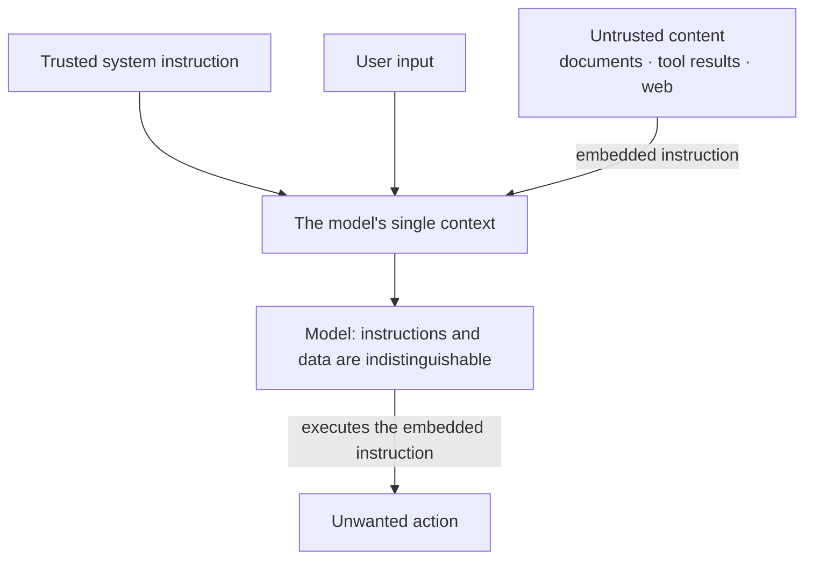
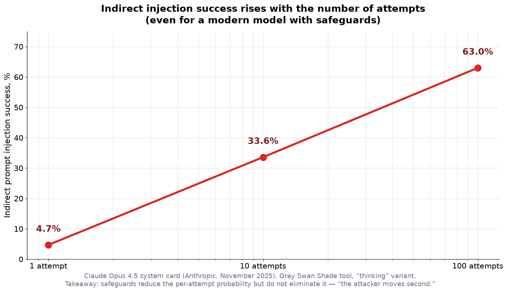
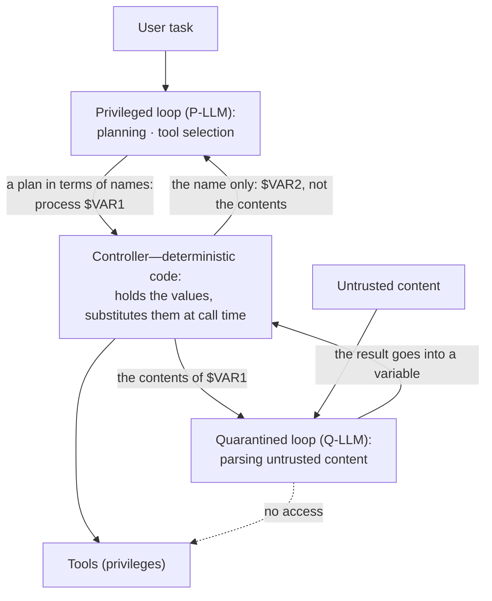

<!-- SPDX-FileCopyrightText: 2026 Aleksandr Drobiazkin
     SPDX-License-Identifier: CC-BY-SA-4.0 AND MIT
     Source: https://github.com/Drobiazkin/ai-agent-architecture
     Dual-licensed, and the boundary is exactly the fence: a fenced code block tagged
     with a language (python, java, sql, bash, yaml, xml, json), comments inside it
     included, is MIT. Everything else — the prose, the tables, the formulas, and the
     mermaid diagrams, which are illustrations expressed as text — is CC-BY-SA-4.0.
     Full terms: LICENSE, LICENSE-CODE, and NOTICE in the repository root. -->

# Chapter 19. Security: Prompt Injection and Defense in Depth

Security runs through the whole book as a cross-cutting theme: isolating untrusted content (§3.2, §4.6), the tool perimeter and the lethal trifecta (§12.5), classes of MCP attacks (§15.7). This chapter gathers those threads into one systematic treatment, centered on the root problem—prompt injection—and on the architectural answer to it. The key claim: an injection cannot be "patched" at the model level, because it exploits the model's own design; the defense has to be architectural.

## 19.1 The root problem: instructions and data in one channel

The model processes instructions and data in *one channel*, with no structural separation (§1.4, §3.2): anything that lands in the context is potentially read as an instruction. The model has no built-in notion of "trusted instruction" versus "untrusted data"—the boundary exists only in the developer's intent, never in the mechanism itself. It follows that **prompt injection is a structural defect, not a bug**: any system that accepts untrusted content through the model channel inherits the risk. That is why prompt injection has held first place in the industry's risk catalog (§19.3) for two editions running, and why no point fix removes it—it can only be contained by architecture (§19.6).

## 19.2 Prompt injection versus jailbreaking

Two classes often conflated, but distinct (the distinction is S. Willison's):
- **Prompt injection**—mixing the trusted (the system instruction) and the *untrusted* (external content) in one context, such that an instruction embedded in the data hijacks behavior. The term is named by analogy with SQL injection: the same essence—code and data mixed in a single channel.
- **Jailbreaking**—getting around the model's policies through direct manipulation by the user themselves (for example, "pretend you don't have to follow the rules"), to elicit forbidden behavior.

The distinction is fundamental to design: jailbreaking attacks the *model's policy*; injection attacks the *application* that trusts the model's output. They divide further:
- **Direct injection**—the attacker supplies the malicious input themselves.
- **Indirect injection**—malicious instructions are embedded in content the model processes as data: retrieved documents (§8), tool results (§12.5), web pages, attachments, email. Indirect injection is the more dangerous of the two, because the source of the untrusted content is not obvious and is often outside the user's control.

## 19.3 Deep Dive: the threat map—OWASP Top 10 for LLM (2025)

The industry's risk catalog is the **OWASP Top 10 for LLM Applications** (2025 edition). It earns its keep as a systematic checklist of attack surfaces; most of its entries the book has already touched on in passing.

| Code | Risk | Where in the book |
|---|---|---|
| LLM01 | Prompt Injection | §3.2, §12.5, §15.7, this chapter |
| LLM02 | Sensitive Information Disclosure | §18.6, §19.6 |
| LLM03 | Supply Chain | §15.7 (untrusted MCP servers) |
| LLM04 | Data and Model Poisoning | §6 (corpus quality), §8 |
| LLM05 | Insecure Output Handling | §5 (schema), §19.7 |
| LLM06 | Excessive Agency | §10.6, §12.5, §19.4 |
| LLM07 | System Prompt Leakage | §19.6 |
| LLM08 | Vector and Embedding Weaknesses | §8 (RAG as an attack surface) |
| LLM09 | Misinformation | Part III (grounding), Chapter 17 |
| LLM10 | Unbounded Consumption | §10.5 (budgets), §20 |

Prompt injection holds the top position because it exploits the model's own design (§19.1). For autonomous agents OWASP released a separate companion—the Top 10 for Agentic Applications (2026 edition, published in December 2025)—reflecting that agency *amplifies* the risks: once a model can not only generate text but also reach for tools, execute code, and call APIs, the blast radius of a single injection or of excessive agency widens sharply. The companion's categories (ASI01–ASI10) and its cross-cutting Least-Agency principle are worked through where the corresponding material lives: §12.5 (tools, privileges) and §14.4–14.5 (memory, inter-agent communication).

## 19.4 Deep Dive: the lethal trifecta and excessive agency

The most operational frame for exfiltration risk is the **lethal trifecta** (§12.5, Willison 2025): the danger arises when access to private data, untrusted content, and an external communication channel coincide. Indirect injection (§19.2) is the mechanism; the trifecta is the condition under which an injection grows into data theft. The answer is the **rule of two** (Meta 2025): an autonomous agent holds at most two of the three properties, otherwise human confirmation is required—or, in Meta's original formulation, a start from a clean context: a fresh session with no untrusted content carried over also breaks the chain, and where the task tolerates a reset it is the architecturally cheaper alternative to a gate; and **taint-tracking**: untrusted content marks the execution as tainted, blocking actions with exfiltration potential (§12.5).

**Excessive agency** (OWASP LLM06) is the second axis, substantially expanded in the 2025 edition, with three roots:
- *Excessive functionality*—more tools than the task needs (§12.3, curating the set).
- *Excessive permissions*—rights broader than required (§10.6, least privilege; authorization with the user's own rights, §12.5).
- *Excessive autonomy*—acting without human confirmation where the action is irreversible (§10.6, human-gate).

Injection and excessive agency amplify each other: the injection knocks the model off course, and excessive agency turns that into a destructive action. Constraining agency narrows the consequences of a successful injection, even when the injection itself could not be prevented.

## 19.5 Deep Dive: guardrails and their limits

**Guardrails** are filters on the input and the output: detectors for injection and malicious input (classifiers), checks of the output for leaks and unsafe content, programmable "rails" for permissible behavior. They are useful and they lower the rate of successful attacks, but they have a fundamental limit: they are *probabilistic*, and an adaptive attacker gets around them.

The empirical record is unambiguous. Systematic trials of published defenses under adaptive attacks showed that defenses which initially reported near-zero vulnerability yield over 90% attack success under adaptive search, and manual red teaming[^t-redteam] in those same trials drove the success rate to practically total (work on adaptive attacks against published defenses, 2025). Even in modern models with built-in defenses, the probability of a successful indirect injection—small on a single attempt—climbs quickly with the number of attempts:

The conclusion for architecture: guardrails are a *probability-reduction layer*, not a guarantee. The analogy that has taken hold in the industry — prompt injection as the new SQL injection — carries exactly this far and no further: the injection is structural, and filters alone do not close it. Relying on filters as the sole defense is a mistake; they belong in defense in depth, but they do not replace architectural constraints (§19.6).

## 19.6 Deep Dive: architectural defense

Since injection cannot be eliminated at the model level, the defense is built at the level of the *system*—with deterministic constraints around the probabilistic component. The key architectural patterns:

- **Privilege separation and quarantine of the untrusted (dual-LLM).** The proposed design patterns for securing agents (Beurer-Kellner et al., 2025; the CaMeL approach, Google DeepMind) separate a *privileged* part, which plans and calls tools, from a *quarantined* part, which processes untrusted content but has no access to tools or privileges. Untrusted data never reaches the privileged control loop directly. What guarantees this is not good intentions but a specific mechanism—symbolic variables and a controller between the loops; it is worked through below, after the list.

- **Isolating data from instructions**—untrusted content is fed in a clearly demarcated region of the context and is not mixed with instructions (§4.6); the output format is pinned by a schema (§5), so an injection cannot substitute its own structure.
- **Least privilege and the rule of two**—constraining the trifecta and agency (§19.4), taint-gating (§12.5).
- **Execution sandbox**—for agents that execute code and commands: isolation at the OS/container/virtualization level (seccomp profiles and gVisor at the container level, Firecracker-class microVMs at the virtualization level), an ephemeral environment per task, and an **egress allowlist**—the list of permitted outbound destinations, which cuts off exfiltration even when an injection succeeds (the trifecta's third "leg" is physically removed). Declarative protocol boundaries (MCP roots, §15.3) are not enforcement without this layer.
- **A human-gate on the irreversible**—human confirmation before an action with consequences (§10.6); showing the user what is being sent out (§15.7).
- **Observability for detection**—tracing (Chapter 18) captures anomalous calls and exfiltration attempts, closing the defense with monitoring.

**The dual-LLM mechanism: symbolic variables.** The first item on the list needs unpacking: you cannot assemble a working system out of the phrase "the quarantined loop processes the untrusted," and the book prescribes this pattern in its checklist (§19.7). The key detail is the **controller**: deterministic code, not a model, standing between the loops. It calls the quarantined model, puts its answer into a variable, and returns to the privileged model **the name only**: `$VAR1`, `$VAR2`. The privileged model plans in terms of names—"summarize `$VAR1`," "send it to `$VAR2`"—without seeing the contents of either; the controller substitutes the values at the moment the tool is called. Willison (2023), where the pattern was proposed, states this without any give: the privileged model sees only variable names and sees neither the untrusted content nor the tainted summary that came back from quarantine. Hence the requirement on the diagram: what travels along the arrow from quarantine into the privileged loop is **the variable's name, not the result**. A "structured result with no instructions" is not a defense—it still brings attacker-controlled content into the loop that makes the decisions, which is exactly what the pattern must not allow.

**What symbolic variables do not cover.** Quarantine protects the *control flow*, not the *values*—the CaMeL paper works this through itself (Debenedetti et al., 2025). Take the plan: "find the right document and the client's address in the meeting notes, send the document to that address." The privileged model planned correctly and saw no content. But the notes are poisoned, and the quarantined model extracts the attacker's address from them: the controller substitutes `$VAR2` = `attacker@evil.com`, and the flawlessly executed plan sends a confidential document out. The plan was not hijacked—the argument was. A variable's name protects the decision about *what to do*, and says nothing about *what it is done with*.

**CaMeL: capabilities on values.** Hence the strengthening. The privileged model emits **code** in a stripped-down subset of Python before the system has read a single byte of untrusted data: the control flow is fixed before the data appears, and is therefore out of the attacker's reach by construction. The quarantined model is called from that code as a function with a mandatory response schema, and it has no tools. What executes the code is not Python but a **custom interpreter**: it maintains a dependency graph (which value was derived from which) and attaches to every value a **capability**[^t-capability]—its provenance and the set of permitted readers. Before every call to a tool with a side effect, the policy engine checks the arguments' capabilities. This is the same taint-tracking (§12.5), but not at the level of "the whole run is tainted"—at the level of the individual value, which is why it takes away less functionality.

**Checking the policy.** A policy in CaMeL is an ordinary Python function returning "allowed/denied" with a reason. Its substantive core, for a sending tool:

$$\text{allow}(f, \{v_1,\dots,v_n\}) \iff \text{trusted}(R_f)\ \lor\ \forall i \in [1..n]:\ R_f \subseteq \text{readers}(v_i)$$

Legend (live values from the document example above):
- $f$—the tool being called, one with a side effect: `send_email`, `create_calendar_event`.
- $R_f$—who actually receives the data on this call: for `send_email`, the recipient addresses. Live value: `{attacker@evil.com}`.
- $v_i$—the values that go into the arguments: the message body, the attachment, the subject.
- $\text{readers}(v)$—from the value's capability: the set of permitted readers, or `Public` ("anyone may read it"). Live value for a document out of the corporate store: `{user@corp, bob@corp}`—the people it is shared with.
- $\text{trusted}(R)$—the provenance of $R$: whether it arrived as a literal in code written by the privileged model (that is, from the user's trusted request) rather than out of the data.

Live numbers. The document: $\text{readers}(v_{doc})$ = `{user@corp, bob@corp}`. The address the quarantined model extracted from the poisoned notes: $R_f$ = `{attacker@evil.com}`; its provenance is a tool, not a literal, so $\text{trusted}(R_f)$ = false and the fast path did not fire. That leaves the inclusion: `{attacker@evil.com}` $\subseteq$ `{user@corp, bob@corp}` → **false**. The outcome is `Denied`: the send is blocked and goes to the user for confirmation.

*In plain terms:* the tool fires only if everyone who will receive the data was already permitted to read *every* value in the arguments—or if the recipient list came from the user themselves rather than out of the data. The check compares sets; it does not judge text: its outcome does not depend on how persuasively the injection is written—and that is what separates it from guardrails (§19.5), which judge precisely that text and are therefore evaded.

**The honest price.** The pattern is not free, and its failure modes are named in the paper itself:
- *Lost functionality.* CaMeL solves 77% of AgentDojo[^t-agentdojo] tasks with a provable guarantee, against 84% for the unprotected system (Debenedetti et al., 2025)—roughly seven percentage points handed over for the guarantee (an early revision of the paper reported 67%; the figure here is from the current one, June 2025).
- *Side channels.* The authors give them a section of their own, with a direct admission: CaMeL is vulnerable to side-channel attacks—an attacker infers sensitive information by observing the system's behavior. The guarantee here is about isolating data flows, not about making a leak impossible.
- *Cost.* 2.82× the input tokens and 2.73× the output tokens on the median AgentDojo task versus native tool calling—the most expensive of the defenses the authors compared against one another. What a multiplier like that costs on the bill: Chapter 20.
- *Labor.* Policies have to be written and maintained: an unspecified policy is a hole; an over-strict one means work refused and confirmation fatigue (§10.6).

The deployment rule follows directly: dual-LLM with capabilities goes where the price of compromise exceeds the price of lost functionality and a tripled token bill—in high-risk loops (§19.7), not by default.

The general principle: **constrain the system rather than trust the model**. The model is assumed to be knockable off course by untrusted content, so authorization, isolation, and confirmation are provided by the deterministic components around it.

## 19.7 In practice: defense in depth

A summary checklist, drawing the measures from across the book into a layered defense:
- **Isolate untrusted content** from instructions (§4.6); a fixed output schema (§5).
- **Least privilege** and a minimal tool set (§10.6, §12.3); the **rule of two** and constraining the trifecta (§12.5, §19.4).
- **Input validation and output filtering** (guardrails)—as a probability-reduction layer, not as a guarantee (§19.5).
- **Authorization at the tool with the user's own rights** (§12.5), which prevents the confused deputy.
- **A human-gate on irreversible and dangerous actions** (§10.6).
- **Quarantine of the untrusted loop** from the privileged one (dual-LLM, §19.6) for high-risk systems.
- **A sandbox for code execution**—isolation at the container or microVM level, an ephemeral environment, an egress allowlist (§19.6).
- **Treating third-party MCP servers as untrusted**—integrity of definitions, OAuth (§15.7).
- **Observability and evaluation** for detection and security regression control (Chapters 17–18).

No single measure is self-sufficient; reliability comes from all of them together—because the probabilistic component can be knocked off course, and the system has to stay safe even once that has happened.

## 19.8 Chapter summary

Prompt injection is a structural defect: the model does not separate instructions and data in a single channel (§19.1), and so an injection cannot be eliminated at the model level. It is distinguished from jailbreaking, and by source—direct from indirect, the more dangerous (§19.2). The systematic map of surfaces comes from the OWASP Top 10 for LLM 2025, with prompt injection in first place and a companion for agents (§19.3). The operational axes of risk are the lethal trifecta and excessive agency (§19.4). Guardrails lower the probability but do not remove the attack: under adaptive pressure, and with the number of attempts, success grows (§19.5). The defense is therefore architectural: privilege separation and quarantine of the untrusted (dual-LLM), isolation, least privilege, human-gate, observability (§19.6), assembled into defense in depth (§19.7). The principle: constrain the system rather than trust the model. Next, Chapter 20: cost and latency.

*Sources.* OWASP, "Top 10 for LLM Applications" (2025) and "Top 10 for Agentic Applications" (2026 edition, published in December 2025)—(c) the OWASP Foundation, licensed under CC BY-SA 4.0 (https://creativecommons.org/licenses/by-sa/4.0/); the risk categories in §19.3 are reproduced as published, the mapping to this book's sections is added; S. Willison—prompt injection, the distinction from jailbreaking, the lethal trifecta (2022–2025); Meta, "Agents Rule of Two: A Practical Approach to AI Agent Security" (2025)—the rule of two; K. Beurer-Kellner et al., "Design Patterns for Securing LLM Agents against Prompt Injections" (arXiv:2506.08837, 2025); S. Willison, "The Dual LLM pattern for building AI assistants that can resist prompt injection" (2023)—the controller and symbolic variables; E. Debenedetti et al., "Defeating Prompt Injections by Design" (CaMeL; Google / Google DeepMind / ETH Zurich, arXiv:2503.18813v2, June 2025)—capabilities, the interpreter, 77% against 84% on AgentDojo, side channels, cost in tokens; E. Debenedetti et al., "AgentDojo: A Dynamic Environment to Evaluate Prompt Injection Attacks and Defenses for LLM Agents" (arXiv:2406.13352, 2024)—the benchmark itself, on which these numbers were obtained; work on adaptive attacks against injection defenses (2025); the Claude Opus 4.5 system card (Anthropic, 2025)—empirical data on indirect injection success; F. Perez, I. Ribeiro, "Ignore Previous Prompt" (2022); NeMo Guardrails (Rebedea et al., 2023).

**In the Margins: Chapter 19**

[^t-redteam]: **Red teaming**—adversarial testing: a specially designated party sets out deliberately to break the system's defenses before a real adversary does; for LLMs, searching for injections and jailbreaks, by people or by automation.
[^t-capability]: **Capability**—in systems security: a label bound to the object itself, describing what may be done with it—as opposed to checking "who is asking" against an external list of rights. In CaMeL a capability is attached to every *value* and holds two things: provenance (from the user, from a transformation inside the execution, or from a specific tool) and the set of permitted readers. The idea is borrowed from the classic systems—KeyKOS/EROS, Capsicum, CHERI.
[^t-agentdojo]: **AgentDojo** (Debenedetti et al., 2024)—an environment for evaluating prompt-injection attacks and the defenses against them: 97 user tasks with tools across four domains (email with calendar, a corporate messenger, a bank, travel booking) and 27 malicious goals planted in the data the agent reads; their combinations yield 629 security checks. It measures two things at once—the share of tasks solved (utility, hence the 77% against 84%) and the share of attacks that succeed.

---
