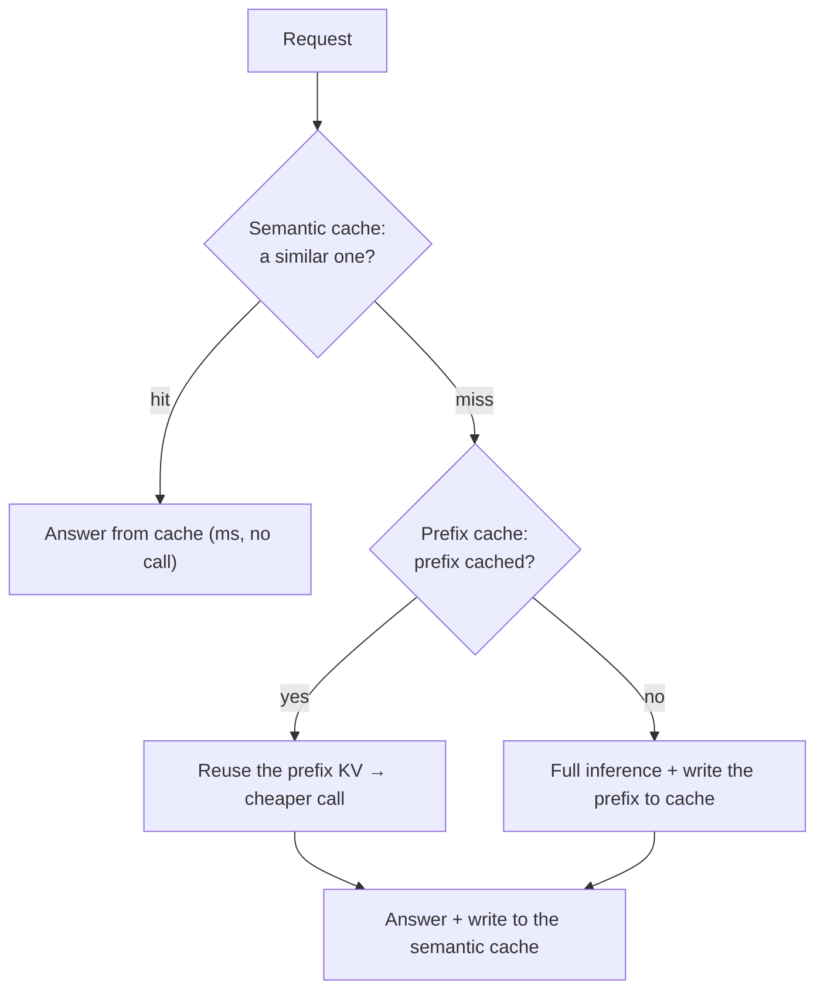
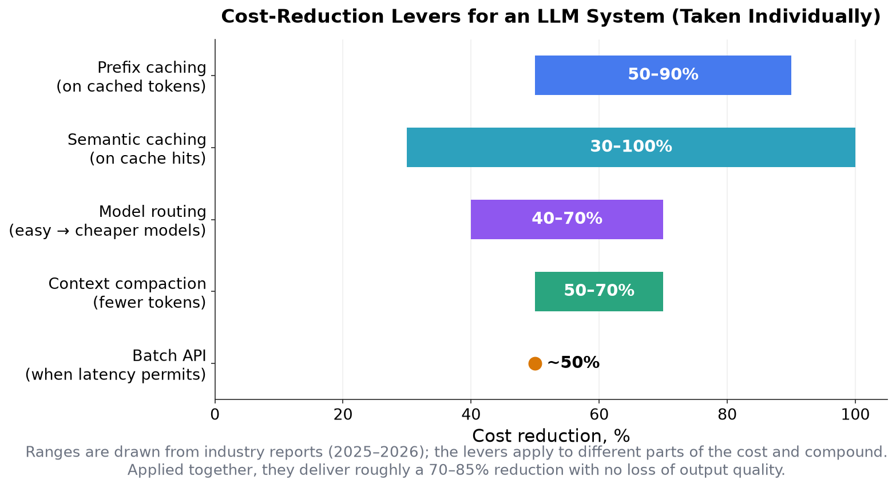

<!-- SPDX-FileCopyrightText: 2026 Aleksandr Drobiazkin
     SPDX-License-Identifier: CC-BY-SA-4.0 AND MIT
     Source: https://github.com/Drobiazkin/ai-agent-architecture
     Dual-licensed, and the boundary is exactly the fence: a fenced code block tagged
     with a language (python, java, sql, bash, yaml, xml, json), comments inside it
     included, is MIT. Everything else — the prose, the tables, the formulas, and the
     mermaid diagrams, which are illustrations expressed as text — is CC-BY-SA-4.0.
     Full terms: LICENSE, LICENSE-CODE, and NOTICE in the repository root. -->

# Chapter 20. Cost and Latency

§2.2–2.3 introduced the economics of a call and the components of latency. This chapter is the operational digest: how to hold cost and latency inside budget in production. The thesis: **cost is a product constraint**, not a technical detail; it drives margin, pricing, and scalability, and an agent's autonomy *multiplies* both cost and latency (every step of the loop is a model call, §14.3). Optimizing here is not premature micro-optimization but a condition of the system's viability under load.

## 20.1 Cost as a product constraint

An LLM system's costs are linear in usage and variable: an agent making dozens of calls per session on a strong model runs up a noticeable per-session cost before anyone even checks the bill, and in unoptimized systems actual spend overshoots the plan by a multiple. The three axes of optimization—cost, latency, and quality—are related in a nontrivial way: some techniques improve one axis *by trading away* another (routing to a cheap model or compacting the context lowers cost but puts quality at risk), while others improve several axes *at once* with no loss of quality (caching lowers cost and latency both). So optimization is not one blanket "pick two of three" trade-off but a set of levers with different profiles (§20.7). None of it is manageable without cost attribution (§18.5): spend is broken out by feature, tenant, and user so you can see *what* is actually consuming the budget.

## 20.2 Deep Dive: the economics of caching

Caching is one of the highest-yield levers, and it works at two levels.

**Prefix/prompt caching** caches the processed KV state (§1.6) of static prompt prefixes, letting the computation be reused instead of redone from scratch. The economics are asymmetric, and their parameters are vendor-specific. In Anthropic's pricing model a cache write costs more than an ordinary input token (a premium on the order of 25%), while a read is far cheaper (a discount on the order of 90%, that is, about 10% of the base price); hence the break-even point is roughly two hits or more per cached prefix. Other providers have a different cost structure (OpenAI—automatic caching, a read discount and no write premium; Google Gemini—an explicit cache with hourly storage billing), so a break-even calculation does not carry across vendors without being redone. Prefix caching is the first optimization in any system whose system prompt changes less often than its user requests—which is to say nearly everywhere; it improves TTFT (§2.3) along the way. A caveat: badly placed cache boundaries can instead *increase* latency, so a caching strategy gets verified by measurement.

**Semantic caching** works at the level of *semantically similar* requests rather than exact matches: the request is embedded, the cache is searched for a near neighbor in embedding space (Chapter 8), and if similarity clears the threshold the cached answer comes back; otherwise the answer is generated and stored. On a hit the model call disappears entirely (zero cost, latency in milliseconds). This catches the paraphrases that exact caching misses ("what is the return policy?" and "how do I return an item?" differ textually but match semantically). A material limitation: semantic caching assumes a *stateless* "request → answer" mapping and therefore does not apply to tool calls that change state.

In practice the levels stack into a multi-level scheme: the semantic cache first (it removes the call outright), then the prefix cache (it makes the unavoidable call cheaper), then inference. Their combined effect on cost and latency is substantial.

## 20.3 Deep Dive: model routing and cascades

**Model routing** (§2.2) works like this in practice: a classifier scores the difficulty of a request and sends easy tasks to a cheap model, reserving the strong one for the genuinely hard ones. Because a significant share of an agent's requests are routine, the weighted average cost drops sharply, and multi-model routers can hold their own against the best single model on quality at a lower average cost. Classification itself costs a little (a small call, added latency on the order of hundreds of milliseconds), which pays for itself at volume; what the classifier is made of and how it fails silently—Deep Dive §2.2.

A related form is the **cascade**: the request is handled first by the cheap model and escalates to the strong one only on insufficient confidence or a failed check (kin to the "don't add complexity before you need it" ladder, §13.7). Routing and the cascade trade cost against quality: the savings come from the fact that part of the traffic does not require a frontier model, and the risk is a classification error that sends a hard task to a weak model—which is why the difficulty decision is itself evaluated (Chapter 17). The latency asymmetry: direct routing pays the latency of one model, while with a cascade the escalated share of traffic pays the *sum* of the delays (cheap call + check + strong call)—for P99-sensitive systems that argues for routing, even if the cascade is cheaper on average.

## 20.4 Cutting tokens

Cutting the token count outright works on both axes.
- **Minimizing the output.** Output tokens cost more than input tokens (§2.2), so a `max_tokens` limit, stop sequences, and a strict output schema (Chapter 5) shrink the expensive part; `max_tokens` is a lever on more than the bill—it also cuts the room the output takes up in the window it shares with the input (§1.8), and when you serve the model yourself it further bounds how long a request holds KV-cache blocks, taking them away from neighboring sessions (§2.3); for reasoning models you manage the reasoning budget instead of paying for excess "thinking" on easy tasks (§13.8, over-thinking).
- **Compacting the context.** Removing what is redundant from history and tool results before the call cuts input tokens (§4.4); compaction by deletion differs from summarization in that what remains stays verbatim.
- **Batch API.** Where deferral is acceptable, batch processing gives a discount on the order of 50% (an SLA of up to a day) and stacks with caching: a batch with a cached prefix combines both discounts.

## 20.5 Deep Dive: latency

Latency is managed separately from cost, though some of the levers are shared (§2.3).
- **TTFT versus total time.** Perceived latency comes down to the time to the first token; streaming emits the answer as it is generated, sharply improving perceived responsiveness at the same total duration (§2.3).
- **Parallel tool calls.** Independent actions execute in parallel, not in sequence (§12.2): a sequential chain adds the delays up, a parallel one takes the maximum.
- **Caching.** Prefix caching improves TTFT; semantic caching, on a hit, brings latency down to milliseconds (§20.2).
- **Model choice and length.** A smaller model and a shorter output reduce generation time; at the serving level, decode latency drops further with speculative decoding (Chapter 22).

An agent's latency accumulates step by step (§2.3, §14.3), so cutting the number of steps (Plan-and-Execute versus a long ReAct, §13.4) and parallelism deliver the biggest effect on multi-step tasks.

## 20.6 Budgets, the gateway, and attribution

Operational control rests on three elements.
- **Budgets and limits.** Caps on step count and tokens per task and per session (§10.5) bound both cost and the "unbounded consumption" failure class (OWASP LLM10, §19.3); rate limiting is the standard production barrier at scale.
- **The LLM gateway.** A layer between the application and the providers that centralizes routing, semantic caching, fault tolerance (fallback, circuit breaker, §2.5), and cost accounting. Moving these concerns into infrastructure takes them off application code and gives a single point of control and of portability across providers (§16.5).
- **Attribution and SLOs.** Token, cost, and latency metrics (§18.5) are broken out by feature and tenant and tied to latency and availability SLOs; cost anomalies raise alerts the same way latency anomalies do.

Taken together, these practices—cost attribution, budgets, unit economics as a scaling gate (§25.6)—have consolidated in the industry under the name **FinOps for AI** (an extension of FinOps, the discipline of managing cloud spend as an engineering practice, to LLM workloads). The book lays the material out across its own chapters, but in an interview and in a job posting it will go by that name.

## 20.7 The combined effect and the order of application

The levers apply to different parts of the spend and they stack.

Individually each one delivers a noticeable reduction; applied together—on the order of a 70–85% cost reduction with no degradation of the output. The arithmetic is multiplicative: cache −40% × routing −50% × compaction −30% ⇒ 0.6·0.5·0.7 ≈ 0.21 of the original cost, that is, −79% (the multipliers are illustrative and depend on the workload profile—hence the spread of the range). The practical order of adoption runs from least effort to most: prefix caching first (often automatic, or needing nothing but markup), then model routing, then context compaction for agentic and long-context workloads, then semantic caching and batch where they apply. The same caveat applies here as in §13.7: do not optimize before measurement (Chapters 17–18) shows *what* is actually consuming the budget and the latency; premature optimization complicates the system with no proven gain.

## 20.8 Summary of the chapter and of Part VI

Cost is a product constraint that grows with autonomy; the three axes (cost, latency, quality) are related in a nontrivial way (§20.1). Caching works at two levels—prefix (asymmetric economics, break-even from two hits on) and semantic (the call is removed on similar requests, but only for stateless ones)—and lowers both axes (§20.2). Routing and cascades move the routine work onto cheap models at the price of classification risk (§20.3); cutting tokens means minimizing the output, compaction, batch (§20.4); latency is managed through TTFT, streaming, parallelism, and fewer steps (§20.5). Control rests on budgets, the LLM gateway, and attribution (§20.6); the levers stack up to a 70–85% reduction, but they are applied in proportion to need and after measurement (§20.7).

**Part VI in sum.** The system is now operable: its quality is measured (Chapter 17), its behavior is observable (Chapter 18), it is defended against manipulation (Chapter 19), and its cost and latency are held inside budget (Chapter 20). Next comes **Part VII: your own models**—when and how to fine-tune, deploy, and train models instead of calling an API.

*Sources.* Industry reports and practices for optimizing the cost and latency of LLM systems (2025–2026): prefix/prompt caching and its economics (the Anthropic and OpenAI documentation), semantic caching, model routing (RouterBench), context compaction, batch APIs; C. Huyen, *AI Engineering* (2025)—the economics and latency of inference; §2.2–2.3 and §18.5 of the book.

---
