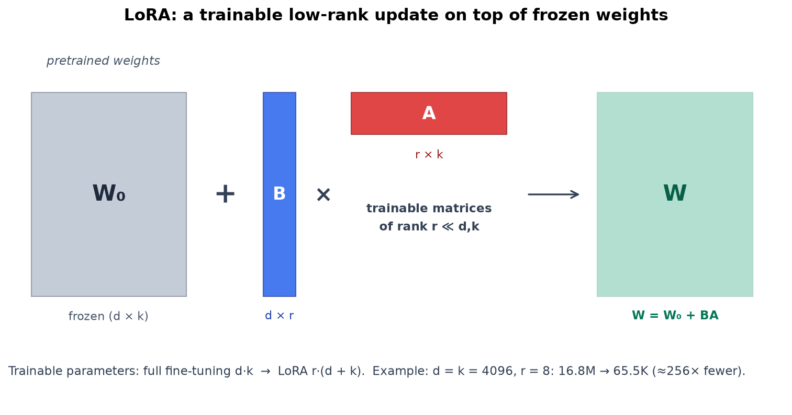
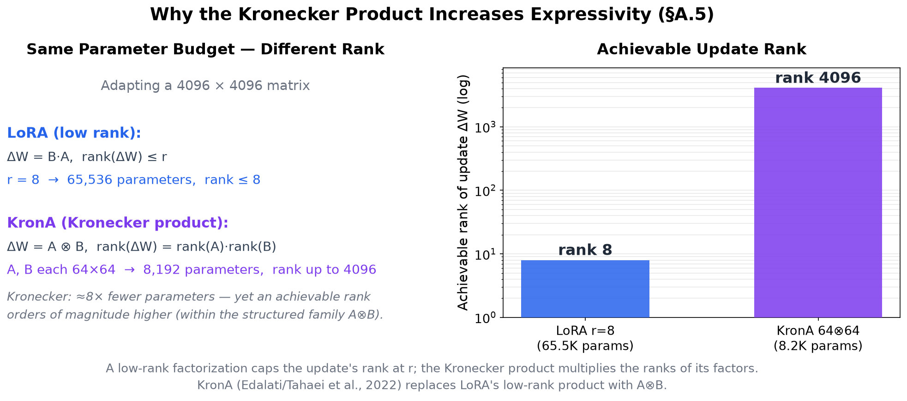
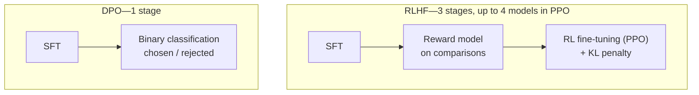
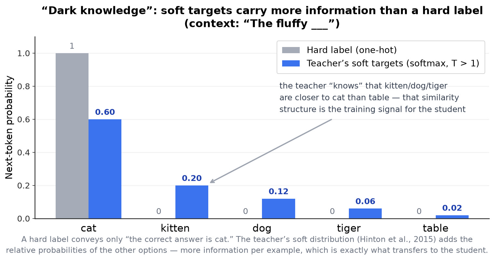
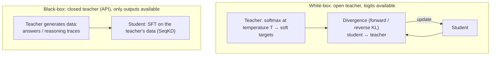

<!-- SPDX-FileCopyrightText: 2026 Aleksandr Drobiazkin
     SPDX-License-Identifier: CC-BY-SA-4.0 AND MIT
     Source: https://github.com/Drobiazkin/ai-agent-architecture
     Dual-licensed, and the boundary is exactly the fence: a fenced code block tagged
     with a language (python, java, sql, bash, yaml, xml, json), comments inside it
     included, is MIT. Everything else — the prose, the tables, the formulas, and the
     mermaid diagrams, which are illustrations expressed as text — is CC-BY-SA-4.0.
     Full terms: LICENSE, LICENSE-CODE, and NOTICE in the repository root. -->

# Part VII. Models of Your Own

Parts I–VI treated the model as a given—something called through an API. Part VII takes up the case where that is not enough and an organization moves to a model of its own: adapting an existing one (Chapter 21, fine-tuning), deploying an open model on its own infrastructure (Chapter 22), or training from scratch (Chapter 23). The shift in Part VII is from "using a model" to "owning a model," with the corresponding rise in both control and cost. The mathematical substrate of these operations is carried out into Appendix A, which the chapters reference.

# Chapter 21. Fine-Tuning: Adapting the Model

Fine-tuning continues training a finished model on target data, changing its behavior. This chapter answers two questions: *when* to fine-tune instead of prompting and RAG, and *how* to do it efficiently—with methods that train a small fraction of the parameters, and with techniques for aligning to preferences.

## 21.1 When to fine-tune: the decision frame

Fine-tuning is neither the first tool nor a universal one. A ladder of rising cost and invasiveness applies: prompting (Part II) → RAG (Part III) → fine-tuning. The fundamental difference is *what* each level changes:
- **RAG adds knowledge**—factual information placed into the context at run time (Part III).
- **Fine-tuning changes behavior**—the form, the style, the answer format, adherence to domain conventions, tool-use patterns.

Hence the common mistake: fine-tuning for the sake of *knowledge*. Putting facts into the weights is expensive, they go stale, and every update demands retraining, whereas RAG refreshes the corpus without retraining (§6). Fine-tuning is justified when what needs to change is *behavior*: a stable format or style unreachable by prompting; specialization for a narrow domain with its own terminology; reliable tool-calling patterns; and lower cost and latency, because a fine-tuned *small* model replaces a large one on a narrow task (§20.3). As in §13.7, the rule is not to climb the ladder before measurement (Chapter 17) shows the previous level falling short.

## 21.2 Full fine-tuning versus PEFT

**Full fine-tuning** updates *all* of the model's weights. For large models that demands training-grade memory and compute, storing a full copy of the weights for every task, and it carries the risk of catastrophic forgetting (§21.8). Hence **parameter-efficient fine-tuning (PEFT)**: only a small fraction of the parameters is trained while the bulk of the model stays frozen. The key empirical observation underlying PEFT: the *update* to the weights for a specific task has low intrinsic rank—it can be approximated with a small number of parameters at no loss of quality. The intuition: a pretrained model already "knows how" to do almost everything required; adaptation does not rewrite knowledge, it nudges already-learned representations slightly—and that correction lives in a low-dimensional subspace of the full weight space.

## 21.3 Deep Dive: LoRA

**LoRA (Low-Rank Adaptation)** (Hu et al., 2022) freezes the pretrained weights W₀ and adds a trainable low-rank update that enters the weight with a fixed multiplier:

`W = W₀ + (α/r) · BA`

Where:
* **W**—the effective (final) weight: the matrix the model actually computes with once the adapter is applied. The adapter does not change the shape of the layer—the dimensions are the same `d × k` as `W₀` (4096 × 4096).
* **W₀**—the pretrained matrix of size `d × k`, frozen; for the attention matrices of a LLaMA-like model, typically 4096 × 4096.
* **B** (`d × r`) and **A** (`r × k`)—the only trainable matrices. The product `BA` matches `W₀` in size, but its rank is at most r—that is the low-rank assumption.
* **r**—the rank of the update, dimensionless; `r ≪ min(d, k)`, typically 8–64 (§21.8). The width of the "bottleneck" the correction is pushed through.
* **α**—the scaling constant, dimensionless; set in the config next to r, typically 16–128 (a direct consequence of the α ≈ 2r default at r = 8–64, §21.8).
* **α/r**—the effective scale: the factor by which the trained increment enters the final weight. At r = 8 and α = 16 that is 16/8 = 2—`BA` is folded in at double weight.

It reads like this: the model computes on the frozen weights plus a correction squeezed through a rank-r bottleneck and amplified α/r times. Only A and B are trained; the number of trainable parameters drops from d·k to r·(d + k).

Two properties make LoRA the practical standard. First, the sharp cut in trainable parameters (for a 4096×4096 matrix at r = 8, roughly 256-fold) lowers memory and makes it possible to keep many lightweight adapters for different tasks on top of one base model—up to serving many adapters simultaneously from a single server (multi-LoRA serving: S-LoRA, LoRAX; supported in vLLM—a bridge to Chapter 22, where the base is loaded once and adapters are attached per request). Second, the `(α/r)·BA` update can be *merged* into W₀ after training, yielding an ordinary weight matrix—which is why LoRA adds no latency at inference. The method's limitation is the low-rank assumption itself: the rank of the update is capped at r, which narrows expressiveness on tasks whose update has complex structure (§21.5).

**Initialization: starting exactly at the pretrained model.** Matrix `A` is filled with small random numbers (Gaussian in the paper; Kaiming-uniform in the reference implementation and by default in PEFT), and `B` with **exact zeros**. Hence at step 0: `BA = 0`, so `(α/r)·BA = 0` for any α, and `W = W₀` exactly. An untrained adapter is the identity transform, a no-op: training starts precisely at the pretrained model, and the very first step cannot damage the base. The practical consequence—attaching a fresh adapter to a production model is safe by construction (which is what serving many adapters over one base rests on). The asymmetry here is mandatory: you cannot zero *both* matrices—the gradient with respect to `B` is proportional to `A`, the gradient with respect to `A` is proportional to `B`, and at `A = B = 0` both would vanish, leaving the adapter dead forever.

**Why the α/r multiplier.** The reason the authors give is operational, not mathematical: tuning α is roughly equivalent to tuning the learning rate, so α is fixed once and r is swept afterward without re-picking the learning rate. That also explains the `α ≈ 2r` default from §21.8: there is no magic two here, it is just the condition `α/r = 2` written out—"an effective scale of 2 regardless of rank." Which is why the default is expressed as a multiple of r rather than an absolute number: it holds the scale constant while r is swept. The flip side—α and r are part of the adapter's contract, not free knobs at merge time: what gets merged is `W₀ + (α/r)·BA` with *its own* multiplier, so an adapter trained at r = 8, α = 16 (scale 2) but merged at α = 32 (scale 4) produces a weight with the correction amplified twofold—silently, with no error and no warning. The adapter's config (`adapter_config.json`) stores both `r` and `lora_alpha`; tooling is obliged to take them from there and not from the current run's settings.

**The r divisor is a heuristic, not a derivation.** Why divide by r specifically, rather than by, say, √r, the paper does not derive—it confines itself to citing Yang & Hu (2021) and asserting that this scaling reduces the need to retune hyperparameters as r is swept. Kalajdzievski (2023) showed that the multiplier which keeps an adapter stable as rank grows is `α/√r`, whereas the classic `α/r` decays too fast as r rises and, in that work's own phrasing, slows learning and limits quality on high-rank adapters. The arithmetic of the divergence at a fixed α = 16: raising the rank from 8 to 64 drops `α/r` from 16/8 = 2 to 16/64 = 0.25—an eightfold fall, while `α/√r` goes from 16/2.83 ≈ 5.7 to 16/8 = 2, a fall of only √8 ≈ 2.83. The practical takeaway, worth keeping next to §21.8: if r has been pushed into the 32–64 range and quality did not follow the rank, suspect the multiplier first and the ceiling of the low-rank assumption (§21.5) only after; in PEFT this is exactly one flag, `use_rslora=True`, which switches the divisor to `√r`. A caveat, so three different regimes do not get conflated: at a fixed α the multiplier decays as 1/r; rsLoRA makes it decay as 1/√r; the α = 2r convention removes the rank dependence altogether, pinning the multiplier hard at 2.

## 21.4 Deep Dive: QLoRA and memory

**QLoRA** (Dettmers et al., 2023) removes the main barrier—the memory taken by the base model. Gradients propagate through a *frozen, 4-bit-quantized* base model into the LoRA adapters. Three techniques make this work without a material loss of quality: the 4-bit NormalFloat format (NF4), matched to the distribution of the weights; double quantization (the quantization constants are themselves quantized); and paged optimizers, which page out optimizer state during memory spikes. The result—fine-tuning a large model on a single GPU: the base is stored in 4 bits and is not trained, only the adapters are. Through 2024–2026 QLoRA is the standard choice for fine-tuning large models under constrained resources.

## 21.5 Deep Dive: beyond low rank—DoRA and the Kronecker product

LoRA's low-rank assumption is at once the source of its efficiency and the limit on its expressiveness. Development runs in two directions.

**DoRA (Weight-Decomposed Low-Rank Adaptation)** (Liu et al., 2024) decomposes the pretrained weight into a *magnitude* and a *direction* and applies the low-rank update only to the direction component. The formula, in the LoRA parameters from §21.3:

`W = m · (W₀ + BA) / ‖W₀ + BA‖_c`

It reads like this: `W₀ + BA` is the ordinary LoRA update (the α/r scale from §21.3 is dropped here, following the original paper: it does not affect how the decomposition works, so it is kept inside `BA`); dividing by `‖·‖_c` (the norm of each *column* taken separately) leaves only the direction—every column becomes unit length; the vector `m` (one entry per column, initialized with the norms of the original `W₀`) gives each column its length back and is trained *separately* from BA. The point of the decomposition: the analysis by Liu et al. showed that full fine-tuning changes the magnitude and the direction of the weights in a *loosely coupled* way, whereas LoRA is forced to change them jointly—through a single low-rank increment. By separating the components, DoRA brings the training dynamics closer to full fine-tuning at the same parameter budget (plus one vector `m` per layer—negligible). At inference everything merges back into a dense matrix, so there is no added latency—the same merge property LoRA has.

**The Kronecker product (KronA).** A deeper answer to the rank limit is to replace the low-rank product with a structure that yields *high* rank from few parameters. **KronA** (Edalati/Tahaei et al., 2022) uses the Kronecker product A ⊗ B in place of BA. The key algebraic property (Appendix A, §A.5): the rank of a Kronecker product is *multiplicative*—rank(A ⊗ B) = rank(A) · rank(B)—whereas the rank of an ordinary product (a contraction) is capped by the smaller of the dimensions. So at the *same* parameter budget the Kronecker product reaches an update rank orders of magnitude higher.

The distinction is fundamental and traces back to §A.5: a *contraction* (ordinary matrix multiplication) *lowers* or caps the rank, while the *Kronecker product* *raises* it. KronA exploits exactly this, getting a more expressive update out of fewer parameters—with one caveat: the reachable updates form a *structured* family A ⊗ B, not arbitrary full-rank matrices. The idea develops into LoKr (a low-rank increment on the Kronecker component), AdaKron, MoKA (a mixture of Kronecker factors), and Kron-LoRA (a hybrid). Compressing adapters and the weights themselves further rests on tensor decompositions (Tensor-Train, Tucker, CP; §A.5)—the generalization of matrix factorization to multidimensional arrays. The algebra of all these constructions is worked through in Appendix A.

## 21.6 Deep Dive: preference alignment—RLHF and DPO

Fine-tuning for *behavior* covers more than imitation—it includes aligning to human preferences. Post-training usually runs through several stages: **SFT (supervised fine-tuning)**—imitation on "query → reference answer" pairs; **preference alignment**—tuning toward which answers people *prefer*; and, for verifiable reasoning tasks, **RLVR** (§13.8). The two main preference-alignment techniques differ radically.

**RLHF (reinforcement learning from human feedback)** (Ouyang et al., 2022, InstructGPT)—three stages: SFT; training a *reward model* on human comparisons of answers (rankings rather than absolute scores, to cut the noise from annotator calibration); fine-tuning the policy[^t-policy] through RL (PPO), maximizing reward under a penalty (KL[^t-kl]) for drifting from the original model. The procedure is powerful but complex and unstable, and the PPO phase holds *four* models in memory at once (the policy, the reference, the reward, and the critic).

**GRPO (Group Relative Policy Optimization)** (Shao et al., 2024, DeepSeekMath)—a lightened PPO that became the standard of the RLVR line (§13.8): instead of a separate value model (the critic), the advantage is estimated against a *group baseline*—the mean reward of several answers sampled for the same prompt. Three models stay in memory instead of four, and the algorithm sits naturally on tasks with a verifiable reward, where sampling a group of solutions for one prompt is cheap.

**DPO (Direct Preference Optimization)** (Rafailov et al., 2023) eliminates both the reward model and the RL. Alignment is recast as plain binary classification over chosen/rejected pairs: the model learns to raise the probability of the preferred answer and lower that of the rejected one. DPO implicitly posits the same reward model (Bradley–Terry[^t-bt]) but extracts the optimal policy *in closed form*, with no sampling from the model during training. The result is substantially simpler and more stable than RLHF, less prone to reward hacking[^t-rewardhack], at comparable or better quality on style control, summarization, and dialogue.

An important caveat: DPO is strong on preference and dialogue tasks, but on *mathematical reasoning* it yields only a marginal gain or even hurts—this is precisely where RLVR with a verifiable reward applies (§13.8). Related approaches swap human preferences for machine critics (Constitutional AI, RLAIF) and simplify DPO further (ORPO, SimPO[^t-orpo]—no reference model; KTO—on *unpaired* data: "good/bad" labels suffice instead of chosen/rejected pairs, which matters when there is nowhere to get pairwise annotation from).

## 21.7 Deep Dive: knowledge distillation (teacher→student)

Fine-tuning and PEFT adapt *one* model; knowledge distillation solves an adjacent problem—transferring the abilities of a large model into a *smaller* one to cut cost, latency, and memory consumption (§21.1). Introduced by Hinton, Vinyals, and Dean (2015), it trains a compact **student** model to reproduce the behavior of a large **teacher** model.

**Soft targets and "dark knowledge."** The key idea—the student learns not from *hard* labels (one correct token) but from *soft targets*: the teacher's full probability distribution over the vocabulary. That distribution carries what Hinton called **dark knowledge**: the relative probabilities the teacher assigns to the *wrong* options encode the similarity structure it has learned and give the student more information per example than a single label does. The distribution is "softened" with **temperature** (§1.7): a softmax at T > 1 exposes that structure and turns it into a training signal.

**Response-, feature-, and relation-based.** By *what* the student takes over, the taxonomy runs (Gou et al., 2021): **response-based** (logit distillation)—matching the final output distribution, Hinton's classic form; **feature-based** (hint-based, Romero et al., 2015)—aligning intermediate representations and hidden states; **relation-based**—matching the relations between representations (pairwise distances, angles). The response-based loss minimizes the divergence between distributions—the **forward KL divergence** (Hinton; DistilBERT), while for generative models the **reverse KL**[^t-fkl] (MiniLLM, Gu et al., 2023) and generalized schemes (GKD[^t-gkd], Agarwal et al., 2023) are also used, as they better reflect the specifics of autoregression.

**Hinton's objective.** Formally, response-based distillation trains the student on a weighted sum of two terms: a *soft* one—agreement with the teacher's distribution—and a *hard* one—agreement with the true label:

$$L = \alpha \cdot T^2 \cdot KL\left(\sigma(z_t/T) \parallel \sigma(z_s/T)\right) + (1 - \alpha) \cdot CE\left(y, \sigma(z_s)\right)$$

| Symbol | What it is | Live value |
|---|---|---|
| $L$ | The student's loss—what training minimizes | — |
| $z_t$, $z_s$ | The teacher's and the student's logits—raw scores before softmax, one number per vocabulary token (§1.7) | a vector as long as the vocabulary: 30,000–130,000 in an LLM (§1.2) |
| $\sigma$ | softmax; $\sigma(z/T)$ is the temperature-softened distribution | — |
| $T$ | Temperature (§1.7), dimensionless. In the soft term the same $T$ is applied to both the teacher and the student; at inference it returns to 1 | in Hinton: 2 (speech), 20 (MNIST) |
| $\alpha$ | The weight of the soft term, from 0 to 1 | Hinton: a "considerably lower weight" on the hard term—that is, $\alpha$ closer to 1 |
| $KL$ | The forward KL divergence—a measure of how far the student's distribution departs from the teacher's | — |
| $CE$ | Cross-entropy against the hard label $y$; computed at $T = 1$ | — |
| $y$ | The true label—the correct next token from the training data | one-hot: 1 on the correct token, 0 on the other 30,000+ |

*In plain terms:* the student reaches at once toward the teacher's full "opinion" about *all* the options (the soft term) and toward the single correct answer (the hard one); $\alpha$ sets which of the two dominates the mix, and $T^2$ is the correction without which $\alpha$ does not mean what it says. A caveat for anyone checking against the original: Hinton writes the soft term as cross-entropy against the soft targets rather than through KL; the two differ by the teacher's entropy—a term that does not depend on the student's weights and therefore contributes zero gradient, so for optimization the forms are equivalent.

**Why the $T^2$ multiplier is not cosmetic.** This is the one non-obvious detail in the formula, and it is purely an engineering one. The gradient of the soft term with respect to a student logit equals $\frac{1}{T}(q_i - p_i)$, where $q$ and $p$ are the softened distributions of the student and the teacher. The factor $1/T$ enters here *twice*: explicitly, from differentiating $z/T$ with respect to $z$, and implicitly, because softening shrinks the difference $(q_i - p_i)$ itself in proportion to $1/T$. Hinton writes out the limit: for $T$ large relative to the logits, and logits centered at zero, the gradient ≈ $\frac{1}{N T^2}(z_{s,i} - z_{t,i})$, where $N$ is the vocabulary size (the number of classes the softmax normalizes over); in the original the same logits are written $z$ for the student and $v$ for the teacher. The upshot: the strength of the soft signal falls as $1/T^2$.

Hence what is at stake. Let $\alpha = 0.9$—nominally the soft term outweighs the hard one 9 : 1. Without the $T^2$ multiplier the actual ratio equals $\frac{\alpha / T^2}{1 - \alpha}$:
- at $T = 2$: $0.9 / 4 = 0.225$ against $0.1$—a ratio of 2.25 : 1, the soft term still leads;
- at $T = 4$: $0.9 / 16 = 0.056$ against $0.1$—a ratio of 0.56 : 1, meaning **the hard term now dominates by nearly twofold**.

A single doubling of the temperature flipped the mix, though nobody touched $\alpha$. With the $T^2$ multiplier the product $T^2 \cdot \frac{1}{T^2} = 1$, and the ratio equals $\alpha : (1 - \alpha) = 9 : 1$ at any $T$.

**The invariant:** $T^2$ makes $T$ and $\alpha$ *independent* knobs. Without it, raising the temperature silently devalues the soft term relative to the hard one, and a sweep over $T$ measures something other than what the experimenter assumes: the balance of the two terms rides along with $T$. A separate trap is the convention for $\alpha$: different implementations use it to mean the weight of the soft term in one place and the weight of the hard term in another. You establish which from the code, not from the parameter's name.

**Temperature and the student's capacity.** There is no universal $T$: the working range is tied to the student's capacity, and Hinton measured this directly. On MNIST a student with 300 or more units per layer is nearly insensitive to temperature—every value above 8 gave a close result (the published run used $T = 20$). But for a radically trimmed student, 30 units per layer, the best values of $T$ turned out to be in the 2.5–4 range—markedly better than both higher and lower ones. On speech recognition, out of the sweep [1, 2, 5, 10] the best was $T = 2$ at a relative weight of 0.5 on the hard term. The mechanism is simple: a high $T$ lifts the tail of the teacher's tiny probabilities; to a high-capacity student that tail is signal, to a cramped one it is noise—noise it cannot reproduce and that crowds out what matters. Hence the rule: $T$ is picked together with the size of the student, not carried over from someone else's config; for heavily compressed students a sensible starting point is $T$ ≈ 2–5, and from there go by evaluation (Chapter 17)—the same discipline as with LoRA's rank (§21.8).

**White-box versus black-box—the main division for LLMs.** By access to the teacher, LLM distillation splits into two classes:

- **White-box (open teacher)**—logits and internal representations are available. The student trains on soft targets (token probabilities), getting a rich signal; it requires an open teacher model and is computationally heavier.
- **Black-box (closed teacher)**—only the teacher's textual *outputs* are available (through a proprietary model's API, for instance). The standard technique is **sequence-level knowledge distillation (SeqKD)** (Kim & Rush, 2016): the teacher generates a set of answers and the student is fine-tuned (SFT) on them. Simpler, but it loses the teacher's internal distribution. The modern extension is SFT on the teacher's *reasoning traces* to transfer the ability to reason (the DeepSeek-R1-Distill line, §13.8; earlier, Alpaca/Vicuna for transferring instruction following).

**On-policy distillation.** Naive black-box distillation suffers from a distribution mismatch: the student trains on the teacher's data but at inference walks its *own* trajectories. On-policy distillation removes this by training the student on *its own* generations, scored or corrected by the teacher—an important modern direction.

**Inherited positional bias.** The distribution mismatch is not the only defect introduced not by the loss function but by the *data-collection protocol*. The teacher that produces the data reads its own prompt—and is itself subject to **positional bias** (lost in the middle: the middle of a long input is used less well than the edges, §1.8, §4.3). The difference in consequences is fundamental. At inference this is a *transient* error: move the fact from the middle to an edge and the answer is right again. In distillation there are no transient errors: nobody rejects the teacher's answer—it **becomes the training target**. If the data was generated on long prompts and the teacher answered while ignoring their middle, the student gets a gradient step that encodes "ignore the middle" as the *correct* behavior. A bias that lived in the teacher for a fraction of a second in a single run settles into the student's weights forever.

**Why the loss function does not see this.** In black-box mode the student is fine-tuned (SFT) on the teacher's outputs—it maximizes the likelihood of the sequences the teacher generated (SeqKD, above). The loss is cross-entropy averaged over the answer's tokens:

$$L = -\frac{1}{|y|}\sum_{t=1}^{|y|} \log p_{student}(y^{teacher}_t \mid y^{teacher}_{<t}, x)$$

Where:
* **$L$**—the loss itself (not to be confused with the $L$ of Hinton's objective earlier in this section: there it is a dimensionless weighted sum of a soft and a hard term, here it is a single cross-entropy over the teacher's outputs; different distillation regimes); the unit is **nats per token**, the logarithm natural (in log₁₀ the same number would come out as 0.046 instead of 0.105—the base must be pinned down, or the scale lies by a factor of 2.3). The student's confidence sets the scale: $p_{student} = 0.5$ gives $L \approx 0.69$, $p_{student} = 0.9$ gives $L \approx 0.105$, $p_{student} \to 1$ gives $L \to 0$. This is the very number the training curve plots.
* **$t$**—the position index in the answer, from 1 to $|y|$: the sum runs over every token of the answer, and dividing by $|y|$ makes $L$ the *average* loss per token rather than a quantity that grows with the answer's length.
* **$x$**—the prompt the teacher was asked to generate data on (from tens of tokens to hundreds of thousands). Its length is the risk variable in question: on a short input the teacher reads all of it, on a long one it no longer does (how long is a matter of measurement, not of a lookup table, §4.3).
* **$y^{teacher}_t$**—the $t$-th token of the teacher's answer; for the student this is the "correct answer" at position $t$. $|y|$ is the answer's length in tokens (hundreds for a typical answer).
* **$y^{teacher}_{<t}$**—all the **teacher's** preceding tokens: the student predicts the next token while looking at the teacher's prefix, not at its own (**teacher forcing**—training on the reference prefix). Hence the main point: the student has nowhere to diverge from a defective target—at every step it is put back on the teacher's rails. This is exactly the dependency on-policy distillation (above) breaks, by feeding the student its own prefix.
* **$p_{student}$**—the probability (dimensionless, 0…1) the student assigns to the teacher's next token.

Live numbers. Suppose the student has converged and assigns $p_{student} = 0.9$ to every token of the teacher, and the answer's length is $|y| = 300$ tokens. The loss per token equals $-\ln 0.9 \approx 0.105$ nats, the sum over the answer is $300 \times 0.105 \approx 31.6$ nats, and dividing by those same 300 gives back $L \approx 0.105$ nats per token. The training curve will show exactly the same figure in the case where $y^{teacher}$ was obtained by ignoring the middle of the prompt. The reason: **the formula contains no term accountable for the teacher being right**—the input $x$ enters only as a condition, and nothing checks whether the teacher read $x$ in full. In plain terms: the loss function measures exactly one thing—how precisely the student repeats the teacher; a perfect zero is reached on a defective target just as on a sound one. The metric the engineer watches is blind to this defect by construction.

**The defect is in the generation protocol, not in the method.** Distillation does not *create* positional bias—the data-collection recipe introduces it. That positional behavior is distillable at all is not a guess, but it rests on two supports, and they are about different things. Wang et al. (2025) demonstrate transferability *within a single model*: their Pos2Distill carries behavior over from "winning" input positions to "losing" ones, where teacher and student are the same model, differing only in where the fact sits in the input (of the regimes listed below, this is closest to *self-distillation*—distilling a model into itself). It follows that positional behavior is a quantity that can be distilled in principle; it says nothing about transfer *between* models. Transfer from teacher to student is shown by Huber et al. (2026): they trace how positional perturbations from the query and key vectors (Q/K, §1.4) reach the teacher's output distribution "and, further, the distillation signal received by the student." The caveat matters: their channel is logits (white-box), whereas what is at issue here is black-box SFT on textual outputs; in black-box the transfer is more direct and needs no citation—the defective answer literally becomes the target. The general formulation is in Zhang et al. (2024): distillation passes on "both correct and incorrect knowledge," and the teacher's bias misleads the student.

Hence the rule: **generate the distillation data on short, dense fragments**, not on a long document whole. The common reference point is 1024–2048 tokens per prompt; this is an engineering heuristic (the original source could not be traced), a starting point for a sweep rather than a constant, and it rests on an argument rather than on a measurement: at that length the teacher's attention is not smeared, the whole fragment lies in the zone where it works confidently, and the student's gradient is gathered from answers that genuinely rest on the entire input. The quality of the training signal is a function of how loaded the teacher's context is.

The objection—"won't the student then lose long context?"—is defused by separating two lengths that are easy to conflate: the short one belongs to the *fragment* at generation time, the long one to the *training sequence*. Huber et al. (2026) transfer long-context retrieval into the student by training it exclusively on short examples **packed into a long window** (packed short-context samples): the fragments themselves are short, but the training sequence is full length, so the RoPE positions across the whole window stay exercised (§1.4). Packing here is not a formatting detail but a condition for the thing to work at all: a student trained on short *sequences* is precisely the one that will not get a long window—which Huber et al. do not claim. The same caveat holds: their channel is logits, so carrying their conclusion over to black-box SeqKD remains an argument from mechanism, not a citation. The short-fragment rule does not need that prop anyway: it rests on the teacher being obliged to read its input in full.

**Practical reference points.** The standard scheme is *offline* (the teacher is frozen); there are also *online* (teacher and student train together) and *self-distillation* (teacher and student are the same network). Empirically the principle "pretrain the student first, then distill" (Turc et al.) works: a strong base plus the teacher's outputs compound. The classic result at scale is **DistilBERT** (Sanh et al., 2019): the student is initialized from part of the teacher's weights and trained on soft targets, retaining about 97% of BERT's quality at 40% smaller size.

**Where it sits on the compression map.** Distillation must be told apart from two other techniques for getting a compact model: **quantization** (§22.6) lowers the *precision* of the weights of the *same* model; **pruning** removes weights or structures from the *same* model; **distillation** trains a *fundamentally new, smaller* model—possibly of a different architecture—to reproduce the teacher. The techniques are complementary and are often combined (distill, then quantize). Caveats: the student rarely catches the teacher fully, and the gap widens on hard and reasoning tasks (partially closed by distilling traces); white-box requires an open teacher, while black-box out of a proprietary API may violate its terms of use—that gets checked before you apply it.

## 21.8 Practice: data, forgetting, evaluation

Three operational factors determine whether fine-tuning succeeds.
- **Data.** The quality and representativeness of the target set matter more than its size; fine-tuning amplifies the patterns in the data, defects included. Alignment needs *preference* pairs, SFT needs reference answers. One special case deserves its own control: if a teacher produced the set (§21.7), the teacher's own defects enter the data as ground truth—so what you check about the generation is not only the answers but the **length of the prompts** they were obtained on.
- **Catastrophic forgetting.** Fine-tuning for a narrow task can degrade the model's general abilities. PEFT (a frozen base) lowers the risk compared with full fine-tuning but does not remove it; fine-tuning for several tasks in sequence demands particular care. The practical mitigation is to mix a share of general data into the target set (replay), which holds the model back from drifting.
- **LoRA starting heuristics.** Rank r = 8–16 for style/format tasks, 32–64 when the task is structurally harder (and that is a signal to re-check whether a different method is needed at all); alpha ≈ 2r as the common default—an effective scale of α/r = 2 regardless of rank (§21.3); if raising r yields no gain in quality, check the multiplier (rsLoRA, §21.3) before blaming the rank ceiling; target modules—all the attention matrices (Q/K/V/O), and if quality falls short, the FFN projections as well. These are starting points for a sweep, not constants: they are confirmed by evaluation (Chapter 17).
- **Evaluation.** A fine-tuned model is evaluated with the same discipline as any other (Chapter 17): on a *held-out* set and against a baseline, checking not only the target task but also that general abilities have not regressed. A gain on the target paid for by degradation everywhere else is a common outcome, and one that goes unnoticed.

## 21.9 Chapter summary

Fine-tuning changes the model's *behavior*, whereas RAG adds *knowledge*; fine-tuning for the sake of knowledge is the typical mistake (§21.1). Full fine-tuning is expensive, so PEFT is used instead, leaning on the low intrinsic rank of the update (§21.2). LoRA trains a low-rank increment W₀ + (α/r)·BA that merges in at inference with no latency (§21.3); QLoRA removes the memory barrier with a 4-bit-quantized base (§21.4). The low-rank limit is overcome by DoRA and, more deeply, by the Kronecker product (KronA), which raises the reachable rank through the multiplicativity of Kronecker rank—a direct consequence of §A.5 (§21.5). Preference alignment goes through RLHF (three stages, a reward model, PPO) or the radically simpler DPO (binary chosen/rejected classification), with the caveat about DPO's weakness on reasoning, where RLVR is what you need (§21.6). Knowledge distillation transfers the teacher's abilities into a smaller model through soft targets ("dark knowledge"), in white-box (via logits) or black-box (SFT on the teacher's outputs, SeqKD) mode, and differs from quantization and pruning in that it yields a *new* compact model; along with the abilities, the teacher's defects transfer too—including positional bias, if the data was generated on long prompts (§21.7). Success is determined by the data, by keeping forgetting in check, and by honest evaluation against a baseline (§21.8). Next up is Chapter 22: deploying open models on your own infrastructure.

*Sources.* E. Hu et al., "LoRA" (arXiv:2106.09685, 2022); D. Kalajdzievski, "A Rank Stabilization Scaling Factor for Fine-Tuning with LoRA" (arXiv:2312.03732, 2023)—rsLoRA, the α/√r multiplier; T. Dettmers et al., "QLoRA" (arXiv:2305.14314, 2023); S. Liu et al., "DoRA" (arXiv:2402.09353, 2024); A. Edalati / M. Tahaei et al., "KronA: Parameter Efficient Tuning with Kronecker Adapter" (arXiv:2212.10650, 2022) and its development (LoKr, AdaKron, MoKA, Kron-LoRA, 2024–2025); R. Rafailov et al., "Direct Preference Optimization" (arXiv:2305.18290, 2023); L. Ouyang et al., "InstructGPT / RLHF" (2022); N. Lambert, *RLHF Book* (2025); Z. Shao et al., "DeepSeekMath" (2024)—GRPO; K. Ethayarajh et al., "KTO: Model Alignment as Prospect Theoretic Optimization" (2024); on distillation: G. Hinton, O. Vinyals, J. Dean, "Distilling the Knowledge in a Neural Network" (2015); J. Gou et al., "Knowledge Distillation: A Survey" (2021); V. Sanh et al., "DistilBERT" (2019); Y. Kim, A. Rush, "Sequence-Level Knowledge Distillation" (2016); Y. Gu et al., "MiniLLM" (2023) and R. Agarwal et al., "GKD" (2023); Y. Wang et al., "Position Bias Mitigates Position Bias: Mitigate Position Bias Through Inter-Position Knowledge Distillation" (arXiv:2508.15709, 2025)—transfer between positions within one model; J. Zhang et al., "Can Students Beyond The Teacher? Distilling Knowledge from Teacher's Bias" (arXiv:2412.09874, 2024); P. Huber et al., "Short Data, Long Context: Distilling Positional Knowledge in Transformers" (arXiv:2604.06070, 2026)—teacher→student transfer via logits; surveys of LLM distillation and model compression (2023–2025); §13.8 (RLVR) and Appendix A (§A.5) of this book.

**In the Margins: Chapter 21**

[^t-policy]: **Policy** in the RL sense—the strategy for choosing an action given a state; for an LLM the policy is the model itself (the next-token distribution), and "training the policy" means updating its weights. ≠ Homonym: in this book "policy" is also a governance rule of an organization or a gateway (Chapters 20, 25), an RLS access policy in Postgres (Chapter 8), and a memory forgetting policy (§4.5). Four senses from four different disciplines; in Chapter 21 "policy" is always the RL term.
[^t-kl]: **KL divergence**—a measure of the discrepancy between two distributions. The KL penalty holds the policy being trained close to the original model: without it the policy "hacks" the reward and pays for it with degraded language. It is asymmetric: KL(P‖Q) ≠ KL(Q‖P), hence the forward and reverse forms (§21.7).
[^t-bt]: **Bradley–Terry** (1952)—the classic model of pairwise comparisons: the probability that "a beats b" is expressed through the latent "strengths" of the options; this is exactly what DPO implicitly estimates from chosen/rejected pairs.
[^t-rewardhack]: **Reward hacking**—exploiting flaws in the reward model: the policy finds answers that score high without real quality (longer, more self-assured, more formulaic).
[^t-orpo]: **ORPO, SimPO**—simplifications of DPO with no separate reference model: ORPO merges alignment with SFT through an odds ratio, SimPO normalizes the implicit reward by the answer's length.
[^t-fkl]: Forward KL (mode-covering) forces the student to "smear" probability across all of the teacher's modes; reverse KL (mode-seeking) makes it concentrate on the dominant ones. For generation the reverse is often the more honest: better to reproduce the strong modes confidently than all of them badly.
[^t-gkd]: **GKD**—Generalized Knowledge Distillation (Agarwal et al., 2023): distillation on the student's *own* generations (on-policy), closing the gap between "trained on the teacher's texts" and "generates its own."

---
