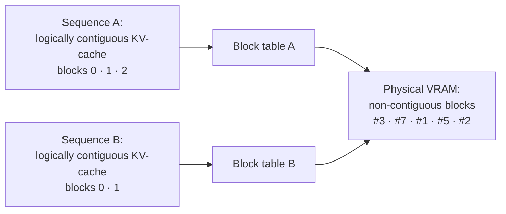
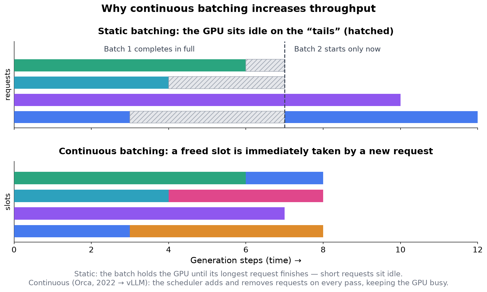
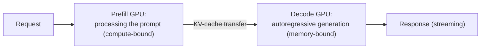

<!-- SPDX-FileCopyrightText: 2026 Aleksandr Drobiazkin
     SPDX-License-Identifier: CC-BY-SA-4.0 AND MIT
     Source: https://github.com/Drobiazkin/ai-agent-architecture
     Dual-licensed, and the boundary is exactly the fence: a fenced code block tagged
     with a language (python, java, sql, bash, yaml, xml, json), comments inside it
     included, is MIT. Everything else — the prose, the tables, the formulas, and the
     mermaid diagrams, which are illustrations expressed as text — is CC-BY-SA-4.0.
     Full terms: LICENSE, LICENSE-CODE, and NOTICE in the repository root. -->

# Chapter 22. Serving Open Models

Chapter 21 adapted the model; this chapter deploys it—an open-weight model—on infrastructure you own. The question is twofold: *when* to serve it yourself instead of calling an API, and *how* efficient serving works—the techniques that make GPU inference economical. The chapter consolidates the KV-cache (§1.6) and the economics of inference (Chapter 2) at the infrastructure level.

## 22.1 Why deploy an open model

Serving it yourself is justified where an API does not fit, for one of these reasons:
- **Control and privacy.** Data never leaves the perimeter—which matters for regulated domains and for data residency.
- **Cost at scale.** At a large, sustained volume, serving it yourself can come out cheaper than paying an API per call (§2.2), though it requires amortizing the infrastructure.
- **No vendor lock-in.** The model and its version stay under the organization's control; nothing depends on an API or a price list changing.
- **Customization.** Deploying *your own* fine-tuned model (Chapter 21), and full control over inference parameters, quantization, and version.

The price: infrastructure (GPUs), operations, and the engineering complexity of serving—which the rest of the chapter is about. The "API or self-host" decision is the same trade-off of control against cost that runs through the rest of Part VII.

## 22.2 The serving stack

GPU inference is handled by specialized servers, not by a naive loop on a training framework. The main ones:
- **vLLM** (Kwon et al., 2023)—introduced PagedAttention and popularized continuous batching (Orca, 2022; §22.4); a common production choice at tens to hundreds of concurrent users, with iteration that needs no recompilation and support across a range of GPUs.
- **SGLang** (Zheng et al., 2024)—RadixAttention for prefix caching, and efficient constrained decoding (§5.4).
- **TensorRT-LLM** (NVIDIA)—optimized kernels through NVIDIA's compilation stack; maximum performance on NVIDIA hardware at the price of a compilation step.
- **TGI** (Text Generation Inference) and others—the remaining inference servers.

How to choose: **vLLM**—the general-purpose default (broad model and GPU support, multi-LoRA, fast iteration without compilation); **SGLang**—when the load profile is built on heavy prefix reuse (agent trees, many-shot) or on heavy constrained decoding; **TensorRT-LLM**—to squeeze the most out of an NVIDIA fleet, at the price of a compilation cycle per model and configuration; **TGI**—simplicity inside the Hugging Face ecosystem. On typical workloads the performance differences among the first three are smaller than the effect of tuning any one of them properly.

A naive PyTorch inference loop falls short of these systems by a multiple; what follows are the techniques that account for the gap.

## 22.3 Deep Dive: PagedAttention

The main resource in serving is GPU memory for the KV-cache (§1.6), which grows linearly with sequence length and with the number of concurrent requests. Naive management demands a *contiguous* block of VRAM per request, sized to the maximum length—which leads to over-allocation and fragmentation.

**PagedAttention** (Kwon et al., SOSP 2023) solves this by mapping a sequence's KV-cache through a *logical block table* onto *non-contiguous physical blocks* of GPU memory. By the direct analogy the authors themselves draw, this is the same principle of virtual memory by which an OS manages RAM: logical pages map onto physical frames, and contiguity is not required.

The consequences are substantial: VRAM is not allocated up front to the maximum, fragmentation goes away, and the memory freed up holds more concurrent requests. PagedAttention is the foundation vLLM's high throughput is built on; along the way, it makes sharing common prefixes between requests possible (§22.7).

**Exactly how much memory sits idle.** The authors measured it on their own workload (OPT models, the ShareGPT and Alpaca datasets): in existing systems only **20.4–38.2%** of KV-cache memory goes to *actual* token states (Fig. 2 of the paper)—the other 61.8–79.6% is eaten by the reserve against maximum length and by fragmentation. For vLLM the same figure is **96.3%**, meaning residual waste under 4%. Hence the headline result: **2–4× the throughput at the same latency** against FasterTransformer and Orca. This is a measurement on one specific traffic profile, not a constant of nature, but the order of the gap tells: a naive memory manager puts a fifth of VRAM to work.

The top of the range—38.2%—is the telling one. It belongs to the Orca (Oracle) variant, which knows the actual answer length *in advance*. Even perfect knowledge of the length does not save it: as long as the request is alive, its entire contiguous chunk of memory stays reserved for it, and other, shorter requests cannot move into the idle tail. What you pay for, then, is not ignorance of the length but the requirement of contiguity itself—which is why the cure is sought in indirection rather than in predicting lengths more accurately.

**Where the idle memory comes from.** Take the derivation in §1.6—320 KB per token for a 70B-class configuration (80 layers, 8 KV heads, `d_head` = 128, fp16). A request with a maximum of 8192 tokens that actually generated 500: the naive manager reserves 8192 × 320 KB ≈ 2.5 GB, of which 500 × 320 KB ≈ 156 MB does real work. Idle: ≈2.3 GB—94% of what was reserved, and idle for the request's entire lifetime. This is an extreme point, not a recomputation of the 20.4–38.2% measured above: here one request carries a ratio of "declared maximum : actual" = 16:1, whereas the bottom of the band, 20.4%, came from the variant that reserves against the model's own ceiling (2048 tokens for OPT), averaged over traffic—there the ratio is about 5:1. The mechanics of the idling are the same; the multiplier differs. These are exactly the gigabytes that paging returns to the shared pool.

**What block allocation buys.** The allocation unit in vLLM is a block of $B$ tokens (by default $B$ = 16; the value was picked experimentally: larger and internal fragmentation grows, smaller and the GPU is utilized worse). Blocks fill left to right and a new one is allocated only when the previous is full, so only the last block can be underused—and only if $L$ is not a multiple of $B$. The waste per request:

$$W = \lceil L/B \rceil \cdot B - L \le B - 1$$

Where:
* **$L$**—the actual sequence length, in tokens (500 in the example).
* **$B$**—the block size, in tokens (16 by default in vLLM).
* **$W$**—the unoccupied slots in the last block; equally, the whole of the request's wasted memory.

Live numbers: ⌈500/16⌉ = 32 blocks, taking 32 × 16 × 320 KB = 160 MB. Of that, 156 MB does real work, and $W$ = 32 × 16 − 500 = 12 slots ≈ 3.8 MB. The worst case is $B$ − 1 = 15 slots ≈ 4.7 MB.

*In plain terms:* with paged allocation only the tail of the last block is lost, so the waste is a constant of no more than 15 tokens, whereas with a naive reservation it grows along with the *declared* maximum. In the example that is ≈2.3 GB against ≈4.7 MB per request, and the request's footprint in memory is 2.5 GB against 160 MB—exactly 16× smaller.

**The invariant for capacity planning.** This is what makes "more requests" countable. Naively, the number of concurrent requests is the VRAM budget for the cache divided by $L_{max}$ × 320 KB—that is, it follows the *declared* maximum; under paged allocation it follows the *actual* distribution of lengths in the traffic. The sixteen-fold memory headroom from the example, however, does not carry over into throughput in full: the 2–4× the authors measured is noticeably lower, and that is not a contradiction. Decode runs up against memory *bandwidth*, not memory capacity (§22.5), so past a certain batch size the bottleneck moves from capacity to the HBM bus and to compute. PagedAttention lifts the capacity limit; how much of what it frees turns into tokens per second is decided by the length distribution and the bandwidth ceiling. The practical consequence: capacity is planned from a histogram of *actual* answer lengths, not from `max_tokens`, and checked against a measurement on your own traffic (§22.8).

## 22.4 Deep Dive: continuous batching

The second foundation is how the batch gets formed. *Static* batching groups requests together and holds the GPU until the longest of them finishes; because answer lengths vary widely, short requests sit idle waiting and the next batch does not start—the GPU is underloaded.

**Continuous batching** (Orca, Yu et al., 2022; later vLLM, SGLang) removes this: on *every* forward pass the scheduler adds newly arrived requests to the running batch and retires the finished ones, filling a freed slot with a new request immediately.

This keeps GPU utilization high across heterogeneous lengths and yields a multiple-fold throughput gain under high concurrency—one of the key things separating a modern server from a naive loop.

## 22.5 Deep Dive: prefill vs. decode and disaggregation

Inference consists of two phases with *different* computational profiles:
- **Prefill**—processing the input prompt, parallel across tokens; *compute-bound*.
- **Decode**—autoregressive generation one token at a time; *memory-bound*, since every step reads the entire KV-cache.

Running both phases on one device produces *interference*: adding a new prefill to the active batch crowds out the decode in flight, delaying token generation and causing spikes in inter-token latency (ITL). Two answers:
- **Chunked prefill** (Sarathi, Agrawal et al., 2023)—splits a long prefill into chunks and interleaves it with decode, capping peak memory; a small rise in p50 TTFT buys a markedly better p95.
- **Disaggregated serving** (DistServe, Zhong et al., 2024; Splitwise, Patel et al., 2024)—physically separates prefill and decode onto *different* GPUs, removing the interference and letting you match hardware to each phase's profile (compute-bound against memory-bound). It has become a common technique, supported by vLLM and SGLang.

## 22.6 Quantization for inference

Quantization for *inference* differs from QLoRA (§21.4): QLoRA introduces adapters on top of a quantized base *for training*, whereas the goal here is to compress the *deployed* weights, cutting memory and speeding up reads (decode is memory-bound, §22.5). The formats:
- **AWQ and GPTQ**[^t-awq]—methods of 4-bit post-training weight quantization; AWQ accounts for the salience of activations. 4-bit quantization brings a large model down to a single GPU: Llama-3-70B, for instance, goes from 4×A100 (FP16) to one GPU with AWQ.
- **FP8**—the natural format for the H100/H200 with their native FP8 tensor cores; it holds quality with minimal calibration.
- **FP4 (NVFP4/MXFP4)**—micro-scaled 4-bit floating-point formats with native hardware support in NVIDIA's Blackwell generation (B100/B200/GB200, 2024–2025); the next step in density after FP8, with the same condition attached—confirm the degradation by evaluating on your own tasks.
- **INT8**—integer quantization of the weights.
- **KV-cache quantization**—separate from the weights; in practice available in FP8, which further shrinks the main resource in serving (§22.3).

The trade-off is memory and throughput against accuracy: the more aggressive the quantization, the greater the saving and the higher the risk of degradation, so the choice of format is checked against the hardware and the quality tolerance (and confirmed by evaluation, Chapter 17).

## 22.7 Speculative decoding and prefix caching

Two techniques cut latency and repeated work in serving.
- **Speculative decoding** (§1.6, §2.3)—a small *draft* model proposes several tokens, and the large *target* model verifies them in a single pass, accepting the ones that match. It speeds up generation without changing the output distribution; it pays off most under *low* concurrency, where per-request latency matters rather than aggregate throughput. Model-free variants (Medusa, EAGLE) do without a separate draft model: the draft tokens come from lightweight extra heads on top of the target model itself, which removes the problem of finding a well-matched draft-target pair.

### Deep Dive: why speculation speeds up generation without distorting it

The technique exploits the asymmetry from §22.5: decode is memory-bound—for every token the model reads *all* the weights to take one step. But γ already-drafted tokens can be verified in **one** forward pass: feed them as input and get the target model's distributions for all γ positions at once—the same regime as prefill, with the weights read once instead of γ times. The draft model (smaller by a multiple) generates γ tokens fast; the target model decides on each of them in a single pass—accept or reject; at the first rejection the chain is truncated, and the target model emits the next token itself.

Two questions decide everything. **The first is correctness.** Acceptance works as rejection sampling (Leviathan et al., 2023): a draft token `x` is accepted with probability `min(1, p(x)/q(x))`, where `q` is the draft's distribution and `p` the target model's; on a rejection the token is resampled from the corrected residual distribution `norm(max(0, p − q))`. The scheme's provable property: the resulting sequence is distributed *exactly* as it would be under ordinary decoding by the target model—the speedup is mathematically free in quality terms, and the only loss is the time spent on unsuccessful drafts.

**The second is the size of the speedup.** Let `α` be the average probability of accepting a single draft token (a measure of how well the draft-target pair agrees on the domain at hand). The expected number of tokens per cycle of "γ drafts + one verification":

`E = (1 − α^(γ+1)) / (1 − α)`

Reading the formula: this is the sum of a geometric series `1 + α + α² + … + α^γ`—the probability that the first i tokens are accepted in a row is `α^i`, and each such outcome adds a token; the `+1` in the exponent is the token the target model emits itself even under a total rejection (which is why E ≥ 1 always: in number of steps you cannot end up worse than ordinary decoding). At `α = 0.8` and `γ = 4`: E = (1 − 0.8⁵)/(0.2) ≈ 3.4 tokens per cycle—roughly a third as many passes of the target model; the real speedup is lower (the draft is not free), typically 2–3×. The same view shows when the technique *does not* work: under weak agreement (α ≈ 0.5 on a niche domain) E ≈ 1.9 and the gain is eaten by overhead, while raising γ at a low α adds almost nothing (the series converges). The draft model is chosen or fine-tuned for the target domain, and γ is kept small (2–5).
- **Prefix caching in serving** (SGLang RadixAttention)—the KV state of a common prefix (the system prompt, shared context) is reused across requests instead of recomputed. This is the server-side counterpart of prompt caching (§20.2), resting on non-contiguous block storage of the KV (§22.3).

## 22.8 Throughput vs. latency and scaling

Serving is tuned to a target load profile, and the key trade-off is *throughput against latency*. A larger batch raises throughput (the weight load is amortized) but increases an individual request's latency; speculative decoding, conversely, cuts latency at the cost of throughput. For models that do not fit on a single GPU there is *tensor parallelism* (a layer's weights are cut across GPUs) and *pipeline parallelism* (layers on different GPUs); for MoE models *expert parallelism* joins them: the experts are laid out across devices, and tokens are routed to their own experts through an all-to-all exchange. For MoE this is not an exotic mode but the baseline one—most of the top open weights of 2025–2026 (DeepSeek-V3/R1, Qwen3-MoE, Llama 4) are exactly that: memory for the *total* parameters is large while active compute is small (§1.5), so the sharding profile and the bottleneck (interconnect bandwidth on the all-to-all) differ from the dense case.

The orders of magnitude are illustrative: on an H100 the combination of continuous batching, PagedAttention, and chunked prefill gives Llama-3.3-70B in FP8 on the order of a few thousand tokens per second under high concurrency—a multiple above a naive PyTorch loop. The figures depend on the load, though: when answer lengths vary widely, continuous batching contributes more and chunked prefill less, so the configuration is checked against the *actual* distribution of traffic rather than against a synthetic one.

## 22.9 Chapter summary

Deploying an open model is justified by control, privacy, cost at scale, freedom from lock-in, and customization—at the price of infrastructure and complexity (§22.1). Serving is run by specialized servers (vLLM, SGLang, TensorRT-LLM) that beat a naive loop by a multiple (§22.2) on two foundations: PagedAttention, which manages the KV-cache through non-contiguous blocks on the principle of virtual memory (§22.3), and continuous batching, which keeps the GPU loaded across heterogeneous lengths (§22.4). The two phases of inference—compute-bound prefill and memory-bound decode—are separated by chunked prefill and by disaggregation, removing the interference (§22.5). Quantization for inference (AWQ/GPTQ/FP8/INT8, and the KV-cache in FP8) compresses the deployed weights at the price of accuracy (§22.6); speculative decoding and prefix caching cut latency and repeated work (§22.7). Tuning is a trade-off between throughput and latency, with tensor, pipeline, and—for MoE—expert parallelism for large models (§22.8). Next is Chapter 23: pre-training, for when even fine-tuning is not enough.

*Sources.* W. Kwon et al., "Efficient Memory Management for LLM Serving with PagedAttention" (vLLM, SOSP 2023); G.-I. Yu et al., "Orca" (2022)—continuous batching; A. Agrawal et al., "Sarathi" (2023)—chunked prefill; P. Zhong et al., "DistServe" (2024) and P. Patel et al., "Splitwise" (2024)—prefill/decode disaggregation; L. Zheng et al., "SGLang / RadixAttention" (2024); Y. Leviathan et al., "Fast Inference from Transformers via Speculative Decoding" (2023)—rejection sampling and the speedup formula (§22.7); the vLLM documentation (AWQ/GPTQ/FP8/INT8 quantization, tensor parallelism, H100 benchmarks, 2025); §1.6 (KV-cache, speculative decoding) and Chapter 2 of this book.

**In the Margins: Chapter 22**

[^t-awq]: **GPTQ** (Frantar et al., 2022)—layer-by-layer quantization that minimizes reconstruction error through a Hessian approximation; **AWQ**—Activation-aware Weight Quantization (Lin et al., 2023)—protects from coarsening the small fraction of weights that the activation statistics mark as critical.

---
