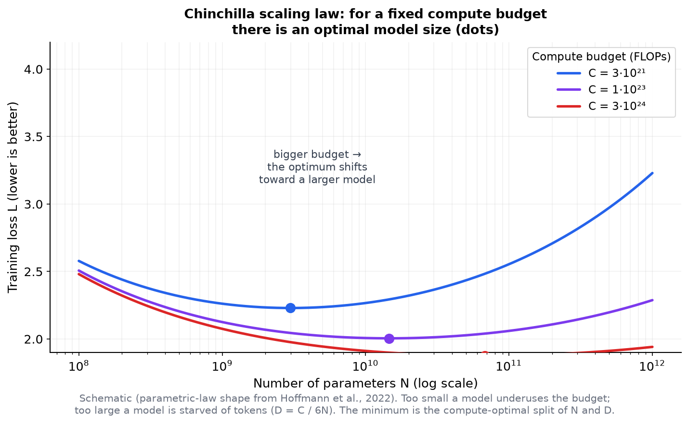
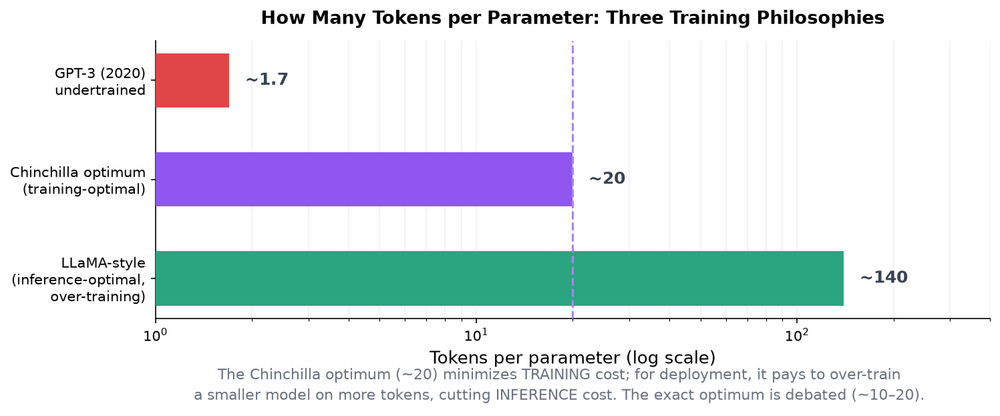
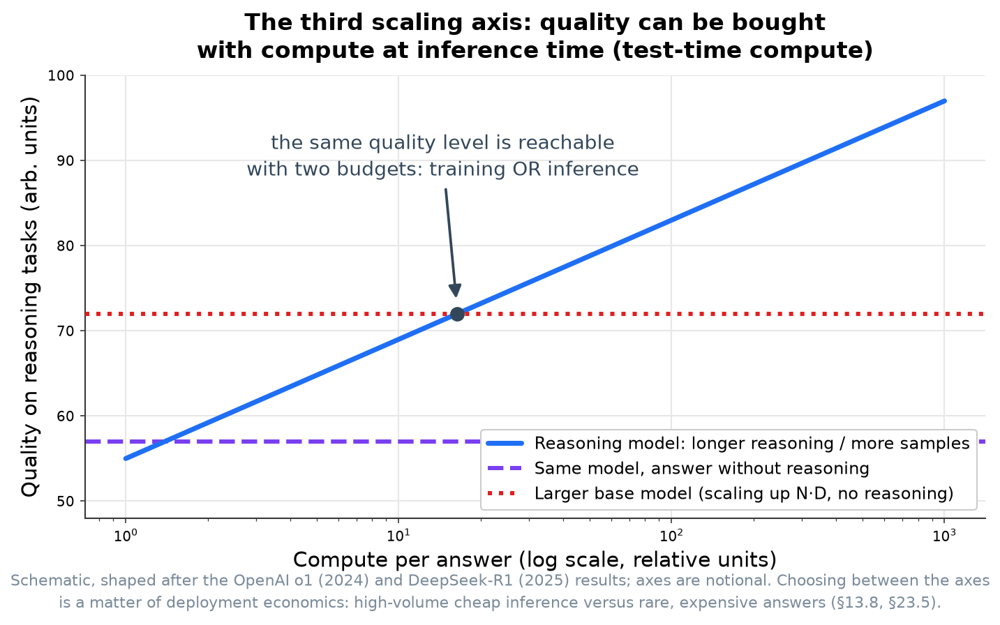

<!-- SPDX-FileCopyrightText: 2026 Aleksandr Drobiazkin
     SPDX-License-Identifier: CC-BY-SA-4.0 AND MIT
     Source: https://github.com/Drobiazkin/ai-agent-architecture
     Dual-licensed, and the boundary is exactly the fence: a fenced code block tagged
     with a language (python, java, sql, bash, yaml, xml, json), comments inside it
     included, is MIT. Everything else — the prose, the tables, the formulas, and the
     mermaid diagrams, which are illustrations expressed as text — is CC-BY-SA-4.0.
     Full terms: LICENSE, LICENSE-CODE, and NOTICE in the repository root. -->

# Chapter 23. Pre-Training

Chapter 21 adapted the model, Chapter 22 deployed it; this chapter is the top of Part VII's ladder: training a model *from scratch*. For the overwhelming majority of organizations this is the wrong choice, and the chapter explains what pre-training entails and what laws govern it—so that an architect can reason about the decision on solid ground, even while making it extremely rarely.

## 23.1 What pre-training is and when it is justified

**Pre-training** trains a model from scratch on an enormous corpus in a self-supervised regime: the model predicts the next token (§1.2), and out of that single task, knowledge and capabilities emerge. It is the top rung of the ladder "prompting → RAG → fine-tuning → pre-training"—maximum control at the price of maximum cost.

Pre-training is justified only in narrow cases: a fundamentally new architecture or modality that existing models do not cover; a language or a domain genuinely unrepresented in open models; sovereignty or regulatory requirements that rule out any external weights. For applied tasks the earlier rungs are almost always enough: fine-tuning (Chapter 21) changes behavior more cheaply, and RAG (Part III) adds knowledge without training at all. What makes pre-training almost never justified for a typical organization: cost (orders of magnitude above fine-tuning), the volume and quality of the data required (§23.6), and specialized expertise. The honest conclusion: absent one of the narrow reasons above, do not pre-train.

## 23.2 The pre-training pipeline

Pre-training is a pipeline of several stages:
- **Data collection**—a corpus on the scale of trillions of tokens from the web, books, code, and specialized sources.
- **Cleaning and deduplication**—filtering out junk, removing duplicates and near-duplicates, screening out harmful and low-quality material; the quality and cleanliness of the data drive the model's quality more strongly than its volume does (§23.6).
- **Tokenization** (§1.3)—training the tokenizer (BPE and its relatives) and encoding the corpus into token sequences.
- **Training**—optimizing next-token prediction over the corpus; this is where the scaling laws (§23.3) and the compute budget (§23.4) apply.
- **Post-training**—SFT and preference alignment (Chapter 21), which turn the "raw" pre-trained model into one that follows instructions; pre-training supplies only the base.

## 23.3 Deep Dive: scaling laws

How to split a fixed compute budget between *model size* and *token count* is the central question of pre-training, and the scaling laws are what answer it.

The early laws (Kaplan et al., 2020) described quality as a power law in scale, but leaned toward putting most of the budget into model *size*. **Chinchilla** (Hoffmann et al., 2022) revised them: across more than 400 trained models (from 70M to 16B parameters at controlled budgets) it showed that for *compute-optimal* training the model size N and the token count D must grow *in equal measure*—each as ~C^0.5 (doubling the budget C multiplies each by √2; doubling both takes four times the budget, since C = 6ND). Hence the rule of thumb of **≈20 tokens per parameter**. The Chinchilla model (70B, trained on 1.4T tokens) beat Gopher (280B) at the same budget with four times fewer parameters and nearly five times more tokens—direct proof that the preceding models were *undertrained* (GPT-3 at ~1.7 tokens per parameter).

The optimum is located by three complementary methods: varying the token count at a fixed size; varying the size at a fixed budget (IsoFLOP); and fitting a parametric loss surface L(N, D), then deriving the optimal split from it. As the chart shows, at a fixed budget too small a model underuses it, too large a model comes up short on tokens, and the minimum marks the compute-optimal split.

## 23.4 Deep Dive: the compute budget C ≈ 6ND

The compute cost of pre-training is estimated by a simple and practically important relation: **C ≈ 6ND**, where C is compute in FLOPs, N is the number of parameters, and D is the number of (training) tokens. Let's take the factor of 6 apart term by term—it is not empirical but follows from how the forward pass is built (§1.4, Appendix A).

**Where the 2 FLOPs come from.** The forward pass is matrix multiplication, and in it every parameter (an element of a weight matrix) takes part in processing every token exactly once: one multiply (weight × input number) and one add (add the product to a running sum). Multiply + add = 2 operations per "parameter × token" pair, giving **2ND** for the whole forward pass over all the data.

**Where the ×3 comes from.** The backward pass costs roughly *two* forward passes, because the gradient is computed twice: with respect to the *activations* (to push the error deeper into the network—without which the earlier layers cannot be trained) and with respect to the *weights* themselves (to update them). Each of the two operations is the same matrix multiplication at the same sizes as the forward. In total: 2ND × (1 forward + 2 forward-equivalents for the backward) = **6ND**. The relation makes the budget tangible: training a model in the tens of billions of parameters on trillions of tokens takes on the order of 10²³–10²⁴ FLOPs—from hundreds of thousands to millions of GPU-hours on an expensive cluster (for scale, per Meta's model cards: Llama 2 70B—about 1.7M A100 GPU-hours; Llama 3 405B—about 31M H100 GPU-hours; in money at market rental prices, single-digit to tens of millions of dollars per run, and for the largest models at list prices, noticeably more), which is exactly why pre-training is out of reach as a routine operation. C ≈ 6ND plus the 20-tokens-per-parameter rule also yields the data estimate: a 70B-parameter model needs about 1.4T tokens, a 175B model about 3.5T (on the order of several terabytes of text).

## 23.5 Deep Dive: compute-optimal vs. inference-optimal

A substantial and frequently missed subtlety: the Chinchilla optimum minimizes the cost of *training*, not of *operating*. A model is trained once and inferenced many times over; so for a model destined for wide deployment it pays to train a *smaller* model on *more* tokens than the 20:1 rule prescribes—over-training[^t-overtrain] raises the training cost but lowers the inference cost across the entire service life.

This is exactly how models meant for mass deployment are trained (the LLaMA family, for one, was trained well past the Chinchilla optimum). Hence three philosophies: undertraining (GPT-3, ~1.7 tokens per parameter), training-optimal (Chinchilla, ~20), and inference-optimal over-training (~100 and up). The caveats matter: the exact value of the optimal ratio is open to debate (a number of later works find ~10–12), and the Chinchilla law itself was derived for a decoder-only transformer with next-token prediction—for mixture-of-experts, encoder-decoder, or other objectives, the 6ND estimate and the exponents may not carry over directly.

### Deep Dive: the third axis—test-time compute

The classical scaling laws split the *training* budget between N and D. With the arrival of reasoning models (o1, 2024; DeepSeek-R1, 2025), scaling gained a third axis—**test-time compute**: on reasoning tasks quality grows with the amount of compute spent on the answer itself (the length of the reasoning chain, the number of samples), and that growth is bought without retraining (§13.8). For allocating the budget this changes the arithmetic: part of the quality that once came only from raising N or D is now reachable through post-training (RLVR) plus inference spend—and conversely, for cheap inference at scale a large base model without long reasoning may be the better buy. The full calculation becomes three-dimensional—pre-training × post-training × inference budget; no settled Chinchilla analogue exists for that space yet, and the practical conclusion for an architect is a single one: count the cost per *task* (reasoning tokens included, §2.2), not per model.

## 23.6 Data and infrastructure

Two practical constraints decide whether pre-training is feasible.
- **Data.** Trillions of tokens are required, but their *quality* and *cleanliness* matter more than their volume: deduplication, filtering out low-quality and harmful content, and the selection of sources affect the result more strongly than the raw size of the corpus does (§23.2). At the upper scales the worry of a "data wall" arises—running out of available quality text (the quantitative frame is data-constrained scaling laws, Muennighoff et al., 2023: repeated epochs over quality data do work, but with sharply diminishing returns).
- **Infrastructure.** The training run fits on no single node and demands distributed training on a cluster of thousands of accelerators: *data parallelism* (replicas of the model on different data), *tensor parallelism* (a layer's weights sliced across devices), and *pipeline parallelism* (layers spread across devices)—the same forms of parallelism as in serving (§22.8), but at training scale. The tool names to search under: FSDP (PyTorch), DeepSpeed ZeRO (stages 1–3 of sharding the optimizer state, the gradients, and the weights), Megatron-LM (tensor/pipeline), and their combination, "3D parallelism." Hence the cost and the expertise that put pre-training beyond the reach of most.

## 23.7 Summary of the chapter and of Part VII

Pre-training trains a model from scratch by next-token prediction and stands at the top of the ladder; for a typical organization it is almost never justified—RAG and fine-tuning are enough (§23.1). The pipeline covers data collection, cleaning and deduplication, tokenization, training, and post-training (§23.2). The scaling laws set how the budget splits between size and data: Chinchilla established equal scaling of N and D and the ~20-tokens-per-parameter rule, showing that earlier models were undertrained (§23.3); the cost is estimated as C ≈ 6ND (§23.4). But the Chinchilla optimum minimizes training, not inference, which is why widely deployed models are over-trained—smaller ones on more tokens (§23.5). Feasibility comes down to data quality and the infrastructure for distributed training (§23.6).

**Part VII in sum.** A model of your own is a spectrum of rising control and rising cost: adapt a ready-made one (Chapter 21), deploy an open one (Chapter 22), or train one from scratch (Chapter 23). The decisive principle of the whole part: do not climb this ladder before the rung below it has demonstrably failed, because each rung costs several times the one before. Next comes **Part VIII: synthesis**, where all the parts come together into a reference architecture, an organizational frame for adoption, and a worked end-to-end example with a package of architectural decisions.

*Sources.* J. Kaplan et al., "Scaling Laws for Neural Language Models" (2020); J. Hoffmann et al., "Training Compute-Optimal Large Language Models" (Chinchilla, NeurIPS 2022)—the ~20-tokens-per-parameter rule, C ≈ 6ND, equal scaling of N and D; H. Touvron et al., "LLaMA" (2023)—inference-optimal over-training; the discussion of the exact ratio and of reconciling Kaplan/Chinchilla (2024); material on curating pre-training data and on distributed training; §1.2–1.3 and Chapter 22 of the book.

**In the Margins: Chapter 23**

[^t-overtrain]: ≠ A false friend: **over-training** here means a deliberate inference-optimal regime (a smaller model on more tokens than the compute optimum prescribes), not classic overfitting—degradation from memorizing the training set. It improves operating economics without "spoiling" anything.

---
