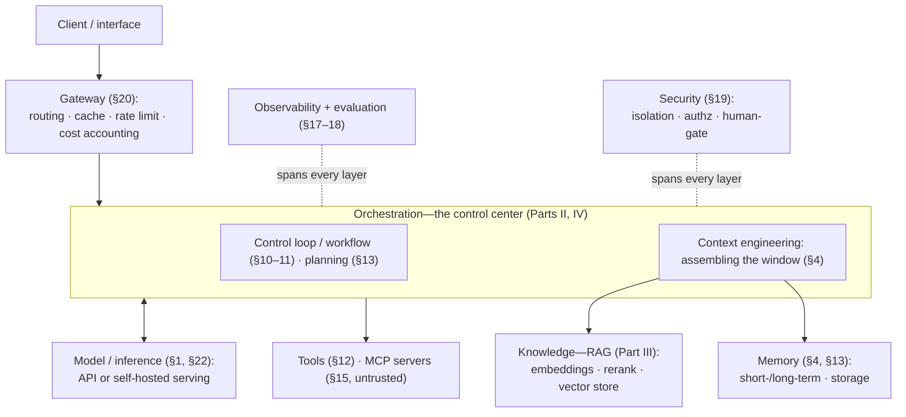
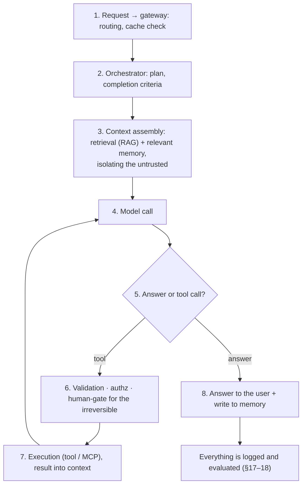

<!-- SPDX-FileCopyrightText: 2026 Aleksandr Drobiazkin
     SPDX-License-Identifier: CC-BY-SA-4.0 AND MIT
     Source: https://github.com/Drobiazkin/ai-agent-architecture
     Dual-licensed, and the boundary is exactly the fence: a fenced code block tagged
     with a language (python, java, sql, bash, yaml, xml, json), comments inside it
     included, is MIT. Everything else — the prose, the tables, the formulas, and the
     mermaid diagrams, which are illustrations expressed as text — is CC-BY-SA-4.0.
     Full terms: LICENSE, LICENSE-CODE, and NOTICE in the repository root. -->

# Part VIII. Synthesis

Parts I–VII built the components; Part VIII assembles them into a whole. Chapter 24 draws all the material together into a single reference architecture for a production AI-agent system, Chapter 25 adds the organizational scaffolding of adoption—ownership, privacy, regulation, economics, and process—and Chapter 26 works an end-to-end example from requirements to a package of architectural decisions. Part VIII shifts the question from "how each part is built" to "how it all comes together into one working, observable, secure, and economical system."

# Chapter 24. Reference Architecture

This chapter is a map of the whole book: how the components of Parts I–VII fit together into one reference architecture. Not a new framework but a systematization—which layers make up a production AI-agent system, how they interact, where the boundaries run, and which invariants hold across the entire system. Industry practice has converged on a similar layered split, and the architecture laid out here agrees with it.

## 24.1 The layers of the reference architecture

A production AI-agent system decomposes into layers with separate responsibilities:
- **Interface and gateway**—the entry point; the gateway centralizes model routing, caching, rate limiting, and cost accounting (§20.6).
- **Orchestration**—the control center: the control loop or workflow (Chapters 10–11), planning and reasoning (Chapter 13), context assembly (Chapter 4). This is where decisions get made, where the other layers are called, and where the discipline of reliability is held (Chapter 14).
- **Model and inference**—the LLM itself, called through an API or served yourself (Chapters 1, 22).
- **Knowledge (RAG)**—grounding in data: embeddings, retrieval, reranking, the vector store (Part III).
- **Memory**—state across steps and sessions: short- and long-term, with persistent storage (§4, §13).
- **Tools and integration**—acting on the outside world: tool calling (Chapter 12) and MCP servers (Chapter 15).

Above these layers sit three **cross-cutting concerns**—not layers themselves, but running through all of them: observability and evaluation (Chapters 17–18), security (Chapter 19), and cost and latency (Chapter 20). The organizing principle, borne out by industry practice: **orchestration controls everything, and the model is a constrained component**. In particular, the model never reaches the vector store or the tools directly—retrieval and calls are mediated by orchestration, which turns them from the model's improvisation into a predictable, controlled mechanism (the same point underpins security, §19.6, and the MCP separation, §15.2).

## 24.2 The full component diagram

The layers and how they connect:

Read the diagram downward from the entry point: a request passes the gateway and lands in orchestration as the control center, which calls the model, assembles context out of knowledge and memory, and invokes tools; observability and security span every layer. What matters is the topology: orchestration at the center, the other layers subordinate to it, and the stores (vector and memory) and external tools (MCP) sitting beyond a boundary, out of the model's direct reach.

## 24.3 Deep Dive: the flow of a request through the architecture

One request, from entry to answer, sets the layers in motion:

- The request passes the gateway: routing to a suitable model (§20.3) and a cache check (§20.2).
- The orchestrator settles the plan and the completion criteria (§10.5, §13.4).
- Context gets assembled: retrieving the relevant documents (Part III) and the relevant memory (§4.5), with untrusted content isolated (§4.6, §19.6).
- The model is called and decides: answer, or call a tool (§12.2).
- On a tool call—argument validation (§12.4), authorization under the user's own rights (§12.5) and, for irreversible actions, human confirmation (§10.6); then execution (tool or MCP, §15) and the result returns into the context—the loop repeats.
- When it is ready—the answer goes to the user and gets written to memory.
- The whole path is captured in traces and evaluated (Chapters 17–18), closing the improvement loop (§17.8).

## 24.4 Deep Dive: boundaries and invariants

The architecture's reliability and security rest on a handful of invariants that hold in every layer:
- **The model has no direct access to the stores or the tools.** Retrieval and calls are mediated by orchestration; this keeps behavior predictable and denies an injection any direct path to data and actions (§19.6, §24.1).
- **Untrusted content is isolated.** External data (documents, tool results, MCP) is fed in a clearly separated region of the context and never mixed with instructions (§4.6, §19.1); for high-risk systems—a quarantined loop (dual-LLM, §19.6).
- **The irreversible goes through a human.** Actions with consequences require confirmation; compensation is only for the reversible (§10.6).
- **The trust boundary sits at orchestration.** Orchestration is trusted; the model is a manipulable component; servers and external sources are untrusted (§15.2). Authorization and isolation are enforced by deterministic components, not by trusting the model.
- **Every step is bounded by a budget.** Limits on iterations and on tokens per step and per task (§10.5) hold cost down and prevent unbounded consumption (§19.3, §20.6).

These invariants are not properties of any one layer but rules that cut across all of them; break one anywhere and the whole system is undermined.

### Deep Dive: physical topology and scaling

The logical diagram of §24.2 unfolds into a physical one by the usual rules of distributed systems—with one decisive choice: **orchestration is designed stateless**, and all session state (history, plan, memory) lives in an external store (externalized state, §4.4). Orchestration replicas then scale horizontally behind a load balancer without sticky sessions, a pod restart does not lose the conversation, and a pause at a human-gate (§10.6)—state that lives for hours—survives a deploy, because it sits in a database rather than in process memory. Long-running agent tasks are shaped asynchronously: a task queue plus workers, not an HTTP request holding a connection open for minutes. Multi-agent (Chapter 14) does not change the external topology: supervisor and worker agents are logical roles inside the orchestration layer, executed by the same replicas. The GPU pool for self-hosted inference (Chapter 22) scales on a track of its own—it has its own scaling units (model replicas) and its own utilization economics (§2.6).

## 24.5 Cross-cutting concerns

Three concerns run through every layer and are designed in from the start rather than bolted on after the fact.
- **Observability and evaluation** (Chapters 17–18) span every layer: traces record a request's path through all the components, metrics aggregate cost and latency, and evaluation judges quality on those same traces. Without this you can neither debug the system nor improve it.
- **Security** (Chapter 19) is built into the architecture from day one: isolation, least privilege, human-gate, and quarantine are architectural decisions, not after-the-fact filters.
- **Cost and latency** (Chapter 20) are managed at the level of the gateway and orchestration: routing, caching, budgets, and attribution.

What they share: none of them localizes to a single layer, which is why they are treated as cross-cutting dimensions of the whole architecture.

## 24.6 Decisions by layer: a composite map

Each layer demands explicit architectural decisions; the composite map ties them to the chapters:

| Layer / cross-cutting concern | Key decision | Where in the book |
|---|---|---|
| Gateway | Routing, cache, budgets | §20 |
| Orchestration | Workflow versus agent; level of autonomy | §10.7, §11.8 |
| Context | Strategy for assembling and isolating the window | §4 |
| Model | Model tier; API versus self-host | §2, Chapter 22 |
| Knowledge | Retrieval pattern; index; reranking | Part III |
| Memory | Short-/long-term; forgetting strategy | §4.5, §13.1 |
| Tools | The set and the contracts; MCP | §12.3, Chapter 15 |
| Implementation | Framework (Spring AI / LangChain4j) | Chapter 16 |
| Evaluation | Offline gate + online monitoring | Chapter 17 |
| Observability | Traces, metrics, attribution | Chapter 18 |
| Security | Isolation, privileges, human-gate | Chapter 19 |
| Your own model | Fine-tuning / serving / pre-training | Part VII |

The map does not prescribe specific values; it lists the *decisions* an architect makes deliberately. What gets chosen in each row follows from the requirements (Chapter 2, Chapters 25–26).

## 24.7 Chapter summary

A production AI-agent system decomposes into layers: gateway, orchestration (the control center), model, knowledge (RAG), memory, tools—with observability/evaluation, security, and cost/latency as cross-cutting concerns (§24.1). The full diagram (§24.2) puts orchestration at the center and the stores and external tools beyond a boundary the model cannot cross directly; the request flow (§24.3) sets the layers in motion from gateway to answer, with an evaluation loop closing it. Invariants hold the architecture together: the model never touches the stores or the tools directly, the untrusted is isolated, the irreversible goes through a human, the trust boundary sits at orchestration, and every step is bounded by a budget (§24.4). The cross-cutting concerns are designed in from day one (§24.5), and the composite map ties each layer's decisions back to the material of the book (§24.6). Next, Chapter 25: the organizational scaffolding for adopting this architecture; the end-to-end example that drives it from concrete requirements through to a package of decisions is Chapter 26.

*Sources.* Industry reference architectures for agentic systems and the "agentic stack" (2025–2026)—the layered split, the principle that "orchestration controls retrieval, the model has no direct access to the store," observability as a cross-cutting concern, security from day one; C. Richardson, *Microservices Patterns* (2018)—the principles of layers and boundaries; this book (Parts I–VII) as the source of the layers' content.

---
