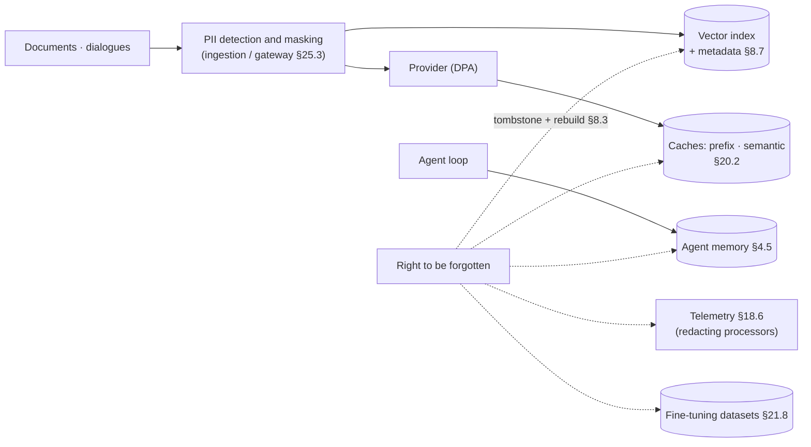
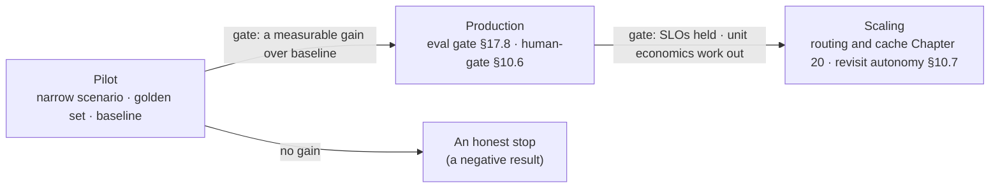

<!-- SPDX-FileCopyrightText: 2026 Aleksandr Drobiazkin
     SPDX-License-Identifier: CC-BY-SA-4.0 AND MIT
     Source: https://github.com/Drobiazkin/ai-agent-architecture
     Dual-licensed, and the boundary is exactly the fence: a fenced code block tagged
     with a language (python, java, sql, bash, yaml, xml, json), comments inside it
     included, is MIT. Everything else — the prose, the tables, the formulas, and the
     mermaid diagrams, which are illustrations expressed as text — is CC-BY-SA-4.0.
     Full terms: LICENSE, LICENSE-CODE, and NOTICE in the repository root. -->

# Chapter 25. Adoption in the Organization

Chapter 24 assembled the technical architecture. But the platform the book's subtitle promises—*automating the organization*—runs up against more than technology: who owns the prompts, who pays for the tokens, who answers to the regulator, and why employees will start using it (or refuse to). This chapter is the platform's organizational scaffolding: the lifecycle of AI artifacts, the point where policy gets applied, the containment loop around personal data, regulatory readiness, the economic case, and the adoption process. It is an overview with bridges to the technical chapters, not legal or management advice.

## 25.1 Why architecture is not enough

A probabilistic component breaks the organizational contracts everyone is used to. Quality is a distribution, not a boolean property: "works / doesn't work" gives way to the share of acceptable answers against a threshold (Chapter 17), and that reshapes the SLA, the definition of an incident ("systematically bad answers" is an incident with no stack trace), and the postmortem process. Artifacts appear that did not exist before: prompts, schemas, golden sets, indexes, judge versions—with no lifecycle deliberately built for them, they live in chats and notebooks and degrade in silence. Finally, an agent's actions (Chapter 10) raise a question of accountability that deterministic code settles through testing and that here demands autonomy levels and auditing (§10.6–10.7). Three questions adoption has to answer beyond the architecture: **who owns, who pays, who answers**.

## 25.2 Ownership and the lifecycle of AI artifacts

A prompt, an output schema, a golden set, and a retrieval configuration are versioned artifacts with a release cycle (§3.6): review, an offline gate against the golden set (§17.8), a canary rollout, a rollback. Organizationally this takes the shape of two registries.

> ### Pattern: Prompt Registry
>
> **Context.** Everyone edits the prompts a little: product edits the wording, engineering the format, security the constraints. A change in one place quietly changes behavior in another; nobody can answer "which prompt is in production right now, and why."
> **Problem.** How do you give prompts the lifecycle of code—versions, review, rollback, attribution of regressions—without turning every edit into an application deploy?
> **Forces.** A prompt needs the iteration speed of text and the discipline of code at the same time; an edit is cheap to make and expensive to detect—a regression surfaces in the quality of the answers, not in the compiler.
> **Solution.** A central registry: the prompt is stored and versioned separately from the code, each one has an owner, an attached golden set, and a change log; the application fetches a prompt by version or alias.
> **Mechanics.** A prompt change is a pull request with an eval run as the CI gate (§17.8); rollout is a canary on a fraction of traffic with online metrics (§17.6); every telemetry record is tagged with the prompt version (§18.5), so a regression is attributed to a specific change; rollback is a version switch, with no rebuild.
> **Resulting Context.** Reproducibility and controlled evolution; prompt engineering stops being folklore. The price is infrastructure and discipline, plus the risk of bureaucratizing small edits (mitigated by automating the gate).
> **When to Use.** More than one prompt in production, or more than one person changing them. **When Not To.** A single team's prototype—prompts in git next to the code are enough (§3.6).
> **Related Patterns.** Prompts as code (§3.6); the eval gate (§17.8); observability with version attributes (§18.5).
> **Sources.** LLMOps practice for versioning and rolling out prompts (2024–2026); §3.6 and §17.8 of this book.

The second registry is the **organization's registry of AI systems**: which systems exist, which models and providers they run on, what risk class they carry, and who owns them (for agents, including their machine accounts—NHI, §15.7). It looks like bureaucracy right up until the regulator's first question, the first security incident, or the provider's first price change—and it is also the entry point for risk classification (§25.5).

**Shadow AI.** The registry describes what the organization *knows* about itself. **Shadow AI** is unsanctioned LLM use outside the registry: a personal API key in a script, a browser extension with access to work email, "gray" automation on a no-code platform, an employee pasting customer data into a public chatbot. It is a direct descendant of shadow IT, sharpened by two properties of LLMs: the barrier to entry is negligible (a key and five lines of code), and the leak channel is built into the function itself—the data goes to an external provider *by definition*. The detection vectors are engineering ones: analyzing outbound traffic to provider domains, the financial trail (API subscriptions in expense reports), a periodic amnesty ("legalize your script and you get budget and support"). But the main lever is not prohibition—it is economics: the sanctioned path through the gateway (§25.3), with self-service and fast onboarding, has to be *cheaper and more convenient* than the unsanctioned one, or the shadow path reproduces itself forever.

## 25.3 Pattern: AI Gateway as the governance point

> ### Pattern: AI Gateway
>
> **Context.** Teams integrate with providers directly: keys spread across team secret stores, spend goes unattributed, privacy policy is applied at will, and switching providers means edits in every service.
> **Problem.** How do you apply organizational policy—access, budgets, privacy, audit, choice of models—to *every* LLM call without building it into every application?
> **Forces.** Centralization buys control, visibility, and portability, but it puts a component in the path of every call; direct integrations are fast for an individual team but smear policy, spend, and audit across the whole organization.
> **Solution.** A single egress point to the models: every call goes through a gateway that authenticates the caller, applies policy, and routes to the providers.
> **Mechanics.** Authentication and cost attribution by team, feature, and user (§20.6); quotas and budgets that degrade rather than cut off (§10.5, §20.6); PII masking before anything goes to the provider (§25.4); routing only to approved destinations (DPA[^t-dpa], residency—§2.6); an audit log of requests; centralized timeouts, retries, and fallback models (§2.5); swapping a model with no edits in the applications (§20.3). The gateway is the natural place to collect telemetry (Chapter 18).
> ```mermaid
> flowchart LR
>   T1["Product A"] --> GW
>   T2["Product B"] --> GW
>   Ag["Agent C"] --> GW
>   subgraph GW["AI Gateway"]
>     Pol["authentication · quotas · PII masking<br/>audit · routing and fallback · cost attribution"]
>   end
>   GW --> P1["Provider 1 (DPA)"]
>   GW --> P2["Provider 2"]
>   GW --> SH["Self-host (vLLM)"]
>   GW -.-> Tel[("Telemetry, Chapter 18")]
> ```
>
> **Resulting Context.** Policy in one place; portability across vendors (§16.5, §20.6); a complete picture of spend. The price: a component in the path of every call—availability and latency requirements at the level of critical infrastructure; and the risk of turning the platform team into a bottleneck on everyone's process.
> **When to Use.** More than one team or system; any regulatory requirement at all. **When Not To.** One product from one team—a library carrying the same concerns is enough.
> **Related Patterns.** Model Routing / Fallback (§2.2, §2.5, §20.3); budgets and attribution (§20.6); the PII containment loop (§25.4); observability (Chapter 18).
> **Sources.** Chip Huyen, *AI Engineering* (2025)—the platform layer and gateways; LLM gateway practice (2024–2026); §20.6 of this book.

## 25.4 Data and privacy: the PII containment loop

Personal data settles in every layer of the system, and the loop is built around the places where it settles:

- **Ingestion into the index.** Detect and mask/pseudonymize PII *before* embedding and indexing; the clearance and the owner go into the chunk's metadata (§8.7). What never entered the index cannot leak through retrieval.
- **Telemetry.** Capturing prompts and answers runs through redacting processors (§18.6); debugging completeness against privacy is a managed trade-off.
- **The provider.** Routing through the gateway (§25.3) guarantees DPA-compatible destinations: what the provider stores, whether it trains on the data, where residency lands (§2.6, ADR-8 in §26.4).
- **The right to be forgotten.** The most inconvenient requirement of all: the subject's data has to be deleted from the vector index (in HNSW, a tombstone plus a periodic rebuild, §8.3), from the caches (including the semantic cache, §20.2), from the agent's memory (§4.5), and from the fine-tuning datasets (§21.8). The list of places where data settles follows directly from the systems registry (§25.2); without it, "delete everything" cannot be carried out.



**How PII detection itself works.** "Detection and masking" above is not one operation but a ladder of three techniques, in rising order of coverage and cost:

1. **Deterministic recognizers**—regular expressions, dictionaries, checksums (a card number validates against the Luhn algorithm, a Russian tax number against its own check digit). High precision on *formatted* data, zero on free text: "Ivan's wife from the third stairwell" will match no pattern at all.
2. **NER models** (named entity recognition, the classic NLP task)—a trained recognizer finds names, addresses, and organizations in free text. It needs language support: Russian needs Russian-language models, and an English-language default silently misses Cyrillic entities. The open reference point is **Microsoft Presidio**: it combines both classes of recognizer and extends with custom ones (internal identifiers, contract numbers).
3. **An LLM classifier**—the only one that understands *contextual* PII ("the client we talked about yesterday" is a disclosure too), and the most expensive. The recursive trap: the text is sent to an LLM in order to find the PII in it—so that call is itself obliged to go to a local or DPA-covered model, or the protective loop *is* the leak.

The failure modes are asymmetric, and that sets the calibration: a **false negative** means PII went out unmasked (a compliance incident with regulatory consequences); a **false positive** means too much got masked (quality degrades: "contact [PERSON] at [PHONE]" is useless as an answer). So the loop's target metric is recall (Chapter 9—the same logic as in retrieval) on paths leaving the perimeter, at the cost of precision; inside the perimeter the balance is softer. And keep the operations distinct: **masking** (an irreversible placeholder), **pseudonymization** (reversible through a mapping table—which itself becomes a critical secret), and format-preserving **tokenization** (the value is replaced, the format and the relationships survive—indexes and analytics keep working).

## 25.5 The regulatory landscape

An overview of the frameworks; check the details and the deadlines against the current state—regulation moves faster than books.

- **The EU AI Act** (Regulation (EU) 2024/1689)—a risk-based classification of systems: unacceptable risk (banned), high (hard obligations: risk management, data quality, logging, human oversight, documentation), limited (transparency), minimal. Obligations differ by role: **provider** and **deployer**[^t-provider-deployer]; general-purpose models (GPAI[^t-gpai]) get a regime of their own. The dates of entry are staggered and have been revised: as of this writing (mid-2026), pushing the obligations for high-risk systems out to 2027–2028 has been approved by the European Parliament and the Council and awaits publication—check the timetable as of the date you are reading.
- **Personal-data regimes**—GDPR, Russia's 152-FZ, and their analogues: the legal basis for processing, cross-border transfer (calling a hosted API from another jurisdiction is a transfer, §2.6), the subject's rights (→ §25.4).
- **Sector-specific overlays**—finance, medicine, and the public sector add requirements of their own for explainability, localization, and audit.
- **Standards as a maturity frame**—NIST AI RMF[^t-nist-rmf] (2023) and ISO/IEC 42001:2023 systematize the management of AI risk; useful as checklists even where they carry no legal force.

**Liability for autonomous actions** (not legal advice—a map of the questions to bring to a lawyer). The doctrine for agents is still taking shape, but two settled principles already apply: the principal's liability for the actions of the instrument it employs (in contract law, the actions of an automated system are attributed to the party deploying it—"the agent decided on its own" is not a defense), and precedents of the Moffatt v. Air Canada (2024) kind: the tribunal held the company to terms its chatbot had promised in error, rejecting the argument that the bot was a "separate entity." The engineering consequence: autonomy levels (§10.7), the human-gate (§10.6), and the audit trail (Chapter 18) are not only compliance but the evidentiary basis for due diligence in a dispute. Where the roles divide: *which* actions may be delegated to an agent in a given jurisdiction and industry is the lawyer's call; the architect's job is to make the system capable of technically enforcing those boundaries and demonstrably observing them.

Practical consequences for the architect: (1) a systems registry with a risk class recorded on intake (§25.2)—without it you cannot even determine which obligations apply; (2) human oversight is already built into the architecture—the human-gate (§10.6) and autonomy levels (§10.7); (3) tracing (Chapter 18) serves two purposes—debugging and evidence for the regulator; (4) a map of the places where data settles (§25.4).

## 25.6 The economic case: TCO and ROI

The cost of ownership is wider than the token bill: **TCO = inference** (Chapters 2, 20) **+ infrastructure** (retrieval Chapter 8, the eval system §17.8, observability Chapter 18) **+ people** (the platform team, HITL reviewers §10.6, maintaining the golden sets) **+ risk** (incidents, compliance). Of these terms, tokens are often not the largest—people cost more.

The ROI frame: value = time saved per task × rate × volume × **the share of people actually using it (adoption)**—or a direct effect on conversion and revenue; payback = value − TCO. Adoption is the main unknown multiplier, which is why you do not forecast it—you establish it with **a pilot carrying a measurable metric**: a baseline before rollout, a target gain, a stopping criterion (the methodology is Chapter 17; the mechanics of costing it out are the worked example in §2.2). The standard traps: counting tokens only; measuring usage (queries/day) instead of the outcome (tasks closed, cycle time); ignoring the cost of an error—which is exactly what sets the autonomy level and the volume of HITL work (§10.6–10.7).

## 25.7 Teams and the adoption process

**Dividing responsibility.** The configuration that works: a **platform team** (the gateway §25.3, eval infrastructure §17.8, observability Chapter 18, the registries §25.2—the "rails") and **product teams** (prompts, tools, answer quality, the product metric—the "trains"). The platform does not write prompts on the product's behalf: owning the quality of the answer is inseparable from owning the domain.

**The stages.** A pilot (a narrow scenario, a golden set, a baseline) → production (the eval gate §17.8, a human-gate on anything irreversible §10.6) → scaling (routing and caching Chapter 20, revisiting the autonomy level §10.7). The gate at every stage is metrics, not impressions: a pilot that "everybody liked" but that showed no gain over the baseline is a negative result.



**People and trust.** Users are taught to *calibrate* their trust: blind acceptance of answers (automation bias) and total distrust that routes around the system kill the value equally; transparency—source citations (§6.7) and an explanation of the actions taken—works in favor of calibration. HITL review is planned workload with metrics of its own (§10.6: the approval rate as a detector of rubber-stamping). The feedback channel closes onto the golden set (§17.8): a complaint that never became an eval case is lost.

## 25.8 Chapter summary

Adoption = architecture (Chapter 24) × organizational scaffolding: AI artifacts get a lifecycle and registries (§25.2), policy is applied at a single point—the gateway (§25.3), personal data is controlled across every place it settles (§25.4), regulatory readiness rests on the registry, human oversight, and tracing (§25.5), the economics are proven by a measurable pilot (§25.6), and the process is built on a platform/product split with staged gates on metrics (§25.7). The next chapter instantiates the technical and the organizational parts alike in a worked example.

*Sources.* EU, Regulation (EU) 2024/1689 (AI Act); NIST, "Artificial Intelligence Risk Management Framework 1.0" (2023); ISO/IEC 42001:2023—AI management systems; Microsoft Presidio—an open-source PII detection tool (§25.4); Moffatt v. Air Canada (Civil Resolution Tribunal, 2024)—liability for a chatbot (§25.5); Google SRE Book (Beyer et al., 2016)—operational discipline, error budgets; Chip Huyen, *AI Engineering* (2025)—platform concerns and the lifecycle of AI applications.

**In the Margins: Chapter 25**

[^t-provider-deployer]: The AI Act's roles: **provider**—develops the system or model and places it on the market; **deployer**—uses it under its own responsibility. An organization that has wired a hosted model into its process is usually a deployer; the obligations of the roles differ.
[^t-gpai]: **GPAI**—general-purpose AI in the AI Act's terminology: general-purpose models (the base LLMs) carrying a separate set of provider obligations, regardless of the end application.
[^t-nist-rmf]: **NIST AI RMF**—a voluntary framework for managing AI risk (the functions Govern / Map / Measure / Manage); a jurisdiction-neutral maturity checklist.
[^t-dpa]: **DPA**—a Data Processing Agreement: the contract with the provider about what it does with your data (the scope of processing, retention, use for training, subprocessors). On the §26.5 diagram it appears as the abbreviation.

---
