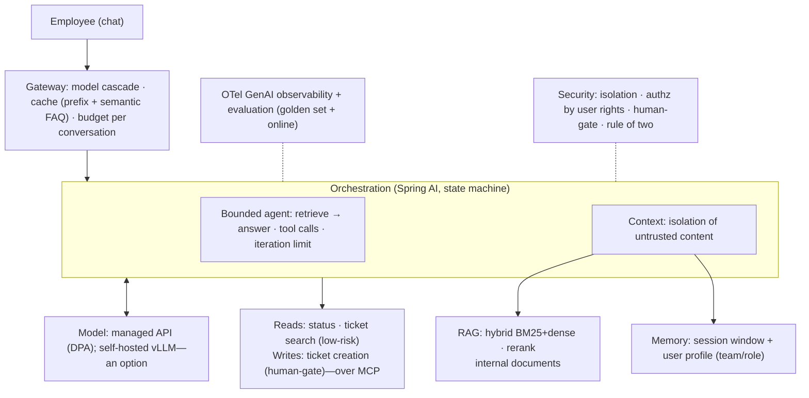

<!-- SPDX-FileCopyrightText: 2026 Aleksandr Drobiazkin
     SPDX-License-Identifier: CC-BY-SA-4.0 AND MIT
     Source: https://github.com/Drobiazkin/ai-agent-architecture
     Dual-licensed, and the boundary is exactly the fence: a fenced code block tagged
     with a language (python, java, sql, bash, yaml, xml, json), comments inside it
     included, is MIT. Everything else — the prose, the tables, the formulas, and the
     mermaid diagrams, which are illustrations expressed as text — is CC-BY-SA-4.0.
     Full terms: LICENSE, LICENSE-CODE, and NOTICE in the repository root. -->

# Chapter 26. A Worked Example and a Package of Architectural Decisions

This closing chapter applies the whole book to one concrete case, turning principles into a sequence of **architecture decision records (ADRs)**—the standard format for recording a decision together with its rationale (M. Nygard). That makes the material operational: each decision rests on a specific chapter, and together they instantiate the reference architecture (Chapter 24) for a given set of requirements.

## 26.1 The scenario and functional requirements

**Scenario.** An internal support and operations assistant for an organization: it answers employees' questions from internal documentation (HR policies, IT runbooks, engineering docs), citing sources, and performs a limited set of actions in internal systems.

**Functional requirements:**
- Answer questions by *grounding* the answer in internal documents and citing sources.
- Search and create tickets in the support system (creation is an action with a side effect).
- Check the status of internal systems (a read-only action).
- Hold context within a conversation, and remember the employee's team and role across sessions.
- Escalate to a human when uncertain and before sensitive actions.

## 26.2 Non-functional requirements and budgets

The requirements calibrate the architecture (Chapter 2):
- **Latency**—interactive: TTFT within a couple of seconds, with streaming (§2.3); write actions may be slower.
- **Cost**—a bounded budget per conversation; an internal tool, cost-sensitive at scale (Chapter 20).
- **Accuracy**—high faithfulness (grounding and citations), refusal or escalation when confidence is insufficient (Part III, Chapter 17).
- **Security**—internal data must not leak; the content of documents and tickets is potentially untrusted (injection risk); irreversible actions stay under control (Chapter 19).
- **Privacy and residency**—processing internal data drives the choice between an API under a data processing agreement (DPA, §25.3) and self-hosted serving (Part VII).
- **Availability**—a business-hours SLO.

**The budget in numbers (illustrative, in the discipline of §2.2).** 2,000 requests per working day; the average conversation runs 3 turns at ~2,000 input tokens each (with RAG context) and ~300 output ⇒ ~6k input + 0.9k output per request ⇒ ~12M input + 1.8M output per day. At mid-tier pricing ($1/M in, $4/M out): 12 + 7.2 ≈ **$19 a day, ~$420 a month** before optimizations; caching the system prompt and routing (ADR-4, ADR-11) cut that several-fold. The number settles the ADR-8 argument on the spot: at this volume, self-hosting (renting a GPU node runs thousands of dollars a month, §2.6) costs an order of magnitude more than the API—and it stays an option on residency grounds, not on economics.

## 26.3 The ADR format

An **ADR** records one architecture decision: its *context* (the forces and constraints), the *decision* itself, its *consequences*, and the *alternatives rejected*. The format earns its keep through the explicit rationale: the decision can be revisited later by someone who understands why it was made. What follows is a package of ADRs covering the key decisions across the layers of the reference architecture (§24.6).

## 26.4 The architectural decision package

**ADR-1. Orchestration: a bounded agent, not full autonomy.** *Context:* the task is partly structured (grounded Q&A, a limited set of actions) but needs flexibility. *Decision:* orchestrate as a bounded agent built on a state machine (§11.8, §16.4)—a deterministic "retrieve → answer" path with tool calls for actions and an iteration limit (§10.5); not open-ended autonomy. *Consequences:* predictability, debuggability, lower cost; novel, atypical requests get escalated. *Rejected:* a fully autonomous agent (a multiple of the cost, and unpredictable, §14.3) and a pure workflow (does not cover the variability of the requests).

**ADR-2. Knowledge: RAG, not fine-tuning or a long context.** *Context:* the corpus is large and changes often; answers must be current and carry citations. *Decision:* RAG over the internal documents (Part III). *Consequences:* current knowledge, updatable without retraining, with citations; retrieval infrastructure gets added. *Rejected:* fine-tuning (it changes behavior, not knowledge, and goes stale, §21.1) and loading every document into a long window (U-shaped degradation and cost, §4.3).

**ADR-3. Retrieval: hybrid with reranking.** *Context:* queries mix exact terms (error codes, policy identifiers) with semantics. *Decision:* hybrid retrieval (BM25 + dense) with RRF fusion, followed by cross-encoder reranking of the top candidates (Chapter 7). *Consequences:* robustness to both query types; reranking adds latency over a small candidate set. *Rejected:* dense-only retrieval (misses exact matches) and no reranking (precision suffers).

**ADR-4. Model: a cascade by complexity.** *Context:* most requests are routine, some require reasoning. *Decision:* route by complexity—a cheap model for routine Q&A, a strong one for complex multi-step requests, with classification ahead of routing (§20.3). *Consequences:* lower average cost; the classifier itself costs latency and money—keep it light (a heuristic or a cheap model; anatomy in Deep Dive §2.2) and account for it in the TTFT budget (§26.2); the risk of a classification error is *silent* (there is no feedback loop, §2.2) and is controlled only by evaluation (Chapter 17). *Rejected:* one strong model everywhere (cost) and one cheap model everywhere (quality).

**ADR-5. Memory: a session window plus a user profile.** *Context:* the system needs continuity within a conversation and stable employee context (team, role) across sessions. *Decision:* short-term memory is the session's message window; long-term memory is a user profile in a store, injected into the context (§4.5, §13.1). *Consequences:* continuity and personalization at a bounded volume; a forgetting policy is required. *Rejected:* no memory at all (repetition) and full memory of every past conversation (cost and privacy).

**ADR-6. Tools: a minimal set, reads and writes kept separate, over MCP.** *Context:* the assistant needs ticket search and status (reads) and ticket creation (a write). *Decision:* a curated minimal set (§12.3); low-risk reads, and separately the write, under control (ADR-7); integration over MCP wherever a standard server exists, treating the servers as untrusted (§15.7). *Consequences:* a small attack surface, clear contracts. *Rejected:* broad tool access (excessive agency, §19.4).

**ADR-7. Security: isolation, least privilege, a human-gate on writes.** *Context:* private data, potentially untrusted content (documents, tickets), and a write tool coincide here—a configuration close to the lethal trifecta (§12.5, §19.4). *Decision:* isolate untrusted content from instructions (§4.6); authorize the tool with the requesting employee's own rights (§12.5); require human confirmation (a human-gate) on ticket creation and on any configuration-changing action (§10.6); apply the rule of two—do not combine private data, untrusted content, and an autonomous write without a gate. *Consequences:* an injection cannot silently create a ticket or walk off with the data; a little friction on writes. *Rejected:* relying on guardrails alone (an adaptive attack gets around them, §19.5).

**ADR-8. Model deployment: an API under a data processing agreement, self-hosting as an option.** *Context:* privacy of internal data, moderate scale, limited ML-infrastructure expertise. *Decision:* start on a managed API under a data processing agreement; self-hosted serving of an open model on vLLM (Chapter 22) is a documented option should residency requirements tighten or scale grow; no pre-training and no fine-tuning at the start (§21.1, §23.1). *Consequences:* a fast start with little infrastructure load; vendor dependence is softened by portability at the gateway layer (§16.5, §20.6). *Rejected:* self-hosting from day one (cost without proven need) and pre-training (§23.1).

**ADR-9. Evaluation: an offline golden-set gate plus online monitoring.** *Context:* nondeterminism, no tolerance for regression, the need to catch drift. *Decision:* a golden set of representative queries with faithfulness and correctness thresholds as a CI gate ahead of any change to the prompt, the model, or the tools; online reference-free monitoring (faithfulness, refusal rate, retrieval quality) on a sample of traffic; an LLM judge validated against human labels and pinned to a fixed version (§17.4). *Consequences:* protection from regressions and detection of drift; the cost of eval infrastructure and calibration. *Rejected:* manual checks only (they do not scale and do not catch regressions, §17.1).

**ADR-10. Observability: OpenTelemetry GenAI traces and cost attribution.** *Context:* many steps and nondeterminism demand debugging and cost allocation. *Decision:* instrument against the OpenTelemetry semantic conventions for GenAI (§18.4); a span tree per request; token, cost, and latency metrics attributed by team and user (§18.5); content capture is optional and redacted, given privacy (§18.6). *Consequences:* debuggability and cost allocation; the discipline of telemetry retention and redaction.

**ADR-11. Cost and latency: a gateway with caching and budgets.** *Context:* cost sensitivity at scale and interactive latency. *Decision:* an LLM gateway that centralizes routing (ADR-4), prefix caching of the stable system prompt and prefix, semantic caching of frequent, routine answers (stateless), per-conversation token budgets, and streaming for TTFT (Chapter 20). *Consequences:* a substantial cost reduction (§20.7) and responsiveness; the discipline of invalidating the cache when documents and the FAQ are updated.

**ADR-12. Implementation: Spring AI, given an existing Spring landscape.** *Context:* the organization runs Spring Boot and wants ecosystem fit and unified observability. *Decision:* Spring AI—ChatClient and advisors (RAG, memory, safeguard), MCP client and server, observability through Micrometer, a node-based state-machine approach for control (§16.4). *Consequences:* ecosystem fit and minimal integration work; managing the framework's release cadence. *Rejected:* LangChain4j (viable; rejected here purely on fit with the Spring landscape, §16.6).

## 26.5 The instantiated architecture

The ADR package instantiates the reference architecture (§24.2) for the scenario:

Every component in the diagram is the trace of a specific ADR; together they form a complete, justified architecture rather than a set of disconnected choices.

## 26.6 How the system evolves

The architecture is not static, and the same ladder that ran through the whole book governs how it grows. The system starts at the least sufficient complexity—grounded Q&A with a limited set of actions—and grows more complex only as need is proven and confirmed by evaluation (Chapter 17): move to multi-agent only when a single agent demonstrably cannot cope (§14.1); to fine-tuning when prompting and RAG are exhausted (§21.1); to self-hosted serving when the API stops meeting the requirements (§22.1); to pre-training essentially never (§23.1). Each such move is written up as a new ADR that builds on the earlier ones and preserves the rationale for the evolution.

## 26.7 Summary of the chapter and of the book

One concrete scenario, carried from functional and non-functional requirements (§26.1–26.2) through a package of twelve architecture decisions (§26.4), instantiates the reference architecture under the given constraints (§26.5) and sets the trajectory of its evolution by the principle of least sufficient complexity (§26.6). Each decision rests on a specific chapter—which was the point of the book: not a catalog of tricks, but a coherent design discipline.

**The book in sum.** The path ran from the model as a component (Part I) through taming its interface (Part II) and grounding knowledge (Part III) to organizing action with agent patterns (Part IV), integration into the architecture (Part V), operation in production (Part VI), and owning your own models (Part VII), assembled into a single reference architecture, an organizational adoption framework, and a justified decision package (Part VIII). The through-line of the entire book: **a probabilistic component embedded in a deterministic discipline**. The model is nondeterministic and manipulable, so reliability, security, and economy are delivered by the architecture around it—constraints, isolation, evaluation, and observability—not by trusting the model itself. The mathematical substrate of every mechanism covered here is set out in Appendix A.

*Sources.* M. Nygard, "Documenting Architecture Decisions" (2011)—the ADR format; this book (Parts I–VII) as the foundation for every decision in the package; S. Willison, "The Lethal Trifecta" (2025) and Meta, "Agents Rule of Two" (2025)—the security frame for ADR-7 (introduced in §12.5, §19.4); C. Richardson, *Microservices Patterns* (2018)—the discipline of architecture decisions and boundaries.

---
