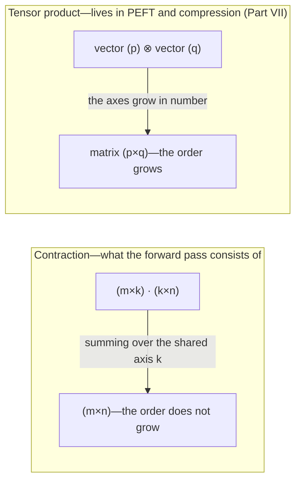

<!-- SPDX-FileCopyrightText: 2026 Aleksandr Drobiazkin
     SPDX-License-Identifier: CC-BY-SA-4.0 AND MIT
     Source: https://github.com/Drobiazkin/ai-agent-architecture
     Dual-licensed, and the boundary is exactly the fence: a fenced code block tagged
     with a language (python, java, sql, bash, yaml, xml, json), comments inside it
     included, is MIT. Everything else — the prose, the tables, the formulas, and the
     mermaid diagrams, which are illustrations expressed as text — is CC-BY-SA-4.0.
     Full terms: LICENSE, LICENSE-CODE, and NOTICE in the repository root. -->

# Appendices

# Appendix A. The Linear-Algebra Substrate

## A.1 Why this appendix exists

Part I's chapters give the architecture and its consequences; this appendix is the *computational substrate* underneath it. To be an architect who understands the consequences (cost, memory, what the hardware is doing), you have to grasp the basic operations the forward pass is assembled from. This is not a derivation of the transformer from scratch (for that, see CS336/Raschka) but a **vocabulary of operations**, and how the model reduces to them.

## A.2 A tensor is a multidimensional array

Let's clear up a terminological muddle right away. A **tensor** in ML (PyTorch/TensorFlow) is simply a **multidimensional array** of numbers, nothing more. It is *not* the tensor of physics/differential geometry and *not* a tensor product (§A.5). Its characteristics:
- **shape**—the sizes along each axis, e.g. `(batch, seq, d_model)`.
- **ndim** (the order; ML frameworks sometimes call this same thing "rank")—the number of axes (0 is a scalar, 1 a vector, 2 a matrix, 3+ a tensor-array). Not to be confused with the **rank of a matrix** from linear algebra (the dimension of the image, a number from 0 to min(rows, columns)): it is this second sense of "rank" that is at work in LoRA (§21.3) and in rank(A⊗B) (§21.5). Any matrix has ndim = 2 regardless of its linear-algebraic rank; from here on this appendix uses the word "order" for the number of axes.
- **dtype**—the type: float32; float16/**bf16** (bf16 has float32's exponent with a smaller mantissa—the same range, less precision, which is why it holds up better in training); int8 and below is quantization (Chapter 22).

Typical LLM tensors: embeddings `(batch, seq, d_model)`—3-dimensional; a weight matrix `(d_in, d_out)`—2-dimensional; attention scores `(batch, heads, seq, seq)`—4-dimensional.

## A.3 The core operations (a vocabulary)

- **Element-wise:** `+`, `*`, the activation functions (ReLU, GELU, SiLU). Applied to every element; the operands share a shape (or get there by broadcasting).
- **Broadcasting:** the rule that automatically "stretches" axes of size 1 to make shapes compatible (e.g., adding a vector `(d,)` to a matrix `(seq, d)`). Understanding broadcasting is critical to reading LLM code.
- **Matrix multiplication (matmul):** `(m×k)·(k×n) → (m×n)`. Summing over the shared axis `k` is a **contraction**. Cost `O(m·k·n)`. The model's principal operation. Besides FLOPs there is a second characteristic—**arithmetic intensity**: how many operations (FLOPs) there are for each byte read from memory. Numbers to make it tangible (H100, FP16): peak throughput ~989 TFLOPS against memory bandwidth ~3.35 TB/s; their ratio is ≈ **300 FLOP/byte**—the card's "balance point": to keep the compute units busy, every byte read has to carry ~300 operations. Now take decode at batch 1: it is a matrix-vector multiply, and every weight (2 bytes in FP16) is read for the sake of a single multiply-add pair—2 FLOPs / 2 bytes = **1 FLOP/byte**. One against three hundred: the compute units idle ~99.7% of the time, and a decode step is bounded by how fast the weights can be read, not by the arithmetic. Prefill, on the other hand, processes all the prompt's tokens in one batched matmul—a weight read once is used once per input token, intensity grows with prompt length, and the card finally computes. That is how the entire contrast between memory-bound decode and compute-bound prefill (§22.5) follows "from below," out of two numbers on the accelerator's spec sheet.
- **Batched matmul (bmm):** matmul applied along the batch axis: `(b×m×k)·(b×k×n) → (b×m×n)`. This is how the model handles *batches* and *multi-head* attention (each head/example gets its own matmul, in parallel). **LLM operations are batched matmuls, not single ones**—which matters for the intuition about GPU utilization (§1.6).
- **einsum (Einstein summation / contraction):** the general notation for tensor contractions in terms of indices. For example, `QKᵀ` across heads is written `einsum("bhqd,bhkd->bhqk", Q, K)`: sum over the shared index `d` (the head dimension), keep `b,h,q,k`. Reading it letter by letter: `b` and `h` are in both operands and in the result—batch axes (independent repeats); `d` is in both but absent from the result—that is the axis being summed over; `q` and `k` are the operands' own axes, and they form the result's axes. A convenient way to write any matmul/contraction. **A contraction lowers or preserves a tensor's order** (it sums over an index)—remember this for §A.5.
- **softmax:** turns a vector of numbers into a probability distribution (exponentiate + normalize) along a given axis. Used in attention (the weights) and at the output (§1.7).
- **Normalization (LayerNorm / RMSNorm):** normalizes values along the feature axis (stabilizes training, §1.4). RMSNorm is cheaper (scale only, no subtraction of the mean).
- **reshape / view / transpose:** reorganizing axes without changing the data—the code's "plumbing" (e.g., slicing `d_model` into `(h, d_head)` for multi-head attention and assembling it back).
- **Concatenation (`torch.cat`):** gluing several tensors end to end along a chosen axis: `[576, 4096]` and `[20, 4096]` with `dim=0` give `[596, 4096]`. Unlike the element-wise `+` above, it does not require the sizes to match along the axis being glued—only along all the others; and it does not blend values, it keeps each operand in its own positions. This is how a multimodal sequence is assembled out of text and visual patches (§1.2).

**≠ A false friend: «свёртка».** In Russian technical literature this one word denotes three *different* operations; when reading translated texts you have to keep them apart:

- **Contraction (tensor contraction; Russian «свёртка тензоров», «эйнштейнова свёртка»)**—summing products over a shared index, as in the matmul and einsum above; it lowers or preserves a tensor's order. This is the operation of the LLM forward pass, and it is exactly why the book's primary term is "contraction" rather than «свёртка».
- **Convolution (the «свёртка» of CNNs and signal processing)**—dragging a kernel-filter across the input in a sliding window and summing the overlaps. Mathematically a different operation: the basis of convolutional networks (CNNs); there is none of it in a transformer block.
- **Fold / reduce (the «свёртка» of a list from functional programming; `Stream.reduce` in Java)**—sequentially aggregating a collection with a binary operation. It has nothing to do with linear algebra, but in engineering prose it turns up under the same Russian word.

In the rest of this appendix, «свёртка» always means the first—contraction.

## A.4 How a transformer block reduces to these operations

(The full trace with dimensions is in the Deep Dive of §1.4.) In brief, a block = a sequence:
- **A linear layer** = matmul (the Q/K/V projections, the output one, two in the FFN).
- **Attention scores** = batched matmul (`QKᵀ`) → scale → **softmax** → batched matmul (`·V`).
- **FFN** = matmul → activation (element-wise) → matmul.
- **Residual** = element-wise addition; **norm** = normalization.
- **reshape/transpose**—slicing/assembling the heads between steps.

The upshot: the whole forward pass is **batched matrix multiplications (contractions)**, interleaved with softmax, normalization, and element-wise nonlinearities. There are no tensor or Kronecker products (§A.5) in it at all. The backward pass is the same matmuls with transposed operands; its roughly double cost relative to the forward is what gives the factor of 3 (one forward + two equivalents for the backward) in the formula C ≈ 6ND (§23.4).

## A.5 Kronecker and tensor products: where they really are (and where they are NOT)

A section of its own, because the words "tensor" and "tensor product" sound as though they were precisely what the transformer rests on—and that expectation is worth taking apart explicitly.

**Definition.** A **tensor product** *raises the order*: the product of objects of orders `p` and `q` has order `p + q` (two vectors, for example, give a matrix). Its matrix form is the **Kronecker product** `⊗`: the result's order stays at 2, but the sizes multiply, `(m×n) ⊗ (p×q) → (mp×nq)`. In both cases a *larger* object *is built* out of smaller ones. A numeric example: `A` of size 2×2 ⊗ `B` of size 3×3 → a 6×6 matrix—each element `aᵢⱼ` is replaced by an entire block `aᵢⱼ·B` (four 3×3 blocks in a 2×2 grid). The same example shows the multiplicativity of rank: rank(A) = 2, rank(B) = 3 → rank(A⊗B) = 2·3 = 6—full rank out of 4 + 9 = 13 stored numbers, whereas for an ordinary product of two matrices the rank does not exceed the smaller of the factors' ranks (§21.5 exploits exactly this difference).

**The key contrast with matmul.** The transformer's forward pass is built on **contraction** (matmul/einsum), which *lowers or preserves* the order—it sums over a shared index. The tensor product is the *reverse* in spirit: it *raises* the order. Hence:

> **There is no tensor product and no Kronecker product in an LLM's forward pass.** Attention, the linear layers, the FFN—these are contractions, not products. "Tensor" here = array; the operations on it = contractions. This is not some foundation of the architecture that got left out—they are simply not there.

**Where the Kronecker/tensor product *really does* show up in ML** (adjacent topics, all in Part VII):
- **PEFT: Kronecker adapters** (KronA, for one)—an alternative to LoRA in which the weight update is represented as a Kronecker product of small matrices → **Part VII (fine-tuning)**.
- **Model compression: tensor decompositions** (Tensor-Train, Tucker, CP)—representing a weight/embedding matrix as a product of smaller tensors for the sake of compression → **Part VII (compression/serving)**.
- **Second-order optimization: K-FAC** (Kronecker-Factored Approximate Curvature)—approximating the curvature with Kronecker factors (a training topic, not a forward-pass one).

The upshot: these operations live in *fine-tuning and compression* (Part VII), not in the core of the forward pass—and they are worked through where they do their work.

## A.6 The practical bridge: why an architect needs this

The point of the appendix is not math for math's sake; it is that everything the architect governs follows from these operations:
- **Cost/FLOPs** are dominated by matmul → accelerators (GPU/TPU) are in essence matrix multipliers, and utilization is measured in matmul throughput (§1.6).
- **`seq²`** in the attention matmul is the root of the quadratic price of long context (§1.4, §1.8).
- **The sizes of the weight matrices** = the parameter count = the memory for the weights (§1.6, Chapter 21).
- **The batched nature** of the operations explains why batching raises GPU utilization (§1.6, continuous batching).

Understanding the model as "a stack of batched matmuls wrapped in attention and nonlinearities" gives you that base level from which the consequences (cost, latency, memory, hardware choice) are *derived* rather than memorized.

*Sources.* S. Raschka, *Build a LLM from Scratch* (2024)—the implementation of these operations; Stanford CS336—resource accounting and architectures; the PyTorch documentation (matmul, einsum, broadcasting). For Part VII: the work on KronA, Tensor-Train/Tucker decompositions, K-FAC.

---
