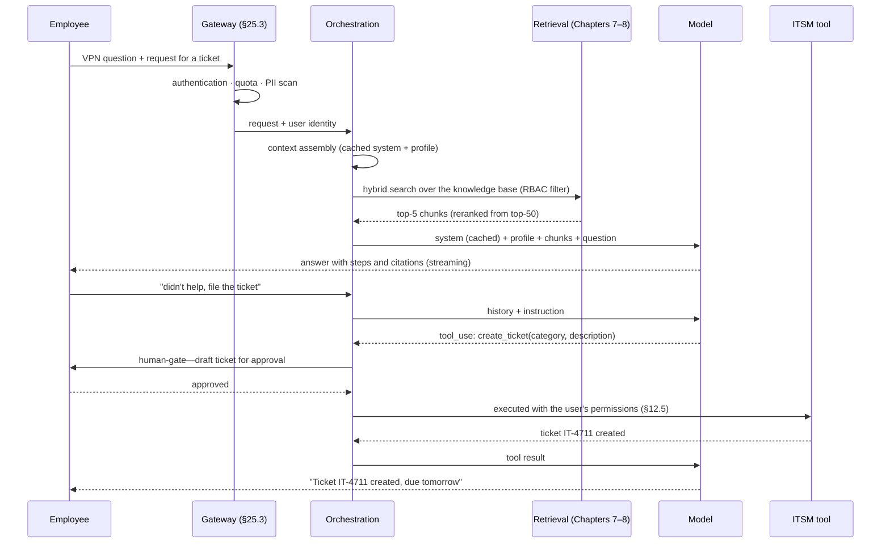
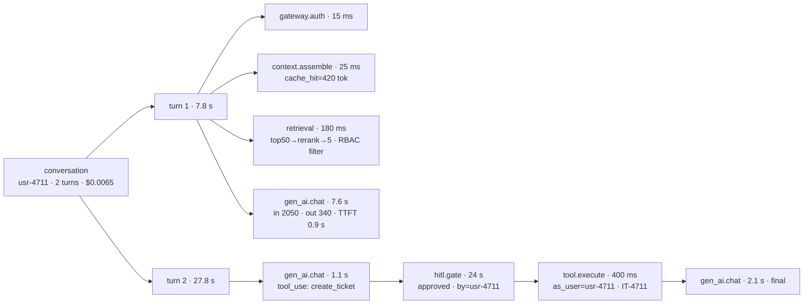

<!-- SPDX-FileCopyrightText: 2026 Aleksandr Drobiazkin
     SPDX-License-Identifier: CC-BY-SA-4.0 AND MIT
     Source: https://github.com/Drobiazkin/ai-agent-architecture
     Dual-licensed, and the boundary is exactly the fence: a fenced code block tagged
     with a language (python, java, sql, bash, yaml, xml, json), comments inside it
     included, is MIT. Everything else — the prose, the tables, the formulas, and the
     mermaid diagrams, which are illustrations expressed as text — is CC-BY-SA-4.0.
     Full terms: LICENSE, LICENSE-CODE, and NOTICE in the repository root. -->

# Appendix C. Anatomy of a Single Trajectory

The book's chapters take the system apart layer by layer; this appendix puts the layers back together—it traces **one concrete request** through the system of Chapter 26 (the internal assistant, 12 ADRs, the architecture of §26.5) from the press of Enter to the entry in the log. Every abstraction in the book—context assembly, retrieval, ACI, the human-gate, the trace, the budget—comes together here in one tangible example. The numbers line up with the budget of §26.2 and are illustrative.

**The request.** An employee writes to the assistant: *"After the update my laptop won't connect to the VPN. What do I do? If I need a new access token—file a ticket."* The conversation runs two turns: an answer from the knowledge base, and creating a ticket through the gate.

## C.1 The request flow

## C.2 The budget, step by step

| Step | Tokens (in / out) | Latency | Cost* |
|---|---|---|---|
| Gateway: authentication, quota, PII scan | — | 15 ms | — |
| Context assembly: system 420 (cache hit, §20.2) + profile 130 + instructions 110 | — | 25 ms | — |
| Retrieval: query embedding → dense+BM25 → RRF → rerank top-50→5 | — | 180 ms | ~$0.0001 |
| Turn 1, generation: in 2,050 / out 340, TTFT 0.9 s, streaming | 2,050 / 340 | 7.6 s (perceived ~0.9 s) | $0.0030 |
| Turn 2, the tool decision: in 2,600 (420 of it from cache) / tool_use 90 | 2,600 / 90 | 1.1 s | $0.0026 |
| **Human-gate: draft ticket → approval** | — | 24 s (waiting on a human) | — |
| Tool: create the ticket with the employee's permissions | — | 400 ms | — |
| Final answer: in 160 (the tool result) / out 160 | 160 / 160 | 2.1 s | $0.0008 |
| **Conversation total** | **~4.8k / 0.6k** | **~11 s machine + 24 s human** | **~$0.0065** |

\* A mid-tier rate ($1/M in, $4/M out—an illustrative tier, not Claude's pricing: there an output token costs exactly five times an input one, §2.5), the system prefix coming from cache at ~10% of the price. Against the §26.2 budget (≈$0.0096 per interaction), it comes in with room to spare; the human wait at the gate does not count toward system latency, but it does count toward the process SLA (§10.6).

## C.3 What observability recorded

The span tree for this trace (semantics—§18.3–18.4):

This one trace shows everything Chapters 10–20 taught: the citations in the answer make faithfulness checkable (§9.2); the action ran with the user's permissions rather than the agent's—no confused deputy (§12.5); the gate recorded *who* approved (§10.6); cost is attributed to a user and a feature (§18.5, §20.6).

## C.4 Closing the loops

A request's life does not end with the answer. This trace: (1) landed in the **online sample**—a reference-free judge scored the faithfulness of the turn-1 answer (§17.6); (2) is a candidate for the **golden set**—the VPN-after-an-update question turned out to be a new class, and an SME will label the reference answer (§9.3, §17.8); (3) fed the **metrics**—token spend, cache-hit rate, time in the gate queue (§25.7: the approval rate as a detector of rubber-stamping). One request, three feedback loops; a system with those loops closed improves off its own traffic.

---
