<!-- SPDX-FileCopyrightText: 2026 Aleksandr Drobiazkin
     SPDX-License-Identifier: CC-BY-SA-4.0 AND MIT
     Source: https://github.com/Drobiazkin/ai-agent-architecture
     Dual-licensed, and the boundary is exactly the fence: a fenced code block tagged
     with a language (python, java, sql, bash, yaml, xml, json), comments inside it
     included, is MIT. Everything else — the prose, the tables, the formulas, and the
     mermaid diagrams, which are illustrations expressed as text — is CC-BY-SA-4.0.
     Full terms: LICENSE, LICENSE-CODE, and NOTICE in the repository root. -->

# Архитектура AI-агентов и LLM-систем
## Паттерны, подходы и инженерия для проектирования автоматизации организаций

**Александр Дробязкин**

*Редакция: июль 2026. Горизонт актуальности источников — конец 2025 – середина 2026 (OWASP Agentic 2026, MCP под Linux Foundation, EU AI Act). Датируемые факты помечены годом; где индустрия ещё движется — стоит явный хедж.*

# Предисловие

## Для кого эта книга

Книга адресована инженеру, который уже умеет проектировать распределённые системы — знает саги, оркестрацию и хореографию, DDD, событийную архитектуру, безопасность — и хочет добавить в инструментарий LLM и агентов **как архитектурные компоненты**, а не как магию. Она не пересказывает основы программирования и распределённых систем, а объясняет, что в мире LLM аналогично общеизвестным распределённым паттернам, что принципиально новое — и где аналогии ломаются.

## Как построена эта книга

Книга построена как наполнение на глубину структурированного учебного маршрута: его этапы становятся частями книги.

Материал организован как **язык паттернов**. Паттерн — это именованное решение повторяющейся проблемы в определённом контексте (термин восходит к Кристоферу Александеру, а в разработке ПО закреплён «бандой четырёх» и, для распределённых систем, Крисом Ричардсоном). Каждый значимый паттерн описан по единому шаблону:

> **Шаблон паттерна**
> - **Контекст** — ситуация, в которой возникает проблема.
> - **Проблема** — вопрос, на который паттерн отвечает.
> - **Силы** — конкурирующие соображения (латентность против точности, стоимость против качества, автономия против контроля).
> - **Решение** — сам паттерн.
> - **Механика** — как он работает внутри.
> - **Пример** — конкретная реализация на распространённом стеке (например, Java/Spring, PostgreSQL, Kubernetes).
> - **Результирующий контекст** — что даёт паттерн и чем за это платится.
> - **Когда применять / когда нет.**
> - **Связанные паттерны.**
> - **Источники** — книги/статьи, откуда взято, для углубления.

Термины набраны **полужирным при первом появлении** и вынесены в Глоссарий. Часть терминов настолько нагружена, что получает отдельный раздел-статью внутри соответствующей главы (например, «Attention», «Retrieval-Augmented Generation», «Prompt Injection»).

Третий уровень терминологической поддержки — блок **«На полях»** в конце главы: короткие пояснения терминов и механизмов, которые в главе *используются*, но раскрываются в другом месте книги или вовсе за её пределами. Пометка в тексте — обычная сноска; каждое пояснение завершается метками корреляции: «→ §N.M» — где тема раскрыта полностью, «⇐ Глоссарий» — есть словарная статья, «≠» — ложный друг (термин означает не то, что подсказывает интуиция). Сноска без меток — самодостаточное определение термина, которому в книге некуда указать; употреблением термина считается проза, подписи на диаграммах маркерами не снабжаются. Правило блока: не больше дюжины сносок на главу — то, что требует большего, заслуживает Глоссария или статьи-раздела.

**Соглашение об источниках.** Там, где излагается чужой результат, в конце раздела даётся ссылка на первоисточник (статью или книгу), где это можно проверить и углубить. Тема раскрывается в тексте достаточно, чтобы ссылка была логическим *продолжением*, а не заглушкой.

**Диаграммы** — в Mermaid (рендерятся в GitHub, VS Code, Obsidian, mermaid.live).

**Структура.** Материал развёрнут в восьми частях (двадцать шесть глав) с пятью приложениями: A — линейно-алгебраический субстрат, B — указатель паттернов, C — анатомия одной траектории (сквозной разбор одного запроса), D — пре-флайт чек-лист архитектора, E — консолидированная библиография.

**Границы.** Книга сосредоточена на текстовых LLM-системах: мультимодальность (изображения, аудио, видео) затрагивается только там, где пересекается с основным материалом (мультимодальный RAG, гл. 7); голосовые агенты и computer-use остаются за рамками. Причина не в незрелости этих направлений (к середине 2026 браузерные и computer-use-агенты — рабочая замена RPA-автоматизации), а в разделении слоёв: и голос, и управление интерфейсом — это *модальности ввода-вывода* поверх той же архитектуры агента, которую книга разбирает; специфика (VAD/ASR/TTS-конвейер и латентность реального времени в голосе, grounding координат и устойчивость к смене вёрстки в computer-use) заслуживает отдельных источников, а фундамент — цикл, инструменты, память, безопасность — здесь. Ориентир зрелости computer-use-направления — бенчмарки класса WebArena (§17.5).

**О формате.** Шаблон паттерна выше — общее наследие дисциплины, а не изобретение этой книги: Кристофер Александер задал связку Context → Problem → Forces → Solution («A Pattern Language», 1977), «банда четырёх» закрепила её для софта («Design Patterns», 1994), а Крис Ричардсон перенёс в распределённые системы («Microservices Patterns», 2018) — оттуда изложение этой книги и берёт пример, чтобы каждая концепция давалась не тезисом, а с контекстом, механикой, примером, компромиссами и связями с другими паттернами. Рубрики «Механика», «Пример», «Когда применять / когда не стоит» и «Источники» добавлены здесь. Имена названы для ориентира: ни Крис Ричардсон, ни издательство Manning к этой книге отношения не имеют, её не рецензировали и не одобряли.

**Об инструментах.** Эта книга написана автором на русском языке и им же переведена на английский. Софт помогал: ассистент (Claude, Anthropic) рецензировал черновики, находил ошибки и несогласованности, предлагал варианты формулировок. Каждое утверждение, каждое решение о структуре, каждый источник и каждая опубликованная фраза выбраны, написаны или переписаны и выверены автором, который несёт за них полную ответственность. Модель — инструмент, а не сторона: у неё нет ни авторства, ни прав, а Anthropic к этой книге отношения не имеет и её не рецензировала. Полное заявление — в файле NOTICE: https://github.com/Drobiazkin/ai-agent-architecture

---

## Демонстрация формата: паттерн «Оркестратор-Воркеры»

Чтобы сразу показать глубину каталога, ниже приведён один паттерн целиком. Он относится к Части IV (Агенты), но дан здесь как образец. Его структура родственна оркестрованной саге, в которой координатор заменён языковой моделью.

> ### Паттерн: Orchestrator-Workers (Оркестратор-Воркеры)
>
> **Контекст.** Задача автоматизации не раскладывается на фиксированный набор шагов заранее: число и характер подзадач зависят от входных данных. Например, «разобрать входящий запрос клиента» может потребовать одного действия (ответить из базы знаний) или пяти (проверить заказ, свериться с регламентом, оформить возврат, уведомить склад, ответить клиенту) — и неизвестно, каких именно, пока запрос не получен.
>
> **Проблема.** Как выполнить задачу, декомпозиция которой известна только в рантайме, сохранив при этом надёжность, наблюдаемость и возможность отката — свойства, привычно обеспечиваемые оркестрацией саг?
>
> **Силы.**
> - Статический граф (workflow) предсказуем и дёшев, но не справляется с динамической декомпозицией.
> - Полностью автономный одиночный агент справляется с динамикой, но его труднее контролировать и отлаживать.
> - Организации требуют аудита, идемпотентности и компенсаций — независимо от того, кто принял решение о шаге: человек, стейт-машина или LLM.
>
> **Решение.** Выделите **LLM-оркестратор**, который в рантайме анализирует задачу, динамически порождает список подзадач и раздаёт их **воркерам** (каждый воркер — это отдельный вызов LLM или инструмента с узкой ответственностью). Результаты воркеров оркестратор собирает и синтезирует в финальный результат. Архитектурно это **оркестрация-сага** (в терминах Ричардсона), но с двумя отличиями: (1) координатор недетерминирован, (2) множество и порядок шагов определяются динамически, а не заданной стейт-машиной.
>
> **Механика.**
> ```mermaid
> flowchart TB
>   In["Входная задача"] --> Orch["LLM-Оркестратор<br/>декомпозиция в рантайме"]
>   Orch --> Plan["Список подзадач (динамический)"]
>   Plan --> W1["Воркер 1<br/>инструмент/LLM"]
>   Plan --> W2["Воркер 2"]
>   Plan --> W3["Воркер N"]
>   W1 --> Synth["Оркестратор: синтез результатов"]
>   W2 --> Synth
>   W3 --> Synth
>   Synth --> Out["Результат"]
>   W2 -.провал.-> Comp["Компенсация + повтор/эскалация"]
>   Comp -.-> Orch
> ```
> Оркестратор ведёт **журнал шагов** (как orchestrator-based saga log). Каждый воркер-шаг делается **идемпотентным** (по ключу задачи), с **тайм-аутом** и с определённой **компенсацией** на случай провала. Обязателен **лимит итераций/бюджет**, иначе оркестратор может зациклиться (недетерминизм координатора — источник риска незавершаемости управляющего цикла — режима отказа, отсутствующего в детерминированной оркестрации).
>
> **Пример.** Обработка клиентского запроса: оркестратор в момент выполнения определяет необходимые подзадачи (проверить статус заказа, свериться с регламентом, оформить возврат, уведомить склад) и распределяет их по воркерам. Журнал шагов, идемпотентность по ключу задачи и компенсирующие операции реализуются стандартными средствами оркестрации саг. Необратимые подзадачи (списание средств, отправка уведомления) проходят через подтверждение человеком (human-in-the-loop).
>
> **Результирующий контекст.** Паттерн обеспечивает гибкость динамической декомпозиции при сохранении аудита, идемпотентности и отката. Плата: недетерминизмом плана (два запуска на одном входе могут дать разную декомпозицию — усложняет тестирование, см. паттерн «Trajectory Evaluation»), ростом стоимости (каждый воркер — вызов модели) и латентностью.
>
> **Когда применять.** Задача действительно требует динамической декомпозиции, число подзадач переменно, и есть требования к надёжности/аудиту. **Когда нет.** Если декомпозиция фиксирована — берите статический workflow (паттерн «Prompt Chaining» / детерминированный граф): он дешевле, предсказуемее и проще в отладке. Не усложняйте раньше, чем задача докажет необходимость.
>
> **Связанные паттерны.** Prompt Chaining (статическая альтернатива); Routing (частный случай — оркестратор только выбирает ветку); Evaluator-Optimizer (для проверки качества шагов); Human-in-the-Loop Gate (для необратимых действий, §10.6); Trajectory Evaluation (как тестировать недетерминированный план).
>
> **Источники.** Anthropic, «Building Effective Agents» (2024) — паттерн orchestrator-workers. Chris Richardson, «Microservices Patterns» (2018), гл. 4 — оркестрация саг, компенсирующие транзакции, идемпотентность. V. Dibia, «Designing Multi-Agent Systems» (2025) — supervisor/handoff-оркестрация.

Так выглядит каждый паттерн в книге. Теперь — план целиком и фундамент.

# Оглавление

**Часть I. Языковая модель как компонент**
- Глава 1. Языковая модель как архитектурный компонент
    - 1.1 Зачем необходимо понимать внутреннее устройство модели
    - 1.2 Токенизация
    - 1.3 Эмбеддинги и векторное пространство
    - 1.4 Attention и трансформер *(статья-раздел)*
    - 1.5 Dense против Mixture-of-Experts
    - 1.6 Цикл генерации и инференс
    - 1.7 Стратегии декодирования
    - 1.8 Окно контекста и его отказы
    - 1.9 Почему модель галлюцинирует и что значит «знать»
    - 1.10 Итог: контракт компонента
- Глава 2. Экономика и нефункциональные свойства LLM

**Часть II. Интерфейс к модели**
- Глава 3. Prompt engineering как проектирование контракта
    - 3.1 Рамка: промпт как спецификация интерфейса · 3.2 Анатомия промпта · 3.3 Каталог паттернов промптинга · 3.4 Chain-of-Thought — подробнее · 3.5 Системный промпт как инвариант · 3.6 Промпт как код · 3.7 Границы промпт-инжиниринга
- Глава 4. Context engineering и паттерны управления контекстом *(статья-раздел)*
    - 4.1 Смена единицы проектирования · 4.2 Анатомия контекста · 4.3 Силы: почему это нетривиально · 4.4 Каталог паттернов управления контекстом · 4.5 Память как долгосрочный контекст · 4.6 Границы контекста и доверие · 4.7 Резюме
- Глава 5. Structured output и надёжный парсинг
    - 5.1 Граница вероятностного и детерминированного · 5.2 Спектр техник · 5.3 Constrained decoding (глубоко) · 5.4 Дизайн схемы как контракта · 5.5 Паттерны надёжности · 5.6 Структура ≠ корректность · 5.7 Реализация на JVM · 5.8 Резюме

**Часть III. Заземление знаний: RAG**
- Глава 6. Retrieval-Augmented Generation: постановка *(статья-раздел)*
    - 6.1 Проблема · 6.2 Что такое RAG · 6.3 RAG против альтернатив · 6.4 Анатомия RAG-системы · 6.5 Ретрив — узкое место · 6.6 Таксономия отказов · 6.7 Заземление и faithfulness · 6.8 Реализация retrieval-слоя · 6.9 Резюме
- Глава 7. Каталог паттернов извлечения (Naive, Hybrid, Rerank, GraphRAG, Agentic, Adaptive)
    - 7.1 Лестница паттернов · 7.2 Naive RAG · 7.3 Hybrid Search · 7.4 Reranking · 7.5 Трансформация запроса · 7.6 Chunking (+ мультимодальный RAG, выбор эмбеддера) · 7.7 GraphRAG · 7.8 Agentic RAG · 7.9 Adaptive RAG · 7.10 Резюме и рамка решения
- Глава 8. Векторные индексы и инфраструктура ретрива (ANN/HNSW, pgvector, гибридный поиск)
    - 8.1 Поиск ближайших соседей · 8.2 Проклятие размерности · 8.3 Семейства ANN-индексов · 8.4 Универсальный размен · 8.5 pgvector · 8.6 Гибридный поиск и фильтрация · 8.7 RBAC/ABAC на ретриве · 8.8 Операционные заботы · 8.9 Резюме
- Глава 9. Оценка качества RAG
    - 9.1 Eval-driven RAG · 9.2 Двухосевой каркас метрик · 9.3 Золотой набор · 9.4 LLM-as-judge для RAG · 9.5 Цикл eval-driven RAG · 9.6 Онлайн-оценка · 9.7 Резюме

**Часть IV. Действие: агенты и оркестрация**
- Глава 10. Агент как распределённая система
    - 10.1 Что такое агент · 10.2 Augmented LLM · 10.3 Workflow vs agent · 10.4 Агент как распределённая система · 10.5 Управляющий цикл и нетерминация · 10.6 Надёжность, обратимость и Human-in-the-Loop Gate · 10.7 Уровни агентности · 10.8 Резюме
- Глава 11. Каталог агентных паттернов (Chaining, Routing, Parallelization, Orchestrator-Workers, Evaluator-Optimizer)
    - 11.1 Лестница и композиция · 11.2 Prompt Chaining · 11.3 Routing · 11.4 Parallelization · 11.5 Orchestrator-Workers · 11.6 Evaluator-Optimizer · 11.7 Композиция паттернов · 11.8 Что workflow, а что агент · 11.9 Резюме и рамка решения
- Глава 12. Инструменты и tool calling как контракт
    - 12.1 Что такое tool calling · 12.2 Механика · 12.3 ACI как дизайн контракта · 12.4 Ошибки инструментов · 12.5 Безопасность инструментов · 12.6 Code execution и Skills · 12.7 Реализация на JVM · 12.8 Резюме
- Глава 13. Память и стратегии рассуждения (ReAct, Plan-and-Execute, Reflection)
    - 13.1 Память в цикле агента · 13.2 Семейство стратегий · 13.3 ReAct · 13.4 Plan-and-Execute · 13.5 Reflection · 13.6 Tree-of-Thought · 13.7 Выбор стратегии · 13.8 Reasoning-модели меняют расчёт · 13.9 Резюме
- Глава 14. Мультиагентные системы и таксономия отказов
    - 14.1 Когда нужна мультиагентность · 14.2 Паттерны координации · 14.3 Цена мультиагентности · 14.4 Таксономия отказов (MAST) · 14.5 Лечить дисциплиной распределённых систем · 14.6 Резюме

**Часть V. Интеграция: встраивание в архитектуру**
- Глава 15. Model Context Protocol (MCP) *(статья-раздел)*
    - 15.1 Проблема N×M · 15.2 Host, client, server · 15.3 Примитивы · 15.4 Жизненный цикл сессии · 15.5 Транспорты · 15.6 MCP и tool calling (+ A2A) · 15.7 Безопасность MCP · 15.8 Реализация на JVM · 15.9 Резюме
- Глава 16. Сборка стека на JVM (Spring AI, LangChain4j)
    - 16.1 Две опции · 16.2 Отображение забот на конструкции · 16.3 Перехватчики против декларативных сервисов · 16.4 Агенты и workflow на JVM · 16.5 Продакшен-заботы · 16.6 Выбор и сочетание · 16.7 Резюме

**Часть VI. Продакшен: эксплуатация системы**
- Глава 17. Оценка: построение eval-системы
    - 17.1 Оценка — центральная дисциплина · 17.2 Уровни и типы · 17.3 LLM-as-judge · 17.4 Смещения судьи · 17.5 Оценка агентов и траекторий · 17.6 Оффлайн против онлайн · 17.7 Статистическая строгость · 17.8 Архитектура eval-системы · 17.9 Резюме
- Глава 18. Наблюдаемость
    - 18.1 Почему это труднее · 18.2 Три сигнала · 18.3 Трассировка агента · 18.4 Соглашения OpenTelemetry GenAI · 18.5 Метрики и атрибуция стоимости · 18.6 Захват содержимого и приватность · 18.7 Отладка недетерминированных траекторий · 18.8 Наблюдаемость и оценка вместе · 18.9 Резюме
- Глава 19. Безопасность: prompt injection и защита в глубину *(статья-раздел)*
    - 19.1 Инструкции и данные в одном канале · 19.2 Injection против jailbreaking · 19.3 Карта угроз OWASP · 19.4 Lethal trifecta и excessive agency · 19.5 Guardrails и их пределы · 19.6 Архитектурная защита · 19.7 Защита в глубину · 19.8 Резюме
- Глава 20. Стоимость и латентность
    - 20.1 Стоимость как продуктовое ограничение · 20.2 Экономика кэширования · 20.3 Роутинг и каскады · 20.4 Сокращение токенов · 20.5 Латентность · 20.6 Бюджеты, шлюз и атрибуция · 20.7 Совокупный эффект · 20.8 Резюме

**Часть VII. Собственные модели**
- Глава 21. Дообучение: адаптация модели (LoRA, QLoRA, DPO, дистилляция)
    - 21.1 Когда дообучать · 21.2 Полное дообучение против PEFT · 21.3 LoRA · 21.4 QLoRA и память · 21.5 DoRA и произведение Кронекера · 21.6 RLHF и DPO · 21.7 Дистилляция знаний · 21.8 Практика · 21.9 Резюме
- Глава 22. Разворачивание открытых моделей
    - 22.1 Зачем · 22.2 Стек сервинга · 22.3 PagedAttention · 22.4 Непрерывное батчирование · 22.5 Prefill против decode и дизагрегация · 22.6 Квантизация для инференса · 22.7 Спекулятивное декодирование · 22.8 Пропускная способность против латентности · 22.9 Резюме
- Глава 23. Предобучение
    - 23.1 Когда оправдано · 23.2 Конвейер · 23.3 Законы масштабирования · 23.4 Бюджет C ≈ 6ND · 23.5 Compute-optimal против inference-optimal (+ test-time compute) · 23.6 Данные и инфраструктура · 23.7 Резюме

**Часть VIII. Синтез**
- Глава 24. Референсная архитектура
    - 24.1 Слои · 24.2 Полная компонентная схема · 24.3 Поток запроса · 24.4 Границы и инварианты (+ физическая топология) · 24.5 Сквозные заботы · 24.6 Решения по слоям · 24.7 Резюме
- Глава 25. Внедрение в организации
    - 25.1 Почему архитектуры недостаточно · 25.2 Владение и жизненный цикл AI-артефактов · 25.3 AI Gateway как точка governance · 25.4 PII-контур · 25.5 Регуляторный ландшафт · 25.6 TCO и ROI · 25.7 Команды и процесс · 25.8 Резюме
- Глава 26. Сквозной пример и пакет архитектурных решений
    - 26.1 Сценарий и требования · 26.2 НФТ и бюджеты · 26.3 Формат ADR · 26.4 Пакет решений (12 ADR) · 26.5 Инстанцированная архитектура · 26.6 Эволюция системы · 26.7 Резюме книги

**Приложения**
- Приложение A. Линейно-алгебраический субстрат
- Приложение B. Указатель паттернов
- Приложение C. Анатомия одной траектории
- Приложение D. Пре-флайт чек-лист архитектора
- Приложение E. Консолидированная библиография

# Глоссарий

*Термины, помеченные (→ гл. N), получают развёрнутый раздел в указанной главе.*

**Модель и её внутренности**
- **Токен** — минимальная единица, которой оперирует модель: подслово из BPE-словаря, не символ и не слово. Единица тарификации и лимитов. (→ гл. 1)
- **Эмбеддинг** — плотный вектор фиксированной размерности, кодирующий смысл; близость по смыслу ≈ близость векторов (косинус). Под одним словом — две разные вещи: внутренний вектор токена внутри самой модели и вектор целого фрагмента от отдельной embedding-модели для поиска; они живут на разном железе и не взаимозаменяемы (§1.3). (→ гл. 1)
- **Attention** — механизм, позволяющий каждому токену взвешенно «смотреть» на другие при вычислении своего представления; ядро трансформера. (→ гл. 1)
- **Трансформер** — архитектура нейросети на основе attention, из которой построены современные LLM.
- **Dense-модель** — модель, где все параметры активны на каждый токен.
- **MoE (Mixture of Experts)** — разрежённая модель, где роутер активирует лишь подмножество экспертов на токен; большой общий размер при малых активных вычислениях. (→ гл. 1)
- **KV-cache** — кэш ключей/значений attention, чтобы не пересчитывать их при авторегрессии; главный потребитель памяти после весов. (→ гл. 1)
- **Prefill / Decode** — две фазы инференса: параллельная обработка промпта и последовательная генерация. (→ гл. 1)
- **Логиты** — сырые (до softmax) оценки модели для каждого токена словаря.
- **Temperature / Top-p / Top-k** — параметры декодирования, управляющие случайностью выбора токена; «регулятор детерминизма». (→ гл. 1)
- **Контекстное окно** — максимум токенов, который модель обрабатывает за раз; конечный бюджет. (→ гл. 1)
- **Галлюцинация** — уверенно сгенерированное, но неверное утверждение; следствие предсказания правдоподобия, а не истины. (→ гл. 1)
- **RoPE (Rotary Position Embedding)** — кодирование позиции поворотом векторов Q/K: внимание видит относительные позиции; основа техник растяжения контекста. (→ гл. 1)
- **TTFT / TPOT** — time-to-first-token и time-per-output-token: две составляющие латентности генерации, соответствующие фазам prefill и decode. (→ гл. 2)
- **Reasoning-модель** — модель, обученная (RLVR) тратить вычисления на длинную внутреннюю цепочку рассуждения до ответа; рассуждение тарифицируется как выходные токены. (→ гл. 13)

**Интерфейс**
- **Промпт** — вход модели; в проде — не текст запроса, а весь собранный контекст.
- **System prompt** — часть промпта, задающая инвариант поведения; мягкий контракт. (→ гл. 3)
- **Few-shot** — задание формата/поведения примерами прямо в промпте.
- **Context engineering** — дисциплина сборки правильного контента в окно на каждом шаге. (→ гл. 4)
- **Structured output** — принуждение модели к схеме вывода (JSON/грамматика). (→ гл. 5)
- **Prompt caching** — кэширование статичного префикса промпта ради стоимости/латентности.
- **Constrained (grammar) decoding** — маскирование недопустимых по грамматике токенов на каждом шаге генерации; гарантирует структуру вывода (не корректность). (→ гл. 5)

**Заземление**
- **RAG (Retrieval-Augmented Generation)** — подача в контекст извлечённых данных вместо/в дополнение к параметрическому знанию. (→ гл. 6)
- **Bi-encoder** — модель, кодирующая запрос и документ независимо (быстрый ретрив).
- **Cross-encoder / Reranker** — модель, оценивающая пару [запрос, документ] совместно (точная переоценка). (→ гл. 7)
- **Chunking** — разбиение документов на фрагменты для индексации. (→ гл. 7)
- **Hybrid search** — комбинация плотного (векторного) и разрежённого (BM25) поиска. (→ гл. 7)
- **ANN / HNSW** — приближённый поиск ближайших соседей и его популярная индекс-структура. (→ гл. 8)
- **BM25** — классическая функция разрежённого (лексического) ранжирования: TF-IDF с насыщением частоты и нормировкой длины; лексическая половина гибридного поиска. (→ гл. 7)
- **RRF (Reciprocal Rank Fusion)** — слияние нескольких ранжированных списков по обратным рангам; стандартный способ объединить dense- и sparse-выдачу. (→ гл. 7)
- **GraphRAG** — извлечение по графу знаний (сущности, связи, сообщества), а не по независимым фрагментам. (→ гл. 7)
- **Faithfulness** — верность ответа извлечённому контексту (нет ли выдуманного); ось качества, ортогональная качеству ретрива. (→ гл. 6, 9)

**Агенты**
- **Агент** — система с LLM в роли ядра принятия решений, действующая в цикле observe→decide→act; всегда пара «LLM + харнесс». (→ гл. 10)
- **Харнесс (agent harness)** — детерминированный код приложения вокруг модели: собирает контекст, исполняет вызовы инструментов, ведёт состояние цикла, навязывает бюджеты и гейты. (→ §10.2)
- **Workflow** — заранее заданный граф шагов с вызовами LLM (в отличие от агента).
- **Tool calling / Function calling** — механизм, в котором модель формирует структурированный запрос вызова функции, а харнесс исполняет его. (→ гл. 12)
- **Code execution (code mode)** — представление инструментов кодовым API: модель пишет код, композирующий вызовы в песочнице, вместо последовательности JSON-вызовов. (→ §12.6)
- **Skill (Agent Skills)** — версионируемый артефакт процедурного знания (SKILL.md: инструкции + ресурсы) с progressive disclosure; модель его читает, в отличие от инструмента, который харнесс исполняет. (→ §12.6)
- **ReAct** — паттерн переплетения рассуждения и действия (Thought→Action→Observation). (→ гл. 13)
- **Оркестрация-сага** — координация шагов из центра с компенсациями; база паттерна Orchestrator-Workers.
- **Human-in-the-Loop Gate (human-gate)** — детерминированный гейт подтверждения человеком перед необратимым или значимым действием агента. (→ гл. 10)

**Интеграция**
- **MCP (Model Context Protocol)** — открытый стандарт (JSON-RPC) подключения агентов к инструментам/данным. (→ гл. 15)
- **A2A (Agent2Agent)** — открытый протокол взаимодействия агентов между собой (Agent Card, задачи с жизненным циклом); комплементарен MCP. (→ гл. 15)

**Продакшен**
- **Eval** — измеримая проверка качества вероятностной системы; заменяет булев ассерт распределением. (→ гл. 17)
- **LLM-as-judge** — использование LLM для оценки вывода другой LLM по рубрику. (→ гл. 17)
- **Trajectory evaluation** — оценка каждого шага траектории агента, а не только финального ответа. (→ гл. 17)
- **Prompt Injection** — атака, использующая неразделённость инструкций и данных в одном канале. (→ гл. 19)
- **Excessive Agency** — избыток прав/функций/автономии (агентности — в книге это синонимы, §10.7) у агента; класс рисков OWASP. (→ гл. 19)
- **Guardrails** — детерминированные проверки на входе/выходе вокруг вероятностного ядра. (→ гл. 19)
- **Non-human identity (NHI)** — машинная учётка (сервис, бот, агент); основа идентичности и делегирования полномочий агента. (→ §15.7)
- **Shadow AI** — использование LLM вне реестра и контуров организации: личные ключи, расширения, «серые» автоматизации. (→ §25.2)

**Сервинг и инференс**
- **Квантизация** — представление весов/активаций/кэша в пониженной разрядности (int8, 4-бит, FP8/FP4) ради памяти и пропускной способности. (→ гл. 22)
- **PagedAttention** — страничная организация KV-cache по образцу виртуальной памяти ОС: устраняет фрагментацию, позволяет делить общие префиксы. (→ гл. 22)
- **Continuous batching** — динамическое подселение запросов в батч по мере освобождения слотов; главный рычаг утилизации ускорителя. (→ гл. 22)
- **Speculative decoding** — черновая модель предлагает несколько токенов, целевая проверяет их одним параллельным проходом; ускорение decode без изменения распределения. (→ гл. 22)

**Обучение**
- **Fine-tuning** — дообучение модели под форму/стиль/схему (не под меняющиеся факты). (→ гл. 21)
- **LoRA / QLoRA** — параметр-эффективное дообучение низкоранговыми адаптерами (+ 4-битная база). (→ гл. 21)
- **DPO** — прямая оптимизация по предпочтениям; замена классического RLHF. (→ гл. 21)
- **Scaling laws** — эмпирические зависимости качества от размера модели и объёма данных (Chinchilla). (→ гл. 23)
- **RLHF** — дообучение с подкреплением на модели вознаграждения, обученной на человеческих предпочтениях. (→ гл. 21)
- **RLVR** — RL на проверяемых наградах (прогон тестов, сверка с эталоном); механизм обучения reasoning-моделей. (→ гл. 13)
- **PPO / GRPO** — RL-алгоритмы шага оптимизации в RLHF/RLVR: PPO — с отдельной value-моделью для оценки advantage, GRPO — с групповой базовой линией вместо неё. (→ гл. 13, 21)
- **Дистилляция знаний** — обучение компактного «ученика» воспроизводить выходное распределение или рассуждения «учителя». (→ гл. 21)

# Часть I. Языковая модель как компонент

# Глава 1. Языковая модель как архитектурный компонент

## 1.1 Зачем необходимо понимать внутреннее устройство модели

Языковую модель можно рассматривать как внешний сервис, принимающий запрос и возвращающий ответ. Для прототипа этого достаточно; для проектирования системы — нет. У модели есть нефункциональные свойства, определяющие архитектуру системы вокруг неё, и они не сводятся к формату входа и выхода:

- стоимость и латентность нелинейно зависят от длины входа — следствие квадратичной сложности механизма внимания (§1.4);
- качество ответа снижается не только при переполнении контекстного окна, но и при его заполнении нерелевантным содержимым (§1.8);
- воспроизводимость вывода не гарантирована и регулируется параметрами декодирования (§1.7);
- выбор между плотной (dense) и разрежённой (Mixture-of-Experts) архитектурой определяет требования к памяти и вычислениям при обслуживании (§1.5, §1.6).

Каждое из этих свойств влияет на проектные решения: бюджет контекста, выбор модели, стратегию обслуживания, требования к латентности. Поэтому цель главы — не обучение модели с нуля (для этого см. источники), а построение минимально достаточной модели её внутреннего устройства, из которой эти свойства выводятся. Организующая идея главы: языковая модель — это компонент с определённым набором свойств (сведён в §1.10), и значительная часть последующего материала книги (проектирование запросов, RAG, агенты, эксплуатация) посвящена управлению вероятностной природой этого компонента.

**Определение.** Большая языковая модель (LLM) — это параметризованная функция, которая по последовательности токенов вычисляет распределение вероятностей следующего токена и применяется авторегрессионно: выбранный токен добавляется ко входу, и вычисление повторяется. Всё наблюдаемое поведение модели вырастает из этой единственной операции, выполняемой моделью с миллиардами параметров, обученной на триллионах токенов. Существенно, что модель вычисляет *распределение* (а не единственный ответ), — из этого следуют и недетерминизм вывода (§1.7), и отсутствие встроенного признака достоверности (§1.9).

*Источники для главы в целом:* S. Raschka, «Build a Large Language Model (From Scratch)» (2024) — реализация с нуля; J. Alammar & M. Grootendorst, «Hands-On Large Language Models» (2024) — интуиция; Chip Huyen, «AI Engineering» (2025) — инженерная рамка; Stanford CS336 — академический курс.

## 1.2 Токенизация

**Термин. Токен** — минимальная единица, которой оперирует модель: не символ и не слово, а **подслово**, элемент словаря, построенного алгоритмом семейства **BPE (Byte-Pair Encoding)**. Алгоритм двухэтапный. При обучении токенизатора (однократно, до обучения самой модели) он начинает с базового алфавита и итеративно объединяет самую частую пару смежных единиц в новую, пока словарь не достигнет заданного размера (обычно 30 000–130 000); результат — упорядоченная таблица слияний. При применении текст сегментируется по этой таблице детерминированно: частотные слова и морфемы кодируются одним токеном, редкие дробятся. Так фиксированный словарь покрывает неограниченный язык без специального «неизвестного» токена.

**Байт-уровневый BPE.** Современные модели (начиная с GPT-2) применяют BPE не над символами Unicode, а над **байтами** UTF-8. Это гарантирует, что *любая* строка представима: невиданный символ, эмодзи или повреждённый ввод раскладывается в последовательность байтовых токенов. Следствие — истинного out-of-vocabulary не существует; «неизвестное» просто кодируется дороже (больше токенов). Для кириллицы это же объясняет дробление: символ вне базового латинского диапазона занимает несколько байт, а значит потенциально несколько токенов.

**Альтернативные алгоритмы токенизации.** Хотя BPE доминирует в современных LLM (семейства GPT, LLaMA), исторически и архитектурно существуют другие мощные подходы. Разница между ними кроется в математическом критерии, по которому символы объединяются в подслова или разбиваются на них.

**1. WordPiece (Используется в BERT, DistilBERT)**
Если BPE — это «жадный» алгоритм, который объединяет пары символов просто по их **абсолютной частоте** в тексте, то WordPiece (разработанный Google) использует вероятностный подход. Он оценивает смежные пары токенов $A$ и $B$ через метрику, похожую на взаимную информацию (PMI):
$$Score = \frac{P(AB)}{P(A) \times P(B)}$$

| Символ | Что это | Как считается | Живое значение |
|---|---|---|---|
| $N$ | размер корпуса в токенах | — | 100 в разборе ниже; у BERT — порядка $10^9$ |
| $P(A)$, $P(B)$ | доля токена $A$ (или $B$) среди всех токенов корпуса | $count(A) / N$ | $40/100 = 0.4$ |
| $P(AB)$ | доля позиций, где $A$ стоит непосредственно перед $B$ | $count(AB) / N$ | $10/100 = 0.1$ |
| $Score$ | безразмерный ранг пары; сливается пара с максимальным | $P(AB) / (P(A) P(B))$ | $0.1 / 0.16 = 0.625$ |

**Словами:** метрика спрашивает не «как часто эта пара встречается», а «во сколько раз чаще, чем если бы $A$ и $B$ становились соседями случайно». Знаменатель $P(A) \times P(B)$ — это и есть ожидаемая доля пары при независимости: не тянись токены друг к другу, они попадали бы в соседи ровно с такой частотой. Отсюда шкала: $Score = 1$ — связи нет, совпадение; $Score \gg 1$ — эти двое держатся друг за друга; $Score < 1$ — избегают соседства. (Пар в последовательности из $N$ токенов ровно $N-1$, а не $N$, но при $N$ от тысяч и выше на ранжирование это не влияет.)

**Сноска к реализации.** В учебной реализации из HuggingFace LLM Course (гл. 6.6) score считается на сырых счётчиках, $count(AB) / (count(A) \times count(B))$, без деления на $N$. Это та же метрика с точностью до постоянного множителя $N$: на фиксированном корпусе $N$ — константа, порядок ранжирования пар не меняется, а с ним и выбор сливаемой пары.

Искать же эту формулу в продакшн-коде бесполезно: там нет ни вероятностей, ни самого score. Google не открыл оригинальный алгоритм обучения WordPiece, и курс честно помечает свой разбор как догадку по опубликованным статьям. Библиотека `tokenizers` от HuggingFace обходит проблему радикально: её `WordPieceTrainer` создаёт внутри обычный BPE, обучает его и лишь затем конвертирует результат в словарь WordPiece (`WordPiece::from_bpe`) — пара для слияния выбирается по сырому `count`, и только по нему. Словарь, обученный этим трейнером, получен критерием BPE, и PMI-метрика из формулы выше в нём не участвует. Там же и `min_frequency`, отсекающий редкие пары (о нём ниже), по умолчанию равен нулю — фильтр выключен, пока его не включат явно. Метрика описывает WordPiece как алгоритм; популярная реализация его обучения — не воспроизводит.

**Как это работает под капотом (Итеративный цикл):**

    vocab = get_base_alphabet() # [a, b, c, ..., z, а, б, в...]
    text = load_gigantic_corpus()

    # Крутим цикл, пока не наберем нужный размер словаря
    while len(vocab) < 30000:
    # 1. Считаем частоты всех токенов и пар в текущем тексте

    stats = compute_statistics(text)

    best_score = -1
    best_pair = None
    
    # 2. Ищем ОДНУ лучшую пару на этой итерации
    for pair in stats.pairs:
        if pair.count < min_frequency:
            continue # Отбрасываем редкий мусор
            
        score = calculate_wordpiece_score(pair, stats)
        
        if score > best_score:
            best_score = score
            best_pair = pair
            
    # 3. Добавляем лучшую пару в словарь
    new_token = merge(best_pair[0], best_pair[1])
    vocab.add(new_token)
    
    # 4. ОБНОВЛЯЕМ ТЕКСТ: заменяем пару на новый токен
    text = replace_in_text(text, best_pair, new_token)

Алгоритм не останавливается на одном слиянии. Он работает в цикле, постепенно выращивая словарь из базового алфавита до целевого размера (например, `vocab_size = 30 000`).
1. **Сбор статистики:** Сканируется весь обучающий корпус, вычисляются вероятности $P$ (доля от общего числа токенов) для всех существующих токенов и их пар.
2. **Ранжирование:** Для всех пар вычисляется Score.
3. **Слияние:** Выбирается строго **одна пара** с максимальным Score. Она сливается в новый токен $AB$ и добавляется в словарь.
4. **Переразметка (Критический шаг):** Алгоритм проходит по всему тексту и аппаратно заменяет все стоящие рядом токены $A$ и $B$ на новый единый токен $AB$.
5. **Повтор:** Цикл запускается заново по обновленному тексту. Благодаря переразметке возникает «эффект снежного кома»: на первых итерациях сливаются `про` и `грам` (в `програм`), а на более поздних итерациях новый токен `програм` может слиться с `мист`, образовав `программист`. Цикл останавливается, когда словарь достигает лимита.

**Инженерные нюансы метрики WordPiece:**
* **Штраф за популярность:** Знаменатель $P(A) \times P(B)$ не дает алгоритму сливать частые, но независимые буквы (например, «а» и «о»). Score будет высоким, только если токены встречаются *вместе* гораздо чаще, чем *по отдельности*. Это заставляет алгоритм выделять осмысленные морфемы.
* **Защита от редких событий (Rare Event Bias):** Тот же знаменатель работает и против алгоритма: он задирает score парам, чьи части почти не встречаются порознь, а предельный случай — пара, встретившаяся ровно раз. Чтобы алгоритм не забивал словарь мусором, в реальном коде применяется гиперпараметр `min_frequency`: пары, встречающиеся реже 2–5 раз, исключаются из расчетов.

**Штраф за популярность на числах.** Условный корпус, $N = 100$ токенов. Мусорная пара `а`+`о` стоит рядом 10 раз, морфемная `про`+`грам` — 5: мусор **вдвое частотнее**, и жадный BPE не раздумывая слил бы именно его. Но «а» и «о» прекрасно живут поодиночке — по 40 вхождений каждая, — тогда как «про» и «грам» встречаются по 5 раз и только друг с другом:

$$Score(а, о) = \frac{10/100}{(40/100) \times (40/100)} = \frac{0.1}{0.16} = 0.625$$

$$Score(про, грам) = \frac{5/100}{(5/100) \times (5/100)} = \frac{0.05}{0.0025} = 20$$

Знаменатель $0.4 \times 0.4 = 0.16$ обваливает мусорную пару: вдвое более редкая `про`+`грам` выигрывает в 32 раза. Причём $0.625 < 1$ — «а» и «о» оказываются соседями даже *реже* случайного (ожидалось 16 пар, наблюдалось 10), то есть метрика не просто не поощряет слияние, а прямо фиксирует отсутствие связи. Победившая `про`+`грам` и открывает «эффект снежного кома» из шага 5 выше: став токеном `програм`, на поздних итерациях она дорастёт до `программист`.

**Почему метрике нужен нижний порог.** Возьмём пару, части которой встречаются только вместе (как `про`+`грам`): $count(A) = count(B) = count(AB) = c$. Метрика схлопывается:

$$Score = \frac{c/N}{(c/N) \times (c/N)} = \frac{N}{c}$$

Для идеально спаянной пары score **обратно пропорционален её частоте**: чем реже — тем выше. Единичный мусор ($c = 1$) даёт ровно $Score = N$, размер корпуса: на игрушечных $N = 100$ это 100 против 20 у настоящей морфемы. А разрыв между ними равен $N / (N/c) = c$ — частоте самой морфемы: **чем морфема полезнее и частотнее, тем сильнее она проигрывает единичному мусору.** У BERT корпус — BooksCorpus (800 млн слов) плюс английская Википедия (2,5 млрд слов), то есть $N$ порядка $10^9$ токенов: пара, части которой больше нигде в корпусе не встречаются, получила бы score порядка $N$ — то есть миллиарда.

Это верхняя граница, а не факт про обучение BERT. Условие «части встречаются только вместе» для настоящей опечатки на таком корпусе не выполняется: её куски — ходовые латинские подслова, они попадаются повсюду, $count(A)$ и $count(B)$ огромны, и score у неё выйдет, наоборот, ничтожным — тот самый «штраф за популярность» из пункта выше. Порог защищает от идеально спаянного мусора: редкого имени, обрывка URL, случайной последовательности, которая больше нигде не всплывает.

Отсюда уточнение к расхожей формулировке «знаменатель стремится к нулю, а score — к бесконечности»: логически она не замкнута, потому что числитель $P(AB)$ обнуляется вместе со знаменателем, и из «знаменатель мал» само по себе ничего не следует. Score редкой пары не уходит в бесконечность — он принимает конечное значение $N$, растущее вместе с корпусом. Практический вывод тот же, но теперь он доказан: нижний порог — не эмпирический хак, а вынужденная поправка к метрике, которая по построению ставит самую редкую из спаянных пар первой.

**2. Unigram Language Model (Используется в ALBERT, T5)**
В отличие от BPE и WordPiece, которые строят словарь «снизу вверх» (bottom-up, от букв к словам), Unigram работает **«сверху вниз» (top-down)**.
* **Инициализация:** Алгоритм стартует с гигантского словаря, включающего вообще все возможные подслова из обучающего корпуса.
* **Оптимизация:** Для каждого подслова вычисляется его вероятность. Затем алгоритм итеративно удаляет (prunes) те токены, потеря которых приводит к наименьшему падению общего правдоподобия корпуса.
* **Декодирование:** На этапе применения (инференса) одно и то же слово может быть разбито по-разному. Unigram использует алгоритм Витерби (Viterbi), чтобы найти математически наиболее вероятный путь сегментации конкретного слова.

**3. SentencePiece (Инженерный стандарт для мультиязычности)**
Важно понимать: SentencePiece — это **не алгоритм, а фреймворк** (библиотека от Google), внутри которого можно использовать как BPE, так и Unigram. Его главная архитектурная инновация — отказ от предварительной токенизации (pre-tokenization).
Стандартные токенизаторы сначала разбивают текст по пробелам и пунктуации, что ломается на языках без пробелов (китайский, японский) или языках со сложной морфологией. SentencePiece работает с сырым потоком байтов/символов и воспринимает пробел как обычный символ (обычно заменяя его на мета-символ `_` или `U+2581`). Это позволяет модели самой выучить, является ли пробел важным разделителем в данном контексте.

**Железное правило инженера:**
Токенизатор и веса нейросети — это **единый, неразрывный бинарный контракт**. Модель не понимает текст, она понимает только индексы (ID) из своего конкретного словаря. Попытка скормить модели LLaMA (использует BPE) токены, нарезанные токенизатором от BERT (WordPiece), приведет к полному разрушению семантики (Garbage In — Garbage Out). Для подсчета токенов, обрезки контекста или сборки промптов необходимо инициализировать токенизатор строго от целевой модели (например, через `AutoTokenizer.from_pretrained(model_name)`). Куда полученный массив ID отправляется дальше и что происходит на границе CPU/ускорителя — §1.6.

**Специальные и управляющие токены.** Помимо подслов словарь содержит служебные токены: начало и конец последовательности (BOS/EOS), заполнитель (pad), а у чат-моделей — **разметку ролей и реплик** (токены-разделители вида `<|im_start|>`, `<|im_end|>` и аналоги). Из них строится **chat-шаблон** — точная структура, в которой роли (system/user/assistant) подаются модели. Это практически важный и часто недооценённый навык: модель обучена на *конкретном* формате разметки, и ручная сборка промпта с неверными разделителями деградирует качество вплоть до бессвязности. Правило: применять штатный chat-шаблон токенизатора, а не конструировать разметку конкатенацией строк.

У мультимодальных моделей (VLM) для интеграции нетекстовых данных используются **специальные токены-якоря** (например, `<image>`). Сами же изображения обрабатываются отдельным Vision-энкодером (например, ViT), разбиваются на **визуальные патчи** — фрагменты, которые проецируются в векторы и на уровне тензоров встраиваются в общую последовательность.

**Сборка мультимодальной последовательности (Under the Hood)**
Когда VLM получает на вход картинку и текст, она формирует единый массив эмбеддингов. Возьмём конкретную модель — LLaVA-1.5, её числа используются и дальше в разделе. На уровне тензоров сборка выглядит как конкатенация векторов:

$$E_{seq} = [E_{BOS}] \oplus \Phi(V_{patches}) \oplus E_{text} \oplus [E_{EOS}]$$

**Две стадии, а не одна.** Путаница с `<image>` снимается, если разнести во времени то, что пишет разработчик, и то, что получает модель.

*Стадия 1 — строка промпта (здесь `<image>` есть).* Разработчик подаёт текст с одним токеном-заполнителем:

```
USER: <image>
Что на картинке? ASSISTANT:
```

`<image>` (id 32000) — единственная визуальная метка. Изображения на этой стадии ещё нет: есть лишь пометка «сюда встанет картинка».

*Стадия 2 — вход модели (здесь `<image>` уже исчез).* На сборке эмбеддингов этот один токен **замещается** 576 векторами патчей $\Phi(V_{patches})$: метка убирается, на её место встаёт блок картинки. Поэтому в формуле $E_{seq}$ отдельного члена `<image>` нет — $\Phi(V_{patches})$ стоит ровно на его месте: он не сосед якоря, а его замена.

Где:
* **[BOS] (Begin of Sequence):** Всегда стоит в начале. В архитектуре Transformer он не «инициализирует скрытое состояние» (как в старых RNN), а проявляет свойство **Attention Sink**: избыток внимания softmax эмерджентно стекается на начальные позиции (Xiao et al., StreamingLLM, 2023) и тем стабилизирует механизм внимания. Это не назначенная токену роль, а следствие архитектуры; K/V токена [BOS] при этом просто кэшируются первыми на этапе prefill, как у любого токена.
* **$\Phi(V_{patches})$:** Визуальные патчи, пропущенные через Projection Adapter (MLP или Q-Former). Адаптер необходим для приведения размерности визуальных признаков к размерности текстовых эмбеддингов LLM ($D_{model}$). Сами патчи возникают геометрически: ViT режет изображение регулярной сеткой квадратов фиксированного размера $P \times P$ пикселей и линейно проецирует каждый квадрат в один вектор. Типовое $P$ — 14, 16 или 32; в имени модели это второе число (`ViT-L/14` — «Large, патч 14»). Отсюда главное следствие, к которому мы вернёмся ниже: число патчей — не константа модели, а функция входного разрешения и $P$.
* **[EOS] (End of Sequence):** Ставится в конце обучающих примеров. На этапе инференса (генерации) появление этого токена является строгим детерминированным триггером для остановки авторегрессионного цикла (autoregressive decoding).

Внутри скрытого пространства модели (Embedding Space) нет разницы между текстом и картинкой. Идентификаторы `[BOS]` и `[EOS]` преобразуются в стандартные обучаемые векторы той же размерности $D_{model}$, что и спроецированные визуальные патчи. Благодаря этому математическому выравниванию, механизм Self-Attention ($Softmax(QK^T / \sqrt{d})V$) может бесшовно вычислять веса внимания между служебными токенами, печатными словами и фрагментами изображения, обрабатывая их как единый непрерывный контекст.

**$\oplus$ — это склейка, а не сложение.** Значок $\oplus$ обозначает **конкатенацию** (concatenation) — сборку последовательности встык. Отвергаемая альтернатива — поэлементное сложение векторов. *Сложить* → значит записать сумму в те же ячейки массива: форма не изменится, но текст и картинка перемешаются в одних и тех же числах, а из суммы слагаемые не восстановить — Self-Attention выше по стеку уже принципиально не отделит изображение от слов. *Склеить* → значит удлинить последовательность: каждая модальность занимает свои позиции и остаётся отдельно адресуемой. Отсюда требование к $D_{model}$ из абзаца выше читается точно: ширина векторов обязана совпадать, чтобы строки встали в одну таблицу (поэлементное `+` тоже требует совпадения формы, §A.3), — но совпадение ширины не означает, что векторы складывают.

На уровне PyTorch сборка — одна операция, склейка вдоль оси токенов:

    # Числа — LLaVA-1.5 (ViT-L/14 @ 336px + Vicuna-7B).
    e_bos      # [  1, 4096]
    v_patches  # [576, 4096]  <- (336/14)^2 = 24 x 24 = 576 патчей после адаптера; сюда встаёт <image>
    e_text     # [ 20, 4096]  <- промпт условной длины в 20 токенов
    e_eos      # [  1, 4096]

    E_seq = torch.cat([e_bos, v_patches, e_text, e_eos], dim=0)
    # E_seq.shape == [598, 4096]

**Как читать формы.** Первое число — `seq`, количество строк-токенов; второе — $D_{model}$, ширина вектора одного токена (4096 у Vicuna-7B — базовой LLM в LLaVA-1.5; те же числа, что в трассировке §1.4). `dim=0` — номер оси, вдоль которой идёт наращивание; здесь это ось токенов. Арифметика: 1 + 576 + 20 + 1 = **598** строк, а 4096 так и остаётся 4096. *Словами:* склейка удлиняет таблицу вниз, но не расширяет её вбок — токенов стало больше, вектор каждого токена не изменился. И в отличие от `+`, конкатенация не требует совпадения размера по той оси, вдоль которой растёт (576 и 20 прекрасно уживаются), — только по всем остальным.

**Цена картинки в токенах.** Из этих 598 строк 576 — изображение: 96% последовательности против 3% на текст промпта. Картинка стоит не «одно вложение», а порядка 576 токенов, и по вниманию это квадратично от полной длины (§1.4). Отсюда читается смысл выбора адаптера, названного в разборе $\Phi(V_{patches})$ выше. **MLP** (небольшая полносвязная сеть) в LLaVA-1.5 работает попатчево: 576 патчей на входе дают 576 векторов на выходе — счёт не меняется, адаптер лишь подгоняет ширину. **Resampler** (пересборщик) вместо пропускания патчей один-к-одному прогоняет их через фиксированный набор обучаемых **запросов-векторов**: перекрёстное внимание, где каждый запрос сам «вычитывает» из всех патчей нужное ему, — и на выходе отдаёт ровно столько строк, сколько в нём запросов, независимо от разрешения входа. В исходном **Q-Former** (BLIP-2) запросов 32; в адаптере **Qwen-VL** (официально — Position-aware Vision-Language Adapter, «адаптер с учётом позиций»; однослойное перекрёстное внимание) — 256. Разброс 32 против 256 при одной и той же механике и есть инвариант пересборщика: у адаптера с фиксированным набором запросов счёт визуальных токенов задаёт адаптер, а не разрешение входа; у попатчевого MLP — наоборот, счёт целиком наследуется от разрешения. Выбор адаптера — это выбор цены картинки в токенах, а не деталь реализации.

**Откуда берётся 576: арифметика сетки.** Инвариант выше говорит, что́ адаптер делает со счётом патчей, но не откуда этот счёт взялся. А берётся он из чистой геометрии: энкодер режет картинку сеткой квадратов $P \times P$ и отдаёт по вектору на квадрат. Сколько позиций последовательности это стоит — считается в два шага:

$$N_{patches} = \frac{H \times W}{P^{2}}, \qquad N_{slots} = \frac{N_{patches}}{m^{2}} + k$$

| Символ | Что это | Живое значение |
|---|---|---|
| $H, W$ | высота и ширина в пикселях **после** ресайза под энкодер, а не у исходного файла | 336 × 336 у LLaVA-1.5: вход жёстко фиксирован (`crop_size: 336×336`) |
| $P$ | сторона квадратного патча в пикселях | 14 у CLIP ViT-L/14-336 и у Qwen2-VL; 16 у ViT-B/16; 32 у ViT-B/32 |
| $N_{patches}$ | сколько векторов отдаёт энкодер | $336 \times 336 / 14^{2} = 24 \times 24 = 576$ |
| $m$ | сторона блока патчей, который адаптер сливает в один токен | $m = 1$ — слияния нет (LLaVA-1.5, MLP работает попатчево); $m = 2$ — четыре соседних патча схлопываются в один (Qwen2-VL) |
| $k$ | сколько служебных позиций уходит на обрамление | $k = 2$ у Qwen2-VL (`<\|vision_start\|>` и `<\|vision_end\|>` — две настоящие позиции); $k = 0$ у LLaVA-1.5: закрывающего токена нет, а `<image>` замещается визуальными векторами, а не добавляется к ним |
| $N_{slots}$ | итоговая цена картинки в позициях | 576 у LLaVA-1.5; 66 у Qwen2-VL на входе 224×224 |

*Живые числа.* LLaVA-1.5: $336 \times 336 / 14^{2} = 576$ патчей, слияния нет ($m = 1$), обрамления нет ($k = 0$) — ровно **576 позиций** на картинку. Qwen2-VL на входе 224×224: $224 \times 224 / 14^{2} = 16 \times 16 = 256$ патчей, слияние 2×2 даёт $256 / 4 = 64$ токена, плюс пара ограничителей — **66**. Последнюю цифру авторы Qwen2-VL приводят сами, и она включает оба служебных токена: даже разработчики модели считают ограничители в бюджете, а не выносят за скобки.

*Словами:* первая дробь — это «сколько квадратов помещается в картинку», и ничего больше; вторая формула — поправка на то, что делает с этими квадратами конкретная архитектура (склеивает по четыре или нет, тратит две позиции на разметку границ или нет).

**Следствие: разрешение — это статья бюджета.** В $N_{patches} = HW/P^{2}$ разрешение стоит в числителе **произведением**, поэтому удвоение *стороны* картинки учетверяет число патчей. А внимание квадратично по длине последовательности (§1.4) — и эта четвёрка превращается в ×16 работы там, где визуальная часть доминирует. Даже без удвоения счёт отрезвляющий: 576 визуальных позиций поверх промпта в 1000 токенов дают $seq = 1576$ — длина выросла на 58%, а работа внимания в $(1576/1000)^{2} \approx 2{,}5$ раза. **Инвариант:** разрешение — параметр бюджета контекста, а не только качества картинки; ресайз до минимального разрешения, на котором задача ещё решается, сокращает $seq$ и стоящую за ним квадратичную цену. Оговорка: ручка эта существует не всегда, и причина — вход, а не адаптер. У LLaVA-1.5 вход фиксирован, и картинка стоит 576 патчей независимо от того, схема на ней или пустой фон; у моделей с динамическим разрешением (Qwen2-VL) $N$ растёт вместе с разрешением до заданного потолка — и вот там разрешение действительно управляемая ручка.

**Fertility и многоязычность.** *Fertility* — среднее число токенов на слово — измеримая характеристика пары «токенизатор × язык»: для английского близка к единице, для кириллицы существенно выше. Она напрямую определяет стоимость и *эффективную* длину контекста: при равном размере окна в токенах русский текст исчерпывает его быстрее, то есть в окно помещается меньше смысла. Поэтому оценка стоимости и бюджета контекста для русскоязычной системы делается на подсчёте токенов конкретной модели по репрезентативной выборке документов, а не по числу символов: фраза «автоматизация процессов» (23 символа) кодируется в 6–9 токенов против 2–3 у «process automation», и на объёме в сотни тысяч документов эта разница определяет и счёт, и то, сколько фрагментов поместится в окно при извлечении (Часть III). Выполненная заранее, такая оценка делает стоимость и ёмкость предсказуемыми ещё до запуска.

**Нюансы, ведущие к ошибкам.** Несколько практических подводных камней прямо следуют из устройства токенизации:
- *Числа.* Многозначные числа дробятся на токены непоследовательно (по одной цифре или группами), из-за чего арифметика и точное манипулирование цифрами ненадёжны; для задач с числами это закладывается в дизайн (проверка результата, вынесение вычислений во внешний инструмент).
- *Пробелы и границы.* В большинстве токенизаторов ведущий пробел — часть токена (` the` и `the` — разные токены). Отсюда чувствительность к границам: обрыв на середине «естественного» токена мешает модели продолжить оптимально — проблема, решаемая на уровне декодирования (token healing, §5.3).
- *Код.* Исходный код токенизируется неэффективно, если токенизатор не адаптирован под него (отступы, длинные идентификаторы), что раздувает длину и стоимость.
- *Glitch-токены.* Редкие строки, попавшие в словарь, но почти не встречавшиеся при обучении (пример `SolidGoldMagikarp`, Rumbelow & Watkins, 2023), вызывают аномальное поведение — демонстрация того, что представление модели о тексте опосредовано словарём.

**Размер словаря как компромисс.** Больший словарь укорачивает последовательности (дешевле по вниманию, §1.4), но увеличивает матрицы эмбеддингов и выходной проекции — память под параметры (§1.6). Это проектное решение при создании модели; при её использовании существенно следствие: размер словаря зафиксирован вместе с моделью и определяет её fertility. Токенизация также взаимодействует со **структурированным выводом**: поскольку модель порождает токены, ограничение вывода грамматикой или схемой (constrained decoding, §5.3) действует на уровне токенов и учитывает, какие токены допустимы в каждой позиции.

**Сравнение подходов к сегментации.**

| Подход | Преимущество | Недостаток |
|---|---|---|
| По символам | Крошечный словарь, нет неизвестных слов | Очень длинные последовательности, слабый сигнал на единицу |
| По словам | Короткие последовательности | Огромный словарь, неизвестные слова на редкой лексике |
| Подслова (BPE / WordPiece / Unigram) | Баланс покрытия и длины, нет истинного OOV (байт-уровень) | Артефакты дробления, неравномерность по языкам |

*Инструменты.* Для подсчёта и инспекции токенов используются `tiktoken` (модели OpenAI) и токенизатор конкретной модели через библиотеку `transformers`; ключевое требование — использовать тот же токенизатор, что и целевая модель.

*Источники.* R. Sennrich, B. Haddow, A. Birch, «Neural Machine Translation of Rare Words with Subword Units» (2016) — BPE. M. Schuster, K. Nakajima, «Japanese and Korean Voice Search» (2012) — WordPiece. Y. Wu et al., «Google's Neural Machine Translation System» (2016) — критерий правдоподобия WordPiece. J. Devlin et al., «BERT: Pre-training of Deep Bidirectional Transformers» (2018) — корпус и словарь BERT. HuggingFace LLM Course, гл. 6.6 «WordPiece tokenization» — учебная реализация метрики на сырых счётчиках. T. Kudo, «Subword Regularization» и SentencePiece (2018) — Unigram LM. A. Karpathy, «Let's build the GPT Tokenizer» (2024). Rumbelow & Watkins, «SolidGoldMagikarp» (2023). H. Liu, C. Li, Y. Li, Y. J. Lee, «Improved Baselines with Visual Instruction Tuning» (arXiv:2310.03744, 2023) — LLaVA-1.5: CLIP-ViT-L-336px + двухслойный MLP-коннектор. J. Bai et al., «Qwen-VL» (arXiv:2308.12966, 2023) — Position-aware Vision-Language Adapter: однослойное перекрёстное внимание, сжатие визуального ряда до 256, ограничители ``/`</img>`. J. Li, D. Li, S. Savarese, S. Hoi, «BLIP-2» (arXiv:2301.12597, 2023), §3.1 — Q-Former: 32 запроса размерности 768. S. Zhang, Q. Fang, Z. Yang, Y. Feng, «LLaVA-Mini» (2025) — 24×24 = 576 визуальных токенов LLaVA-1.5. A. Dosovitskiy et al., «An Image is Worth 16x16 Words: Transformers for Image Recognition at Scale» (arXiv:2010.11929, 2021) — ViT и патч-сетка $N = HW/P^2$. P. Wang et al., «Qwen2-VL: Enhancing Vision-Language Model's Perception of the World at Any Resolution» (arXiv:2409.12191, 2024) — динамическое разрешение, слияние патчей 2×2, ограничители `<|vision_start|>`/`<|vision_end|>`, авторская оценка «224×224 при patch_size=14 → 66 токенов». Словарь и геометрия сверены по вендорским артефактам: `llava-hf/llava-1.5-7b-hf` (`added_tokens.json` — только `<image>` 32000 и `<pad>` 32001; `config.json` — `image_size: 336`, `patch_size: 14`), `liuhaotian/llava-v1.5-7b` (`config.json` — `mm_use_im_start_end: false`), `Qwen/Qwen2-VL-7B-Instruct` (`config.json` — `vision_start_token_id: 151652`, `vision_end_token_id: 151653`; `preprocessor_config.json` — `patch_size: 14`, `merge_size: 2`).

## 1.3 Эмбеддинги и векторное пространство

**Термин. Эмбеддинг** — отображение токена или фрагмента текста в **плотный вектор** фиксированной размерности `d` (типично 384, 768, 1024, 1536, 4096), при котором геометрическая близость векторов соответствует смысловой близости объектов. Основание — **дистрибутивная гипотеза** (Firth, 1957): значение единицы определяется контекстами её употребления, поэтому единицы из сходных контекстов получают близкие векторы.

**Два разных понятия, которые важно различать.** *Внутренние эмбеддинги модели* — первый слой трансформера, отображающий идентификатор токена в вектор, далее обогащаемый контекстом через внимание; часть самой языковой модели. *Модели эмбеддингов (embedding models)* — отдельные модели, кодирующие *целый фрагмент* в один вектор для поиска; на них строится RAG (Часть III).

**Где эти векторы физически лежат.** Различие не только структурное, но и аппаратное — и это самый надёжный способ его не путать. Векторы embedding-модели — это *данные*: они лежат в векторном хранилище (pgvector, Qdrant, Milvus), то есть в оперативной памяти или на SSD обычного сервера базы данных, рядом с графом ANN-индекса (§8.3). Внутренние эмбеддинги модели — это *вычисление*: они возникают в памяти ускорителя (HBM[^t-hbm], §1.6) внутри процесса инференса и за его пределы не выходят. Разное железо, разные процессы, разные команды эксплуатации.

**Что здесь постоянно, а что мгновенно.** Внутри самой модели «эмбеддингом» зовут две разные вещи, и их надо развести. Постоянна **матрица эмбеддингов** — таблица поиска размером `V × d_model`, по строке на каждый токен словаря; это обучаемые веса, они лежат в памяти ускорителя всё время жизни процесса и входят в «размер модели» (§1.6). Её объём:

```
Матрица эмбеддингов (байт) = V · d_model · bytes
```

- `V` — размер словаря; у Llama 3 — 128 256 токенов.
- `d_model` — размерность внутреннего вектора модели; у Llama 3 8B — 4096.
- `bytes` — байт на число; при bf16 — 2.

Подставляем: 128 256 · 4096 · 2 = 1 050 673 152 байта ≈ 0,98 ГБ — почти гигабайт весов на одну лишь таблицу поиска (и это без выходной проекции: у Llama 3 8B она отдельная матрица того же размера, веса не связаны, §1.2). Мгновенен **выход** этой таблицы: вектор одного токена — это 4096 · 2 = 8 КБ активации, которые живут в пределах одного форвард-пасса и освобождаются после него. Отношение постоянного к мгновенному здесь равно ровно `V`: одна строка против 128 256 строк таблицы. *Словами:* в памяти ускорителя навсегда лежит **словарь векторов**, а вектор конкретного токена — расходник: его вычисляют, передают выше по стеку и выбрасывают. Через шаги decode переживает не он, а KV-cache (§1.6).

Вектор в RAG-индексе устроен ровно наоборот: в pgvector он занимает `4 · d + 8` байт, то есть ≈4 КБ при `d` = 1024 (bge-m3), и пишется на диск один раз — чтобы пролежать там месяцами, до смены эмбеддера и полной переиндексации (§8.8). На вектор в обоих случаях приходится один порядок величины (килобайты), а срок жизни различается на порядки: миллисекунды против месяцев.

**≠ Не путать: RAG-векторы в модель не попадают вообще.** Самое частое заблуждение о RAG — будто найденные векторы «скармливают» модели. Не скармливают. Вектор фрагмента нужен ровно для одной операции — сравнения с вектором запроса при поиске ближайших соседей (§8.1); как только соседи найдены, вектор своё отработал. В контекст уходит **текст** найденного фрагмента, поднятый из хранилища по идентификатору. Дальше этот текст проходит весь путь заново: токенизатор модели (§1.2) → идентификаторы токенов → матрица эмбеддингов модели → её внутренние векторы. То есть фрагмент делает петлю «текст → вектор эмбеддера → (поиск) → текст → вектор модели», и два векторных пространства не соприкасаются ни разу: единственное, чем они обмениваются, — текст. Отсюда практическое следствие, снимающее лишний вопрос: размерность эмбеддера (1024) и `d_model` модели (4096) не обязаны совпадать и обычно не совпадают — согласовывать их незачем, они нигде не встречаются.

Ниже речь преимущественно о вторых.

**Как из токенов получается один вектор: пулинг.** Модель эмбеддингов выдаёт по вектору на токен; чтобы получить единый вектор фрагмента, векторы агрегируют. Основные стратегии: *mean pooling* (усреднение по токенам — распространённый выбор), *CLS-пулинг* (вектор специального токена у BERT-подобных), *last-token pooling* (вектор последнего токена у декодерных эмбеддеров). Пулинг — часть архитектуры конкретной модели; практически важно, что он влияет на качество и не подлежит произвольной замене.

**Почему близость векторов отражает смысл: контрастное обучение.** Это не самоочевидное свойство, а результат обучения. Эмбеддер обучают контрастной целевой функцией на парах: векторы семантически близких текстов сближаются, далёких — расходятся по выбранной мере. Технически негативные примеры часто берут *в пределах батча* (in-batch negatives), и качество сильно зависит от «трудности» негативов. После обучения мера близости направлений становится оценкой семантической близости — этим и обосновано применение косинусной близости, а не произвольной функции.

**InfoNCE — функция потерь, которая эту геометрию и создаёт.** Стандартная контрастная цель называется **InfoNCE** (Oord et al., 2018; «шумо-контрастная оценка» — отличить настоящий сигнал от подмешанного шума). Для запроса $q$, его релевантного документа $d^+$ и набора негативов $d_j^-$:

$$L = -\log \frac{\exp(\mathrm{sim}(q, d^+)/\tau)}{\exp(\mathrm{sim}(q, d^+)/\tau) + \sum_{j=1}^{N} \exp(\mathrm{sim}(q, d_j^-)/\tau)}$$

* $q$, $d^+$, $d_j^-$ — векторы запроса, релевантного документа (позитив, ровно один на запрос) и нерелевантных (негативы, $j = 1..N$); при in-batch negatives $N = B - 1$, где $B$ — размер батча.
* $\mathrm{sim}$ — мера близости; на практике косинус между L2-нормированными векторами, безразмерный, диапазон $[-1, 1]$.
* $\tau$ — **температура**, безразмерная, типично 0.01–0.05: у E5 это 0.01 (L. Wang et al., 2022, §4.1), у SimCSE — 0.05 (T. Gao et al., 2021, табл. D.1). Механика ровно та же, что у температуры декодирования (§1.7), — деление на $\tau$ перед softmax, — но задача и масштаб другие: там $T$ порядка единицы правит разнообразием генерации на инференсе, здесь $\tau$ на один-два порядка меньше и решает, какие негативы вообще попадут в градиент при обучении.
* $L$ — потери в натах; ноль означает «позитив опознан безошибочно».

**Словами.** Это обычная кросс-энтропия задачи «угадай, кто из $N+1$ кандидатов настоящий», и штраф начисляется ровно за то, что модель не отделила позитив от негативов **по косинусу**. Отсюда два следствия. Первое — про меру: косинус стоит *внутри* функции потерь, поэтому обучение оптимизирует не «смысл вообще», а именно ту величину, что записана в $\mathrm{sim}$; требование ниже (см. «Нормировка и меры близости») — мера поиска обязана совпадать с мерой обучения — это не соглашение об удобстве, а условие корректности. Второе — про негативы: смысл в векторы приносит не позитив, а множество тех, от кого его пришлось отличать.

**Живые числа: что на самом деле делает τ.** Пусть косинус к позитиву 0.80, к одному трудному негативу 0.75, и в батче есть ещё 30 лёгких негативов с косинусом около 0.10.

* $\tau = 0.1$ → логиты 8.0, 7.5, 1.0. Знаменатель: $2981 + 1808 + 30 \times 2.72 = 4871$. Лёгкие негативы дают 1.7% знаменателя — мало, но не ноль. $L = -\ln(2981/4871) \approx 0.49$.
* $\tau = 0.01$ → логиты 80, 75, 10. Позитив опережает трудный негатив в $e^{5} \approx 148$ раз, а все 30 лёгких вместе вносят $30 \cdot e^{-70} \approx 10^{-29}$ знаменателя — для градиента их попросту нет. $L = \ln(1 + e^{-5}) \approx 0.0067$, и порождены эти потери целиком единственным трудным негативом.

Сдвиг τ на порядок — не «немного другая резкость», а решение о том, сколько негативов вообще участвуют в градиенте. Свойство доказано формально: контрастные потери **hardness-aware** («с учётом трудности» — чем ближе негатив, тем сильнее его отталкивают). Градиент по негативу пропорционален $\exp(\mathrm{sim}/\tau)$: штраф растёт с близостью не линейно, а **экспоненциально**, и τ задаёт крутизну этого роста (F. Wang, H. Liu, 2021, §3.1). Именно поэтому зазор косинуса всего в 0.05 обернулся выше разрывом в 148 раз, а лёгкие негативы провалились в $10^{-29}$: в градиент входит не сама близость, а её экспонента. В пределе $\tau \to 0$ InfoNCE вырождается в triplet loss с нулевым отступом и смотрит **только на ближайший негатив** (там же, §3.2). Обратная сторона — «дилемма равномерности и терпимости» (там же, §4): чрезмерно малая τ давит ближайших соседей, а они как раз чаще прочих семантически родственны запросу.

**Размер батча — гиперпараметр качества, а не производительности.** Это прямо следует из знаменателя: в нём $B - 1$ негативов, поэтому больший батч = больше кандидатов, от которых надо отличить позитив = труднее задача = сильнее сигнал. Измеримо: при предобучении E5 средний скор по шести наборам растёт $45.8 \to 50.2 \to 51.6$ при батче $1\text{K} \to 8\text{K} \to 32\text{K}$ (L. Wang et al., 2022, табл. 5) — почти 6 пунктов за один лишь размер батча; в финальной конфигурации $B = 32\,768$. Инженерное следствие контринтуитивно для бэкендера: батч здесь нельзя срезать «ради памяти» — срежется качество модели. Ради обхода и существует **GradCache** (Gao et al., 2021) — приём, разрывающий зависимость обратного прохода энкодера вдоль оси батча, что позволяет посчитать батч в 32K на памяти, в которую он целиком не помещается.

**Режим отказа: ложные негативы.** Трудные негативы добывают майнингом: прогоняют запрос по корпусу текущей моделью и берут верх выдачи. Ловушка ровно там же, где выгода: верх выдачи — то самое место, где лежат *настоящие* релевантные документы, просто не размеченные. Числом: авторы RocketQA вручную разметили топ выдачи, не помеченный позитивами в MS MARCO, и обнаружили, что **70% из них на деле позитивы** (Qu et al., 2021, §1). Подставьте такой документ в формулу как $d^-$ — она честно оттолкнёт релевантный документ от запроса, и при малой τ вложит в это почти весь градиент шага. Майнинг без фильтра отравляет ретрив тем точнее, чем острее τ.

Фикс по духу тот же, что `min_frequency` у WordPiece (§1.2), — не доверять сырой статистике:

* *Фильтр учителем.* RocketQA переоценивает кандидатов кросс-энкодером (§7.4) и оставляет негативами лишь тех, кого учитель уверенно предсказал негативом (в их реализации — со скором ниже 0.1).
* *Отсечка по рангу.* В `sentence-transformers` за это отвечает параметр `range_min` функции `mine_hard_negatives` — минимальный ранг, начиная с которого кандидат вообще рассматривается как негатив; его назначение прямо документировано как «пропустить самые похожие тексты, чтобы не пометить негативом то, что на деле позитив». Канонического значения нет — по умолчанию 0, то есть фильтр выключен, — окно рангов подбирают на своих данных.

Практический инвариант: в датасете для контрастного дообучения (см. «Доменная адаптация» ниже) негативы — не наполнитель, а половина сигнала. Пары «запрос — позитив» без продуманных и отфильтрованных негативов дают модель, которая не научилась ничего *различать*.

**Асимметрия и инструкционные префиксы — практический подводный камень.** Многие современные эмбеддеры *инструкционно-настроены* и асимметричны: запрос и документ кодируются с разными префиксами (например, `query:` и `passage:` либо инструкция «представь предложение для поиска»). Если предписанный префикс не подать, качество поиска *молча* деградирует — без ошибок и предупреждений. Это одна из самых частых практических ошибок: использование модели без предусмотренного ею формата ввода. Правило — применять ровно тот формат запроса и документа, который указан в карточке модели.

**Нормировка и меры близости.** При L2-нормировке векторов (приведении к единичной длине) скалярное произведение равно косинусной близости — поэтому в поиске обычно нормируют и используют косинус или эквивалентный dot. Меры: *косинусная* (угол, инвариантна к длине — стандарт для семантики); *скалярное произведение* (учитывает длину — когда длина несёт смысл); *евклидово расстояние* (на нормированных векторах монотонно связано с косинусом). Выбранная мера фиксируется при настройке индекса (гл. 8) и должна совпадать с той, на которой обучалась модель.

**Анизотропия.** Сырые эмбеддинги языковых моделей страдают *анизотропией* — занимают узкий конус в пространстве, из-за чего произвольные пары кажутся похожими и близость плохо разделяет. Специализированные модели эмбеддингов корректируют это обучением (в том числе контрастным), давая равномернее распределённое пространство. Практический вывод: для поиска брать выделенную embedding-модель, а не извлекать векторы из генеративной модели.

**Размерность как компромисс.** Бо́льшая `d` вмещает больше различий, но линейно увеличивает память и стоимость поиска в индексе (§8). *Matryoshka Representation Learning* обучает эмбеддинг так, что его можно **усечь** до меньшей размерности с контролируемой потерей качества, — это даёт гибкий размен «память и скорость ↔ точность» без переобучения (например, усечь 1024→256 для дешёвого первого прохода).

**Оценка и выбор модели.** Стандартный ориентир — бенчмарк **MTEB**[^t-mteb] (задачи retrieval, semantic textual similarity, clustering, reranking и другие); выбирать модель следует по *той* задаче, что соответствует целевой (для RAG — retrieval), и обязательно проверять на *собственных* данных, а не только по лидерборду, поскольку доменная и языковая специфика решают. Для русскоязычных систем критична сильная поддержка русского: у многих топовых англоязычных моделей fertility и качество на русском ниже, что проверяется на моно- и кросс-язычных парах.

**Доменная адаптация.** Наиболее мощный рычаг качества извлечения в узком домене — *дообучение эмбеддера* на парах «запрос — релевантный документ» из этого домена (пары берут из логов кликов и обратной связи либо генерируют синтетически с последующей проверкой). Часто это даёт больше, чем смена паттерна поиска (гл. 7).

**Применение.** Практический смысл перечисленного — семантический поиск: каждый фрагмент корпуса кодируется в вектор и сохраняется в векторном хранилище (например, pgvector); запрос «как оформить возврат бракованного товара» кодируется в вектор и сопоставляется с ближайшими фрагментами, даже если в документе использована иная формулировка — «процедура рекламации некачественной продукции». Ценность в том, что поиск ведётся по смыслу, а не по совпадению слов, обеспечивая нахождение материала при расхождении лексики запроса и документа. Ограничение той же природы: буквальные термины, коды и артикулы, где важно точное совпадение, семантический поиск может пропустить — этим мотивирован гибридный поиск (§7.3). Операционное следствие: векторы разных моделей несопоставимы, поэтому смена эмбеддера означает полную переиндексацию корпуса (§8.8), и модель выбирают с расчётом на длительное использование; для экономии памяти векторы дополнительно квантуют (§8; это квантизация векторов индекса — не путать с квантизацией весов модели, гл. 22) с контролем потери качества.

*Источники.* T. Mikolov et al. (2013) — word2vec. N. Reimers, I. Gurevych, «Sentence-BERT» (2019). N. Muennighoff et al., «MTEB» (2022). A. Kusupati et al., «Matryoshka Representation Learning» (2022). A. van den Oord, Y. Li, O. Vinyals, «Representation Learning with Contrastive Predictive Coding» (2018) — InfoNCE. L. Wang et al., «Text Embeddings by Weakly-Supervised Contrastive Pre-training» (2022) — E5. F. Wang, H. Liu, «Understanding the Behaviour of Contrastive Loss» (2021) — температура и трудные негативы. T. Gao, X. Yao, D. Chen, «SimCSE: Simple Contrastive Learning of Sentence Embeddings» (2021) — температура 0.05. Y. Qu et al., «RocketQA» (2021) — ложные негативы. L. Gao et al., «Scaling Deep Contrastive Learning Batch Size under Memory Limited Setup» (2021) — GradCache.

## 1.4 Attention и трансформер *(статья-раздел)*

Это ядро архитектуры: механизм внимания определяет и способности модели, и её вычислительную стоимость.

**Проблема, которую решает внимание.** Предшествующие архитектуры обрабатывали текст рекуррентно (RNN, LSTM): токен за токеном, перенося скрытое состояние. Отсюда два ограничения: последовательность невозможно распараллелить, поскольку каждый шаг зависит от предыдущего (медленное обучение), и информация о дальних зависимостях затухает по мере переноса через состояние (начало длинного текста «размывается» к концу). Механизм внимания снимает оба ограничения: он позволяет каждой позиции напрямую обращаться к любой другой за один шаг и вычисляется параллельно для всей последовательности.

**Термин. Scaled dot-product attention.** Каждая позиция проецируется тремя обучаемыми матрицами в три вектора: **Query (Q)**, **Key (K)** и **Value (V)**. Вычисление задаётся формулой:
```
Attention(Q, K, V) = softmax( Q·Kᵀ / √d_k ) · V
```
Пошаговый разбор:
1. `Q·Kᵀ` — матрица попарных скалярных произведений между запросами и ключами. Скалярное произведение измеряет согласованность направлений двух векторов, то есть степень соответствия запроса одной позиции ключу другой; результат — оценка того, насколько каждая позиция должна учитывать каждую.
2. Деление на `√d_k` — масштабирование, и его обоснование строгое: при независимых компонентах с единичной дисперсией дисперсия скалярного произведения растёт линейно с размерностью `d_k`, поэтому его модуль — порядка `√d_k`. Без нормировки при большой `d_k` аргументы softmax становятся большими, распределение вырождается (один вес близок к 1, остальные к 0), градиент softmax обращается почти в ноль и обучение останавливается. Деление на `√d_k` возвращает дисперсию к единице и удерживает softmax в рабочем режиме.
3. `softmax` — преобразует оценки в веса, суммирующиеся в единицу: распределение внимания позиции по всем позициям.
4. Умножение на `V` — взвешенная сумма значений: новое представление позиции есть смесь значений тех позиций, на которые распределено её внимание.

**Многоголовое внимание (multi-head).** Один набор Q/K/V захватывает один тип отношений. Поэтому вычисление выполняют в `h` **головах** параллельно: `d_model` разбивается на `h` подпространств размерности `d_head = d_model / h`, в каждом независимо считается внимание, результаты конкатенируются и проходят через выходную линейную проекцию. Разные головы специализируются на разных отношениях — синтаксических связях, кореференции, дальних тематических зависимостях, — что при той же суммарной размерности повышает выразительность.

**Причинная (causal) маска.** В генеративной (decoder-only) модели позиция `i` не должна учитывать будущие позиции `> i`: иначе задача предсказания следующего токена стала бы тривиальной, а генерация — некорректной. Перед softmax элементы матрицы, соответствующие будущим позициям, заполняются `−∞`, что после softmax даёт нулевой вес. Причинная маска — то, что делает авторегрессию (§1.6) корректной.

**KV-кэш как следствие.** При авторегрессионной генерации ключи и значения уже обработанных позиций не меняются, поэтому их кэшируют и переиспользуют на каждом шаге, а не пересчитывают. Этот кэш (KV-cache) — главный потребитель памяти при инференсе после самих весов (§1.6), и именно его размер мотивирует варианты внимания ниже.

**Варианты внимания и их мотивация.** Перечисленное далее — способы экономии памяти под KV-cache при сохранении качества:
- **MHA (multi-head attention)** — базовый вариант: у каждой головы собственные K и V. Максимальная выразительность и максимальный KV-cache.
- **MQA (multi-query attention)** — все головы разделяют единственный набор K, V. Минимальный KV-cache ценой заметной потери качества.
- **GQA (grouped-query attention)** — компромисс: головы делятся на группы, внутри группы общий набор K, V. Существенно меньше KV-cache при качестве, близком к MHA; применяется в Llama 2 (старшие варианты 34B/70B), во всех размерах Llama 3, в Mistral и других.
- **MLA (multi-head latent attention)** — сжатие K, V в низкоразмерное латентное представление, из которого они восстанавливаются; дополнительно сокращает KV-cache. Применяется в DeepSeek-V2/V3.

**Позиционное кодирование и RoPE.** Само внимание инвариантно к порядку (операция над множеством), поэтому информацию о позиции вносят отдельно. Современный стандарт — **RoPE (Rotary Position Embedding)**: векторы Q и K поворачиваются на угол, пропорциональный позиции, так что скалярное произведение между позициями `i` и `j` зависит от их разности `i − j`, то есть кодируется *относительная* позиция. Механика в две строки: компоненты вектора группируются в пары, и каждая пара поворачивается в своей плоскости на угол θ_i·pos со своей частотой θ_i (быстрые частоты кодируют локальный порядок, медленные — дальний контекст); поскольку поворот Q на угол α и K на угол β меняет их скалярное произведение как функцию разности (α − β), внимание видит только относительное смещение. Практически значимое свойство RoPE — способность к экстраполяции на длины, не встречавшиеся при обучении; расширение контекста реализуют интерполяцией частот (NTK-aware scaling, YaRN[^t-yarn]), но и она имеет предел — за границами обучающих длин качество деградирует (связано с §1.8).

**Сложность и её практические следствия.** Матрица `Q·Kᵀ` имеет размер `n×n` при длине `n`, поэтому вычислительная сложность и объём промежуточной памяти внимания — **O(n²·d)**: удвоение длины контекста учетверяет работу внимания. Отсюда прямые практические следствия:
- подача всего доступного текста в контекст не масштабируется — стоимость и латентность растут квадратично, поэтому извлечение релевантного (RAG, Часть III) предпочтительнее «загрузки всего» не только по качеству (§1.8), но и по вычислениям;
- квадратичный рост — цель оптимизаций. **Sliding-window attention** ограничивает внимание окном последних `w` позиций: строка матрицы внимания сокращается с `n` до `w`, поэтому таблица хранит `n` строк × `w` столбцов — **O(n·w)** ячеек вместо `n²`. Множитель `d` (размерность вектора одной позиции) входит в обе оценки одинаково и потому в сравнении сокращается: в полной записи это `O(n·w·d)` против `O(n²·d)` выше. Линейность возникает именно потому, что `w` — константа архитектуры, а не свойство запроса (Longformer, Beltagy et al., 2020); в Mistral 7B `w = 4096`. Отсюда живой счёт: экономия равна `n/w` и появляется только тогда, когда контекст длиннее окна. При произвольной длине `n = 32 768` (число здесь только для иллюстрации) таблица одной головы сжимается с `32 768² ≈ 1,07 млрд` ячеек до `32 768 × 4096 ≈ 134 млн` — ровно в 8 раз; при `n ≤ 4096` окно не отсекает и не экономит ничего. Ценой обычно называют потерю *прямого* доступа к дальним позициям — слово «прямого» несёт здесь весь смысл (следующий абзац); **разрежённое (sparse) внимание** ограничивает матрицу заданным шаблоном связей.

**Окно не отрезает дальний контекст: рецептивное поле растёт по слоям.** Окно ограничивает не то, что токен *знает*, а то, куда он смотрит напрямую, — и применяется это ограничение на каждом слое заново. В Mistral 7B состояние позиции `i` на слое `k` видит состояния предыдущего слоя в диапазоне `i − w … i` (Jiang et al., 2023). Но состояния предыдущего слоя уже впитали своих `w` соседей: на слое 1 позиция `i` собрала `i − 4096 … i`; на слое 2 она смотрит на тех же ближайших соседей, а каждый из них несёт в себе ещё 4096 позиций назад — суммарный обзор удваивается до 8192. Так за `L` слоёв набирается **рецептивное поле** — максимальная дистанция, с которой информация в принципе способна дотечь до позиции:

$$R = w \cdot L$$

| Символ | Что это | В Mistral 7B |
|---|---|---|
| `w` | Ширина окна: на сколько позиций назад токен смотрит напрямую на одном слое | 4096 |
| `L` | Число слоёв; на каждом окно применяется заново | 32 |
| `R` | Рецептивное поле верхнего слоя, в токенах | 4096 × 32 = 131 072 ≈ 131k |

*Словами:* токен верхнего слоя несёт следы 131 тысячи предшествующих токенов, хотя ни на одном слое не заглядывал дальше 4096 назад. Информация проходит не прыжком, а эстафетой — слой за слоем, через промежуточные представления соседей. Аналогия с эстафетой удобна, но ломается в главном: по эстафете передают *предмет*, здесь же вектор токена на каждом слое есть взвешенное среднее `w` соседей (шаг 4 трассировки ниже) — на каждой передаче содержимое не копируется, а подмешивается в смесь.

**Отсюда — граница применимости.** Сама работа называет 131k *theoretical attention span* — теоретическим обзором, и слово выбрано точно: `w·L` задаёт, куда информация способна дотечь, а не длину, на которой она доходит различимой. Вклад далёкого предка размывается тем сильнее, чем больше смешиваний он прошёл, — поэтому sliding-window-модель не эквивалентна модели с полным вниманием на той же длине. Разрыв здесь той же природы, что между заявленным и эффективным размером окна (§1.8): опубликованного норматива, насколько именно проседает качество за границей `w`, нет — величина зависит от модели и задачи. Инженерный вывод: `w·L` — верхняя оценка обзора, а не рабочая длина; если система опирается на связи за пределами окна, обзор измеряют на своей задаче (§4.3).

**FlashAttention — важное уточнение.** FlashAttention (Dao et al., 2022) часто ставят в один ряд с вариантами выше, но это *не* приближение и не изменение архитектуры: он вычисляет **тот же** результат точно. Это IO-aware алгоритм: вычисление разбивается на блоки (tiling), и полная матрица `n×n` никогда не материализуется в медленной памяти GPU (HBM) — необходимое пересчитывается в быстрой памяти. В результате объём обращений к HBM и потребление памяти снижаются с квадратичного до линейного по `n`, что кардинально ускоряет и обучение, и инференс на длинных последовательностях. Версии FlashAttention-2/3 развивают тот же принцип.

**Сравнение вариантов внимания.**

| Механизм | Идея | Эффект |
|---|---|---|
| MHA (multi-head) | Собственные K/V у каждой головы | Базовый; максимальный KV-cache |
| MQA (multi-query) | Один набор K/V на все головы | Минимальный KV-cache, потеря качества |
| GQA (grouped-query) | Группы голов делят K/V | Меньше KV-cache при качестве, близком к MHA |
| MLA (multi-head latent) | Сжатие K/V в латентное пространство | Ещё меньше KV-cache |
| Sliding-window | Внимание в окне последних `w` позиций | `O(n·w·d)` вместо `O(n²·d)`; дальние связи — не напрямую, а накоплением по слоям (`w·L`) |
| FlashAttention | Точное вычисление без материализации `n×n` | Кардинально быстрее и экономнее (системная, не архитектурная оптимизация) |

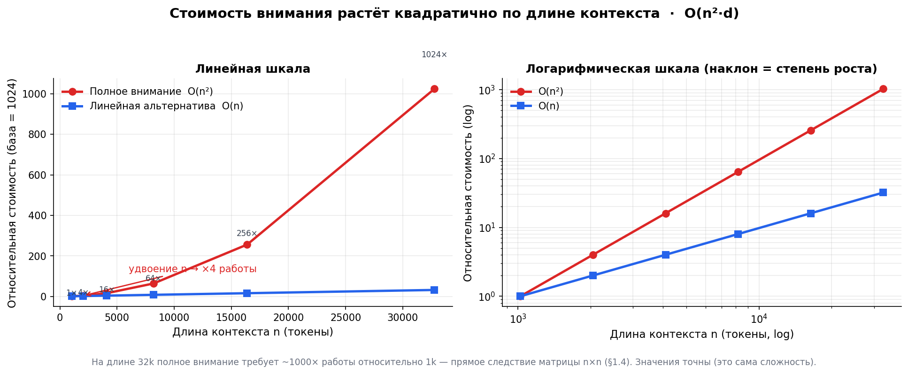

**Диаграмма трансформерного блока.**
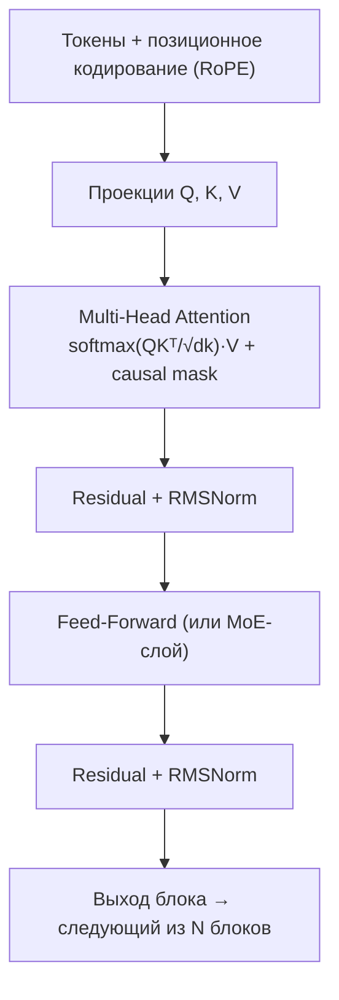

**Полный трансформер** — стопка из `N` таких блоков (у крупных моделей — десятки-сотни), завершаемая линейной проекцией в словарь (даёт логиты, §1.7). **Residual-связи** (сложение входа блока с его выходом) и **нормализация** (RMSNorm[^t-rmsnorm]) обеспечивают обучаемость такой глубины, предотвращая затухание градиента при прохождении сигнала через множество слоёв.

### Deep Dive: линейные слои и вычислительный поток блока

Выше attention дан концептуально; здесь — из *каких операций* реально состоит блок, потому что архитектурные следствия (стоимость, память, что делает GPU) видны только на этом уровне. Полный словарь операций — Приложение A; здесь — как трансформер к ним сводится.

**Линейный слой — базовый элемент.** Всё, что в трансформере называют «проекцией», — это **линейный слой**: `y = xW (+ b)`, то есть **матричное умножение** входа на обучаемую матрицу весов `W`. Ключевое осознание: **параметры модели — это и есть эти весовые матрицы.** «Модель на 7B параметров» = суммарный размер всех `W` в её линейных слоях (плюс эмбеддинги). Линейный слой ничего не «понимает» — он умножает на матрицу.

**Где линейные слои в блоке** (почти вся масса весов — в них). Нотация `a → b` читается «слой принимает вектор из `a` чисел, возвращает вектор из `b` чисел»; его матрица весов имеет форму `a × b`, то есть `a·b` параметров:
- **Проекции Q, K, V** — три линейных слоя `d_model → d_model` (результат режется на `h` голов размерности `d_head = d_model/h`).
- **Выходная проекция** attention — линейный слой `d_model → d_model`.
- **FFN** — в классическом варианте *два* линейных слоя: `d_model → d_ff` (обычно `d_ff ≈ 4·d_model`) и обратно `d_ff → d_model`, с нелинейностью между ними. Большинство современных open-weight моделей (Llama, Mistral, Qwen, Gemma) используют **гейтированный вариант (SwiGLU)** с *тремя* матрицами: gate- и up-проекции `d_model → d_ff`, их результаты перемножаются поэлементно (с активацией на gate-ветви), затем down-проекция `d_ff → d_model`; чтобы сохранить бюджет параметров при трёх матрицах, теоретический паритет даёт `d_ff ≈ 8/3·d_model`; на практике модели берут больше — у якорной здесь Llama-3-8B `d_ff/d_model = 14336/4096 = 3.5`. FFN держит бо́льшую часть параметров блока — именно его заменяет MoE (§1.5).

**Легенда обозначений.** Прежде чем читать формулы — что означает каждый символ. Все числа в третьей колонке — реальные, из открытой Llama-3-8B, чтобы за буквами стояли конкретные величины:

| Символ | Что это | В Llama-3-8B |
|---|---|---|
| `seq` | Длина последовательности в токенах. Единственная величина, зависящая от запроса, — всё остальное фиксировано архитектурой | от 1 до 8192 |
| `d_model` | «Ширина» модели: сколько чисел в векторе, представляющем один токен внутри блока | 4096 |
| `h` | Число голов внимания | 32 |
| `d_head` | Кусок вектора, достающийся одной голове: `d_model / h` | 4096/32 = 128 |
| `d_ff` | Внутренняя ширина FFN (шире, чем `d_model`) | 14336 |
| `x` | Вход блока — не «переменная», а целая таблица `seq × d_model`: одна *строка* на каждый токен, в строке `d_model` чисел | напр. 1000 × 4096 |
| `Wq, Wk, Wv, Wo, W1, W2` | Обучаемые матрицы весов — те самые «параметры модели» из абзаца выше. Зафиксированы после обучения | каждая ~4096 × 4096 или 4096 × 14336 |

**Как читать формы.** Запись `seq × d_model` — это форма таблицы: строк × столбцов. Правило одно, и оно объясняет каждый шаг ниже: умножение таблиц `(a × b) · (b × c) → a × c` допустимо, когда «внутренние» размеры совпадают, — они схлопываются, «внешние» остаются. Пример: `(1000 × 4096) · (4096 × 4096) → 1000 × 4096` — тысяча токенов вошла, тысяча вышла, но каждый вектор пересчитан. Значок `ᵀ` (транспонирование) переставляет строки и столбцы местами — им пользуются, чтобы состыковать формы. Больше ничего из линейной алгебры для чтения трассировки не нужно (полный словарь — Приложение A).

**Трассировка потока** (вход — `x` формы `seq × d_model`); после формулы каждого шага — его чтение словами:

1. `Q,K,V = xWq, xWk, xWv` → три таблицы `seq × d_model`, каждая режется на головы → `h × seq × d_head`.
   *Словами:* вектор каждого токена умножается на три разные весовые матрицы — получаются три «прочтения» одного токена: Q — «что я ищу», K — «по чему меня можно найти», V — «что я отдам, если меня выберут» (роли из концептуального описания выше). Резка на головы — это буквально разрезание вектора длины 4096 на 32 куска по 128 чисел: каждая голова дальше работает со своим куском независимо (и потому — параллельно).
2. `scores = Q·Kᵀ / √d_head` → таблица `h × seq × seq`.
   *Словами:* для каждой пары токенов считается скалярное произведение «запроса» одного и «ключа» другого — одно число, мера их совместимости. Пар — «каждый с каждым», отсюда таблица `seq × seq` в каждой голове: при 1000 токенов это 1 000 000 чисел на голову — **вот физическое происхождение квадратичной цены длинного контекста** (§1.4). Транспонирование `Kᵀ` здесь чисто техническое: `(seq × d_head) · (d_head × seq) → seq × seq` — состыковали формы. Деление на `√d_head` — нормировка масштаба: скалярные произведения длинных векторов — большие числа, а softmax следующего шага на больших числах «насыщается» (выдаёт почти чистый 0/1 и перестаёт различать оттенки); деление возвращает числа в рабочий диапазон.
3. `weights = softmax(scores)` — формы не меняет.
   *Словами:* каждая строка таблицы совместимостей превращается в набор положительных весов с суммой 1 — «бюджет внимания» токена, распределённый по всем токенам, которые ему видны. Было «сырое число совместимости», стало «доля внимания».
4. `attn = weights·V` → `h × seq × d_head`, головы конкатенируются обратно → `seq × d_model`.
   *Словами:* новый вектор токена — это *взвешенное среднее* V-векторов всех видимых токенов с только что посчитанными весами: токен «собирает» информацию с тех, на кого смотрит, пропорционально вниманию. Сборка голов — обратная операция резки из шага 1: 32 куска по 128 чисел снова склеиваются в один вектор длины 4096.
5. `out = attn·Wo` → `seq × d_model`.
   *Словами:* до этого момента головы работали изолированно, каждая на своём куске; умножение на выходную матрицу `Wo` перемешивает их результаты между собой — итог одной головы может повлиять на любую координату итогового вектора.
6. `x = x + out`; RMSNorm.
   *Словами:* residual-связь — выход внимания не *заменяет* вектор токена, а *прибавляется* к нему: блок вносит правку в черновик, а не переписывает его (поэтому сигнал не разрушается за десятки блоков). Нормализация выравнивает масштаб чисел перед следующим этапом.
7. FFN: `x·W1 → активация → ·W2` → `seq × d_model` (в SwiGLU — три матрицы: `(активация(x·W_gate) ⊙ x·W_up)·W_down`, где `⊙` — поэлементное умножение двух таблиц одинаковой формы).
   *Словами:* каждый токен *независимо от остальных* прогоняется через расширение (4096 → 14336), нелинейность и сжатие обратно (14336 → 4096). Разделение труда в блоке именно такое: attention (шаги 1–5) — единственное место, где токены обмениваются информацией; FFN «переваривает» собранное внутри каждого токена по отдельности. Активация (нелинейность) — то, что делает стопку слоёв выразительнее одного большого умножения: без неё два линейных слоя математически схлопнулись бы в один.
8. `x = x + ffn`; норма — та же residual-правка, что в шаге 6.

**Вывод.** Весь блок сводится к небольшому числу матричных умножений (проекции, два матричных умножения внимания, два-три — в FFN) в сочетании с softmax, нормализацией и поэлементными операциями. Отсюда следуют ключевые свойства: вычислительная стоимость (FLOPs) доминируется матричным умножением, из-за чего ускорители (GPU/TPU) оптимизированы именно под него; множитель `seq²` в шаге 2 — источник квадратичной цены длинного контекста (§1.4); размеры матриц `W` определяют число параметров и объём памяти под веса (§1.6). Представление модели как стека матричных умножений, обёрнутых механизмом внимания и нелинейностями, — тот базовый уровень, из которого выводятся архитектурные следствия. Отдельные операции разобраны в Приложении A.

*Источники.* A. Vaswani et al., «Attention Is All You Need» (2017) — первоисточник. J. Alammar, «The Illustrated Transformer» — лучшая визуальная интуиция. J. Su et al., «RoFormer» (2021) — RoPE. T. Dao et al., «FlashAttention» (2022). I. Beltagy, M. E. Peters, A. Cohan, «Longformer: The Long-Document Transformer» (2020) — sliding-window attention, сложность `O(n·w)` и рецептивное поле `ℓ·w`. A. Q. Jiang et al., «Mistral 7B» (2023) — SWA на практике: `w = 4096`, 32 слоя, theoretical attention span ≈ 131k. Stanford CS336, лекции 3–4. S. Raschka (2024) — реализация attention руками.

## 1.5 Dense против Mixture-of-Experts

**Где в блоке сосредоточены параметры.** Основную массу весов трансформерного блока держит не внимание, а **сеть прямого распространения (FFN)** — полносвязные слои после внимания (§1.4): два в классическом варианте, три в гейтированном SwiGLU. Идея Mixture-of-Experts (MoE) состоит в замене одного крупного FFN набором **экспертов** (несколько FFN меньшего размера) и **маршрутизатора** (router), который для каждого токена выбирает лишь `k` экспертов из общего числа (типично top-1 или top-2). ≠ Не путать с **Model Routing** (§2.2, §11.3): роутер MoE — обучаемый слой *внутри* форвард-пасса, выбирающий экспертов для каждого токена на каждом слое; Model Routing — компонент *приложения*, выбирающий целую модель для целого запроса. Одно слово, два несмежных уровня стека.

**Термины. Dense-модель** — все параметры активны при обработке каждого токена. **MoE (Mixture of Experts)** — для каждого токена активна лишь малая доля параметров (выбранные эксперты), остальные не участвуют в вычислении. Различие фиксируется двумя величинами:
- **Общее число параметров (total)** — сколько весов хранится; определяет ёмкость знаний и требования к памяти.
- **Активные параметры (active)** — сколько участвует в вычислении на один токен; определяют вычислительную стоимость и скорость инференса.

У dense-модели эти величины равны. У MoE активных параметров на порядок меньше общего числа. В этом ключевая идея MoE: **разделить ёмкость модели (число параметров) и стоимость обработки токена (FLOPs)** — получить больше параметров без пропорционального роста вычислений. Пример: DeepSeek-V3 хранит 671 млрд параметров, но активирует ≈37 млрд на токен.

**Механика маршрутизации.**
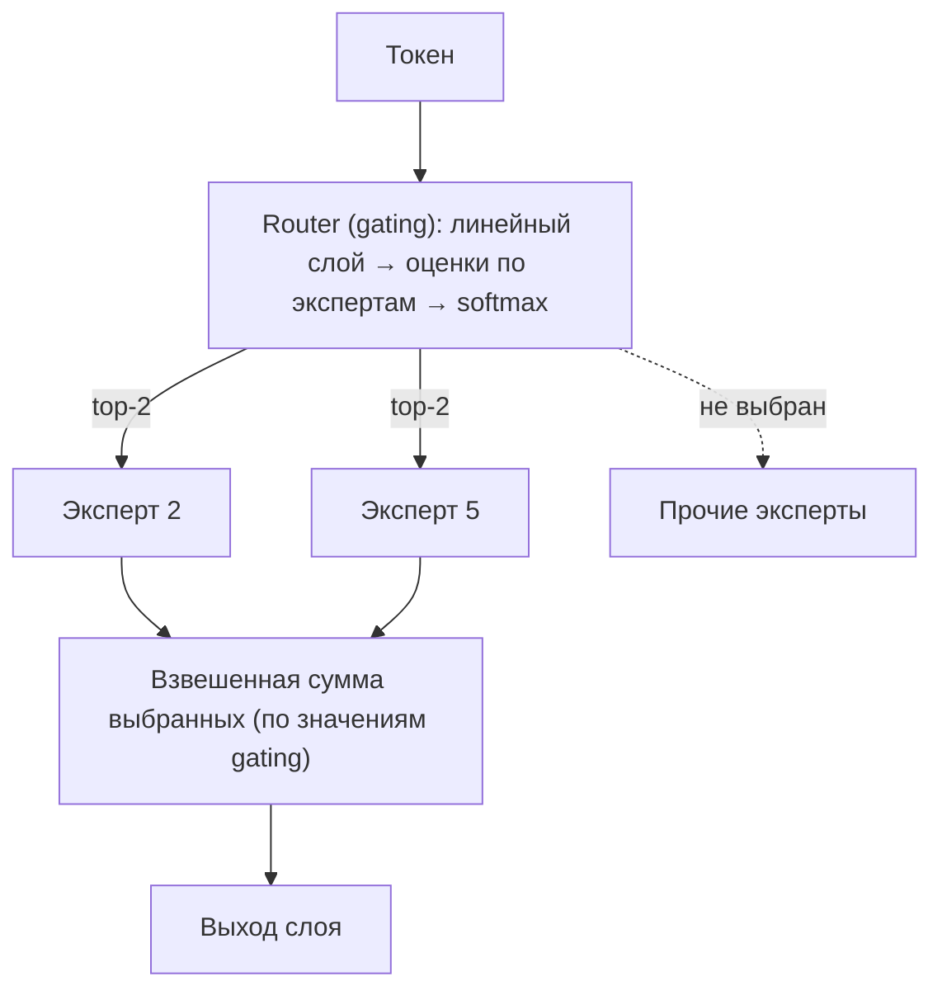
Маршрутизатор — это линейный слой (gating), вычисляющий по токену оценку для каждого эксперта; после softmax выбираются `k` экспертов с наибольшими оценками, и их выходы комбинируются взвешенно по значениям gating. Выбор `k` — компромисс: top-1 (Switch Transformers) минимизирует вычисления, top-2 повышает качество ценой большего счёта.

Сопутствующие механизмы и характерные отказы:
- **Балансировка нагрузки (load balancing).** Без вмешательства маршрутизатор склонен концентрировать токены на нескольких экспертах, перегружая их и оставляя остальные недообученными. Классическое средство — **вспомогательная функция потерь** (штраф за неравномерность использования экспертов); более новый подход — **балансировка без вспомогательного loss** (DeepSeek-V3 корректирует смещения маршрутизации вместо штрафа), что устраняет помеху, которую вспомогательный член вносит в основное обучение.
- **Ёмкость эксперта и отбрасывание токенов (token dropping).** Каждому эксперту назначается ограниченная ёмкость; при её превышении часть токенов сверх лимита не обрабатывается выбранным экспертом (пропускается либо проходит по residual-связи). Это прямое следствие несбалансированной маршрутизации, снижающее качество.
- **Общие эксперты (shared experts).** Часть экспертов делают всегда активными: они несут общее знание, тогда как маршрутизируемые специализируются на узком (схема DeepSeekMoE, часто в сочетании с бо́льшим числом более мелких — fine-grained — экспертов).
- **Нестабильность обучения.** Совместное обучение маршрутизатора и экспертов подвержено расхождению; применяются стабилизирующие приёмы (например, регуляризация логитов маршрутизатора).

**Параллелизм экспертов и его цена.** Экспертов распределяют по разным устройствам (**expert parallelism**), что позволяет обучать и обслуживать очень большие модели. Плата двоякая: во-первых, **все** эксперты должны находиться в памяти, даже если на каждый токен активны лишь `k`, — поэтому требования MoE к объёму памяти высоки, несмотря на малое число активных параметров; во-вторых, маршрутизация порождает интенсивный обмен между устройствами (all-to-all коммуникация), поскольку выбранные для токена эксперты могут располагаться на других устройствах.

**Ключевой практический парадокс.** MoE **дешевле по вычислениям** (мало активных параметров), но **требовательнее к памяти** (хранятся все эксперты) и сложнее в обслуживании (маршрутизация, межустройственная коммуникация, балансировка на инференсе — токены одного батча расходятся по разным экспертам, вызывая дисбаланс). Поэтому «дешевле» применительно к MoE относится к FLOPs, а не к совокупной стоимости развёртывания.

**Архитектурный выбор.**

| Критерий | Dense | MoE |
|---|---|---|
| Латентность (малый батч) | Предсказуемее, часто ниже | Выше накладные расходы (маршрутизация, память) |
| Пропускная способность (большой батч) | Дороже за качество | Выигрывает (ёмкость при малых FLOPs) |
| Память под веса | По размеру модели | Большая (хранятся все эксперты) |
| Рассуждение (математика, логика) | Часто сильнее при равном total | — |
| Знаниеёмкие задачи | — | Часто сильнее (больше total-параметров) |
| Дообучение и обслуживание | Проще | Сложнее (нестабильность, expert parallelism) |

Практическое следствие для проектирования: система, чувствительная к латентности при малом батче (онлайн-агент), обычно выигрывает от dense-модели умеренного размера — предсказуемая латентность и простое обслуживание; нагрузка с высокой пропускной способностью на знаниеёмких задачах (пакетная обработка) оправдывает MoE — большая ёмкость при малых FLOPs. Выбор напрямую определяет требования к памяти ускорителя и модель обслуживания (§1.6).

*Источники.* N. Shazeer et al., «Outrageously Large Neural Networks: The Sparsely-Gated MoE Layer» (2017) — исток. W. Fedus et al., «Switch Transformers» (2021) — упрощение до top-1 и масштабирование. «DeepSeek-V3 Technical Report» (2024) — MLA, DeepSeekMoE, балансировка без вспомогательного loss. Meta, «Llama 4» (2025) — первое MoE-поколение семейства Llama. S. Raschka, «The Big LLM Architecture Comparison» (2025) — dense и MoE на актуальных моделях. Stanford CS336, лекция 4.

## 1.6 Цикл генерации и инференс

**Постановка. Путь запроса: от JSON до ускорителя.** Всё описанное ниже начинается с массива идентификаторов, уже лежащего в памяти ускорителя. Откуда он там взялся — вопрос архитектурно существенный, потому что ответ проводит границу: **до модели работает обычный детерминированный код на CPU, и только после неё начинается вероятностное вычисление на ускорителе**. Путь одного вызова: HTTP-запрос с JSON-телом → сборка реплик штатным chat-шаблоном (§1.2) → токенизатор превращает строку в массив целых чисел, индексов словаря (§1.2) → подсчёт длины и сверка с окном (§1.8) → копирование массива в память ускорителя. Первые четыре шага исполняет хостовый процесс: ни одного умножения матриц, ни грамма недетерминизма. Это тот же **харнесс** (§10.2) — детерминированная обвязка вокруг вероятностного ядра, — только увиденный на масштабе одного вызова, а не агентного цикла: там он парсит вызовы инструментов и навязывает бюджеты, здесь раскладывает текст на числа и решает, пускать ли запрос на ускоритель вообще. Граничный артефакт между двумя мирами — выход токенизатора: массив целых чисел, и ничего больше.

**Сколько стоит переезд.** Массив идентификаторов пересекает границу «хост → ускоритель» по шине — в типовом сервере это PCIe (в тесных связках вроде Grace Hopper — более быстрый NVLink-C2C, но вывод не меняется). Время копирования:

$$t_{copy} = \frac{n \times b}{BW_{bus}}$$

Где:
* **$n$** — длина промпта в токенах, шт. Возьмём заведомо длинный контекст: $n$ = 100 000.
* **$b$** — размер одного идентификатора в байтах. Слой `nn.Embedding` принимает индексы типа Int/Long, а штатный HF-токенизатор с `return_tensors="pt"` отдаёт int64, то есть $b$ = 8 Б.
* **$BW_{bus}$** — пропускная способность шины в одну сторону, Б/с. У PCIe 5.0 x16 это ≈64 ГБ/с (16 линий по 32 GT/s — гигатрансфера в секунду на линию).

Живые числа: 100 000 × 8 Б = **800 КБ**; 800 КБ ÷ 64 ГБ/с ≈ **12,5 мкс**. Словами: *весь стотысячетокенный промпт переезжает в ускоритель за десяток микросекунд — сам переезд не стоит ничего.* Причина в том, что на этой границе промпт — уже не текст, а числа, и чисел мало: даже окно в миллион токенов даёт 8 МБ против десятков гигабайт весов, постоянно лежащих в ускорителе. Следствие для проектирования: экономить на доставке промпта незачем — TTFT (§2.3) растёт с длиной входа не из-за шины, а из-за prefill, то есть из-за арифметики.

≠ Не путать шину «хост↔ускоритель» с памятью самого ускорителя (**HBM**, §22.5): это разные каналы, и узкое место — второй. PCIe соединяет CPU с ускорителем, срабатывает **один раз за запрос** и везёт сотни килобайт. HBM соединяет память ускорителя с его же вычислительными блоками, работает **на каждом шаге decode** и перечитывает все веса и весь KV-cache — гигабайты. Отсюда и разрыв в ширине: у H100 SXM пропускная способность HBM3 — 3,35 ТБ/с против ≈64 ГБ/с у PCIe 5.0 x16, примерно **в 50 раз** больше — и всё равно её не хватает (почему — ниже). Поэтому дальше в разделе речь пойдёт о батчинге и KV-cache, а не о шине.

**Термин. Авторегрессия.** Модель генерирует текст по одному токену за раз: вычисляет распределение следующего токена → выбирает токен (§1.7) → добавляет его ко входу → повторяет. Из последовательного характера процесса вытекают две фазы инференса с принципиально разными вычислительными профилями:

- **Prefill (предзаполнение)** — обработка всего входного промпта. Все токены промпта доступны сразу, поэтому фаза выполняется за один параллельный проход и **упирается в вычисления** (compute-bound): арифметическая нагрузка велика, вычислительные блоки ускорителя загружены.
- **Decode (декодирование)** — генерация ответа токен за токеном. Каждый шаг зависит от предыдущего, поэтому фаза **последовательна** и **упирается в пропускную способность памяти** (memory-bandwidth-bound).

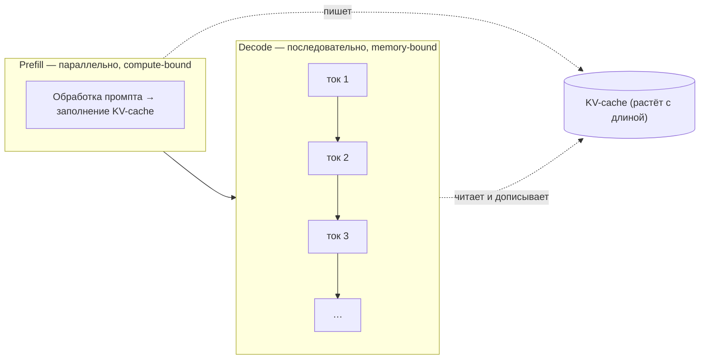

**Почему decode ограничен памятью, а не вычислениями.** На каждый сгенерированный токен необходимо прочитать из памяти ускорителя (HBM) все веса модели и весь KV-cache, выполнив при этом сравнительно немного арифметики (обработка одного токена). Отношение объёма вычислений к объёму считанных данных (*арифметическая интенсивность*) низкое, поэтому узким местом становится пропускная способность памяти, а вычислительные блоки простаивают. Это ключевое отличие decode от prefill и объяснение того, почему батчинг (ниже) столь эффективен: он позволяет прочитать веса один раз и применить их сразу ко многим последовательностям, повышая арифметическую интенсивность. Связь с латентностью: длительность prefill определяет время до первого токена (TTFT, растёт с длиной промпта), а decode — время на каждый последующий токен (TPOT); подробнее — §2.3.

**Термин. KV-cache.** Чтобы на каждом шаге decode не пересчитывать внимание для всех предыдущих позиций заново, вычисленные Key и Value кэшируются и переиспользуются (§1.4). Это радикально ускоряет генерацию, но кэш **растёт линейно с длиной последовательности** и является **главным потребителем памяти ускорителя после весов модели**. Его размер:
```
KV-cache (байт) ≈ 2 · n_layers · n_kv_heads · d_head · seq_len · batch · bytes
```
Множитель 2 — на Key и Value. Конкретный пример (конфигурация уровня 70B-модели с GQA: 80 слоёв, 8 KV-голов, `d_head` = 128, fp16): на один токен приходится 2·80·8·128·2 ≈ 320 КБ, то есть последовательность в 8192 токена занимает ≈2,5 ГБ, а сотня параллельных сессий такой длины — сотни гигабайт только под кэш. Отсюда прямое следствие для планирования ёмкости: память ускорителя делится между весами и KV-cache, а объём кэша растёт как произведение числа параллельных сессий на длину контекста — именно это, а не только размер весов, ограничивает число одновременно обслуживаемых сессий. Сокращение KV-cache — цель вариантов внимания GQA/MQA/MLA (§1.4) и квантизации кэша.

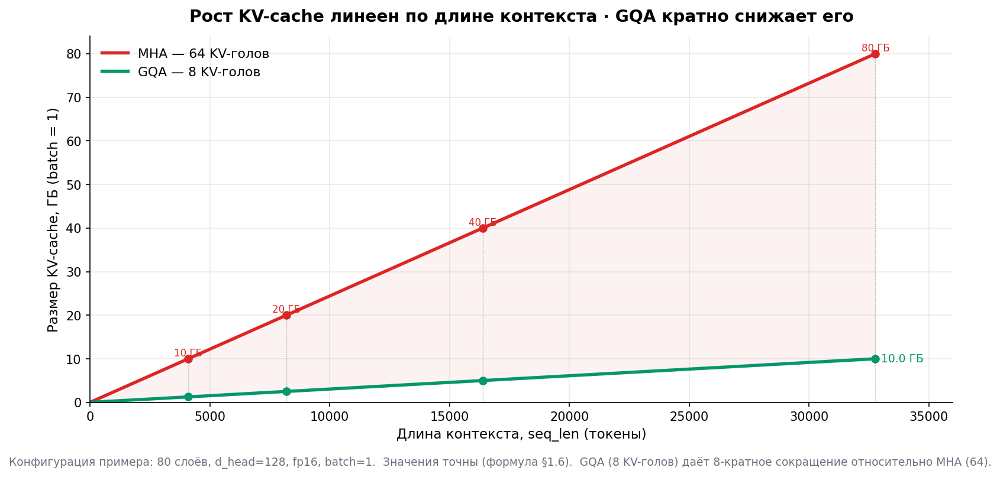

**Оптимизации обслуживания (детально — гл. 22):**
- **Continuous batching (потоковый батчинг)** — динамическое добавление новых запросов в батч по мере освобождения слотов, без ожидания завершения всех последовательностей текущего батча. Поскольку последовательности заканчиваются в разное время, статический батч простаивает на самой длинной; потоковый батчинг устраняет этот простой и является главным рычагом утилизации ускорителя. Реализован в vLLM[^t-vllm] (по идеям Orca).
- **PagedAttention** — управление KV-cache блоками фиксированного размера (страницами) через таблицу косвенной адресации вместо непрерывного выделения. Это устраняет фрагментацию памяти (внутреннюю и внешнюю) и позволяет разным последовательностям разделять общие страницы (например, общий префикс промпта, с копированием при записи). Приём переносит принцип страничной организации памяти из операционных систем; лежит в основе vLLM.
- **Speculative decoding (спекулятивное декодирование)** — небольшая «черновая» модель предлагает несколько токенов вперёд, а основная модель проверяет их за один параллельный проход, принимая наибольший совпавший префикс. Ускорение достигается за счёт того, что проверка задействует простаивающие в decode вычислительные блоки (проверка compute-параллельна, тогда как обычный decode memory-bound); величина ускорения определяется долей принятых токенов, то есть согласованностью черновой и основной моделей.
- **Дизагрегация prefill/decode** — разнесение двух фаз инференса по разным пулам ускорителей (или их чередование через chunked prefill): compute-bound prefill и memory-bound decode мешают друг другу в общем батче, а разделение устраняет интерференцию, улучшая и латентность, и утилизацию (§22.5).
- **Квантизация** — хранение весов и/или кэша в пониженной точности (гл. 22) ради экономии памяти.

**Итог.** Инференс LLM обладает профилем «пропускная способность — латентность — память», а не профилем вычислительной бизнес-логики: prefill compute-bound, decode memory-bound, а память ускорителя делится между весами и растущим KV-cache. Эти свойства определяют стоимость, латентность и предельное число параллельных сессий (§2).

*Источники.* W. Kwon et al., «Efficient Memory Management for LLM Serving with PagedAttention» (2023) — vLLM. Chip Huyen, «AI Engineering» (2025), главы про инференс. Y. Leviathan et al., «Fast Inference from Transformers via Speculative Decoding» (2023).

## 1.7 Стратегии декодирования

**Постановка.** Последний слой трансформера выдаёт **логиты** — по одному числу на каждый токен словаря; `softmax` преобразует их в распределение вероятностей следующего токена (§1.4, §1.6). Способ выбора конкретного токена из этого распределения и называется *стратегией декодирования*; именно он определяет степень детерминированности вывода.

**Жадный выбор и почему его недостаточно.** Простейшая стратегия — **greedy**: брать наиболее вероятный токен (argmax). Она детерминирована по выбору, но на открытой генерации приводит к вырождению — повторам, зацикливанию, однообразию. Причина установлена эмпирически (Holtzman et al., 2019): последовательности максимального правдоподобия не совпадают с естественным текстом — человеческая речь регулярно выбирает не самый вероятный токен, и жадная максимизация правдоподобия систематически уходит в монотонность. **Beam search** (удержание `b` наиболее вероятных последовательностей) повышает правдоподобие и уместен в задачах с единственным правильным ответом (например, машинный перевод), но на открытой генерации усиливает ту же проблему — даёт гладкий, но однообразный текст. Поэтому открытую генерацию ведут *сэмплированием* из распределения, а не максимизацией.

**Формирование распределения перед сэмплированием:**
- **Temperature `T`** — перед softmax логиты делятся на `T`: `softmax(logits / T)`. Механика: softmax возводит e в степень каждого логита, поэтому его выход определяется *разрывами* между логитами; деление на `T < 1` эти разрывы растягивает (лидер отрывается ещё сильнее — распределение обостряется), деление на `T > 1` — сжимает (кандидаты сближаются — распределение сглаживается, растёт вероятность менее вероятных токенов). Отсюда пределы: при `T → 0` разрывы бесконечны и остаётся один argmax (жадный предел), при `T = 1` распределение не меняется. Основной регулятор баланса «предсказуемость ↔ разнообразие» (см. рисунок).
- **Top-k** — сэмплирование только из `k` наиболее вероятных токенов, остальные обнуляются. Недостаток — фиксированность `k`: когда модель уверена, лишние варианты впускают шум; когда не уверена, отсечение обрезает уместные продолжения.
- **Top-p (nucleus sampling)** — сэмплирование из минимального набора токенов, суммарная вероятность которых ≥ `p` (Holtzman et al., 2019). Набор адаптивен: сужается там, где модель уверена, и расширяется, где нет, — этим top-p устраняет негибкость top-k.
- **Min-p** — более новый порог, заданный относительно вероятности наиболее вероятного токена (отсекается всё ниже фиксированной доли от пика); устойчивее top-p при высоких температурах.

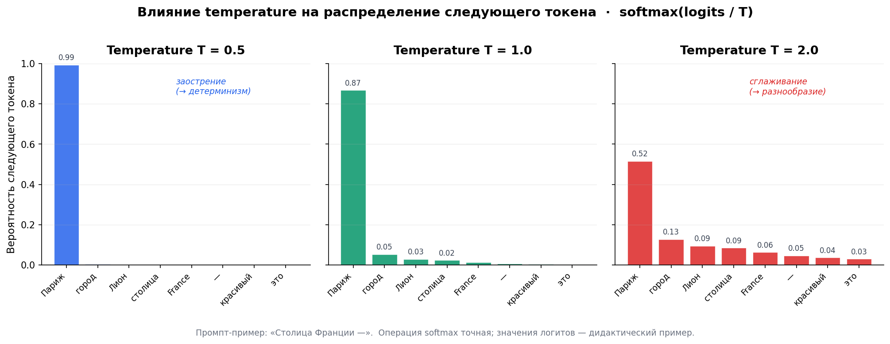

**Штрафы за повторение.** Отдельное семейство параметров подавляет зацикливание: *presence penalty* (штраф за появление токена независимо от частоты), *frequency penalty* (штраф пропорционально числу вхождений), *repetition penalty* (множитель к логитам уже встречавшихся токенов), *no-repeat-ngram* (прямой запрет повторно порождать n-граммы).

**Порядок операций.** Параметры применяются в определённой последовательности: сначала штрафы за повторение к логитам, затем масштабирование температурой, затем усечение top-k / top-p, затем сэмплирование. Порядок влияет на результат — это практически значимая деталь при воспроизведении поведения между разными реализациями.

**Термин. Structured / constrained decoding.** На этапе выбора токена можно **запретить** все токены, нарушающие заданную грамматику или JSON-схему, маскируя их логиты (устанавливая в `−∞` до сэмплирования). Это гарантирует синтаксически валидный вывод — критично, когда результат передаётся в парсер или в вызов инструмента, — и надёжнее запроса «верни JSON» без гарантии. Механизм детально разбирается в §5.3; важная оговорка: он гарантирует *структуру*, но не *корректность* содержания (§5.6).

**Практический выбор.** Для извлечения полей, классификации и вызова инструментов применяют низкую температуру (≈0–0.3), нередко в сочетании с constrained decoding, — это возвращает предсказуемость вероятностному ядру там, где результат должен быть машинно-обрабатываемым. Для генерации текста и порождения идей температуру и top-p повышают ради разнообразия. При этом даже для «детерминированных» задач иногда предпочитают малую ненулевую температуру вместо чистого greedy, чтобы избежать вырожденных повторов. Наконец, выбор `T = 0` детерминирован лишь в смысле выбора токена и **не гарантирует побитово идентичный вывод** между запусками (§2.4).

**Сравнение.**

| Стратегия | Детерминизм | Разнообразие | Типичное применение |
|---|---|---|---|
| Greedy | Максимум | Минимум | Извлечение, классификация |
| Low-T + top-p | Высокий | Низкое | Tool-calling, структурированный вывод |
| High-T + top-p | Низкий | Высокое | Креатив, брейнсторм |
| Constrained | Гарантия схемы | Ограничено грамматикой | Вывод в парсер/инструмент |

*Источники.* A. Holtzman et al., «The Curious Case of Neural Text Degeneration» (2019) — nucleus sampling и почему greedy/beam деградируют. Документация Anthropic/OpenAI по параметрам сэмплинга и structured outputs.

## 1.8 Окно контекста и его отказы

**Термин. Контекстное окно** — максимальное число токенов, которое модель обрабатывает за один вызов (промпт вместе с генерацией). Это конечный бюджет: его величина зафиксирована при обучении (позиционное кодирование обучается до некоторой максимальной длины, §1.4), а выход за неё требует экстраполяции позиций (RoPE-scaling) с потерей качества.

**Один бюджет на вход и выход.** Почему окно накрывает и промпт, и ответ — прямо следует из авторегрессии (§1.6): каждый сгенерированный токен **дописывается ко входу** и занимает очередную позицию последовательности. Для модели собственный токен неотличим от пришедшего в промпте — он расходует ту же позицию из того же обученного диапазона (§1.4). Значит вход и выход не две квоты, а одна:

$$T_{in} + T_{out} \le W$$

Где:
* **$T_{in}$** — вход, в токенах: всё, что уходит в запрос — system-инструкция, определения инструментов, история, извлечённые чанки, сам запрос. Кэшированный префикс тоже занимает место: prompt caching (§2.2) меняет цену токена, а не его присутствие в окне. В ответе API это поле `input_tokens`.
* **$T_{out}$** — выход, в токенах: всё, что модель породила за вызов, включая внутреннее рассуждение reasoning-моделей, то есть моделей, порождающих перед ответом длинную цепочку рассуждения и тарифицирующих её как выходные токены (§13.8). Поле `output_tokens`.
* **$W$** — окно, в токенах: константа модели, зафиксированная при обучении. У Claude Sonnet 4.5 и Claude Haiku 4.5 — 200 000; у поколения Sonnet 4.6 и новее — 1 000 000.
* **`max_tokens`** — параметр запроса, в токенах: потолок, который вы сами ставите на $T_{out}$. Для Claude Sonnet 4.5 — не более 64 000.

Живая арифметика на Claude Sonnet 4.5: 200 000 − 64 000 = **136 000**. Столько остаётся входу, если вы запросили максимальный для этой модели ответ. Словами: место под ответ не выдаётся сверх окна — оно вычитается из него, и каждый токен, добавленный во вход, — это на один токен меньше, который модель успеет сгенерировать.

**Резерв — это планирование, а не проверка.** Существенная деталь: `max_tokens` не бронируется заранее. На моделях Claude 4.5 и новее запрос, в котором $T_{in}$ + `max_tokens` превышает окно, **принимается** — ограничение срабатывает не на валидации, а по факту генерации (на более ранних моделях, наоборот, возвращалась ошибка валидации). Поэтому вычитание $W$ − `max_tokens` даёт не порог отказа, а границу, до которой запрошенный объём ответа **гарантированно** поместится. Перешагнув её, вы получите не ошибку на входе, а обрыв на выходе — случай ниже.

**Больше контекста не означает лучше.** Даже когда весь материал помещается в окно, качество ответа может снижаться по трём причинам:
1. **Позиционное смещение (lost in the middle).** Модели полнее используют информацию в начале и конце контекста и хуже — в середине; факт, помещённый в середину длинного контекста, может остаться неучтённым (Liu et al., 2023). Эмпирика этого эффекта (U-образная кривая, методология измерения) подробно разобрана в §4.3.
2. **Разбавление внимания (context rot).** С ростом числа токенов внимание распределяется тоньше (причина — нормировка softmax: бюджет внимания фиксирован суммой 1 и делится на всё большее число токенов; вывод — §4.3), а нерелевантное содержимое вносит шум; качество рассуждения деградирует по мере заполнения окна даже при формально достаточной длине.
3. **Квадратичная стоимость** обработки по длине (§1.4).

**Эффективная длина против заявленной.** Заявленный размер окна (например, 128k) — верхняя граница обработки, а не длина, на которой сохраняется качество: модель нередко деградирует на сложных задачах задолго до предела. Поэтому *эффективную* длину контекста измеряют на конкретной задаче (§4.3), а не принимают равной заявленной.

**Поведение при переполнении: два разных отказа.** Со стороны *входа* поведение зависит от реализации: явная ошибка (у Anthropic — 400 «prompt is too long», если один только вход не влезает в окно) либо молчаливое усечение входа (обрезка начала или конца). Молчаливое усечение опасно тем, что незаметно удаляет часть промпта, поэтому обработку переполнения закладывают в систему явно.

Симметричный и более коварный отказ — со стороны *выхода*: промпт поместился, вызов принят, генерация пошла — и оборвалась на полуслове. Ошибки нет: ответ приходит с кодом успеха и выглядит настоящим ровно до места обрыва. Единственный признак — поле причины остановки (`stop_reason` у Anthropic, `finish_reason` у OpenAI), и оно различает два случая, которые лечатся противоположно:
- **Упёрлись в запрошенный потолок** — `stop_reason: "max_tokens"`, у OpenAI `finish_reason: "length"`: генерация исчерпала выданный ей `max_tokens`. Лечится поднятием лимита или продолжением ответа следующим вызовом.
- **Упёрлись в само окно** — `stop_reason: "model_context_window_exceeded"` (Anthropic, модели Claude 4.5 и новее): места не осталось физически. Поднимать `max_tokens` бессмысленно — сокращать надо вход.

**Железное правило инженера:** причину остановки проверяют на каждом вызове, *до* чтения содержимого ответа. Обработчик, который сразу парсит `content`, обрыв по бюджету не заметит — он увидит правдоподобный огрызок. Для структурированного вывода это ровно тот оборванный JSON из §5.1: невалидный хвост приходит не от сбоя сети, а от исчерпанного бюджета, и различает их только причина остановки.

**За обоими отказами — одна физическая причина.** Ошибка на входе и обрыв на выходе выглядят как две прихоти реализации, но берегут они одно и то же: **место под KV-кэш в памяти ускорителя**. Окно ограничено дважды. Сверху — обученной длиной позиционного кодирования (§1.4); это предел качества, и переход через него даёт деградацию, а не сбой. Снизу — физическим объёмом памяти под кэш (§1.6); этот предел жёсткий, поскольку кэш растёт линейно по длине последовательности, а кончившаяся память ускорителя — это не деградация, а падение процесса. Отсюда верное прочтение обоих отказов: **проверка длины — программный предохранитель, поставленный перед аппаратным отказом**. Дешёвая арифметика на хосте (§1.6: подсчёт длины идёт до копирования в ускоритель) стоит перед дорогим падением, потому её там и делают.

**Что именно считает движок.** Формула KV-кэша из §1.6 — не прикидка на полях: движок инференса вычисляет её буквально, ещё при старте. Возьмём Qwen3-8B с его штатным окном 40 960 токенов:

$$2 \times n_{layers} \times n_{kv\_heads} \times d_{head} \times seq\_len \times batch \times bytes = 2 \times 36 \times 8 \times 128 \times 40\,960 \times 1 \times 2 = 6{,}04 \cdot 10^{9}\ \text{байт} \approx 5{,}62\ \text{ГиБ}$$

Легенда (обозначения §1.6, значения — из `config.json` модели): множитель **2** — на Key и Value; **$n_{layers}$** = 36 — число слоёв; **$n_{kv\_heads}$** = 8 — число KV-голов, их вчетверо меньше, чем голов внимания (32 против 8), — это GQA, §1.4; **$d_{head}$** = 128 — размерность одной головы; **$seq\_len$** = 40 960 — полное окно в токенах; **$batch$** = 1 — одна сессия, ровно тот минимум, который движок проверяет при старте; **$bytes$** = 2 — байта на число в формате bf16 (`torch_dtype: bfloat16`). Словами: чтобы обслужить **один-единственный** запрос на всю длину окна, нужно 5,62 ГиБ памяти ускорителя только под кэш — сверх весов модели, которые лежат там же и никуда не деваются.

Ровно это число vLLM (§22.2) печатает, **отказываясь стартовать**: «*5.62 GiB KV cache is needed, which is larger than the available KV cache memory (4.89 GiB)*» — и предлагает либо отдать под кэш большую долю памяти (`gpu_memory_utilization`), либо урезать окно (`max_model_len`). Движок предпочитает не подняться вовсе, чем подняться и упасть по памяти на первом же длинном запросе.

Попутный урок — в том, на какой модели снят этот лог: не 8B, а Qwen3-**4B** на карте 16 ГиБ. Число то же, и это не совпадение: у 4B та же геометрия внимания (36 слоёв, 8 KV-голов, $d_{head}$ = 128), а множителя «число параметров» в формуле нет вовсе — модель вдвое меньше, а под кэш ей нужны **те же** 5,62 ГиБ. Объём KV-кэша задаётся глубиной и шириной внимания, а не числом весов; меньшая модель освобождает память под весами, но не под кэшем.

**Почему отказ, а не попытка.** Пул KV-кэша **общий** для всех сессий на ускорителе (§1.6), поэтому исчерпание памяти било бы не по одному виновнику, а по всем соседям, делившим ускоритель в этот момент. Отсюда три эшелона проверок, и ни один не оставлен на «поймаем исключение»:
- **при старте** — влезает ли хотя бы одна сессия на полное окно; не влезает — движок не поднимается (случай выше);
- **при приёме запроса** — влезает ли этот вход; не влезает — отказ на стороне хоста, до ускорителя (у Anthropic это 400 «prompt is too long», случай выше). Что именно попадает в эту проверку — только вход или вход вместе с запрошенным `max_tokens`, — вопрос политики реализации, а не арифметики: как показано выше, модели Claude 4.5 и новее вывод заранее не бронируют;
- **в рантайме** — при нехватке блоков движок **вытесняет** последовательность: её KV-блоки отдаются соседям, а сама она позже считается заново, с нуля (в vLLM V1 это режим `RECOMPUTE`, принятый по умолчанию как более дешёвый, чем выгрузка кэша в RAM). Запрос при этом задерживается, но не падает.

Инженерное следствие для проектирования: молчаливое усечение и явная ошибка — не две прихоти вендоров, а два способа не доводить до исчерпания памяти ускорителя. Выбор между ними обязана делать ваша система: не сделаете вы — сделает провайдер, молча и не в вашу пользу.

Отсюда следствия, образующие фундамент Частей II–III: контекст **курируют**, а не заполняют произвольным материалом (context engineering, гл. 4); критичную информацию размещают по краям окна, а не в середине; замена извлечения (RAG) подачей всего доступного текста в длинное окно — ложная экономия: извлечение нескольких релевантных фрагментов (Часть III) обычно точнее и дешевле, чем подача целого документа, — и по стоимости (квадратичный рост), и по качеству (разбавление). Например, вместо подачи 80-страничного регламента целиком его индексируют, извлекают 3–5 релевантных фрагментов и помещают в начало контекста с явной инструкцией — это дешевле, быстрее и точнее.

*Источники.* N. Liu et al., «Lost in the Middle: How Language Models Use Long Contexts» (2023); Chroma Research, «Context Rot» (2025). Anthropic, документация Claude API: «Context windows» (окно как сумма входа и выхода; поведение при переполнении, `model_context_window_exceeded`), «Handling stop reasons», «Models overview» (окна и потолки вывода по моделям). OpenAI, API reference — `finish_reason`. Проверка KV-кэша при старте, вытеснение с пересчётом (`RECOMPUTE`) и параметры `gpu_memory_utilization`/`max_model_len` — документация vLLM; текст стартового отказа приведён дословно по vLLM, issue #38516 (Qwen3-4B на RTX 5080, 16 ГиБ). Конфигурации Qwen3-8B и Qwen3-4B (число слоёв, KV-голов, `head_dim`, `max_position_embeddings`, `torch_dtype`) — `config.json` моделей на Hugging Face. Эмпирика и методология измерения — §4.3.

## 1.9 Почему модель галлюцинирует и что значит «знать»

**Термин. Галлюцинация** — уверенно сгенерированное, но фактически неверное или вымышленное утверждение. Это не дефект реализации, а следствие принципа работы модели: она обучена предсказывать *правдоподобное продолжение*, а не устанавливать истину. Обучающая задача (предсказание следующего токена по корпусу) не содержит понятия фактической верности; правдоподобие и истинность коррелируют, но не совпадают, и там, где расходятся, модель уверенно порождает правдоподобную неправду.

**Источники галлюцинаций** различны, и их полезно разделять:
- *Пробел в знании* — факт отсутствовал в обучающих данных или не закрепился; модель достраивает правдоподобное.
- *Устаревание* — параметрическое знание фиксировано на дату cutoff и не отражает последующих изменений.
- *Ошибочная интерполяция* — правдоподобное, но неверное объединение разрозненных фактов.
- *Индуцированные промптом* — следование ложной посылке во входе и **склонность соглашаться с формулировкой пользователя** (sycophancy): модель тяготеет к подтверждению заданной точки зрения.

**Калибровка.** Модель, как правило, *плохо откалибрована* относительно фактической верности: уверенный тон ответа не соответствует вероятности его правоты, а встроенного сигнала «не знаю» нет. Это ядро проблемы доверия к LLM-системам.

**Измеримое определение.** Калибровка — совпадение заявленной уверенности с фактической долей правоты: идеально откалиброванная модель, ответившая «уверен на 80%», права ровно в 80% таких случаев. Стандартная мера расхождения — **ECE (Expected Calibration Error)**, средняя ошибка калибровки: ответы раскладывают по корзинам уверенности, в каждой корзине сравнивают фактическую точность с заявленной уверенностью и усредняют разрыв по корзинам с весом по числу примеров.

$$ECE = \sum_{m=1}^{M} \frac{|B_m|}{N} \bigl| \mathrm{acc}(B_m) - \mathrm{conf}(B_m) \bigr|$$

Символы: `M` — число корзин уверенности, на практике 10–15 (у Guo et al. — 15; ниже взято 10, то есть интервалы 0.0–0.1, …, 0.9–1.0); `B_m` — множество ответов, чья уверенность попала в `m`-ю корзину; `N` — всего ответов в замере; `|B_m|/N` — вес корзины, то есть доля трафика в ней; `acc(B_m)` — доля фактически верных ответов в корзине, 0–1; `conf(B_m)` — средняя заявленная уверенность в корзине, 0–1. ECE безразмерен и читается в процентных пунктах.

Живые числа — условный пример: цифры подобраны для иллюстрации механики счёта, а не измерены. Пусть всего `N` = 1000 ответов, корзины ниже 0.7 пусты, а остаток распределён так:

| Корзина | `conf` | `acc` | Разрыв | Вес корзины | Вклад |
|---|---|---|---|---|---|
| 0.7–0.8 | 0.75 | 0.65 | 0.10 | 200/1000 = 0.2 | 0.020 |
| 0.8–0.9 | 0.85 | 0.75 | 0.10 | 300/1000 = 0.3 | 0.030 |
| 0.9–1.0 | 0.95 | 0.80 | 0.15 | 500/1000 = 0.5 | 0.075 |

ECE = 0.020 + 0.030 + 0.075 = **0.125**. Словами: в среднем по трафику модель обещает примерно на 12.5 процентного пункта больше уверенности, чем отрабатывает. Это условная величина учебного примера, а не чей-либо замер — реальные цифры идут ниже, со ссылкой. Существенна и структура замера: половина массы лежит в корзине 0.9–1.0, и разрыв там наибольший — сдвиг массы в верхние корзины и есть типичная патология выровненной модели.

**Механизм разрушения: калибровку ломает выравнивание.** Плохая калибровка — свойство не врождённое, а приобретённое, и это принципиально. Базовая (предобученная) модель откалибрована почти идеально: её единственная задача — предсказывать распределение следующего токена, и вероятность в этом распределении честно отражает наблюдённую в корпусе частоту. Выравнивание под диалог (RLHF, §21.6) эту калибровку разрушает: замер на подмножестве MMLU даёт ECE ≈ 0.007 у предобученной модели против ≈ 0.074 у неё же после пост-обучения — на порядок хуже (GPT-4 Technical Report, 2023, рис. 8). Причина прямая: модель вознаграждения обучена на человеческих предпочтениях, а люди предпочитают ответы, звучащие уверенно и полезно; максимизация такой награды прижимает выход к верхним корзинам уверенности независимо от того, знает модель ответ или нет. Отсюда видно, что sycophancy (выше) и потеря калибровки — не два независимых дефекта, а один корень: оба суть побочный эффект оптимизации под человеческое одобрение. Следствие для архитектора: чат-модель любого провайдера — это модель *после* выравнивания, её уверенность завышена систематически и по построению; промптом это не лечится, поскольку инструкция «честно сообщай о неуверенности» борется с тем, что зашито градиентом.

**Калибровка — не то же, что различение.** Это разные свойства, и каскад опирается на второе, а не на первое. ECE отвечает, совпадает ли уверенность с правотой *в среднем*. Различение — способность сигнала *отделить* верные ответы от неверных; его меряют AUROC[^t-auroc]. Модель, ставящая всем ответам уверенность 0.85 и правая ровно в 85% случаев, откалибрована идеально (ECE = 0), но для эскалации бесполезна: AUROC = 0.5, порог провести негде — сигнал одинаков на верных и неверных. Поэтому сигналы ниже оцениваются по AUROC, а не по ECE.

**Три сигнала уверенности, по убыванию надёжности.**
- *Согласие сэмплов* — самый надёжный. Один и тот же запрос прогоняется `k` раз, мерой уверенности служит согласованность ответов (энтропия по ним). Это self-consistency из §3.4, применённая как *измеритель*, а не как улучшатель. Цена — ×k вызовов. Величина выигрыша: на арифметике GSM8K переход от одиночной вербализованной оценки к пяти сэмплам с агрегацией по согласию поднимает AUROC с 54.8% (уровень подбрасывания монеты) до 92.7% (Xiong et al., 2023; GPT-3.5 с CoT). Развитие приёма — *семантическая энтропия*: сэмплы сначала кластеризуют по смыслу и лишь затем считают энтропию по кластерам, чтобы перефразировки одного ответа не засчитывались как разногласие (Farquhar et al., Nature, 2024).
- *Logprob* — логарифм вероятности, которую модель присвоила самим токенам ответа: то самое распределение после softmax из §1.7, только в логарифмической шкале (в ней вероятности последовательности складываются, а не перемножаются). Дёшев (один вызов), но меряет не то: это уверенность в *следующем токене*, а не в истинности утверждения. Хрестоматийный пример Xiong et al. — «Chocolate milk comes from brown cows»: каждый токен на своём месте высоковероятен, а утверждение ложно. Инженерная оговорка: чем именно является возвращаемый logprob, зависит от движка — vLLM по умолчанию отдаёт «сырые» лог-вероятности, посчитанные при `T = 1` независимо от температуры сэмплирования, но это настраиваемый режим (`logprobs_mode`), а не универсальный закон; опираясь на logprob как на сигнал, это проверяют по документации своего движка.
- *Вербализованная уверенность* («уверен на 90%») — худший оценщик: это стиль, а не вероятность. Значения кучкуются в диапазоне 80–100% и кратны пяти — модель воспроизводит человеческую манеру *говорить* об уверенности, а не своё распределение (Xiong et al., 2023).

Оговорка на честность: безусловного лидера среди трёх нет — на трудных задачах слабы все, и разрыв между вербализованной оценкой и методами с доступом к логитам в том же замере оказался узким (AUROC 0.522 против 0.605). Сигнал уверенности — прибор с известной погрешностью, а не оракул.

**Железное правило инженера:** сырое число уверенности модели — не вероятность. Порог каскада (§2.2, §20.3) или guardrail (§19.5), сравнивающий это число с константой, эскалирует по неоткалиброванному прибору. Порог выставляют по *своему* размеченному набору: прогнать репрезентативную выборку трафика, зафиксировать факт правоты, построить ECE и AUROC выбранного сигнала — и лишь затем выбрать точку отсечения, по матрице цен ошибок (§2.2), а не по красоте числа. Это та же логика, что «валидация судьи против людей» (§9.4): прежде чем строить решение на показании прибора, прибор привязывают к реальности.

**Два типа знания** (различие определяет выбор между RAG и fine-tuning, Части III и VII):
- **Параметрическое знание** закреплено в весах при обучении: статично на момент cutoff, не обновляется, источник не отслеживается.
- **Непараметрическое знание** подаётся в контекст во время выполнения (RAG): актуально, проверяемо, снабжено источником.

Отсюда две сквозные темы книги: заземление ответа на извлечённые факты с источником вместо опоры на память (**RAG**, Часть III) и измерение того, когда и насколько модель отклоняется от фактов (**оценка**, Часть VI), поскольку уверенный неверный ответ визуально неотличим от верного. Отдельный случай — *конфликт знаний*, когда извлечённый контекст противоречит параметрическому приору модели (разбирается в §6.7).

Практический принцип: систему не проектируют в расчёте на фактическую точность параметрического знания как на данность — для фактов применяют заземление (RAG) и проверку (оценку), а на модель опираются в том, что относится к форме, стилю и рассуждению.

*Источники.* Обзоры калибровки и галлюцинаций LLM (2023–2025); рамка «параметрическое и непараметрическое знание» — Chip Huyen, «AI Engineering» (2025). ECE — M. P. Naeini et al. (2015); стандартная форма и популяризация — C. Guo et al., «On Calibration of Modern Neural Networks» (2017). Калибровка до и после пост-обучения — OpenAI, «GPT-4 Technical Report» (2023), рис. 8. Сигналы уверенности и их сравнение — M. Xiong et al., «Can LLMs Express Their Uncertainty? An Empirical Evaluation of Confidence Elicitation in LLMs» (2023). Семантическая энтропия — S. Farquhar, J. Kossen, L. Kuhn, Y. Gal, «Detecting hallucinations in large language models using semantic entropy», Nature (2024).

## 1.10 Итог: контракт компонента

Материал главы сводится к тому, ради чего он изложен, — к **набору свойств языковой модели как архитектурного компонента**. При проектировании системы поверх модели существенны следующие свойства и места управления ими:

| Свойство | Что означает | Где управляется |
|---|---|---|
| Вход и выход — текст | Не типизированы жёстко; выход требует валидации | Structured output (гл. 5) |
| Недетерминизм | Один вход → разные выходы | Декодирование (§1.7); оценка (гл. 17) |
| Стоимость ∝ токенам, нелинейно по длине | Длинный контекст дорожает квадратично | Context engineering (гл. 4); RAG (Часть III) |
| Латентность: prefill + decode | Профиль «пропускная способность — латентность — память» | Обслуживание (гл. 22) |
| Конечное окно и деградация в середине | Больше не значит лучше | Курирование контекста (§1.8, §4.3) |
| Параметрическое знание статично и не гарантировано | Факты устаревают и выдумываются | RAG (Часть III); оценка (гл. 17) |
| Слабая калибровка | Уверенность ≠ правота | Guardrails (гл. 19); оценка |
| Dense или MoE меняет требования к ресурсам | total ≠ active параметры | Выбор модели; обслуживание (§1.6, гл. 22) |

Дальнейший материал книги — это методы управления строками этой таблицы: проектирование запросов и контекста (Часть II) упорядочивает вход; RAG (Часть III) заземляет знание; агенты и оркестрация (Часть IV) организуют действия недетерминированного ядра; интеграция (Часть V) встраивает систему в существующую инфраструктуру; продакшен (Часть VI) восстанавливает предсказуемость по границам — оценка, наблюдаемость, guardrails, стоимость; собственные модели (Часть VII) — изменение самого компонента. Владение этим набором свойств заменяет отношение к модели как к непредсказуемому «чёрному ящику» на работу с ней как с компонентом, обладающим известными нефункциональными характеристиками.

**На полях главы 1**

[^t-mteb]: **MTEB** — Massive Text Embedding Benchmark: сводный бенчмарк embedding-моделей на десятках датасетов по типам задач (Muennighoff et al., 2022). → §7.6.
[^t-yarn]: **NTK-aware scaling, YaRN** — техники интерполяции RoPE-частот, растягивающие рабочую длину контекста без полного переобучения; YaRN (Peng et al., 2023) — развитие NTK-интерполяции. → §1.8.
[^t-hbm]: **HBM** — High Bandwidth Memory: стековая память на подложке ускорителя. Её пропускная способность — узкое место decode-фазы: каждый шаг генерации перечитывает веса и KV-cache. → §1.6, §22.5.
[^t-rmsnorm]: **RMSNorm** (Zhang & Sennrich, 2019) — упрощённый LayerNorm: нормировка на среднеквадратичное значение с обучаемым масштабом, без вычитания среднего — дешевле при том же стабилизирующем эффекте. → Приложение A (§A.3).
[^t-vllm]: **vLLM** — открытый сервер инференса LLM (PagedAttention, continuous batching); отраслевая точка отсчёта для self-host. → гл. 22.
[^t-auroc]: **AUROC** — площадь под ROC-кривой: вероятность того, что случайно взятый верный ответ получит от сигнала уверенности более высокую оценку, чем случайно взятый неверный. 0.5 — сигнал не отличает верное от неверного (подбрасывание монеты), 1.0 — разделяет идеально. Меряет *различение*, а не калибровку: идеально откалиброванный сигнал может иметь AUROC = 0.5.

# Глава 2. Экономика и нефункциональные свойства LLM

Глава 1 дала *контракт* компонента. Эта глава превращает его нефункциональные свойства — стоимость, латентность, детерминизм, надёжность — в **бюджеты**, то есть в валюту, в которой реально ведётся проектирование. Рамка аналогична бюджетам латентности и ошибок, раскладываемым по SLO в SRE: дефицитные ресурсы распределяются под каждую функцию. Разница в том, что один из ресурсов — доверие к вероятностному компоненту.

## 2.1 Три бюджета

Любое проектное решение в LLM-системе — это размен трёх дефицитных бюджетов:

- **Стоимость** (токены → деньги),
- **Латентность** (время до ответа),
- **Детерминизм/качество** (насколько ответу можно доверять без проверки человеком).

Эти ресурсы конфликтуют. Снижение стоимости обычно означает меньшую модель и, как следствие, более низкое качество; повышение качества через развёрнутое рассуждение, больший контекст или оркестрацию увеличивает стоимость и латентность; повышение надёжности через проверки и guardrails добавляет латентность. Задача проектирования, таким образом, состоит не в абстрактном «сделать хорошо», а в осознанном распределении этих ресурсов под конкретную функцию относительно её требований (SLO): онлайн-функции в диалоговом интерфейсе требуется жёсткий бюджет латентности, тогда как для фоновой пакетной обработки данных доминирующим ограничением выступает стоимость. Настоящая глава посвящена измерению и распределению этих трёх бюджетов.

## 2.2 Модель стоимости

**Тарификация по токенам, с асимметрией.** Стоимость API считается за токены, причём **выходные токены обычно в несколько раз дороже входных**. Причина техническая (§1.6): вход обрабатывается в фазе prefill (параллельно, дёшево на токен), а выход генерируется в decode (последовательно, дороже на токен). Практический вывод: длинные *ответы* бьют по счёту сильнее длинных *промптов*.

**Кэш входа.** Повторно подаваемый статичный префикс (system prompt + константный контекст) через **prompt caching** тарифицируется сильно дешевле обычного входа. Это делает экономически выгодным вынос стабильной части контекста в кэшируемый префикс.

**Стоимость контекста.** Тариф за токен линеен, но длинный контекст означает больше входных токенов на *каждый* вызов — а в агентном цикле контекст ещё и растёт от шага к шагу. Квадратичная сложность внимания (§1.4) относится к стороне провайдера (влияя на латентность), тогда как в тарификации по токенам контекст дорожает линейно, но на каждом вызове.

**Мультипликатор агентов — главная ловушка стоимости.** Агентный цикл из `K` шагов — это `K` вызовов модели, каждый с растущим контекстом. Стоимость растёт сверхлинейно. Именно поэтому сквозной принцип книги («не усложняй раньше, чем задача докажет») — это ещё и про деньги: мультиагентный рой на задаче, где хватало одного вызова, может стоить в десятки раз дороже без выигрыша в качестве.

**Ярусы моделей.** Провайдеры дают линейку: маленькая и дешёвая, средняя, фронтир — с разбросом цены в 10–50 раз. Направлять все запросы на фронтир-модель расточительно. Отсюда паттерн:

> ### Паттерн: Model Routing / Cascade (Маршрутизация по ярусам)
> **Контекст.** Поток запросов неоднороден по сложности: большинство простые, меньшинство трудные.
> **Проблема.** Как удержать стоимость и латентность, не жертвуя качеством на трудных запросах?
> **Силы.** Фронтир-модель точна, но дорога и медленна; дешёвая — наоборот. Отправлять всё на фронтир расточительно; всё на дешёвую — рискованно.
> **Решение.** Классификатор (дешёвый) оценивает сложность и **маршрутизирует**: простое → дешёвая модель, трудное → фронтир. Вариант **cascade**: сначала дешёвая модель, затем проверка (уверенность/валидатор/judge); при провале — эскалация на фронтир.
> **Механика.** Маршрутизация реализует общий паттерн выбора ветви по содержимому запроса; каскад — эскалацию после проверки. Ключевой риск: стоимость самой классификации или проверки не должна превысить достигаемую экономию.
> **Пример.** Классификация обращений: 80% типовых закрывает дешёвая модель, 20% сложных эскалируется. Экономия часто кратная.
> **Результирующий контекст.** Кратное снижение стоимости/латентности; плата — сложность конвейера и риск ошибок маршрутизации (простой запрос ушёл на дешёвую и провалился).
> **Когда применять.** Явная неоднородность нагрузки и чувствительность к стоимости. **Когда нет.** Однородно-трудный поток — маршрутизировать нечего.
> **Связанные паттерны.** Adaptive RAG (та же идея на ретриве, гл. 7); Evaluator-Optimizer (проверка перед эскалацией).
> **Источники.** Chip Huyen, «AI Engineering» (2025) — model routing/cascades; S. Jeong et al., «Adaptive-RAG» (2024) — та же идея маршрутизации по сложности, применённая к ретриву (гл. 7).

### Deep Dive: классификатор-маршрутизатор — анатомия компонента

Слово «классификатор» в карточке выше легко проскочить, а между тем это отдельный артефакт, который несёт на себе всю конструкцию — и здесь, и в Adaptive RAG (§7.9), и в паттерне Routing (§11.3), и в каскадах шлюза (§20.3), и в ADR-4 капстоуна (§26.4). Разберём его как компонент: из чего он бывает, откуда берётся его «знание» и как он отказывает.

**Три реализации, по возрастанию стоимости.** (1) **Эвристика по наблюдаемым признакам** — детерминированный код: длина запроса, наличие кода/вложений, язык, тип клиента, канал. Бесплатна и мгновенна, но видит только форму запроса, не смысл. (2) **Обученный классификатор поверх эмбеддингов** — запрос прогоняется через embedding-модель (§7 — та же, что в ретриве), и лёгкая голова (логистическая регрессия, маленький MLP) выдаёт класс. Стоимость — один embedding-вызов (порядка сотых цента и десятков миллисекунд), но требуется разметка. (3) **Промптованный дешёвый LLM-вызов** — младшая модель с инструкцией «оцени сложность/категорию» и structured output (гл. 5). Самый гибкий и самый дорогой вариант: полноценный LLM-вызов на каждый запрос, сотни миллисекунд латентности — та самая «стоимость классификации», которая в карточке названа ключевым риском.

**Откуда берётся разметка.** Классификатору нужно знание «что считать простым», и взять его неоткуда, кроме как из собственного трафика. Основной источник — исторические трассы (гл. 18), размеченные пост-фактум: прогнать выборку запросов через обе модели и разметить, где дешёвая справилась (оценку даёт LLM-judge или человек, гл. 17). Каскад устроен удобнее: он *порождает разметку сам* — каждый запрос, прошедший проверку на дешёвой модели, есть подтверждённый пример «простого», каждая эскалация — пример «трудного». Поэтому зрелый маршрутизатор часто начинается как каскад и лишь потом, накопив разметку, обзаводится upfront-классификатором, убирающим двойной вызов.

**Калибровка — это матрица цен ошибок, а не accuracy.** Две ошибки маршрутизатора несимметричны: «трудный → дешёвая» стоит *качества* (пользователь получил плохой ответ), «простой → фронтир» стоит только *денег*. Поэтому порог решения выставляется не по максимуму точности, а по соотношению этих цен: при дорогой ошибке качества порог сдвигают в сторону фронтира и соглашаются переплачивать за ложные срабатывания. Это обычная логика порога бинарного классификатора (precision/recall), применённая к деньгам.

**Режим отказа — молчаливый.** Принципиальное отличие от ошибок инструментов (§12.4): у неверной маршрутизации *нет петли обратной связи*. Инструмент, упав, возвращает ошибку — модель видит её и адаптируется. Неверно маршрутизированный запрос не падает: дешёвая модель уверенно выдаёт посредственный ответ, и ни один компонент конвейера не узнаёт, что ошибся именно маршрутизатор. Обнаружение — только внешнее: офлайн-eval на размеченной выборке (гл. 17), мониторинг доли маршрутов и качества по маршрутам в телеметрии (гл. 18), канарейки. Отдельный риск — **дрейф трафика**: классификатор обучен на вчерашнем распределении запросов; новая категория обращений молча уезжает не туда, и заметить это можно только по метрикам, а не по исключениям. Каскад частично защищён (его проверка — и есть встроенный сигнал), upfront-маршрутизатор — нет.

**Пример оценки стоимости.** Для функции автоответа на обращения (≈1500 входных и 400 выходных токенов на запрос, 5000 запросов в сутки) месячная стоимость оценивается как произведение числа токенов на тариф и на объём; далее показывается её снижение за счёт (а) кэширования стабильного system-промпта и (б) маршрутизации 80% запросов на дешёвую модель. Такая оценка сопровождает предложение любой функции, переводя её в измеримое решение.

Две поправки существенно влияют на счёт. Во-первых, у **reasoning-моделей**[^t-reasoning] внутренние рассуждения тарифицируются как выходные токены, поэтому вызов такой модели дороже обычного при равном видимом ответе (§13.8). Во-вторых, многие провайдеры предоставляют **пакетный (batch) тариф** со значительной скидкой за асинхронную обработку без гарантий латентности, что уместно для фоновых, а не онлайновых нагрузок.

**Точка перехода к self-host.** При высоком *стабильном* объёме собственное обслуживание open-weight-модели может обойтись дешевле поштучного обращения к API; при низком или пиковом объёме hosted-вариант выгоднее. Положение точки перехода определяется утилизацией оборудования. Детально — §2.6 и гл. 22.

*Источники.* Chip Huyen, «AI Engineering» (2025) — cost/serving; тарифные страницы провайдеров; Google SRE Book (Beyer et al., 2016) — рамка бюджетов и SLO.

## 2.3 Модель латентности

**Две метрики вместо одной.** «Латентность LLM» распадается на:
- **TTFT (time to first token)** — время до первого токена ответа. Доминируется фазой prefill, растёт с длиной *входа*.
- **TPOT (time per output token)** / скорость генерации (токенов/с) — доминируется decode.

Итоговое время ≈ `TTFT + TPOT × длина_ответа`. Отсюда прямые рычаги: короче вход → ниже TTFT; короче ответ → ниже общий хвост. Кэширование стабильного префикса (§2.2) дополнительно снижает TTFT, сокращая объём prefill. У reasoning-моделей латентность выше, поскольку значимая часть генерации приходится на внутренние рассуждения до появления полезного ответа (§13.8).

**Живые числа.** Легенда: **TTFT** — время до первого токена, определяется prefill и растёт с длиной входа; **TPOT** — время на один выходной токен; **длина_ответа** — сколько токенов предстоит сгенерировать. Ориентиры Databricks: TPOT = 100 мс/токен — это 10 токенов/с на пользователя, ≈450 слов в минуту, то есть быстрее, чем читает человек; TTFT там же измерен в 114 мс для Llama2-70B на 4×A100-40GB при входе 512 токенов и батче 1. Число TTFT привязано к своей конфигурации и на длинном входе будет выше — но порядок остаётся тем же: доли секунды, в тяжёлых случаях единицы. Подставим верхнюю границу — разрешим модели генерировать на всё штатное окно Qwen3-8B (40 960 токенов, §1.8): 0,114 с + 40 960 × 0,1 с ≈ 4 096 с ≈ **68 минут**. TTFT здесь тонет в округлении — тысячные доли процента от второго слагаемого, — поэтому итог целиком определяется генерацией; это общее свойство длинных ответов, а не частность примера. Словами: на комфортной для чтения скорости генерации потолок вывода измеряется не секундами, а часом.

**`max_tokens` — граница занятости, а не только счёта.** Отсюда видно, зачем вывод ограничивают жёстко. В §20.4 `max_tokens` разобран как рычаг счёта и как место, отнимаемое у входа в общем окне (§1.8); при собственном сервинге у него есть и третья роль — параметр задаёт, **как долго запрос удерживает свой слот и свои блоки KV-кэша**. Уточнение против расхожей формулировки «длинная генерация монополизирует GPU»: при continuous batching (§1.6) ускоритель всё это время обслуживает соседей, так что монополии на такт GPU нет — дефицитна память. Час занятой сессии — это час, в течение которого её блоки кэша недоступны другим, а число одновременных сессий упирается именно в объём кэша (§1.6). Незаданный `max_tokens` — это незаданная верхняя граница на удержание общей памяти: в многопользовательском сервинге его выставляют не только ради счёта, но и ради соседей.

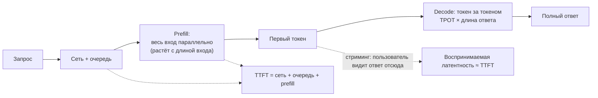

**Стриминг прячет латентность.** Если стримить токены пользователю по мере генерации, *воспринимаемая* латентность падает до TTFT — пользователь видит, что «пошло», не дожидаясь конца. Это UX-паттерн, обязательный для чат-интерфейсов.

**Латентность агентного цикла.** `N` последовательных вызовов модели складываются в `N` сетевых обходов, и их латентности суммируются, как в любой цепочке синхронных вызовов. Отсюда стандартный приём сокращения времени ответа: независимые шаги выполняют параллельно (паттерн Parallelization, гл. 11). Последовательная оркестрация из шести шагов на пользовательском пути — это шесть сложенных латентностей, часть которых обычно можно распараллелить.

**Батчинг: пропускная способность против латентности.** Continuous batching (§1.6) повышает пропускную способность ускорителя, но добавляет ожидание в очереди — стандартный размен «пропускная способность ↔ латентность одиночного запроса». Онлайновый и пакетный пути обслуживания разделяют, поскольку у них разные приоритеты.

**Пример распределения бюджета латентности.** Для пользовательского агента с SLO p95 = 3 с бюджет раскладывается по стадиям: извлечение (например, ≤300 мс), вызовы модели (≤2 с суммарно, часть параллельно), вызовы инструментов (≤500 мс), guardrails (≤200 мс). При превышении сокращают число шагов, распараллеливают независимые и применяют кэширование. Это стандартная декомпозиция бюджета латентности, применённая к стадиям LLM-конвейера.

*Источники.* Chip Huyen, «AI Engineering» (2025) — latency/serving-метрики; W. Kwon et al. (2023) — vLLM/PagedAttention. Databricks, «LLM Inference Performance Engineering: Best Practices» (2023) — определения TTFT/TPOT, формула итогового времени, ориентир 100 мс/токен (10 токенов/с, ≈450 слов в минуту) и замер TTFT 114 мс для Llama2-70B на 4×A100-40GB.

## 2.4 Детерминизм и воспроизводимость

**Даже T=0 не бит-в-бит детерминирован.** Установка temperature=0 делает выбор токена жадным, но **не гарантирует идентичный вывод между запусками**: сказываются неассоциативность операций с плавающей точкой, зависимость GPU-ядер от размера батча, различия железа и незаметные изменения бэкенда на стороне провайдера. Полагаться на побитовую воспроизводимость вывода нельзя.

**Источник шума — форма батча, а не «случайность».** Ходовое объяснение («GPU считает параллельно, атомарные сложения приходят в случайном порядке») для прямого прохода неверно: ядра forward pass детерминированы — тот же вход на том же железе даёт побитово тот же результат, и атомарного сложения в них, как правило, нет вовсе (Thinking Machines Lab, 2025). Настоящая цепочка — из четырёх звеньев.

1. **Сложение с плавающей точкой неассоциативно:** $(a+b)+c \neq a+(b+c)$. При конечной мантиссе результат зависит от порядка суммирования, а расхождение садится в младшие биты.
2. **Порядок суммирования ядро выбирает под форму батча.** Редукция (у матричного умножения — свёртка по общей размерности $k$, у внимания — по длине KV-кэша) режется на тайлы, и разбиение подбирается под текущий размер батча ради утилизации ускорителя. Другой батч → другое разбиение → другой порядок сложения → другие младшие биты логитов. Нужного здесь свойства **batch invariance** — «результат для моей строки не зависит от того, кто ещё едет в том же батче» — у стандартных ядер нет. Затронуты ровно три операции, те, что содержат редукцию: RMSNorm (нормировка активаций, §A.3), матричное умножение и внимание.
3. **Размер батча задаёт continuous batching (§1.6)** — то есть трафик соседей по батчу в эту миллисекунду. Отсюда формулировка, которую стоит произнести целиком: **при T=0 ваш вывод зависит от того, сколько чужих запросов приехало на сервер одновременно с вашим.** Это и есть главная причина недетерминизма публичных API, а не «творческая натура» модели.
4. **Жадный выбор переворачивается только на почти-ничьей.** argmax устойчив, пока разрыв между первым и вторым логитом заметно больше шума; на подавляющем большинстве позиций это так, и шум не виден вовсе. Изредка топ-2 сходятся вплотную — тогда исход решают те самые младшие биты. Порога в числах здесь нет: он свой на каждой позиции, и первоисточник его не приводит.

**Seed этот механизм не лечит.** Seed фиксирует генератор псевдослучайных чисел сэмплера, но при T=0 сэмплирование вырождено в argmax — закреплять там нечего, а шум входит выше по конвейеру, в самом прямом проходе. Seed поэтому воспроизводит выбор при T>0 на неизменном бэкенде и не отменяет ни зависимости от батча, ни расхождений между версиями и бэкендами.

**Почему расхождение «редкое, но целиком».** Прогон совпадёт с эталоном, только если не перевернулась ни одна позиция:

$$P_{\text{совпало}} = (1 - p)^{N}$$

* $P_{\text{совпало}}$ — вероятность того, что прогон совпал с эталоном бит-в-бит; безразмерная, в замере ниже — 0,078.
* $p$ — вероятность переворота argmax на одной позиции (доля позиций, где топ-2 сошлись теснее шума); безразмерная, здесь ≈ 0,0025.
* $N$ — длина генерации в токенах; здесь 1000.

*Живые числа.* Thinking Machines Lab прогнали Qwen3-235B-A22B-Instruct-2507 тысячу раз при T=0 на одном промпте по 1000 токенов: вышло **80 различных ответов**, самый частый — 78 раз из 1000. Подставляем $N = 1000$ и $P_{\text{совпало}} = 78/1000 = 0{,}078$: $(1-p)^{1000} = 0{,}078$, откуда $p = 1 - 0{,}078^{1/1000} = 1 - e^{-2{,}551/1000} \approx 0{,}0025$ — четверть процента, то есть одна почти-ничья примерно на 390 токенов.

*Словами.* На отдельном токене переворот почти невероятен, но длина возводит эту почти-невероятность в степень: на тысяче токенов побитовое совпадение становится исключением, а не нормой. Оговорка, без которой формула врёт: $p$ здесь — среднее по позициям, а реальное распределение крайне неравномерно. На большинстве позиций разрыв топ-2 велик и $p \approx 0$; вся масса сидит на редких точках ветвления. Усреднение годится для оценки, но описывает не «ровный шум».

Само ветвление видно в тех же данных. Все 1000 прогонов шли одинаково до 102-го токена; на **103-м** 992 прогона продолжили «Queens, New York», а 8 — «New York City». Дальше работает авторегрессия (§1.6): выбранный токен возвращается на вход и меняет обусловливание всего остатка — одна перевернувшаяся позиция уводит не соседнее слово, а **всю оставшуюся последовательность**. Из считанных таких точек и вырастают 80 разных ответов.

**Недетерминизм коррелирует с нагрузкой.** Раз размер батча — функция чужого трафика, то и вероятность расхождения не константа модели, а функция профиля нагрузки провайдера. Практическое проявление: eval зелёный на тихом трафике (ночь, дев-стенд, батч из одного запроса) и мигающий на пике — без единой изменённой строки кода. «Не воспроизводится у меня» здесь не отговорка, а буквальное описание среды.

**Железное правило инженера:** воспроизводимость проверяют под тем давлением батча, в котором система работает в проде, — либо флап принимают как свойство среды, а не как баг. Побитовая воспроизводимость — покупаемое свойство, а не данность: batch-invariant ядра существуют (библиотека Thinking Machines Lab, интеграция в SGLang[^t-sglang]) и дают 1000 идентичных прогонов из 1000, но стоят пропускной способности: у авторов на Qwen3-8B 26 с → 42 с после оптимизации ядра внимания (неоптимизированный вариант — 55 с), у SGLang — от +24% до +55% латентности в зависимости от бэкенда внимания и длины контекста. Эта цена оправдана там, где бит-в-бит нужен по существу (например, on-policy RL, где сэмплирование и обучение обязаны считать бит-в-бит одинаково, иначе обучение расходится), и не оправдана в прикладном агенте, которому достаточно проверки свойств.

**Следствие для тестирования.** Поскольку вывод недетерминирован даже при нулевой температуре, точечная проверка `assertEquals(expected, actual)` неприменима. Требуется проверка *свойств* вывода — оценка (гл. 17): валидность схемы, релевантность, заземлённость, а не точное совпадение строк. Это фундаментальная причина, по которой LLM-системам необходима отдельная дисциплина тестирования.

**Дрейф версий модели — операционный риск.** Провайдер обновляет модель под тем же именем — поведение сдвигается молча, и промпты, отлаженные под прежнюю версию, могут деградировать. Мера — та же, что применяется к внешним зависимостям: фиксировать версию модели (где провайдер это позволяет) и прогонять eval-набор при смене версии (регрессионное тестирование). Смена модели — это развёртывание, а не самопроизвольное обновление.

*Источники.* H. He et al. (Thinking Machines Lab), «Defeating Nondeterminism in LLM Inference» (2025) — batch invariance, эксперимент с Qwen3-235B, batch-invariant ядра и их цена. LMSYS/SGLang, «Towards Deterministic Inference in SGLang and Reproducible RL Training» (2025) — интеграция и замеры накладных расходов. Google SRE Book (2016) — регрессии и управление изменениями.

## 2.5 Надёжность: LLM как ненадёжная внешняя зависимость

Языковая модель, вызываемая по сети, представляет собой **ненадёжную внешнюю зависимость**, и к ней применяются стандартные паттерны устойчивости, разработанные для любых внешних сервисов (канонический источник — M. Nygard, «Release It!»).

**Режимы отказа:** rate limit (429), тайм-ауты, недоступность провайдера (5xx/outage), отказ по контент-фильтру, ошибка «превышена длина контекста», невалидный/оборванный вывод, деградация латентности под нагрузкой. Коварная комбинация — обрыв соединения посреди *потоковой* генерации при structured output: на руках остаётся синтаксически невалидный частичный JSON, и ловить его обязан post-hoc валидатор с ретраем (§5.5), а не парсер в happy path.

**Применимые паттерны устойчивости:**
- **Retry с экспоненциальным backoff и jitter** — на транзиентные ошибки (429/5xx; при 429 паузу ведут по заголовку `retry-after`, см. ниже).
- **Circuit breaker** — быстро отказывать во время аварии провайдера, не накапливая очередь.
- **Timeout + graceful degradation** — по тайм-ауту вернуть кэшированный, частичный или детерминированный fallback вместо зависания.
- **Bulkhead и клиентский rate limiting** — удерживаться в квотах провайдера, изолировать нагрузки друг от друга.
- **Идемпотентность действий агента** — повторные попытки здесь являются нормой, поэтому операции с побочными эффектами должны быть идемпотентными (по ключу операции, как в паттерне саги).

> ### Паттерн: Fallback Model (Резервная модель)
> **Контекст.** Доступность фичи зависит от внешнего LLM-провайдера, который может деградировать или упасть.
> **Проблема.** Как сохранить работоспособность при отказе основной модели/провайдера?
> **Силы.** Один провайдер = единая точка отказа и вендор-лок; несколько провайдеров = сложность (разные API, разное поведение, разные промпты).
> **Решение.** Поддерживают вторичную модель (другого провайдера или собственного обслуживания) и переключаются на неё при отказе или тайм-ауте основной. Вызов абстрагируют за единым провайдер-агностичным интерфейсом (такие абстракции предоставляют, например, JVM-фреймворки Spring AI и LangChain4j).
> **Механика.** Обёртка с circuit breaker: primary → при open-состоянии → secondary. Следует учитывать, что поведение моделей различается, поэтому резервная требует собственных промптов и тестов.
>
> ```mermaid
> flowchart TB
>   Req["Запрос"] --> A["Основная модель"]
>   A -->|успех| Out["Ответ"]
>   A -->|"тайм-аут / 5xx / 429"| R{"Ретраи исчерпаны?"}
>   R -->|"нет"| A2["Повтор: пауза по retry-after,<br/>иначе экспонента + джиттер"] --> A
>   R -->|"да"| CB["Circuit breaker открыт"] --> FB["Фолбэк-модель<br/>(другой провайдер / свой ярус)"]
>   FB -->|успех| Out2["Ответ (возможно, слабее)"]
>   FB -->|провал| Deg["Деградация: кэш · шаблон · очередь на потом"]
> ```
> **Результирующий контекст.** Устойчивость к отказу провайдера и меньше лок-ина; плата — двойная поддержка промптов/evals и риск деградации качества на резервной.
> **Когда применять.** Фича критична к доступности. **Когда нет.** Внутренние/некритичные сценарии, где проще подождать восстановления.
> **Связанные паттерны.** Circuit Breaker; Model Routing (резервная как «дешёвый ярус»); Graceful Degradation.
> **Источники.** M. Nygard, «Release It!» (2-е изд., 2018) — circuit breaker, bulkhead, timeout; доки Spring AI/LangChain4j — провайдер-агностичные абстракции.

Существенно, что перечисленные паттерны не специфичны для языковой модели — они применяются к любой внешней зависимости. Особенность модели как зависимости в том, что она менее надёжна, дороже и недетерминирована, поэтому дисциплина устойчивости здесь обязательна, а не факультативна.

**Чем ретрай к модели отличается от ретрая к сервису.** Оговорка выше верна на уровне механики и обманчива на уровне экономики. Повтор обращения к обычному REST-эндпоинту стоит латентности и чужого CPU; повтор обращения к модели стоит денег — и дороже всего стоит ровно в тот момент, когда провайдер деградирует. Три механизма, которых у Nygard нет, потому что там повтор для вызывающего бесплатен.

**Механизм 1: 429 приходит по нескольким осям сразу.** Провайдер ограничивает не «запросы», а несколько независимых счётчиков. У Anthropic их три — запросы в минуту (RPM), входные токены в минуту (ITPM) и выходные токены в минуту (OTPM); превышение *любого* даёт 429 с указанием, какой именно лимит выбран. У OpenAI оси свои (запросы и токены в минуту плюс суточные), и документация прямо оговаривает: срабатывает тот лимит, который исчерпан первым. Практическое следствие для клиентского ограничителя: ведро, считающее *вызовы*, будет исправно ловить 429 на длинных промптах — выбрана токенная ось, которой оно не видит. Считать надо токены.

Здесь же — расхождение вендоров, которое нельзя переносить по аналогии. OpenAI резервирует токенную квоту *до* исполнения: лимит считается как максимум из `max_tokens` и оценки по числу символов запроса, то есть завышенный `max_tokens` съедает квоту, даже если ответ вышел коротким. Anthropic — наоборот: OTPM считается в реальном времени по фактически порождённым токенам, `max_tokens` в расчёт лимита не входит вовсе, и завышать его для лимитов безнаказанно. Одна и та же настройка у одного провайдера наказывает, у другого бесплатна — та же вендор-специфичность, что у экономики кэша префикса (§20.2). Полезный побочный эффект того же кэша: у Anthropic токены, прочитанные из кэша, на большинстве моделей не засчитываются в ITPM — кэш поднимает не только счёт, но и пропускную способность в рамках того же лимита.

**Механизм 2: у 429 обычно есть готовый ответ на вопрос «когда».** Провайдер отдаёт заголовок `retry-after` — число секунд до сброса окна. Формулировка документации Anthropic не оставляет простора: «Число секунд ожидания до повтора. Более ранние попытки провалятся». Слепая экспонента при известном окне сброса — не осторожность, а серия заведомо проваленных попыток. Правило: пришёл заголовок — вести паузу по нему; экспонента с джиттером остаётся для случаев, когда провайдер окна не назвал (5xx, 529 «перегружен», обрыв соединения).

**Механизм 3: неудачная попытка уже потреблена.** Обрыв на 900-м выходном токене из 1000 не отматывает назад ни вход, ни эти 900: полезного результата нет, потребление есть. Отношение цены провала к цене успеха:

$$\frac{C_{fail}}{C_{success}} = \frac{N_{in} + k \varphi N_{out}}{N_{in} + k N_{out}}$$

Где:
* $N_{in}$ — входных токенов в запросе; в примере §2.2 — 1500.
* $N_{out}$ — выходных токенов полного ответа; там же — 400.
* $k$ — во сколько раз выходной токен дороже входного (§2.2). По всей линейке Claude на середину 2026 — ровно 5 ($5/$25 за миллион у Opus 4.8, $3/$15 у Sonnet 4.6, $1/$5 у Haiku 4.5).
* $\varphi$ — доля ответа, успевшая породиться до обрыва (0…1).
* Числитель и знаменатель выражены в условных единицах цены входного токена; отношение безразмерно.

Живые числа. Обрыв на 90% ответа ($\varphi = 0.9$): числитель $1500 + 5 \times 0.9 \times 400 = 3300$, знаменатель $1500 + 5 \times 400 = 3500$, отношение $3300 / 3500 = 0.94$ — провалившаяся попытка потребила 94% успешной и не дала ничего. Повтор потратит полные 3500 заново: 6800 вместо 3500 за один доставленный ответ.

На длинном контексте хуже, и виновата асимметрия prefill/decode (§2.2). Вход 100 000 токенов, ответ те же 400, тайм-аут сразу после prefill — ни одного выходного токена ($\varphi = 0$): $100000 / 102000 = 0.98$. Попытка, не породившая **ни одного** полезного токена, потребила 98% успешной. Словами: платят прежде всего за обработку входа, а она выполняется целиком независимо от того, дожил ли запрос до ответа; чем длиннее вход относительно ответа, тем ближе цена неудачи к цене удачи и тем меньше «повторить ещё раз» отличается от «сделать ещё один полный запрос». Оговорка о тарификации: вернёт ли провайдер деньги за оборванный посреди генерации запрос — вендор-специфично, надёжного публичного правила здесь нет, это проверяется по документации провайдера и по собственному счёту. От вендора не зависит другое: *повтор* есть полноценный новый запрос с полным prefill и оплачивается целиком.

**Ретрай-шторм и разворот семантики circuit breaker.** Цепочка замыкается сама на себя: деградация латентности → тайм-ауты → ретраи → рост нагрузки → счёт взлетает ровно тогда, когда качество на дне. SRE-книга описывает динамику в числах: 100 ретраев в секунду на первой секунде превращаются в 200, затем в 300, и всё меньшая доля обращений делает полезную работу. Опаснее то, что ретраи разных слоёв не складываются, а перемножаются:

$$A = \prod_{i=1}^{L} a_i$$

Где:
* $L$ — число слоёв, каждый из которых повторяет самостоятельно.
* $a_i$ — попыток на слое $i$ (одна исходная плюс ретраи).
* $A$ — попыток, доходящих до нижнего слоя, на одно действие пользователя. Единица — попытки.

Живые числа первоисточника: три слоя (frontend, backend, JavaScript), каждый делает 3 ретрая, то есть 4 попытки — одно действие пользователя порождает $4^3 = 64$ обращения к базе. В LLM-стеке один такой слой легко проглядеть, потому что он включён по умолчанию: официальные SDK Anthropic сами повторяют транзиентные ошибки с экспоненциальной паузой — **дважды по умолчанию**, то есть 3 попытки, — и уважают `retry-after`. Приложение, добросовестно обернувшее вызов «тремя попытками», получает $3 \times 3 = 9$ обращений к провайдеру на один запрос; добавьте ретрай на шлюзе (§20.6) — станет 27. Прежде чем добавлять свой ретрай, выясните, сколько их уже делает библиотека, и оставьте ровно один уровень.

Отсюда разворот, который стоит назвать прямо. У Nygard circuit breaker защищает *вызываемого* — не даёт добить падающий сервис. Провайдера модели ваш трафик не спасёт и не убьёт: ёмкость чужая. Предохранитель здесь защищает **кошелёк вызывающего** — прекращает платить за попытки в момент, когда их ожидаемая доходность близка к нулю. Механика та же, мотивация другая, и от неё зависит настройка: порог выставляют по скорости сгорания бюджета, а не по здоровью провайдера.

**Железное правило инженера:** бюджет ретраев задают в токенах и как долю трафика, а не числом попыток на запрос. Лимит «3 попытки» шторм не ограничивает — при полной деградации он разрешает утроить и нагрузку, и счёт. Второй, независимый предохранитель из SRE-книги — клиентский бюджет: доля ретраев в общем потоке запросов держится ниже 10%, при превышении ретраи прекращаются до восстановления. Перенос на модель прямой, с одной поправкой: долю считают в токенах, а не в запросах (§2.2) — платят за токены.

*Источники.* M. Nygard, «Release It!» (2018); Google SRE Book (2016) — «Handling Overload» (бюджет ретраев: 3 попытки на запрос, доля ретраев ниже 10%) и «Addressing Cascading Failures» (перемножение попыток по слоям, $4^3 = 64$; рост шторма 100 → 200 → 300 запросов в секунду); документация Anthropic — Rate limits (оси RPM/ITPM/OTPM, `retry-after`, ITPM с учётом кэша), Errors (ретраи SDK по умолчанию, 529) и Pricing (отношение цены выхода к цене входа); документация OpenAI — Rate limits (оси лимитов, резервирование квоты по `max_tokens`).

## 2.6 Hosted против Self-Host: рамка решения

Не идеологический выбор, а инженерный размен по осям:

| Ось | Hosted API | Self-host (собственная инфраструктура) |
|---|---|---|
| Стоимость при масштабе | Поштучно; дорожает линейно с объёмом | Капзатраты + утилизация; дешевле при высоком стабильном объёме |
| Латентность | Зависит от провайдера и сети | Под контролем оператора |
| Резидентность/комплаенс данных | Данные уходят наружу | Данные не покидают периметр |
| Кастомизация | Ограничена | Полная (fine-tuning open-weight, гл. 21) |
| Выбор модели / лок-ин | Каталог провайдера, лок-ин | Любая open-weight |
| Операционная нагрузка | Минимальна | Эксплуатация GPU-инференса (vLLM и т.п.) |

Self-host предполагает зрелую инфраструктурную практику: оркестрацию GPU-нагрузок и эксплуатацию серверов инференса. При её наличии он реалистичен, но не оправдан для низкого или пикового объёма, где hosted проще и дешевле.

**Средний ярус: managed-инференс открытых моделей.** Между полюсами таблицы существует третий вариант — serverless GPU-инференс open-weight моделей у специализированных провайдеров (Together, Fireworks, Baseten и аналоги): открытые веса и свобода выбора модели (включая собственные LoRA-адаптеры) — без владения GPU-инфраструктурой. Закрывает случай «нужна конкретная открытая или дообученная модель, но нет команды для эксплуатации vLLM»; по резидентности и комплаенсу при этом ближе к hosted (данные уходят к провайдеру яруса), чем к self-host.

**Точка безубыточности (иллюстративный расчёт).** Порядок величин: аренда узла с одним GPU серверного класса — единицы тысяч долларов в месяц; точка безубыточности ≈ аренда / смешанная цена за миллион hosted-токенов. При $3000/мес и смешанном тарифе $2–5 за миллион это 0.6–1.5 млрд токенов в месяц, то есть **20–50M токенов в сутки устойчивой загрузки** — в разы больше, чем типичная одиночная функция (пример §2.2: ~9.5M токенов в сутки, при смешанном тарифе $1–2 за миллион — порядка $300–600 в месяц на API). Отсюда практический вывод: self-host редко окупается одной функцией — его окупает *портфель* нагрузок с высокой утилизацией; пиковый профиль ухудшает счёт (провижининг по пику), фоновые batch-нагрузки — улучшают. Цифры иллюстративны, структура расчёта — нет.

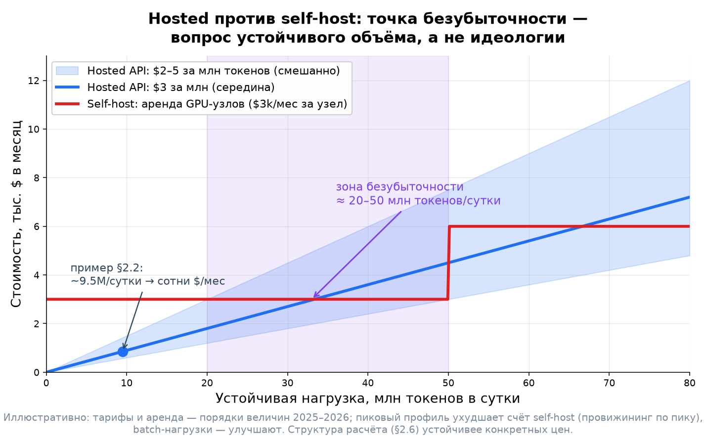

**Гибрид (типовой паттерн 2026).** Hosted-фронтир для трудных/редких задач + self-hosted маленькая модель для высокочастотных узких задач (например, извлечение полей). Оптимизация стоимости при сохранении качества там, где оно нужно. Детально — гл. 22.

*Источники.* Chip Huyen, «AI Engineering» (2025) — build vs buy, serving-экономика.

## 2.7 Спецификация фичи в бюджетах (артефакт архитектора)

Материал главы сводится в артефакт — **нефункциональную спецификацию функции**, адаптированную под особенности языковой модели:

> **Шаблон: NFR-спецификация LLM-фичи**
> - **Латентность:** SLO p95 (TTFT и полное), стриминг да/нет.
> - **Стоимость:** бюджет на запрос и на месяц; ярус модели; кэширование.
> - **Качество:** пороги evals (faithfulness/релевантность/валидность схемы), gate в CI.
> - **Детерминизм:** требуемый уровень; temperature; пиннинг версии модели.
> - **Доступность:** цель + стратегия отказа (fallback-модель, degradation).
> - **Безопасность/комплаенс:** резидентность данных, guardrails (гл. 19).

Заполненная спецификация выносится на проектное ревью. Она переводит намерение «добавить LLM» в инженерное решение с измеримыми свойствами — то, чего недостаёт большинству пилотных проектов, не доходящих до промышленной эксплуатации.

*Источники.* Google SRE Book (2016) — SLO/SLI/бюджеты; Chip Huyen, «AI Engineering» (2025).

**На полях главы 2**

[^t-reasoning]: **Reasoning-модель** — модель, обученная перед ответом порождать длинную внутреннюю цепочку рассуждения (o-серия, DeepSeek-R1 и последователи); рассуждение тарифицируется как выходные токены. → §13.8; ⇐ Глоссарий.
[^t-sglang]: **SGLang** — открытый сервер инференса LLM (программа, которая держит модель на ускорителе и обслуживает поток запросов); известен префиксным кэшированием RadixAttention. → гл. 22.

# Часть II. Интерфейс к модели

В Части I модель рассмотрена как компонент с определённым набором свойств (§1.10) и бюджетами (гл. 2). Часть II посвящена его **интерфейсу** — тому, как модели сообщается намерение и как ограничивается её вывод. Три главы: проектирование запроса (гл. 3), проектирование контекста (гл. 4), структурированный вывод и надёжный разбор (гл. 5).

# Глава 3. Prompt engineering как проектирование контракта

## 3.1 Рамка: промпт как спецификация интерфейса

Базовый промпт-инжиниринг обычно понимается как «формулирование хороших запросов». При проектировании системы существеннее иная рамка: промпт — это спецификация интерфейса к вероятностному компоненту, который (а) недетерминирован, (б) читает инструкции и данные в едином текстовом канале, (в) может выполнить требование частично. Соответственно, задача состоит не в подборе удачных формулировок, а в том, чтобы *специфицировать* вход, *ограничить* вывод и *обработать* случаи неполного или неверного выполнения. Дальнейшие разделы разбирают средства для каждой из трёх задач; их пределы очерчены в §3.7, за которыми лежат RAG[^t-rag] (знание), структурированный вывод (гарантии формата) и guardrails (безопасность).

## 3.2 Анатомия промпта

Промпт в проде — не строка запроса, а собранная структура. Компоненты и их роль:

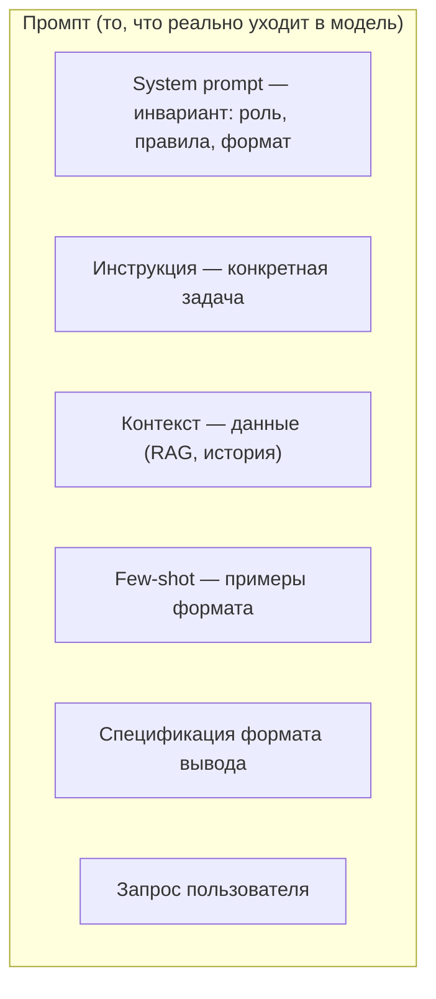

Порядок компонентов существен: из-за позиционного смещения (§1.8) модель полнее учитывает начало и конец. Типовая раскладка — инвариант и требуемый формат в начало (system-часть); критичные данные в начало или конец пользовательской части, но не в середину.

**Единый канал инструкций и данных.** Принципиальная особенность интерфейса: модель получает и инструкции, и данные одним текстовым потоком и не различает их автоматически. Поэтому границы между ними задают явно — разделителями (XML-теги, размеченные блоки), помечая недоверенное содержимое (пользовательский ввод, извлечённые документы, результаты инструментов) как данные. Это одновременно повышает ясность и служит первой линией защиты от prompt injection (гл. 19), при которой инструкции, внедрённые в данные, перехватывают управление.

**Иерархия инструкций (instruction hierarchy).** Частично та же проблема адресуется на уровне обучения модели: современные модели обучены ранжировать источники инструкций по приоритету — system выше developer, developer выше user, а содержимое от инструментов и данных ниже всех (E. Wallace et al., «The Instruction Hierarchy», OpenAI, 2024; направление продолжает развиваться в 2025–2026). Это повышает устойчивость к попыткам данных перехватить управление, но, как всякая выученная защита, вероятностно и обходится адаптивной атакой (§19.5) — структурное обособление недоверенного контента остаётся обязательным.

## 3.3 Каталог паттернов промптинга

Мини-паттерны (каждый — с условиями применимости):

- **Role / Persona priming** — задание роли («специалист поддержки, отвечающий строго по регламентам»). Сужает пространство ответов. *Когда:* практически всегда полезно в system-части.
- **Few-shot / демонстрации** — задание формата и поведения примерами вместо словесного описания. Существенны число примеров, их отбор (репрезентативность, покрытие граничных случаев) и порядок — эти факторы измеримо влияют на результат. *Когда:* задачи, чувствительные к формату, специфический стиль вывода. *Когда нет:* если модель справляется по инструкции, примеры лишь расходуют токены.
- **Chain-of-Thought (CoT)** — указание выдать промежуточные шаги рассуждения. Повышает точность на многошаговых задачах (§3.4). *Плата:* дополнительные токены и латентность.
- **Декомпозиция** — разбиение единого крупного промпта на последовательность узких шагов (паттерн Prompt Chaining, гл. 11). Каждый шаг проще специфицировать и проверить.
- **Спецификация формата вывода** — описание схемы (мягкое средство) или принуждение к ней (сильное, гл. 5). Для вывода, передаваемого в парсер или инструмент, применяют принуждение.
- **Разделители и структура** — явное отделение инструкций от данных (см. §3.2); одновременно первая линия защиты от prompt injection (гл. 19).
- **Prefilling (предзаполнение ответа)** — подстановка начала ответной реплики модели, чтобы задать формат её продолжения (например, открывающая скобка `{` принуждает к JSON, а заголовок задаёт структуру). Эффективный способ ограничить форму вывода без внешнего механизма.
- **Разрешение отказа от ответа** — явное дозволение ответить «недостаточно данных» или «не знаю». Снижает склонность к выдумыванию на входах без ответа (§1.9) и особенно важно в RAG, где ответ должен опираться на контекст (§6.7).
- **Позитивная формулировка вместо негативной** — указание, что *следует* делать, работает надёжнее запрета «не делай X»: модель точнее следует предписанному действию, чем отрицанию.

## 3.4 Chain-of-Thought — подробнее

**Что это.** Chain-of-Thought (CoT) — приём, при котором модель порождает промежуточные шаги рассуждения перед финальным ответом. Wei et al. (2022) показали, что это заметно повышает точность на арифметике, логике и многошаговых задачах.

**Почему работает.** Объяснение опирается на объём вычислений на токен. За один проход (forward pass) модель выполняет фиксированный объём вычислений — трансформер не CPU с циклом: внутри одного прохода нет механизма повторить вычисление произвольное число раз (фиксированное число слоёв, по одному проходу через каждый), — поэтому задачу, требующую многих шагов, негде «свернуть» в один шаг. CoT выносит промежуточные шаги в выходные токены, увеличивая объём *последовательного* вычисления: каждый порождённый шаг рассуждения становится частью входа для следующего. Промежуточное рассуждение играет роль внешнего черновика, которого модель лишена в пределах одного прохода.

**Варианты:**
- **Zero-shot CoT** (Kojima et al., 2022) — достаточно инструкции рассуждать пошагово, без примеров.
- **Few-shot CoT** — примеры с явно показанным ходом рассуждения.
- **Self-consistency** (Wang et al., 2022) — порождение нескольких цепочек рассуждения (при повышенной температуре) и выбор ответа по большинству; дороже, но точнее на трудных задачах.

**Когда применять.** CoT оправдан на задачах, требующих многошагового вывода (вычисления, логика, планирование); на простых задачах извлечения или классификации он лишь расходует токены и латентность без выигрыша.

**Сдвиг ландшафта (2025+).** Reasoning-модели — сначала специализированные (o-серия, DeepSeek-R1), к 2026 году штатный режим большинства передовых моделей — обучены выполнять развёрнутое рассуждение *внутри себя* методами обучения с подкреплением; для них явная инструкция «рассуждай пошагово» часто избыточна, а иногда ухудшает результат. Управляемым параметром становится не наличие CoT в промпте, а бюджет внутреннего рассуждения модели (§13.8).

*Источники.* J. Wei et al., «Chain-of-Thought Prompting Elicits Reasoning in LLMs» (2022); T. Kojima et al., «Large Language Models are Zero-Shot Reasoners» (2022); X. Wang et al., «Self-Consistency Improves Chain of Thought Reasoning» (2022).

## 3.5 Системный промпт как инвариант

**Содержимое system-промпта** — долговременная роль, жёсткие ограничения, формат вывода, правила безопасности, то есть то, что не меняется от запроса к запросу. Не помещаются в него изменчивые данные (они относятся к контексту запроса) и, что критично, **секреты**: system-промпт подвержен утечке (prompt leakage, риск OWASP LLM07[^t-owasp], гл. 19), поэтому ключи, строки подключения и внутренние адреса в нём не размещают, а контроль доступа реализуют вне модели.

**Стабильность и кэширование.** Стабильный system-промпт — оптимальный кандидат на prompt caching (§2.2): его константную часть выносят в кэшируемый префикс.

## 3.6 Промпт как код

Промпты являются производственными артефактами и требуют соответствующего обращения: версионирования, шаблонизации (переменные вместо конкатенации строк), ревью изменений, тестирования через оценку (гл. 17). Изменение промпта — это развёртывание: оно способно изменить поведение системы так же, как изменение кода. Отсюда применимость стандартной дисциплины управления изменениями — фиксация версий, ревью, регрессионное тестирование, канареечные выкатки. Внесение правок в промпт непосредственно в промышленной среде, вне процесса развёртывания, несёт тот же риск неконтролируемого изменения поведения, что и любое изменение в обход конвейера.

## 3.7 Границы промпт-инжиниринга

Честно о пределах — это позиционирует Часть II в целом. Промпт **не может**:
- надёжно внести большой объём меняющегося знания → это **RAG** (Часть III);
- гарантировать валидную схему вывода → это **structured output** (гл. 5);
- полностью предотвратить prompt injection → нужны **guardrails** (гл. 19);
- прочно и в масштабе привить новую форму/стиль/формат вызова инструментов → это **fine-tuning** (гл. 21).

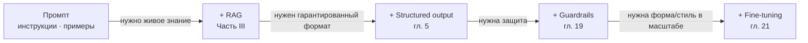

Последовательность (та же лестница): **сначала промптинг, эскалация — только когда он упёрся.** Большинство задач закрывается хорошим промптом плюс RAG; fine-tuning и мультиагент — это верх лестницы, куда лезут по доказанной необходимости. Промпт-инжиниринг — дешёвый, мгновенный, обратимый первый инструмент; именно поэтому он первый.

*Источники.* J. Wei et al. (2022), T. Kojima et al. (2022), X. Wang et al. (2022); Z. Sprague et al., «To CoT or not to CoT?» (2024) — мета-анализ: выигрыш CoT сосредоточен в математике и символьных задачах; документация Anthropic/OpenAI по промптингу; Chip Huyen, «AI Engineering» (2025).

**На полях главы 3**

[^t-rag]: **RAG** — Retrieval-Augmented Generation: релевантное знание извлекается из внешних источников и подаётся в контекст, вместо надежды на «память» модели. → гл. 6; ⇐ Глоссарий.
[^t-owasp]: **OWASP LLM07** — позиция в «OWASP Top 10 for LLM Applications», ранжированном списке рисков LLM-приложений от Open Worldwide Application Security Project; LLM07 — утечка системного промпта. → §19.3.

# Глава 4. Context engineering и паттерны управления контекстом

## 4.1 Смена единицы проектирования

Prompt engineering (гл. 3) оптимизирует формулировку задачи. **Context engineering** оптимизирует *весь* набор токенов, собираемый в окно на каждом шаге инференса. Этот сдвиг произошёл не случайно: как только агенты стали многошаговыми, а окна — большими, узким местом перестало быть «как сформулировать просьбу» и стало «какую информацию, в каком виде, в каком месте окна и в рамках какого бюджета подать». Формулировка задачи — это доли процента контекста продвинутого агента; остальное — системная инструкция, извлечённые знания, история, определения инструментов, промежуточные результаты.

Дадим строгое определение. **Context engineering** — это дисциплина динамического конструирования входного контекста модели: отбор, форматирование, упорядочивание и сжатие нужной информации (инструкции, извлечённые знания, история, определения инструментов, примеры) в рамках токен-бюджета, отдельно для каждого шага инференса.

Полезная формулировка: контекст — это состояние, собираемое для компонента без состояния. Модель не сохраняет ничего между вызовами (§1.10); всё, чем она оперирует в данный момент, помещено в контекст на этом шаге. Следовательно, инженерия контекста — это управление состоянием для stateless-компонента в условиях жёсткого бюджета: на каждом шаге заново решается, какое состояние реконструировать в окне и в каком виде.

## 4.2 Анатомия контекста: кто борется за бюджет

Окно — это конечный бюджет, и за него конкурируют потребители с разными профилями «польза/стоимость»:

| Потребитель | Что даёт | Чем платит |
|---|---|---|
| System prompt | Инвариант поведения, формат | Постоянные токены каждый вызов (кэшируется, §2.2) |
| Определения инструментов | Возможность действовать | Могут быть большими; много инструментов = много токенов и путаница выбора |
| Few-shot примеры | Формат/поведение | Дорого при большом числе примеров |
| История диалога | Непрерывность | **Растёт неограниченно** — главный источник переполнения |
| Извлечённые чанки (RAG) | Свежие/приватные факты | Токены + риск дилюции при переборе |
| Scratchpad / промежуточные результаты | Многошаговое рассуждение | Накапливаются в агентном цикле |
| Запрос пользователя | Собственно задача | Мал |
| **Генерация (ответ модели)** | Собственно результат | Делит **тот же** бюджет со входом: `max_tokens` вычитается из окна (§1.8) |

Задача проектирования — распределить бюджет: что включить, что сжать, что вынести за пределы окна.

Компонентно инженерия контекста — это слой *сборки*, сводящий разнородные источники в единое окно под бюджетом:

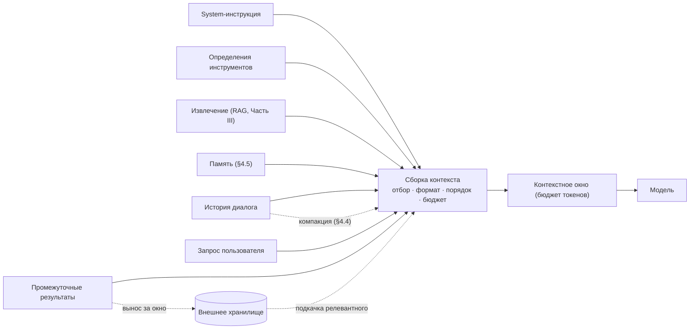

## 4.3 Силы: почему это нетривиально

Инженерия контекста — это **оптимизация с ограничениями**, потому что в ней сталкиваются:

- **Конечный бюджет** — жёсткий потолок окна.
- **Деградация от объёма** (§1.8) — «lost in the middle» и дилюция внимания означают, что *больше контекста ≠ лучше*; после некоторого объёма добавление токенов *ухудшает* ответ. Плюс важно *место*: критичное — по краям.
- **Стоимость** (§2.2) — каждый токен оплачивается на *каждом* вызове; в агентном цикле контекст ещё и растёт.
- **Размен relevance ↔ recall** — включить больше (не упустить нужное) против включить меньше (не зашуметь). Тот же размен, что в поиске.
- **Устаревание** — история и результаты инструментов протухают внутри сессии; старый результат может противоречить новому.

Цель — максимум релевантного сигнала при минимуме токенов и шума.

### Deep Dive: механика и эмпирика деградации контекста

Тезис «больше ≠ лучше» стоит подкрепить механизмом и измерениями, иначе это вера.

**Механика: бюджет внимания нормирован в единицу.** Причина деградации собрана ещё в §1.4 — её остаётся достать. Шаг 3 трассировки блока внимания: `softmax` превращает оценки совместимости в веса **с суммой ровно 1** — «бюджет внимания» токена, распределённый по всем токенам, которые ему видны. Существенно здесь то, что бюджет **не растёт с длиной контекста**: и тысяча токенов, и сто тысяч делят одну и ту же единицу. Отсюда разбавление — не метафора, а игра с нулевой суммой: каждый добавленный токен отнимает вес у уже присутствующего материала. Эту величину важно не путать с «конечным бюджетом» из списка выше: там потолок окна в *токенах*, который вендор волен поднять хоть до миллиона; здесь — нормировка в *единицу*, которую не поднимет никто и никогда.

Насколько отнимает — считается точно. Пусть искомый факт («игла») получил оценку совместимости на Δ выше, чем каждый из n токенов нерелевантного «стога»:

$$w^{*} = \frac{e^{s}}{e^{s} + n \cdot e^{s-\Delta}} = \frac{1}{1 + n \cdot e^{-\Delta}}$$

*Легенда.* $w^{*}$ — доля бюджета внимания, доставшаяся игле: безразмерная, от 0 до 1. $n$ — число токенов-отвлекателей в окне (штук; в рабочих окнах 10³–10⁶). $\Delta$ — разрыв в оценках совместимости между иглой и рядовым токеном стога, уже после деления на $\sqrt{d_{head}}$ (§1.4): безразмерный, и «типичного» табличного значения у него нет — поэтому зафиксируем Δ = 10 не как замер, а как условие задачи: разрыв, при котором на 1000 токенов игла собирает 96% бюджета, то есть модель видит её уверенно. $s$ — сырая оценка иглы; в правой части она сокращается, и это первый вывод: абсолютная «уверенность» модели не значит ничего, работает только разрыв.

*Живые числа* при Δ = 10, где $e^{-10} = 4.5 \cdot 10^{-5}$. Знаменатель $1 + n \cdot 4.5 \cdot 10^{-5}$ растёт вместе со стогом:

| n (токенов стога) | Знаменатель | $w^{*}$ |
|---|---|---|
| 1 000 | 1 + 0.045 = 1.045 | **0.96** |
| 10 000 | 1 + 0.45 = 1.45 | **0.69** |
| 100 000 | 1 + 4.54 = 5.54 | **0.18** |

*Словами:* модель не передумала. Δ осталось равным 10, оценка иглы не изменилась ни на йоту — вырос только знаменатель. Стог из ста тысяч токенов, каждый из которых по отдельности ничтожен ($e^{-10}$ против единицы), сообща забрал 82% бюджета: числом, а не качеством. Это и есть вывод того, что §1.8 приводит без доказательства: внимание распределяется «тоньше» ровно потому, что сумма зафиксирована.

**Почему это не лечится уверенностью модели.** Чтобы удержать те же 96% на 100 000 токенов, разрыв должен вырасти с 10 до 14.6 — ровно на $\ln 100 = 4.6$: удержание доли требует роста Δ пропорционально $\ln n$. Расти неоткуда, хотя причина тоньше, чем «веса заморожены». Верхняя граница на Δ — произведение четырёх сомножителей (с точностью до множителя 2): спектральных норм матриц $W_q$ и $W_k$ — то есть наибольшего растяжения, которое матрица способна дать вектору, — и норм самих векторов-представлений, запроса и ключей (Veličković et al., 2025, Prop. 3.1). На инференсе заморожены только первые два: нормы представлений зависят от входа и сами по себе могли бы расти вместе с ним. Их удерживает нормализация слоя (RMSNorm, §1.4), выравнивающая масштаб векторов на каждом блоке, — и только оба факта вместе замыкают потолок. Первоисточник формулирует то же самое с обратной стороны, озаглавливая раздел «резкость требует больших весов»: удержать резкость на растущем n можно, лишь если чему-то позволено расти, — а в замороженной нормализованной модели такого множителя нет. Отсюда доказанный результат: при ограниченном разбросе оценок любой вес внимания зажат в коридор $\frac{1}{n} e^{-\delta/\theta} \le w \le \frac{1}{n} e^{\delta/\theta}$ и ведёт себя как Θ(1/n) — с ростом n неизбежно сползает к равномерному распределению (там же, Lemma 2.1; $\delta$ — разброс оценок между максимальной и минимальной, $\theta$ — температура softmax, в обычном внимании равна 1). Преимущество иглы — постоянный множитель $e^{\Delta} \approx 22\,000$, а постоянный множитель не обгоняет линейно растущий знаменатель. При 100k токенов равномерная доля — $10^{-5}$: игла живёт в константу раз выше этого пола, но вместе с ним и опускается.

**Края: нормировка объясняет один из двух.** Из суммы 1 следует равномерное разбавление — но не U-образная асимметрия. Один край она всё же объясняет, и тем же механизмом: раз веса обязаны дать в сумме единицу, обнулить их все нельзя — когда токену нечего искать в прошлом, излишек бюджета некуда девать, и модель **сбрасывает** его на первые токены последовательности, видимые всем последующим в силу авторегрессии. Это **attention sink** — «сток внимания», уже знакомый по роли BOS (§1.2); в замерах Xiao et al. на последовательностях 4096 токенов доля первого токена превышает 50% внимания в большинстве слоёв (кроме двух нижних). Начало «горячее» не потому, что там важное, а потому, что оно служит свалкой излишка. А вот recency (сохранность конца) и провал именно в *середине* из нормировки не выводятся: за них отвечают позиционное кодирование и распределение длин в обучающих данных. Честная граница механизма: сумма 1 объясняет, почему с ростом n слепнет всё и почему начало удерживает вес; U-кривая ниже остаётся эмпирикой, а не следствием.

**Инженерный инвариант.** На инференсе Δ не настраивается: веса заморожены, и более настойчивая формулировка промпта не поднимет вес факта против стотысячного знаменателя. Единственная величина в руках инженера — n. Поэтому большая часть дальнейшего каталога (§4.4) — про уменьшение знаменателя: извлекать вместо подачи целиком (§1.8), резать вывод инструментов, изолировать суб-агентов, — а не про то, чтобы попросить модель быть внимательнее.

**U-образная кривая (Liu et al., 2023).** В исходном исследовании «Lost in the Middle» модели тестировали на задачах с несколькими документами, варьируя *позицию* релевантного документа. Результат — характерная U-образная зависимость точности от позиции: высокая, когда нужный факт в начале или конце контекста, и заметно проседающая в середине. Причём провал в середине бывает настолько силён, что модель с релевантным фактом посреди длинного контекста отвечает *хуже, чем модель вообще без этого контекста* — «открытая книга» оказалась хуже «закрытой». Primacy (начало) и recency (конец) — два «горячих» края внимания.

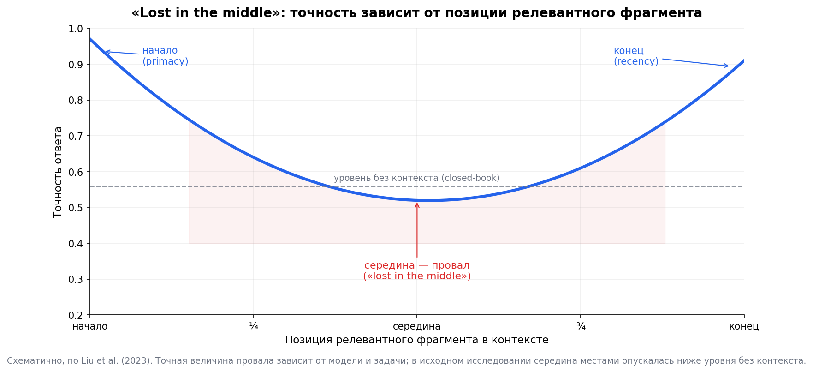

**Методология needle-in-a-haystack (NIAH).** Практический способ измерить эффект на конкретной модели и задаче: вставить «иголку» (уникальный факт, например «секретный код — 7492») в «стог» нерелевантного текста на разных глубинах и при разных длинах контекста, запросить факт и построить тепловую карту «глубина × длина → найдено/нет». Это стало стандартным smoke-тестом длинного контекста (популяризирован G. Kamradt, 2023). Важная оговорка: базовый NIAH с одной иголкой — *лёгкий* тест; реальные задачи требуют *нескольких* фактов и *рассуждения* по ним, где деградация сильнее. Отсюда варианты multi-needle и reasoning-over-context.

**Различие моделей и «context rot».** Величина деградации сильно зависит от модели: одни держат 100k+ почти без провала на простом NIAH, другие «плывут» уже на 32k. Но даже сильные на NIAH модели деградируют на *сложных* задачах с ростом длины — эффект, который практики называют **context rot**: качество рассуждения падает по мере заполнения окна, даже если формально всё «влезло» и простой поиск работает. Практический вывод: заявленный размер окна не следует принимать за рабочий; деградацию измеряют на конкретной задаче (multi-needle и рассуждение по контексту), а не на простом поиске. Размер окна «1M токенов» не означает эффективного рассуждения на 1M. Контринтуитивная деталь из того же исследования: *связный*, хорошо структурированный длинный контекст может деградировать качество сильнее перемешанного — упорядоченность не является автоматическим хеджем против деградации.

*Источники.* N. Liu et al., «Lost in the Middle: How Language Models Use Long Contexts» (2023); G. Kamradt, «Needle In A Haystack» (2023) — методология оценки длинного контекста; Chroma Research, «Context Rot: How Increasing Input Tokens Impacts LLM Performance» (Hong, Troynikov, Huber, 2025) — 18 моделей, включая эффект структурированности контекста. P. Veličković, C. Perivolaropoulos, F. Barbero, R. Pascanu, «Softmax is not Enough (for Sharp Size Generalisation)» (arXiv 2024; ICML 2025) — Lemma 2.1: при ограниченных оценках веса внимания ведут себя как Θ(1/n). G. Xiao, Y. Tian, B. Chen, S. Han, M. Lewis, «Efficient Streaming Language Models with Attention Sinks» (2023) — attention sink как следствие нормировки softmax.

## 4.4 Каталог паттернов управления контекстом

- **Retrieval (RAG) как отбор контекста** — вместо хранения всего знания в окне извлекается только релевантное под запрос (Часть III). Доминирующий паттерн для знаний.
- **Sliding Window / усечение** — держать последние `N` ходов истории, старое отбрасывать. Просто, дёшево; теряет дальнюю память. Годится, когда старое реально не нужно.
- **Externalized state / scratchpad** — промежуточные результаты пишутся во внешнее хранилище, а в контексте остаются только указатели или выжимка. Окно освобождается от объёмного рабочего состояния, которое реконструируется по запросу.
- **Context isolation / суб-агенты** — каждому суб-агенту выделяется *собственный чистый минимальный контекст* вместо одного растущего загрязнённого окна (мультиагент, гл. 14). Разделение контекстов не даёт одному длинному взаимодействию зашумить остальные (подробно — deep-dive ниже).
- **Tool-result pruning** — не хранить полный многословный вывод инструмента в контексте; извлекать/сжимать нужное. Иначе один болтливый инструмент съедает бюджет.
- **Placement / ordering** — критичное по краям окна (§1.8), недоверенные данные — в обособленный блок (§4.6).
- **Context caching** — переиспользовать стабильный префикс ради стоимости/латентности (§2.2).

Один паттерн в полном шаблоне — самый неочевидный и практичный для длинных сессий:

> ### Паттерн: Context Compaction (Сжатие контекста скользящим резюме)
> **Контекст.** Долгий многошаговый диалог/цикл агента: история и промежуточные результаты растут и приближаются к пределу окна.
> **Проблема.** Как сохранить непрерывность (агент помнит, что уже сделано и решено), не переполнив окно и не заплатив за раздувание контекста?
> **Силы.** Держать всю историю — переполнение и дилюция; тупо обрезать старое — потеря важных ранних решений/фактов.
> **Решение.** По мере приближения к порогу бюджета **сжимайте старую часть истории в резюме** (rolling summary): агент периодически «конспектирует» пройденное, и в контексте остаётся `резюме прошлого + последние N ходов дословно`. Резюме обновляется инкрементально.
> **Механика.** Триггер по достижении доли бюджета → вызов модели «сожми диалог до ключевых фактов, решений, открытых вопросов» → заменить старые ходы этим резюме. Обычно суммаризацию делают дешёвой моделью (ярус, §2.2).
> **Пример.** Агент разбора инцидента за много шагов: держит «резюме расследования» + последние действия, а не весь лог целиком. Тот же механизм работает в потребительских чат-интерфейсах: длинный диалог не упирается в отказ по длине (§1.8) лишь потому, что оболочка молча сжимает историю за пользователя. Здесь полезно видеть две стороны одного предела: API отказывает жёстко и явно, продуктовая оболочка тот же предел прячет — а вместе с ним прячет и потерю деталей.
> **Результирующий контекст.** Постоянный размер контекста при сохранённой сути; плата — суммаризация лоссова (можно потерять деталь, которая позже окажется важной) и стоит вызова модели.
> **Когда применять.** Длинные сессии/циклы, где история существенно превышает разумный бюджет. **Когда нет.** Короткие взаимодействия — проще держать всё; или когда важна *каждая* деталь дословно (тогда externalize state с точным извлечением, а не сжатие).
> **Связанные паттерны.** Sliding Window (грубая альтернатива); Externalized State (когда нужна точность, а не сжатие); Retrieval-based memory (§4.5).
> **Источники.** Anthropic, инженерные заметки об эффективном контексте (2024–2025); паттерны памяти агентов в V. Dibia, «Designing Multi-Agent Systems» (2025).

### Deep Dive: как сжимать (иерархия и структурированные заметки)

Паттерн Compaction отвечает «когда»; этот раздел — «как», потому что наивная суммаризация теряет не то и накапливает ошибку.

- **Что сохранять vs сжимать.** Не всё в истории равноценно. Сохраняйте *дословно*: принятые решения и их обоснования, установленные факты/ограничения, открытые вопросы, идентификаторы (id заказов, имена файлов). Сжимайте: рассуждения-черновики, тупики, болтовню. Правило: *решения и факты — дословно, путь к ним — в резюме.*
- **Рекурсивная/иерархическая суммаризация.** Для очень длинных историй сжимают не «всё сразу», а уровнями: блоки → резюме блоков → резюме резюме (как map-reduce). Устойчивее к пределу окна самой суммаризации и даёт многоуровневую память (детальную для недавнего, грубую для давнего).
- **Структурированные заметки вместо прозы.** Прозаическое резюме само подвержено разбавлению и искажающему перефразированию. Надёжнее вести *структурированное* состояние — не абзац, а структуру с полями `решения[]`, `факты[]`, `открытые_вопросы[]`, `сущности{}` (связь со structured output, гл. 5). Оно компактнее и устойчивее к искажению смысла при пересказе: поддерживается не пересказ, а структурированная рабочая модель задачи.
- **Накопление ошибки.** Каждая повторная суммаризация — операция с потерями над уже сжатым с потерями резюме, поэтому ошибки накапливаются от поколения к поколению. Митигация: сжимать *исходную* историю, а не резюме от резюме, и держать «якорные» факты дословно вне цикла сжатия.

**Нативные примитивы провайдера (2025+).** Прежде чем строить сжатие и память самостоятельно, проверьте, что уже даёт API. У Anthropic это **context editing** — автоматическое вытеснение устаревших результатов инструментов из растущего контекста — и **memory tool** — файловая память, которой модель управляет через инструмент и которая переживает сессию (бета `context-management-2025-06-27`); по данным Anthropic на 100-ходовом сценарии, context editing сам по себе сокращает расход токенов до ~84%, а добавление memory tool поднимает прирост качества с ~29% до ~39%. Аналогичные механизмы появляются и у других провайдеров. Паттерны этой главы примитивы не отменяют — они реализуют их за вас в готовом виде; проектным решением остаётся политика: что считать устаревшим и что достойно памяти (memory tool — готовая реализация контура записи-чтения из §4.5).

### Deep Dive: изоляция контекста суб-агентами

Один из важнейших современных приёмов масштабирования агентов — поэтому механикой, а не строкой.

**Проблема.** По мере роста задачи один агент накапливает в окне всё: инструкции, промежуточные результаты десятка под-задач, вывод инструментов. Контекст зашумляется — начинается дилюция (§4.3) и рост стоимости. Плюс разные под-задачи требуют разных инструментов/инструкций, конкурирующих за одно окно.

**Механика.** Оркестратор (гл. 11, 14) декомпозирует задачу и запускает **суб-агентов, каждый со своим чистым минимальным контекстом**: только нужные инструменты, только релевантные данные, только своя инструкция. Суб-агент возвращает *сжатый результат* (не всю внутреннюю траекторию) обратно оркестратору. «Грязный» рабочий контекст под-задачи не протекает ни в оркестратор, ни в соседей.

Механически изоляция выглядит так:

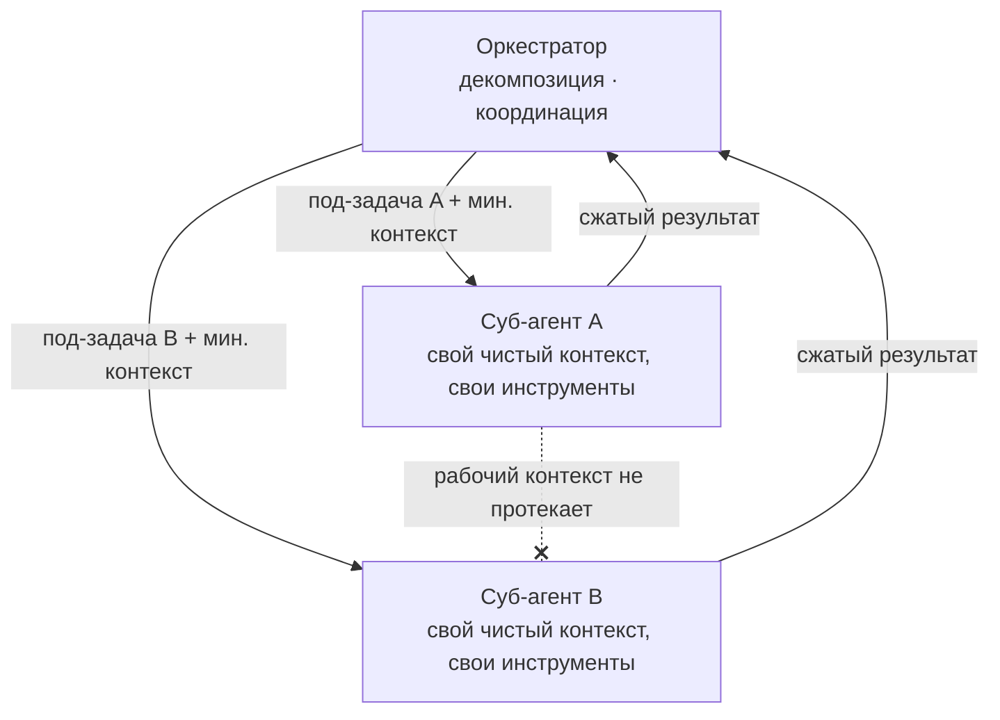

Рабочий («грязный») контекст под-задачи не протекает ни в оркестратор, ни в соседние суб-агенты — наружу выходит только сжатый результат. По сути это декомпозиция единого монолитного контекста на изолированные области с чёткой зоной ответственности каждой.

**Компромиссы.** Плюс: каждый агент на коротком фокусированном контексте (меньше дилюции, дешевле на шаг, проще набор инструментов). Минус: множатся вызовы (стоимость, §2.2), усложняется координация и отладка (гл. 14), риск потери контекста *между* агентами (сосед не видит того, что знает другой). Правило (лестница): изоляция оправдана, когда единый контекст реально зашумился или под-задачи требуют несовместимых инструментов; для простого линейного процесса — оверинжиниринг.

*Источники.* Anthropic, материалы о мультиагентных исследовательских системах и контекстной изоляции (2024–2025); V. Dibia, «Designing Multi-Agent Systems» (2025).

### Deep Dive: механика prompt/prefix caching

Раз context caching — рычаг стоимости (§2.2), важно понимать, что именно кэшируется и что кэш ломает.

- **Кэшируется общий *префикс* как KV-cache[^t-kv].** Провайдер сохраняет результат prefill (§1.6) для начала промпта и переиспользует на следующих запросах с тем же началом — платите только за «хвост». Экономит и латентность (не пересчитывать prefill длинного system-промпта), и деньги (кэш-токены сильно дешевле).
- **Условие — точное совпадение префикса, посимвольно, с начала.** Кэш работает по совпадению *с начала* последовательности; любое различие в начале инвалидирует кэш для всего, что дальше. Следствие: **стабильное — вперёд, изменчивое — назад.** Порядок `[system] → [инструменты] → [RAG-чанки] → [запрос]` кэшируется хорошо; вставите меняющийся timestamp или user-id в начало system-промпта — убьёте кэш на весь запрос.
- **Что ломает кэш:** любое изменение в начале (даже пробел/дата), смена версии модели, истечение TTL (обычно короткий), превышение лимитов.
- **Конфликт с §4.3 и его разрешение.** §4.3 советует критичное класть *в конец* (recency), а кэш любит стабильное *в начале*. Противоречия нет: в начало — стабильные *инструкции/инструменты* (кэш), в конец — изменчивый *критичный контент запроса* (recency). Это разные части контекста.

### Worked example: раскладка окна 200k

Пусть у агента поддержки окно 200k токенов. Наивно кажется «влезет всё». Инженерная раскладка бюджета:

| Компонент | Бюджет (пример) | Стратегия |
|---|---|---|
| System + правила + формат | ~2k | Стабильно, в начало → кэшируется |
| Определения инструментов (8 шт.) | ~3k | Только нужные для под-задачи (обрезка) |
| RAG-чанки (регламенты) | ~6k (top-5) | Извлечь релевантное, не весь регламент; края, не середина |
| История диалога | ~4k | Sliding window + compaction прошлого в структурированное резюме |
| Scratchpad / вывод инструментов | ~3k | Pruning многословного; крупное — во внешнее хранилище |
| Запрос + критичный контент | ~1k | В конец (recency) |
| **Итого рабочего** | **~19k** | — |
| + Резерв под ответ (`max_tokens`) | ~4k (потолок модели — 64k) | Выход делит окно со входом (§1.8) |
| **Занято в окне 200k** | **~23k** | Остаток — запас на пик, а не цель |

Ключевой вывод: даже при окне 200k целевой объём — около 19k осмысленного контекста, а не заполнение окна. Жёсткий предел здесь и не близко: 19k входа плюс даже максимальные для модели 64k вывода — это 83k из 200k (§1.8). Ограничение, определяющее раскладку, не арифметическое, а качественное. Основания — §4.3 (разбавление и context rot ухудшают качество задолго до предела) и §2.2 (каждый токен оплачивается на каждом вызове на протяжении всего цикла). Заполнение окна только потому, что оно большое, — антипаттерн: большое окно представляет собой запас на пиковые случаи, а не рабочую точку.

## 4.5 Память как долгосрочный контекст

Понятие связано с памятью агента (гл. 13). Если контекстное окно — это состояние, доступное на текущем шаге, то **память — это состояние за пределами окна**, из которого нужное возвращается в окно. Три вида — по таксономии CoALA (Sumers et al., 2023; её четвёртый вид, рабочая память, — это само контекстное окно, §4.2):

- **Эпизодическая** — история взаимодействий, обычно в векторной БД; под текущий запрос извлекается *релевантный срез* прошлого (retrieval по собственной истории), а не вся история целиком.
- **Семантическая** — устойчивые факты и знания (профиль клиента, выученные предпочтения), часто в графовой или реляционной БД.
- **Процедурная** — выученные *способы действовать*: отлаженные последовательности шагов, рабочие связки инструментов; хранится как переиспользуемые инструкции/навыки и подключается циклом агента (§13.1). Наименее интуитивная категория — и часто самый большой рычаг: агент, помнящий «как решать этот класс задач», дешевле агента, каждый раз открывающего это заново.

Ключевая мысль: то, что возвращается в контекст из памяти, конструируется. «Долгосрочная память» stateless-компонента — это паттерн «сохранить за пределами окна → извлечь релевантное обратно в окно», то есть тот же retrieval, что в RAG, но применённый к состоянию сессии или пользователя.

### Deep Dive: архитектура памяти

«Извлекать релевантное из памяти» требует спроектированной подсистемы. Компоненты и пути данных:

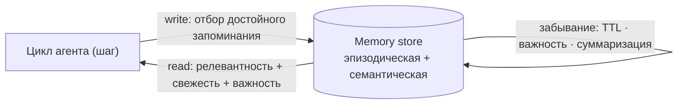


- **Memory store.** Хранилище за пределами окна: векторная БД для эпизодической памяти (семантическое извлечение), реляционная или графовая БД для семантической (профиль, факты, связи). Оба типа покрываются, например, связкой pgvector[^t-pgvector] и Postgres.
- **Путь записи (write path).** Не всё подряд пишется. Политика: что считать «достойным запоминания» (важные факты, решения, предпочтения), в каком виде (сырой ход vs извлечённый факт vs эмбеддинг). Часто на запись ставят отдельный шаг «извлеки факты, достойные памяти» — та же идея, что структурированные заметки выше.
- **Путь чтения (read path).** На каждом шаге — извлечь *релевантный срез* памяти под текущий контекст и вернуть в окно. Ранжирование не только по семантической близости: в системах вроде generative-agents (Park et al., 2023) score комбинирует **релевантность + свежесть (recency) + важность (importance)** — недавнее и важное всплывает даже при равной релевантности. Это богаче наивного top-k по косинусу.
- **Консолидация / рефлексия.** Периодически система синтезирует из низкоуровневых воспоминаний более высокоуровневые («пользователь предпочитает краткие ответы» из десятка наблюдений) — reflection в generative-agents. Аналог — материализованное представление / rollup над сырыми событиями.
- **Политика забывания.** Память без вытеснения деградирует — растёт, шумит, дорожает. Политики: TTL, удаление записей по низкой важности или давности, суммаризация старого в компактную форму. Критерий вытеснения здесь семантический (важность, релевантность записи), а не только её возраст или частота обращений.

**Формула ранжирования.** Score воспоминания под текущий запрос — сумма трёх нормализованных слагаемых:

$$score = \alpha_{rec} \cdot recency + \alpha_{imp} \cdot importance + \alpha_{rel} \cdot relevance$$

- **$recency$** — свежесть: $0.995^{\Delta t}$, где $\Delta t$ — число часов с **последнего обращения** к воспоминанию, а не с момента создания. Разница принципиальна: извлечённое воспоминание тем самым «освежается» и на следующем шаге стоит выше — подкрепление той же природы, что LRU в кэше. Период полураспада — $\ln(0.5)/\ln(0.995) \approx 138$ часов, около 5.8 суток.
- **$importance$** — важность: целочисленная оценка 1–10, которую выставляет сама модель в момент записи по прямому вопросу «насколько это значимо» (в оригинале — шкала от «почистил зубы» = 1 до «расставание» = 10).
- **$relevance$** — релевантность: косинус между эмбеддингом запроса и эмбеддингом воспоминания — то единственное, чем ограничивается наивный top-k.
- **$\alpha$** — веса слагаемых; в статье все три равны 1. Каждое слагаемое предварительно приводится в [0,1] min-max-масштабированием по пулу кандидатов, а значит score относителен пулу: это ранжирующая величина, а не порог, сравнимый между запросами.

**Живой расчёт.** Два воспоминания при *равной* релевантности 0.6 (значения даны до min-max: при большом пуле оно смещает их незначительно и вывод не меняет). A — «у пользователя не прошёл платёж»: важность 8/10 → 0.8, последнее обращение 72 часа назад → $0.995^{72} \approx 0.70$; score = 0.70 + 0.8 + 0.6 = **2.10**. B — «пользователь поздоровался»: важность 2/10 → 0.2, обращение час назад → $0.995^{1} = 0.995$; score = 0.995 + 0.2 + 0.6 ≈ **1.80**. Важное-но-остывшее обошло свежее-но-пустое, хотя косинус у них одинаковый и top-k не различил бы их вовсе.

**Словами:** формула поднимает наверх не «то, что похоже на запрос», а «то, что похоже — и при этом либо недавно всплывало, либо изначально было признано значимым». Три независимые оси, каждая способна вытащить запись в окно в одиночку.

**Железное правило инженера:** константа затухания — конфигурационный параметр, привязанный к реальной каденции продукта, а не число из статьи. 0.995 за час подобрана под симуляцию с плотным внутриигровым днём. Для ассистента, которым пользуются раз в неделю, факт двухнедельной давности даёт $0.995^{336} \approx 0.19$ — практически вытеснен, хотя это может быть профиль клиента. Отсюда второе следствие: затухать должна **эпизодическая** память; семантическая (устойчивые факты профиля) из recency-слагаемого исключается вовсе — иначе система «забудет» корпоративный тариф клиента только потому, что он месяц не заходил.

**Статья против кода.** В опубликованной референс-реализации веса не равны единице: код умножает слагаемые на `gw = [0.5, 3, 2]` (свежесть, релевантность, важность) — релевантность весит вшестеро больше свежести, — а сами авторы в комментарии признают, что веса стоило бы выучить, а не подбирать руками. Там же recency вычисляется не по прошедшим часам, а по порядковому номеру записи в списке, отсортированном по последнему обращению. Вывод для проекта: три веса и константу затухания вы обязаны настроить и измерить на своём трафике (гл. 17), а не унаследовать из работы 2023 года.

Рамка **MemGPT** (Packer et al., 2023) организует память в два уровня — «главный контекст» в окне и «внешний контекст» в хранилище, — а модель управляет перемещением данных между ними через инструменты (подгрузка релевантного в окно, вытеснение неактуального); авторы проводят прямую аналогию с иерархией памяти операционной системы.

*Источники.* C. Packer et al., «MemGPT: Towards LLMs as Operating Systems» (2023); J. Park et al., «Generative Agents: Interactive Simulacra of Human Behavior» (2023) — memory stream, recency/importance/relevance, reflection; T. Sumers et al., «Cognitive Architectures for Language Agents (CoALA)» (2023) — таксономия видов памяти. Референс-реализация generative-agents (github.com/joonspk-research/generative_agents, `persona/cognitive_modules/retrieve.py`) — фактические веса `gw` и расчёт recency.

## 4.6 Границы контекста и доверие (мост к безопасности)

Вернёмся к факту из §1.4: модель не разделяет инструкции и данные в одном канале. Внутри собранного контекста **недоверенный контент** — извлечённые документы, вывод инструментов, пользовательские данные — должен быть *структурно обособлен* (разделителями/тегами) и никогда не трактоваться как инструкция. Инженерия контекста — это **место, где начинается защита от prompt injection**: корректная разметка и изоляция недоверенных блоков. Полностью защита реализуется на уровне guardrails (гл. 19), но закладывается здесь, при сборке контекста. Инвариант: данные из внешнего мира помещаются в обособленный (карантинный) блок — например, `<untrusted_data>…</untrusted_data>` с явным указанием модели, что содержимое блока — данные, а не инструкции, — а инструкции поступают только из доверенного источника. Обученная иерархия инструкций (§3.2) работает над той же проблемой со стороны модели; сборка контекста — со стороны системы, и опорной следует считать именно её.

## 4.7 Резюме главы

Context engineering — это управление состоянием для stateless-вероятностного компонента под токен-бюджетом. Она располагается между проектированием запроса (гл. 3) и RAG (Часть III): **запрос задаёт требование, RAG поставляет знание, а инженерия контекста определяет, что именно и в каком виде попадёт в окно на каждом шаге** — релевантно, в пределах бюджета, с правильным размещением и изоляцией. По существу это дисциплина управления состоянием, применённая к вероятностному компоненту.

*Источники.* Anthropic, инженерные материалы о context engineering и эффективном использовании контекста (2024–2025); N. Liu et al., «Lost in the Middle» (2023); Chip Huyen, «AI Engineering» (2025); литература по RAG (Часть III).

**На полях главы 4**

[^t-kv]: **K и V** — тензоры Key/Value механизма внимания, вычисленные для каждого токена контекста (§1.4). При неизменном префиксе они не меняются — провайдер хранит их и пропускает prefill префикса целиком. → §1.6.
[^t-pgvector]: **pgvector** — расширение PostgreSQL: векторный тип, операторы близости и ANN-индексы (HNSW, IVFFlat) в обычной таблице. → §8.5.

# Глава 5. Structured output и надёжный парсинг

## 5.1 Проблема: граница между вероятностным и детерминированным

Модель выдаёт свободный текст. Компоненты ниже по потоку — парсер, вызов инструмента, запись в БД, рендеринг интерфейса — требуют **типизированных валидных данных**. Граница между этими двумя мирами и есть место, где ломается большинство агентных систем в эксплуатации.

Наивный подход «запросить JSON и распарсить» не выживает в эксплуатации по конкретным причинам: модель добавляет прозу вокруг JSON («Вот ответ: …»), оборачивает его в markdown-ограждения (```json), ставит хвостовые запятые, выдумывает или пропускает поля, кладёт не тот тип (строку вместо числа), обрывает вывод по лимиту токенов (§1.8). Каждый из этих случаев — необработанное исключение в парсере или, что хуже, молча неверные данные, ушедшие дальше по потоку.

По существу это обеспечение контракта на границе доверия: выход поступает от вероятностного компонента, который *может* нарушить требуемую форму. Structured output — набор техник, приводящих выход модели в соответствие со схемой, на которую можно положиться. Значимость определяется тем, что структурированный выход — точка стыка недетерминированного ядра (§1.10) с детерминированным кодом; чем строже стык, тем меньше инцидентов в эксплуатации.

## 5.2 Спектр техник: от слабой к гарантированной

Техники располагаются по возрастанию гарантии (и, как правило, стоимости/сложности):

| Уровень | Техника | Что гарантирует | Плата / ограничение |
|---|---|---|---|
| 1 | **Только промпт** («верни JSON по схеме…») | Ничего (просьба) | Проза, заборы, невалидный JSON |
| 2 | **Few-shot формата** | Ничего, но заметно надёжнее | Токены на примеры |
| 3 | **Пост-парсинг + починка (reask)** | Валидность после ретраев | Доп. вызовы модели, латентность |
| 4 | **JSON mode** (провайдерский) | Синтаксически валидный JSON | Валидный JSON ≠ *правильная схема* |
| 5 | **Constrained / grammar decoding** (schema-guided) | Соответствие *схеме* на уровне генерации | Нужен доступ к логитам; небольшой оверхед |
| 6 | **Function / tool calling** | Структурированный вызов по объявленной схеме | Специализирован под вызов функций (гл. 12) |

Практический вывод: не полагайтесь на уровни 1–2 там, где выход идёт в парсер или инструмент. Минимум — уровень 3 (валидация + reask), а лучшее из доступного — уровень 5 (constrained decoding) или 6 (tool calling) для действий.

## 5.3 Как работает constrained decoding (глубоко)

Это самый мощный одиночный приём, и стоит понять его механику, потому что она — прямое обобщение §1.7.

Вспомним: на каждом шаге декодирования модель выдаёт **логиты** — оценку по каждому токену словаря, из которой softmax делает распределение (§1.7). Constrained (grammar-guided) decoding вставляет один шаг между логитами и сэмплированием: **скомпилированная грамматика** (конечный автомат / магазинный автомат[^t-pda] для JSON плюс вашей схемы) отслеживает, какие токены *допустимы* следующими с учётом уже сгенерированного, и **маскирует логиты всех недопустимых токенов в −∞** перед выбором. После маски модель *физически не может* выбрать токен, ломающий структуру.


Это тот же принцип «маскирование невалидных логитов» из §1.7, развёрнутый до полной грамматики: не «запретить один символ», а «на каждом шаге разрешить только то, что ведёт к валидному документу по схеме». Существенные тонкости:
- **Нужен доступ к логитам.** Поэтому constrained decoding «из коробки» доступен на self-host (Outlines, GBNF-грамматики в llama.cpp, XGrammar в vLLM)[^t-grammar-stack] или у провайдеров, которые сами это реализуют (structured outputs с JSON-схемой). С чисто чёрным ящиком без такой фичи — недоступно, придётся падать на уровень 3.
- **Оверхед небольшой**, современные реализации компилируют грамматику эффективно.
- **Гарантирует структуру, не семантику** (см. §5.6) — это ключевое ограничение.

### Deep Dive: выравнивание токенов и индексация FSM

Механика §5.3 (маскирование логитов по грамматике) скрывает нетривиальную инженерную проблему, существенную при выборе движка constrained decoding для self-host.

**Проблема выравнивания токенов (token alignment).** Грамматика/регулярка определяет валидные *строки символов*. Но модель генерирует *токены* — подслова, каждое покрывает *несколько* символов и может пересекать границы грамматики. Один валидный следующий символ может быть началом сотен разных токенов; один токен может «проскочить» сразу несколько символов грамматики. Значит, наивно «разрешить валидные символы» нельзя — нужно на каждом шаге знать, *какие токены словаря* оставляют генерацию на валидном пути по автомату. Это и есть выравнивание «символьная грамматика ↔ токенный словарь».

**Вклад Outlines (Willard & Louf, 2023) — индексация FSM по словарю.** Наивное решение — на каждом шаге перебирать весь словарь (десятки-сотни тысяч токенов), проверяя каждый на совместимость с грамматикой. Дорого на *каждом* сгенерированном токене. Идея Outlines: скомпилировать грамматику в конечный автомат (FSM) и **заранее проиндексировать** для каждого состояния FSM множество допустимых токенов. Тогда маскирование на шаге — это O(1)-поиск «допустимые токены для текущего состояния», а не перебор словаря. Именно это сделало грамматическое декодирование практичным по скорости (последующие движки — XGrammar и др. — развивают ту же идею с оптимизациями под JSON).

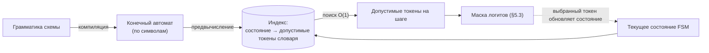


**Token healing.** Смежная тонкость: жадная токенизация может «сломать границу» на стыке зафиксированного префикса и генерации. Пример: если контекст заканчивается на `"url": "htt`, модель естественно продолжила бы токеном `https`, но граница уже отрезала `htt` отдельным токеном — оптимальное продолжение недостижимо. **Token healing** откатывает последний токен(ы) префикса и регенерирует, чтобы токенизация совпала с «естественной». Приём популяризирован в Microsoft Guidance; важен для корректности constrained/шаблонной генерации на границах.

**Пределы грамматик.** Не всё ограничивается дёшево. Плоский объект с enum'ами компилируется в компактный автомат. Но безграничная рекурсия (произвольно вложенный JSON без ограничения глубины) требует магазинного автомата (КС-грамматика), а не конечного, и её эффективная индексация сложнее; глубокая/рекурсивная схема раздувает автомат. Ещё одна причина держать схему плоской и ограниченной (§5.4): не только ради качества модели, но и ради стоимости самого движка ограничений.

### Deep Dive: когда constrained decoding вредит

Гарантия структуры не бесплатна для *качества*:

- **Переусложнённая схема душит модель.** Constrained decoding вынуждает эмитить только токены, ведущие к валидной структуре. Если схема жёсткая и «неестественная» для задачи, распределение модели загоняется в узкий коридор, вынуждая выбирать токены, которые иначе не были бы выбраны, — это может ухудшить *содержание* (галлюцинации-заполнители в обязательных полях). Простая схема с enum'ами — хорошо; барочная схема с десятком обязательных вложенных полей — способ получить валидный, но плохой ответ.
- **Почему ранняя жёсткая схема мешает рассуждению.** Если принуждать к финальной схеме *с первого токена*, модель лишается «места подумать» (§3.4: CoT работает, вынося рассуждение в токены). Она обязана сразу выдавать поля ответа, не порассуждав. Отсюда два лечения: two-step (§5.5) и reasoning-поле внутри схемы (§5.5).

*Источник:* Z. Tam et al., «Let Me Speak Freely? A Study on the Impact of Format Restrictions on Performance of LLMs» (EMNLP 2024) — эмпирика деградации рассуждения под форматными ограничениями.

## 5.4 Дизайн схемы как дизайн контракта

Схема вывода проектируется как контракт: от неё напрямую зависит надёжность.

- **Держите схему простой и по возможности плоской.** Глубоко вложенные структуры модели даются хуже; каждый уровень вложенности — рост вероятности ошибки. Тот же принцип «не усложняй контракт без нужды».
- **Enum'ы для категориальных полей.** Если поле — из фиксированного набора значений (статус, категория), объявите его перечислением. Модель обязана выбрать из набора — это резко надёжнее свободного текста и убирает целый класс «модель написала статус чуть иначе». Один из самых дешёвых и мощных приёмов.
- **Обязательные/опциональные поля и значения по умолчанию** — явно, как в контракте.
- **Описания полей в схеме работают как инлайн-инструкции.** Хорошая JSON-схема с `description` у полей — это одновременно и спецификация для валидатора, и документация, которую *читает модель*. Схема двойного назначения.
- **Осторожно с типами.** Числа модель путает из-за токенизации (§1.2) — по возможности избегайте критичной арифметики в выводе; для дат задавайте формат явно (ISO 8601), иначе получите разнобой.
- **Всегда валидируйте post-hoc настоящим валидатором** (JSON Schema, Pydantic; в JVM — Jackson + Bean Validation или schema-библиотека) — даже при constrained decoding, как defense-in-depth. Грамматика гарантирует структуру, но валидатор ловит крайние случаи и служит вторым рубежом.

**Вендорские лимиты схем (сверяйте с документацией на дату реализации).** Провайдерские structured outputs ограничивают схему не только здравым смыслом, но и жёсткими лимитами реализации, меняющимися от релиза к релизу: у OpenAI ориентиры 2024–2025 — порядка сотни свойств на схему, единицы уровней вложенности, лимиты на суммарный объём имён и enum-значений; поддержка составных возможностей JSON Schema (композиция, рекурсия) ограничена и различается между провайдерами. Существеннее лимитов другая гочка: **ключевые слова валидации значений — `pattern`, `minLength`, `minimum`, `format` — провайдер может принимать в схеме, но не навязывать при генерации**; их проверка целиком ложится на post-hoc валидатор из пункта выше — незнание этого стоит недели отладки «схема же задана, откуда невалидные значения». У Gemini свой набор ограничений: слишком сложная схема отклоняется ошибкой `InvalidArgument`, enum возвращается строкой. Правило: семантику каждого ключевого слова и лимиты сверяют с документацией провайдера, а не с JSON Schema-спецификацией и не по памяти.

## 5.5 Паттерны надёжности

- **Constrained Decoding** — гарантия структуры на генерации (§5.3); сильнейший одиночный приём, когда доступ к логитам есть.
- **Two-step generate-then-format** — сначала дать модели порассуждать свободно (CoT, §3.4), затем *отдельным* constrained-вызовом отформатировать результат в схему. Разводит рассуждение и форматирование: жёсткая схема, навязанная слишком рано, мешает рассуждению, а поздний форматирующий шаг снимает это напряжение. Дороже (два вызова), но качественнее на сложных задачах.
- **Validate-then-Retry** — базовый паттерн, когда constrained decoding недоступен:

> ### Паттерн: Validate-then-Retry (Reask — валидация с переспросом)
> **Контекст.** Выход модели идёт в парсер/инструмент, но constrained decoding недоступен (чёрный ящик без schema-фичи).
> **Проблема.** Как получить схемо-валидный выход без гарантии на уровне генерации?
> **Силы.** Просто распарсить — падает на невалидном; принять невалидное — ломает downstream; бесконечно ретраить — стоимость и латентность.
> **Решение.** Сгенерировать → провалидировать против схемы → при ошибке **вернуть модели текст ошибки валидатора и попросить исправить** (reask), с **ограничением числа попыток**. Модель обычно чинит собственный вывод по конкретному сообщению об ошибке.
> **Механика.** `generate → validate → (invalid?) → append(error) → regenerate`, счётчик попыток (обычно 1–3), затем фолбэк (детерминированная обработка/эскалация). Идемпотентность важна, если downstream-действие уже частично произошло.
> **Пример.** В ряде фреймворков (например, Spring AI, LangChain4j) паттерн встроен: типизированный конвертер выполняет валидацию и переспрос внутри себя.
> **Результирующий контекст.** Надёжность без доступа к логитам; плата — доп. вызовы (стоимость/латентность) и отсутствие *гарантии* (после N попыток всё ещё может не выйти → нужен фолбэк).
> **Когда применять.** Чёрный ящик без constrained-режима. **Когда нет.** Есть constrained decoding/tool calling — они дают гарантию дешевле переспросов.
> **Связанные паттерны.** Constrained Decoding (гарантия вместо ретраев); Fallback (что делать после исчерпания попыток, §2.5); Two-step generate-then-format.
> **Источники.** B. Willard, R. Louf, «Efficient Guided Generation for Large Language Models» (2023, Outlines); документация провайдеров по structured outputs/function calling.

### Приём: reasoning-поле первым (мост CoT ↔ structured output)

Дешёвая альтернатива two-step, когда нужен один вызов с гарантированной схемой: **вынесите рассуждение внутрь самой схемы, первым полем.**

```json
{
  "reasoning": "строка — пошаговый разбор перед ответом",
  "category": "enum",
  "answer": "…"
}
```

Поскольку JSON-поля генерируются по порядку, модель сначала заполняет `reasoning` (получает «место подумать», §3.4) и только потом — структурированный ответ, уже опираясь на собственное рассуждение. Это встраивает CoT прямо в structured output за один вызов. Оговорки: поле `reasoning` тратит токены (стоимость/латентность) и его обычно отбрасывают после парсинга; порядок полей важен (reasoning — *до* ответных полей, иначе смысла нет).

### Напряжение: стриминг ↔ structured output

Реальная эксплуатационная проблема, о которой часто забывают. Стриминг (§2.3) отдаёт токены по мере генерации ради воспринимаемой латентности. Но **частичный JSON невалиден**: пока не получен закрывающий `}`, его нельзя распарсить и провалидировать и нельзя отрисовать «наполовину». Конфликт: либо стриминг (хорошая латентность, но нельзя валидировать и использовать до конца), либо structured output (валидируемо, но пользователь ждёт полного ответа).

Практические разрешения: (1) стримить *человеку-читателю* только свободный текст, а структурированную часть генерировать отдельным нестримовым вызовом (см. two-step); (2) использовать **инкрементальные/partial-JSON парсеры**, достраивающие незакрытые структуры на лету (есть готовые библиотеки) — для прогрессивного рендера; (3) стримить по *полям* (некоторые API отдают структурированный вывод пофрагментно). Выбор зависит от того, нужен ли вывод человеку (стриминг важен) или коду (валидность важнее).

### Об эмпирике (честно)

Насколько каждая техника поднимает надёжность — зависит от модели, задачи и схемы; «универсального процента» нет. Порядок эффекта, воспроизводимый в отчётах и практике: переход от «только промпт» к валидации-с-переспросом убирает большинство ошибок *парсинга*; constrained decoding / JSON-schema-режим убирает их *полностью* по построению (§5.3) для структуры; enum'ы и плоская схема заметно снижают ошибки *значений* в категориальных полях. Но ни одна техника не трогает фактическую корректность (§5.6) — это отдельная ось, измеряемая эвалами (Часть VI). Мораль: меряйте надёжность формата и корректность содержания *раздельно*, разными метриками.

## 5.6 Семантический разрыв: структура ≠ корректность

Критическая оговорка, которую нельзя пропустить. Constrained decoding гарантирует, что JSON **хорошо сформирован и соответствует схеме** — но *значения полей* всё ещё могут быть галлюцинацией. Модель выдаст безупречно валидный `{"order_status": "SHIPPED", "tracking": "…"}`, где статус попросту выдуман.

Отсюда чёткое разделение ответственности:
- **Structured output решает проблему парсинга/интеграции** — «выход стыкуется с моим кодом».
- Он **не решает проблему точности** — «выход *правильный*».

Точность — это работа заземления (RAG, Часть III) и оценки (evals, Часть VI). Никогда не путайте «распарсилось» с «верно». Это одна из типичных ловушек: команда добавляет structured output, видит валидные JSON, расслабляется — и катит в прод уверенно-неверные данные в идеальной обёртке. Structured output закрывает границу *формата*, но не границу *истины*.

## 5.7 Реализация на JVM

JVM-экосистема предоставляет типизированный выход почти без дополнительных усилий:
- **Spring AI:** конвертеры структурированного вывода (`ChatClient….entity(MyRecord.class)`, `BeanOutputConverter`) генерируют схему из Java-типа, помещают её в промпт и парсят ответ обратно в запись или POJO. Где модель поддерживает schema-guided output, используется он. Для действий — `@Tool` (tool calling, гл. 12).
- **LangChain4j:** `AiServices` с типизированным возвращаемым значением — объявляется Java-интерфейс, возвращающий POJO, а фреймворк берёт на себя схему, парсинг и переспрос.
- **Валидация:** Jackson для парсинга и Bean Validation (`@NotNull`, `@Pattern`, …) как post-hoc рубеж (§5.4).

На уровне кода это сводится к «объявлен возвращаемый тип — получен типизированный результат», а Validate-then-Retry нередко уже реализован внутри конвертера. При этом сохраняется оговорка §5.6: типобезопасность выхода не означает его правильности.

## 5.8 Резюме — граница закрыта

Structured output — это способ закрыть границу между вероятностной моделью и детерминированным потреблением её выхода. Спектр — от запроса JSON (слабо) до constrained decoding (гарантия структуры) и tool calling (гарантия для действий). Но структура не равна корректности: формат гарантируется, истинность — нет.

Этим завершается Часть II — интерфейс к модели: **проектирование запроса задаёт требование** (гл. 3), **инженерия контекста собирает вход** (гл. 4), **structured output закрывает границу выхода** (гл. 5). Нерешённой остаётся корректность *содержания*, которую формат не обеспечивает. Ей посвящена Часть III: RAG — заземление выхода модели на проверяемые факты.

*Источники.* B. Willard, R. Louf, «Efficient Guided Generation for Large Language Models» (2023) — FSM-подход к constrained decoding (Outlines). Документация OpenAI/Anthropic по structured outputs и function calling; GBNF-грамматики в llama.cpp; XGrammar (2024) для эффективного грамматического декодирования. Документация Spring AI и LangChain4j по structured output.

**На полях главы 5**

[^t-pda]: **Магазинный автомат** (pushdown automaton) — конечный автомат со стеком. Стек — причина его появления здесь: вложенность JSON (объект в массиве в объекте) требует помнить глубину, чего автомат без стека не умеет.
[^t-grammar-stack]: Что здесь что: **llama.cpp** — рантайм локального инференса; **GBNF** — его формат грамматик (GGML BNF); **Outlines** и **XGrammar** — библиотеки constrained decoding с предвычисленной индексацией словаря; **vLLM** — сервер инференса, интегрирующий их. → гл. 22.

# Часть III. Заземление знаний: RAG

Часть II укротила интерфейс. Но structured output гарантирует *формат*, а не *истину* (§5.6), а параметрическое знание модели статично, неверифицируемо и склонно к галлюцинациям (§1.9) — и не содержит приватных данных организации, и не учитывает контроль доступа. Часть III — о том, как заземлить ответ на извлекаемые, проверяемые, контролируемые по доступу данные. Четыре главы: постановка RAG (6), каталог паттернов извлечения (7), векторные индексы и инфраструктура (8), оценка качества RAG (9).

# Глава 6. Retrieval-Augmented Generation: постановка

## 6.1 Проблема, которую решает RAG

Вернёмся к §1.9. Параметрическое знание модели «запечено» при обучении, а значит: **статично** (обрывается на дате cutoff), **неверифицируемо** (нет источника — нельзя проверить, откуда «факт»), **склонно к галлюцинации** (модель уверенно выдаёт правдоподобную неправду). Вдобавок оно **не содержит приватных данных** организации (их нет в обучении) и **не учитывает контроль доступа** (модель не знает, что конкретному пользователю нельзя видеть тот или иной документ).

Архитектурный вопрос: как заставить вероятностный компонент отвечать по данным, которые *свежие*, *приватные*, *проверяемые* и *контролируемые по доступу*? **RAG — это архитектурный ответ.** Он не улучшает память модели — он подменяет опору на память опорой на извлечённые данные.

## 6.2 Что такое RAG

**Термин. Retrieval-Augmented Generation (RAG)** — паттерн, при котором в контекст модели на этапе инференса подаются *извлечённые* релевантные данные, и ответ формируется на их основе, а не (только) на параметрической памяти. Структурно это две фазы:

- **Retrieve** — найти данные, релевантные запросу.
- **Generate** — сгенерировать ответ, обусловленный этими данными.

И два конвейера — офлайн и онлайн:

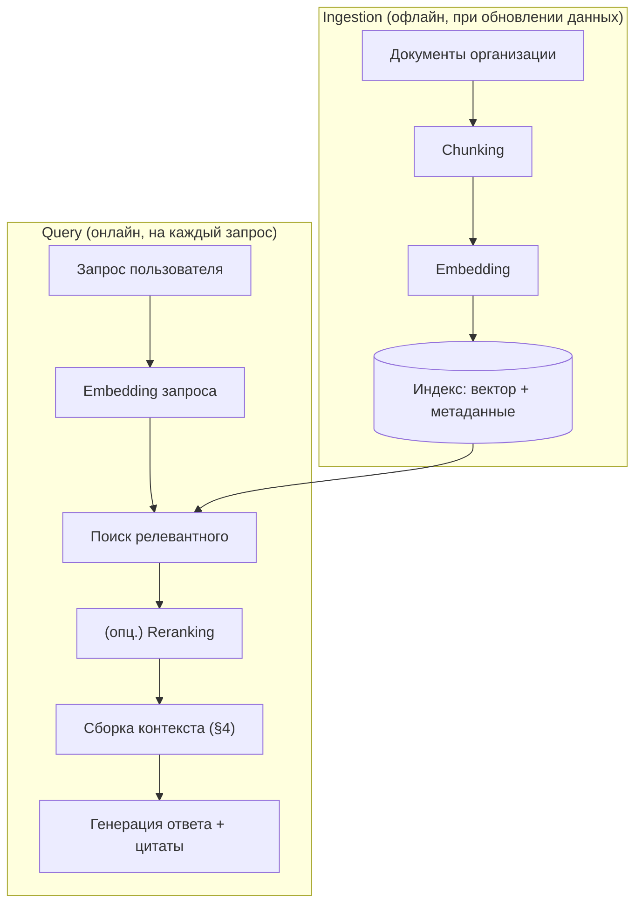

Обратите внимание: retrieval — это в точности то, о чём Часть II говорила как об *отборе контекста* (§4.4). RAG — это конкретная, доминирующая реализация context engineering для знаний.

Существенное уточнение к схеме: векторы живут только внутри блока поиска. На генерацию приходит извлечённый *текст* — модель заново режет его на токены и строит собственные внутренние векторы; RAG-векторы она не видит никогда (§1.3).

## 6.3 RAG против альтернатив — ключевое решение архитектора

Три способа сообщить модели знание или поведение, отсутствующее по умолчанию, — одна из главных проектных развилок:

| Ось | RAG | Fine-tuning (гл. 21) | Длинный контекст |
|---|---|---|---|
| Свежесть данных | Обновил индекс — готово | Надо переобучать | По запросу |
| Объём знаний | Огромный (вся база) | Ограничен, «размывается» | Только влезающее в окно |
| Верифицируемость/цитаты | Да (есть источник) | Нет | Да (данные в промпте) |
| Контроль доступа | Да (RBAC[^t-rbac] на ретриве) | Нет (знание в весах для всех) | На стороне сборки |
| Стоимость | Индекс + ретрив на запрос | Дорогое обучение, дешёвый инференс | Дорогой длинный промпт |
| Для чего | *Знание* (факты, документы) | *Форма* (стиль, схема, тон) | Мелкое/разовое |

Правило (та же лестница `Prompt → RAG → Fine-tune`): для *знаний* — почти всегда RAG; fine-tuning — для *формы*, а не фактов (§1.9, гл. 21); длинный контекст — для мелкого разового вброса, не для базы знаний (§1.8: дилюция и стоимость). Часто комбинируют: RAG для знаний + маленькая дообученная модель для формы вызова инструментов.

## 6.4 Анатомия RAG-системы

Каждый компонент — это поверхность отказа, и полезно видеть их отдельно:

1. **Ingestion pipeline** — загрузка → chunking[^t-chunking] → embedding → индексация (+ метаданные для фильтрации/RBAC).
2. **Retrieval** — embedding запроса → поиск → (опц.) reranking.
3. **Augmentation** — сборка извлечённого в контекст (размещение, изоляция, §4).
4. **Generation** — ответ, обусловленный контекстом, желательно с цитатами.

Большинство прод-проблем RAG — это отказ *ретрива* (компоненты 1–2), а не генерации, поэтому — §6.5–6.6.

## 6.5 Ретрив — узкое место (ключевой сдвиг)

Наивный RAG промахивается на ретриве, по распространённым индустриальным оценкам, **порядка 30–40%** случаев в эксплуатации (цифра плавающая и к единому первоисточнику не прослеживается — тем важнее измерить её на собственных данных, гл. 9), причём **молча**: модель уверенно генерирует ответ по *неправильным* извлечённым фрагментам, и на выходе это неотличимо от верного ответа. Ключевой сдвиг: **узкое место — не генерация, а ретрив.** Современные модели генерируют качественно; ломается то, *что* им подано. Практический вывод: качество ретрива рассматривается как измеряемый SLO (гл. 9), а его улучшение (гл. 7) — основной рычаг качества RAG-системы.

## 6.6 Deep Dive: таксономия отказов RAG

Разложим «RAG не работает» на конкретные режимы отказа:

| Режим отказа | Что происходит | Митигация |
|---|---|---|
| **Промах recall** | Релевантный документ не извлечён | Hybrid search, query rewriting (гл. 7) |
| **Промах precision** | Извлечён нерелевантный шум | Реранкинг, фильтры (гл. 7) |
| **Плохое ранжирование** | Нужное есть, но не в top-k | Реранкер (гл. 7) |
| **Молчаливо неверный контекст** | Модель уверенно отвечает по *не тем* фрагментам | Самый опасный; выявляется только оценкой (гл. 9) и цитатами (§6.7) |
| **Неверность (faithfulness)** | Модель игнорирует или искажает контекст либо галлюцинирует сверх него | Отдельная ось (§6.7); метрика faithfulness (гл. 9) |
| **Фрагментация чанков** | Нужный факт разрезан границей чанка; чанк непонятен вне контекста | Стратегии chunking, contextual retrieval (гл. 7) |
| **Устаревание** | Индекс отстал от источника | Пайплайн реиндексации |
| **Безопасность** | Извлечено недоступное пользователю (нарушение разграничения доступа при ретриве); отравление индекса | RBAC/ABAC на ретриве (гл. 8, 19) |
| **Косвенная инъекция** | Легитимно доступный, но злонамеренно составленный документ содержит инструкцию, перехватывающую модель/агента | Обособление извлечённого как данных (§4.6); taint-tracking и правило двух (§12.5); гл. 19 |

Ключевая мысль: «улучшить RAG» — это не одно действие, а адресная работа с конкретным *измеренным* режимом отказа (гл. 9). Без измерения исправление ведётся вслепую.

## 6.7 Deep Dive: заземление и faithfulness — две ортогональные оси

Критическое различие, которое путают чаще всего. Качество RAG-системы — это **две независимые оси**, и их надо мерить *раздельно*:

- **Качество ретрива** — достали ли мы правильные документы? (context recall — не упустили ли нужное; context precision — не притащили ли шум).
- **Faithfulness / groundedness** — использовал ли ответ извлечённое *корректно*, не выдумав сверх него?

Они ортогональны, и все четыре комбинации реальны:
- Хороший ретрив + faithful → идеал.
- Хороший ретрив + не faithful → достали правильное, но модель всё равно нагаллюцинировала (проблема генерации).
- Плохой ретрив + faithful → модель *честно* пересказала *неправильные* чанки (проблема ретрива, замаскированная уверенным тоном).
- Плохой ретрив + не faithful → всё плохо.

Отсюда два вывода. Первый: нельзя чинить «RAG» вообще — надо знать, *какая ось* просела (гл. 9 измеряет обе раздельно). Второй, проектный: **цитаты как цель дизайна.** Заставьте модель указывать, *какой чанк* подтверждает каждое утверждение (через structured output, гл. 5: поле `citations` с id источников). Это даёт три вещи сразу — верифицируемость (пользователь проверит), снижение галлюцинаций (модель «привязана» к источнику), и отладку faithfulness (видно, откуда взялось утверждение). Цитируемость — не украшение, а архитектурное требование для доверия к RAG.

### Deep Dive: конфликт знаний (параметрическое vs извлечённое)

RAG предполагает, что модель предпочтёт извлечённый контекст своей памяти. На деле это не гарантировано — возникает **конфликт знаний**: что делает модель, когда контекст *противоречит* её параметрическому приору?

Два симметричных провала:
- **Модель игнорирует контекст в пользу приора.** Если извлечённый факт противоречит сильно закреплённому в весах (общеизвестному), модель может проигнорировать контекст и ответить из памяти — устаревшим или неверным для конкретной организации фактом. Чем сильнее приор и «неожиданнее» контекст, тем выше риск. Это напрямую затрагивает случай, когда внутренний регламент организации расходится с общепринятым.
- **Модель слепо доверяет неверному контексту.** Обратное: извлечён неверный, устаревший или отравленный фрагмент — модель faithfully воспроизведёт ошибку. Faithfulness в этом случае работает против корректности.

Проектные меры: **явно приоритизировать контекст** в инструкции («отвечай *только* по документам; если недостаточно — скажи "не знаю"»); **цитаты** (§выше) делают переопирание на память видимым (утверждение без источника = флаг); **свежесть/качество/безопасность ретрива** (гл. 7–8) закрывают половину проблемы (неверный контекст); **признание неопределённости** — система обязана сказать «в документах этого нет», а не заполнять пробел приором (проверяется золотым набором с вопросами-без-ответа, гл. 9).

Архитектурный вывод: RAG не отключает параметрическое знание, а конкурирует с ним. Систему проектируют так, чтобы в конфликте побеждал контекст, и это измеряют.

*Источник:* S. Longpre et al., «Entity-Based Knowledge Conflicts in Question Answering» (2021); исследования context-faithfulness (2023–2024).

### Deep Dive: RAG против длинного контекста — обесценивают ли окна 1M+ сам RAG?

Живой спор: раз окна растут до 1M+, зачем ретрив — «засунь всю базу в контекст»? Ответ: длинный контекст *меняет* дизайн RAG, но не отменяет его:

- **Стоимость (§2.2).** Подавать 1M токенов на *каждый* запрос — линейно дорого и постоянно; извлечь релевантные 5k — на порядки дешевле. При потоке запросов это решающий аргумент.
- **Латентность (§1.6, §2.3).** Длинный prefill бьёт по TTFT; короткий извлечённый контекст быстрее.
- **Точность (§1.8).** Дилюция и lost-in-the-middle: качество *падает* с ростом нерелевантного контента. Меньше, но релевантнее — часто *точнее*, не только дешевле.
- **Масштаб.** Корпус организации (терабайты) в принципе не влезает ни в какое окно — ретрив обязателен.
- **Доступ и свежесть.** RBAC на ретриве (гл. 8) и обновление индекса без переобучения — свойства, которых длинное окно само не даёт.
- **«А prompt caching?»** Кэш префикса (§2.2, §20.2) снимает часть стоимости повторной подачи корпуса, но аргумент не спасает: кэш инвалидируется при каждом обновлении корпуса; у каждого пользователя свой RBAC-срез — общий кэшируемый префикс не собрать; TTFT незакэшированного хвоста остаётся; а деградацию качества от дилюции (§1.8) кэш не лечит вовсе.

Что длинный контекст *меняет*: можно позволить **крупнее чанки** и **менее агрессивный top-k** (20 богатых фрагментов вместо 5 узких), меньше страдая от фрагментации (§7.6). То есть длинное окно — это *дополнительный бюджет*, делающий RAG-конвейер мягче, а не ненужным. Эмпирически (Xu et al., 2023) RAG и длинный контекст *комплементарны*: RAG даёт сопоставимое качество дешевле, сочетание — лучшее.

Вывод: тезис «окно большое → RAG не нужен» не выдерживает проверки. Экономика, точность, масштаб и контроль доступа оставляют RAG обязательным; длинное окно лишь настраивает его параметры.

*Источник:* P. Xu et al., «Retrieval meets Long Context Large Language Models» (2023).

## 6.8 Реализация retrieval-слоя (мост к гл. 8)

Retrieval-слой — это дополнительный индекс над данными. На старте его можно реализовать без выделенного инфраструктурного компонента: **pgvector в Postgres** для векторного поиска; гибридный поиск — сочетание pgvector и полнотекстового поиска Postgres; кэш эмбеддингов и ответов (включая semantic caching, §2.2) — например, в Redis. Метаданные фрагмента (владелец, гриф, дата) в реляционной БД обеспечивают фильтрацию и контроль доступа (RBAC/ABAC) на этапе ретрива средствами системы управления доступом. Инфраструктурные детали (ANN, HNSW, параметры, условия выноса в специализированное хранилище вроде Qdrant или Weaviate) — глава 8.

Противоположный конец шкалы build-vs-buy — **managed retrieval**: провайдерские решения, скрывающие ingestion, chunking, эмбеддинги и индекс за одним API (Amazon Bedrock Knowledge Bases, Vertex AI Search, OpenAI vector stores / file search, Azure AI Search). Старт быстрее и без собственной инфраструктуры; плата — ограниченный контроль ровно над теми рычагами, из которых состоит глава 7 (chunking, гибрид, реранкинг), непрозрачность качества ретрива и привязка данных к провайдеру; модель контроля доступа (§8.7) должна выражаться средствами провайдера. Рабочее правило: managed — для быстрого старта и типовых корпусов; собственный слой — когда качество ретрива становится продуктовым дифференциатором или этого требуют данные (приватность, специфическая фильтрация).

## 6.9 Резюме главы

RAG — это заземление вероятностного компонента на извлекаемые, проверяемые, контролируемые по доступу данные, вместо опоры на статичную параметрическую память. Узкое место — ретрив, а не генерация (§6.5). Качество — это две ортогональные оси: качество ретрива и faithfulness (§6.7), меряемые раздельно (гл. 9). Дальше: **глава 7 — паттерны, улучшающие ретрив; глава 8 — инфраструктура; глава 9 — измерение.**

*Источники.* P. Lewis et al., «Retrieval-Augmented Generation for Knowledge-Intensive NLP Tasks» (2020) — первоисточник RAG. Y. Gao et al., «Retrieval-Augmented Generation for Large Language Models: A Survey» (2023) — карта области. Chip Huyen, «AI Engineering» (2025) — инженерная рамка.

**На полях главы 6**

[^t-rbac]: **RBAC / ABAC** — Role-/Attribute-Based Access Control: доступ по ролям против доступа по атрибутам (отдел, гриф, проект). В RAG проверяется на *ретриве*, а не на генерации. → §8.7.
[^t-chunking]: **Chunking** — разбиение документов на фрагменты для индексации; размер и границы фрагмента — отдельное проектное решение. → §7.6; ⇐ Глоссарий.

# Глава 7. Каталог паттернов извлечения

## 7.1 Лестница паттернов ретрива

Паттерны располагаются по возрастанию сложности; сквозной принцип — подниматься ровно настолько, насколько показывает измерение (гл. 9), а не выбирать сложное авансом.

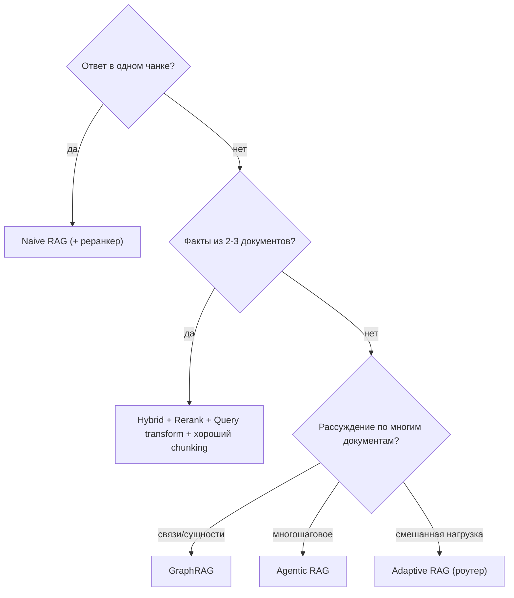

Практическое правило: **дефолт — Hybrid + Reranker + грамотный chunking.** Это закрывает большинство проблем. GraphRAG / Agentic / мультизапрос — верх лестницы, куда лезут по доказанной необходимости (иначе получаете 10× стоимости без выигрыша в точности).

## 7.2 Паттерн: Naive RAG (базовая линия)

> **Контекст.** Простой вопрос-ответ по корпусу; ответ обычно в одном фрагменте.
> **Решение.** Один проход: embedding запроса → dense top-k поиск → подать в контекст → ответ.
> **Когда.** Ответ локализован в одном чанке, корпус небольшой, требования к точности умеренные. **Когда нет.** Точные термины/коды (dense их теряет — §7.3), многодокументные/многошаговые вопросы.
> **Роль.** Это *базовая линия*, относительно которой измеряются все улучшения (гл. 9). С неё начинают, измеряют и поднимаются по лестнице только туда, куда указывает провал метрики.

## 7.3 Паттерн: Hybrid Search (Гибридный поиск)

> **Контекст.** Запросы содержат и семантику («как оформить возврат»), и точные токены (коды ошибок, артикулы, имена, ID), которые важно не потерять.
> **Проблема.** Плотный (векторный) поиск отлично ловит смысл, но промахивается мимо точных редких терминов; поиск по ключевым словам ловит точное, но не понимает перефразирования. Как получить оба?
> **Силы.** Dense: семантика, устойчивость к синонимам, но «замыливает» редкие точные токены. Sparse (BM25[^t-bm25]): точное совпадение терминов, но слеп к смыслу.
> **Решение.** Гонять **оба** поиска — dense (вектор) и sparse (BM25/полнотекстовый) — и **сливать** их результаты в единый ранжированный список.
> **Механика — слияние через RRF.** Самый надёжный способ слить два списка — **Reciprocal Rank Fusion**: каждому документу начисляется `Σ 1/(k + rank_i)` по его позициям в каждом списке (k — константа, напр. 60)[^t-rrf-k]. RRF работает *по рангам*, а не по сырым скорам, поэтому не требует нормализации несопоставимых шкал (косинус vs BM25-score) — большое практическое удобство.
> *Чтение формулы:* `rank_i` — позиция документа в i-м списке (1 — первое место); слагаемое `1/(k + rank_i)` — «очки» за эту позицию: обратная величина, поэтому высокая позиция даёт больше очков, но за счёт демпфера k — не подавляюще больше. Мини-пример при k = 60: документ, пришедший 1-м по BM25 и 5-м по векторному поиску, получает `1/(60+1) + 1/(60+5) ≈ 0.0164 + 0.0154 = 0.0318` — обе шкалы внесли сопоставимый вклад, хотя их сырые скоры (BM25 ≈ 12.7 и косинус ≈ 0.83) даже складывать было бы бессмысленно.
> **Пример реализации.** Dense-кандидатов даёт векторный поиск (например, pgvector), sparse-кандидатов — полнотекстовый поиск (например, `tsvector`/`ts_rank` в Postgres), а RRF вычисляется в SQL или в приложении; обе ветви покрываются одной реляционной БД.
> **Альтернатива слиянию.** Если шкалы скоров откалиброваны и сопоставимы, вместо RRF применяют взвешенную (выпуклую) комбинацию нормированных скоров с коэффициентом `α`, регулирующим вклад dense и sparse; RRF предпочитают там, где калибровка недоступна, поскольку он не требует нормализации.
> **Результирующий контекст.** Заметный рост recall на смешанных запросах; плата — два поиска и логика слияния.
> **Когда.** Почти всегда для реальных корпусов (в них всегда есть и смысл, и точные токены). **Когда нет.** Чисто семантические короткие FAQ без терминологии.
> **Связанные паттерны.** Reranking (следующий шаг после слияния); Query transformation.
> **Источники.** G. Cormack et al., «Reciprocal Rank Fusion outperforms Condorcet…» (2009); S. Robertson, H. Zaragoza, «The Probabilistic Relevance Framework: BM25 and Beyond» (2009).

## 7.4 Паттерн: Reranking (Переранжирование)

> **Контекст.** Первичный поиск вернул top-N кандидатов, но их порядок неточен — нужное может быть на 15-й позиции, а в контекст влезет top-5.
> **Проблема.** Как получить точный порядок релевантности, если быстрый векторный поиск лоссов?
> **Силы.** Здесь ключевое различие двух архитектур (углубление §1.3):
> - **Bi-encoder** (модель поиска) кодирует запрос и документ *независимо* в векторы, сравнивает косинусом. Быстро и масштабируемо (векторы предпосчитаны), но **лоссово** — нет взаимодействия «запрос↔документ».
> - **Cross-encoder** (реранкер) подаёт пару **[запрос, документ] совместно** в модель и выдаёт скор релевантности. Точно (видит взаимодействие), но **дорого** — считается на каждой паре, нельзя предпосчитать.
> **Решение.** Двухстадийность: bi-encoder дёшево достаёт top-N (напр., 50), cross-encoder точно переранжирует в top-k (напр., 5). **Реранкинг работает именно потому, что восстанавливает взаимодействие запрос-документ, которое bi-encoder выбросил ради скорости.**
> **Механика/размещение.** После retrieval (dense или hybrid), перед генерацией. Латентность растёт (проход cross-encoder по N кандидатам), но N мало (десятки), так что терпимо. Реранкер — отдельная небольшая модель (self-host) или API.
> **Результирующий контекст.** Точность top-k заметно выше; плата — доп. латентность и компонент-реранкер.
> **Когда.** Почти всегда, если точность top-k важна. **Когда нет.** Ультранизкая латентность критичнее точности, или корпус так мал, что ранжирование неважно.
> **Связанные паттерны.** Hybrid Search (перед реранком); Naive RAG (без реранка).
> **Источники.** R. Nogueira, K. Cho, «Passage Re-ranking with BERT» (2019); N. Reimers, I. Gurevych, «Sentence-BERT» (2019) — bi- vs cross-encoder.

Совмещённый конвейер по умолчанию — гибридный поиск с последующим переранжированием — выглядит так:

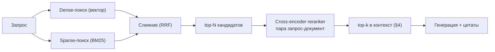

Выбор `N` — компромисс: больший `N` повышает вероятность, что релевантный документ дойдёт до переранжирования (recall первой стадии), но линейно увеличивает стоимость cross-encoder. Помимо cross-encoder существуют **LLM-реранкеры** (модель ранжирует список документов по релевантности, listwise): они гибче, но дороже и медленнее. Практические ориентиры (середина 2026): открытая связка по умолчанию — BGE-reranker-v2 поверх BGE-M3-эмбеддингов, из API — Cohere Rerank; выбор подтверждается на собственном золотом наборе (гл. 9), а не по чужим бенчмаркам.

### Deep Dive: late interaction (ColBERT) — третья парадигма ретрива

Между bi-encoder (быстро, лоссово) и cross-encoder (точно, дорого) есть третья парадигма — **late interaction**, снимающая их дилемму.

**Идея (ColBERT, Khattab & Zaharia, 2020).** Вместо одного вектора на документ (bi-encoder) или совместного прохода пары (cross-encoder), ColBERT кодирует запрос и документ в *набор* векторов — по одному на токен (**multi-vector**). Релевантность — операция **MaxSim**: для каждого токена запроса берётся максимум сходства по всем токенам документа, максимумы суммируются. «Late» — потому что взаимодействие запрос-документ происходит *поздно* (на уровне предпосчитанных токенных векторов), а не рано (совместный проход, как у cross-encoder).

**Где на спектре.** Точнее bi-encoder (сохраняет токенную гранулярность вместо сжатия в один вектор), но масштабируемее cross-encoder (векторы документов *предпосчитаны* — не нужен проход пары на каждом запросе). Плата — **память**: по вектору на токен документа дорого (на порядок больше одного вектора); отсюда оптимизации хранения (сжатие токенных векторов, PLAID[^t-plaid]).

**Когда рассматривать.** Когда bi-encoder с реранкером не дотягивает по качеству, cross-encoder по всему корпусу нереален, а бюджет памяти под multi-vector есть. Часто ColBERT применяют как сильный ретрив или как реранкер. По сути это ещё одна точка на кривой «качество ↔ память ↔ скорость».

*Источник:* O. Khattab, M. Zaharia, «ColBERT: Efficient and Effective Passage Search via Contextualized Late Interaction over BERT» (2020).

## 7.5 Семейство: трансформация запроса

Иногда проблема не в индексе, а в самом запросе — он мутный, разговорный или лексически далёк от документов. Семейство приёмов «переписать запрос перед поиском»:

- **Query rewriting** — переформулировать разговорный/неполный запрос в хороший поисковый (разрешить местоимения из истории, убрать шум).
- **HyDE (Hypothetical Document Embeddings)** — сгенерировать *гипотетический ответ* на запрос и искать по эмбеддингу *ответа*, а не вопроса. Идея: гипотетический ответ лексически ближе к реальным документам, чем вопрос (мостит разрыв «вопрос ↔ формулировка документа»).
- **Multi-query** — сгенерировать несколько вариантов запроса, объединить результаты (повышает recall).
- **Decomposition** — разбить сложный многочастный вопрос на под-запросы, искать по каждому.
- **Step-back** — обобщить запрос, чтобы достать более широкий контекст (полезно, когда узкий вопрос требует фонового знания).

*Когда:* лексический разрыв запрос-документ, сложные/многочастные/разговорные запросы. *Плата:* доп. вызов(ы) модели на трансформацию (стоимость/латентность). *Источник:* L. Gao et al., «Precise Zero-Shot Dense Retrieval without Relevance Labels» (2022, HyDE); обзор Gao et al. (2023).

## 7.6 Deep Dive: chunking

Chunking — ingestion-time решение, но оно определяет потолок качества ретрива: нельзя извлечь то, что плохо нарезано. Стратегии по возрастанию качества:

- **Fixed-size** — резать по N токенов. Просто, но рвёт смысл посреди предложения/мысли.
- **Recursive / structural** — резать по структуре: заголовки, абзацы, а для кода — по функциям/классам через AST (не по символам). Уважает границы смысла.
- **Semantic** — резать там, где *смещается* эмбеддинг соседних предложений (граница темы). Правило разреза — не абсолютный порог, а **перцентиль собственного распределения документа**: считаются косинусные расстояния ($1-\cos$) между эмбеддингами соседних групп предложений, и разрез ставится там, где расстояние превышает 95-й перцентиль расстояний *этого же* документа. 95 — дефолт обеих ходовых реализаций (`SemanticSplitterNodeParser` в LlamaIndex, `SemanticChunker` в LangChain); ниже порог — чаще разрезы, мельче чанки. *Живой счёт:* документ из 200 предложений даёт 199 стыков; 95-й перцентиль отсекает верхние 5% — это ~10 разрезов и ~11 чанков по ~18 предложений. То есть перцентиль напрямую задаёт **число** чанков, а не «качество границы»: это ручка гранулярности, и подбирать её надо как ручку гранулярности. Порог относителен по необходимости: абсолютные значения косинуса несопоставимы между эмбеддерами — из-за анизотропии (§1.3) векторы жмутся в узкий конус, поэтому «расстояние 0.3» у одной модели означает не то же, что у другой, и зашитая константа не переносится ни на другую модель, ни на другой корпус.
- **Parent-document (small-to-big)** — индексировать мелкие точные чанки (для точного *попадания*), но в контекст подавать бо́льший *родительский* фрагмент (для *понятности* при генерации). Разрешает конфликт «мелкий чанк точнее ищется, но беднее контекстом». Механика в одну строку: в векторный индекс кладутся *дочерние* чанки (например, 256 токенов), каждый с полем `parent_id`; поиск идёт по детям, а в контекст собирается родитель (например, 2048 токенов), поднятый по `parent_id` из обычного хранилища и **дедуплицированный** — несколько попавших в top-k детей одного родителя обязаны дать одного родителя, иначе тот же текст займёт окно дважды.
- **Contextual retrieval (Anthropic, 2024)** — перед эмбеддингом прицепить к каждому чанку короткую LLM-сгенерированную врезку, ситуирующую его в документе («Это раздел про возвраты из регламента X, касается брака»). Работает потому, что изолированный чанк часто непонятен без контекста документа. Величина выигрыша измерена: на замерах Anthropic доля промахов (нужного фрагмента нет в top-20) падает с 5.7% до 3.7% — на **35% относительно**; если ту же врезку учесть и в BM25-ветви гибрида (§7.3), то до 2.9% (−49%); добавить сверху реранкер (§7.4) — 1.9% (−67%). Абсолютные проценты обманчивы, и читать их надо в относительной шкале: базовая линия и так не промахивается в 94% случаев, так что «−2 процентных пункта» — это треть всех оставшихся отказов. Плата — один вызов модели на чанк при ingestion.

**Почему «вызов на чанк» не разоряет: prompt caching.** Наивно contextual retrieval выглядит неподъёмным: чтобы написать врезку про чанк, модели нужен весь документ — значит документ подаётся заново на каждый из его чанков. Спасает то, что документ кладётся в **кэшируемый префикс** (§2.2): он записывается в кэш однократно, а каждый следующий вызов его *читает*. Ценник у Anthropic задан множителями от обычного входа: запись в кэш — 1.25 цены входа, чтение из кэша — 0.1 (§20.2). Меняется только хвост промпта — сам чанк. Стоимость индексирования считается в два шага. Сначала — цена одного документа. Деление на $10^{6}$ здесь не украшение, а перевод единиц: длины у нас в токенах, а прайс задан за миллион токенов:

$$C_{doc} = \frac{(L_{doc}+L_{ins}) \cdot p_{w} + n \cdot \big( (L_{doc}+L_{ins}) \cdot p_{r} + L_{chunk} \cdot p_{in} + L_{ctx} \cdot p_{out} \big)}{10^{6}}$$

Затем умножаем на число документов в миллионе токенов корпуса, $10^{6}/L_{doc}$. Два множителя $10^{6}$ сокращаются нацело, и остаётся чистая дробь:

$$C_{1M} = \frac{10^{6}}{L_{doc}} \cdot C_{doc} = \frac{(L_{doc}+L_{ins}) \cdot p_{w} + n \cdot \big( (L_{doc}+L_{ins}) \cdot p_{r} + L_{chunk} \cdot p_{in} + L_{ctx} \cdot p_{out} \big)}{L_{doc}}$$

| Символ | Что это | Значение в расчёте Anthropic |
|---|---|---|
| $L_{doc}$ | длина документа, токенов | 8000 |
| $L_{ins}$ | инструкция-обёртка, токенов | 50 |
| $L_{chunk}$ | размер чанка, токенов | 800 |
| $L_{ctx}$ | длина порождённой врезки, токенов | 100 |
| $n$ | чанков в документе, $L_{doc}/L_{chunk}$ | 10 |
| $p_{w}$ | запись в кэш, $ за 1M токенов | 0.30 |
| $p_{r}$ | чтение из кэша, $ за 1M токенов | 0.03 |
| $p_{in}$ | обычный вход, $ за 1M токенов | 0.25 |
| $p_{out}$ | выход, $ за 1M токенов | 1.25 |
| $C_{doc}$ | цена одного документа, $ | 0.0081 |
| $C_{1M}$ | цена миллиона токенов корпуса, $ | 1.01 |

Цены — прайс Claude 3 Haiku, той модели, на которой Anthropic и считала. Честная оговорка про источник: модель выведена из обслуживания в апреле 2026-го, её строки в действующем прайс-листе Anthropic больше нет — сверить сегодня базовые $0.25/$1.25 негде, это цифры из прайса 2024 года. Проверяемо другое, и этого достаточно: множители кэша в прайс-листе есть и сейчас, а сам расчёт воспроизводит опубликованную Anthropic цифру с точностью до процента. Подставляем, на один документ:

- запись документа в кэш, однократно: `8050 × 0.30/10⁶ = $0.0024`
- 10 чтений кэша (по одному на чанк): `10 × 8050 × 0.03/10⁶ = $0.0024`
- 10 чанков обычным входом: `10 × 800 × 0.25/10⁶ = $0.0020`
- 10 врезок на выходе: `10 × 100 × 1.25/10⁶ = $0.0013`
- итого $C_{doc} \approx$ `$0.0081` на документ; в миллионе токенов корпуса `10⁶/8000 = 125` документов → $C_{1M}$ = `8080/8000` = **≈ $1.01** (Anthropic публикует $1.02)

*Чтение формулы словами:* врезка стоит один вызов модели на чанк, но документ в этот вызов не подаётся заново — он читается из кэша, и доминирующее слагаемое «документ × число чанков» дешевеет примерно в восемь раз (`0.25/0.03`). Восемь, а не номинальные десять, потому что таблица Haiku 3 округлена до центов: чтение по множителю есть `0.1 × 0.25 = 0.025`, а в прайсе стоит $0.03 (та же копеечная погрешность у записи: `1.25 × 0.25 = 0.3125` → $0.30). Само округление при этом работает в плюс: по точным множителям (`0.3125` за запись, `0.025` за чтение) тот же расчёт даёт $0.97, и именно округление прайса поднимает оценку до $1.01 — то есть придвигает её к опубликованной цифре. Оставшийся до $1.02 цент из опубликованных Anthropic данных не восстанавливается; расхождение округлённого расчёта с публикацией — в пределах процента и на форму вывода не влияет. Без кэша тот же расчёт даёт `10 × 8850 × 0.25/10⁶` входа плюс выход ≈ `$0.023` на документ, или **$2.92** на миллион — почти втрое дороже. Кэш здесь не оптимизация поверх работающей схемы, а то, что делает схему экономически осмысленной; в этом и состоит неочевидный инженерный смысл приёма. Переносить в свой расчёт стоит не абсолютные цифры (модели больше нет, а структура кэша у провайдеров разная — §20.2), а форму: доминирует «документ × число чанков», и именно его убирает кэш.

**Параметры и проблемы.** Размер обычно 256–1024 токена; **overlap** (перекрытие соседних чанков) сохраняет пограничный контекст. Цифры тут эмпирические, а не выведенные, и это видно прямо по источнику. Microsoft в руководстве по chunking для Azure AI Search рекомендует **как отправную точку чанк 512 токенов (≈ 2000 символов) и перекрытие 25% — те самые 128 токенов**; там же значения по умолчанию для встроенного разбиения (2000 символов, перекрытие 500) дают те же 25%. Но в таблице приёмов на той же странице, в описании фиксированной нарезки, мимоходом упомянуто перекрытие «например, 10–15% содержимого» — без всякого статуса рекомендации. Одна страница вендора, две несогласованные цифры — лучшее доказательство, что закона тут нет: берите 25% как отправную точку и подбирайте под свои данные. У перекрытия двойная цена, и вторая половина неочевидна: индекс растёт примерно пропорционально перекрытию, а в top-k приходят **почти-дубликаты** — два соседних чанка с общим куском текста, — которые молча съедают бюджет контекста и разбавляют его (§1.8). Отсюда правило: есть перекрытие — обязательна дедупликация после извлечения. Главная беда — **фрагментация**: нужный факт разрезан границей, или чанк непонятен вне документа (лечится parent-document и contextual retrieval). И обязательно **прикрепляйте метаданные** к чанку (источник, владелец, гриф, дата) — они нужны для фильтрации, цитат (§6.7) и RBAC на ретриве (гл. 8).

**Железное правило инженера:**
Chunking — решение **времени индексирования**: размер, перекрытие и стратегия запечены в те векторы, что уже лежат в индексе, и задним числом из индекса их не вынуть. Поэтому смена любого из трёх — не правка конфига, а **полная переиндексация корпуса**: тот же класс миграционной стоимости, что и смена эмбеддера (§1.3, §8.8). Практических следствий два. Первое: параметры chunking подбирают на золотом наборе (гл. 9) *до* заливки корпуса, а не после. Второе: на выросшем корпусе цена эксперимента «а попробуем 512 вместо 1024» считается в часах переиндексации и в счёте за эмбеддинги, а не в минутах правки конфига, — и потому такие эксперименты планируют пакетом, а не по одному.

*Источники.* Anthropic, «Contextual Retrieval» (2024) — доли промахов, параметры расчёта (чанк 800, документ 8k, инструкция 50, врезка 100 токенов) и итог $1.02 на миллион. Множители кэша (запись 1.25, чтение 0.1 от входа) — действующий прайс-лист Anthropic (§2.2, §20.2); базовые ставки Claude 3 Haiku — прайс 2024 года, модель выведена из обслуживания в апреле 2026-го и в действующем прайс-листе отсутствует. Дефолт 95-го перцентиля — реализации `SemanticSplitterNodeParser` (LlamaIndex) и `SemanticChunker` (LangChain). Перекрытие 512/25%/128 — Microsoft, руководство по chunking для Azure AI Search, раздел «Content overlap considerations». Обзор Gao et al. (2023).

### Deep Dive: мультимодальный RAG (сканы, таблицы, схемы)

Корпоративный корпус редко состоит из чистого текста: сканированные PDF, таблицы, диаграммы, скриншоты. Классический конвейер — OCR/парсинг в текст → chunking → текстовые эмбеддинги — теряет структуру таблиц (наивный chunking режет их поперёк смысла) и слеп к схемам; на таких корпусах это главный источник промахов ретрива, который не лечится ни гибридом, ни реранкером. Два выхода за пределы текстового конвейера:

- **VLM-описания на ingestion** — vision-language-модель конвертирует изображения и таблицы в структурированный текст (markdown-таблицы, текстовые описания схем), дальше работает обычный текстовый конвейер. Практичный первый шаг: сохраняет всю текстовую инфраструктуру, стоимость — разовая на индексирование.
- **Ретрив по изображениям страниц** (семейство ColPali/ColQwen, 2024–2025) — страница кодируется *как изображение*: визуальные патчи в роли токенов, late interaction поверх них (§7.4). Индексация без OCR-конвейера вовсе; устойчивость к вёрстке, таблицам, рукописному. Плата: память на мультивекторы (та же боль, что у ColBERT), генератор должен уметь читать изображения страниц в контексте, инфраструктура моложе текстовой.

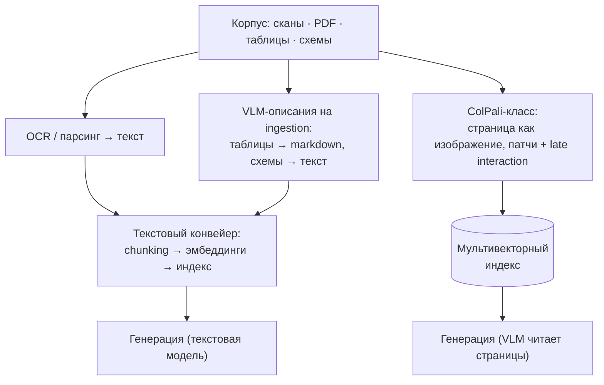

Выбор: чистый текст → классический конвейер; вёрстка и таблицы критичны → VLM-описания как первая ступень; ColPali-класс — когда измерение (гл. 9) показывает, что качество ретрива по визуальным документам упирается именно в OCR-потери.

*Источники.* M. Faysse et al., «ColPali: Efficient Document Retrieval with Vision Language Models» (2024); ColQwen-модели (2025); §7.4 — late interaction.

### Deep Dive: выбор embedding-модели (фундамент, влияющий на всё)

Качество ретрива упирается в качество эмбеддингов, но выбор embedding-модели часто делается наугад. Оси выбора:

- **Доменная пригодность.** Модель, обученная на общем вебе, хуже кодирует специфический домен (юридический, внутренний жаргон); оценивать её следует на данных этого домена, а не по общему лидерборду.
- **Бенчмарк MTEB** — стандартная отправная точка (ретрив, кластеризация и другие задачи), но это ориентир, а не окончательный критерий: верхняя строка MTEB не гарантирует лучшего результата на конкретной задаче. Ориентиры на середину 2026: верх лидерборда — Gemini Embedding и открытая Qwen3-Embedding, из API-моделей распространены Cohere embed-v4 и OpenAI text-embedding-3-large, открытый дефолт — BGE-M3; при сравнении учитывайте переход MTEB на v2 (очки v1 и v2 несопоставимы). Имена устаревают быстро — оси выбора из этого списка устаревают медленнее.
- **Многоязычность.** Для русскоязычной системы необходима модель с сильной поддержкой русского (многие сильные англоязычные модели на русском слабее); проверяются моно- и кросс-язычный ретрив на русских парах.
- **Размерность и длина.** Бо́льшая `d` богаче, но дороже по памяти и поиску (§8); максимальная длина входа ограничивает размер чанка. **Matryoshka-эмбеддинги** позволяют усекать размерность без переобучения (гибкость «память ↔ качество»).
- **Дообучение эмбеддера** — самый мощный рычаг качества ретрива в домене: дообучение embedding-модели на доменных парах (запрос, релевантный документ) часто даёт больше, чем смена паттерна ретрива. Требуются размеченные пары (из кликов и обратной связи либо синтетические с ревью).
- **Операционное следствие (§1.3, §8.8).** Смена эмбеддера означает полную переиндексацию, поэтому выбор делается с расчётом на длительное использование.

Практический порядок: сильная многоязычная модель как база → измерение на золотом наборе (гл. 9) → при специфическом домене и наличии данных — дообучение эмбеддера. Это фундамент: никакой реранкер не компенсирует базовые эмбеддинги, не отражающие домен.

*Источник:* N. Muennighoff et al., «MTEB» (2022); Matryoshka Representation Learning (2022); работы по доменному дообучению эмбеддеров.

## 7.7 Паттерн: GraphRAG

> **Контекст.** Вопросы требуют «связать точки» через много документов: цепочки поставок, оргструктуры, связи «кто-с-кем», цитирования.
> **Проблема.** Векторный поиск достаёт *похожие* фрагменты, но не *связи* между сущностями; вопрос «через какие подрядчиков A связан с B» он не соберёт.
> **Решение.** На ingestion извлечь **сущности и связи** в граф знаний; на запрос — ходить по графу (обход связей), а не только искать похожее.
> **Механика (вариант Microsoft GraphRAG).** Индексация: LLM извлекает сущности и связи → строится граф → **community detection** (алгоритм Leiden) режет его на иерархию сообществ → LLM пишет резюме каждого сообщества. Запрос: **local search** — окрестность конкретной сущности (точечные вопросы) или **global search** — map-reduce по резюме сообществ (вопросы «обо всём корпусе», на которые фрагментный RAG не способен в принципе). Индексация дорога (LLM-проход по корпусу); удешевлённый вариант **LazyGraphRAG** (2024) откладывает LLM-работу с индексации на момент запроса.
> **Результирующий контекст.** Отвечает на многошаговые реляционные вопросы; плата — дорогое извлечение сущностей и *поддержка графа* (схема, обновление, качество извлечения).
> **Когда.** Реляционные/многодокументные вопросы, где связи важнее сходства. **Когда нет.** Обычный factoid-QA — GraphRAG тут дороже и не точнее (частая ошибка — брать граф там, где хватало hybrid).
> **Источник:** Microsoft Research, «GraphRAG» (2024).

Конвейер целиком — единственный в главе многоступенчатый, поэтому нарисуем его:

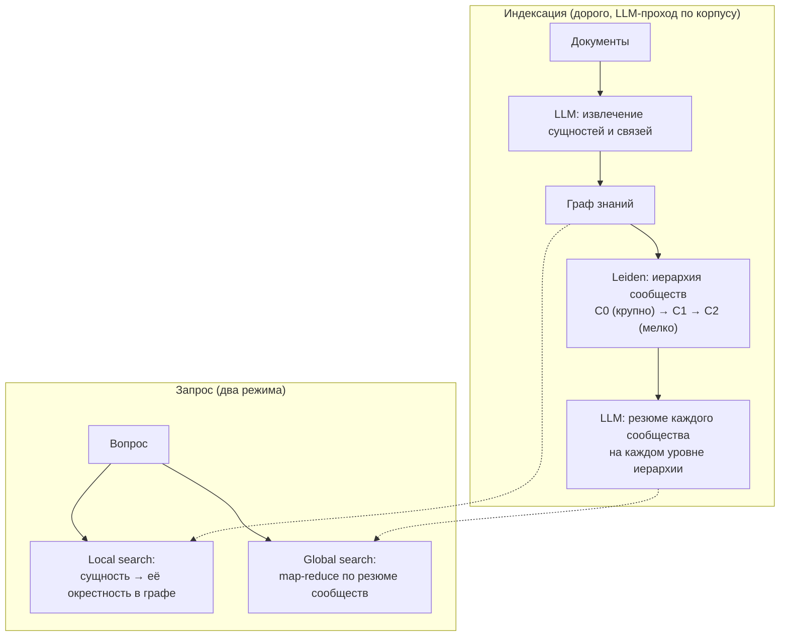

**Что именно делает Leiden.** Community detection — разбиение графа на группы вершин, внутри которых рёбер много, а между которыми мало. Формальный критерий — **модульность**: доля рёбер внутри сообществ минус её ожидание для случайного графа с теми же степенями вершин; чем выше, тем «настоящее» разбиение. Точная максимизация модульности NP-трудна, поэтому работают жадные алгоритмы: классический **Louvain** (2008) чередует локальные перемещения вершин между сообществами и агрегацию (сообщество схлопывается в супервершину, процесс повторяется — отсюда иерархия уровней). У Louvain есть документированный дефект: он может выдать *внутренне несвязное* сообщество — вершина-мост уехала в соседнюю группу, оставшиеся куски формально числятся одним сообществом, не имея пути друг к другу. **Leiden** (Traag, Waltman, van Eck, 2019) добавляет между перемещением и агрегацией фазу уточнения (refinement) и *гарантирует* связность каждого сообщества, работая при этом быстрее. Для GraphRAG эта гарантия — не абстракция: резюме несвязного «сообщества» описывало бы две не относящиеся друг к другу группы сущностей как одну, отравляя global search. Иерархия уровней даёт ручку гранулярности: global search по C0 — дёшево и крупными мазками, по C2 — дороже и детальнее; уровень выбирают под бюджет токенов запроса.

## 7.8 Паттерн: Agentic RAG

> **Контекст.** Вопрос многошаговый: один проход поиска в принципе не соберёт нужный контекст (нужно достать одно, понять, уточнить, достать другое).
> **Проблема.** Статический `retrieve → generate` не адаптируется, если первого извлечения не хватило.
> **Силы.** Одиночный проход дёшев/быстр, но негибок; управляемый моделью цикл гибок, но дорог/медленен.
> **Решение.** Дать **LLM управлять циклом ретрива**: retrieve → оценить достаточность → переформулировать/дозапросить → повторить, пока не хватит. Это уже агент над ретривом (мост к Части IV). В обученном варианте (**Self-RAG**, Asai et al., 2023) модель сама решает, *когда* извлекать и *критикует* извлечённые пассажи на релевантность.
> **Механика.** Ретрив становится инструментом (tool calling, гл. 12), которым модель пользуется в цикле, с **лимитом итераций** (иначе — риск бесконечного цикла).
> **Результирующий контекст.** Справляется с многошаговыми вопросами; плата — латентность и стоимость (несколько вызовов + несколько ретривов).
> **Когда.** Многошаговые вопросы, где один проход недостаточен. **Когда нет.** Простой factoid — оверинжиниринг.
> **Связанные паттерны.** Adaptive RAG (маршрутизировать *в* agentic только сложные); агентные паттерны Части IV.
> **Источник:** A. Asai et al., «Self-RAG: Learning to Retrieve, Generate, and Critique through Self-Reflection» (2023).

Цикл структурно идентичен Evaluator-Optimizer (§11.6) — генерация и оценка чередуются до достаточности или лимита:

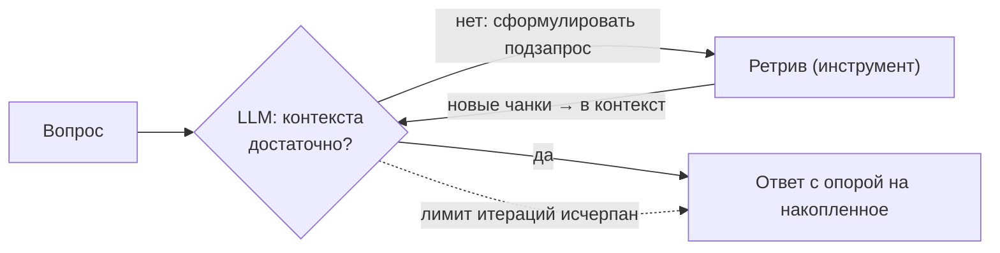

**Worked example: во что обходится цикл.** Пусть один проход Naive RAG — это ~2000 входных токенов (вопрос + top-k чанков) и ~300 выходных; при тарифе $1/M вход и $4/M выход это ≈ $0.0032. Agentic-цикл на 3 итерации *накапливает* контекст: каждая итерация — полный вызов со всем, что извлечено ранее, поэтому вход растёт ступенями ~2k → 4k → 6k (итого ~12k) плюс ~0.9k выходных на промежуточные решения и ответ ≈ **$0.0156 — впятеро дороже** и в 3–4 раза медленнее (итерации последовательны, распараллелить нельзя: каждый подзапрос зависит от предыдущего результата). Обратите внимание на *суперлинейность*: стоимость k итераций растёт как O(k²) по входным токенам — та же арифметика накопления контекста, что у длинного диалога (§4.4). Отсюда практический вывод: лимит итераций — это не только защита от нетерминации (§10.5), но и бюджетный рычаг, а маршрутизация в agentic только сложных запросов (Adaptive RAG, §7.9) — то, что делает паттерн экономически возможным на потоке.

**Self-RAG: как «решает» и «критикует» устроены внутри.** Промптовый Agentic RAG держит цикл снаружи — в харнессе (§10.2): инструкция, вызов инструмента, проверка. Self-RAG переносит управление *внутрь декодирования*. В словарь модели добавлены специальные **reflection-токены**, и дообученная модель порождает их в общем потоке генерации, как обычные токены: `Retrieve` (нужно ли сейчас извлечение), `ISREL` (релевантен ли извлечённый пассаж вопросу), `ISSUP` (подкреплено ли сгенерированное утверждение пассажем — по сути встроенная проверка faithfulness, §9), `ISUSE` (итоговая полезность ответа). Обучение двухступенчатое: сначала модель-*критик* размечает обучающий корпус этими токенами, затем *генератор* дообучается предсказывать разметку вместе с текстом. На инференсе токены работают дважды: `Retrieve` включает ретрив по ходу генерации, а вероятности `ISREL`/`ISSUP`/`ISUSE` служат оценками для ранжирования сегментов-кандидатов, сгенерированных на разных пассажах (segment-level beam search): модель сама выбирает продолжение, лучше подкреплённое источниками. Плата за элегантность — это *дообученная* модель, которой нужен доступ к словарю и логитам: с hosted-API так не сделать, поэтому Self-RAG — паттерн для self-host-развёртывания (гл. 22), а в hosted-мире господствует промптовый вариант с внешним циклом.

## 7.9 Паттерн: Adaptive RAG

> **Контекст.** Поток запросов неоднороден: простые factoid и сложные многошаговые вперемешку. Гонять всё через дорогой agentic/graph — расточительно; всё через naive — рискованно на сложных.
> **Решение.** Классификатор оценивает сложность запроса и **маршрутизирует** его в подходящую стратегию: простой → naive/hybrid, сложный → agentic/graph. Это ровно Model Routing (§2.2) в применении к ретриву — оптимизатор цена/качество.
> **Результирующий контекст.** Баланс стоимости и качества по всему потоку; плата — стоимость/ошибки самой классификации. Анатомия классификатора (реализации, разметка, молчаливый режим отказа) — Deep Dive в §2.2.
> **Когда.** Явно неоднородный поток. **Когда нет.** Однородная нагрузка — маршрутизировать нечего.
> **Источник:** S. Jeong et al., «Adaptive-RAG…» (2024).

## 7.10 Резюме и рамка решения

Каталог по возрастанию сложности и стоимости:

| Паттерн | Решает | Стоимость | Брать, когда |
|---|---|---|---|
| Naive | Базовая линия | Минимум | Ответ в одном чанке, старт |
| Hybrid Search | Промах по точным токенам | Низкая | Почти всегда (дефолт) |
| Reranking | Плохой порядок top-k | Средняя | Почти всегда (дефолт) |
| Query transform | Разрыв запрос-документ | +вызов на запрос | Мутные/сложные запросы |
| Contextual chunking | Фрагментация/непонятность чанков | +вызов на чанк (ingest) | Изолированные чанки теряют смысл |
| GraphRAG | Реляционные многодок. вопросы | Высокая | Связи важнее сходства |
| Agentic RAG | Многошаговые вопросы | Высокая | Один проход недостаточен |
| Adaptive RAG | Неоднородная нагрузка | +роутер | Смешанный поток сложности |

**Рамка решения:** старт — Naive (базовая линия) → измерение (гл. 9) → по умолчанию **Hybrid + Rerank + грамотный chunking** → и только если измерение показывает нехватку на конкретном классе вопросов, применяются query-transform, graph, agentic или adaptive. Сложность оправдывается доказанным провалом простого решения, а не выбирается заранее.

*Источники.* Обзор Y. Gao et al. (2023); первоисточники по каждому паттерну (см. разделы); V. Traag, L. Waltman, N. J. van Eck, «From Louvain to Leiden: Guaranteeing Well-Connected Communities» (2019) — механика community detection (§7.7); Chip Huyen, «AI Engineering» (2025).

**На полях главы 7**

[^t-bm25]: **BM25** (Okapi BM25) — классика лексического ранжирования: TF-IDF с насыщением частоты термина и нормировкой по длине документа. «Разрежённый» поиск = совпадение по словам, не по смыслу. ⇐ Глоссарий.
[^t-rrf-k]: Константа `k` в RRF — демпфер: не даёт первому месту в одном списке автоматически перевесить стабильно высокие (но не первые) позиции в остальных. Работа по рангам, а не скорам, избавляет от нормализации несопоставимых шкал. ≠ Предупреждение о нотации: буква k перегружена во всей книге — константа RRF, top-k ретрива, ef_search-кандидаты HNSW (§8.3), k в recall@k (гл. 9), а ещё раньше top-k сэмплирования при декодировании (§1.7) и top-k экспертов в MoE-роутинге (§1.5) — шесть разных величин; значение определяется контекстом.
[^t-plaid]: **PLAID** (Santhanam et al., 2022) — движок хранения и поиска для late-interaction моделей: сжимает токенные векторы ColBERT (центроиды + остатки) и ускоряет поиск на порядок. → §7.4 (Deep Dive).

# Глава 8. Векторные индексы и инфраструктура ретрива

Ретрив-слой опирается на специальный тип индекса над данными, и большая часть главы сводится к выбору структуры индекса и её настройке под нагрузку. Особенность в том, что «расстояние» здесь — геометрическая близость в многомерном пространстве, а сам индекс *приближённый* по построению.

## 8.1 Проблема: поиск ближайших соседей в многомерье

Retrieval сводится к задаче **nearest-neighbor search**: дан вектор запроса, найти ближайшие к нему векторы в корпусе. Точный (brute-force) поиск — это `O(N·d)` на запрос: сравнить запрос с каждым из `N` векторов размерности `d`. На миллионах векторов это неприемлемо по латентности. Значит, нужен **ANN — Approximate Nearest Neighbor**: обмен точности попадания на скорость. Ключевое слово — *approximate*: ANN-индекс по построению может пропустить истинного ближайшего соседа. Это не дефект, а осознанный размен (§8.4).

## 8.2 Deep Dive: проклятие размерности

Почему нельзя взять привычное дерево (kd-tree) и не думать? В высоких размерностях (у эмбеддингов `d` = сотни-тысячи) работает **проклятие размерности**: расстояния *концентрируются* — разница между ближайшим и дальнейшим соседом схлопывается, почти всё оказывается примерно равноудалённым. Древовидные структуры (kd-tree, ball-tree), эффективные в 2–3D, деградируют до перебора: нужно обходить почти все ветви. Именно поэтому для векторного поиска придумали *специальные* ANN-структуры (графовые и на основе кластеризации), а не переиспользовали пространственные индексы БД. Понимание этого объясняет, почему pgvector добавляет HNSW/IVFFlat, а не строит обычный B-tree по вектору.

**Критерий концентрации.** «Схлопывается» — не метафора, а теорема с проверяемым условием. Beyer et al. (1999) формулируют так: концентрация наступает, если *относительный* разброс расстояний — дисперсия, нормированная на средний масштаб самого расстояния, — стремится к нулю с ростом размерности:

$$\lim_{d \to \infty} var\left( \frac{D_d^p}{E[D_d^p]} \right) = 0 \quad \Longrightarrow \quad \lim_{d \to \infty} P\left[ D_{max} \le (1 + \varepsilon) D_{min} \right] = 1$$

Где:
* $d$ — размерность вектора; у эмбеддингов 384–4096, дальше берём $d = 1536$.
* $D_d$ — расстояние от запроса до случайной точки корпуса при размерности $d$, в единицах метрики (для L2 в кубе $[0,1]^{1536}$ — около 16, считаем ниже).
* $p$ — константа степени, $0 < p < \infty$; для квадрата евклидова расстояния $p = 2$. На существо дела не влияет.
* $E[\cdot]$ и $var(\cdot)$ — среднее и дисперсия по корпусу. Деление на $E[D_d^p]$ обезразмеривает величину: это разброс расстояний *в долях от их собственного масштаба*.
* $P[\cdot]$ — вероятность события; здесь — доля запросов, для которых неравенство в скобках выполняется.
* $D_{min}$, $D_{max}$ — расстояния от запроса до ближайшей и до самой дальней из $n$ точек корпуса; $n$ **фиксировано** — теорема о росте $d$ при постоянном корпусе, а не наоборот.
* $\varepsilon$ — относительный зазор; утверждение верно для любого сколь угодно малого $\varepsilon > 0$.

Одна оговорка о точности цитирования: в оригинале теорема сформулирована для абстрактного индекса $m$, по которому сходится последовательность распределений расстояний; размерность — его канонический случай, и далее мы пишем $d$.

*Словами:* если с ростом размерности расстояния перестают отличаться друг от друга в долях от среднего расстояния, то с вероятностью, стремящейся к единице, самая дальняя точка корпуса лежит не дальше, чем в $(1 + \varepsilon)$ раз от ближайшей. Не «дальний сосед чуть ближе», а «дальний и ближний неразличимы»: слово «ближайший» перестаёт что-либо выделять.

**Живые числа.** Равномерные случайные точки в кубе $[0,1]^d$ — как раз случай, где условие выполняется. По одной координате $E[(u - v)^2] = 1/6 \approx 0.167$ и $var = 7/180 \approx 0.039$. Координаты независимы, поэтому при $d = 1536$: $E[D^2] = 1536 / 6 = 256$, $var(D^2) = 7 \cdot 1536 / 180 \approx 59.7$, стандартное отклонение $\sqrt{59.7} \approx 7.7$. Относительный разброс квадрата расстояния — $7.7 / 256 \approx 3\%$, а самого расстояния (корень режет отклонение примерно вдвое) — **около 1.5%**, то есть $D \approx 16 \pm 0.24$. Весь корпус лежит в тонкой сферической скорлупе вокруг запроса.

Прямая симуляция ($n$ = 200 000 точек, среднее по нескольким прогонам) эту оценку подтверждает: при $d = 1536$ выходит $E[D] = 16.05$ и $\sigma = 0.224$, то есть разброс 1.4%, $D_{min} \approx 15.0$, $D_{max} \approx 17.0$. И она же вскрывает механизм концентрации одним сравнением: с ростом размерности **абсолютный** разброс не меняется вообще — $\sigma = 0.224$ и при $d = 100$, и при $d = 3072$, разрыв $D_{max} - D_{min} \approx 2.0$ тоже стоит на месте, — а само расстояние растёт как $\sqrt{d/6}$: с 4.08 до 22.70. Контраст $(D_{max} - D_{min}) / D_{min}$ — это застывшая константа, делённая на растущий знаменатель, поэтому он тает примерно как $1/\sqrt{d}$: 0.70 при $d = 100$, 0.13 при $d = 1536$, 0.09 при $d = 3072$. Схлопывается не разброс — схлопывается его *доля* от расстояния.

**Почему дерево оказывается хуже перебора, а не просто медленнее.** kd-tree экономит работу единственным способом — **отсечением ветвей** (pruning): если шар вокруг запроса радиусом «до лучшего найденного пока кандидата» не пересекает ячейку, вся ветвь не читается. Но при схлопнувшемся контрасте этот радиус почти равен расстоянию до *всех* точек сразу, и шар пересекает практически каждую ячейку. Отсекать нечего — дерево обходит почти все листья, проделывая ту же работу, что перебор (те же $N$ вычислений расстояния), плюс блуждание по указателям вместо линейного прохода по памяти: теряются последовательный доступ, предвыборка и векторизация. Отсюда результат Weber, Schek, Blott (1998): выше примерно **10** измерений простое последовательное сканирование в среднем обгоняет разделяющие и кластеризующие индексы. Дерево здесь не «медленнее» — оно строго проигрывает `O(N·d)`-перебору (§8.1), и это конкретная причина не тащить пространственный индекс в векторный поиск.

**Парадокс — и его разрешение.** Внимательный читатель обязан здесь споткнуться: если при $d = 1536$ действительно всё равноудалено, то жадный спуск HNSW (§8.3) обречён ровно так же, как kd-tree, — а он работает. Противоречие снимает посылка теоремы. Условие Beyer выполняется для точек, координаты которых ведут себя независимо (равномерный шум); реальные эмбеддинги так себя не ведут. Модель обучали *стягивать* семантически близкие тексты друг к другу, поэтому векторы занимают не весь объём куба, а тонкую **низкоразмерную поверхность** внутри него (manifold — поверхность, вложенная в пространство большей размерности: координат 1536, а независимо меняющихся направлений — десятки). Это не натяжка задним числом: Beyer et al. сами выносят оба исключения в отдельный раздел своей работы — кластеризованные данные (их раздел 4.1) и «неявно низкая размерность» (их раздел 4.2, *implicitly low dimensionality*).

Разрыв между **номинальной** размерностью (сколько чисел в векторе) и **внутренней** (intrinsic dimension — сколько независимых направлений реально задействовано) измерим. Оценки LID (local intrinsic dimensionality — внутренняя размерность, замеренная локально, по окрестности каждой точки) на стандартных корпусах:

| Корпус | Номинальная $d$ | LID (среднее) |
|---|---|---|
| MNIST | 784 | 14.0 |
| Fashion-MNIST | 784 | 15.6 |
| GLOVE | 100 | 18.0 |
| GLOVE-2M | 300 | 26.1 |
| SIFT | 128 | 21.9 |

Проклятие действует на номинальную размерность, а ANN-граф навигирует по внутренней — вот почему HNSW жив при $d = 1536$. Прямее всего это видно у Chen et al. (2024): у *случайных* векторов relative contrast (отношение среднего расстояния к расстоянию до ближайшего; значение 1 означает «всё равноудалено, поиск бессмыслен») сваливается к 1 уже при $d \approx 512$–$768$, а у текстовых эмбеддингов на тех же размерностях держится в пределах 1.75–2.05. Одна и та же номинальная $d$ — противоположный исход; вся разница в распределении данных, а не в размерности.

**Операционное следствие.** Работоспособность ANN — свойство *ваших данных*, а не гарантия алгоритма. Внутри одного корпуса запросы с высокой локальной размерностью стабильно требуют больше времени на ту же полноту выдачи (recall), а на самом трудном корпусе (GLOVE-2M) recall, близкий к единице, вытягивают уже не все реализации (Aumüller & Ceccarello, 2019). Но переносить это между корпусами нельзя, и авторы оговаривают запрет отдельно: LID сама по себе не объясняет разницу в производительности на разных наборах данных — тот же SIFT при LID 21.9 на практике оказывается заметно легче, чем предсказывает его LID. Что лишь усиливает вывод: на данных с честно высокой внутренней размерностью — хеши, случайные векторы, плохо обученные эмбеддинги — recall HNSW просядет так же, как отсечение у kd-tree, и тюнингом `ef_search` это не лечится, но узнать это про свой корпус можно ровно одним способом — замером recall против brute-force ground truth (§8.4) на *своих* векторах. Опубликованных оценок LID для типовых 1536-мерных эмбеддингов последнего поколения найти не удалось — тем более это повод замерить внутреннюю размерность и контраст на своём корпусе, а не принимать «десятки» на веру.

*Источники.* K. Beyer, J. Goldstein, R. Ramakrishnan, U. Shaft, «When Is "Nearest Neighbor" Meaningful?» (ICDT, 1999) — теорема 1 и разделы 4.1–4.2 об исключениях. R. Weber, H.-J. Schek, S. Blott, «A Quantitative Analysis and Performance Study for Similarity-Search Methods in High-Dimensional Spaces» (VLDB, 1998) — порог ~10 измерений. M. Aumüller, M. Ceccarello, «The Role of Local Intrinsic Dimensionality in Benchmarking Nearest Neighbor Search» (SISAP, 2019) — таблица LID, влияние LID на стоимость recall внутри корпуса и оговорка о непереносимости между корпусами. Z. Chen, R. Zhang, X. Zhao, X. Cheng, X. Zhou, «Exploring the Meaningfulness of Nearest Neighbor Search in High-Dimensional Space» (препринт arXiv, 2024) — relative contrast эмбеддингов против случайных векторов.

## 8.3 Deep Dive: семейства ANN-индексов

Три основных подхода — как разные типы индексов под разные профили:

**HNSW (Hierarchical Navigable Small World)** — графовый, доминирующий дефолт. Строит многослойный граф близости: верхние слои разрежены (дальние «прыжки»), нижний содержит все точки (плотный граф). Поиск — жадный спуск: начать с верхнего слоя, прыгать к ближайшему соседу, спускаться слой за слоем.

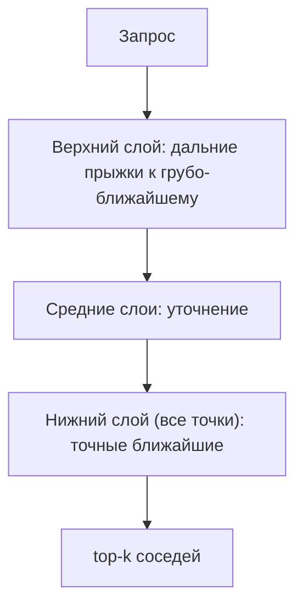
Параметры настройки: **M** — число связей на узел (больше M → выше recall и память); **ef_construction** — размер списка кандидатов при построении (больше → лучше граф, дольше сборка); **ef_search** — размер списка при запросе (больше → выше recall, выше латентность). Профиль: высокий recall и быстрый запрос, но **большая память** (граф в RAM) и **медленная сборка**.

**IVF (Inverted File)** — на основе кластеризации. K-means делит пространство на `nlist` ячеек (Вороного); при запросе ищем только в `nprobe` ближайших ячейках, а не по всему корпусу. Параметры: **nlist** (число ячеек), **nprobe** (сколько ячеек проверять — больше → выше recall, медленнее). Профиль: быстрая сборка, меньше памяти, чем HNSW; recall/скорость тюнится через nprobe.

**PQ (Product Quantization)** — сжатие. Разбивает вектор на под-векторы и кодирует каждый кодом из маленькой кодовой книги, резко уменьшая память (вектор → $m$ байт: точная арифметика и механика скорости — в deep-dive ниже). Часто комбинируется: **IVF-PQ** (кластеризация + сжатие) для миллиардного масштаба. Профиль: кардинально меньше памяти, ценой потери recall.

**DiskANN и дисковые** — граф на SSD для миллиардов векторов на одной ноде, когда всё в RAM не влезает.

| Индекс | Recall | Латентность запроса | Сборка | Память | Когда |
|---|---|---|---|---|---|
| HNSW | Высокий | Низкая | Медленная | Высокая (RAM) | Дефолт: качество + скорость, память есть |
| IVFFlat | Средний-высокий (nprobe) | Средняя | Быстрая | Средняя | Быстрая сборка, экономия памяти |
| IVF-PQ | Средний (сжатие теряет) | Низкая | Средняя | Очень низкая | Миллиарды векторов, память дорога |
| DiskANN | Высокий | Средняя (диск) | Медленная | Низкая (RAM) | Миллиарды на одной ноде |

*Источники.* Y. Malkov, D. Yashunin, «Efficient and robust ANN search using HNSW graphs» (2016/2018); H. Jégou et al., «Product Quantization for Nearest Neighbor Search» (2011); S. Subramanya et al., «DiskANN» (2019); J. Johnson et al., «Billion-scale similarity search with GPUs» (2017, FAISS).

Качественные метки таблицы переводятся в порядки величин так: HNSW при типовых параметрах держит recall@10 в высоких 90-х процентах при миллисекундном поиске на миллионах векторов; IVF смещает баланс к меньшей памяти и большей чувствительности к параметрам; PQ-варианты жертвуют recall ради кратной экономии. Конкретные числа критически зависят от данных и параметров — снимайте их бенчмарком на *своих* векторах (методология — ann-benchmarks), а не переносите из чужих таблиц.

### Deep Dive: механика HNSW изнутри (включая боль удаления)

Раз HNSW — дефолт, стоит понять, *почему* он быстрый и где болит.

**Small-world и слои.** HNSW строит граф со «small-world»-свойством: большинство узлов связаны короткими путями через немногочисленные «дальние» связи (как «шесть рукопожатий»). Многослойность добавляет иерархию: узел попадает на слой `l` с *экспоненциально убывающей* вероятностью, поэтому верхние слои разрежены (мало узлов, дальние прыжки), нижний — плотный (все узлы). Поиск идёт сверху (грубая навигация большими прыжками) и спускается, уточняя. Комбинация «small-world + иерархия» даёт **логарифмическую** сложность поиска вместо линейной — вот откуда скорость.

**Greedy search с backtracking (ef).** На каждом слое — жадный обход: идти к соседу, ближайшему к запросу. Но чистая жадность застревает в локальных минимумах, поэтому поддерживается **динамический список кандидатов размера `ef`** (по сути beam/backtracking): больше `ef_search` → шире поиск, выше recall, выше латентность. Это основной параметр размена recall ↔ скорость на запросе.

**Построение.** Вставка узла: найти его `M` ближайших соседей (тем же поиском) и соединиться с ними на каждом слое присутствия. Отсюда `ef_construction` (качество поиска соседей при вставке) и `M` (степень графа): больше — лучше граф, но дороже память и сборка.

**Удаление — реальный операционный минус.** HNSW **плохо поддерживает удаление**: удаление узла рискует нарушить связность (через него проходили пути), снижая recall. На практике удаляют **мягко** (tombstone: пометить удалённым, фильтровать на выдаче) с **периодической полной перестройкой** индекса для физической очистки. Следствие: при частом удалении или изменении данных (удаление по требованию GDPR, ротация документов) стратегию перестроения закладывают заранее, учитывая, что векторный индекс — не таблица, из которой дёшево удалить строку; удаление здесь требует отдельной операции.

*Источник:* Malkov & Yashunin (2016/2018); документация pgvector/FAISS по ограничениям удаления.

### Deep Dive: спектр квантизации (память — часто главный лимит)

Память под векторы — частый лимит на масштабе; квантизация её режет ценой recall. Спектр по агрессивности:

- **Scalar quantization (SQ)** — компоненту как int8 вместо float32. ~4× экономии, малая потеря recall. Дешёвый дефолт.
- **Product quantization (PQ)** — разбить вектор на под-векторы, каждый закодировать индексом из обученной кодовой книги. Высокое сжатие (вектор → $m$ байт при $k^* = 256$ — 96 байт при $d$ = 1536, $m$ = 96; счёт в deep-dive ниже), заметнее потеря recall; часто в связке IVF-PQ для миллиардов (§8.3). Переоценка кандидатов полными векторами (rescoring, см. следующий пункт) применима и к PQ — сравнивать методы честно только при одинаковой двухстадийности.
- **Binary quantization (BQ) + rescoring** — самое агрессивное и модное (2024): компоненту → *1 бит* (знак), сходство по Хэммингу. До ~32× экономии и очень быстрый поиск. Потеря точности компенсируется **rescoring**: достать кандидатов по бинарным векторам (грубо, дёшево), затем переоценить top-N *полными* (float) векторами. Двухстадийность «грубо-бинарно → точно-полно» даёт почти полный recall при доле памяти — концептуально тот же приём, что retrieve-then-rerank (§7.4), но на уровне представления вектора.

| Метод | Экономия памяти | Потеря recall | Когда |
|---|---|---|---|
| Scalar (int8) | ~4× | Малая | Дешёвый дефолт |
| Product (PQ) | Высокая: $4d/m$ при $k^*=256$ (64× при d=1536, m=96) | Заметная | Миллиарды векторов |
| Binary + rescoring | ~32× | Малая (с rescoring) | Память — главный лимит, нужна скорость |

Вывод: когда ограничением становится память (а не латентность или качество), квантизация — первый рычаг; **binary + rescoring** сегодня даёт лучший размен «память ↔ качество» для многих случаев. Recall (§8.4) измеряют при каждом уровне сжатия — это цена компрессии.

*Источник:* Jégou et al. (2011, PQ); материалы по binary quantization + rescoring в векторных БД (2024).

### Deep Dive: механика PQ изнутри (сжатие и ADC)

Раз PQ — главный рычаг на миллиардном масштабе, стоит уметь посчитать, *сколько* именно он экономит, понять, почему сжатый индекс оказывается ещё и быстрым, и знать, где он ломается молча. Все три ответа получаются на бумаге, до бенчмарка.

**Арифметика сжатия.** Вектор режется на $m$ непересекающихся под-векторов ($d$ обязано делиться на $m$). Для каждого куска *отдельно* обучается своя **кодовая книга** — набор из $k^*$ типовых представителей (центроидов). Сам вектор после этого не хранится: хранятся $m$ номеров — «на какую из $k^*$ заготовок похож каждый кусок».

$$L = m \cdot \log_2 k^* \text{ бит}, \qquad \text{сжатие} = \frac{32d}{m \cdot \log_2 k^*} \;=\; \frac{4d}{m} \;\;(\text{только при } k^* = 256)$$

* $d$ — размерность эмбеддинга, типично 1536 (§1.3);
* $m$ — на сколько кусков режем вектор; **это и есть ручка настройки**;
* $D^* = d/m$ — размерность одного куска;
* $k^*$ — размер кодовой книги одного куска; по конвенции 256 — и короткая форма $4d/m$ верна **только** при этом значении (почему — ниже);
* $L$ — длина кода одного вектора;
* 4 — байт на компоненту исходного float32;
* 32 = 4 байта $\times$ 8 бит — переводной множитель: приводит байты исходного вектора и биты кода к общей единице.

Живые числа при $d = 1536$, $m = 96$: в куске $D^* = 16$ компонент; $\log_2 256 = 8$ бит — **ровно один байт**, и именно поэтому $k^* = 256$ стало конвенцией: номер центроида адресуется байтом без битовой упаковки. Код вектора = $96 \times 8 = 768$ бит = **96 байт** против $1536 \times 4 = 6144$ байт исходного вектора. Сжатие: $6144 / 96 = 64\times$.

Здесь же виден и источник короткой формы, и её граница. При $k^* = 256$ множитель $\log_2 k^* / 8 = 1$ схлопывается, и от общей формулы остаётся $4d/m$. Сдвиньте $k^*$ — и она начинает врать: при $k^* = 1024$ кусок стоит $\log_2 1024 = 10$ бит = 1,25 байта, код = $96 \times 1{,}25 = 120$ байт, сжатие = $6144 / 120 = 51{,}2\times$, а не 64×. Короткая форма завысила бы на 25%. $4d/m$ — не закон PQ, а арифметика конкретного соглашения «центроид = ровно байт»; вне его считают по $32d / (m \log_2 k^*)$.

Словами: от вектора остаётся 96 байт-указателей в таблицу заготовок — в 64 раза меньше, чем он весил. Ручка работает так: больше $m$ → длиннее код → слабее сжатие, но точнее приближение и выше recall; меньше $m$ → агрессивнее и грубее. Сами книги весят $k^* \cdot d$ float32 = $256 \times 1536 \times 4 \approx 1{,}5$ МБ на индекс — величина разовая и на миллионах векторов пренебрежимая.

**ADC: почему PQ не только маленький, но и быстрый.** Таблица §8.3 ставит PQ «низкую латентность», и это не следствие малого размера самого по себе — за скорость отвечает отдельный механизм, **ADC (asymmetric distance computation)**. «Несимметричный» он потому, что кодируется только база, а **запрос не квантуется**: сравнивается живой вектор запроса с кодом документа (это же и точнее — шум квантизации вносится один раз, а не дважды). Схема такая: один раз на запрос считается таблица квадратов расстояний от каждого куска запроса до всех центроидов соответствующей книги — $m \times k^* = 96 \times 256 = 24\,576$ чисел ценой $k^* \cdot d = 256 \times 1536 \approx 393$ тыс. операций. После этого расстояние до **любого** документа — это $m = 96$ чтений из таблицы и сложений; ни одного умножения по $d$. В формулировке первоисточника: «only $m$ additions are required per distance calculation».

Живые числа на корпусе $n = 10$ млн: скан стоит $n \cdot m = 10^7 \times 96 = 960$ млн сложений, а построение таблицы — 393 тыс., то есть 0,04% работы (первоисточник даёт и точку окупаемости: таблица перестаёт быть заметной при $n > k^* D^* = 256 \times 16 = 4096$). Точный перебор на тех же данных — $n \cdot d = 10^7 \times 1536 \approx 15{,}4$ млрд умножений-сложений. Выигрышей, таким образом, два сразу: арифметики в $d/m = 16$ раз меньше, и это сложения вместо умножений; а трафика памяти — в 64 раза (96 байт против 6144 на вектор). Поскольку скан упирается в пропускную способность памяти, а не в АЛУ, решает именно второй: «маленький» и «быстрый» у PQ — это одно свойство, а не два. Оговорка из той же работы: растить $k^*$ дальше 256 мешает не только удлинение кода, но и объём центроидов ($k^* \cdot d$ float), который эффективен, лишь пока помещается в кэш.

**Режим отказа: дрейф распределения.** Кодовая книга — не константа алгоритма, а **обученная на данных** модель: $m$ независимых прогонов k-means по *выборке* корпуса. Выборка мала и по умолчанию жёстко ограничена: FAISS обрезает обучающее множество до `max_points_per_centroid` = 256 точек на центроид, то есть до $256 \times 256 = 65\,536$ векторов — сколько бы миллионов ни лежало в корпусе (а ниже `min_points_per_centroid` = 39 на центроид выдаёт предупреждение). Первоисточник формулирует это прямо: книга «to some extent, still adapted to the data distribution to represent» — она подогнана под то распределение, которое ей показали.

Отсюда режим отказа, специфичный именно для PQ. Приходит новый домен документов — другой язык, другая предметная область, — его векторы ложатся далеко от всех центроидов, ошибка квантизации растёт, recall падает. **И никакой ошибки при этом не возникает**: индекс не падает, запрос отвечает, коды пишутся, метрики зелёные. Единственный детектор — измерение recall против brute-force ground truth (§8.4), причём *на свежем домене отдельно*, а не на общей выборке. У IVF ячейки тоже строятся k-means по выборке и тоже плывут, но IVFFlat хранит полные векторы: расстояния внутри проверенных ячеек остаются точными, а перекластеризация не требует ничего, кроме уже лежащего в индексе. У PQ потеря запечена в само хранимое представление.

Цена починки — ключевой пункт для плана миграций. Лечится дрейф переобучением книг и **перекодированием всего корпуса**, но перекодировать не из чего: PQ-код необратим, вектор из него не восстановить — ровно потому индекс и занимает 96 байт вместо 6144. Значит, нужны исходные float-векторы, которых PQ существует чтобы не хранить, — то есть прогон эмбеддера по корпусу заново. Это тот же класс стоимости, что смена embedding-модели (§8.8).

**Инвариант.** Выбирая PQ, принимают не только размен «памяти в 64 раза меньше ↔ recall ниже», но и обязательство: либо исходные векторы лежат в холодном хранилище, либо в план заложен бюджет на полный переэмбеддинг корпуса. Первое дешевле и имеет второй, редко называемый бонус — те же векторы нужны для rescoring (выше в §8.3). И recall меряют при заходе каждого нового домена: дрейф распределения молчит.

*Источники.* H. Jégou, M. Douze, C. Schmid, «Product Quantization for Nearest Neighbor Search» (IEEE TPAMI, 2011) — разбиение на $m$ под-векторов, $l = m \log_2 k^*$, «$k^* = 256$ и $m = 8$ — часто разумный выбор», ADC/SDC, Table II (стоимость $k^*D$ на таблицу, $nm$ на скан), обучение книг по Ллойду; исходники FAISS (`Clustering.h`: `min_points_per_centroid` = 39, `max_points_per_centroid` = 256).

## 8.4 Deep Dive: универсальный размен

У ANN нет бесплатного обеда — есть поверхность разменов между четырьмя величинами: **recall ↔ латентность запроса ↔ память ↔ время построения**. Максимизировать все нельзя: повышение ef_search увеличивает recall и латентность; переход к PQ снижает память и recall. Настройка ANN — это выбор точки на этой поверхности под конкретный профиль нагрузки.

Ключевой инженерный приём, который часто пропускают: **измерение recall@k относительно brute-force ground truth.** Поскольку ANN приближённый, необходимо знать, *сколько* recall отдано за скорость. Для этого формируют небольшой набор запросов, вычисляют точных соседей перебором (офлайн, однократно) и измеряют, какую их долю находит ANN-индекс при текущих параметрах. Без этого настройка ведётся вслепую, а величина потерь неизвестна.

## 8.5 Deep Dive: pgvector

**pgvector** — прагматичный вариант по умолчанию: хранит векторы *в Postgres*. Это даёт транзакционность, соединения (JOIN) с бизнес-таблицами, контроль доступа через существующие механизмы и — главное — **отсутствие нового хранилища**, пока оно реально не потребуется.

- **Типы индексов:** HNSW и IVFFlat (те же семейства из §8.3).
- **Параметры:** HNSW — `m`, `ef_construction` (при создании индекса), `hnsw.ef_search` (при запросе, через SET); IVFFlat — `lists` (при создании), `ivfflat.probes` (при запросе).
- **Операторы расстояния:** `<=>` косинусное, `<#>` (отрицательное) скалярное произведение, `<->` евклидово (L2). Выбор оператора соответствует выбранной мере близости (§1.3).

**Когда pgvector достаточно, а когда выносить в выделенную БД (Qdrant/Weaviate/Milvus):** pgvector отлично закрывает старт и средние масштабы, особенно если ценна связка с реляционными данными и фильтрацией. Выносить целесообразно при: очень большом масштабе (сотни миллионов и более), высокой нагрузке с жёсткими требованиями к латентности или потребности в продвинутых возможностях выделенных БД (сложная фильтрация с ANN, шардирование, встроенные гибридные движки). Правило: **начинать с pgvector и выносить по доказанной необходимости.**

*Источник:* документация pgvector.

## 8.6 Deep Dive: инфраструктура гибридного поиска и подводный камень фильтрации

Гибрид (§7.3) реализуется в одной реляционной БД: pgvector (dense) + полнотекстовый поиск Postgres (`tsvector` с GIN-индексом, sparse) + слияние RRF в SQL или приложении.

Но есть **важный подводный камень — взаимодействие фильтрации метаданных и ANN.** Часто нужен поиск *с фильтром*: «ближайшие чанки, но только из документов отдела продаж, не старше года». Наивно кажется тривиальным, но ANN и фильтр конфликтуют:
- **Post-filtering** (сначала ANN top-k, потом отфильтровать по метаданным) — может вернуть *слишком мало*: если из top-50 после фильтра осталось 2, а нужно 5, результат недобран и поиск приходится расширять.
- **Pre-filtering** (сначала отобрать по метаданным, потом искать среди них) — «ломает» граф HNSW: обход рассчитан на полный граф, а на подмножестве связность нарушается, recall падает; либо приходится делать перебор по подмножеству.

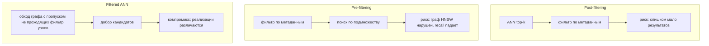

Реальные системы применяют **iterative / filtered ANN** (обход графа с пропуском не проходящих фильтр узлов и добором кандидатов), и разные векторные БД реализуют это по-разному и с разным качеством. Конкретная точка отсчёта: pgvector 0.8.0 (октябрь 2024) оформил это как `hnsw.iterative_scan` (режимы strict_order / relaxed_order) с бюджетом добора `hnsw.max_scan_tuples` — фильтрованный ANN из «неявного поведения, о котором молчат» стал настраиваемым параметром с документированной семантикой. Практический вывод: **фильтрация с ANN не бесплатна и не тривиальна**; при высокой селективности фильтра recall (§8.4) проверяют именно *с включённым фильтром*, а не только на чистом поиске.

## 8.7 Deep Dive: RBAC/ABAC на ретриве (мост к безопасности)

Критическая и недооценённая тема. Индекс содержит чанки из документов *разного уровня доступа*, а запрос обязан вернуть только то, что конкретному пользователю *разрешено* видеть. Пропуск этого — нарушение разграничения доступа при ретриве: агент извлечёт и покажет (или использует в ответе) конфиденциальный чанк, к которому у пользователя нет прав.

Подходы:
- **Фильтрация по ACL в метаданных** — прицепить к каждому чанку владельца/гриф/список доступа и фильтровать на запросе по правам пользователя. Просто, но см. §8.6 (фильтр + ANN).
- **Row-Level Security (RLS) Postgres** — политики RLS на таблице чанков: пользователь физически не видит строки вне своих прав. Мощно и надёжно, потому что доступ форсится на уровне БД, а не в коде приложения (которое можно забыть).
- **Индекс на тенанта/уровень** — отдельные индексы/коллекции под изолированные группы (жёсткая изоляция ценой дублирования инфраструктуры).

Интеграция с системой управления доступом: роли и права пользователя из токена отображаются в предикат фильтра или политику RLS. Ключевой инвариант: **контроль доступа применяется на ретриве, а не на генерации** — нельзя полагаться на то, что модель «сама не покажет» запретное: модель не является механизмом безопасности.

## 8.8 Операционные заботы

- **Реиндексация при смене embedding-модели.** Векторы разных моделей несопоставимы (§1.3) — смена эмбеддера означает *полную* переиндексацию корпуса. Это закладывают в план миграций как дорогую операцию.
- **Стоимость построения и инкрементальные обновления.** HNSW строится медленно; предусматривают инкрементальную вставку и перестроение.
- **Свежесть и устаревание.** Пайплайн, поддерживающий индекс в согласии с источником (§6.6, режим «устаревание»).
- **Планирование ёмкости.** Память под HNSW-граф и под сами векторы — новый потребитель RAM, учитываемый при оценке ёмкости; арифметика — ниже.

### Deep Dive: планирование ёмкости в байтах

Порог выноса из pgvector в §8.5 задан в строках — «сотни миллионов». В строках он обманчив: платят байтами, и упереться в потолок ноды можно на два порядка раньше. Это считается на салфетке, до закупки железа.

**Сколько весит вектор.** pgvector хранит тип `vector` плотно, без сжатия:

$$S_{vec} = 4d + 8$$

* $S_{vec}$ — байт на один вектор.
* $d$ — размерность эмбеддинга (§1.3), штук: 1536 у распространённых моделей OpenAI (text-embedding-3-small, ada-002), 1024 у BGE-M3.
* 4 — байт на компоненту: каждое число хранится как `float32`.
* 8 — байт заголовка значения (длина и размерность).

При $d = 1536$: $4 \cdot 1536 + 8 = 6152$ байта. **Словами:** один чанк стоит ~6 КБ ещё до всякого индекса.

**Сколько весит граф.** Малков и Яшунин дают среднюю память на элемент напрямую:

$$S_{graph} = (M_{max0} + m_L \cdot M_{max}) \cdot b$$

* $M_{max0}$ — предельное число связей у точки на нулевом слое (том самом плотном, где лежат *все* точки, §8.3). Рекомендация авторов — $2M$, то есть 32 при $M = 16$ (в pgvector этот параметр пишется строчной `m`, значение по умолчанию — 16).
* $M_{max}$ — то же для верхних, разреженных слоёв; равно $M$ = 16.
* $m_L$ — множитель, нормирующий розыгрыш уровня для новой точки: уровень тянется как $\lfloor -\ln(U) \cdot m_L \rfloor$, где $U$ равномерно на (0,1). Рекомендация авторов — $1/\ln M = 1/\ln 16 \approx 0{,}36$. Это масштаб розыгрыша, и только он: числом слоёв на точку $m_L$ не является. Слои редеют экспоненциально — на слой 1 попадает $e^{-1/m_L}$ = ~1/16 точек, на слой 2 — ~1/256, — так что почти вся масса связей лежит на нулевом слое.
* $b$ — байт на одну связь. У авторов это 4: они ограничивают индекс примерно четырьмя миллиардами элементов и хранят соседа 32-битным номером. **В pgvector цифра другая** — там связь записана как `ItemPointerData`, штатный указатель Postgres на строку («номер страницы плюс смещение внутри неё»), а он занимает 6 байт. Ниже сначала воспроизводится счёт авторов при $b$ = 4, затем он пересчитывается под pgvector при $b$ = 6.

Подставляем при $M$ = 16: $(32 + 0{,}36 \cdot 16) \cdot 4 = 37{,}8 \cdot 4 \approx 151$ байт. Проверка сходимости: на всём рабочем диапазоне $M$ = 6…48 формула даёт 61…434 байта — это и есть опубликованная авторами оценка, «около 60–450 байт на объект, *не считая самих данных*». В этих ~38 связях на точку нулевой слой держит 32, а вся надстройка над ним — $0{,}36 \cdot 16 \approx 6$ связей.

*Оговорка о верхнем члене.* Он завышен. Среднее число верхних слоёв на точку — это сумма вероятностей попасть на слой 1, на слой 2, на слой 3 и так далее: $\sum_{k \ge 1} 16^{-k} = 1/15 \approx 0{,}067$, то есть ~1 связь сверху, а не 5,8. Цифра сходится с формулировкой самих авторов при выборе $m_L = 1/\ln M$ — «average single element overlap between the layers», перекрытие слоёв в один элемент. Счёт первоисточника здесь всё же оставлен: он даёт оценку сверху — для планирования ёмкости ошибка в эту сторону безопасна, — и воспроизводит опубликованный диапазон. Кто считает точнее, берёт ~33 связи вместо ~38: граф выходит на ~12% легче, на вывод раздела это не влияет.

**Пересчёт под pgvector.** Те же ~38 связей, но по 6 байт: $(32 + 0{,}36 \cdot 16) \cdot 6 \approx 227$ байт на элемент. Дальше в счёте используется эта цифра. **Словами:** граф — это примерно 38 ссылок на соседей на точку, и от $d$ он не зависит вовсе.

**Отсюда главный вывод раздела.** 227 байт против 6152 — граф составляет ~3,7% футпринта. Значит **`m` — не рычаг памяти**: удвоить его стоит ещё ~3,5% RAM и окупается recall; урезать его ради экономии памяти бессмысленно. Память — это *векторы*, и рычагов против них ровно два, оба уже названы. Первый — квантизация (§8.3): `halfvec` хранит компоненту в двух байтах вместо четырёх ($2d + 8$ = 3080 Б, ~2×), а `binary_quantize` в тип `bit` — в одном бите ($d/8 + 8$ = 200 Б, ~30×, с обязательной переоценкой кандидатов полными векторами). Второй — урезание размерности (§7.6, Matryoshka): 1536 → 768 делит счёт пополам без переобучения эмбеддера и без переиндексации из другого источника.

**Корпус целиком.** $N$ = 10 млн чанков, $d$ = 1536, $m$ = 16: векторы $10^7 \cdot 6152$ Б ≈ 61 ГБ, граф $10^7 \cdot 227$ Б ≈ 2,3 ГБ.

И это оценка снизу — в pgvector она занижена примерно вдвое. HNSW-индекс не ссылается на строку таблицы, а держит **собственную полную копию** каждого вектора внутри своего элемента (поле `Vector data` в структуре `HnswElementTupleData`, `src/hnsw.h`). То есть таблица ≈61 ГБ *и* индекс ≈63 ГБ поверх неё. Сверху ложится гранулярность хранения: страница Postgres — 8 КБ, элемент индекса при $d$ = 1536 — свыше 6 КБ, два в страницу не помещаются, поэтому на вектор фактически расходуется целая страница. Итог — оценочно порядка 130–150 ГБ вместо наивного 61; точную цифру снимают `pg_relation_size` на своих данных, а не берут из этой прикидки (та же дисциплина, что и с recall, §8.4). Тот же 8-килобайтный лимит объясняет и потолок `vector` для HNSW в 2000 измерений ($4 \cdot 2000 + 8 = 8008$ Б — впритык к странице): $d$ = 3072 (text-embedding-3-large) как `vector` не индексируется вовсе, требуется `halfvec` (его потолок — 4000).

**Инвариант: ёмкость здесь — обрыв, а не склон.** Обход HNSW — случайный доступ по графу: десятки прыжков на запрос в непредсказуемые места индекса. Пока всё лежит в RAM, прыжок стоит порядка 100 нс и поиск укладывается в миллисекунды (§8.3). Как только векторы с графом перестают помещаться в RAM ноды, каждый промах кэша превращается в чтение с SSD — порядка 100 мкс, в тысячу раз дороже, — и сотня прыжков оценочно даёт уже десятки миллисекунд вместо одной. Деградация не плавная: индекс не «немного замедляется», он проваливается на порядок и более, разом, на ровном месте. Практическое следствие: 10 млн чанков — это в полсотни раз меньше «сотен миллионов» из §8.5, но 64-гигабайтная нода на них уже кончилась. Планировать надо по байтам, а решение брать из §8.3: либо ужать вектор (квантизация, Matryoshka), либо взять индекс, спроектированный жить на диске (DiskANN) — HNSW на это не рассчитан.

*Источники.* Y. Malkov, D. Yashunin, «Efficient and robust approximate nearest neighbor search using Hierarchical Navigable Small World graphs» (2016/2018) — формула памяти графа и «60–450 байт на объект» (§4.2.3), четырёхбайтная связь там же, рекомендации $M_{max0} = 2M$ и $m_L = 1/\ln M$ с «average single element overlap» (§4.1), розыгрыш уровня (alg. 1). Документация и исходный код pgvector (`src/hnsw.h`) — размеры типов `vector`/`halfvec`/`bit`, хранение связей как `ItemPointerData` (`HNSW_NEIGHBOR_TUPLE_SIZE`), значение `m` по умолчанию (`HNSW_DEFAULT_M` = 16), лимит в 2000 измерений (`HNSW_MAX_DIM`). Исходный код PostgreSQL (`src/include/storage/itemptr.h`) — размер `ItemPointerData`: «designed to be six bytes long».

## 8.9 Резюме главы

Векторный поиск — специальный тип индекса; ANN *приближённый* по построению и находится на поверхности разменов recall ↔ латентность ↔ память ↔ построение (§8.4), настраиваемой под нагрузку. HNSW — вариант по умолчанию (качество и скорость ценой памяти), pgvector — прагматичное хранилище на старте. Обязательное в эксплуатации: гибрид, фильтрация метаданных (с учётом её конфликта с ANN, §8.6) и **контроль доступа на ретриве** (§8.7). Recall измеряют относительно ground truth, в том числе с фильтрами.

*Источники.* Malkov & Yashunin (2018, HNSW); Jégou et al. (2011, PQ); Johnson et al. (2017, FAISS); документация pgvector; обзор Gao et al. (2023).

# Глава 9. Оценка качества RAG

Глава 6 установила: ретрив — молчаливое узкое место, а качество — две ортогональные оси. Настоящая глава — о том, как их *измерять*, поскольку исправление RAG без измерения (§6.6) ведётся вслепую. По существу это дисциплина регрессионного тестирования и SLO, применённая к вероятностной системе.

## 9.1 Зачем мерить: eval-driven RAG

Наивный RAG молча промахивается на заметной доле запросов (§6.5), и уверенный неверный ответ неотличим от верного на глаз. Единственный способ управлять качеством — **измерять его как метрику**. Отсюда eval-driven разработка RAG: «хорошо» задаётся измеримыми метриками, замеряется базовая линия, а итерации ведутся против метрик. Поскольку качество — две оси (§6.7), измеряют *обе раздельно*, иначе неясно, *что* исправлять.

## 9.2 Deep Dive: двухосевой каркас метрик

Меряем ретрив и генерацию по отдельности (это по сути каркас RAGAS):

**Ось ретрива — «достали ли правильное?»**
- **Context Recall** — доля релевантной информации, которую ретрив *достал* (не упустили ли нужное). Низкий → проблема recall (§7.3, §7.5).
- **Context Precision** — релевантно ли то, что достали, и хорошо ли ранжировано (не притащили ли шум, не зарыто ли нужное). Низкий → нужен реранкер/фильтры (§7.4).
- **Классические IR-метрики** (когда есть размеченные релевантности): **Hit Rate** (нашли ли хоть один релевантный в top-k), **MRR** (насколько высоко первый релевантный), **NDCG**[^t-ndcg] (качество всего ранжирования).

**Ось генерации — «использовали ли правильно?»**
- **Faithfulness / Groundedness** — опирается ли *каждое утверждение* ответа на извлечённый контекст, без выдумки сверх него. Низкий → модель галлюцинирует несмотря на хороший контекст (проблема генерации, §6.7).
- **Answer Relevancy** — отвечает ли ответ на *заданный вопрос* (а не на соседний).
- **Answer Correctness** — совпадает ли с эталоном (когда эталон есть).

| Ось | Метрика | Что диагностирует | Куда чинить |
|---|---|---|---|
| Ретрив | Context Recall | Упустили релевантное | Hybrid, query transform, chunking |
| Ретрив | Context Precision | Шум/плохое ранжирование | Reranking, фильтры |
| Генерация | Faithfulness | Галлюцинация сверх контекста | Промпт, цитаты, temperature |
| Генерация | Answer Relevancy | Ответ не по вопросу | Промпт, query rewriting |

Именно раздельность даёт диагностику: низкий Context Recall при высокой Faithfulness означает «модель честно пересказала неполный контекст» → исправлять следует *ретрив*, а не генерацию.

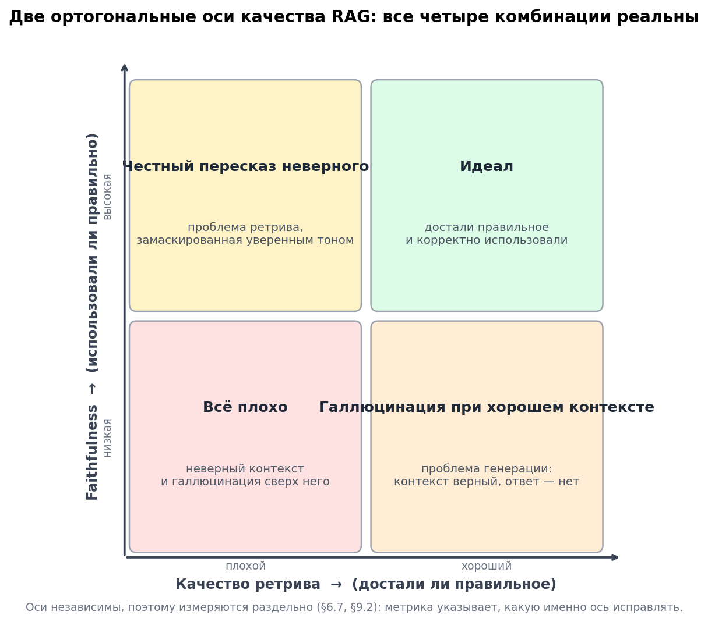

### Deep Dive: как метрики считаются на самом деле

«Faithfulness» и «context precision» звучат абстрактно; полезно знать *алгоритм*, чтобы доверять числу и уметь его отлаживать. Как это делает RAGAS (и аналоги):

- **Faithfulness.** (1) Разложить ответ на атомарные *утверждения* (claims) — отдельным вызовом LLM. (2) Для каждого спросить судью: «следует ли это из извлечённого контекста?» (да/нет). (3) `faithfulness = (подтверждённых утверждений) / (всего утверждений)`. Метрика — доля ответа, реально опирающаяся на контекст. Отладка: видно, *какие именно* утверждения не подтверждены.
- **Answer Relevancy.** (1) По сгенерированному ответу LLM *обратно* порождает несколько вопросов, на которые этот ответ отвечал бы. (2) Считается сходство этих вопросов с *исходным* (эмбеддинги). (3) Высокое сходство → ответ по делу; низкое → уплыл в сторону. Ловит «ответ не на тот вопрос» без эталона.
- **Context Precision.** Смотрит на *ранжирование*: находятся ли релевантные чанки *выше* нерелевантных в извлечённом списке (по позициям релевантных). Низкая → нужен реранкер (§7.4).

Микропример faithfulness. Ответ: «Возврат оформляется в течение 14 дней; для техники срок — 30 дней; курьер приезжает бесплатно». Разложение: (1) «возврат — 14 дней» — есть в контексте ✓; (2) «для техники — 30 дней» — есть ✓; (3) «курьер бесплатно» — в контексте отсутствует ✗. Faithfulness = 2/3 ≈ 0.67, и сразу видно, *какое* утверждение выдумано — это и отличает диагностируемую метрику от «оценки на глаз».
- **Context Recall.** Требует эталонного ответа: каждое утверждение *эталона* проверяется на *атрибутируемость* к извлечённому контексту. `recall = (утверждений эталона, покрытых контекстом) / (всего утверждений эталона)`. Низкая → ретрив упустил нужное (§7.3/7.5).

Ключевое наблюдение: почти все эти метрики *сами используют LLM* (для разложения на утверждения и проверки следования) — то есть это LLM-as-judge под капотом (§9.4), со всеми требованиями к калибровке. Поэтому «RAGAS = 0.82» — не абсолют, а *измерение измерителем*, которое надо валидировать (§ниже).

*Источник:* S. Es et al., «RAGAS» (2023).

## 9.3 Deep Dive: золотой набор

Фундамент всякой оценки — **золотой набор (golden dataset)**: курируемый набор кортежей `(вопрос, релевантный контекст, эталонный ответ)`. Это регрессионный набор тестов для RAG; без него оценка невозможна.

Как строить:
- **Из реальных запросов** — собрать настоящие вопросы пользователей (самый ценный источник — отражает реальную нагрузку).
- **Экспертная разметка** — SME размечает, какой контекст релевантен и каков идеальный ответ.
- **LLM-генерация + ревью человеком** — сгенерировать вопросы по документам моделью, затем *обязательно* провалидировать человеком (иначе эвал наследует ошибки генератора).

Требования: **покрытие** (лёгкие factoid *и* трудные многошаговые, крайние случаи, вопросы без ответа в корпусе — проверить, что система признаёт «не знаю», а не выдумывает); достаточный **размер** для статзначимости, но качество примеров важнее количества. Золотой набор версионируется и растёт вместе с системой. Внешняя точка отсчёта для ретрив-части — **BEIR** (Thakur et al., 2021), гетерогенный IR-бенчмарк: полезен для сверки базового качества ретрива до доменной разметки, но собственный золотой набор не заменяет.

## 9.4 Deep Dive: LLM-as-judge для RAG

Faithfulness и relevancy — семантические свойства; булевым ассертом их не проверить. Решение — **LLM-as-judge** (детально в гл. 17): подать судье вопрос, контекст, ответ и *рубрику*, и попросить оценить.

- **Faithfulness через судью:** разложить ответ на утверждения и по каждому спросить «подтверждается ли это извлечённым контекстом?» — доля подтверждённых и есть faithfulness. Это операционализирует «не выдумал ли».
- **Answer Relevancy через судью:** оценить, насколько ответ адресует именно заданный вопрос.
- **Reference-free vs reference-based:** faithfulness/relevancy можно мерить *без эталона* (судья смотрит только вопрос+контекст+ответ) — это удобно, эталон нужен не всегда. Correctness требует эталона.
- **Калибровка судьи обязательна** (гл. 17): явные шаги оценки, strict-режим для pass/fail и валидация против человеческой разметки на подвыборке — иначе доверие оказывается неоткалиброванному измерителю.

В проде: лёгкие/дешёвые метрики на 100% трафика + дорогой LLM-судья на сэмпле (§17), чтобы не платить за оценку каждого запроса.

### Deep Dive: статистическая строгость и валидация судьи

Эвал — это измерение, а у измерения есть погрешность. Академическая честность требует с ней считаться.

- **Дисперсия LLM-судьи.** Судья недетерминирован (§2.4) и шумит: один и тот же ответ может получить разный скор между прогонами. Митигация: усреднять по нескольким прогонам для важных решений; фиксировать низкую temperature судьи; предпочитать бинарные/дискретные вердикты непрерывным (устойчивее).
- **Размер выборки и значимость.** Рост метрики с 0.80 до 0.83 на 30 примерах — вероятно, шум. Чтобы отличить реальное улучшение от случайного, нужен достаточный размер золотого набора и, в идеале, **доверительные интервалы** или тест значимости на разнице. Правило: улучшение, укладывающееся в разброс, не считается улучшением. Это стандартная дисциплина статистической значимости, применённая к оценке.
- **Валидация судьи против людей (eval the evaluator).** Прежде чем доверять LLM-судье, необходимо показать, что он согласуется с человеком: на подвыборке размечают вручную и вычисляют **согласие** (например, каппу Коэна[^t-kappa]) или корреляцию «судья ↔ люди». Низкое согласие означает, что рубрику судьи нужно исправлять, а не доверять его числам. Без этого шага SLO строится на неоткалиброванном приборе.
- **Регрессионный режим.** Золотой набор с порогами в CI-гейте (§9.5) выявляет *регрессии* при смене промпта, модели или эмбеддера (§2.4); базовую линию фиксируют, а на просадку настраивают оповещение.

Вывод: оценку рассматривают как измерительную систему с погрешностью — усредняют шум судьи, проверяют значимость разниц и *валидируют самого судью против людей* прежде, чем строить на его числах решения. Иначе «faithfulness 0.9» — число без доверительного интервала и без откалиброванного прибора.

*Источник:* L. Zheng et al., «Judging LLM-as-a-Judge with MT-Bench and Chatbot Arena» (2023); классическая статистика согласия оценщиков.

## 9.5 Deep Dive: цикл eval-driven RAG (связывает главы 6–9)

Вот рабочий цикл, который сшивает всю Часть III:

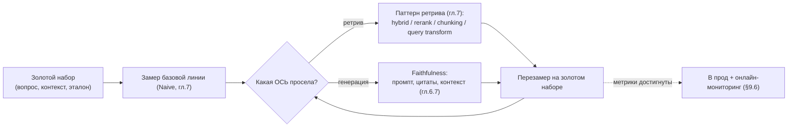

Это операционализация «лестницы» (§7.1): подъём по паттернам ретрива происходит **не наугад, а по результатам измерения** — метрика указывает, *какая ось* просела и, следовательно, *какой* паттерн применить. Именно так принцип «начинать просто, усложнять по доказанной необходимости» превращается из лозунга в процесс.

## 9.6 Онлайн-оценка и мониторинг

Офлайн-эвалы (золотой набор как CI-гейт перед деплоем) — необходимы, но недостаточны. В проде добавьте **онлайн-оценку**: сэмплировать реальный трафик, прогонять судью, отслеживать **дрейф качества** во времени (корпус меняется, запросы дрейфуют, модель обновляется — §2.4). Сигналы: падение faithfulness, рост «не найдено», аномалии латентности ретрива. Это мост к наблюдаемости (гл. 18): трейсинг RAG-конвейера + метрики качества на дашборде.

## 9.7 Резюме главы и Части III

Оценка RAG — это измерение **двух ортогональных осей раздельно** (качество ретрива и faithfulness) на **золотом наборе** с помощью **LLM-судьи**, и использование замера, чтобы решать, *какой паттерн* (гл. 7) применить. Это замыкает Часть III: **RAG = заземлить (гл. 6) → улучшать паттернами (гл. 7) на правильной инфраструктуре (гл. 8) → ведомо измерением (гл. 9), итеративно.** Формат закрыт в Части II, знание и его корректность — в Части III. Далее — Часть IV: как заставить этот заземлённый компонент *действовать*, применяя паттерны оркестрации и надёжности.

*Источники.* S. Es et al., «RAGAS: Automated Evaluation of Retrieval Augmented Generation» (2023); обзор Y. Gao et al. (2023); Chip Huyen, «AI Engineering» (2025); классические IR-метрики (MRR, NDCG, recall@k).

**На полях главы 9**

[^t-ndcg]: **NDCG** — Normalized Discounted Cumulative Gain: вклад релевантного документа дисконтируется логарифмом позиции, сумма нормируется к идеальному порядку (1.0 = лучший возможный). Штрафует «нужное есть, но внизу списка».
[^t-kappa]: **Каппа Коэна** — согласие двух оценщиков с поправкой на случайные совпадения: κ = (p₀ − pₑ)/(1 − pₑ). Честнее сырого процента совпадений, особенно при перекошенном распределении классов.

# Часть IV. Действие: агенты и оркестрация

Части I–III сделали модель надёжным, заземлённым компонентом. Часть IV заставляет его *действовать*. Центральный тезис: агентная система — это распределённая система, управляющая логика одного из узлов которой является вероятностной моделью. Поэтому к ней напрямую применимы известные паттерны распределённых систем — оркестрация и хореография, компенсации, идемпотентность, устойчивость к частичным отказам, — дополненные двумя новыми измерениями: **недетерминированный поток управления** и **нетерминация**. Пять глав: агент как распределённая система (10), каталог агентных паттернов (11), tool calling как контракт (12), память и стратегии рассуждения (13), мультиагентные системы и таксономия отказов (14).

# Глава 10. Агент как распределённая система

## 10.1 Что такое агент

**Агент** — система, в которой языковая модель выступает ядром принятия решений в цикле **observe → decide → act** и обладает автономией в выборе того, какие действия предпринять и когда остановиться. Противопоставляется **workflow** — системе, где последовательность шагов задана заранее фиксированным графом: модель вызывается на отдельных шагах, но не определяет, каким будет следующий.

Различие не бинарно, а образует спектр автономии — от «модель заполняет один шаг фиксированного графа» до «модель самостоятельно определяет всю последовательность действий». Существенная характеристика агентной системы состоит в том, что это **распределённая система, управляющая логика одного из узлов которой недетерминирована**. Отсюда следует, что к ней применимы известные результаты о распределённых системах — частичные отказы, координация, согласованность состояния, — а специфически новым является то, что поток управления вероятностен и не задан статически.

## 10.2 Augmented LLM — базовый строительный блок

Базовый строительный блок агента — **augmented LLM**: модель, дополненная инструментами (tool calling, гл. 12), памятью (гл. 13) и ретривом (Часть III). На нём крутится управляющий цикл:

```mermaid
flowchart LR
  Obs["Observe: контекст, результат прошлого шага"] --> Dec["Decide: LLM выбирает действие"]
  Dec --> Act["Act: вызов инструмента / ответ"]
  Act --> Obs
  Dec -.задача решена.-> Done["Финальный ответ"]
```

Это цикл ReAct (детально гл. 13): рассуждение переплетается с действием, пока задача не решена или не исчерпан бюджет. Обратите внимание: в отличие от workflow, *количество и порядок итераций не заданы заранее* — их выбирает модель.

Кто исполняет этот цикл — вопрос не риторический. Сама модель — чистая функция «токены → токены»: она ничего не исполняет, не хранит состояние между вызовами и не умеет остановить собственный цикл. Всё перечисленное делает **харнесс** (agent harness; также host application, runtime) — *детерминированный* код приложения, который собирает контекст и подаёт его модели, парсит возвращённые вызовы инструментов и исполняет их, ведёт состояние между итерациями и навязывает бюджеты и тайм-ауты (§10.5). Агент из определения §10.1 — это всегда пара: **LLM как недетерминированное ядро принятия решений + харнесс как детерминированная обвязка исполнения**. Разделение несёт архитектурный смысл: всё, что обязано быть гарантированным — авторизация, лимиты, журналирование, гейты подтверждения (§10.6), — размещается в харнессе, потому что вероятностному ядру гарантий поручить нельзя.

## 10.3 Workflow vs agent — фундаментальное решение

Первое и главное архитектурное решение части. Размен:

| | Workflow (граф задан заранее) | Agent (модель решает) |
|---|---|---|
| Предсказуемость | Высокая | Низкая |
| Стоимость/латентность | Ниже, контролируемы | Выше (много вызовов), переменны |
| Надёжность/отладка | Проще | Сложнее |
| Гибкость | Низкая | Высокая |

Практический принцип: workflow предпочтителен до тех пор, пока задаче действительно не требуется динамика агента. Наблюдение из практики: большинство систем, называемых агентами, фактически представляют собой workflow с одной-двумя точками автономии. Полная автономия оправдана лишь при доказанной необходимости, поскольку каждая дополнительная степень автономии снижает предсказуемость и повышает стоимость и риск. Компромисс «автономия ↔ надёжность» проходит через всю часть.

## 10.4 Deep Dive: агент как распределённая система

Агентная система обладает свойствами и режимами отказа распределённой системы, дополненными недетерминированным узлом принятия решений. Соответствие — прямое:

| Свойство распределённых систем | Проявление в агенте | Стандартный механизм устранения |
|---|---|---|
| Частичные отказы | Вызов инструмента завершился ошибкой, а цикл продолжился | Явная проверка результата каждого действия |
| Повторы и идемпотентность | Шаг повторяется, побочный эффект не должен дублироваться | Идемпотентные операции по ключу |
| Тайм-ауты | Инструмент или модель не отвечают | Тайм-аут на шаг + резервный путь (§2.5) |
| Управление состоянием | Рабочее состояние между шагами | Внешнее хранилище состояния, компакция (§4) |
| Координация | Несколько агентов или воркеров (гл. 14) | Оркестрация или хореография |
| Наблюдаемость | Восстановление последовательности шагов и решений | Распределённая трассировка по шагам (гл. 18) |
| Компенсации | Откат многошагового процесса при сбое | Компенсирующие операции (паттерн саги) |

Принципиально новое по сравнению с классической распределённой системой — **недетерминированность самого потока управления**. В детерминированной системе граф переходов задан статически, и о нём возможно формальное рассуждение: доказательство завершаемости, перечисление достижимых состояний. В агенте следующий шаг выбирается моделью в момент выполнения — статического графа не существует. Отсюда два класса проблем, не встречающихся в детерминированных системах: незавершаемость управляющего цикла (§10.5) и исполнение действий недетерминированным, потенциально ошибающимся или подверженным манипуляции компонентом (§10.6). Остальные режимы отказа и методы их устранения совпадают с общими для распределённых систем.

## 10.5 Deep Dive: управляющий цикл и нетерминация

В детерминированной системе с переходами по фиксированному графу завершаемость гарантирована его конструкцией. В агентном цикле такой гарантии нет: модель может зациклиться (повторять одно и то же действие), отклониться от исходной цели на длинной траектории или бесконечно уточнять решение, не сходясь. Это класс отказа, специфичный для систем с недетерминированным управлением.

Средства устранения — внешние ограничения на цикл. Концептуально это те же ограничения, что применяются к любым повторяющимся операциям с внешними вызовами (предел числа повторов и тайм-аут), но здесь они действуют на уровне цикла принятия решений, а не отдельного вызова:
- **Предел числа итераций и бюджет шагов** — жёсткий верхний порог на число циклов.
- **Бюджет стоимости или токенов** — остановка по исчерпанию (§2.2).
- **Проверка прогресса** — обнаружение отсутствия продвижения (повторное прохождение одних и тех же состояний) с прерыванием или эскалацией. Механика при свободнотекстовом состоянии: сравнение сигнатур действий — имя инструмента плюс хэш нормализованных аргументов — на точный повтор; более мягкая эвристика — высокая близость эмбеддингов последовательных наблюдений.
- **Тайм-аут на задачу целиком**, а не только на отдельный шаг.
- **Эскалация оператору** при исчерпании бюджета вместо молчаливого отказа или бесконечного цикла.

**Иерархия бюджетов: какой предел обязан сработать первым.** Перечисленные ограничения — не независимые предохранители, а упорядоченная система, и порядок задаётся арифметикой, а не вкусом. Обозначения — сквозные для всего раздела:

* $N_{max}$ — предел числа итераций, шт. Порядок величины для ReAct-цикла с инструментами — десятки, не сотни; твёрдый ориентир из вендорской документации один: в LangChain `AgentExecutor` по умолчанию `max_iterations = 15` (речь о классическом `AgentExecutor` — он живёт в пакете `langchain-classic`: в LangChain 1.x агентную часть перенесли в LangGraph, поэтому в актуальной документации под старым именем это значение не найти).
* $t_{model}$ — время одного вызова модели на итерации, сек; единицы секунд.
* $t_{step}$ — время исполнения инструмента на итерации, сек; сверху ограничено пошаговым тайм-аутом.
* $T_{task}$ — тайм-аут на задачу целиком, сек.
* $k$ — число пройденных циклом итераций, шт; здесь и до конца раздела $k$ считает итерации и ничего другого.
* $\Delta$ — сколько токенов наблюдения добавляет к контексту один шаг, токенов; для прохода ретрива — тысячи (в примере §7.8 — около 2000).
* $k_{rep}$ — сколько подряд идущих *одинаковых* сигнатур действия детектор требует, прежде чем объявить цикл, шт; значение выводится ниже, типично 3.
* $m$ — сколько подряд идущих наблюдений сравнивает эвристика на эмбеддингах, шт; типично 3.

Одна итерация занимает по реальному времени (wall clock) $t_{model} + t_{step}$. Отсюда двустороннее условие на $T_{task}$:

$$N_{max} \times (t_{model} + t_{step})_{\text{тип}} \;<\; T_{task} \;<\; N_{max} \times (t_{model} + t_{step})_{\text{макс}}$$

*Чтение формулы словами:* тайм-аут на задачу обязан быть достаточно большим, чтобы здоровый цикл успел израсходовать свой лимит шагов, и достаточно малым, чтобы патологически медленный цикл был убит раньше, чем досчитает до этого лимита.

Живые числа. Пусть $N_{max} = 20$; при типичных задержках $t_{model} \approx 2$ с и $t_{step} \approx 1$ с итерация занимает 3 с, а в худшем случае $t_{model} \approx 10$ с и $t_{step}$ упирается в пошаговый тайм-аут 30 с — итого 40 с. Границы: $20 \times 3 = 60$ с и $20 \times 40 = 800$ с, то есть $T_{task}$ выбирается внутри интервала (60 с, 800 с) — например, 300 с. Проверка обоих нарушений. При $T_{task} = 900$ с даже худший цикл добирается до $N_{max}$ за 800 с — тайм-аут недостижим, это мёртвая настройка, и единственным реальным ограничителем остаётся счётчик итераций. При $T_{task} = 45$ с мёртвой настройкой становится уже $N_{max}$: цикл ампутируется по часам, ни разу не дойдя до своего лимита шагов, и здоровая длинная задача перестаёт отличаться от зациклившейся.

Роли в этой системе распределены так: $N_{max}$ — **штатный** ограничитель, он срабатывает в ожидаемом вырожденном случае (модель кружит), даёт дешёвый однозначный диагноз «шаги кончились» и не зависит от задержек; $T_{task}$ — **аварийный добой**. Потолок 800 с и вывод «900 с — мёртвая настройка» справедливы лишь пока каждый шаг укладывается в пошаговый тайм-аут; ровно на этом допущении $T_{task}$ и выглядит избыточным. Его настоящая работа — там, где допущение рушится и один шаг пробивает пошаговую границу: вызов модели без тайм-аута, инструмент, игнорирующий отмену, зависший внешний вызов. Такой шаг не укладывается в 800 с, счётчик итераций застревает на нём и не видит его в принципе — и добивает задачу только $T_{task}$. Насколько легко остаться без добоя, показывает та же вендорская документация: `max_iterations = 15` при `max_execution_time = None` — счётчик шагов выставлен, часы отключены.

Четвёртый предел — бюджет токенов — ведёт себя иначе всех: он единственный растёт **сверхлинейно** по числу итераций, потому что каждая итерация подаёт модели весь накопленный контекст (та же арифметика, что в §7.8). Если шаг добавляет $\Delta$ токенов наблюдения, суммарный вход за $k$ итераций равен $\Delta \times k(k+1)/2$, то есть $O(k^2)$. При $\Delta \approx 2000$ токенов (порядок из примера §7.8): 20 итераций — $2000 \times 210 = 420\,000$ входных токенов, 40 итераций — $2000 \times 820 = 1\,640\,000$, почти вчетверо больше при удвоении предела. Следствие практическое: бюджет стоимости способен связать раньше $N_{max}$, а поднятие предела итераций «на всякий случай» дорожает квадратично.

**Детектор сигнатур, режим первый: ложное срабатывание.** У сравнения сигнатур два режима отказа, и оба закрываются явно. Ложное срабатывание: легитимный опрос состояния — `check_status(order_id=42)` в ожидании перехода в `SHIPPED` — порождает побайтово одинаковую сигнатуру на каждой итерации и убивается как «застрявший», работая ровно так, как задумано. Средства два. Первое: требовать не одного повтора, а $k_{rep}$ подряд идущих одинаковых сигнатур — счётчик повторов, не путать со счётчиком итераций $k$. Значение $k_{rep}$ выводится, а не назначается: детектор тратит на подтверждение цикла $k_{rep}$ итераций бюджета, поэтому осмысленный диапазон — $k_{rep}/N_{max} \lesssim 0.15$; при $N_{max} = 20$ это $k_{rep} = 3$ (15% бюджета на диагноз), тогда как $k_{rep} = 10$ почти обесценивает раннее обнаружение: подтверждение цикла съедает 10 итераций из 20, поэтому выигрыш перед $N_{max}$ остаётся лишь у циклов, начавшихся в первой половине бюджета, — польза раннего детектора падает пропорционально $k_{rep}$. Второе: помечать в метаданных инструмента (слот уже есть, §12.5) идемпотентное чтение и опрос — для них повтор сигнатуры есть норма, а не симптом. Выведенный из-под детектора опрос не остаётся без присмотра: его по-прежнему держат $N_{max}$ и $T_{task}$ — но именно как предохранители, а не как диагноз.

**Режим второй: ложный пропуск.** Модель действительно застряла, но перефразирует аргументы на каждом ходу: `"вчера"` → `"2026-07-15"` → `"15 июля"`. Семантически это один и тот же вызов, а хэш даёт три разных значения — детектор точного повтора не видит ничего. Нормализация аргументов (даты к ISO, регистр, порядок ключей) отодвигает границу, но не закрывает её: перефразировать можно и то, о чём нормализатор не знает. Именно для этого случая нужна эвристика на эмбеддингах — она сравнивает смысл наблюдений, а не байты: срабатывание, когда косинусная близость (§1.3) держится выше порога на последних $m$ наблюдениях подряд ($m = 3$ — по той же арифметике доли бюджета, что и $k_{rep}$).

**Порог косинуса нельзя взять готовым.** Абсолютное значение порога не переносится между эмбеддерами, и это геометрия, а не вкусовщина: пространства представлений трансформера **анизотропны** — векторы занимают узкий конус, поэтому средняя косинусная близость *случайных* пар далека от нуля (Ethayarajh, 2019: в последнем слое GPT-2 анизотропия такова, что два случайных слова в среднем дают «почти идеальную» косинусную близость). Контрастное обучение эмбеддера (§1.3) эффект ослабляет, но модельную специфику шкалы не отменяет. Рабочий рецепт — тот же, что предложил Ethayarajh для измерения: мерить не сырую близость, а превышение над **базовой линией** своего эмбеддера, то есть над средней близостью заведомо разных наблюдений из собственных трасс (гл. 18). Порог вида «cos > 0.95» осмыслен только после такой калибровки: там, где случайные пары дают в среднем 0.1, он означает «практически то же самое», а там, где базовая линия 0.8, — всего лишь «чуть теснее, чем два произвольных текста».

Отсюда порядок применения — по цене, а не по полноте. Сигнатуры считаются локально, стоят один хэш на шаг и ловят тупой случай — включаются всегда и первыми. Эмбеддинги ловят перефразирующий случай, но добавляют по одному вызову эмбеддера на каждый шаг агента — включаются, когда в трассах (гл. 18) видны реальные циклы, прошедшие мимо сигнатур. И тонкость: эвристика на близости — вероятностный детектор поверх вероятностного цикла, поэтому её вывод годится для эскалации, но не для молчаливого убийства задачи; жёсткими и детерминированными остаются $N_{max}$ и $T_{task}$.

**Что харнесс делает в момент исчерпания.** «Эскалация оператору» одной строкой списка прячет главное: в момент исчерпания бюджета траектория **исполнена наполовину**. Агент, остановленный на двадцатом шаге из двадцати, уже создал заявку, уже зарезервировал товар и, возможно, уже списал средства. Молча оборвать цикл — значит оставить эти побочные эффекты без владельца: незавершённая сага без координатора. Поэтому исчерпание бюджета — не `return`, а тот же откат, которым харнесс обслуживает провал шага: пройти назад по **журналу шагов** — тому самому saga log, который оркестратор ведёт с определённой компенсацией на каждый шаг (Предисловие), — выполнить компенсации для обратимых действий, а необратимые вынести в **карточку решения для человека** (§10.6). Сама компенсация — сетевой вызов и может упасть: она идемпотентна и повторяется с backoff (§2.5), а неустранимо упавшая эскалируется в ту же карточку решения для человека, что и необратимые действия. Разграничение оттуда же: обратимое отменяется компенсирующей операцией, необратимое не компенсируется вовсе, поэтому по нему решает человек. Отсюда требование к харнессу, которое дешевле заложить сразу, чем добавлять после инцидента: журнал шагов ведётся с первой итерации, и компенсация определяется на каждое действие *в момент его исполнения*, а не восстанавливается постфактум из трассы. На исчерпании бюджета выяснять, что именно агент успел натворить, уже поздно.

Существенно: поскольку граф переходов формируется моделью в момент выполнения, завершаемость не гарантирована по умолчанию и должна навязываться извне — бюджетами и тайм-аутами на уровне управляющего цикла.

*Источники.* K. Ethayarajh, «How Contextual are Contextualized Word Representations?» (EMNLP 2019, arXiv:1909.00512) — анизотропия представлений и поправка на базовую линию. LangChain, справочник `AgentExecutor` (пакет `langchain-classic`) — значения по умолчанию `max_iterations = 15` и `max_execution_time = None`. C. Richardson, «Microservices Patterns» (2018), гл. 4 — журнал шагов и компенсации саги (источник, к которому книга привязывает журнал шагов в Предисловии).

## 10.6 Deep Dive: надёжность и принцип обратимости

Действия исполняет недетерминированный компонент, который может ошибиться или быть выведен из штатного поведения инструкциями, внедрёнными во входные данные (prompt injection, гл. 19). Отсюда принципы проектирования, повышающие надёжность (сформулированы, в частности, в рекомендациях Anthropic):

- **Предпочтение обратимых действий необратимым.** Обратимое действие можно отменить компенсирующей операцией; необратимое (отправка сообщения, списание средств, публикация, удаление) — нет.
- **Подтверждение человеком (human-in-the-loop) перед действиями со значимыми последствиями.**
- **Минимальный набор прав и инструментов (least privilege)** — связь с классом рисков excessive agency (гл. 19).

Обоснование. В детерминированной системе доверие основано на том, что код написан и протестирован разработчиком. В агенте роль кода, выбирающего действие, играет вероятностная модель, поведение которой может быть искажено входными данными. Поэтому вокруг неё выстраивается эшелонированная защита: обратимость обеспечивает откат при ошибочном решении, подтверждение человеком перехватывает ошибку до наступления необратимых последствий, ограничение прав сокращает радиус поражения. Разграничение по обратимости соответствует стандартному разграничению в паттерне саги: для обратимых шагов применимы компенсирующие операции, для необратимых — предварительное подтверждение, а не компенсация (отменить отправленное сообщение невозможно). Соблюдение этого разграничения отличает агента, пригодного к промышленной эксплуатации, от демонстрационного прототипа.

Подтверждение человеком — не строчка в чек-листе, а самостоятельный паттерн со своей механикой и своими режимами отказа; далее в книге он обозначается кратко **human-gate**.

> ### Паттерн: Human-in-the-Loop Gate (human-gate)
>
> **Контекст.** Агент исполняет действия с последствиями; часть из них необратима (отправка сообщений, списание средств, удаление, изменение конфигурации), а решение принимает вероятностная модель, поведение которой может быть искажено внедрённой инструкцией (гл. 19).
> **Проблема.** Как получить пользу автономии на обратимых действиях, не принимая риск необратимой ошибки или скомпрометированного действия?
> **Силы.** Автономия даёт скорость и масштаб, но цена ошибки на необратимом действии асимметрично велика. Тотальное ручное подтверждение убивает пропускную способность и внимание ревьюера. Запросы на подтверждение без контекста провоцируют бездумное одобрение.
> **Решение.** Детерминированный **гейт** в точке между «модель запросила действие» и «действие исполнено» (§12.2): действия классифицируются по обратимости и риску, помеченные приостанавливаются до явного решения человека, остальные исполняются автономно.
> **Механика.** (1) Классификация: статическая разметка инструмента (метаданные риска, §12.5) плюс правила по аргументам (сумма, адресат, окружение). (2) Очередь ревью с SLA и безопасным поведением по тайм-ауту — отклонить, а не «одобрить по истечении». (3) Карточка решения для человека: что именно будет сделано, обоснование агента, предпросмотр исходящего содержимого, происхождение данных в контексте (не заражён ли он недоверенным источником, §12.5). (4) Решение и его автор пишутся в журнал (аудит); отклонение возвращается агенту как наблюдение, а не молчаливый обрыв. (5) Метрики гейта: доля одобрений и время решения — одобрения, приближающиеся к 100% при секундах на решение, сигнализируют о деградации надзора (**automation complacency** — каноническое имя из литературы о человеке в автоматизации; разговорно — rubber-stamping) и о необходимости пересмотреть классификацию действий.
> ```mermaid
> flowchart TB
>   Act["Модель запросила действие"] --> Cls{"Классификация:<br/>обратимость · риск · аргументы"}
>   Cls -->|"обратимое / низкий риск"| Exec["Исполнить автономно"]
>   Cls -->|"необратимое / высокий риск"| Q["Очередь ревью (SLA)"]
>   Q --> H{"Решение человека"}
>   H -->|"одобрено"| Exec
>   H -->|"отклонено"| Obs["Вернуть агенту как наблюдение"]
>   Q -->|"тайм-аут"| TO["Безопасный отказ<br/>(не «одобрить по истечении»)"] --> Obs
>   Exec --> Log[("Журнал: действие · решение · автор")]
>   H --> Log
> ```
>
> **Пример.** В сценарии из Предисловия оформление возврата и уведомление склада проходят через гейт (необратимы), проверка статуса заказа исполняется автономно (чтение). Ревьюер видит: сумму возврата, черновик уведомления, источник запроса.
> **Результирующий контекст.** Необратимая ошибка перехватывается до наступления последствий; «правило двух» (§12.5, §19.4) выполняется дешёвым способом. Плата: латентность на гейтованных действиях, нагрузка на ревьюеров и деградация их внимания при избыточном гейтинге.
> **Когда применять.** Необратимые или дорогие действия; конфигурации, близкие к lethal trifecta (§12.5); ранняя стадия доверия к агенту. **Когда нет.** Полностью обратимые действия с дешёвой компенсацией — гейт лишь съедает пропускную способность; там достаточно обратимости и аудита.
> **Связанные паттерны.** Уровни агентности (§10.7 — гейт и есть механизм уровня L2); правило двух (§12.5); Orchestrator-Workers (гейт на необратимых шагах, §11.5); Evaluator-Optimizer (§11.6 — автоматический оценщик как пред-фильтр перед человеком).
> **Источники.** Anthropic, «Building Effective Agents» (2024) — контрольные точки с участием человека; Meta, «Agents Rule of Two» (2025) — подтверждение как выход из trifecta; OWASP Top 10 for LLM Applications (2025) — митигации Excessive Agency; R. Parasuraman, V. Riley, «Humans and Automation: Use, Misuse, Disuse, Abuse» (1997) — automation complacency и деградация надзора.

## 10.7 Уровни агентности

Величина предоставляемой автономии[^t-agency] — самостоятельное проектное решение, определяемое ценой ошибки и радиусом поражения, а не выбор «включить агента или нет».

| Уровень | Кто решает / исполняет | Blast radius[^t-blast] | Когда |
|---|---|---|---|
| **L0 — Suggest** | LLM *предлагает*, человек исполняет всё | Нулевой | Высокий риск, старт, недоверенный домен |
| **L1 — Reversible-only** | LLM исполняет *только обратимое* | Ограничен (компенсируемо) | Средний риск |
| **L2 — Approval-gated** | LLM исполняет; необратимое — через human-gate | Контролируем | Прод с последствиями (типичный выбор) |
| **L3 — Full autonomy** | LLM исполняет всё | Максимальный | Низкий риск / песочница / внутреннее |

Шкала — дидактическая рамка этой книги (индустриальные аналоги различаются числом уровней; существо не в номерах, а в осях «кто исполняет» и «каков радиус поражения»). Уровень выбирается по цене ошибки. Рабочий дефолт для эксплуатации в организации — **L2** (обратимые действия автономны, необратимые — через подтверждение): это прямое применение принципа обратимости §10.6.

## 10.8 Резюме главы

Агент — распределённая система с недетерминированным управляющим узлом. Два ключевых проектных решения — workflow или agent (§10.3) и уровень автономии (§10.7) — определяются ценой ошибки. Методы обеспечения надёжности распределённых систем (идемпотентность, компенсации, тайм-ауты, трассировка) применимы напрямую (§10.4); специфически новыми являются два измерения: незавершаемость управляющего цикла, устраняемая внешними бюджетами (§10.5), и исполнение действий недетерминированным компонентом, требующее обратимости, подтверждения человеком и ограничения прав (§10.6). Далее — каталог паттернов, из которых строятся такие системы.

*Источники.* Anthropic, «Building Effective Agents» (2024); V. Dibia, «Designing Multi-Agent Systems» (2025); C. Richardson, «Microservices Patterns» (2018) — оркестрация, хореография, компенсации и идемпотентность как общие паттерны распределённых систем.

**На полях главы 10**

[^t-blast]: **Blast radius** («радиус поражения») — максимальный ущерб от одного ошибочного или скомпрометированного действия; его ограничение — цель уровней автономии и least privilege. → §12.5, гл. 19.
[^t-agency]: **Agency** переводится в книге двумя словами-синонимами: «агентность» (свойство системы, отсюда «уровни агентности» и OWASP-риск Excessive Agency, гл. 19) и «автономия» (мера этого свойства). Это одна ось, не две: агентность *есть* предоставленная автономия. ⇐ Глоссарий (Excessive Agency).

# Глава 11. Каталог агентных паттернов

## 11.1 Лестница и композиция

Паттерны делятся на **workflow-паттерны** (детерминированный граф, заданный разработчиком) и **агентную автономию** (поток определяет модель). Канон Anthropic — пять паттернов; первые три по сути являются workflow, последние два вводят автономию. Ключевое свойство: **они композируются** — реальная система собирается из них как из строительных блоков (§11.7). Подъём по лестнице от простых (chaining) к автономным (orchestrator-workers) выполняется только по необходимости (§10.3).

## 11.2 Паттерн: Prompt Chaining

> **Контекст.** Задача раскладывается на *фиксированную* последовательность шагов, каждый на выходе предыдущего.
> **Проблема.** Один мега-промпт делает всё плохо (много целей сразу), и его трудно проверять/отлаживать.
> **Решение.** Разбить на цепочку узких LLM-вызовов: выход шага N — вход шага N+1. Между шагами можно вставлять программные проверки (gate: валиден ли промежуточный результат — иначе прервать).
> **Механика.** Детерминированный граф задан заранее (разработчиком, не моделью) — это workflow; структурно соответствует последовательному конвейеру (pipeline).
> **Пример.** «Извлечь сущности → проверить по справочнику → сформировать ответ»: три узких вызова вместо одного широкого.
> **Результирующий контекст.** Выше качество и отлаживаемость (каждый шаг узкий и проверяемый); плата — латентность (шаги последовательны) и больше вызовов.
> **Когда.** Декомпозиция фиксирована и линейна. **Когда нет.** Число/порядок шагов зависит от данных → Orchestrator-Workers (§11.5).
> **Связанные.** Orchestrator-Workers (динамическая версия); Evaluator-Optimizer (проверка шага).
> **Источник:** Anthropic, «Building Effective Agents» (2024).

## 11.3 Паттерн: Routing

> **Контекст.** Вход неоднороден: разные типы запросов требуют разной обработки/модели/промпта.
> **Проблема.** Единый обработчик под всё либо перегружен, либо неоптимален (дорогая модель на простом, общий промпт на специфичном).
> **Решение.** Классификатор определяет тип входа и **направляет** в подходящую ветку (специализированный промпт, инструмент или модель).
> **Механика.** Структурно это маршрутизация по содержимому (content-based router). Классификатор — дешёвая LLM или обученный классификатор (анатомия компонента — Deep Dive §2.2). Ветвление задано заранее, поэтому это workflow. Связь с Model Routing (§2.2) и Adaptive RAG (§7.9) — тот же приём в разных слоях.
> **Пример.** Входящие обращения → {возврат, жалоба, вопрос по продукту} → своя ветка на каждый.
> **Результирующий контекст.** Каждая ветка оптимальна; плата — стоимость/ошибки классификации (мисроутинг: простой ушёл не туда).
> **Когда.** Явно различимые категории входа. **Когда нет.** Однородный поток.
> **Связанные.** Model Routing (§2.2), Adaptive RAG (§7.9).
> **Источник:** Anthropic (2024).

## 11.4 Паттерн: Parallelization

> **Контекст.** Задачу можно разбить на *независимые* подзадачи (sectioning), либо нужно несколько независимых попыток одного (voting).
> **Проблема.** Последовательное выполнение независимых частей зря копит латентность; одна попытка может быть ненадёжной.
> **Решение.** Две разновидности: **Sectioning** — раздать независимые подзадачи параллельно, собрать (scatter-gather). **Voting** — прогнать одну задачу несколько раз (напр., проверки безопасности разными промптами) и агрегировать по большинству/консенсусу — та же идея, что self-consistency в промптинге (Wang et al., 2022; §3.4), поднятая на уровень оркестрации.
> **Механика.** Структурно это scatter-gather. Разбиение задано заранее, поэтому это workflow.
> ```mermaid
> flowchart TB
>   In["Задача"] --> Split["Разбить / размножить"]
>   Split --> W1["LLM 1"]
>   Split --> W2["LLM 2"]
>   Split --> W3["LLM 3"]
>   W1 --> Agg["Агрегатор (сбор / голосование)"]
>   W2 --> Agg
>   W3 --> Agg
> ```
> **Результирующий контекст.** Ниже wall-clock латентность (§2.3) и/или выше надёжность (voting); плата — стоимость (несколько вызовов) и логика агрегации.
> **Deep Dive — частичные отказы.** Scatter-gather порождает характерную для распределённых систем проблему: одна из N параллельных ветвей *молча* завершилась ошибкой или вернула мусор. Наивная агрегация «собрать что пришло» молча теряет часть результата. Требуется стандартный для распределённых систем подход: явно отслеживать статус *каждой* ветви, определять политику при недоборе (ожидание, повтор, деградация) и не считать агрегат полным, пока не подтверждены все ветви (либо осознанно принять частичный результат).
> **Когда.** Независимые подзадачи или нужна надёжность через избыточность. **Когда нет.** Шаги зависимы (нужен chaining).
> **Связанные.** Evaluator-Optimizer (voting как форма проверки).
> **Источник:** Anthropic (2024).

## 11.5 Паттерн: Orchestrator-Workers

Это **первый паттерн каталога, вводящий агентную автономию**: LLM решает, *какие* шаги нужны. Развёрнутая демонстрация формата на этом паттерне (с диаграммой и полным примером) дана в Предисловии; ниже — рабочая карточка, чтобы глава оставалась самодостаточной в справочном чтении.

> ### Паттерн: Orchestrator-Workers (Оркестратор-Воркеры)
>
> **Контекст.** Задача не раскладывается на фиксированный набор шагов заранее: число и характер подзадач зависят от входных данных и известны только в рантайме.
> **Проблема.** Как выполнить задачу с динамической декомпозицией, сохранив надёжность, наблюдаемость и возможность отката — свойства, привычно обеспечиваемые оркестрацией саг?
> **Решение.** LLM-**оркестратор** в рантайме анализирует задачу, порождает список подзадач и раздаёт их **воркерам** (каждый — отдельный вызов LLM или инструмента с узкой ответственностью), затем собирает и синтезирует результаты. Архитектурно — **оркестрация-сага** (в терминах Ричардсона) с двумя отличиями: координатор недетерминирован, а множество и порядок шагов определяются динамически, а не стейт-машиной.
> **Механика.** Журнал шагов (как saga log); идемпотентность воркер-шага по ключу задачи; тайм-аут и компенсация на каждый шаг; обязательный **лимит итераций/бюджет** — недетерминированный координатор может зациклиться (§10.5). В отличие от Chaining (§11.2) граф не фиксирован, поэтому наблюдаемость строится по траектории (§17.5, гл. 18).
> **Результирующий контекст.** Гибкость динамической декомпозиции при сохранении аудита, идемпотентности и отката. Плата: недетерминизм плана (два запуска на одном входе могут дать разную декомпозицию — тестировать траекторией, §17.5), стоимость (каждый воркер — вызов модели) и латентность.
> **Когда применять.** Декомпозиция действительно зависит от входа, число подзадач переменно, есть требования к надёжности/аудиту. **Когда нет.** Фиксированная декомпозиция — статический workflow (§11.2) дешевле, предсказуемее и проще в отладке.
> **Связанные паттерны.** Prompt Chaining (статическая альтернатива, §11.2); Routing (вырожденный случай — оркестратор только выбирает ветку, §11.3); Evaluator-Optimizer (проверка качества шагов, §11.6); Human-in-the-Loop Gate (необратимые шаги, §10.6); Trajectory Evaluation (§17.5).
> **Источники.** Anthropic, «Building Effective Agents» (2024) — orchestrator-workers. C. Richardson, «Microservices Patterns» (2018), гл. 4 — оркестрация саг, компенсации, идемпотентность. V. Dibia, «Designing Multi-Agent Systems» (2025) — supervisor/handoff-оркестрация.

## 11.6 Паттерн: Evaluator-Optimizer

> **Контекст.** Качество ответа с первого раза недостаточно, но его можно *оценить* и итеративно улучшить.
> **Проблема.** Одиночная генерация не даёт нужного качества; нужен цикл «сделал → проверил → улучшил».
> **Решение.** Два LLM в цикле: **генератор** производит ответ, **оценщик** критикует его по критериям и возвращает фидбек; генератор дорабатывает. Повторять до прохождения порога или **лимита итераций**.
> **Механика.** ≈ retry с проверкой качества. Оценщик — отдельный вызов с рубрикой (родственно LLM-as-judge, гл. 9/17). *Обязателен* лимит итераций (иначе бесконечный цикл, §10.5).
> ```mermaid
> flowchart LR
>   Gen["Генератор"] --> Ev{"Оценщик: порог достигнут?"}
>   Ev -->|нет, в пределах лимита| Gen
>   Ev -->|да / лимит| Out["Результат"]
> ```
> **Пример.** Генерация ответа клиенту → оценщик проверяет тон/полноту/соответствие регламенту → доработка. Или итеративное улучшение кода/перевода.
> **Результирующий контекст.** Выше качество на задачах с чётким критерием оценки; плата — стоимость/латентность (несколько раундов).
> **Когда.** Есть измеримый критерий качества и ценность итерации. **Когда нет.** Критерий неясен, или качество с первого раза достаточно.
> **Связанные.** Voting (§11.4), Reflection (гл. 13), LLM-as-judge (гл. 9/17).
> **Источник:** Anthropic (2024).

## 11.7 Deep Dive: композиция паттернов

Главная мысль «языка паттернов»: реальные системы **собираются из паттернов**, а не выбирают один. Примеры композиции:

- **Router → Chains.** Роутер (§11.3) направляет запрос в одну из нескольких цепочек (§11.2), каждая — под свой тип.
- **Orchestrator, воркеры которого — Evaluator-Optimizer.** Оркестратор (§11.5) раздаёт подзадачи, а каждый воркер внутри крутит цикл генератор-оценщик (§11.6) для качества.
- **Parallelization внутри шага цепочки.** Шаг chaining, который сам раздаёт подзадачи параллельно (§11.4) и агрегирует.
- **Agentic RAG (§7.8) как воркер.** Оркестратор поручает воркеру «найти информацию», а тот — агентный RAG-цикл.

```mermaid
flowchart TB
  Q["Запрос"] --> R{"Routing"}
  R -->|тип A| C1["Chain A (Prompt Chaining)"]
  R -->|тип B| O["Orchestrator"]
  O --> W1["Worker = цикл Evaluator-Optimizer"]
  O --> W2["Worker = Agentic RAG"]
  W1 --> S["Синтез"]
  W2 --> S
```

Проектирование агентной системы — это *композиция* этих блоков под задачу, а не выбор одного паттерна. Действует та же дисциплина сдержанности: каждый добавленный слой автономии или паттерн увеличивает стоимость, латентность и риск, поэтому композиция ведётся по необходимости, а не по умолчанию.

## 11.8 Deep Dive: что здесь workflow, а что агент

Полезно чётко провести границу (она определяет предсказуемость системы):

- **Workflow-паттерны** (граф задан заранее, поток детерминирован): Prompt Chaining, Routing, Parallelization. Предсказуемы, дешевле, проще в отладке. Большинство «агентов» в эксплуатации относятся к ним.
- **Агентная автономия** (поток решает *LLM* в рантайме): Orchestrator-Workers (динамическая декомпозиция) и сам управляющий цикл ReAct (гл. 13). Гибче, но недетерминированы — со всеми последствиями §10.4–10.6 (нетерминация, недетерминированный актор).

Практический вывод: важно различать, *какие* части системы являются workflow, а какие автономны. Автономию вводят точечно и только там, где фиксированный граф действительно не справляется. Чем бо́льшая часть системы удерживается в детерминированных workflow-паттернах, тем она предсказуемее, дешевле и безопаснее; автономные участки ограничивают бюджетами (§10.5) и human-gate (§10.6).

## 11.9 Резюме и рамка решения

| Паттерн | Тип | Решает | Брать, когда |
|---|---|---|---|
| Prompt Chaining | Workflow | Фиксированная последовательность | Линейная декомпозиция |
| Routing | Workflow | Неоднородный вход | Различимые категории |
| Parallelization | Workflow | Независимые части / надёжность | Параллелизуемо или нужна избыточность |
| Orchestrator-Workers | Автономия | Динамическая декомпозиция | Шаги зависят от входа |
| Evaluator-Optimizer | Workflow-цикл | Итеративное качество | Есть критерий оценки |

*Workflow-цикл — промежуточная форма между полюсами §11.8: ограниченная автономия. Оценщик в рантайме решает, продолжать ли итерации (следующий шаг выбирает модель), но пространство выбора сведено к «ещё итерация или стоп» внутри заданного шаблона и жёсткого лимита циклов.*

**Рамка решения:** начинать с самого простого паттерна, покрывающего задачу (обычно chaining или routing) → вводить автономию (orchestrator-workers) только когда фиксированный граф доказанно не справляется → композировать (§11.7) под реальную форму задачи → каждый автономный участок ограничивать бюджетом (§10.5), а необратимые действия — human-gate (§10.6). Сложность вводится по доказанной необходимости, а не заранее.

*Источники.* Anthropic, «Building Effective Agents» (2024) — пять паттернов; V. Dibia, «Designing Multi-Agent Systems» (2025) — паттерны оркестрации; C. Richardson, «Microservices Patterns» (2018) — база отображения на саги/EIP[^t-eip].

**На полях главы 11**

[^t-eip]: **EIP** — Enterprise Integration Patterns (Hohpe, Woolf, 2003): канонический каталог паттернов обмена сообщениями (маршрутизатор, splitter/aggregator, dead letter channel); Routing и Parallelization — их прямые родственники.

# Глава 12. Инструменты и tool calling как контракт

Tool calling позволяет недетерминированной модели *инициировать* вызовы функций приложения: модель формирует структурированный запрос вызова, а исполняет его харнесс (§10.2) — детерминированный код приложения. Две сквозные темы главы: интерфейс инструмента — это контракт, который читает модель, и его качество определяет корректность вызовов; инструменты — главная поверхность безопасности агента, поскольку именно через них он воздействует на внешний мир.

## 12.1 Что такое tool calling

**Термин. Tool calling (function calling)** — механизм, при котором инструменты *объявляются* (имя, описание, схема параметров), модель, получив задачу, *решает*, какой инструмент вызвать и с какими аргументами, и возвращает структурированный вызов; харнесс (§10.2) исполняет его и возвращает результат в контекст; модель продолжает. Направление вызова здесь обратно привычному: вызывающей стороной выступает недетерминированная модель, а исполняющей — детерминированный код приложения.

```mermaid
sequenceDiagram
    participant U as Пользователь
    participant L as LLM (ядро решений)
    participant R as Харнесс (код приложения)
    participant S as Сервис/данные
    U->>L: задача
    L->>L: reason: нужен инструмент get_order
    L->>R: tool_call get_order(id=123)
    R->>S: выполнить (с правами пользователя!)
    S-->>R: {status: SHIPPED}
    R-->>L: observation: {status: SHIPPED}
    L->>L: reason: достаточно?
    L-->>U: финальный ответ
```

## 12.2 Механика tool calling

Как это устроено:
1. **Инструменты описаны в контексте** — их схемы (имя, параметры, типы) подаются модели как спецификация (родственно structured output, гл. 5).
2. **Модель возвращает структурированный вызов** — не исполняет ничего, а *формирует запрос* «вызвать X с аргументами Y». Constrained/structured decoding (§5.3) гарантирует соответствие вызова схеме инструмента.
3. **Харнесс (§10.2) диспетчеризует** вызов на реальную функцию и исполняет его.
4. **Результат возвращается в контекст** как *observation*, и цикл (§10.2) продолжается.

Несколько деталей уровня API существенны на практике:
- **Формат обмена.** Вызов и результат передаются отдельными типами блоков сообщения: модель возвращает блок запроса вызова (`tool_use` с именем и аргументами), а приложение — блок результата (`tool_result`), сопоставленный по идентификатору вызова. Явная связка «запрос → результат» позволяет нескольким вызовам сосуществовать в одном ходе.
- **Управление выбором (`tool_choice`).** Провайдеры задают режим: модель решает сама (`auto`), обязана вызвать какой-либо инструмент (`required`/`any`), обязана вызвать конкретный названный инструмент либо вызовы запрещены (`none`). Это рычаг детерминизма: там, где вызов обязателен, режим `required` устраняет вариант «модель ответила текстом вместо вызова».
- **Параллельные вызовы.** Модель может в одном ходе запросить несколько независимых вызовов, исполняемых параллельно, что снижает wall-clock латентность (§2.3) для независимых действий (аналог Parallelization, §11.4, но инициированного самой моделью). Обратная сторона — параллельные вызовы усложняют откат при частичном отказе (часть вызовов прошла, часть нет).
- **Нативный против эмулируемого.** Нативный function-calling (модель обучена возвращать структурированные вызовы, а декодирование ограничено схемой) надёжнее эмуляции через промпт — просьбы написать `CALL tool(...)` с последующим парсингом текста.

**Критично для безопасности (§12.5): модель не исполняет действие — она его запрашивает; исполняет харнесс.** Это разделение — точка контроля: между «модель запросила вызов» и «вызов произошёл» размещаются валидация аргументов, авторизация и, при необходимости, подтверждение человеком.

## 12.3 Deep Dive: agent-computer interface (ACI) как дизайн контракта

Имя инструмента, его описание и схема параметров — это **контракт, который читает модель**. Плохой интерфейс инструмента приводит к тому, что модель вызывает не тот инструмент или передаёт неверные аргументы. Anthropic формулирует это как требование вкладываться в **agent-computer interface (ACI)** столько же, сколько в интерфейс для человека (HCI).

Принципы проектирования интерфейса инструмента:
- **Ясные, однозначные описания.** Модель читает описание инструмента как документацию; двусмысленность ведёт к неверному выбору.
- **Информативные имена и описания параметров** и **ограничения типами и enum** (гл. 5): чем строже схема, тем меньше неверных вызовов.
- **Poka-yoke (защита от ошибки конструкцией).** Интерфейс проектируют так, чтобы неверный вызов был *затруднён*: например, требование абсолютных путей вместо относительных устраняет класс ошибок «неверный рабочий каталог». Инструмент делают трудным для неправильного использования, а не только документируют правильное.
- **Небольшой набор хорошо спроектированных инструментов предпочтительнее множества пересекающихся.** Избыток инструментов размывает выбор (**tool confusion**): модель путается, какой из них вызвать. Порядок величины: до пары десятков хорошо разведённых инструментов обычно посильны; дальше кривая ошибок выбора растёт быстро — это сигнал к группировке, иерархии или динамическому отбору инструментов (у которого свой глухой режим отказа: если ретривер не включил нужный инструмент в кандидаты, модель не восстановится — в отличие от исправимых ошибок петли §12.4).
- **Компактный структурированный результат** вместо многословного дампа — иначе расходуется бюджет контекста (§4.4, tool-result pruning). Результат — тоже часть контракта.
- **Примеры в описании** помогают модели так же, как примеры в документации помогают разработчику.

**Отбор инструментов на масштабе.** С ростом числа инструментов выбор модели деградирует (tool confusion), а их схемы занимают всё больше контекста (§4.4). Помимо курирования набора применяют структурные приёмы: группировку и пространства имён инструментов; и **динамический отбор** — извлечение в контекст только релевантного подмножества определений инструментов под конкретную задачу (retrieval по каталогу инструментов) вместо одновременного предъявления всех. Это переносит логику отбора контекста (Часть III, §4.4) на сами определения инструментов.

Отличие проектирования под модель от проектирования под человека в том, что потребитель вероятностен: при плохом контракте он ошибается и, в отличие от человека, не задаёт уточняющего вопроса, а молча вызывает неверно.

## 12.4 Deep Dive: ошибки инструментов и петля обратной связи

Инструменты падают (неверные аргументы, внешняя ошибка, «не найдено»). Отличие от классической обработки ошибок: **вызывающий может *рассуждать* об ошибке**. Если вернуть ошибку *полезно* — как observation с понятным сообщением — модель часто восстанавливается сама: повторит с исправленными аргументами, попробует другой инструмент, или корректно сдастся. Это **петля обратной связи**: ошибка → модель адаптируется.

Практика:
- **Ошибки возвращаются как observations, а не как исключения, роняющие цикл.** Сообщение «параметр date должен быть в формате YYYY-MM-DD» модель исправляет; необработанная трассировка стека прерывает цикл.
- **Различение исправимых и терминальных ошибок.** Исправимую ошибку (неверный формат аргумента) возвращают так, чтобы модель могла повторить с исправлением; терминальную (отказ в доступе, отсутствие ресурса) — так, чтобы модель прекратила попытки, а не зацикливалась на исправлении неисправимого. Смешение этих категорий — частая причина бесполезных циклов повтора. Контрактное оформление: явное поле `retryable` (или классы ошибок по аналогии с HTTP 4xx/5xx — ошибка запроса против ошибки исполнителя) в результате инструмента, чтобы различение выполнял код цикла, а не интерпретация текста ошибки моделью.
- **Ограничение петли** (§10.5): лимит попыток, иначе последовательность «исправление → ошибка → исправление» уходит в бесконечность.
- **Валидация аргументов инструмента как недоверенного входа:** модель может сгенерировать невалидные или опасные аргументы. Схема (гл. 5), валидатор и проверки безопасности (§12.5) применяются до исполнения. Модель не является доверенным источником аргументов.

## 12.5 Deep Dive: безопасность инструментов (мост к гл. 19)

Инструменты — место, где агент получает *реальную способность воздействовать на мир*, поэтому это главная поверхность атаки и риска.

**Lethal trifecta.** Наиболее ёмкая рамка для оценки риска предложена S. Willison (2025): опасность эксфильтрации данных возникает при совпадении в одной сессии агента **трёх** свойств — (1) доступ к приватным данным, (2) присутствие в контексте недоверенного контента и (3) возможность внешней коммуникации (передать данные наружу). Любые *два* из трёх безопасны; все три вместе позволяют атакующему, контролирующему недоверенный контент, заставить агента извлечь приватные данные и отправить их наружу. Механизм — indirect prompt injection (§19): инструкции, внедрённые в данные, перехватывают поведение модели, которая не различает инструкции и данные (§1.4, §3.2). Trifecta — не сам механизм, а рамка границы доверия, указывающая, *когда* инъекция перерастает из «странного ответа» в утечку.

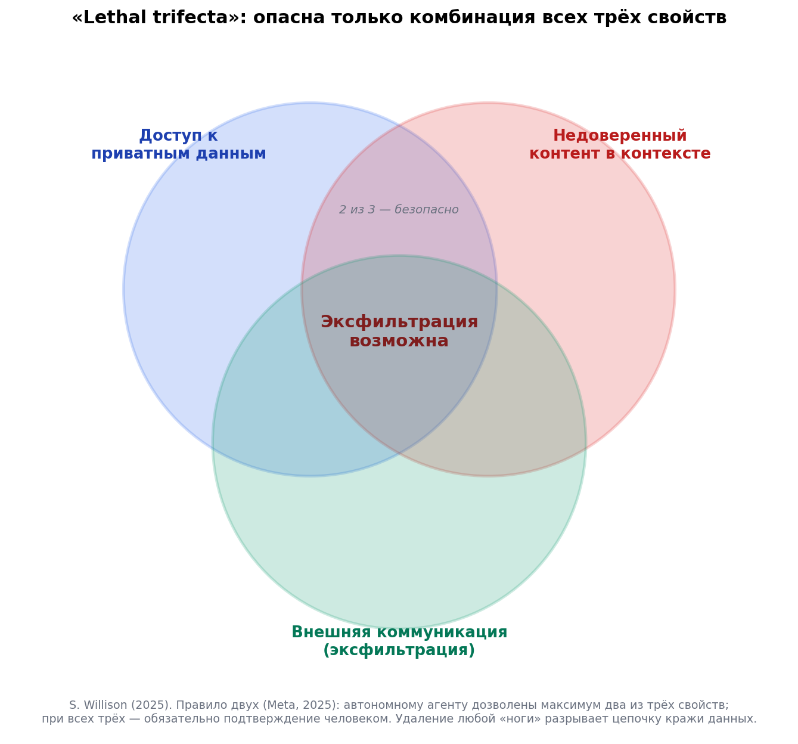

Комбинация реальна и наблюдалась в эксплуатируемых системах; канал коммуникации бывает неочевидным — исходящий HTTP-запрос, загрузка изображения по URL с данными в параметрах, даже отрисованная кликабельная ссылка (клик становится каналом утечки). Публично разбирались инциденты этого класса: доступ к приватным репозиториям через MCP-сервер GitHub по внедрённой в публичный issue инструкции; эксфильтрация из корпоративных ассистентов через параметры URL изображения (класс «zero-click»[^t-zeroclick]).

**Правило двух (Agents Rule of Two).** Практический бюджет, предложенный Meta (2025) и поддержанный Willison: автономный агент в пределах одной сессии должен обладать не более чем **двумя** из трёх свойств trifecta; если задача действительно требует всех трёх, агент **не должен работать автономно** — необходимо подтверждение человеком или иная надёжная проверка перед действием с последствиями. Удаление любой из трёх «ног» разрывает цепочку кражи: нет приватных данных — нечего красть; нет внешнего канала — некуда передать; нет недоверенного контента — нечем внедрить команду.

**Taint tracking как детерминированная мера.** Из trifecta следует конкретная архитектурная мера: присутствие недоверенного контента рассматривают как *событие заражения* (taint) — после того как агент принял контролируемый атакующим ввод, остаток хода считается заражённым. В заражённом состоянии действия с потенциалом эксфильтрации (исходящий HTTP, отправка сообщений, создание PR, отрисовка кликабельной ссылки) блокируются или требуют явного подтверждения. Инструменты снабжают метаданными (`reads_private_data`, `sees_untrusted_content`, `can_exfiltrate`), а runtime запрещает совмещение всех трёх в одном исполняемом пути.

Конкретные контроли, реализующие эту рамку:
- **Наименьшие привилегии и минимальный набор инструментов (§10.6).** Предоставляются только необходимые инструменты с минимальным скоупом; инструмент «на всякий случай» расширяет радиус поражения. Соответствует классу OWASP LLM06 (Excessive Agency).
- **Аудит набора, а не отдельных инструментов.** Безобидные по отдельности инструменты в комбинации образуют канал атаки: чтение файла плюс исходящий вызов — путь эксфильтрации. Оценивают *совокупность* инструментов агента на предмет trifecta, а не каждый инструмент по отдельности.
- **Результат инструмента — недоверенные данные, а не инструкции.** Вывод инструмента (веб-страница, содержимое файла, ответ API) обособляют в контексте (§4.6) и не позволяют тексту из результата управлять агентом (indirect injection, OWASP LLM01).
- **Авторизация на уровне инструмента (проблема «спутанного заместителя»).** Инструмент обязан применять права *пользователя*, от имени которого работает агент, а не собственные права агента. На вопрос «с какими привилегиями исполняется этот вызов?» ответ должен быть «с правами конкретного пользователя». Иначе агент становится *спутанным заместителем* (confused deputy): пользователь через агента совершает действие, на которое у него нет прав. Контекст пользователя пробрасывают в исполнение инструмента, а авторизацию проверяют *в точке исполнения*. Как это делегирование выражается технически (token exchange, on-behalf-of, идентичность самого агента) — Deep Dive в §15.7.
- **Подтверждение человеком на опасных и необратимых инструментах (§10.6).**

Существенная оговорка. Обучение на безопасность, guardrails и иерархия инструкций *снижают* успешность инъекции, но не *устраняют* её: адаптивный атакующий подбором вариантов находит обход (это показано, в частности, в работах по адаптивным атакам на опубликованные защиты). Поэтому защита должна быть **архитектурной** — ограничение trifecta, taint-gating и подтверждение человеком, — а не только «модельной». Инструменты — периметр безопасности агента; специфика в том, что вызывающая сторона (модель) недетерминирована и может быть выведена из штатного поведения внедрённой инструкцией, поэтому авторизацию и валидацию обеспечивает *исполнитель инструмента*, а не модель. Детально — глава 19.

**Отраслевая рамка: OWASP Top 10 for Agentic Applications (редакция 2026, опубликован в декабре 2025).** Описанная дисциплина закреплена и в отраслевой таксономии: в дополнение к LLM Top 10 (§19.3) OWASP выпустил отдельный список рисков агентных систем (ASI01–ASI10). Среди категорий: захват цели агента (ASI01 Agent Goal Hijack), злоупотребление инструментами, злоупотребление идентичностью и привилегиями агента, компрометация агентной цепочки поставок, неожиданное исполнение кода, отравление памяти и контекста (ASI06), небезопасная межагентная коммуникация (ASI07); полный перечень — genai.owasp.org. Сквозной принцип документа — **Least-Agency**: агенту выдаётся минимальный уровень автономии, необходимый задаче, — прямое обобщение least privilege на ось автономии (§10.7). Категории ложатся на материал этой части почти один в один: цель и нетерминация — §10.5, инструменты и привилегии — этот раздел, память — гл. 13, межагентная коммуникация — гл. 14.

*Источники.* S. Willison, «The Lethal Trifecta for AI Agents» (2025); Meta, «Agents Rule of Two» (2025); K. Beurer-Kellner et al., «Design Patterns for Securing LLM Agents against Prompt Injections» (arXiv:2506.08837, 2025); OWASP Top 10 for LLM Applications (2025) — LLM01 Prompt Injection, LLM06 Excessive Agency, LLM10 Unbounded Consumption; N. Hardy, «The Confused Deputy» (1988).

## 12.6 Deep Dive: масштабирование поверхности инструментов — code execution и Skills

§12.3 закончился на том, что с ростом числа инструментов деградируют обе стороны контракта: схемы съедают контекст, а выбор модели размывается (tool confusion). Динамический отбор определений — паллиатив с собственным глухим режимом отказа. В 2025–2026 индустрия дала два структурных ответа, и оба меняют саму форму контракта.

### Code execution: инструменты через код

**Code execution** (также «code mode»; идея восходит к **CodeAct** — Wang et al., 2024, индустриальная форма — Anthropic, «Code execution with MCP», 2025) переворачивает механику §12.2: вместо того чтобы предъявлять модели JSON-схемы и получать по одному структурированному вызову за ход, харнесс представляет инструменты **кодовым API** — деревом файлов-обёрток (например, TypeScript-модулей, сгенерированных из тех же MCP-схем), — а модель *пишет код*, который эти обёртки вызывает. Код исполняется в песочнице (§19.6), в контекст возвращается только результат исполнения.

```mermaid
flowchart TB
  subgraph TC["Классический tool calling"]
    S1["Контекст: N JSON-схем инструментов"] --> M1["Модель: один tool_use за ход"]
    M1 --> H1["Харнесс исполняет"] --> M1
  end
  subgraph CM["Code execution"]
    S2["Контекст: дерево файлов-обёрток<br/>(модель читает только нужные)"] --> M2["Модель: пишет код,<br/>композирующий вызовы"]
    M2 --> SB["Песочница исполняет:<br/>циклы, фильтрация, промежуточные данные"]
    SB -- "только выжимка" --> M2
  end
```

Почему это работает, видно по каждому из четырёх механических следствий:

1. **Progressive disclosure вместо тотального предъявления.** Схемы не грузятся в контекст все сразу — модель обнаруживает инструменты как файлы (листинг каталога, чтение конкретной обёртки) и читает только нужные. Сотни инструментов перестают стоить контекста; Anthropic приводит сокращение с ~150k до ~2k токенов на реальном сценарии (порядок величины важнее точной цифры).
2. **Промежуточные данные не проходят через модель.** В классической петле результат каждого вызова — observation в контексте: многотысячестрочный JSON оплачивается токенами и разбавляет внимание (§4.4). В коде фильтрация и агрегация происходят *в песочнице*: модель получает пять нужных строк, а не весь дамп.
3. **Циклы и условия исполняются детерминированно.** «Повторить для каждого из 40 элементов» в агентной петле — это 40 ходов модели (§10.2), каждый с вероятностью ошибки и полной ценой вызова; в коде — обычный цикл `for`, исполненный за один ход. Часть управляющей логики переезжает из вероятностного ядра в детерминированный код — тот же вектор, что и весь §10.6.
4. **Родной язык композиции.** Модель обучена на гигантском корпусе кода; композировать операции *программой* для неё более естественная задача, чем длинной последовательностью изолированных JSON-вызовов, — это и есть исходное наблюдение CodeAct.

Плата симметрична выгодам: нужна песочница-исполнитель как инфраструктура (и написанный моделью код в ней по определению недоверен — вся дисциплина §19.6 обязательна); отлаживать сгенерированный код сложнее, чем последовательность явных вызовов в трассе (гл. 18); слабая на коде модель теряет главное преимущество. Практическая рамка: единичные вызовы точечных инструментов — классический tool calling; широкие поверхности (сотни инструментов, большие промежуточные данные, массовые операции) — code execution.

### Skills: компетенция как артефакт

Инструмент отвечает на вопрос «что агент *может сделать*». На вопрос «как это *принято делать*» — процедурное знание: последовательности, соглашения, шаблоны — отвечает **skill** (Agent Skills; открытый формат, Anthropic, 2025): каталог с манифестом `SKILL.md` — YAML-заголовок (имя, описание) плюс инструкции в Markdown — и, при необходимости, вспомогательными файлами и скриптами. Skill не исполняется харнессом как функция — он *читается моделью* как методика.

Механика — трёхступенчатый progressive disclosure, и в нём вся суть формата:
1. В системный промпт всегда попадают только **имя и описание** каждого установленного skill — десятки токенов на штуку;
2. Когда модель распознаёт совпадение задачи с описанием, харнесс подгружает **тело** `SKILL.md` — единицы тысяч токенов;
3. Файлы, на которые тело ссылается (справочники, шаблоны, скрипты), читаются **по мере надобности** — как обычные файлы инструментами.

Бюджет контекста расходуется пропорционально релевантности (§4.4): сто установленных skills стоят как один загруженный. Сравните с альтернативой «вшить все методики в системный промпт» — она оплачивается на каждом вызове целиком.

Архитектурно skill — это **экстернализованная процедурная память** (§13.1): знание «как», вынутое из весов и промпта в версионируемый git-артефакт, который можно ревьюить, тестировать, переносить между агентами и раскатывать как код. Отлаженная агентом (или человеком) процедура кристаллизуется в файл — вместо того чтобы переучиваться в каждой сессии заново.

Безопасность следует из природы формата: skill — это инструкции, *загружаемые в контекст*, то есть поверхность инъекции (гл. 19); skill со скриптами — исполняемый код. Сторонний skill — недоверенный компонент цепочки поставок, ровно в той же дисциплине, что сторонний MCP-сервер (§15.7).

### Tools, Skills, MCP — три разных оси

Три слова часто смешивают, потому что все три «дают агенту возможности». Оси разные:

| Ось | Tool (гл. 12) | Skill | MCP (гл. 15) |
|---|---|---|---|
| Природа | Исполняемый контракт: схема + функция | Декларативная методика: инструкции + ресурсы | Протокол подключения источников |
| Отвечает на | «Что можно сделать» | «Как принято делать» | «Как обнаружить и вызвать» |
| Кто потребляет | Харнесс исполняет вызов | Модель читает как текст | Клиент харнесса подключает сервер |
| Цена в контексте | Схема (всегда или по отбору) | Имя+описание всегда, тело по требованию | Схемы инструментов сервера |
| Версионируется как | Код приложения | Файл в git | Версия сервера/спецификации |
| Инженерный аналог | Метод API | Runbook | Стандарт разъёма (M+N, §15.1) |

Они композируются, а не конкурируют: MCP-сервер поставляет инструменты, code execution меняет способ их вызова, skill объясняет модели, в какой последовательности и с какими соглашениями ими пользоваться.

## 12.7 Реализация на JVM

- **Spring AI:** метод помечается `@Tool`, фреймворк генерирует схему из сигнатуры (как structured output из типа) и передаёт модели; вызовы диспетчеризуются на соответствующий бин.
- **LangChain4j:** аналогично — типизированные методы-инструменты со схемой, выведенной из сигнатуры.
- **MCP (гл. 15):** `@McpTool` выставляет метод как MCP-инструмент — стандартный способ предоставить инструменты любому MCP-совместимому агенту (контракт-первый интеграционный слой).

Во всех случаях авторизация и валидация (§12.4–12.5) обеспечиваются *в теле метода-инструмента*: фреймворк лишь передаёт вызов, а безопасность остаётся на стороне приложения.

## 12.8 Резюме главы

Tool calling инвертирует направление вызова: вызывающая сторона — недетерминированная модель, исполняющая — харнесс. Интерфейс инструмента (ACI) — это контракт, который читает модель, и его качество определяет корректность вызовов: ясные описания, строгие схемы, poka-yoke, небольшой курируемый набор инструментов, компактные результаты. Ошибки инструментов образуют петлю обратной связи, требующую различения исправимых и терминальных случаев и ограничения числа повторов. На широких поверхностях форма контракта меняется: code execution заменяет последовательность JSON-вызовов написанием кода в песочнице, а Skills пакетируют процедурное знание в версионируемые артефакты с progressive disclosure (§12.6). Инструменты — главная поверхность безопасности агента: риск концентрируется в *lethal trifecta* (приватные данные + недоверенный контент + внешняя коммуникация), ограничиваемой правилом двух, taint-tracking, наименьшими привилегиями, авторизацией с правами пользователя и подтверждением человеком на необратимых действиях.

*Источники.* Anthropic, «Building Effective Agents» (2024) — ACI («инвестировать в ACI как в HCI»), poka-yoke; документация провайдеров по function calling (форматы `tool_use`/`tool_result`, `tool_choice`, параллельные вызовы); X. Wang et al., «Executable Code Actions Elicit Better LLM Agents» (CodeAct, 2024); Anthropic, «Code execution with MCP» (2025) и «Agent Skills» (2025); безопасность инструментов — источники §12.5 (Willison, Meta, Beurer-Kellner et al., OWASP); Spring AI, LangChain4j, MCP.

**На полях главы 12**

[^t-zeroclick]: **Zero-click** — класс атак, где эксфильтрация не требует ни одного действия жертвы: например, клиент сам рендерит изображение, в URL которого атакующая инструкция упаковала украденные данные. Контрмера — контроль исходящих каналов. → §15.7, гл. 19.

# Глава 13. Память и стратегии рассуждения

## 13.1 Память в цикле агента (кратко, см. §4.5)

Архитектура памяти разобрана в §4.5 (memory store, пути записи и чтения, консолидация и рефлексия, забывание, рамка MemGPT). Здесь — её место в цикле и полная таксономия.

Память агента разделяют по нескольким осям. По содержанию: **эпизодическая** (история конкретных взаимодействий), **семантическая** (устойчивые факты и знания) и **процедурная** (усвоенные способы действия — например, отлаженные последовательности шагов для типовой задачи). По горизонту: **краткосрочная** — контекстное окно текущей сессии (§4) — и **долгосрочная** — состояние за пределами окна, из которого нужное возвращается в контекст. Долгосрочная память питает фазу *observe* цикла (§10.2), возвращая релевантный срез прошлого под текущий шаг.

Существенный архитектурный вариант — **память как инструмент**: вместо неявного извлечения агент управляет памятью явно, через вызовы инструментов чтения и записи (подход MemGPT, §4.5), сам решая, что сохранить и что подгрузить; управление памятью становится частью рассуждения агента. Ключевая мысль остаётся прежней: долгосрочная память stateless-агента — это паттерн «сохранить за пределами окна → извлечь релевантное в окно», то есть тот же retrieval, что в RAG, но над состоянием сессии и пользователя.

**Когда выполнять консолидацию: sleep-time compute.** Консолидация и рефлексия (§4.5) — переработка сырой эпизодической памяти в устойчивые факты и процедуры — сами стоят LLM-вызовов, и в синхронном цикле они конкурируют с задачей пользователя за латентность и бюджет хода. Направление 2025–2026 (термин **sleep-time compute**, Letta; название ещё не устоялось, механика — уже практика) выносит эту работу *в фон*: отдельный процесс в простое между сессиями дедуплицирует эпизоды, обобщает повторяющееся в семантические факты, кристаллизует отлаженные последовательности в процедуры (естественная форма выгрузки — skill-файл, §12.6) и понижает вес устаревшего. Экономика сходится сама: фоновая переработка не имеет требований к латентности, а значит, идёт на дешёвом ярусе и пакетном тарифе (§2.2) — консолидация памяти оказывается классической offline-batch-нагрузкой, знакомой любому бэкенд-инженеру. Аналогия с консолидацией памяти во сне у человека — только леса: общего с нейробиологией здесь ровно столько, что переработка отделена от активного действия.

За механикой — §4.5; далее глава о том, как агент *рассуждает*.

## 13.2 Стратегии рассуждения — семейство

Стратегия рассуждения задаёт, *как* агент структурирует мышление и планирование внутри цикла. Они располагаются по возрастанию стоимости/сложности; выбор — под задачу (§13.7).

## 13.3 ReAct (Reason + Act)

**Термин. ReAct** (Yao et al., 2022) — канонический цикл агента: переплетение **Reason → Act → Observe**. Модель рассуждает («требуется статус заказа»), действует (вызов инструмента), наблюдает результат, снова рассуждает — и так до решения. На уровне трассы это чередование блоков *Thought* (рассуждение), *Action* (вызов инструмента) и *Observation* (результат вызова).

**Почему переплетение работает.** Чистое рассуждение без действий не имеет доступа к внешним фактам и склонно к галлюцинации; чистые действия без рассуждения лишены планирования. ReAct соединяет их: каждое наблюдение информирует следующее рассуждение, а рассуждение направляет следующее действие. Заземление рассуждения на фактические наблюдения снижает галлюцинацию по сравнению с рассуждением без внешней проверки (CoT в чистом виде). Это доминирующий паттерн управляющего цикла (§10.2).

**Механика и размен.** Каждый шаг выбирается моделью *динамически* (агентная автономия, §11.8) с лимитом итераций (§10.5). Гибко и реактивно, но недетерминированно и по вызову модели на шаг (стоимость и латентность). Характерные отказы — застревание (повторение одного и того же действия) и дрейф цели на длинной траектории; отсюда необходимость проверки прогресса и бюджета шагов (§10.5).

*Источник:* S. Yao et al., «ReAct: Synergizing Reasoning and Acting in Language Models» (2022).

## 13.4 Plan-and-Execute

**Термин. Plan-and-Execute** — стратегия, в которой агент *сначала строит план* всех шагов, *затем исполняет* его, при отклонении выполняя пере-планирование (re-plan). Контраст с ReAct, решающим шаг за шагом. Прототип на уровне промптинга — Plan-and-Solve (Wang et al., 2023: «сначала составить план, затем решать по шагам»); агентная архитектура обобщает его до явной фазы планирования с последующим исполнением.

**Размен против ReAct:**
- Plan-and-Execute **дешевле** (планирование однократно, при исполнении меньше «думающих» вызовов), **структурнее** и лучше держит **длинные задачи** (явный план снижает дрейф цели, §10.5).
- Но **менее адаптивен**: план устаревает, если реальность отклонилась; требуется механизм пере-планирования при провале шага.

**Оптимизация исполнения.** Если план содержит независимые шаги, их исполняют параллельно: например, подход LLMCompiler строит граф зависимостей задач и запускает независимые вызовы одновременно, снижая латентность — то же соображение, что в Parallelization (§11.4).

**Когда что.** ReAct — короткие реактивные задачи с непредсказуемой траекторией; Plan-and-Execute — длинные, относительно предсказуемые многошаговые задачи, где ценны структура и экономия. Часто комбинируют: план сверху и ReAct-исполнение отдельных шагов.

*Источник:* L. Wang et al., «Plan-and-Solve Prompting» (2023); S. Kim et al., «An LLM Compiler for Parallel Function Calling» (2023) — LLMCompiler.

## 13.5 Reflection / Self-Critique

**Термин. Reflection** — агент *анализирует собственный* вывод или траекторию и улучшает результат. Это Evaluator-Optimizer (§11.6), применённый к рассуждению самого агента. Развитие — **Reflexion** (Shinn et al., 2023): агент рефлексирует над *провалами*, формулирует урок в словесной форме и повторяет попытку уже с ним, сохраняя рефлексию в эпизодической памяти между попытками (вербальное «подкрепление» без обновления весов).

**Существенное ограничение: самокоррекция без внешнего сигнала ненадёжна.** Принципиально различать источник обратной связи. *Внутренняя* самокоррекция — попытка исправить ответ, опираясь только на собственные способности модели, без внешнего сигнала — для задач рассуждения ненадёжна: Huang et al. (2024) показали, что качество после такой самокоррекции нередко *не улучшается, а ухудшается*. Причина уточнена в Tyen et al. (2024): модели плохо *находят* собственные ошибки, но способны их *исправить*, если местоположение ошибки указано извне. Отсюда практический вывод: рефлексия работает, когда доступен *внешний* сигнал — результат исполнения, провал теста, ошибка компилятора, вердикт верификатора. Именно на этом основан успех Reflexion (внешний сигнал успеха или провала задачи) и Evaluator-Optimizer (внешний оценщик). Самокритика без внешней проверки — слабый и потенциально вредный приём.

**Когда.** Задачи с *проверяемым* критерием, дающим внешний сигнал (код с тестами, доказательства, ответы с эталоном). **Плата:** дополнительные раунды (стоимость и латентность).

*Источники.* N. Shinn et al., «Reflexion: Language Agents with Verbal Reinforcement Learning» (2023); J. Huang et al., «Large Language Models Cannot Self-Correct Reasoning Yet» (ICLR 2024); G. Tyen et al., «LLMs cannot find reasoning errors, but can correct them given the error location» (ACL Findings 2024).

## 13.6 Tree-of-Thought и поиск

**Термин. Tree-of-Thought (ToT)** (Yao et al., 2023) — вместо одной цепочки рассуждения агент *исследует несколько ветвей*, оценивает их и выполняет backtracking, как поиск по дереву. ToT состоит из трёх компонентов: *генерация мыслей* (несколько вариантов следующего шага рассуждения), *оценка состояний* (эвристическая оценка перспективности каждой ветви самой моделью) и *алгоритм поиска* (обход дерева в ширину или в глубину с отсечением бесперспективных ветвей). Применяется к задачам, где одна линия рассуждения часто заходит в тупик и нужна разведка пространства решений (сложное планирование, головоломки). Обобщение — Graph-of-Thoughts, где промежуточные результаты образуют граф, а не дерево, допуская объединение ветвей.

```mermaid
flowchart TB
  R["Задача"] --> A["Мысль A"]
  R --> B["Мысль B"]
  R --> C["Мысль C — отсечена (низкая оценка)"]
  A --> A1["A → 1"]
  A --> A2["A → 2 — тупик, backtrack"]
  B --> B1["B → 1 — перспективно"]
  B1 --> Sol["Решение"]
```

**Плата — высокая:** число вызовов растёт как произведение ветвления, глубины и стоимости оценки. Стратегию применяют только когда единственная цепочка (CoT или ReAct) доказанно не справляется.

*Источник:* S. Yao et al., «Tree of Thoughts: Deliberate Problem Solving with Large Language Models» (2023); M. Besta et al., «Graph of Thoughts» (2023).

## 13.7 Deep Dive: выбор стратегии рассуждения

Рамка — та же лестница «не усложняй раньше нужды», по возрастанию стоимости:

| Задача | Стратегия | Стоимость |
|---|---|---|
| Простой факт/классификация | Один вызов (без стратегии) | Минимум |
| Использование инструментов, реактивно | **ReAct** | Средняя |
| Длинная многошаговая, предсказуемая | **Plan-and-Execute** | Средняя |
| Нужна самокоррекция по критерию | **Reflection** | Выше |
| Нужна разведка пространства решений | **Tree-of-Thought** | Высокая |

Правило: начинать с самого дешёвого варианта, покрывающего задачу; подниматься только когда измерение (гл. 9/17) показывает нехватку. ToT и Reflexion — верх лестницы, для трудных случаев, а не выбор по умолчанию.

## 13.8 Deep Dive: reasoning-модели меняют расчёт (2025+)

Важный сдвиг ландшафта. **Reasoning-модели** — сначала специализированные (OpenAI o-серия, DeepSeek-R1), а к 2026 году это штатный режим большинства передовых моделей, включая открытые, — обучены выполнять значительную часть рассуждения *внутри себя*.

**Как они обучены: RLVR.** В основе — **обучение с подкреплением на проверяемых наградах (RLVR, reinforcement learning with verifiable rewards)**. В отличие от RLHF, где награду выдаёт обученная на человеческих предпочтениях модель вознаграждения, в RLVR награду вычисляет *детерминированный верификатор*, проверяющий правильность ответа: сверка с эталоном в математике, прогон юнит-тестов в программировании. Модель порождает длинную цепочку рассуждения как последовательность действий и получает сигнал о корректности итога. OpenAI o1 (2024) впервые показала, что качество рассуждения масштабируется за счёт вычислений во время вывода; DeepSeek-R1 (2025) продемонстрировала, что награда на основе правил способна вызвать самопроверку и рефлексию без плотного человеческого надзора (алгоритм GRPO[^t-grpo] — расширение PPO[^t-ppo], оценивающее группу ответов для относительного преимущества).

**Масштабирование во время вывода.** Отсюда режим *inference-time scaling*: качество растёт с объёмом вычислений на генерацию (более длинные цепочки рассуждения, множественные выборки), и это масштабирование по характеру отличается от масштабирования предобучения. Управляемым параметром становится бюджет внутреннего рассуждения, а не ручное построение CoT.

**Рассуждение переплетается с действием (2025–2026).** Первое поколение reasoning-моделей рассуждало до ответа единым блоком; следующее переплетает рассуждение с вызовами инструментов: модель думает, вызывает инструмент, продолжает рассуждать над его результатом (interleaved thinking, «thinking with tools»). Сместилось и управление: вместо жёсткого токен-бюджета на рассуждение провайдеры предлагают задавать *уровень усилия* (effort), в рамках которого модель сама решает, сколько думать над конкретным шагом. Для архитектора это означает, что граница «рассуждение внутри — оркестрация снаружи» стала пористой для инструментов — часть цикла ReAct теперь исполняется внутри одного вызова модели, — но контроль инструментов, память, бюджеты и human-gate по-прежнему обеспечивает система.

**Оговорка.** RLVR наиболее эффективен в областях с проверяемой корректностью (математика, код); перенос на открытые задачи без верификатора — предмет активных исследований. Есть данные (Yue et al., 2025), что RLVR преимущественно *перераспределяет вероятностную массу по уже присутствующим в модели путям рассуждения*, а не расширяет её фундаментальные способности, и выигрыш насыщается на конечных данных. То есть reasoning-модели усиливают то, что база уже умеет, а не создают способности из ничего.

```mermaid
flowchart LR
  subgraph Model["Внутри модели (reasoning-модель, RLVR)"]
    Think["Рассуждение · планирование · самопроверка"]
  end
  subgraph System["Снаружи, в архитектуре системы"]
    Tools["Инструменты"]
    Mem["Память и состояние"]
    Sec["Безопасность · human-gate"]
    Orch["Оркестрация"]
  end
  Orch --> Think
  Think <--> Tools
  Think <--> Mem
  Sec --> Tools
```

**Следствие для архитектуры.** Разделение чёткое: **рассуждение уходит внутрь модели, оркестрация остаётся снаружи, в архитектуре системы.** Reasoning-модель не отменяет цикл использования инструментов, координацию, память, human-gate и безопасность (гл. 10–12) — всё это по-прежнему обеспечивает система. Явный ReAct-промптинг для *рассуждательной* части при использовании reasoning-модели часто избыточен, а иногда ухудшает результат (§3.4); при этом на простых задачах reasoning-модели склонны к избыточному рассуждению (over-thinking), расходуя токены и латентность без выигрыша. Чем сильнее внутреннее рассуждение моделей, тем меньше требуется внешней рассуждательной «лесы» и тем важнее роль системы в оркестрации, состоянии и безопасности.

*Источники.* OpenAI, «Learning to Reason with LLMs» (o1, 2024); DeepSeek, «DeepSeek-R1» (2025); Z. Shao et al., «DeepSeekMath» (2024) — алгоритм GRPO; N. Lambert, «RLHF Book», глава о reasoning и inference-time scaling (2025); Y. Yue et al. (2025) — анализ границ RLVR; материалы провайдеров об interleaved thinking и адаптивном уровне усилия (2025–2026).

## 13.9 Резюме главы

Память (архитектура — §4.5) питает цикл релевантным прошлым; её разделяют на эпизодическую, семантическую и процедурную, краткосрочную и долгосрочную (§13.1). Стратегии рассуждения — по возрастанию стоимости: одиночный вызов → **ReAct** (реактивно, с инструментами) → **Plan-and-Execute** (длинное, структурно) → **Reflection** (самокоррекция, но только при внешнем сигнале) → **Tree-of-Thought** (разведка пространства решений). Выбор — по задаче, по результатам измерения (§13.7). Сдвиг 2025+: **рассуждение уходит внутрь reasoning-моделей (обученных через RLVR), а оркестрация, состояние и безопасность остаются внешней архитектурой системы** (§13.8).

*Источники.* S. Yao et al. (ReAct 2022; ToT 2023); N. Shinn et al. (Reflexion 2023); J. Huang et al. (2024); G. Tyen et al. (2024); L. Wang et al. (Plan-and-Solve 2023); OpenAI (o1 2024); DeepSeek-R1 (2025); Z. Shao et al. (GRPO 2024); Letta — sleep-time compute (2025), §13.1.

**На полях главы 13**

[^t-ppo]: **PPO** (Proximal Policy Optimization, Schulman et al., 2017) — RL-алгоритм: «политика» здесь — сама LLM (выбор токена = действие), обновления ограничены, чтобы политика не убегала далеко от прежней. Требует отдельной value-модели для оценки advantage — того, насколько действие лучше ожидаемого уровня. → §21.6.
[^t-grpo]: **GRPO** — Group Relative Policy Optimization (Shao et al., 2024): advantage считается относительно средней награды *группы* ответов на тот же промпт — value-модель не нужна; дешевле по памяти, стандарт RLVR-линии. → §21.6.

# Глава 14. Мультиагентные системы и таксономия отказов

Завершающая глава Части IV: когда разделять систему на несколько агентов, как их координировать (паттерны оркестрации и хореографии) и полная таксономия отказов агента, устраняемая дисциплиной распределённых систем.

## 14.1 Что такое мультиагентная система и когда она нужна

**Мультиагентная система** — несколько специализированных агентов, координирующихся для решения задачи, вместо одного агента. Когда дробить:
- **Контекст единого агента зашумляется** (§4.4, изоляция суб-агентами): разнести под-задачи по агентам с чистыми контекстами.
- **Под-задачи требуют несовместимых наборов инструментов/инструкций** — специализировать агентов.
- **Специализация повышает качество** — «агент-исследователь», «агент-исполнитель», «агент-критик».

Когда **не** разделять (та же лестница): агентов не множат, пока единый агент доказанно не справляется. Каждый дополнительный агент добавляет стоимость, координацию и сложность отладки. Мультиагент — не цель, а инструмент под доказанную потребность; большинство задач закрывается одним хорошо спроектированным агентом (гл. 10–13), а мультиагент — верх лестницы. Эмпирически прирост качества мультиагентных систем над одиночным агентом на распространённых бенчмарках часто невелик (Cemri et al., 2025, §14.4), что усиливает аргумент против разделения без явной необходимости.

## 14.2 Deep Dive: паттерны координации (оркестрация vs хореография)

Координация агентов воспроизводит общую дихотомию распределённых систем — оркестрация против хореографии (Richardson):

```mermaid
flowchart TB
  subgraph Sup["Supervisor — оркестрация (централизованно)"]
    S["Supervisor-агент"] --> A1["Агент 1"]
    S --> A2["Агент 2"]
    A1 --> S
    A2 --> S
  end
  subgraph Hand["Handoff — последовательная передача"]
    H1["Агент A"] --> H2["Агент B"] --> H3["Агент C"]
  end
  subgraph Net["Network — хореография (peer-to-peer)"]
    N1["Агент 1"] <--> N2["Агент 2"]
    N2 <--> N3["Агент 3"]
    N1 <--> N3
  end
```

- **Supervisor / Orchestrator (централизованно)** — ведущий агент координирует воркеров и собирает результаты. ≈ **оркестрация-сага** (§11.5), масштабированная до агентов.
- **Handoff / Sequential** — агент передаёт управление следующему. ≈ pipeline / частичная хореография.
- **Network / Peer** — агенты вызывают друг друга напрямую, децентрализованно. ≈ **хореография**.
- **Hierarchical** — супервайзоры над супервайзорами. Окупается, когда один супервайзор перестаёт вмещать координацию (контекст, пропускная способность); плата — второй уровень сам становится узким местом и точкой отказа, а трассировка удлиняется ещё на уровень.

**Ключевой размен — тот же, что оркестрация ↔ хореография:** централизованный supervisor легче осмыслить, отладить и наблюдать (единая точка координации), но это узкое место и единая точка отказа; децентрализованная сеть гибче, но её *труднее трассировать и анализировать* (эмерджентное поведение[^t-emergent], циклические передачи). Практический вывод: **по умолчанию предпочтительна оркестрация (supervisor)** — она предсказуемее и наблюдаемее; к хореографии переходят, когда централизация действительно становится узким местом. Это та же логика выбора между оркестрационной и хореографической сагой. Для коммуникации агентов *между организациями* (разные владельцы, supervisor невозможен) складывается протокольный стандарт — A2A (§15.6).

## 14.3 Deep Dive: цена мультиагентности

Честно о плате, потому что мультиагент соблазнителен и переоценён. Он **множит**:
- **Стоимость** — каждый агент = вызовы LLM; координация добавляет ещё (§2.2). Конкретика из отчёта Anthropic о мультиагентной research-системе (2025): ~15× токенов относительно чата (одиночный агент — ~4×), при этом расход токенов объяснял ~80% вариации качества — за качество здесь буквально платят токенами.
- **Латентность** — координационные round-trip'ы между агентами складываются (§2.3).
- **Сложность отладки/наблюдаемости** — трассировать поведение *через* агентов кратно труднее (гл. 18); эмерджентные баги координации.
- **Потеря контекста между агентами** (§4.4) — агент не знает того, что известно соседу; передаётся только то, что передано явно. Тонкий источник ошибок рассогласования.

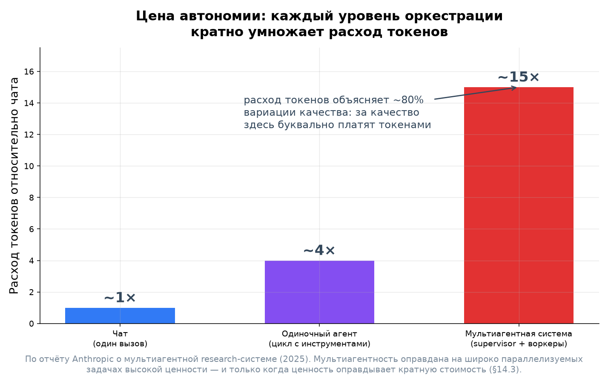

Вывод (Anthropic и практика): мультиагент оправдан для *параллелизуемых* задач высокой ценности (например, широкое исследование с независимыми под-задачами), но только когда ценность оправдывает кратную стоимость. Это же снимает кажущееся противоречие с данными о слабом приросте мультиагентных систем на типовых бенчмарках (Cemri et al., §14.4): оба результата верны — прирост мал на последовательных задачах и велик на широко параллелизуемых, где и мерил Anthropic. **Мультиагент — это распределённая система со всеми издержками координации плюс недетерминированные узлы.** По умолчанию к нему не переходят: сначала исчерпывают возможности одиночного агента и workflow-паттернов (§11.8).

## 14.4 Deep Dive: полная таксономия отказов агента

Отказы агентных систем можно каталогизировать систематически. Эмпирическую основу даёт **MAST (Multi-Agent System Failure Taxonomy)** (Cemri et al., 2025) — первая эмпирически обоснованная таксономия отказов мультиагентных систем, построенная на анализе более 200 задач в семи фреймворках (свыше 1600 размеченных трасс, согласие аннотаторов κ = 0.88). MAST выделяет 14 режимов отказа в трёх категориях: (i) *спецификация и системный дизайн* (некорректная постановка задач, неверное распределение ролей, слабая обработка ошибок), (ii) *рассогласование между агентами* (сбои коммуникации, конфликтующие цели, потеря контекста при передаче) и (iii) *проверка задачи и завершение* (недостаточная валидация вывода, распространение ошибки по цепочке).

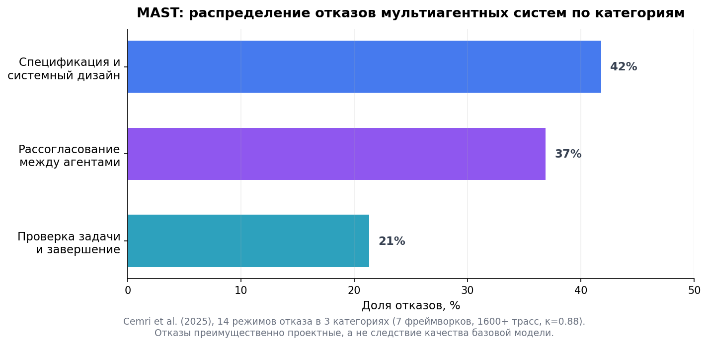

Ключевой вывод исследования: большинство отказов носит *проектный* характер (доминируют спецификация и координация), а не сводится к качеству базовой модели — по формулировке авторов, улучшения способностей модели недостаточно, чтобы закрыть всю таксономию. Это прямо подкрепляет позицию §14.1 и §14.3: цена мультиагентности — не только токены, но и целый класс проектных отказов координации.

Ниже — сводный практический каталог отказов агента (охватывающий и одиночного агента, и мультиагент), сгруппированный по подсистемам; большинство пунктов — отказы распределённых систем с недетерминированной добавкой.

| Категория | Отказ | Аналог в распределённых системах | Митигация (и где в книге) |
|---|---|---|---|
| **Управляющий цикл** | Зацикливание / нетерминация | Бесконечный повтор | Лимит итераций, бюджет (§10.5) |
| | Дрейф цели на длинной траектории | Дрейф состояния | Периодическое re-grounding, план (§10.5, §13.4) |
| | Преждевременная остановка | Ранний выход | Критерии завершения, проверка полноты |
| **Инструменты/действия** | Галлюцинированный вызов / неверные аргументы | Нарушение контракта | Схема + валидация (§5, §12.4) |
| | Тихий частичный отказ в параллели | Scatter-gather partial failure | Явное отслеживание всех ветвей (§11.4) |
| | Silent success при провале под-шага | Проглоченная ошибка | Пробрасывать ошибки, проверять результат |
| | Опасная композиция инструментов | Confused deputy, чрезмерные привилегии | Аудит *набора*, least privilege (§12.5, §19) |
| **Рассуждение** | Галлюцинация | — (специфично для LLM) | Заземление RAG (Часть III), evals (гл. 9, 17) |
| | Ошибочный план | Неверная бизнес-логика | Plan-and-Execute + re-plan, оценка (§13.4) |
| | Каскад ошибок (шаг за шагом усугубляется) | Каскадный отказ | Проверки между шагами, evaluator (§11.6) |
| **Контекст/память** | Переполнение контекста | Переполнение рабочего состояния | Compaction, sliding window (§4.4) |
| | Деградация lost-in-the-middle | — (специфично для LLM) | Курирование, размещение (§1.8, §4) |
| | Устаревшая память | Устаревание кэша | Политики забывания/обновления (§4.5) |
| | Загрязнение контекста | — | Изоляция суб-агентами (§4.4) |
| **Координация (мультиагент)** | Потеря контекста между агентами | Рассинхрон состояния | Явная передача, общее состояние (§14.3) |
| | Циклические/тупиковые передачи | Deadlock | Supervisor вместо peer, лимиты (§14.2) |
| | Разрыв ответственности | Никто не владеет шагом | Чёткие границы ответственности агентов |
| **Безопасность** | Prompt injection (direct/indirect) | Инъекция (SQLi / stored XSS) | Обособление, guardrails (§19) |
| | Excessive agency | Чрезмерные привилегии | Least privilege, human-gate (§10.6, §19) |

Таблица служит чек-листом при проектировании и разборе инцидентов: для каждого агента определяют, какие из этих отказов возможны и чем закрыты.

Эмпирическую таксономию MAST дополняет отраслевая security-рамка — OWASP Top 10 for Agentic Applications (2026, §12.5): минимум две её категории покрывают те же режимы, что и таблица выше (ASI06 Memory & Context Poisoning ↔ устаревшая память и загрязнение контекста; ASI07 Insecure Inter-Agent Communication ↔ потеря контекста и тупиковые передачи между агентами). Практично прогонять обе рамки: MAST — как диагностику качества, OWASP — как анализ угроз.

## 14.5 Deep Dive: лечить отказы дисциплиной распределённых систем

Мета-вывод всей Части IV. Как показывает таблица §14.4, подавляющее большинство отказов — это **отказы распределённых систем с недетерминированной добавкой**. Значит, дисциплина надёжности распределённых систем применяется почти целиком:
- **Идемпотентность** (ретраи в агентах часты) — по ключу задачи (сага).
- **Тайм-ауты и бюджеты** — на шаг *и* на весь цикл (§10.5).
- **Компенсации** для обратимого, **human-gate** для необратимого (§10.6) — не компенсация необратимого.
- **Circuit breaker и fallback** (§2.5) — для внешних зависимостей и провайдера.
- **Наблюдаемость/трейсинг** — по спанам-шагам (гл. 18).
- **Bulkhead** — изоляция контекста/суб-агентов (§4.4).

Что действительно **ново** сверх классики (и это три оси, отсутствующие в детерминированных системах):
1. **Ограничение недетерминизма** — бюджеты на циклы рассуждения, потому что графа переходов нет (§10.5).
2. **Evals для вероятностного поведения** — тесты стали распределениями (гл. 9, 17), `assertEquals` не работает.
3. **Guardrails для манипулируемого актора** — защита от инъекции и excessive agency (гл. 19), потому что «код» решения можно сбить данными.

Рамка одной фразой: **надёжность агента = надёжность распределённой системы + дисциплина вероятностного управления.** Первая составляющая — установившаяся инженерная практика; вторая — новое, чему посвящена Часть VI. Проектирование распределённых систем покрывает значительную часть требований к агентным системам, оставляя специфике вероятностного управления отдельный, но ограниченный слой.

## 14.6 Резюме главы и Части IV

Мультиагент — это распределённая система; координация выполняется через оркестрацию (supervisor, предсказуемее) или хореографию (peer, гибче), с предпочтением первого (§14.2); агентов не множат без доказанной необходимости — цена кратная (§14.3). Таксономия отказов (§14.4) — в основном распределённые отказы плюс недетерминизм, преимущественно проектного характера (MAST); устраняются они существующей дисциплиной (идемпотентность, тайм-ауты, компенсации, наблюдаемость, bulkhead) в сочетании с новой дисциплиной вероятностного управления (бюджеты, evals, guardrails, §14.5).

**Итог Части IV.** Модель теперь *действует*: как компонент (Часть I), с укрощённым интерфейсом (Часть II) и заземлённым знанием (Часть III), организованная агентными паттернами (гл. 10–11), вооружённая инструментами-контрактами (гл. 12), с памятью и стратегиями рассуждения (гл. 13), скоординированная и защищённая дисциплиной распределённых систем (гл. 14). Дальше — **Часть V: интеграция** (MCP как стандарт и JVM-стек Spring AI/LangChain4j), то есть как встроить всё это в реальную архитектуру организации.

*Источники.* Anthropic, «Building Effective Agents» (2024) и материалы о мультиагентных исследовательских системах (2025) — паттерны координации, цена токенов; V. Dibia, «Designing Multi-Agent Systems» (2025) — supervisor/handoff/network; M. Cemri et al., «Why Do Multi-Agent LLM Systems Fail?» (MAST, arXiv:2503.13657, 2025) — эмпирическая таксономия отказов; C. Richardson, «Microservices Patterns» (2018) — оркестрация vs хореография, база отображения отказов.

**На полях главы 14**

[^t-emergent]: **Эмерджентное поведение** — поведение системы, не заложенное ни в один из компонентов и возникающее из их взаимодействия; в мультиагентных системах — главный источник отказов, невидимых при тестировании агентов поодиночке. → §14.4 (MAST, категория рассогласования).

# Часть V. Интеграция: встраивание в архитектуру

Части I–IV построили агента как систему. Часть V — о том, как встроить эту систему в существующую архитектуру: через стандартный протокол интеграции с инструментами и данными (глава 15, Model Context Protocol) и через конкретный слой реализации на JVM (глава 16). Сдвиг Части V — от вопроса «как устроен агент» к вопросу «как агент подключается к остальному ландшафту организации по контракту, а не через разовые интеграции».

# Глава 15. Model Context Protocol (MCP)

Глава 12 показала, что инструмент — это контракт, который читает модель. MCP отвечает на следующий вопрос: как *стандартизировать* этот контракт между разными приложениями и разными источниками инструментов и данных, чтобы интеграции переиспользовались, а не переписывались под каждую пару. MCP — открытый протокол, предложенный Anthropic в ноябре 2024 года; с декабря 2025 управление спецификацией передано в Linux Foundation (фонд Agentic AI Foundation, соучредители Anthropic, Block и OpenAI, при поддержке Google, Microsoft и AWS) — для архитектора, делающего многолетнюю ставку на протокол, это снимает существенную часть риска вендор-зависимости. Протокол основан на JSON-RPC 2.0 и стандартизирует, как AI-приложение обнаруживает и вызывает инструменты, читает данные и получает шаблоны промптов из внешних серверов.

## 15.1 Проблема N×M

До стандарта интеграция страдала от **проблемы N×M**: M AI-приложений, каждому из которых нужен доступ к N инструментам и источникам данных, требуют в худшем случае M×N индивидуальных коннекторов — каждая пара «приложение ↔ источник» реализуется отдельно и несовместимо. С ростом обеих сторон число интеграций растёт мультипликативно.

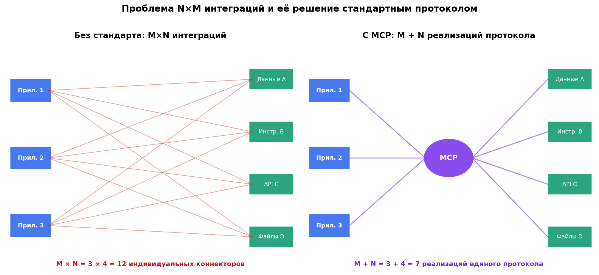

Стандартный протокол превращает это в **M + N**: каждое приложение реализует клиентскую часть протокола один раз, каждый источник — серверную часть один раз, после чего любой клиент работает с любым сервером. MCP переносит интеграцию инструментов с уровня частных, специфичных для фреймворка абстракций на уровень **межпротокольной совместимости** — с обнаружением возможностей, согласованием и переиспользованием между разнородными системами. Аналогия по роли — стандартный периферийный интерфейс: устройство подключается к любому хосту, поддерживающему тот же разъём, вместо отдельного кабеля под каждую пару.

Инфраструктурное дополнение протокола — **MCP Registry** (официальный реестр серверов, превью с сентября 2025; к концу года — порядка двух тысяч записей с API обнаружения). Реестр закрывает вопрос discovery («какие серверы существуют и где их взять»), но не вопрос доверия: публикация в реестре — не аудит, и дисциплина §15.7 — отношение к стороннему серверу как к недоверенному компоненту цепочки поставок — распространяется и на серверы из реестра.

## 15.2 Архитектура: host, client, server

MCP определяет три роли.

- **Host (хост)** — обращённое к пользователю AI-приложение (например, ассистент в IDE, чат-приложение, агентная среда). Хост содержит модель и оркестрирует работу.
- **Client (клиент)** — компонент протокола *внутри* хоста; поддерживает соединение «один к одному» с сервером. На каждый подключённый сервер приходится отдельный клиент.
- **Server (сервер)** — процесс, предоставляющий возможности (инструменты, данные, шаблоны); оборачивает конкретный инструмент или источник данных. Сервер **не взаимодействует с моделью напрямую** — всё общение с моделью опосредовано хостом через клиент.

```mermaid
flowchart LR
  subgraph Host["Host — AI-приложение (доверенная граница)"]
    LLM["Модель"]
    C1["MCP-клиент 1"]
    C2["MCP-клиент 2"]
    LLM --- C1
    LLM --- C2
  end
  C1 <-->|JSON-RPC| S1["MCP-сервер A<br/>инструменты · ресурсы · промпты"]
  C2 <-->|JSON-RPC| S2["MCP-сервер B<br/>инструменты · ресурсы · промпты"]
  S1 --> D1[("Источник данных / API")]
  S2 --> D2[("Источник данных / API")]
```

Разграничение ролей существенно для безопасности и рассуждения о системе: сервер — потенциально недоверенный сторонний компонент (§15.7), а доверенной границей и точкой контроля остаётся хост. Сервер видит только то, что хост передал ему через клиент, и не имеет прямого доступа ни к модели, ни к остальному контексту хоста.

## 15.3 Примитивы

MCP описывает возможности через небольшой набор примитивов; лаконичность таксономии — сознательное решение, покрывающее большинство практических случаев.

**Серверные примитивы:**
- **Tools (инструменты)** — исполняемые операции с побочными эффектами: вызов изменяет состояние мира (запись в БД, отправка сообщения, обращение к API). Каждый инструмент описан JSON-схемой параметров и результата (родственно tool calling, гл. 12). Кратко: *инструменты действуют*.
- **Resources (ресурсы)** — доступ *только на чтение* к данным: профиль пользователя, содержимое файла, документ, конфигурация. Ресурс возвращает контекст, но не меняет состояние — низкорисковый примитив. Кратко: *ресурсы читают*.
- **Prompts (промпты)** — переиспользуемые параметризованные шаблоны, стандартизирующие типовые взаимодействия (например, шаблон код-ревью с параметрами «язык» и «путь к файлу»). Кратко: *промпты стандартизируют*. На практике серверы чаще всего экспонируют инструменты, реже ресурсы и почти не используют промпты, хотя именно промпты позволяют явно загрузить нужные ресурсы в контекст в рамках воспроизводимого рабочего процесса.

**Клиентские примитивы** (возможности, которые предоставляет хост и которые может запросить сервер):
- **Roots (корни)** — границы (файловой системы или URI), в пределах которых серверу предлагается оперировать; хост объявляет, к каким областям сервер имеет доступ. Существенная оговорка: в базовом протоколе roots — *декларация ожидания*, а не изоляция; их соблюдение остаётся на стороне сервера, а принудительное ограничение обеспечивается вне протокола — на уровне ОС/контейнера.
- **Sampling (сэмплирование)** — сервер может запросить у клиента *обращение к модели* (генерацию). Это инверсия обычного направления: сервер использует модель хоста, не имея собственного ключа доступа; хост при этом контролирует, разрешить ли запрос и какую модель применить.
- **Elicitation (запрос уточнения)** — сервер может запросить у *пользователя* дополнительную информацию в середине операции (например, недостающий параметр). Оба клиентских примитива удерживают пользователя и хост в контуре управления.

## 15.4 Жизненный цикл сессии и согласование возможностей

MCP работает через **сессию с состоянием**, а не через разовые REST-вызовы. Сессия открывается рукопожатием `initialize`, в котором происходят:
- **Согласование версии протокола** — поле версии (даты-строки вида `2025-06-18`, `2025-11-25`) гарантирует совместимость сторон; при отсутствии совместимой версии соединение прекращается.
- **Согласование возможностей (capability negotiation)** — каждая сторона объявляет, какие примитивы и функции поддерживает (сервер — инструменты, ресурсы, промпты, подписки; клиент — сэмплирование, обработку уведомлений). Стороны обязаны соблюдать объявленные возможности в течение сессии.

Состояние сессии позволяет **динамические обновления**: сервер уведомляет хост об изменении своего набора возможностей (например, список инструментов изменился) через нотификации. Это отличает MCP от статичного каталога инструментов, зашитого в приложение.

## 15.5 Транспорты

Спецификация определяет два транспорта поверх JSON-RPC:
- **stdio** — локальный, в пределах одной машины: сервер запускается как подпроцесс, обмен идёт через стандартные потоки ввода-вывода. Прост и подходит для локальных интеграций.
- **Streamable HTTP** — удалённый, поверх HTTPS (с использованием SSE[^t-sse] для потоковой передачи от сервера к клиенту). Заменил ранний транспорт на основе HTTP+SSE и рассчитан на удалённые многоклиентские развёртывания.

Выбор транспорта определяется топологией: локальный инструмент — stdio; сетевой сервис, разделяемый несколькими хостами, — Streamable HTTP с соответствующими требованиями к аутентификации и шифрованию (§15.7).

## 15.6 MCP и tool calling: где граница

MCP не заменяет tool calling (гл. 12), а стандартизирует его *транспорт и упаковку*. Модель по-прежнему выполняет function calling — решает, какой инструмент вызвать и с какими аргументами (§12.2). MCP определяет, как инструменты (а также ресурсы и промпты) *обнаруживаются, описываются и вызываются* через границу «хост ↔ сервер», единообразно для любого совместимого сервера. Иначе говоря: tool calling — это *решение модели о вызове*; MCP — *стандарт доставки* определений инструментов в контекст и вызовов к исполнителю. Принципы проектирования интерфейса инструмента из §12.3 (ясные описания, строгие схемы, компактные результаты, курирование набора) применяются к MCP-инструментам без изменений.

### Deep Dive: интероперабельность агентов — A2A

MCP стандартизирует ось «агент ↔ инструменты и данные». Для оси «агент ↔ агент» развивается **A2A (Agent2Agent)** — протокол, предложенный Google (апрель 2025) и переданный в Linux Foundation (июнь 2025). Механика: агент публикует **Agent Card** — JSON-манифест возможностей и точки подключения; взаимодействие строится вокруг **задач** с жизненным циклом (submitted → working → input-required → completed/failed), с потоковой передачей и push-уведомлениями для долгоживущих операций — то есть протокол исходно рассчитан на асинхронные, многоминутные агентные задачи, а не на синхронный вызов функции. Протоколы комплементарны: внутри себя агент пользуется инструментами по MCP, наружу выставляет task-интерфейс по A2A. Для мультиагентных систем (гл. 14) A2A — кандидат на стандарт *межорганизационной* хореографии, где supervisor-оркестрация невозможна: агенты принадлежат разным владельцам. Оговорки: экосистема заметно моложе MCP, а межагентная коммуникация — самостоятельный класс рисков (ASI07, §14.4) — удостоверение агентов, доверие к чужим Agent Card, taint через межагентные сообщения; дисциплины §15.7 применяются и здесь.

*Источники.* A2A Project (Linux Foundation, спецификация 2025); Google, анонс Agent2Agent (2025).

## 15.7 Deep Dive: безопасность MCP (мост к §12.5 и гл. 19)

MCP расширяет поверхность атаки агента, и его собственная модель угроз существенна. Ключевое наблюдение: **сам дизайн MCP — подключение инструментов из разных источников — облегчает сборку lethal trifecta** (§12.5). Смешивая серверы, система легко совмещает доступ к приватным данным, недоверенный контент и внешние каналы коммуникации в одной сессии; поэтому правило двух и taint-tracking (§12.5) применимы к MCP напрямую.

Специфические классы атак MCP:
- **Tool poisoning (отравление инструмента).** Вредоносные инструкции внедряются в *описание* или метаданные инструмента, которые читает модель, но которые может не видеть пользователь; модель следует им. В отличие от разовой инъекции, отравление не ограничено одной сессией — оно затрагивает любого агента, читающего отравленный инструмент. Спецификация прямо предписывает считать аннотации инструмента недоверенными, если сам сервер не доверенный.
- **Rug pull (подмена после одобрения).** Сервер изменяет определение инструмента *после* того, как пользователь его одобрил. Одобрение относилось к исходной конфигурации, а базовый протокол не содержит механизма отслеживания изменений определений или требования повторного одобрения — поэтому модифицированная версия наследует доверие. Класс аналогичен атаке на индексы пакетов (пакет загружается безобидным, затем модифицируется).

```mermaid
flowchart LR
  A["1. Сервер публикует безобидный инструмент"] --> B["2. Пользователь одобряет по исходному описанию"]
  B --> C["3. Сервер меняет определение инструмента"]
  C --> D["4. Изменённая версия наследует одобрение"]
  D --> E["5. Агент исполняет вредоносную инструкцию"]
```

- **Tool shadowing и межсерверное затенение.** Вредоносный сервер регистрирует инструмент с именем или описанием, совпадающим с легитимным, перехватывая вызовы; при межсерверном затенении описание инструмента одного сервера нацелено на *другой* доверенный сервер в той же сессии. Продемонстрировано (Invariant Labs, апрель 2025): вредоносный сервер через встроенные в описание инструкции заставил агента извлечь историю сообщений из легитимного сервера и вывести её наружу через доверенный канал — шифрование транспорта не защищает, так как утечка происходит выше границы шифрования, через легитимный доступ агента.
- **Return value poisoning.** Результат вызова инструмента содержит внедрённые инструкции, перехватывающие последующее рассуждение (indirect injection, §12.5).
- **Реальные CVE (2025).** Внедрение команд ОС через недоверенное подключение (`mcp-remote`, CVE-2025-6514); подмена конфигурации в IDE по паттерну rug pull (CVE-2025-54136) и исполнение через инъекцию из внешнего источника (CVE-2025-54135).

Меры защиты выстраиваются на нескольких уровнях:
- **Авторизация.** Редакция спецификации 2025-06-18 классифицирует MCP-серверы как OAuth Resource Servers[^t-oauth-roles], требует от клиентов реализации Resource Indicators (RFC 8707), чтобы токен, выданный для одного сервера, нельзя было использовать против другого, — и она же вводит elicitation (§15.3). Редакция 2025-11-25 авторизацию расширяет: OIDC Discovery, инкрементальное согласие на scope, OAuth Client ID Metadata Documents.
- **Целостность определений.** Одобренные описания инструментов фиксируют по хешу и отвергают несоответствия; предложение ETDI[^t-etdi] (Bhatt et al., 2025) связывает определения инструментов с подписанными токенами и версионирует их, так что любое изменение аннулирует подпись (в ядро спецификации пока не входит, но принцип применим уже сейчас).
- **Контур пользователя.** Показ пользователю того, что инструмент собирается отправить наружу, — эффективная защита от эксфильтрации; чёткое визуальное разделение того, что видит пользователь и что видит модель.
- **Серверная гигиена.** Валидация входов, ограничение частоты, санация выводов, контроль доступа к ресурсам; отношение к стороннему MCP-серверу как к недоверенному компоненту цепочки поставок.

### Deep Dive: идентичность агента — кто именно действует

Авторизация выше отвечала на вопрос «можно ли этот вызов». Вопрос уровнем ниже — **от чьего имени** он делается, — и у него три плохих ответа по умолчанию и один правильный.

**Три идентичности-кандидата.** (1) *Сервисный аккаунт приложения*: одна учётка с широкими правами на всех пользователей — готовый confused deputy (§12.5): агент исполняет запрос узкоправного пользователя с правами системы, и любая инъекция наследует эти права. (2) *Идентичность пользователя*: агент — невидимый клиент; права корректны, но в журнале действий не отличить действия человека от действий его агента — аудит слепнет, а компрометация агента равна компрометации пользователя. (3) *Собственная идентичность агента* (**non-human identity, NHI** — устоявшийся индустриальный термин для машинных учёток: сервисы, боты, теперь агенты): без связи с пользователем агент не может действовать от его имени. Правильный ответ — **пара**: каждое действие несёт и *кто инициировал* (пользователь), и *что исполняло* (конкретный агент), — и обе идентичности попадают в спаны трассировки (гл. 18).

**Механика делегирования — OAuth 2.0 Token Exchange (RFC 8693).** Как технически выразить «агент A действует от имени пользователя B»: харнесс обменивает пользовательский токен у authorization server на *новый* downstream-токен, в котором субъект — пользователь, актор — агент (claim `act`), scope — *суженный* до необходимого следующему шагу, а получатель — конкретный сервис (resource indicator, RFC 8707 выше). В Microsoft-экосистеме этот поток называется **on-behalf-of**. Ключевая дисциплина цепочки user → агент → MCP-сервер → внутренний API: на каждом хопе токен *обменивается с сужением*, а не передаётся дальше — сквозной проброс пользовательского токена (passthrough) спецификация MCP прямо запрещает: сервер обязан принимать только токены, выданные *ему*. Иначе украденный на дальнем хопе токен открывает всё, что было доступно пользователю.

**Откуда идентичность у самого агента.** Тот же вопрос, что для любой рабочей нагрузки без человека за клавиатурой, и ответ индустрии тот же — **workload identity**: платформа (например, SPIFFE/SPIRE как открытый стандарт) выдаёт нагрузке короткоживущее криптографическое удостоверение по её *атрибутам* (какой под, какой сервис, какой код), а не по секрету в конфиге. Агент здесь не отличается от микросервиса — отличаются три вещи. Во-первых, **недетерминизм**: права микросервиса можно вывести из его кода, права агента задаются *до* и *извне* — least privilege по декларированному набору инструментов (§12.5), а не по наблюдаемому поведению. Во-вторых, **длительность**: траектория агента может жить дольше TTL токена — обновление токенов посреди задачи ложится на харнесс. В-третьих, **масштаб**: десятки агентов на организацию быстро дают взрыв числа NHI, и без реестра (гл. 25) они превращаются в неуправляемый парк учёток — OWASP Agentic называет злоупотребление идентичностью агента отдельной категорией риска именно поэтому.

Итог: MCP не привносит новых *принципов* безопасности сверх глав 12 и 19, но делает их соблюдение критичным, поскольку снижает барьер к подключению недоверенных сторонних инструментов. Дисциплина lethal trifecta и правила двух (§12.5) — базовая рамка и для MCP; идентичность и делегирование — её фундамент уровнем ниже.

## 15.8 Реализация на JVM

Для платформы JVM существует официальный MCP Java SDK (разработан при участии команды Spring). **Spring AI** предоставляет клиентскую и серверную поддержку MCP: приложение может выступать MCP-клиентом, подключаясь к внешним серверам, либо экспонировать методы, помеченные `@Tool`, как MCP-сервер — то есть предоставлять свои возможности любому MCP-совместимому агенту через стандартный протокол, а не через частную интеграцию. Это переносит контракт-первый подход к инструментам (гл. 12) на уровень межсистемной интеграции.

## 15.9 Резюме главы

MCP — открытый протокол (JSON-RPC), стандартизирующий интеграцию AI-приложений с инструментами, данными и шаблонами и превращающий проблему N×M в M+N. Архитектура — три роли: хост (приложение с моделью), клиент (компонент протокола в хосте, по одному на сервер) и сервер (предоставляет возможности, не общаясь с моделью напрямую). Возможности описываются примитивами: серверными (tools — действуют, resources — читают, prompts — стандартизируют) и клиентскими (roots, sampling, elicitation), согласуемыми в рукопожатии `initialize` в рамках сессии с состоянием; транспорт — stdio локально или Streamable HTTP удалённо. MCP не заменяет tool calling, а стандартизирует его доставку (§15.6). Главная оговорка — безопасность (§15.7): MCP облегчает сборку lethal trifecta и вводит классы атак (tool poisoning, rug pull, shadowing), поэтому требует авторизации (OAuth, RFC 8707), целостности определений и отношения к серверам как к недоверенным компонентам. Организационно протокол вендор-нейтрален (с декабря 2025 — под Linux Foundation) и обзавёлся официальным реестром серверов (§15.1); смежную ось «агент ↔ агент» закрывает протокол A2A (§15.6). Далее — глава 16: сборка полного стека на JVM.

*Источники.* Anthropic, спецификация Model Context Protocol (modelcontextprotocol.io; версии 2025-06-18, 2025-11-25) — архитектура, примитивы, жизненный цикл, транспорты; X. Hou et al., «Model Context Protocol (MCP): Landscape, Security Threats, and Future Research Directions» (2025); Invariant Labs, уведомления о tool poisoning и rug pull (2025); M. Bhatt et al., «ETDI: Mitigating Tool Squatting and Rug Pull Attacks in MCP» (2025); S. Willison, «The Lethal Trifecta» (2025, §12.5); Linux Foundation / Agentic AI Foundation — передача управления MCP (декабрь 2025); MCP Registry (registry.modelcontextprotocol.io, превью 2025); идентичность и делегирование — RFC 8693 (OAuth 2.0 Token Exchange), RFC 8707 (Resource Indicators), SPIFFE/SPIRE (workload identity); документация Spring AI по MCP.

**На полях главы 15**

[^t-sse]: **SSE** — Server-Sent Events: односторонний потоковый канал сервер→клиент поверх обычного HTTP; проще WebSocket и достаточен для доставки событий.
[^t-oauth-roles]: Ролевая модель OAuth: **Authorization Server** выдаёт токены, **Resource Server** принимает и проверяет их, **Client** запрашивает доступ. Классификация MCP-сервера как Resource Server означает: сам токенов он не выдаёт, а доверяет внешнему AS.
[^t-etdi]: **ETDI** — Enhanced Tool Definition Interface: академическое предложение подписывать и версионировать определения инструментов; в ядро спецификации не входит, практический эквивалент — фиксация одобренных описаний по хешу.

# Глава 16. Сборка стека на JVM

Абстрактные паттерны Частей I–IV имеют конкретные реализации на платформе JVM. Настоящая глава отображает архитектурные заботы — обращение к модели, шаблонизацию, структурированный вывод, RAG, tool calling, память, оркестрацию, наблюдаемость, интеграцию по MCP — на конструкции двух зрелых фреймворков: **Spring AI** (1.0 GA — май 2025, 1.1 GA — ноябрь 2025) и **LangChain4j** (1.0 GA — май 2025; агентный модуль `langchain4j-agentic` заметно моложе и в активном движении). Цель — не перечень методов API (он меняется от версии к версии), а устойчивое соответствие «паттерн → конструкция», позволяющее собрать полный агентный стек и осознанно выбрать инструментарий.

## 16.1 Две опции и их философия

**Spring AI** следует идиоматике Spring: автоконфигурация, стартеры, бины, внедрение зависимостей. Центральная конструкция — **ChatClient**, текучий типобезопасный API обращения к модели (по духу близкий к WebClient и RestClient). Кросс-срезные заботы (память, RAG, фильтрация) вынесены в **Advisors** — цепочку перехватчиков вокруг вызова модели. Фреймворк тесно интегрирован со Spring Boot и экосистемой Micrometer.

**LangChain4j** — фреймворк-независимая библиотека, работающая с Quarkus, Spring Boot и без фреймворка. Она предлагает два уровня: низкоуровневые компоненты (`ChatModel`, `ChatMemory`, `EmbeddingModel`, `EmbeddingStore`) для полного контроля и высокоуровневые **AI Services** — декларативные интерфейсы с аннотациями (`@SystemMessage`, `@UserMessage`, `@Tool`, `@MemoryId`), по которым фреймворк генерирует прокси-реализацию. Подход к декларативности вдохновлён Spring Data JPA: разработчик описывает интерфейс, реализацию порождает библиотека.

Обе библиотеки предоставляют единый API поверх множества провайдеров моделей (OpenAI, Anthropic, Azure OpenAI, Amazon Bedrock, Google Vertex AI, локальные через Ollama) и векторных хранилищ, реализуя переносимость и снижая привязку к вендору. По покрытию паттернов книги они эквивалентны; различаются стилем и точкой интеграции.

## 16.2 Отображение забот на конструкции

Ключевая ценность главы — соответствие абстракций Частей I–IV конкретным конструкциям.

| Забота (глава) | Spring AI | LangChain4j |
|---|---|---|
| Обращение к модели, переносимость (гл. 1–2) | `ChatClient` + автоконфигурация провайдера | `ChatModel` / `AiServices` + провайдер-модуль |
| Шаблоны промптов (гл. 3) | `PromptTemplate`, system/user сообщения | `@SystemMessage` / `@UserMessage`, `PromptTemplate` |
| Структурированный вывод (гл. 5) | маппинг в POJO (structured output) | тип возврата метода (POJO, enum, `Result<T>`), json mode |
| Векторное хранилище (гл. 8) | `VectorStore` (единый API, SQL-подобный фильтр) | `EmbeddingStore` + `EmbeddingModel` |
| RAG (гл. 6–7) | `QuestionAnswerAdvisor` (naive), `RetrievalAugmentationAdvisor` (modular) | `ContentRetriever`, `RetrievalAugmentor` |
| Tool calling (гл. 12) | методы `@Tool`, вызовы к бинам | методы `@Tool`, `ToolProvider` |
| Память (гл. 4, 13) | `MessageChatMemoryAdvisor`, `VectorStoreChatMemoryAdvisor` | `ChatMemory`, `@MemoryId`, `ChatMemoryStore` |
| Агенты и рабочие процессы (гл. 10–11) | agent-паттерны поверх ChatClient/advisors | `AiServices`, модуль `langchain4j-agentic` |
| Наблюдаемость (гл. 18) | Micrometer (метрики, трассы) | эмиссия токенов и латентностей в метрики |
| Интеграция по MCP (гл. 15) | MCP-клиент и MCP-сервер (OAuth2) | MCP-поддержка в tool calling |
| Оценка (гл. 9, 17) | утилиты Evaluation (релевантность, faithfulness) | интеграция с тест-инфраструктурой |

Практический смысл таблицы: паттерн, введённый абстрактно в предыдущих частях, имеет прямое воплощение в обеих библиотеках; выбор конструкции — вопрос стиля фреймворка, а не наличия возможности.

```mermaid
flowchart TB
  App["Приложение (бизнес-логика)"]
  subgraph FW["Фреймворк: Spring AI ChatClient / LangChain4j AiServices"]
    Adv["Кросс-срезные заботы:<br/>память · RAG · безопасность · логирование"]
    Tools["Tool calling (@Tool)"]
  end
  App --> FW
  FW --> Prov["Провайдеры моделей<br/>OpenAI · Anthropic · Bedrock · Vertex · Ollama"]
  FW --> VS["Векторные хранилища<br/>pgvector · Qdrant · Redis · …"]
  Tools --> MCP["MCP-серверы (гл. 15)"]
  FW --> Obs["Наблюдаемость (Micrometer)"]
```

## 16.3 Deep Dive: перехватчики против декларативных сервисов

Две библиотеки воплощают разные архитектурные стили композиции, и это различие важнее списка функций.

**Spring AI: цепочка перехватчиков (Advisors).** Кросс-срезные заботы оформлены как упорядоченная цепочка advisor'ов вокруг вызова модели: до вызова они выполняются по возрастанию порядка, после — по убыванию, разделяя состояние через контекст. Готовые advisor'ы покрывают память (`MessageChatMemoryAdvisor`), RAG (`QuestionAnswerAdvisor`), фильтрацию небезопасного ввода (`SafeGuardAdvisor`), логирование; собственные добавляются реализацией интерфейса. Это классический конвейер перехватчиков: каждый слой наблюдает и при необходимости преобразует запрос и ответ. Advisor'ы участвуют в стеке наблюдаемости, поэтому их выполнение попадает в метрики и трассы.

**LangChain4j: декларативный прокси (AI Services).** Заботы объявляются на интерфейсе: тип возврата метода задаёт парсер вывода (POJO, коллекция, enum для классификации, `Result<T>` с источниками и расходом токенов), аннотации задают шаблоны сообщений и инструменты, `@MemoryId` разделяет память по пользователям. Реализацию генерирует библиотека — бизнес-код остаётся декларативным и тестируемым (интерфейсы легко подменяются в тестах). Архитектурно полезная тонкость: RAG-контент, добавленный к сообщению, по умолчанию сохраняется в память, но это поведение переключаемо, чтобы не раздувать историю извлечёнными фрагментами.

Иллюстрация обоих стилей (сигнатуры сокращены до сути; актуальный API сверяйте с документацией):

```java
// Spring AI: цепочка перехватчиков вокруг вызова модели
ChatClient chat = ChatClient.builder(model)
    .defaultAdvisors(
        MessageChatMemoryAdvisor.builder(memory).build(),   // память
        QuestionAnswerAdvisor.builder(vectorStore).build()) // RAG
    .build();
Ticket ticket = chat.prompt().user(question).call().entity(Ticket.class);
```

```java
// LangChain4j: декларативный интерфейс, реализацию генерирует библиотека
interface SupportAgent {
    @SystemMessage("Ты — ассистент поддержки; отвечай по регламентам.")
    Result<Ticket> classify(@MemoryId String userId, @UserMessage String question);
}
SupportAgent agent = AiServices.builder(SupportAgent.class)
    .chatModel(model)
    .chatMemoryProvider(memoryProvider)
    .contentRetriever(retriever) // RAG
    .build();
```

Различие сводится к тому, *где* живёт композиция: в Spring AI — в явной цепочке перехватчиков (императивный конвейер), в LangChain4j — в декларации интерфейса (прокси, порождающий поведение). Обе модели реализуют одни и те же паттерны книги.

## 16.4 Deep Dive: агенты и рабочие процессы на JVM

Различие workflow против агента (§11.8) прямо переносится на реализацию, и оба фреймворка поддерживают спектр — от одиночного вызова до автономного цикла.

**Детерминированные рабочие процессы предпочтительны, и код это выражает.** Для процессов, требующих контроля, рекомендуемый на JVM подход — структурировать процесс как **машину состояний**: узлы (шаги) и критерии переходов заданы программно. Узел может быть вызовом AI-сервиса (например, классификация запроса управляемым диалогом) или чисто алгоритмическим (расчёт, где модель неуместна). Преимущества прямо соответствуют §11.8: контроль, разделение ответственности (модель не выходит за границы узла), простота добавления проверок безопасности и ограничения прав на каждом узле, возможность применять маленькие модели на простых узлах и специализированные — на сложных. Это инженерное выражение принципа «удерживать в детерминированных workflow как можно больше».

**Автономные паттерны.** Для агентной автономии Spring AI предоставляет реализации канонических паттернов (chaining, routing, parallelization, orchestrator-workers, evaluator-optimizer, гл. 11) поверх ChatClient. LangChain4j выделил агентную функциональность в модуль `langchain4j-agentic` — набор абстракций для мультиагентных процессов, где агенты делегируют задачи, разделяют контекст и координируются. В обоих случаях сохраняется дисциплина глав 10 и 14: лимиты итераций, тайм-ауты, обратимость, human-gate.

**Отбор инструментов и условный RAG.** Обе библиотеки отражают заботы §12.3 и §4.4: инструмент, включённый в вызов, расходует токены и повышает риск непреднамеренного вызова, поэтому набор инструментов курируют. LangChain4j явно поддерживает *условный* RAG — извлечение, обёрнутое в `@Tool`, вызывается только когда модель сочла контекст необходимым, что избегает лишних поисков на простых запросах (тот же принцип, что Adaptive RAG, §7.9).

## 16.5 Deep Dive: продакшен-заботы на JVM

Сборка стека — это не только вызовы модели, но и эксплуатационные свойства (мост к Части VI).

- **Наблюдаемость.** Spring AI интегрирован с Micrometer: метрики и трассы вызовов модели, векторного хранилища и advisor'ов из коробки (гл. 18). В LangChain4j токены и латентности эмитируются в метрики; трассируются вызовы провайдера и хранилища.
- **Блокирование и реактивный стек.** Вызов модели — секунды сетевого ожидания. В сервлетном стеке он занимает поток пула на всё это время (пул исчерпывается быстрее, чем кажется, — считайте по конкуренции × длительности; закон Литтла и штатный ответ платформы — разбор ниже); в реактивном (WebFlux/Netty) синхронный `call()` внутри event loop — прямой путь к деградации всего сервиса. Правила: в реактивном конвейере — только реактивные/стриминговые варианты API либо вынос на выделенный планировщик; блокирующих вызовов модели в event loop не существует в допустимом виде; тайм-аут на каждый сетевой вызов (§2.5) обязателен в любом стеке.
- **Персистентная память и мультиарендность.** Память по умолчанию проста (окно сообщений), но в многопользовательской и многоподовой среде неверная стратегия ведёт к взрывному росту токенов, скачкам латентности и утечке контекста между пользователями. Решения — разделение памяти по идентификатору (`@MemoryId` в LangChain4j, conversation ID в Spring AI), персистентное хранилище (`ChatMemoryStore` поверх БД), скользящее окно или суммаризация (§4.4). Память трактуется как первоклассная архитектурная забота, а не деталь.
- **Переносимость и выбор модели.** Единый API позволяет менять провайдера и применять Model Routing (§2.2): дешёвая модель на простом узле, сильная — на сложном, в пределах одного приложения.
- **Безопасность.** Авторизация на инструменте с правами пользователя (§12.5), обособление недоверенных данных (§4.6), а для интеграции по MCP — OAuth2 и отношение к серверам как к недоверенным (§15.7). Фреймворк не обеспечивает эти свойства автоматически: они проектируются.

**Сколько потоков съедает вызов модели: закон Литтла.** «Конкуренция × длительность» — это закон Литтла, и он даёт не интуицию, а точный потолок. Для установившегося режима:

$$L = \lambda \times W$$

Здесь $L$ — среднее число запросов, одновременно находящихся в обработке (на сервлетном стеке это ровно число занятых потоков пула, шт.); $\lambda$ — частота входящих запросов (запросов/с); $W$ — **среднее** время полной обработки одного запроса (с), в котором вызов модели доминирует: секунды сетевого ожидания против миллисекунд собственной логики. Слово «среднее» здесь не оговорка, а условие: Литтл доказывает равенство для среднего времени пребывания заявки в системе, а не для произвольного процентиля, — и это ограничение отзовётся ниже. Пул конечен, поэтому подстановка «$L$ = размер пула» обращает закон в предел пропускной способности:

$$\lambda_{max} = \frac{L}{W}$$

**Живые числа.** Spring Boot поднимает встроенный Tomcat с пулом в 200 рабочих потоков по умолчанию (`server.tomcat.threads.max`; значение зашито в `ServerProperties`), а агентный вызов с длинной генерацией занимает, положим, измеренные $W = 8$ с. Тогда $\lambda_{max} = 200 / 8 = 25$ запросов/с на под — при простаивающем процессоре: потолок задают не вычисления, а 200 потоков, стоящих в `read()` на сокете провайдера. Возьмём другой профиль — не один 8-секундный вызов, а весь запрос в бюджете §2.3 (SLO p95 = 3 с: извлечение, вызовы модели, инструменты, guardrails): дисциплинированный агент даёт $200 / 3 \approx 67$ запросов/с — и это оценка снизу: закон оперирует средним, а p95 заведомо больше среднего, так что настоящий потолок выше, но остаётся в том же порядке. Для сравнения, на обычной бизнес-логике в 50 мс тот же пул дал бы $200 / 0{,}05 = 4000$ запросов/с — разрыв с агентным профилем в 60–160 раз, и берётся он целиком из $W$. Умолчание в 200 — константа, которая ничего не знает о вашем $W$; она физически не может быть верной сразу и для миллисекундного профиля, и для секундного. А чтобы выдать 100 запросов/с при $W = 8$ с, требуется $L = 100 \times 8 = 800$ одновременно занятых потоков: 800 МБ адресного пространства только под стеки (Linux/x64: 1024 КБ на поток по умолчанию — резервируется сразу, физически расходуется по мере касания страниц) плюс планировщик ОС, гоняющий 800 потоков.

Словами: пул перестаёт быть пулом и становится ограничителем ровно тогда, когда желаемая частота, умноженная на длительность обработки, превышает число потоков. **Железное правило инженера:** размер пула выводится из целевого $\lambda$ и измеренной длительности полной обработки запроса (§2.3), а не берётся из умолчания фреймворка. Мерить при этом честнее по p99, а не по среднему, и это осознанное отступление от буквы закона: Литтл даёт средний потолок, но пул обязан переживать хвост распределения — p99 здесь сознательный запас поверх того $W$, которое требует формула.

**Виртуальные потоки (Loom) — штатный ответ платформы.** С Java 21 блокирующий сетевой вызов внутри виртуального потока не удерживает поток ОС: среда исполнения **отмонтирует** виртуальный поток (сохранив его стек в куче) и освобождает **несущий** (carrier) поток ОС под другую работу. Профиль «тысячи одновременных запросов, каждый почти всё время ждёт сеть» — ровно тот, ради которого Loom и делался. В Spring Boot (3.2+, на Java 21) это включается одним ключом `spring.threads.virtual.enabled=true`, после чего Tomcat обрабатывает каждый запрос на виртуальном потоке; пул рабочих потоков при этом обходится, и `server.tomcat.threads.max` перестаёт задавать параллелизм обработки (см. spring-projects/spring-boot#41937) — размер пула просто перестаёт быть переменной в формуле выше. Потолок $\lambda$ смещается с числа потоков на настоящее ограничение — квоту провайдера (rate limit, §2.5) и пул соединений HTTP-клиента. Сами виртуальные потоки не пулят: один поток на задачу, их число равно числу задач.

**Ловушка: пиннинг.** До Java 24 виртуальный поток, заблокированный внутри `synchronized`, **приколачивал** несущий поток к себе (pinning) — тот не освобождался, и выигрыш обнулялся: конкуренция в худшем случае схлопывалась примерно до числа ядер (планировщик виртуальных потоков по умолчанию держит столько несущих потоков, сколько доступно процессоров, хотя при блокировке может добавлять компенсирующие потоки вплоть до `jdk.virtualThreadScheduler.maxPoolSize`, по умолчанию 256), то есть ниже, чем у обычного пула на 200 потоков. JEP 491 (Java 24) переписал мониторы JVM и снял этот случай. Практическое следствие: на Java 21–23 виртуальные потоки помогают, только если HTTP-клиент и SDK провайдера по пути вызова не блокируются под `synchronized` — проверяется запуском с `-Djdk.tracePinnedThreads=full` (в Java 24 флаг убран за ненадобностью, диагностика — по событию JFR `jdk.VirtualThreadPinned`). Полностью пиннинг не исчез и в 24+: нативный код (JNI, Foreign Function & Memory API) по-прежнему приколачивает несущий поток.

**Оговорка, чтобы не подменить правило выше.** Виртуальные потоки не лечат реактивный случай: блокирующий `call()` внутри event loop Netty недопустим в любой версии Java, потому что там блокируется не «поток из пула», а один из немногих потоков, обслуживающих все соединения сразу. Loom — **альтернатива** реактивному стеку (вернуть простой блокирующий код, не платя за него потоками ОС), а не заплатка к нему. Выбор ставится так: если стек сервлетный → включение виртуальных потоков снимает потолок $\lambda_{max} = L / W$ ценой аудита `synchronized` на пути вызова; если стек реактивный → правило прежнее: реактивные/стриминговые варианты API либо вынос на выделенный планировщик.

## 16.6 Выбор и сочетание

Поскольку обе библиотеки реализуют одни и те же паттерны книги, выбор определяется не наличием возможностей, а соответствием экосистеме и стилю:
- **Spring AI** естественен там, где приложение уже построено на Spring Boot: автоконфигурация, бины, стартеры и единый стек наблюдаемости минимизируют интеграционные усилия.
- **LangChain4j** уместен при потребности в фреймворк-независимости (Quarkus, plain Java) или в декларативном стиле AI Services; предоставляет также низкоуровневый доступ для полного контроля.
- Библиотеки не взаимоисключающи: их применяют совместно, например декларативные AI Services LangChain4j для отдельных сервисов внутри Spring-приложения, наблюдаемого через Micrometer.

Решающий архитектурный принцип остаётся прежним: фреймворк реализует паттерны, но не заменяет проектных решений — выбор паттерна ретрива (Часть III), уровня автономии (§10.7), границ безопасности (§12.5, гл. 19) и стратегии памяти (§4.5) принимается архитектором, а фреймворк лишь воплощает их идиоматично.

## 16.7 Резюме главы и Части V

Абстрактные паттерны Частей I–IV имеют прямые реализации на JVM в Spring AI и LangChain4j: обращение к модели (ChatClient / AiServices), шаблоны, структурированный вывод, векторное хранилище, RAG, tool calling, память, агентные паттерны, наблюдаемость, интеграцию по MCP и оценку (§16.2). Библиотеки различаются стилем композиции — цепочка перехватчиков-advisor'ов против декларативного прокси AI Services (§16.3) — но покрывают один и тот же набор паттернов, поэтому выбор определяется экосистемой, а не возможностями (§16.6). Контроль над агентными процессами достигается их структурированием как машины состояний с детерминированными и модельными узлами (§16.4), а эксплуатационные свойства — наблюдаемость, персистентная память, переносимость, безопасность — проектируются отдельно (§16.5, мост к Части VI).

**Итог Части V.** Агент, построенный в Частях I–IV, теперь интегрирован: он подключается к инструментам и данным по стандартному протоколу (MCP, гл. 15) и воплощается в конкретном стеке JVM по контракту, а не через разовые интеграции (гл. 16). Далее — **Часть VI: продакшен**: как эксплуатировать эту систему надёжно — оценка, наблюдаемость, безопасность, стоимость и латентность.

*Источники.* Spring AI 1.0/1.1 — документация и материалы релизов GA (docs.spring.io/spring-ai; InfoQ, 2025): ChatClient, Advisors API, векторные хранилища, RAG, tool calling, память, MCP, наблюдаемость; LangChain4j — документация (docs.langchain4j.dev): AI Services, ContentRetriever/RetrievalAugmentor, ChatMemory, `@Tool`, модуль `langchain4j-agentic`; сравнительные материалы Spring AI и LangChain4j (2025). JVM-часть §16.5: J. D. C. Little, «A Proof for the Queuing Formula: L = λW», Operations Research (1961) — закон доказан для среднего времени пребывания заявки в системе; OpenJDK JEP 444 «Virtual Threads» (Java 21) и JEP 491 «Synchronize Virtual Threads without Pinning» (Java 24); Oracle, «Core Libraries: Virtual Threads», JDK 21 — пиннинг и `jdk.tracePinnedThreads`; Oracle, `java` Command Reference, JDK 21 — умолчания `-Xss`; Spring Boot — Release Notes 3.2 (виртуальные потоки) и исходный код `ServerProperties` (умолчание пула Tomcat в 200; javadoc поля гласит лишь «Maximum amount of worker threads», а обнуление эффекта при включённых виртуальных потоках зафиксировано в spring-projects/spring-boot#41937).

# Часть VI. Продакшен: эксплуатация системы

Части I–V построили и интегрировали агента. Часть VI — о том, как эксплуатировать его надёжно: измерять качество недетерминированной системы (глава 17, оценка), видеть её поведение в продакшене (глава 18, наблюдаемость), защищать от манипуляции и злоупотребления (глава 19, безопасность) и удерживать стоимость и латентность в бюджете (глава 20). Сдвиг Части VI — от «как построить» к «как удержать систему работающей, наблюдаемой, безопасной и экономичной под реальной нагрузкой».

# Глава 17. Оценка: построение eval-системы

Глава 9 применила оценку к RAG. Настоящая глава строит оценку как общую дисциплину продакшена для LLM- и агентных систем. Тезис: оценка — не вспомогательный этап, а центральный контур управления недетерминированной системой; без неё качеством нельзя управлять, а регрессии остаются незамеченными.

## 17.1 Почему оценка — центральная дисциплина

Поведение LLM-системы недетерминированно (§2.4): один и тот же вход даёт распределение выходов, а уверенный неверный ответ неотличим от верного на глаз. Классическое тестирование на равенство (`assertEquals`) неприменимо — проверяемое свойство не «выход равен ожидаемому», а «выход *удовлетворяет критерию* с приемлемой частотой». Поэтому тесты превращаются в *распределения*: оценка измеряет долю выходов, проходящих критерий, на репрезентативном наборе, и отслеживает эту долю во времени и между версиями. Это смещает инженерную практику от единичного assert к статистическому измерению — с золотыми наборами, порогами, доверительными интервалами и мониторингом дрейфа.

## 17.2 Уровни и типы оценки

Оценка комбинирует три типа проверок, различающихся стоимостью и тем, что они способны измерить.

- **Программные (детерминированные) проверки.** Точные, дешёвые, воспроизводимые: соответствие схеме и типам (гл. 5), точное совпадение с эталоном, наличие требуемых полей, границы формата, для кода — прохождение юнит-тестов и статус выхода, для действий — изменения состояния и соблюдение границ доступа. Применяются везде, где критерий *формализуем*.
- **Оценка моделью (LLM-as-judge).** Для семантических свойств, не сводимых к точной проверке: релевантность, faithfulness, тон, полнота, следование инструкции. Судья — отдельный вызов модели с рубрикой (§17.3). Гибко, но недетерминированно и смещённо (§17.4), поэтому требует калибровки.
- **Человеческая оценка.** Наиболее надёжна для тонких и субъективных свойств и служит *эталоном*, против которого калибруются автоматические оценки. Дорога и не масштабируется, поэтому применяется на подвыборке — для валидации судьи и разметки золотых наборов.

Ортогональное различение — **с эталоном или без**. Оценка *с эталоном* (reference-based) сравнивает выход с известным правильным ответом (correctness). Оценка *без эталона* (reference-free) судит выход по вопросу и контексту без эталона (faithfulness, relevancy) — удобна там, где эталон дорог или отсутствует, что типично для продакшен-трафика (§17.6).

## 17.3 Deep Dive: LLM-as-judge

**LLM-as-judge** (Zheng et al., 2023) — использование модели для оценки выходов другой модели по заданной рубрике; масштабируемая замена человеческой разметке, достигающая высокого согласия с экспертами на многих задачах. Режимы:
- **Поточечный (pointwise)** — судья оценивает *один* выход по шкале или по критерию pass/fail.
- **Попарный (pairwise)** — судья сравнивает *два* выхода и выбирает лучший; надёжнее для ранжирования и сравнения версий, поскольку относительное суждение проще абсолютного.
- **С опорой на эталон (reference-anchored)** — оценка привязана к фиксированному эталону; по данным исходной работы MT-Bench[^t-mtbench] это надёжнее оценки по одному лишь промпту, так как якорит суждение к стандарту.

Практика построения судьи: явная рубрика с пошаговыми критериями; дискретные вердикты (pass/fail или короткая шкала) устойчивее непрерывных; для faithfulness — разложение ответа на атомарные утверждения и проверка каждого (§9.2). Судья — измерительный прибор, и как всякий прибор требует калибровки (§17.4).

## 17.4 Deep Dive: смещения судьи и их устранение

Судья систематически смещён, и это отдельная инженерная проблема, а не шум. Основные смещения:
- **Позиционное (position bias)** — в попарном сравнении судья непропорционально предпочитает вариант на определённой позиции (первый или последний). Систематически подтверждено на масштабе (Shi et al., 2024/2025: около 150 000 оценок, 15 судей); сила зависит от судьи и задачи и растёт при малом разрыве в качестве вариантов. Устранение: предъявлять пару в *обоих* порядках и усреднять; расхождение вердикта при перестановке — прямой индикатор позиционного смещения. Цена гигиены конкретна: оба порядка удваивают вызовы судьи, а полное попарное сравнение n кандидатов — O(n²) сравнений; бюджет судейства — статья расходов уровня гл. 20, её планируют, а не обнаруживают в счёте.
- **Смещение к многословию (verbosity bias)** — предпочтение более длинных ответов независимо от качества (Saito et al., 2023). Устранение: рубрика, явно штрафующая многословие; контроль длины.
- **Само-предпочтение (self-preference bias)** — судья завышает оценку выходам *собственной* модели. Сила эффекта линейно связана со способностью модели *узнавать* свой текст, а она выше у более сильных моделей (Panickssery et al., 2024); у GPT-4 смещение выражено особенно сильно, и его суть — предпочтение «знакомых» низко-перплексионных[^t-perplexity] ответов независимо от авторства (Wataoka et al., 2024; у слабых моделей встречается даже обратное смещение). Устранение: судья — *иная* модель, чем оцениваемая; ансамбль судей.

Важная оговорка о пределах устранения. Стандартные приёмы — ансамблирование судей, отчёт о межсудейском согласии, реверс порядка — снижают *дисперсию* внутри популяции судей, но не устраняют смещений, *общих* для всех судей. Поэтому автоматическая оценка не самодостаточна и требует привязки к человеку.

Обязательные инженерные практики:
- **Валидация судьи против человека.** На подвыборке — ручная разметка и расчёт согласия (каппа Коэна) или корреляции «судья ↔ люди»; расхождение выше ориентировочных 20–25% означает, что рубрику нужно исправлять, а не доверять числам (§9.4). Судья, откалиброванный на диалогах, не годится для оценки RAG, кода или агентов без доменной калибровки.
- **Фиксация версии судьи.** Провайдер может незаметно обновить модель, и судья начнёт оценивать иначе без предупреждения (temporal drift). Версия модели-судьи фиксируется — это инженерное требование, а не опция.

## 17.5 Deep Dive: оценка агентов и траекторий

Оценка агента отличается от оценки одиночного вызова: агент принимает автономные многошаговые решения (вызовы инструментов, рассуждение, планирование), поэтому финальный ответ — лишь последний шаг длинного пути. Единственная оценка итога упускает существенное: агент может прийти к верному ответу *ошибочным* рассуждением, или выглядеть занятым и не решить задачу, или решить её, но неэффективно — лишними вызовами, неверными аргументами, циклами, избыточным расходом токенов.

Оценка ведётся на **трёх уровнях**, образующих последовательность локализации отказа:

```mermaid
flowchart TB
  E["Сквозной (end-to-end):<br/>решена ли задача? — да/нет"] -->|при провале углубиться| T["Траекторный:<br/>корректность и эффективность пути"]
  T -->|локализовать| C["Покомпонентный:<br/>какой инструмент / ретривер / суб-агент сломался"]
```

- **Сквозной (end-to-end)** — решена ли задача. Отвечает «да/нет», но не объясняет, *где* сломалось.
- **Траекторный (trajectory-level)** — был ли путь корректным и эффективным. Метрики: корректность выбора инструмента и аргументов, качество плана против *следования* плану (агент с плохим планом, но высоким следованием добросовестно исполняет плохой план до неверного ответа), эффективность по числу шагов, обнаружение циклов, выравнивание рассуждения и действия.
- **Покомпонентный (component-level)** — какой ретривер, инструмент или суб-агент сломался.

Подходы к траекторной оценке:
- **Сопоставление с эталонной траекторией** — строгое сравнение последовательности шагов и вызовов с образцом; подходит для чётко определённых рабочих процессов с известным ожидаемым поведением.
- **Судья над траекторией** — модель оценивает траекторию по рубрике (эффективность, обоснованность); гибче, применяется, когда строгий порядок не требуется.
- **Оценка по конечному состоянию** — проверяется терминальное состояние (например, состояние БД и финальный ответ), а не совпадение траектории. Это существенно, потому что одну и ту же цель часто удовлетворяют *разные* корректные пути; жёсткое сопоставление траектории их ошибочно отвергает. Подход принят в агентных бенчмарках (τ-bench[^t-taubench] и аналоги).

Выбор: детерминированные проверки — для формализуемого (корректность инструмента, изменения состояния, границы доступа); судья — для того, что зависит от содержания (качество рассуждения, уместность). Трассировка (гл. 18) — основа: она показывает, *где* упала метрика, и вскрывает новые режимы отказа, для которых метрик ещё нет.

**Публичные агентные бенчмарки как ориентир.** τ-bench — не единственный; у каждого крупного бенчмарка своя ось, и знать её полезно при чтении релизов моделей и калибровке собственных ожиданий:

| Бенчмарк | Что измеряет | Механика проверки | Чем полезен архитектору |
|---|---|---|---|
| **τ-bench** (Sierra, 2024) | Диалоговый агент с инструментами и политиками домена | Конечное состояние БД; pass^k — стабильность на k прогонах | Ближе всего к ассистенту поддержки (гл. 26); pass^k — образец метрики стабильности |
| **SWE-bench** (Jimenez et al., 2024) | Кодовые агенты: реальные GitHub-issues → патч | Тесты репозитория на патче | Калибровка выбора модели для код-задач и длинных траекторий |
| **GAIA** (Mialon et al., 2023) | Универсальный ассистент: веб-поиск, инструменты, файлы | Точный ответ, уровни сложности 1–3 | Оценка «сборки» модель+инструменты, а не модели в вакууме |
| **WebArena** (Zhou et al., 2023) | Браузерные задачи на репликах реальных сайтов | Функциональная проверка результата | Ориентир зрелости computer/browser-use (за рамками книги) |
| **AgentBench** (Liu et al., 2023) | Восемь разнородных сред (ОС, БД, граф знаний…) | Средо-специфичная | Широкий срез агентных способностей одной модели |

**pass^k под капотом.** Метрика введена вместе с τ-bench и определена буквально: **вероятность, что успешны *все* k независимых прогонов одной задачи**, усреднённая по задачам. Для отдельной задачи с вероятностью успеха одного прогона $p$ это просто степень:

$$\text{pass}^k = p^k$$

Здесь $p$ — вероятность успеха одного прогона **конкретной** задачи (безразмерная, 0…1). Живые значения: у Codex-12B на трёх задачах HumanEval измерены $p = 0.9$, $0.17$ и $0.005$ (Chen et al., Figure 2) — у каждой задачи своя $p$, и разброс между ними в сотни раз. $k$ — сколько раз повторяют одну и ту же задачу (в τ-bench 1…8).

На практике $p$ неизвестна: есть лишь $n$ фактически выполненных прогонов задачи, из которых $c$ успешны ($c \le n$). По ним работа даёт несмещённую оценку — рядом с зеркальной оценкой для pass@k:

$$\text{pass}^k = \mathbb{E}_{\text{task}}\left[\frac{\binom{c}{k}}{\binom{n}{k}}\right], \qquad \text{pass@}k = 1 - \mathbb{E}_{\text{task}}\left[\frac{\binom{n-c}{k}}{\binom{n}{k}}\right]$$

Здесь $\mathbb{E}_{\text{task}}$ — среднее по всем задачам бенчмарка: каждая задача даёт своё значение дроби, их складывают и делят на число задач (в τ-retail — 115 задач, Table 1). Словами: дробь $\binom{c}{k}/\binom{n}{k}$ — шанс, что если наугад взять $k$ прогонов из $n$ уже сделанных, все выбранные окажутся успешными; $\mathbb{E}_{\text{task}}$ усредняет этот шанс по задачам. Живое число: при $n = 8$ прогонах и $c = 6$ успехах $\binom{6}{2}/\binom{8}{2} = 15/28 = 0.536$, тогда как наивная подстановка $(6/8)^2 = 0.5625$ завышает. Отсюда жёсткое требование $n \ge k$ (Chen et al., §2.1): посчитать pass^8 по пяти прогонам нельзя — оценка не определена, $\binom{5}{8} = 0$, делить не на что.

**Направление по k противоположное — и на этом ошибаются.** pass@k — вероятность, что успешен **хотя бы один** из k прогонов: $\text{pass@}k = 1 - (1-p)^k$. Имя метрики и её несмещённая оценка вошли в обиход с Chen et al., 2021 — вместе с бенчмарком кодогенерации HumanEval; сама идея мерить функциональную корректность по k попыткам («решено, если проходит хоть одна») там же приписана Kulal et al., 2019, где она носит другое имя — success rate at B, доля задач, решённых в пределах бюджета из B попыток. Словами: «сколько задач я закрою, если разрешено k попыток и я умею выбрать удачную». Она **растёт** с k, тогда как pass^k **падает**. Первоисточники дают обе кривые в живых числах: Codex на HumanEval решает 28.8% задач одним сэмплом и 70.2% при 100 сэмплах на задачу (вверх); gpt-4o на τ-retail — 61.2% при k = 1 и около 25% при k = 8 (вниз). Правило выбора: **pass@k уместен там, где есть дешёвый верификатор и можно взять лучший из k** (прогнали тесты — приняли патч); **pass^k — там, где пользователь получает один прогон**, а повтор стоит денег и доверия. Для ассистента поддержки (гл. 26) валиден только pass^k; перепутать их — принять решение о продакшене на перевёрнутом числе.

**Почему 61% превращается в 25%, а не в 2%.** Наивно подставив опубликованную долю успеха в $p^k$, получим $0.612^8 \approx 0.02$ — 2%, в 12 раз ниже опубликованных ~25%. Ошибка в самой подстановке: 61.2% — это **среднее по задачам** ($\mathbb{E}_{\text{task}}[p]$, оно же pass^1), а не $p$ какой-либо реальной задачи. pass^k усредняет $p^k$ **по задачам**, а не возводит среднее в степень, а для выпуклой $x^k$ всегда $\mathbb{E}[p^k] \ge (\mathbb{E}[p])^k$ (неравенство Йенсена). Живое число на реальных $p$ — те самые три задачи HumanEval (0.9, 0.17, 0.005): среднее $\mathbb{E}[p] = 0.358$, наивная восьмая степень $0.358^8 = 0.0003$; честное усреднение степеней $\mathbb{E}[p^8] = (0.9^8 + 0.17^8 + 0.005^8)/3 = (0.430 + 0.0000007 + 0)/3 = 0.143$. Расхождение в 500 раз, и держится оно на одной задаче: лёгкая ($p = 0.9$) переживает восемь прогонов в 43% случаев и тащит весь агрегат, две трудные вносят ноль. Разрыв — прямая мера **неоднородности задач**. В τ-bench она видна напрямую: Figure 7 (каждая τ-retail-задача прогнана не менее 40 раз на gpt-4-turbo) показывает вероятности успеха отдельных задач размазанными по всему диапазону 0…1. Читается это так: случайно взятая retail-задача проходит все восемь прогонов примерно в четверти случаев. Это усреднённая по задачам вероятность, а не доля «надёжных» задач: сам набор тянется от почти безотказных до стабильно проваливающихся (Приложение A прямо описывает поиск задач с нулевым успехом). Среднее 61% не описывает ни одной реальной задачи, и агрегат по бенчмарку не раскладывается обратно в «надёжность шага». Оговорка о природе разброса: в τ-bench температура агента 0.0, а симулированного пользователя — 1.0, поэтому основной источник разброса — вариативность формулировок пользователя при неизменном намерении; сама работа, впрочем, относит к источникам стохастики сэмплирование обоих — и пользователя, и агента (нулевая температура детерминизм на практике не гарантирует). В своей системе источник разброса определяют отдельно — от него зависит, чем его лечить.

**Инженерное следствие.** Экспонента ужесточает требование к шагу сильнее, чем подсказывает интуиция: чтобы *одна* задача отрабатывала начисто в 9 случаях из 10 при восьми повторах, нужно $p \ge \sqrt[8]{0.9} = 0.987$ — почти 99% на прогон. Рядом с этой точкой метрика работает усилителем: падение $p$ на один пункт (0.987 → 0.977) роняет pass^8 с 90% до 83%, потому что производная $k\,p^{k-1}$ при $k = 8$ даёт коэффициент около 7. Поэтому целевой уровень задают по pass^k при том k, которое диктует бизнес-процесс, и уже из него выводят требование к надёжности отдельного шага. Обратный порядок — «у нас приличные 80% на прогон, должно хватить» — даёт систему, которая при восьми повторах одной задачи целиком отрабатывает в 17% случаев ($0.8^8 = 0.168$).

Два предостережения. Публичный бенчмарк калибрует *выбор модели и харнесса*, но не заменяет доменный eval: ваш корпус, политики и режимы отказа в нём не представлены. И к цифрам лидербордов — здоровый скептицизм: контаминация обучающих данных задачами бенчмарка и оптимизация «под таблицу» — документированные явления; разрыв между соседними строками лидерборда часто меньше разброса pass^k одной модели.

## 17.6 Оффлайн против онлайн

Оценка действует в двух режимах, и оба необходимы.

- **Оффлайн (перед развёртыванием).** Прогон на *контролируемом* золотом наборе с порогами в CI-гейте; запускается перед каждым изменением промпта, модели или конфигурации инструментов, чтобы поймать регрессию до деплоя (§9.5). Даёт воспроизводимость и сравнимость версий.
- **Онлайн (в продакшене).** Оценка на *реальных* трассах, где вход задаёт пользователь, а эталона нет; поэтому применяются reference-free метрики и сэмплирование трафика. Для многоходовых сессий — оценка на уровне *треда*: отдельное сообщение может выглядеть приемлемым, тогда как весь диалог не достигает цели пользователя. Онлайн-оценка отслеживает **дрейф качества** во времени (корпус, запросы и модель меняются, §2.4) и сочетается с постепенным раскатыванием (канареечный релиз, A/B) для сравнения версий на живом трафике.

Связка режимов: оффлайн защищает от регрессий на известных случаях, онлайн ловит то, чего нет в золотом наборе, и пополняет его реальными примерами (§17.8).

## 17.7 Deep Dive: статистическая строгость

Оценка — измерение с погрешностью, и выводы требуют статистической дисциплины (расширение §9.4 на продакшен-масштаб).
- **Размер выборки и значимость.** Изменение метрики на малом наборе вероятно является шумом; чтобы отличить реальное улучшение от случайного, нужны достаточный размер и, в идеале, доверительные интервалы или тест значимости на разнице. Улучшение в пределах разброса не считается улучшением. Порядки величин из формулы интервала для доли (n ≈ z²·p(1−p)/e²): подтвердить долю успеха ~0.9 с точностью ±3 п.п. — n ≈ 385; *различить* 90% против 85% при α = 0.05 и мощности 80% — порядка 700 примеров на каждый вариант. Отсюда практика: набор в десятки примеров ловит только грубые регрессии; для решений о релизе счёт идёт на сотни.
- **Дисперсия против смещения судьи.** Недетерминизм судьи (§2.4) даёт *дисперсию* — снижается усреднением и низкой температурой; систематическое *смещение* (§17.4) усреднением не лечится и требует привязки к человеку. Эти два источника ошибки различают.
- **Согласие судьи с человеком.** До принятия решений на числах судьи проверяется его согласие с человеческой разметкой (каппа); низкое согласие обесценивает метрику.
- **Регрессионный режим.** Золотой набор с порогами в CI фиксирует базовую линию; на просадку настраивается оповещение (§9.5).

## 17.8 Архитектура eval-системы

Перечисленные элементы собираются в замкнутый контур.

```mermaid
flowchart LR
  Prod["Продакшен-агент"] --> Trace["Трассировка (гл. 18)"]
  Trace --> Human["Человеческая разметка"]
  Human --> Gold["Золотой набор / регрессии"]
  Gold --> Offline["Оффлайн-набор в CI (гейт)"]
  Offline -->|деплой| Prod
  Trace --> Online["Онлайн-мониторы:<br/>сэмпл · reference-free · судья"]
  Online -->|дрейф, аномалии| Human
  Online -->|новые примеры| Gold
```

- **Трассировка — основа.** Каждый вызов и шаг агента протоколируется (гл. 18); без трасс невозможно ни диагностировать отказ, ни собрать данные для оценки.
- **Наборы данных из продакшена.** Реальные трассы через человеческую разметку превращаются в золотые наборы и наборы регрессий, отражающие фактическую нагрузку.
- **Оффлайн-набор в CI.** Изменения промптов, моделей и инструментов проходят гейт с порогами (§17.6) до деплоя.
- **Онлайн-мониторы.** На сэмпле продакшен-трафика работают reference-free метрики и судья, отслеживая дрейф и аномалии (латентность ретрива, рост доли «не найдено», падение faithfulness).
- **Контур человеческой проверки.** Периодическая ручная проверка калибрует судью по мере дрейфа агента и вскрывает новые режимы отказа, которые становятся новыми метриками и примерами набора.

Контур замыкается: продакшен порождает трассы → трассы становятся данными оценки → оценка ловит регрессии и дрейф → находки уточняют промпты, инструменты и сам золотой набор. Оценка — не разовый этап, а постоянно действующая измерительная подсистема.

## 17.9 Резюме главы

Оценка — центральный контур управления недетерминированной системой: тесты становятся распределениями, а не проверками на равенство (§17.1). Она комбинирует программные проверки, LLM-as-judge и человеческую оценку, с эталоном и без (§17.2). Судья — измерительный прибор с систематическими смещениями (позиционное, многословие, само-предпочтение), которые частично устраняются, но требуют привязки к человеку, доменной калибровки и фиксации версии (§17.3–17.4). Оценка агентов ведётся на трёх уровнях (сквозной, траекторный, покомпонентный) и по конечному состоянию, поскольку валидных путей много (§17.5). Оффлайн-гейт защищает от регрессий, онлайн-мониторинг ловит дрейф (§17.6), а выводы требуют статистической строгости (§17.7). Всё это собирается в замкнутый контур на основе трассировки (§17.8). Далее — глава 18: наблюдаемость, дающая эти трассы.

*Источники.* L. Zheng et al., «Judging LLM-as-a-Judge with MT-Bench and Chatbot Arena» (2023); L. Shi et al., «Judging the Judges: A Systematic Study of Position Bias in LLM-as-a-Judge» (2024/2025); A. Panickssery et al. и K. Wataoka et al. — self-preference bias (2024); S. Saito et al. — verbosity bias (2023); агентные бенчмарки (§17.5): τ-bench (Sierra, 2024), C. Jimenez et al., «SWE-bench» (2024), G. Mialon et al., «GAIA» (2023), S. Zhou et al., «WebArena» (2023), X. Liu et al., «AgentBench» (2023); M. Chen et al., «Evaluating Large Language Models Trained on Code» (2021) — HumanEval и несмещённая оценка pass@k (§17.5); S. Kulal et al., «SPoC: Search-based Pseudocode to Code» (2019) — первоисточник идеи оценки функциональной корректности по k попыткам (§17.5); C. Huyen, «AI Engineering» (2025); практики оффлайн- и онлайн-оценки, а также траекторной оценки агентов (2025); инструментальный ландшафт eval-платформ (Langfuse, Braintrust, Arize Phoenix, LangSmith, DeepEval — состав меняется быстро, критерии выбора устойчивее имён).

**На полях главы 17**

[^t-mtbench]: **MT-Bench** — набор многоходовых промптов из той же работы Zheng et al. (2023), что ввела LLM-as-judge; вместе с Chatbot Arena — исторический эталон попарного судейства.
[^t-perplexity]: **Перплексия (perplexity)** — мера «удивлённости» модели текстом: экспонента средней ошибки предсказания следующего токена. Интуиция: перплексия 20 означает, что модель на каждом шаге выбирала как бы из 20 равновероятных продолжений; чем текст для модели предсказуемее, тем перплексия ниже. «Низко-перплексионный ответ» = текст, который судья и сам бы вероятно сгенерировал, — отсюда механизм self-preference.
[^t-taubench]: **τ-bench** (Sierra, 2024) — бенчмарк агентов: симулированный пользователь, инструменты и БД (retail/airline); проверяется конечное состояние БД, а не траектория; метрика pass^k — стабильность успеха на k прогонах.

# Глава 18. Наблюдаемость

Глава 17 измеряет *агрегатное* качество системы. Наблюдаемость отвечает на дополняющий вопрос: что именно сделал *конкретный* запуск — какие шаги, вызовы и решения привели к результату. Это первичный сигнал и для отладки, и для самой оценки: без трасс невозможно ни найти причину отказа, ни собрать данные для эвалов (§17.8). Недетерминированность и многошаговость агентных систем делают наблюдаемость одновременно труднее и необходимее, чем в классических сервисах.

## 18.1 Почему наблюдаемость LLM-систем труднее

Вызов модели производит существенно больше телеметрии, чем HTTP-запрос, и — что важнее — иной *формы*. Промпты и ответы — крупные текстовые блоки; аргументы вызова инструмента имеют разную структуру на каждом шаге; многошаговое рассуждение агента не укладывается в фиксированную схему. Сверх обычного «какая модель вызвана и сколько заняла» требуется знать расход токенов, стоимость вызова и *качество* ответа (§17), которое классические соглашения телеметрии не покрывают вовсе. Поэтому наблюдаемость LLM-систем — не перенос APM один в один, а отдельная дисциплина с собственной семантикой.

## 18.2 Три сигнала

Наблюдаемость строится на трёх сигналах, как и в классических распределённых системах, но с LLM-специфичным содержанием.
- **Трассы (traces)** — структура *отдельного* запуска: дерево вложенных операций (спанов) от входа до ответа, отражающее фактическую траекторию (§18.3). Основной сигнал для отладки и источник данных для оценки.
- **Метрики (metrics)** — *агрегаты* во времени: расход токенов, латентность, стоимость, доли ошибок и отказов, попадания кэша (§18.5). Основа для SLO, алертов и атрибуции стоимости.
- **Логи (logs)** — дискретные события (ошибки инструментов, срабатывания guardrail'ов, эскалации), привязанные к спанам трассы.

## 18.3 Deep Dive: трассировка агента — иерархия спанов

Ключевая структура — **трасса** одного запуска как дерево **спанов**. Корневой спан — весь запрос; внутри вложены спаны управляющего цикла (§10.2), а в них — отдельные вызовы модели, инструментов, ретрива и суб-агентов. Дерево спанов *есть* материализованная траектория (§17.5): по нему видно, что и в каком порядке происходило, сколько заняло и где сломалось.

```mermaid
flowchart TB
  Root["Трасса: запрос пользователя"] --> Loop["Спан: управляющий цикл агента"]
  Loop --> LLM1["Спан: вызов модели (reason)<br/>модель · токены · finish_reason"]
  Loop --> Tool1["Спан: вызов инструмента retrieve<br/>аргументы · статус"]
  Tool1 --> Ret["Спан: ретрив<br/>запрос · k · документы"]
  Loop --> LLM2["Спан: вызов модели (reason)"]
  Loop --> Sub["Спан: суб-агент"]
  Sub --> LLM3["Спан: вызов модели"]
  Sub --> Tool2["Спан: вызов инструмента"]
  Loop --> Ans["Спан: финальный ответ"]
```

Каждый спан несёт атрибуты: для вызова модели — имя модели, число входных и выходных токенов, причина остановки (`stop` или `tool_calls`), латентность; для вызова инструмента — имя, аргументы, результат, статус; для ретрива — запрос, число и идентификаторы извлечённых документов. Вложенность спанов сохраняет причинность: сбойный вызов инструмента виден *внутри* конкретной итерации цикла, а не изолированно. Именно поэтому трасса локализует отказ до конкретного шага, чего не даёт оценка только итога (§17.5).

## 18.4 Deep Dive: семантические соглашения OpenTelemetry для GenAI

Чтобы телеметрия была сравнимой и переносимой между фреймворками и вендорами, атрибуты спанов стандартизируют. Отраслевой стандарт — **семантические соглашения OpenTelemetry для GenAI**, разрабатываемые профильной группой (GenAI SIG[^t-sig]) с апреля 2024 года под эгидой CNCF. Они задают единый словарь для вызовов модели, шагов агента, запросов к векторной БД, расхода токенов, стоимости и метрик качества.

- **Атрибуты вызова модели** (префикс `gen_ai.`): `gen_ai.request.model` (модель), `gen_ai.usage.input_tokens` и `gen_ai.usage.output_tokens` (токены), `gen_ai.response.finish_reasons` (причина остановки), `gen_ai.provider.name`, `gen_ai.operation.name`. При включённом захвате содержимого — `gen_ai.input.messages`, `gen_ai.output.messages`, `gen_ai.system_instructions` (§18.6).
- **Слои соглашений.** Помимо вызовов модели стандартизируются оркестрация агента, вызовы инструментов по MCP, захват содержимого и метрики качества; соглашения для мультиагентных систем (задачи, действия, команды агентов, память) — в активной разработке.
- **Интеграция с MCP** (гл. 15): спаны MCP несут `mcp.method.name`, `mcp.session.id`, `mcp.protocol.version`; при распространении контекста трассировки (W3C Trace Context) серверный спан вкладывается в клиентский, сохраняя непрерывность трассы через границу «хост ↔ сервер».
- **Зрелость.** Большинство соглашений на 2026 год в экспериментальном статусе, но уже поддержаны крупными платформами наблюдаемости; ключевая ценность — *переносимость*: инструментирование один раз, анализ в любом совместимом инструменте, без привязки к вендору.

## 18.5 Метрики и атрибуция стоимости

Агрегатные метрики LLM-системы — её «золотые сигналы»:
- **Расход токенов** — входные и выходные раздельно (выходные дороже, §2.2); reasoning-токены reasoning-моделей учитываются отдельно (§13.8).
- **Стоимость** — производная от токенов и тарифа; критично атрибутировать её по функции, арендатору и пользователю, чтобы видеть, *что* именно потребляет бюджет (§20).
- **Латентность** — с разделением TTFT и полного времени (§2.3); для агентов — латентность на шаг и на всю задачу.
- **Доли ошибок и отказов** — сбои инструментов, отказы модели, срабатывания guardrail'ов.
- **Попадания кэша** — эффективность prefix/prompt caching (§2.2), напрямую влияющая на стоимость и TTFT.

Эти метрики образуют основу SLO (латентность, доступность), алертов на аномалии и — существенно для LLM-систем — *атрибуции стоимости*, поскольку затраты переменны и растут с автономией (гл. 20).

## 18.6 Deep Dive: захват содержимого и приватность

Захват *содержимого* — входных и выходных сообщений, аргументов и результатов инструментов как атрибутов спана — бесценен для отладки: он позволяет реконструировать диалог целиком и понять, *почему* модель повела себя так. Но у него две цены. Во-первых, объём: сообщения — крупные блоки, раздувающие хранилище телеметрии. Во-вторых, приватность: содержимое может включать персональные данные и секреты. Поэтому захват содержимого делают *опциональным* и управляемым: включают выборочно, а чувствительные данные редактируют до выхода из периметра — например, процессорами коллектора OpenTelemetry, которые маскируют[^t-masking] и фильтруют атрибуты. Компромисс «полнота отладки ↔ приватность и стоимость хранения» решается политикой захвата, а не захватом всего подряд. Второй рычаг против объёма — **сэмплирование трасс**: head-based (решение о сохранении в начале трассы — дёшево, но теряет редкие сбои) против tail-based (решение после завершения — можно сохранять *все* аномальные и медленные трассы при небольшом проценте нормальных). Для недетерминированных систем tail-based ценнее ровно потому, что интерес представляют хвосты распределения, а не типичный случай.

## 18.7 Deep Dive: отладка недетерминированных траекторий

Наблюдаемость — основа отладки систем, где повтор не воспроизводит поведение (§2.4). Отказавший запуск должен быть реконструируем пошагово: без трассы остаётся лишь итог, а не путь к нему. Типичный порядок диагностики — *сверху вниз*:

```mermaid
flowchart LR
  M["Аномалия в метрике<br/>латентность · faithfulness · ошибки"] --> Tr["Сбойные трассы"]
  Tr --> Traj["Инспекция траектории (дерево спанов)"]
  Traj --> Cause["Корневая причина:<br/>инструмент · аргумент · цикл · контекст"]
  Cause --> Fix["Исправление + новая метрика/пример в наборе (§17.8)"]
```

- Аномалия в агрегатной метрике (рост латентности, падение faithfulness, всплеск ошибок инструмента) сигнализирует о проблеме.
- Переход к *сбойным трассам* локализует, на каком шаге и в каком компоненте произошёл отказ (§18.3).
- Инспекция траектории вскрывает причину: неверный выбор инструмента, испорченный аргумент, цикл, отравленный результат (§12.5), потеря контекста между агентами (§14.4).

Существенно, что трассировка не только диагностирует *известные* отказы, но и *вскрывает новые* режимы, для которых метрик ещё нет: рассматривая реальные трассы, обнаруживают паттерны сбоев, которые затем становятся новыми метриками и примерами золотого набора (§17.8). Так наблюдаемость замыкается с оценкой.

## 18.8 Наблюдаемость и оценка вместе

Наблюдаемость и оценка (§17) дополняют друг друга и не заменяют одна другую. Стандарт телеметрии покрывает атрибуты модели, токены, стоимость и латентность, но *не* оценивает качество — faithfulness, безопасность, соответствие политике. Качество измеряет отдельный слой оценки (§17), потребляющий те же трассы. Их композиция и образует продакшен-мониторинг: наблюдаемость даёт первичный сигнал (что произошло), оценка выносит суждение (было ли это хорошо), а вместе они дают полную картину — где, что и насколько качественно сделала система. Онлайн-мониторинг (§17.6) — это в точности связка «трассы наблюдаемости + оценка на их сэмпле».

## 18.9 Резюме главы

Наблюдаемость показывает, что сделал конкретный запуск, — первичный сигнал для отладки и данных оценки (§18.1). Она труднее классической, потому что вызов модели даёт больше телеметрии иной формы (§18.1), и строится на трёх сигналах: трассах, метриках, логах (§18.2). Центральная структура — дерево спанов, материализующее траекторию и локализующее отказ до шага (§18.3); атрибуты спанов стандартизируют семантические соглашения OpenTelemetry для GenAI, дающие переносимость (§18.4). Метрики токенов, стоимости и латентности образуют золотые сигналы и основу атрибуции стоимости (§18.5); захват содержимого бесценен для отладки, но управляется политикой из-за приватности и объёма (§18.6). Наблюдаемость — основа отладки недетерминированных траекторий и источник новых метрик (§18.7), а вместе с оценкой (§17) образует продакшен-мониторинг (§18.8). Далее — глава 19: безопасность.

*Источники.* OpenTelemetry, Semantic Conventions for Generative AI (GenAI SIG, с 2024; статус экспериментальный, 2025–2026) — атрибуты `gen_ai.*`, слои соглашений, интеграция с MCP; материалы о наблюдаемости LLM-систем и трассировке агентов (OpenTelemetry, платформы наблюдаемости, 2025–2026); C. Huyen, «AI Engineering» (2025) — метрики и мониторинг.

**На полях главы 18**

[^t-sig]: **SIG** — Special Interest Group: постоянная рабочая группа внутри консорциума стандартизации (здесь — OpenTelemetry под эгидой CNCF), владеющая конкретной областью спецификации.
[^t-masking]: **Маскирование** здесь — privacy-операция: замена чувствительных значений заглушками/псевдонимами до выхода данных за периметр (техники — §25.4). ≠ Не путать с маскированием *логитов* в constrained decoding (§5.3): там «маска» запрещает токены при генерации. Общее у операций — только слово.

# Глава 19. Безопасность: prompt injection и защита в глубину

Безопасность проходит сквозной темой через всю книгу: обособление недоверенного контента (§3.2, §4.6), периметр инструментов и lethal trifecta (§12.5), классы атак MCP (§15.7). Настоящая глава сводит это в систематическое изложение, центрированное на корневой проблеме — prompt injection — и на архитектурном ответе на неё. Ключевой тезис: инъекцию нельзя «запатчить» на уровне модели, потому что она эксплуатирует сам её дизайн; защита должна быть архитектурной.

## 19.1 Корневая проблема: инструкции и данные в одном канале

Модель обрабатывает инструкции и данные в *одном канале* без структурного разделения (§1.4, §3.2): всё, что попало в контекст, потенциально интерпретируется как инструкция. У модели нет встроенного понятия «доверенная инструкция» против «недоверенные данные» — граница существует только в намерении разработчика, но не в самом механизме. Отсюда следует, что **prompt injection — структурный дефект, а не баг**: любая система, принимающая недоверенный контент через модельный канал, наследует этот риск. Именно поэтому prompt injection занимает первое место в отраслевом каталоге рисков (§19.3) вторую редакцию подряд, и именно поэтому его нельзя устранить точечным исправлением — можно лишь ограничить архитектурой (§19.6).

```mermaid
flowchart TB
  Sys["Доверенная системная инструкция"] --> Ctx["Единый контекст модели"]
  User["Ввод пользователя"] --> Ctx
  Untrusted["Недоверенный контент<br/>документы · результаты инструментов · веб"] -->|внедрённая инструкция| Ctx
  Ctx --> Model["Модель: инструкции и данные неразличимы"]
  Model -->|исполняет внедрённую инструкцию| Bad["Нежелательное действие"]
```

## 19.2 Prompt injection против jailbreaking

Два часто смешиваемых, но разных класса (различение S. Willison):
- **Prompt injection** — смешивание доверенного (системная инструкция) и *недоверенного* (внешний контент) в одном контексте так, что внедрённая в данные инструкция перехватывает поведение. Термин назван по аналогии с SQL-инъекцией: та же суть — смешение кода и данных в одном канале.
- **Jailbreaking** — обход политик модели прямой манипуляцией самим пользователем (например, «представь, что ты не обязан следовать правилам»), чтобы добиться запрещённого поведения.

Различие принципиально для проектирования: jailbreaking атакует *политику модели*; инъекция атакует *приложение*, доверяющее выходу модели. Их дальнейшее деление:
- **Прямая инъекция** — атакующий сам подаёт вредоносный ввод.
- **Непрямая (indirect) инъекция** — вредоносные инструкции внедрены в контент, который модель обрабатывает как данные: извлечённые документы (§8), результаты инструментов (§12.5), веб-страницы, вложения, письма. Непрямая инъекция опаснее, потому что источник недоверенного контента не очевиден и часто вне контроля пользователя.

## 19.3 Deep Dive: карта угроз — OWASP Top 10 for LLM (2025)

Отраслевой каталог рисков — **OWASP Top 10 for LLM Applications** (редакция 2025). Он полезен как систематический чек-лист поверхностей атаки; большинство пунктов книга уже затрагивала точечно.

| Код | Риск | Где в книге |
|---|---|---|
| LLM01 | Prompt Injection | §3.2, §12.5, §15.7, эта глава |
| LLM02 | Раскрытие чувствительной информации | §18.6, §19.6 |
| LLM03 | Цепочка поставок | §15.7 (недоверенные MCP-серверы) |
| LLM04 | Отравление данных и модели | §6 (качество корпуса), §8 |
| LLM05 | Небезопасная обработка вывода | §5 (схема), §19.7 |
| LLM06 | Excessive Agency | §10.6, §12.5, §19.4 |
| LLM07 | Утечка системного промпта | §19.6 |
| LLM08 | Слабости векторов и эмбеддингов | §8 (RAG как поверхность атаки) |
| LLM09 | Дезинформация | Часть III (заземление), гл. 17 |
| LLM10 | Неограниченное потребление | §10.5 (бюджеты), §20 |

Prompt injection удерживает первую позицию, поскольку эксплуатирует сам дизайн модели (§19.1). Для автономных агентов OWASP выпустил отдельный компаньон — Top 10 for Agentic Applications (редакция 2026, опубликован в декабре 2025), — отражающий, что агентность *усиливает* риски: когда модель может не только генерировать текст, но и обращаться к инструментам, исполнять код и вызывать API, радиус поражения одной инъекции или чрезмерной агентности резко расширяется. Категории компаньона (ASI01–ASI10) и его сквозной принцип Least-Agency разобраны там, где живёт соответствующий материал: §12.5 (инструменты, привилегии) и §14.4–14.5 (память, межагентная коммуникация).

## 19.4 Deep Dive: lethal trifecta и excessive agency

Наиболее операциональная рамка риска эксфильтрации — **lethal trifecta** (§12.5, Willison 2025): опасность возникает при совпадении доступа к приватным данным, недоверенного контента и внешнего канала коммуникации. Непрямая инъекция (§19.2) — механизм, а trifecta — условие, при котором инъекция перерастает в кражу данных. Ответ — **правило двух** (Meta 2025): автономный агент держит максимум два из трёх свойств, иначе требуется подтверждение человеком — либо, в оригинальной формулировке Meta, запуск с чистым контекстом: свежая сессия без перенесённого недоверенного содержимого тоже разрывает цепочку, и это архитектурно более дешёвая альтернатива гейту там, где задача допускает сброс; и **taint-tracking**: недоверенный контент помечает исполнение как заражённое, блокируя действия с потенциалом эксфильтрации (§12.5).

**Excessive agency** (OWASP LLM06) — вторая ось, значительно расширенная в редакции 2025, с тремя корнями:
- *Избыточная функциональность* — инструментов больше, чем нужно задаче (§12.3, курирование набора).
- *Избыточные привилегии* — права шире требуемых (§10.6, наименьшие привилегии; авторизация с правами пользователя, §12.5).
- *Избыточная автономия* — действие без подтверждения человеком там, где оно необратимо (§10.6, human-gate).

Инъекция и excessive agency усиливают друг друга: инъекция сбивает модель, а избыточная агентность превращает это в разрушительное действие. Ограничение агентности сужает последствия успешной инъекции, даже если саму инъекцию предотвратить не удалось.

## 19.5 Deep Dive: guardrails и их пределы

**Guardrails** — фильтры на входе и выходе: детекторы инъекции и вредоносного ввода (классификаторы), проверка вывода на утечки и небезопасное содержимое, программируемые «рельсы» допустимого поведения. Они полезны и снижают частоту успешных атак, но у них принципиальный предел: они *вероятностны* и обходятся адаптивным атакующим.

Эмпирика однозначна. Систематические испытания опубликованных защит адаптивными атаками показали, что защиты, изначально сообщавшие о близкой к нулю уязвимости, под адаптивным подбором дают более 90% успеха атаки, а ручной ред-тиминг[^t-redteam] в тех же испытаниях доводил долю успеха практически до полной (работы об адаптивных атаках на опубликованные защиты, 2025). Даже у современных моделей с встроенной защитой вероятность успешной непрямой инъекции, малая на одну попытку, быстро растёт с числом попыток:

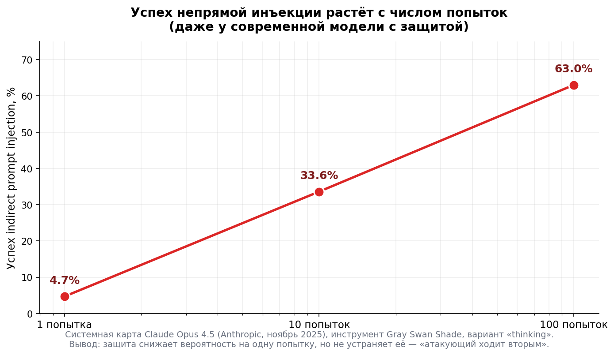

Вывод для архитектуры: guardrails — *слой снижения вероятности*, а не гарантия. Как сформулировано в отраслевой практике, «prompt injection — это новая SQL-инъекция, и одних guardrails недостаточно». Полагаться на фильтры как на единственную защиту — ошибка; они входят в защиту в глубину, но не заменяют архитектурных ограничений (§19.6).

## 19.6 Deep Dive: архитектурная защита

Поскольку инъекцию нельзя устранить на уровне модели, защита строится на уровне *системы* — детерминированными ограничениями вокруг вероятностного компонента. Ключевые архитектурные паттерны:

- **Разделение привилегий и карантин недоверенного (dual-LLM).** Предложенные design-паттерны защиты агентов (Beurer-Kellner et al., 2025; подход CaMeL, Google DeepMind) разделяют *привилегированную* часть, которая планирует и вызывает инструменты, и *карантинную*, которая обрабатывает недоверенный контент, но не имеет доступа к инструментам и привилегиям. Недоверенные данные никогда не попадают напрямую в привилегированный контур управления. Обеспечивает это не благое намерение, а конкретный механизм — символьные переменные и контроллер между контурами; он разобран ниже, после списка.

```mermaid
flowchart TB
  Task["Задача пользователя"] --> Priv["Привилегированный контур (P-LLM):<br/>планирование · выбор инструментов"]
  Priv -->|"план в терминах имён:<br/>обработать $VAR1"| Ctrl["Контроллер — детерминированный код:<br/>хранит значения, подставляет при вызове"]
  Ctrl -->|"содержимое $VAR1"| Quar["Карантинный контур (Q-LLM):<br/>разбор недоверенного контента"]
  Quar -->|"результат кладётся в переменную"| Ctrl
  Ctrl -->|"только имя: $VAR2, не содержимое"| Priv
  Ctrl --> Tools["Инструменты (привилегии)"]
  Untrusted["Недоверенный контент"] --> Quar
  Quar -. нет доступа .-> Tools
```

- **Обособление данных и инструкций** — недоверенный контент подаётся в чётко обособленной области контекста и не смешивается с инструкциями (§4.6); формат вывода фиксируется схемой (§5), чтобы инъекция не могла подменить структуру.
- **Наименьшие привилегии и правило двух** — ограничение trifecta и агентности (§19.4), taint-gating (§12.5).
- **Песочница исполнения (sandbox)** — для агентов, исполняющих код и команды: изоляция на уровне ОС/контейнера/виртуализации (seccomp-профили и gVisor — контейнерный уровень, microVM класса Firecracker — уровень виртуализации), эфемерное окружение на задачу и **egress-allowlist** — белый список исходящих направлений, отсекающий эксфильтрацию даже при успешной инъекции (третья «нога» trifecta удаляется физически). Декларативные границы протоколов (roots MCP, §15.3) без этого уровня принуждением не являются.
- **Human-gate на необратимом** — подтверждение человеком перед действием с последствиями (§10.6); показ пользователю того, что отправляется наружу (§15.7).
- **Наблюдаемость для детекции** — трассировка (гл. 18) фиксирует аномальные вызовы и попытки эксфильтрации, замыкая защиту мониторингом.

**Механизм dual-LLM: символьные переменные.** Первый пункт списка требует раскрытия: из формулировки «карантинный контур обрабатывает недоверенное» работающую систему не собрать, а книга предписывает этот паттерн в чек-листе (§19.7). Ключевая деталь — **контроллер** (controller): детерминированный код, не модель, стоящий между контурами. Он вызывает карантинную модель, кладёт её ответ в переменную и возвращает привилегированной модели **только имя** переменной: `$VAR1`, `$VAR2`. Привилегированная модель планирует в терминах имён — «сделай выжимку из `$VAR1`», «отправь её по адресу `$VAR2`», — не видя содержимого ни одной из них; значения подставляет контроллер в момент вызова инструмента. У Willison (2023), где паттерн предложен, это сказано без зазора: привилегированная модель видит только имена переменных и не видит ни недоверенный контент, ни вернувшуюся из карантина заражённую выжимку. Отсюда требование к схеме: по стрелке из карантина в привилегированный контур идёт **имя переменной, а не результат**. «Структурированный результат без инструкций» защитой не является — он всё равно вносит подконтрольное атакующему содержимое в контур, принимающий решения, а именно этого паттерн и не должен допускать.

**Чего символьные переменные не закрывают.** Карантин защищает *поток управления*, но не *значения* — разобрано это в самой работе CaMeL (Debenedetti et al., 2025). Пусть план: «найти в заметках встречи нужный документ и адрес клиента, отправить документ по адресу». Привилегированная модель спланировала верно и содержимого не видела. Но заметки отравлены, и карантинная модель извлекает из них адрес атакующего: контроллер подставляет `$VAR2` = `attacker@evil.com`, и безупречно исполненный план отправляет конфиденциальный документ наружу. План не перехвачен — перехвачен аргумент. Имя переменной защищает решение о том, *что делать*, и ничего не говорит о том, *с чем* это делают.

**CaMeL: мандаты на значениях.** Отсюда — усиление. Привилегированная модель порождает **код** на урезанном подмножестве Python до того, как система прочитает хоть байт недоверенных данных: поток управления зафиксирован раньше появления данных и потому атакующему недоступен по построению. Карантинная модель вызывается из этого кода как функция с обязательной схемой ответа и инструментов не имеет. Исполняет код не Python, а **кастомный интерпретатор**: он ведёт граф зависимостей (какое значение из каких получено) и навешивает на каждое значение **мандат** (capability[^t-capability]) — происхождение и множество допущенных читателей. Перед каждым вызовом инструмента с побочным эффектом движок политик проверяет мандаты аргументов. Это тот же taint-tracking (§12.5), но не на уровне «весь ход заражён», а на уровне отдельного значения — потому и функциональности он отбирает меньше.

**Проверка политики.** Политика в CaMeL — обычная функция на Python, возвращающая «разрешено/запрещено» с причиной. Её содержательное ядро для инструмента-отправителя:

$$\text{allow}(f, \{v_1,\dots,v_n\}) \iff \text{trusted}(R_f)\ \lor\ \forall i \in [1..n]:\ R_f \subseteq \text{readers}(v_i)$$

Легенда (живые значения — из примера с документом выше):
- $f$ — вызываемый инструмент с побочным эффектом: `send_email`, `create_calendar_event`.
- $R_f$ — кто фактически получит данные при этом вызове: для `send_email` — адреса получателей. Живое значение: `{attacker@evil.com}`.
- $v_i$ — значения, попадающие в аргументы: тело письма, вложение, тема.
- $\text{readers}(v)$ — из мандата значения: множество допущенных читателей либо `Public` («читать может кто угодно»). Живое значение для документа из корпоративного хранилища: `{user@corp, bob@corp}` — те, кому он расшарен.
- $\text{trusted}(R)$ — происхождение $R$: пришло ли оно литералом из кода, написанного привилегированной моделью (то есть из доверенного запроса пользователя), а не из данных.

Живые числа. Документ: $\text{readers}(v_{doc})$ = `{user@corp, bob@corp}`. Адрес, извлечённый карантинной моделью из отравленных заметок: $R_f$ = `{attacker@evil.com}`; происхождение — инструмент, а не литерал, значит $\text{trusted}(R_f)$ = false, и быстрый путь не сработал. Остаётся включение: `{attacker@evil.com}` $\subseteq$ `{user@corp, bob@corp}` → **false**. Итог — `Denied`: отправка блокируется и уходит на подтверждение пользователю.

*Словами:* инструмент срабатывает, только если каждый, кто получит данные, уже был допущен к чтению *каждого* значения в аргументах, — либо если список получателей пришёл от самого пользователя, а не из данных. Проверка сравнивает множества, а не оценивает текст: её исход не зависит от того, насколько убедительно написана инъекция, — и этим она отличается от guardrails (§19.5), которые текст именно оценивают и потому обходятся.

**Честная цена.** Паттерн не бесплатен, и режимы отказа названы в самой работе:
- *Потеря функциональности.* CaMeL решает 77% задач AgentDojo[^t-agentdojo] с доказуемой гарантией против 84% у незащищённой системы (Debenedetti et al., 2025) — около семи процентных пунктов отданы за гарантию (ранняя редакция работы сообщала 67%; здесь цифра актуальной, июнь 2025).
- *Побочные каналы.* Авторы отводят им отдельный раздел с прямым признанием: CaMeL уязвим к атакам по побочным каналам — атакующий выводит чувствительную информацию, наблюдая за поведением системы. Гарантия здесь — об изоляции потоков данных, а не о полной невозможности утечки.
- *Стоимость.* 2,82× входных и 2,73× выходных токенов на медианной задаче AgentDojo против нативного вызова инструментов — самая дорогая из защит, которые авторы сравнивали между собой. Во что такой множитель обходится по счёту — гл. 20.
- *Труд.* Политики надо написать и сопровождать: незаданная политика — дыра, избыточно строгая — отказы в работе и усталость от подтверждений (§10.6).

Правило развёртывания отсюда прямое: dual-LLM с мандатами ставят там, где цена компрометации выше цены потерянной функциональности и утроенного счёта за токены, — в высокорисковых контурах (§19.7), а не по умолчанию.

Общий принцип: **ограничивать систему, а не доверять модели**. Модель считается потенциально сбиваемой недоверенным контентом, поэтому авторизацию, обособление и подтверждение обеспечивают детерминированные компоненты вокруг неё.

## 19.7 Практика: защита в глубину

Сводный чек-лист, объединяющий меры из всей книги в эшелонированную защиту:
- **Обособление недоверенного контента** от инструкций (§4.6); фиксированная схема вывода (§5).
- **Наименьшие привилегии** и минимальный набор инструментов (§10.6, §12.3); **правило двух** и ограничение trifecta (§12.5, §19.4).
- **Валидация входа и фильтрация вывода** (guardrails) — как слой снижения вероятности, не как гарантия (§19.5).
- **Авторизация на инструменте с правами пользователя** (§12.5), предотвращающая спутанного заместителя.
- **Human-gate на необратимых и опасных действиях** (§10.6).
- **Карантин недоверенного контура** от привилегированного (dual-LLM, §19.6) для высокорисковых систем.
- **Песочница для исполнения кода** — изоляция на уровне контейнера или microVM, эфемерность окружения, egress-allowlist (§19.6).
- **Отношение к сторонним MCP-серверам как к недоверенным** — целостность определений, OAuth (§15.7).
- **Наблюдаемость и оценка** для детекции и регресс-контроля безопасности (гл. 17–18).

Ни одна мера не самодостаточна; надёжность даёт их совокупность — потому что вероятностный компонент можно сбить, и система должна оставаться безопасной, даже когда это произошло.

## 19.8 Резюме главы

Prompt injection — структурный дефект: модель не разделяет инструкции и данные в одном канале (§19.1), и потому инъекцию нельзя устранить на уровне модели. Её отличают от jailbreaking, а по источнику — прямую от непрямой, опаснейшей (§19.2). Систематическую карту поверхностей даёт OWASP Top 10 for LLM 2025 с prompt injection на первом месте и компаньоном для агентов (§19.3). Операциональные оси риска — lethal trifecta и excessive agency (§19.4). Guardrails снижают вероятность, но не устраняют атаку: под адаптивным давлением и с числом попыток успех растёт (§19.5). Поэтому защита архитектурна: разделение привилегий и карантин недоверенного (dual-LLM), обособление, наименьшие привилегии, human-gate, наблюдаемость (§19.6), собранные в защиту в глубину (§19.7). Принцип — ограничивать систему, а не доверять модели. Далее — глава 20: стоимость и латентность.

*Источники.* OWASP, «Top 10 for LLM Applications» (2025) и «Top 10 for Agentic Applications» (редакция 2026, опубликован в декабре 2025); S. Willison — prompt injection, различение с jailbreaking, lethal trifecta (2022–2025); Meta, «Agents Rule of Two: A Practical Approach to AI Agent Security» (2025) — правило двух; K. Beurer-Kellner et al., «Design Patterns for Securing LLM Agents against Prompt Injections» (arXiv:2506.08837, 2025); S. Willison, «The Dual LLM pattern for building AI assistants that can resist prompt injection» (2023) — контроллер и символьные переменные; E. Debenedetti et al., «Defeating Prompt Injections by Design» (CaMeL; Google / Google DeepMind / ETH Zurich, arXiv:2503.18813v2, июнь 2025) — мандаты, интерпретатор, 77% против 84% на AgentDojo, побочные каналы, стоимость в токенах; E. Debenedetti et al., «AgentDojo: A Dynamic Environment to Evaluate Prompt Injection Attacks and Defenses for LLM Agents» (arXiv:2406.13352, 2024) — сам бенчмарк, на котором получены эти числа; работы об адаптивных атаках на защиты от инъекции (2025); системная карта Claude Opus 4.5 (Anthropic, 2025) — эмпирика успеха непрямой инъекции; F. Perez, I. Ribeiro, «Ignore Previous Prompt» (2022); NeMo Guardrails (Rebedea et al., 2023).

**На полях главы 19**

[^t-redteam]: **Ред-тиминг** (red teaming) — атакующее тестирование: специально выделенная сторона целенаправленно пытается сломать защиту системы до того, как это сделает реальный противник; для LLM — подбор инъекций и джейлбрейков людьми или автоматикой.

[^t-capability]: **Мандат** (capability) — в системной безопасности: метка, привязанная к самому объекту и описывающая, что с ним можно делать, — в противоположность проверке «кто спрашивает» по внешнему списку прав. В CaMeL мандат навешивается на каждое *значение* и хранит две вещи: происхождение (от пользователя, от преобразования внутри исполнения или от конкретного инструмента) и множество допущенных читателей. Идея заимствована из классических систем — KeyKOS/EROS, Capsicum, CHERI.

[^t-agentdojo]: **AgentDojo** (Debenedetti et al., 2024) — среда для оценки атак с внедрением инструкций и защит от них: 97 пользовательских задач с инструментами в четырёх доменах (почта с календарём, корпоративный мессенджер, банк, бронирование поездок) и 27 вредоносных целей, подсаженных в данные, которые агент читает; их сочетания дают 629 проверок безопасности. Меряет две вещи разом — долю решённых задач (полезность, отсюда 77% против 84%) и долю удавшихся атак.

# Глава 20. Стоимость и латентность

Разделы 2.2–2.3 ввели экономику вызова и составляющие латентности. Настоящая глава — операционный свод: как удерживать стоимость и латентность в бюджете на продакшене. Тезис: **стоимость — продуктовое ограничение**, а не технический нюанс; она определяет маржу, цену и масштабируемость, а автономия агента *умножает* и стоимость, и латентность (каждый шаг цикла — вызов модели, §14.3). Оптимизация здесь — не преждевременная микрооптимизация, а условие жизнеспособности системы под нагрузкой.

## 20.1 Стоимость как продуктовое ограничение

Затраты LLM-системы линейны по использованию и переменны: агент, делающий десятки вызовов за сессию на сильной модели, накапливает ощутимую стоимость на сессию ещё до проверки счёта, а в неоптимизированных системах фактические расходы превышают план в разы. Три оси оптимизации — стоимость, латентность и качество — связаны нетривиально: часть приёмов улучшает одну ось *за счёт* другой (роутинг на дешёвую модель или компактизация контекста снижают стоимость, но рискуют качеством), тогда как другие улучшают несколько осей *одновременно* без потери качества (кэширование снижает и стоимость, и латентность). Поэтому оптимизация — не единый размен «выбери два из трёх», а набор рычагов с разными профилями (§20.7). Управлять этим невозможно без атрибуции стоимости (§18.5): затраты разносят по функции, арендатору и пользователю, чтобы видеть, *что* именно потребляет бюджет.

## 20.2 Deep Dive: экономика кэширования

Кэширование — один из самых результативных рычагов, действующий на двух уровнях.

**Prefix/prompt caching** кэширует обработанное KV-состояние (§1.6) статических префиксов промпта, позволяя переиспользовать вычисление вместо повторной обработки с нуля. Экономика асимметрична, а её параметры вендор-специфичны. В ценовой модели Anthropic запись в кэш дороже обычного входного токена (премия порядка 25%), чтение — значительно дешевле (скидка порядка 90%, то есть около 10% базовой цены); отсюда точка окупаемости — примерно от двух попаданий на кэшированный префикс. У других провайдеров структура издержек иная (OpenAI — автоматическое кэширование со скидкой на чтение без премии на запись; Google Gemini — явный кэш с почасовой оплатой хранения), поэтому расчёт окупаемости не переносится между вендорами без пересчёта. Prefix caching — первая оптимизация в любой системе, где системный промпт меняется реже пользовательских запросов, то есть практически везде; попутно он улучшает TTFT (§2.3). Предостережение: неудачное размещение границ кэша может, напротив, *увеличить* латентность, поэтому стратегию кэширования проверяют замером.

**Semantic caching** работает на уровне *семантически похожих* запросов, а не точного совпадения: запрос эмбеддится, в кэше ищется близкий по эмбеддингу (§8), и при сходстве выше порога возвращается кэшированный ответ, иначе ответ генерируется и сохраняется. На попадании вызов модели устраняется полностью (нулевая стоимость и латентность в миллисекундах). Это ловит перефразировки, которые точное кэширование пропускает («какова политика возврата?» и «как вернуть товар?» текстуально различны, но семантически совпадают). Существенное ограничение: semantic caching предполагает *stateless*-отображение «запрос → ответ» и потому не применим к вызовам инструментов, меняющим состояние.

```mermaid
flowchart TB
  Q["Запрос"] --> Sem{"Semantic cache:<br/>есть похожий?"}
  Sem -->|попадание| Ret["Ответ из кэша (мс, без вызова)"]
  Sem -->|промах| Pre{"Prefix cache:<br/>префикс кэширован?"}
  Pre -->|да| Reuse["Переиспользовать KV префикса → удешевлённый вызов"]
  Pre -->|нет| Full["Полный инференс + запись префикса в кэш"]
  Reuse --> Ans["Ответ + запись в semantic cache"]
  Full --> Ans
```

На практике уровни складывают в многоуровневую схему: сначала semantic cache (устраняет вызов целиком), затем prefix cache (удешевляет неизбежный вызов), затем инференс. Их совокупный эффект на стоимость и латентность значителен.

## 20.3 Deep Dive: роутинг моделей и каскады

**Роутинг моделей** (Model Routing, §2.2) операционализируется так: классификатор оценивает сложность запроса и направляет простые задачи на дешёвую модель, резервируя сильную для действительно трудных. Поскольку значительная доля запросов агента рутинна, взвешенная средняя стоимость резко падает, а мульти-модельные роутеры способны не уступать лучшей одиночной модели по качеству при меньшей средней стоимости. Классификация сама стоит немного (малый вызов, добавочная латентность порядка сотен миллисекунд), что окупается на потоке; из чего классификатор состоит и как молчаливо отказывает — Deep Dive §2.2.

Родственная форма — **каскад**: запрос сперва обрабатывается дешёвой моделью, а к сильной эскалируется лишь при недостаточной уверенности или неуспехе проверки (родственно лестнице «не усложняй раньше нужды», §13.7). Роутинг и каскад — компромисс между стоимостью и качеством: экономию даёт то, что часть трафика не требует frontier-модели, а риск — ошибка классификации, отправившая трудную задачу на слабую модель; поэтому решение о сложности само оценивается (гл. 17). Асимметрия по латентности: у прямого роутинга платится латентность одной модели, у каскада эскалированная доля трафика платит *сумму* задержек (дешёвый вызов + проверка + сильный вызов) — для P99-чувствительных систем это довод в пользу роутинга, даже если каскад дешевле в среднем.

## 20.4 Сокращение токенов

Прямое сокращение числа токенов действует на обеих осях.
- **Минимизация вывода.** Выходные токены дороже входных (§2.2), поэтому лимит `max_tokens`, стоп-последовательности и строгая схема вывода (§5) сокращают дорогую часть; `max_tokens` при этом рычаг не одного лишь счёта — он режет и место, которое выход занимает в общем со входом окне (§1.8), а при собственном сервинге ограничивает ещё и то, как долго запрос удерживает блоки KV-кэша, отнимая их у соседних сессий (§2.3); для reasoning-моделей управляют бюджетом рассуждения, не оплачивая избыточное «размышление» на простых задачах (§13.8, over-thinking).
- **Компактизация контекста.** Удаление избыточного из истории и результатов инструментов перед вызовом сокращает входные токены (§4.4); компактизация удалением отличается от суммаризации сохранением дословности оставшегося.
- **Batch API.** При допустимой отложенности пакетная обработка даёт скидку порядка 50% (SLA до суток) и складывается с кэшированием: пакет с кэшированным префиксом сочетает обе скидки.

## 20.5 Deep Dive: латентность

Латентность управляется отдельно от стоимости, хотя часть рычагов общая (§2.3).
- **TTFT против полного времени.** Воспринимаемая латентность определяется временем до первого токена; потоковая передача (streaming) выдаёт ответ по мере генерации, резко улучшая воспринимаемую отзывчивость при той же полной длительности (§2.3).
- **Параллельные вызовы инструментов.** Независимые действия исполняются параллельно, а не последовательно (§12.2): последовательная цепочка складывает задержки, параллельная — берёт максимум.
- **Кэширование.** Prefix caching улучшает TTFT, semantic caching на попадании сводит латентность к миллисекундам (§20.2).
- **Выбор модели и длина.** Меньшая модель и более короткий вывод снижают время генерации; на уровне сервинга латентность декодирования дополнительно снижают спекулятивным декодированием (§22).

Латентность агента складывается по шагам (§2.3, §14.3), поэтому сокращение числа шагов (Plan-and-Execute против длинного ReAct, §13.4) и параллелизм дают наибольший эффект на многошаговых задачах.

## 20.6 Бюджеты, шлюз и атрибуция

Эксплуатационный контроль строится на трёх элементах.
- **Бюджеты и лимиты.** Лимиты на число шагов и токенов на задачу и на сессию (§10.5) ограничивают как стоимость, так и класс отказов «неограниченное потребление» (OWASP LLM10, §19.3); ограничение частоты (rate limiting) — типичный продакшен-барьер на масштабе.
- **LLM-шлюз.** Слой между приложением и провайдерами, централизующий роутинг, семантическое кэширование, отказоустойчивость (fallback, circuit breaker, §2.5) и учёт стоимости. Вынесение этих забот в инфраструктуру снимает их с прикладного кода и даёт единую точку контроля и переносимости между провайдерами (§16.5).
- **Атрибуция и SLO.** Метрики токенов, стоимости и латентности (§18.5) разносятся по функции и арендатору и связываются с SLO по латентности и доступности; аномалии стоимости алертятся так же, как аномалии латентности.

Совокупность этих практик — атрибуция стоимости, бюджеты, unit-экономика как гейт масштабирования (§25.6) — в индустрии консолидировалась под именем **FinOps for AI** (расширение дисциплины FinOps — управления облачными затратами как инженерной практикой — на LLM-нагрузки). В книге материал разложен по своим главам, но на собеседовании и в вакансии он будет называться этим словом.

## 20.7 Совокупный эффект и порядок применения

Рычаги применяются к разным частям затрат и складываются.

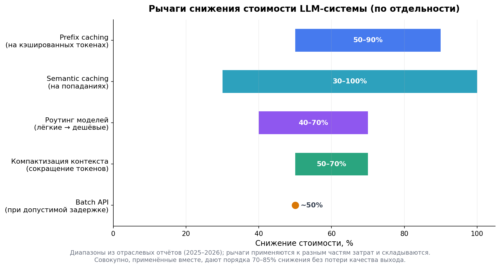

По отдельности каждый даёт заметное снижение; применённые вместе — порядка 70–85% снижения стоимости без ухудшения выхода. Арифметика мультипликативна: например, кэш −40% × роутинг −50% × компактизация −30% ⇒ 0.6·0.5·0.7 ≈ 0.21 исходной стоимости, то есть −79% (множители иллюстративны и зависят от профиля нагрузки — отсюда и разброс диапазона). Практический порядок внедрения — от наименьших усилий к наибольшим: сперва prefix caching (часто автоматический или требующий лишь разметки), затем роутинг моделей, затем компактизация контекста для агентных и длинноконтекстных нагрузок, затем semantic caching и batch там, где применимы. При этом действует та же оговорка, что и в §13.7: не оптимизировать раньше, чем измерение (гл. 17–18) покажет, *что* именно потребляет бюджет и латентность; преждевременная оптимизация усложняет систему без доказанной выгоды.

## 20.8 Резюме главы и Части VI

Стоимость — продуктовое ограничение, растущее с автономией; три оси (стоимость, латентность, качество) связаны нетривиально (§20.1). Кэширование действует на двух уровнях — prefix (асимметричная экономика, окупаемость от двух попаданий) и semantic (устранение вызова на похожих запросах, но только для stateless) — и снижает обе оси (§20.2). Роутинг и каскады уводят рутину на дешёвые модели ценой риска классификации (§20.3); сокращение токенов — минимизация вывода, компактизация, batch (§20.4); латентность управляется TTFT, стримингом, параллелизмом и сокращением шагов (§20.5). Контроль строится на бюджетах, LLM-шлюзе и атрибуции (§20.6); рычаги складываются до 70–85% снижения, но применяются по мере и после измерения (§20.7).

**Итог Части VI.** Система теперь эксплуатируема: её качество измеряется (гл. 17), поведение наблюдаемо (гл. 18), она защищена от манипуляции (гл. 19), а стоимость и латентность удерживаются в бюджете (гл. 20). Далее — **Часть VII: собственные модели** — когда и как дообучать, разворачивать и обучать модели вместо обращения к API.

*Источники.* Отраслевые отчёты и практики оптимизации стоимости и латентности LLM-систем (2025–2026): prefix/prompt caching и его экономика (документация Anthropic, OpenAI), semantic caching, роутинг моделей (RouterBench), компактизация контекста, batch API; C. Huyen, «AI Engineering» (2025) — экономика и латентность инференса; §2.2–2.3 и §18.5 настоящей книги.

# Часть VII. Собственные модели

Части I–VI трактовали модель как данность — вызываемую через API. Часть VII рассматривает случай, когда этого недостаточно и организация переходит к собственной модели: адаптирует существующую (глава 21, дообучение), разворачивает открытую модель в своей инфраструктуре (глава 22) или обучает с нуля (глава 23). Сдвиг Части VII — от «использовать модель» к «владеть моделью», с соответствующим ростом контроля и издержек. Математический субстрат этих операций вынесен в Приложение A, на которое главы ссылаются.

# Глава 21. Дообучение: адаптация модели

Дообучение (fine-tuning) продолжает обучение готовой модели на целевых данных, изменяя её поведение. Глава отвечает на два вопроса: *когда* дообучать вместо промптинга и RAG, и *как* это делать эффективно — методами, обучающими малую долю параметров, и приёмами выравнивания по предпочтениям.

## 21.1 Когда дообучать: решающая рамка

Дообучение — не первый и не универсальный инструмент. Действует лестница возрастающей стоимости и инвазивности: промптинг (Часть II) → RAG (Часть III) → дообучение. Принципиальное различие в том, *что* каждый уровень меняет:
- **RAG добавляет знание** — фактическую информацию в контекст во время исполнения (Часть III).
- **Дообучение меняет поведение** — форму, стиль, формат ответа, следование доменным конвенциям, паттерны использования инструментов.

Отсюда частая ошибка: дообучать ради *знания*. Вкладывать факты в веса дорого, они устаревают и требуют переобучения при каждом обновлении, тогда как RAG обновляет корпус без переобучения (§6). Дообучение оправдано, когда нужно изменить именно *поведение*: устойчивый формат или стиль, недостижимый промптом; специализация под узкий домен с собственной терминологией; надёжные паттерны вызова инструментов; и снижение стоимости и латентности за счёт того, что дообученная *малая* модель заменяет крупную на узкой задаче (§20.3). Как и в §13.7, правило — не подниматься по лестнице раньше, чем измерение (гл. 17) покажет, что предыдущий уровень не справляется.

## 21.2 Полное дообучение против PEFT

**Полное дообучение** обновляет *все* веса модели. Для крупных моделей это требует памяти и вычислений уровня обучения, хранения полной копии весов под каждую задачу и несёт риск катастрофического забывания (§21.8). Отсюда — **параметр-эффективное дообучение (PEFT, parameter-efficient fine-tuning)**: обучается лишь малая доля параметров, а основная часть модели остаётся замороженной. Ключевое эмпирическое наблюдение, лежащее в основе PEFT: *обновление* весов под конкретную задачу имеет низкий внутренний ранг — его можно приблизить малым числом параметров, не теряя качества. Интуиция: предобученная модель уже «умеет» почти всё необходимое; адаптация не переписывает знания, а слегка доворачивает уже выученные представления — и эта поправка живёт в низкоразмерном подпространстве полного пространства весов.

## 21.3 Deep Dive: LoRA

**LoRA (Low-Rank Adaptation)** (Hu et al., 2022) замораживает предобученные веса W₀ и добавляет обучаемое низкоранговое обновление, входящее в вес с фиксированным множителем:

`W = W₀ + (α/r) · BA`

Где:
* **W** — эффективный (итоговый) вес: матрица, по которой модель реально считает после применения адаптера. Форму слоя адаптер не меняет — размерность та же `d × k`, что у `W₀` (4096 × 4096).
* **W₀** — предобученная матрица размера `d × k`, заморожена; у матриц внимания LLaMA-подобной модели типично 4096 × 4096.
* **B** (`d × r`) и **A** (`r × k`) — единственные обучаемые матрицы. Произведение `BA` совпадает по размеру с `W₀`, но его ранг не выше r — это и есть низкоранговое допущение.
* **r** — ранг обновления, безразмерный; `r ≪ min(d, k)`, типично 8–64 (§21.8). Ширина «бутылочного горлышка», через которое пропущена поправка.
* **α** — константа масштабирования, безразмерная; задаётся в конфиге рядом с r, типично 16–128 (это прямое следствие дефолта α ≈ 2r при r = 8–64, §21.8).
* **α/r** — эффективный масштаб: во сколько раз обученная добавка входит в итоговый вес. При r = 8 и α = 16 это 16/8 = 2, то есть `BA` вливается с двойным весом.

Читается так: модель считает по замороженным весам плюс поправку, пропущенную через узкое горлышко ранга r и усиленную в α/r раз. Обучаются только A и B; число обучаемых параметров падает с d·k до r·(d + k).

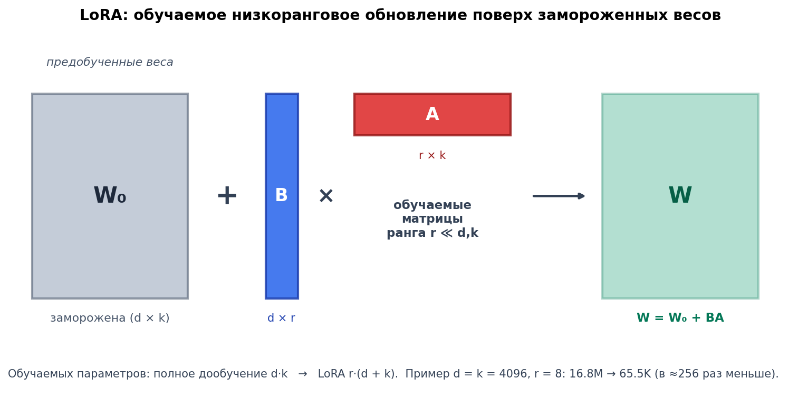

Два свойства делают LoRA практичным стандартом. Во-первых, резкое сокращение обучаемых параметров (для матрицы 4096×4096 при r = 8 — примерно в 256 раз) снижает память и позволяет держать множество лёгких адаптеров под разные задачи поверх одной базовой модели — вплоть до одновременной раздачи многих адаптеров одним сервером (multi-LoRA serving: S-LoRA, LoRAX; поддерживается vLLM — мост к гл. 22, где база загружена один раз, а адаптеры подключаются на запрос). Во-вторых, обновление `(α/r)·BA` можно *влить* в W₀ после обучения, получив обычную матрицу весов, — поэтому на инференсе LoRA не добавляет латентности. Ограничение метода — само низкоранговое допущение: ранг обновления ограничен сверху числом r, что сужает выразительность на задачах со сложной структурой обновления (§21.5).

**Инициализация: старт ровно с предобученной модели.** Матрица `A` заполняется малыми случайными числами (в статье — гауссово распределение; в референсной реализации и в PEFT по умолчанию — Kaiming-uniform), а `B` — **строго нулями**. Отсюда на шаге 0: `BA = 0`, значит `(α/r)·BA = 0` при любом α, и `W = W₀` в точности. Необученный адаптер — тождественное преобразование, ноль-операция: обучение стартует ровно с предобученной модели, и первый же шаг не портит базу. Практическое следствие — подключить свежий адаптер к продовой модели безопасно по построению (то, на чём стоит раздача многих адаптеров поверх одной базы). Асимметрия здесь обязательна: обнулить *обе* матрицы нельзя — градиент по `B` пропорционален `A`, градиент по `A` пропорционален `B`, и при `A = B = 0` оба обратились бы в ноль, адаптер остался бы мёртвым навсегда.

**Зачем множитель α/r.** Причина, названная авторами, эксплуатационная, а не математическая: настройка α примерно эквивалентна настройке скорости обучения, поэтому α фиксируют один раз и дальше перебирают r, не переподбирая learning rate. Отсюда читается и дефолт `α ≈ 2r` из §21.8: это не магическая двойка, а запись условия `α/r = 2` — «эффективный масштаб 2 независимо от ранга». Потому дефолт и выражают кратно r, а не абсолютным числом: он удерживает масштаб постоянным, пока r перебирается. Обратная сторона — α и r суть часть контракта адаптера, а не свободные ручки на этапе слияния: вливается `W₀ + (α/r)·BA` со *своим* множителем, поэтому адаптер, обученный при r = 8, α = 16 (масштаб 2), но слитый при α = 32 (масштаб 4), даст вес с вдвое усиленной поправкой — молча, без ошибки и предупреждения. Конфиг адаптера (`adapter_config.json`) хранит и `r`, и `lora_alpha`; тулинг обязан брать их оттуда, а не из настроек текущего запуска.

**Делитель r — эвристика, а не вывод.** Почему делить нужно именно на r, а не, скажем, на √r, статья не выводит — ограничивается ссылкой на Yang & Hu (2021) и утверждением, что такой масштаб снижает нужду перенастраивать гиперпараметры при переборе r. Kalajdzievski (2023) показал, что множитель, сохраняющий устойчивость адаптера при росте ранга, — это `α/√r`, тогда как классический `α/r` убывает с ростом r слишком быстро и, по формулировке работы, замедляет обучение и ограничивает качество на адаптерах высокого ранга. Арифметика расхождения при фиксированном α = 16: подъём ранга с 8 до 64 роняет `α/r` с 16/8 = 2 до 16/64 = 0.25 — падение восьмикратное, тогда как `α/√r` идёт с 16/2.83 ≈ 5.7 до 16/8 = 2, то есть падает лишь в √8 ≈ 2.83 раза. Практический вывод, который стоит держать рядом с §21.8: если r поднят в диапазон 32–64, а качество за рангом не пошло, подозревать надо сначала множитель и лишь потом — потолок низкорангового допущения (§21.5); в PEFT это ровно один флаг `use_rslora=True`, переключающий делитель на `√r`. Оговорка, чтобы не смешать три разных режима: при фиксированном α множитель убывает как 1/r; rsLoRA задаёт убывание как 1/√r; конвенция α = 2r убирает зависимость от ранга вовсе, жёстко фиксируя множитель на 2.

## 21.4 Deep Dive: QLoRA и память

**QLoRA** (Dettmers et al., 2023) снимает главный барьер — память базовой модели. Градиенты распространяются через *замороженную, квантованную в 4 бита* базовую модель в LoRA-адаптеры. Три приёма делают это возможным без существенной потери качества: 4-битный формат NormalFloat (NF4), согласованный с распределением весов; двойная квантизация (квантуются и сами константы квантизации); страничные оптимизаторы (paged optimizers), выгружающие состояние оптимизатора при всплесках памяти. Итог — дообучение крупной модели на одном GPU: база хранится в 4 битах и не обучается, обучаются лишь адаптеры. QLoRA — стандартный на 2024–2026 годы выбор для дообучения больших моделей при ограниченных ресурсах.

## 21.5 Deep Dive: за пределами низкого ранга — DoRA и произведение Кронекера

Низкоранговое допущение LoRA — одновременно источник эффективности и предел выразительности. Развитие идёт в двух направлениях.

**DoRA (Weight-Decomposed Low-Rank Adaptation)** (Liu et al., 2024) раскладывает предобученный вес на *величину* (magnitude) и *направление* (direction) и применяет низкоранговое обновление только к направленной компоненте. Формула, в параметрах LoRA из §21.3:

`W = m · (W₀ + BA) / ‖W₀ + BA‖_c`

Читается так: `W₀ + BA` — обычное LoRA-обновление (масштаб α/r из §21.3 здесь опущен вслед за исходной статьёй: на устройство декомпозиции он не влияет, поэтому его держат внутри `BA`); деление на `‖·‖_c` (норма каждого *столбца* по отдельности) оставляет от него только направление — все столбцы становятся единичной длины; вектор `m` (по числу столбцов, инициализируется нормами исходного `W₀`) возвращает каждому столбцу длину и обучается *отдельно* от BA. Смысл декомпозиции: анализ Liu et al. показал, что полное дообучение меняет величину и направление весов *слабо связанно*, а LoRA вынуждена менять их совместно — одной низкоранговой добавкой. Разделив компоненты, DoRA приближает динамику обучения к полному дообучению при том же бюджете параметров (плюс один вектор `m` на слой — пренебрежимо). На инференсе всё сливается обратно в плотную матрицу, поэтому дополнительной латентности нет — то же свойство merge, что у LoRA.

**Произведение Кронекера (KronA).** Более глубокий ответ на предел ранга — заменить низкоранговое произведение структурой, дающей *высокий* ранг при малом числе параметров. **KronA** (Edalati/Tahaei et al., 2022) вместо BA использует произведение Кронекера A ⊗ B. Ключевое алгебраическое свойство (Приложение A, §A.5): ранг произведения Кронекера *мультипликативен* — rank(A ⊗ B) = rank(A) · rank(B), — тогда как ранг обычного произведения (свёртки) ограничен сверху меньшей из размерностей. Поэтому при *одинаковом* параметрическом бюджете произведение Кронекера достигает на порядки более высокого ранга обновления.

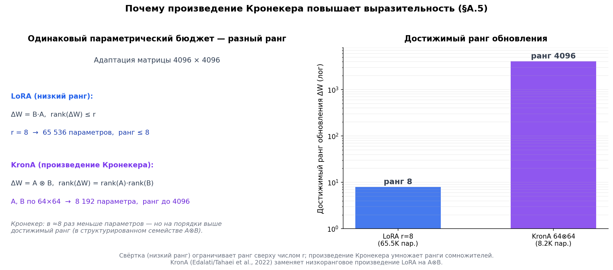

Различие принципиально и восходит к §A.5: *свёртка* (обычное умножение матриц) ранг *понижает* или ограничивает, тогда как *произведение Кронекера* ранг *повышает*. KronA эксплуатирует именно это, получая более выразительное обновление меньшим числом параметров, — но с оговоркой: достижимые обновления образуют *структурированное* семейство A ⊗ B, а не произвольные матрицы полного ранга. Развитие идеи — LoKr (низкоранговая добавка к кронекеровской компоненте), AdaKron, MoKA (смесь кронекеровских факторов), Kron-LoRA (гибрид). Дальнейшее сжатие адаптеров и самих весов опирается на тензорные разложения (Tensor-Train, Tucker, CP; §A.5) — обобщение матричной факторизации на многомерные массивы. Алгебра всех этих конструкций разобрана в Приложении A.

## 21.6 Deep Dive: выравнивание предпочтений — RLHF и DPO

Дообучение под *поведение* включает не только имитацию, но и выравнивание по человеческим предпочтениям. Пост-обучение (post-training) обычно проходит в несколько стадий: **SFT (supervised fine-tuning)** — имитация на парах «запрос → эталонный ответ»; **выравнивание предпочтений** — настройка на то, какие ответы люди *предпочитают*; и для проверяемых задач рассуждения — **RLVR** (§13.8). Две основные техники выравнивания предпочтений различаются радикально.

**RLHF (reinforcement learning from human feedback)** (Ouyang et al., 2022, InstructGPT) — три стадии: SFT; обучение *модели вознаграждения* на человеческих сравнениях ответов (ранжирования, а не абсолютные оценки, чтобы снизить шум калибровки аннотаторов); дообучение политики[^t-policy] через RL (PPO) с максимизацией вознаграждения при штрафе за отклонение (KL[^t-kl]) от исходной модели. Процедура мощная, но сложная и нестабильная, а фаза PPO держит в памяти *четыре* модели одновременно (политику, эталонную, вознаграждения и критика).

**GRPO (Group Relative Policy Optimization)** (Shao et al., 2024, DeepSeekMath) — облегчение PPO, ставшее стандартом RLVR-линии (§13.8): вместо отдельной value-модели (критика) advantage оценивается относительно *групповой базовой линии* — средней награды нескольких сэмплированных ответов на тот же промпт. В памяти остаются три модели вместо четырёх, а алгоритм естественно ложится на задачи с проверяемой наградой, где на один промпт дёшево сэмплировать группу решений.

**DPO (Direct Preference Optimization)** (Rafailov et al., 2023) устраняет и модель вознаграждения, и RL. Выравнивание переформулируется как простая бинарная классификация на парах «предпочтённый (chosen) / отвергнутый (rejected)»: модель обучается повышать вероятность предпочтённого ответа и понижать — отвергнутого. DPO неявно задаёт ту же модель вознаграждения (Bradley–Terry[^t-bt]), но извлекает оптимальную политику *в замкнутой форме*, без сэмплирования из модели во время обучения. Итог — существенно проще и стабильнее RLHF, менее подвержен reward hacking[^t-rewardhack], при сопоставимом или лучшем качестве на управлении стилем, суммаризации и диалоге.

```mermaid
flowchart TB
  subgraph RLHFb["RLHF — 3 стадии, до 4 моделей в PPO"]
    S1["SFT"] --> RM["Модель вознаграждения<br/>на сравнениях"] --> PPO["RL-дообучение (PPO)<br/>+ KL-штраф"]
  end
  subgraph DPOb["DPO — 1 стадия"]
    S2["SFT"] --> D["Бинарная классификация<br/>chosen / rejected"]
  end
```

Существенная оговорка: DPO силён на предпочтенческих и диалоговых задачах, но на *математическом рассуждении* даёт лишь маргинальный выигрыш или даже вредит — именно здесь применяется RLVR с проверяемой наградой (§13.8). Родственные подходы заменяют человеческие предпочтения машинными критиками (Constitutional AI, RLAIF) и упрощают DPO дальше (ORPO, SimPO[^t-orpo] — без эталонной модели; KTO — на *непарных* данных: достаточно пометок «хорошо/плохо» вместо пар chosen/rejected, что ценно, когда парную разметку собрать неоткуда).

## 21.7 Deep Dive: дистилляция знаний (учитель→ученик)

Дообучение и PEFT адаптируют *одну* модель; дистилляция знаний (knowledge distillation) решает смежную задачу — перенести способности крупной модели в *меньшую*, чтобы снизить стоимость, латентность и потребление памяти (§21.1). Введённая Hinton, Vinyals и Dean (2015), она обучает компактную модель-**ученика (student)** воспроизводить поведение крупной модели-**учителя (teacher)**.

**Мягкие цели и «тёмное знание».** Ключевая идея — ученик учится не на *жёстких* метках (один правильный токен), а на *мягких целях* (soft targets) — полном распределении вероятностей учителя над словарём. Это распределение несёт то, что Hinton назвал **«тёмным знанием» (dark knowledge)**: относительные вероятности, которые учитель приписывает *неправильным* вариантам, кодируют выученную им структуру сходства и дают ученику больше информации на пример, чем одна метка. Распределение «размягчают» **температурой** (§1.7): softmax с T > 1 обнажает эту структуру, делая её обучающим сигналом.

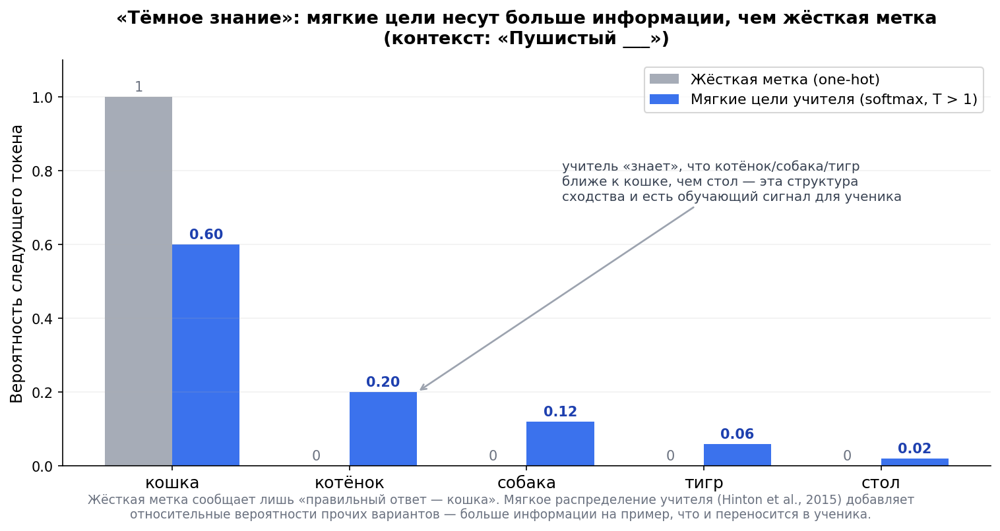

**Response-, feature- и relation-based.** По тому, *что* именно перенимает ученик, различают (Gou et al., 2021): **response-based** (логит-дистилляция) — соответствие финальному распределению выхода, классическая форма Hinton; **feature-based** (hint-based, Romero et al., 2015) — согласование промежуточных представлений и скрытых состояний; **relation-based** — соответствие отношений между представлениями (попарные расстояния, углы). Функция потерь response-based минимизирует расхождение распределений — **прямую KL-дивергенцию** (Hinton; DistilBERT), а для генеративных моделей применяют и **обратную KL**[^t-fkl] (MiniLLM, Gu et al., 2023) и обобщённые схемы (GKD[^t-gkd], Agarwal et al., 2023), лучше отражающие специфику авторегрессии.

**Целевая функция Hinton.** Формально response-based дистилляция обучает ученика на взвешенной сумме двух слагаемых: *мягкого* — согласие с распределением учителя, и *жёсткого* — согласие с истинной меткой:

$$L = \alpha \cdot T^2 \cdot KL\left(\sigma(z_t/T) \parallel \sigma(z_s/T)\right) + (1 - \alpha) \cdot CE\left(y, \sigma(z_s)\right)$$

| Символ | Что это | Живое значение |
|---|---|---|
| $L$ | Функция потерь ученика — то, что минимизируется при обучении | — |
| $z_t$, $z_s$ | Логиты учителя и ученика — сырые оценки до softmax, по одному числу на каждый токен словаря (§1.7) | вектор длиной в словарь: 30 000–130 000 у LLM (§1.2) |
| $\sigma$ | softmax; $\sigma(z/T)$ — размягчённое температурой распределение | — |
| $T$ | Температура (§1.7), безразмерная. В мягком слагаемом одна и та же $T$ применяется и к учителю, и к ученику; на инференсе возвращается к 1 | у Hinton: 2 (речь), 20 (MNIST) |
| $\alpha$ | Вес мягкого слагаемого, от 0 до 1 | Hinton: на жёстком слагаемом — «существенно меньший вес», то есть $\alpha$ ближе к 1 |
| $KL$ | Прямая KL-дивергенция — мера отклонения распределения ученика от распределения учителя | — |
| $CE$ | Перекрёстная энтропия с жёсткой меткой $y$; считается при $T = 1$ | — |
| $y$ | Истинная метка — правильный следующий токен из обучающих данных | one-hot: 1 на правильном токене, 0 на остальных 30 000+ |

*Словами:* ученик одновременно тянется к развёрнутому «мнению» учителя обо *всех* вариантах (мягкое слагаемое) и к единственному правильному ответу (жёсткое); $\alpha$ задаёт, чего в этой смеси больше, а $T^2$ — поправка, без которой $\alpha$ не означает того, что написано. Оговорка для тех, кто сверяется с оригиналом: Hinton записывает мягкое слагаемое перекрёстной энтропией с мягкими целями, а не через KL; отличаются они на энтропию учителя — слагаемое, не зависящее от весов ученика и потому дающее нулевой градиент, так что для оптимизации формы эквивалентны.

**Почему множитель $T^2$ — не косметика.** Это единственная неочевидная деталь формулы, и она чисто инженерная. Градиент мягкого слагаемого по логиту ученика равен $\frac{1}{T}(q_i - p_i)$, где $q$ и $p$ — размягчённые распределения ученика и учителя. Множитель $1/T$ входит сюда *дважды*: явно — из дифференцирования $z/T$ по $z$, и неявно — потому что размягчение сжимает саму разность $(q_i - p_i)$ пропорционально $1/T$. Hinton выписывает предел: при $T$, большой относительно логитов, и логитах, отцентрированных к нулю, градиент ≈ $\frac{1}{N T^2}(z_{s,i} - z_{t,i})$, где $N$ — размер словаря (число классов, по которым нормируется softmax); в оригинале те же логиты обозначены $z$ у ученика и $v$ у учителя. Итог: сила мягкого сигнала падает как $1/T^2$.

Отсюда цена вопроса. Пусть $\alpha = 0.9$ — номинально мягкое слагаемое весит против жёсткого 9 : 1. Без множителя $T^2$ фактическое отношение равно $\frac{\alpha / T^2}{1 - \alpha}$:
- при $T = 2$: $0.9 / 4 = 0.225$ против $0.1$ — отношение 2.25 : 1, мягкое ещё ведёт;
- при $T = 4$: $0.9 / 16 = 0.056$ против $0.1$ — отношение 0.56 : 1, то есть теперь **жёсткое слагаемое доминирует почти вдвое**.

Одно удвоение температуры перевернуло смесь, хотя $\alpha$ никто не трогал. С множителем $T^2$ произведение $T^2 \cdot \frac{1}{T^2} = 1$, и отношение равно $\alpha : (1 - \alpha) = 9 : 1$ при любой $T$.

**Инвариант:** $T^2$ делает $T$ и $\alpha$ *независимыми* ручками. Без него подъём температуры молча обесценивает мягкое слагаемое относительно жёсткого, и перебор по $T$ измеряет не то, что предполагает экспериментатор: вместе с $T$ едет и баланс двух слагаемых. Отдельная ловушка — соглашение об $\alpha$: в разных реализациях им обозначают то вес мягкого слагаемого, то вес жёсткого. Это выясняют по коду, а не по имени параметра.

**Температура и ёмкость ученика.** Универсального $T$ нет: рабочий диапазон привязан к ёмкости ученика, и у Hinton это измерено прямо. На MNIST ученик с 300 и более нейронами в слое к температуре почти нечувствителен — все значения выше 8 давали близкий результат (в опубликованном прогоне взята $T = 20$). Но у радикально урезанного ученика, 30 нейронов в слое, лучшими оказались $T$ в диапазоне 2.5–4 — заметно лучше и более высоких, и более низких. На распознавании речи из перебора [1, 2, 5, 10] лучшей оказалась $T = 2$ при относительном весе 0.5 на жёстком слагаемом. Механизм прост: высокая $T$ поднимает хвост крошечных вероятностей учителя; ёмкому ученику этот хвост — сигнал, тесному — шум, который он не в состоянии воспроизвести и который вытесняет главное. Отсюда правило: $T$ подбирают вместе с размером ученика, а не переносят из чужого конфига; для сильно сжатых учеников разумная стартовая точка — $T$ ≈ 2–5, дальше по оценке (гл. 17) — та же дисциплина, что с рангом LoRA (§21.8).

**White-box против black-box — основное деление для LLM.** По доступу к учителю дистилляцию LLM делят на два класса:

```mermaid
flowchart TB
  subgraph WB["White-box: открытый учитель, доступны логиты"]
    Tw["Учитель: softmax с температурой T → мягкие цели"] --> Lw["Дивергенция (forward / reverse KL)<br/>ученик ↔ учитель"]
    Sw["Ученик"] --> Lw
    Lw -->|обновление| Sw
  end
  subgraph BB["Black-box: закрытый учитель (API), доступны только выходы"]
    Tb["Учитель генерирует данные:<br/>ответы / трассы рассуждения"] --> Sb["Ученик: SFT на данных учителя (SeqKD)"]
  end
```

- **White-box (открытый учитель)** — доступны логиты и внутренние представления. Ученик обучается на мягких целях (токенных вероятностях), получая богатый сигнал; требует открытой модели-учителя и вычислительно тяжелее.
- **Black-box (закрытый учитель)** — доступны только текстовые *выходы* учителя (например, через API проприетарной модели). Стандартный приём — **дистилляция на уровне последовательностей (SeqKD, sequence-level knowledge distillation)** (Kim & Rush, 2016): учитель генерирует набор ответов, а ученик дообучается (SFT) на них. Проще, но теряет внутреннее распределение учителя. Современное расширение — SFT на *трассах рассуждения* учителя для переноса способности рассуждать (линия DeepSeek-R1-Distill, §13.8; ранее — Alpaca/Vicuna для переноса следования инструкциям).

**On-policy дистилляция.** Наивная black-box дистилляция страдает от рассогласования распределений: ученик обучается на данных учителя, но на инференсе идёт по *своим* траекториям. On-policy дистилляция устраняет это, обучая ученика на *его собственных* генерациях, оцениваемых или корректируемых учителем, — важное современное направление.

**Наследуемое позиционное смещение.** Рассогласование распределений — не единственный дефект, который вносит не функция потерь, а *протокол сбора данных*. Учитель, порождающий данные, сам читает свой промпт — и сам подвержен **позиционному смещению** (lost in the middle: середина длинного входа используется хуже краёв, §1.8, §4.3). Разница в последствиях принципиальна. На инференсе это *преходящая* ошибка: переставили факт из середины к краю — ответ снова верен. В дистилляции преходящих ошибок не бывает: ответ учителя никто не отбраковывает, он **становится обучающей целью**. Если данные генерировались на длинных промптах и учитель отвечал, игнорируя их середину, ученик получает градиентный шаг, кодирующий «игнорировать середину» как *правильное* поведение. Смещение, жившее у учителя доли секунды в одном прогоне, оседает в весах ученика навсегда.

**Почему функция потерь этого не видит.** В black-box режиме ученик дообучается (SFT) на выходах учителя, то есть максимизирует правдоподобие сгенерированных учителем последовательностей (SeqKD, выше). Потеря — усреднённая по токенам ответа кросс-энтропия:

$$L = -\frac{1}{|y|}\sum_{t=1}^{|y|} \log p_{student}(y^{teacher}_t \mid y^{teacher}_{<t}, x)$$

Где:
* **$L$** — сама потеря (не путать с $L$ целевой функции Hinton выше в этом разделе: там безразмерная взвешенная сумма мягкого и жёсткого слагаемых, здесь — одна кросс-энтропия по выходам учителя; разные режимы дистилляции); единица — **нат на токен**, логарифм натуральный (в log₁₀ то же самое число вышло бы 0.046 вместо 0.105 — основание обязательно фиксировать, иначе шкала врёт в 2.3 раза). Шкалу задаёт уверенность ученика: $p_{student} = 0.5$ даёт $L \approx 0.69$, $p_{student} = 0.9$ — $L \approx 0.105$, $p_{student} \to 1$ — $L \to 0$. Это то самое число, которое рисует кривая обучения.
* **$t$** — номер позиции в ответе, от 1 до $|y|$: сумма пробегает все токены ответа, а деление на $|y|$ делает $L$ *средней* потерей на токен, а не величиной, растущей с длиной ответа.
* **$x$** — промпт, на котором учителя просили сгенерировать данные (от десятков токенов до сотен тысяч). Его длина — та самая переменная риска: на коротком входе учитель читает всё, на длинном — уже нет (насколько длинном — величина измеряемая, а не табличная, §4.3).
* **$y^{teacher}_t$** — $t$-й токен ответа учителя; для ученика это «правильный ответ» в позиции $t$. $|y|$ — длина ответа в токенах (сотни для типичного ответа).
* **$y^{teacher}_{<t}$** — все предшествующие токены **учителя**: ученик предсказывает очередной токен, глядя на префикс учителя, а не на собственный (**teacher forcing** — обучение по эталонному префиксу). Отсюда главное: ученику негде разойтись с дефектной целью — на каждом шаге его возвращают на рельсы учителя. Именно эту зависимость и разрывает on-policy дистилляция (выше), подставляя ученику его собственный префикс.
* **$p_{student}$** — вероятность (безразмерная, 0…1), которую ученик приписывает очередному токену учителя.

Живой счёт. Пусть ученик сошёлся и приписывает каждому токену учителя $p_{student} = 0.9$, а длина ответа $|y| = 300$ токенов. Потеря на токен равна $-\ln 0.9 \approx 0.105$ ната, сумма по ответу — $300 \times 0.105 \approx 31.6$ ната, деление на те же 300 возвращает $L \approx 0.105$ ната на токен. Ровно столько же покажет кривая обучения и в том случае, когда $y^{teacher}$ был получен игнорированием середины промпта. Причина в том, что **в формуле нет ни одного слагаемого, отвечающего за правоту учителя**: вход $x$ входит только как условие, и ничто не проверяет, прочитал ли учитель $x$ целиком. Словами: функция потерь измеряет ровно одно — насколько точно ученик повторяет учителя; идеальный ноль достигается на дефектной цели так же, как на верной. Метрика, за которой следит инженер, к этому дефекту слепа по построению.

**Дефект в протоколе генерации, а не в методе.** Дистилляция не *порождает* позиционного смещения — его вносит рецепт сбора данных. Что позиционное поведение вообще переносимо дистилляцией — не догадка, но опор у этого две, и они про разное. Wang et al. (2025) показывают переносимость *внутри одной модели*: их Pos2Distill переносит поведение с «выигрышных» позиций входа на «проигрышные», причём учитель и ученик здесь — одна и та же модель, различающаяся только позицией факта во входе (из режимов, перечисленных ниже, это ближе всего к *self-distillation* — дистилляции модели в саму себя). Отсюда следует, что позиционное поведение — величина, дистиллируемая в принципе; о переносе *между* моделями это не говорит. Перенос «учитель → ученик» показывают Huber et al. (2026): они прослеживают, как позиционные возмущения из векторов запроса и ключа (Q/K, §1.4) доходят до выходного распределения учителя «и, далее, до сигнала дистилляции, получаемого учеником». Оговорка существенна: канал у них — логиты (white-box), тогда как здесь речь о black-box SFT на текстовых выходах; в black-box перенос прямее и ссылки не требует — дефектный ответ буквально становится целью. Общая формулировка — у Zhang et al. (2024): дистилляция передаёт «и правильное, и неправильное знание», и смещение учителя вводит ученика в заблуждение.

Отсюда правило: **данные для дистилляции генерируют на коротких плотных фрагментах**, а не на длинном документе целиком. Ходовой ориентир — 1024–2048 токенов на промпт; это инженерная эвристика (первоисточник проследить не удалось), отправная точка для перебора, а не константа, и держится она на обосновании, а не на замере: на такой длине внимание учителя не размазано, весь фрагмент лежит в зоне его уверенной работы, и градиент ученика собирается с ответов, реально опирающихся на весь вход. Качество обучающего сигнала — функция загруженности контекста учителя.

Возражение «а не потеряет ли тогда ученик длинный контекст» снимается разведением двух длин, которые легко спутать: короткая — у *фрагмента* при генерации, длинная — у *обучающей последовательности*. Huber et al. (2026) переносят в ученика способность находить факт в длинном входе (long-context retrieval), обучая его исключительно на коротких примерах, **упакованных в длинное окно** (packed short-context samples): сами фрагменты короткие, но обучающая последовательность — полной длины, поэтому позиции RoPE по всему окну остаются задействованы (§1.4). Упаковка здесь не деталь оформления, а условие работоспособности: ученик, обучаемый на коротких *последовательностях*, длинного окна как раз и не получит — этого Huber не утверждают. Оговорка прежняя: канал у них — логиты, поэтому перенос их вывода на black-box SeqKD остаётся рассуждением по механизму, а не цитатой. Правило коротких фрагментов в этой подпорке и не нуждается: оно держится на том, что учитель обязан прочитать свой вход целиком.

**Практические ориентиры.** Стандартная схема — *offline* (учитель заморожен); существуют также *online* (учитель и ученик обучаются вместе) и *self-distillation* (учитель и ученик — одна и та же сеть). Эмпирически работает принцип «сначала предобучить ученика, затем дистиллировать» (Turc et al.): сильная база плюс выходы учителя дают совокупный эффект. Классический результат масштаба — **DistilBERT** (Sanh et al., 2019): ученик инициализируется частью весов учителя и обучается на мягких целях, сохраняя около 97% качества BERT при на 40% меньшем размере.

**Место на карте сжатия.** Дистилляцию важно отличать от двух других техник получения компактной модели: **квантизация** (§22.6) снижает *точность* весов *той же* модели; **прунинг (pruning)** удаляет веса или структуры из *той же* модели; **дистилляция** обучает *принципиально новую, меньшую* модель — вплоть до иной архитектуры — воспроизводить учителя. Техники комплементарны и часто комбинируются (дистиллировать, затем квантовать). Оговорки: ученик редко полностью догоняет учителя, и разрыв растёт на сложных и рассуждательных задачах (частично закрывается дистилляцией трасс); white-box требует открытого учителя, а black-box из проприетарного API может нарушать его условия использования — это проверяют до применения.

## 21.8 Практика: данные, забывание, оценка

Успех дообучения определяется тремя эксплуатационными факторами.
- **Данные.** Качество и репрезентативность целевого набора важнее его размера; дообучение усиливает паттерны данных, включая их дефекты. Для выравнивания нужны *предпочтенческие* пары, для SFT — эталонные ответы. Частный случай, стоящий отдельного контроля: если набор породил учитель (§21.7), его собственные дефекты входят в данные как эталон — поэтому у генерации проверяют не только ответы, но и **длину промптов**, на которых их получали.
- **Катастрофическое забывание.** Дообучение под узкую задачу может ухудшить общие способности модели. PEFT (замороженная база) снижает риск по сравнению с полным дообучением, но не устраняет его; последовательное дообучение под несколько задач требует особой осторожности. Практическая митигация — подмешивание в целевой набор доли общих данных (replay), удерживающее модель от дрейфа.
- **Стартовые эвристики LoRA.** Ранг r = 8–16 для стилевых/форматных задач, 32–64 — когда задача структурно сложнее (и это сигнал перепроверить, не нужен ли вообще другой метод); alpha ≈ 2r как распространённый дефолт — то есть эффективный масштаб α/r = 2 независимо от ранга (§21.3); если рост r не даёт прироста качества, проверить множитель (rsLoRA, §21.3) прежде чем винить потолок ранга; целевые модули — все матрицы внимания (Q/K/V/O), при недоборе качества — плюс FFN-проекции. Это отправные точки для перебора, а не константы: подтверждаются оценкой (гл. 17).
- **Оценка.** Дообученную модель оценивают той же дисциплиной, что и любую (гл. 17): на *отложенном* наборе и против базовой линии, проверяя не только целевую задачу, но и отсутствие регресса общих способностей. Улучшение на цели ценой деградации в остальном — частый и незамечаемый исход.

## 21.9 Резюме главы

Дообучение меняет *поведение* модели, тогда как RAG добавляет *знание*; дообучать ради знания — типичная ошибка (§21.1). Полное дообучение дорого, поэтому применяют PEFT, опираясь на низкий внутренний ранг обновления (§21.2). LoRA обучает низкоранговую добавку W₀ + (α/r)·BA, вливаемую на инференсе без латентности (§21.3); QLoRA снимает барьер памяти квантованной в 4 бита базой (§21.4). Предел низкого ранга преодолевают DoRA и, глубже, произведение Кронекера (KronA), которое повышает достижимый ранг за счёт мультипликативности ранга Кронекера — прямое следствие §A.5 (§21.5). Выравнивание предпочтений идёт через RLHF (три стадии, модель вознаграждения, PPO) или радикально более простой DPO (бинарная классификация chosen/rejected), с оговоркой о слабости DPO на рассуждении, где нужен RLVR (§21.6). Дистилляция знаний переносит способности учителя в меньшую модель через мягкие цели («тёмное знание»), в режимах white-box (по логитам) или black-box (SFT на выходах учителя, SeqKD), и отличается от квантизации и прунинга тем, что даёт *новую* компактную модель; вместе со способностями переносятся и дефекты учителя — включая позиционное смещение, если данные генерировались на длинных промптах (§21.7). Успех определяют данные, контроль забывания и честная оценка против базовой линии (§21.8). Далее — глава 22: разворачивание открытых моделей в собственной инфраструктуре.

*Источники.* E. Hu et al., «LoRA» (arXiv:2106.09685, 2022); D. Kalajdzievski, «A Rank Stabilization Scaling Factor for Fine-Tuning with LoRA» (arXiv:2312.03732, 2023) — rsLoRA, множитель α/√r; T. Dettmers et al., «QLoRA» (arXiv:2305.14314, 2023); S. Liu et al., «DoRA» (arXiv:2402.09353, 2024); A. Edalati / M. Tahaei et al., «KronA: Parameter Efficient Tuning with Kronecker Adapter» (arXiv:2212.10650, 2022) и развитие (LoKr, AdaKron, MoKA, Kron-LoRA, 2024–2025); R. Rafailov et al., «Direct Preference Optimization» (arXiv:2305.18290, 2023); L. Ouyang et al., «InstructGPT / RLHF» (2022); N. Lambert, «RLHF Book» (2025); Z. Shao et al., «DeepSeekMath» (2024) — GRPO; K. Ethayarajh et al., «KTO: Model Alignment as Prospect Theoretic Optimization» (2024); по дистилляции: G. Hinton, O. Vinyals, J. Dean, «Distilling the Knowledge in a Neural Network» (2015); J. Gou et al., «Knowledge Distillation: A Survey» (2021); V. Sanh et al., «DistilBERT» (2019); Y. Kim, A. Rush, «Sequence-Level Knowledge Distillation» (2016); Y. Gu et al., «MiniLLM» (2023) и R. Agarwal et al., «GKD» (2023); Y. Wang et al., «Position Bias Mitigates Position Bias: Mitigate Position Bias Through Inter-Position Knowledge Distillation» (arXiv:2508.15709, 2025) — перенос между позициями внутри одной модели; J. Zhang et al., «Can Students Beyond The Teacher? Distilling Knowledge from Teacher's Bias» (arXiv:2412.09874, 2024); P. Huber et al., «Short Data, Long Context: Distilling Positional Knowledge in Transformers» (arXiv:2604.06070, 2026) — перенос «учитель → ученик» по логитам; обзоры дистилляции LLM и сжатия моделей (2023–2025); §13.8 (RLVR) и Приложение A (§A.5) настоящей книги.

**На полях главы 21**

[^t-policy]: **Политика (policy)** в RL-смысле — стратегия выбора действия по состоянию; для LLM политика — это сама модель (распределение следующего токена), и «обучить политику» значит обновить её веса. ≠ Омоним: в книге «политика» — это ещё и governance-правило организации/шлюза (гл. 20, 25), политика доступа RLS в Postgres (гл. 8) и политика забывания памяти (§4.5). Четыре смысла из четырёх разных дисциплин; в главе 21 «политика» всегда RL-термин.
[^t-kl]: **KL-дивергенция** — мера расхождения двух распределений. KL-штраф удерживает обучаемую политику рядом с исходной моделью: без него политика «взламывает» вознаграждение ценой деградации языка. Несимметрична: KL(P‖Q) ≠ KL(Q‖P), отсюда прямая и обратная формы (§21.7).
[^t-bt]: **Bradley–Terry** (1952) — классическая модель парных сравнений: вероятность «a лучше b» выражается через скрытые «силы» вариантов; именно её неявно оценивает DPO по парам chosen/rejected.
[^t-rewardhack]: **Reward hacking** — эксплуатация изъянов модели вознаграждения: политика находит ответы с высокой наградой без реального качества (длиннее, самоувереннее, шаблоннее).
[^t-orpo]: **ORPO, SimPO** — упрощения DPO без отдельной эталонной модели: ORPO совмещает выравнивание с SFT через odds ratio, SimPO нормирует неявную награду по длине ответа.
[^t-fkl]: Прямая KL (mode-covering) заставляет ученика «размазать» вероятность по всем модам учителя; обратная (mode-seeking) — сконцентрироваться на доминирующих. Для генерации обратная часто честнее: лучше уверенно воспроизводить сильные моды, чем плохо — все.
[^t-gkd]: **GKD** — Generalized Knowledge Distillation (Agarwal et al., 2023): дистилляция на *собственных* генерациях ученика (on-policy), закрывающая разрыв «обучали на текстах учителя — генерирует свои».

# Глава 22. Разворачивание открытых моделей

Глава 21 адаптировала модель; настоящая глава разворачивает её — открытую модель (open-weight) — в собственной инфраструктуре. Вопрос двоякий: *когда* разворачивать самостоятельно вместо API и *как* устроен эффективный сервинг — техники, делающие инференс на GPU экономичным. Глава консолидирует KV-кэш (§1.6) и экономику инференса (§2) на уровне инфраструктуры.

## 22.1 Зачем разворачивать открытую модель

Самостоятельный сервинг оправдан там, где API не подходит по одной из причин:
- **Контроль и приватность.** Данные не покидают периметр — важно для регулируемых доменов и резидентности данных.
- **Стоимость на масштабе.** При большом устойчивом объёме собственный сервинг может быть дешевле поштучной оплаты API (§2.2), хотя требует амортизации инфраструктуры.
- **Отсутствие привязки к вендору.** Модель и её версия под контролем организации; нет зависимости от изменения API или тарифов.
- **Кастомизация.** Разворачивание *собственной* дообученной модели (гл. 21) и полный контроль над параметрами инференса, квантизацией и версией.

Плата за это — инфраструктура (GPU), эксплуатация и инженерная сложность сервинга, которой посвящена остальная глава. Решение «API или self-host» — тот же размен контроля против издержек, что и в остальной Части VII.

## 22.2 Стек сервинга

Инференс на GPU обслуживают специализированные серверы, а не наивный цикл на фреймворке обучения. Основные:
- **vLLM** (Kwon et al., 2023) — ввёл PagedAttention и популяризовал непрерывное батчирование (Orca, 2022; §22.4); распространённый выбор для продакшена при десятках–сотнях одновременных пользователей, с итерацией без перекомпиляции и поддержкой разных GPU.
- **SGLang** (Zheng et al., 2024) — RadixAttention для префиксного кэширования и эффективное constrained decoding (§5.4).
- **TensorRT-LLM** (NVIDIA) — оптимизированные ядра через компиляционный стек NVIDIA, максимальная производительность на оборудовании NVIDIA ценой этапа компиляции.
- **TGI** (Text Generation Inference) и др. — прочие серверы инференса.

Рамка выбора: **vLLM** — универсальный дефолт (широкая поддержка моделей и GPU, multi-LoRA, быстрая итерация без компиляции); **SGLang** — когда профиль нагрузки строится на интенсивном переиспользовании префиксов (агентные деревья, many-shot) или тяжёлом constrained decoding; **TensorRT-LLM** — выжать максимум из парка NVIDIA ценой компиляционного цикла на каждую модель/конфигурацию; **TGI** — простота в экосистеме Hugging Face. Различия в производительности между первыми тремя на типовых нагрузках меньше, чем эффект правильной настройки любого из них.

Наивный цикл инференса на PyTorch кратно уступает этим системам; далее — техники, за счёт которых.

## 22.3 Deep Dive: PagedAttention

Главный ресурс сервинга — память GPU под KV-кэш (§1.6), растущий линейно с длиной последовательности и числом одновременных запросов. Наивное управление требует *непрерывного* блока VRAM под каждый запрос по максимальной длине, что ведёт к переаллокации и фрагментации.

**PagedAttention** (Kwon et al., SOSP 2023) решает это, отображая KV-кэш последовательности через *логическую таблицу блоков* на *несмежные физические блоки* памяти GPU. По прямой аналогии, проведённой авторами, это тот же принцип виртуальной памяти, которым ОС управляет RAM: логические страницы отображаются на физические кадры, а непрерывность не требуется.

```mermaid
flowchart LR
    A["Последовательность A:<br/>логически непрерывный KV-кэш<br/>блоки 0 · 1 · 2"] --> TA["Таблица блоков A"]
    B["Последовательность B:<br/>логически непрерывный KV-кэш<br/>блоки 0 · 1"] --> TB["Таблица блоков B"]
    TA --> PHY["Физическая VRAM:<br/>несмежные блоки<br/>#3 · #7 · #1 · #5 · #2"]
    TB --> PHY
```

Следствия существенны: VRAM не аллоцируется заранее по максимуму, фрагментация устраняется, а в высвобожденную память помещается больше одновременных запросов. PagedAttention — фундамент, на котором строится высокая пропускная способность vLLM; попутно он делает возможным разделение общих префиксов между запросами (§22.7).

**Сколько именно памяти простаивает.** Авторы измерили это на своей нагрузке (модели OPT, датасеты ShareGPT и Alpaca): в существующих системах под *реальные* состояния токенов уходит лишь **20,4–38,2%** памяти KV-кэша (Fig. 2 статьи) — остальные 61,8–79,6% съедают резерв по максимальной длине и фрагментация. У vLLM тот же показатель — **96,3%**, то есть остаточные потери меньше 4%. Отсюда и заявленный результат: **2–4× пропускной способности при той же латентности** против FasterTransformer и Orca. Это измерение на конкретном профиле трафика, а не константа природы, но порядок разрыва показателен: наивный менеджер памяти отдаёт под дело пятую часть VRAM.

Показательна верхняя граница диапазона — 38,2%. Она принадлежит варианту Orca (Oracle), которому фактическая длина ответа известна *заранее*. Даже идеальное знание длины не спасает: пока запрос жив, весь его непрерывный кусок памяти зарезервирован за ним, и другие, более короткие запросы не могут занять простаивающий хвост. Платят, таким образом, не за незнание длины, а за само требование непрерывности — что и объясняет, почему лечение ищут в косвенной адресации, а не в более точном предсказании длин.

**Откуда берётся простой.** Возьмём выкладку §1.6 — 320 КБ на токен для конфигурации уровня 70B (80 слоёв, 8 KV-голов, `d_head` = 128, fp16). Запрос с максимумом 8192 токена, реально сгенерировавший 500: наивный менеджер резервирует 8192 × 320 КБ ≈ 2,5 ГБ, из которых под дело занято 500 × 320 КБ ≈ 156 МБ. Простаивает ≈2,3 ГБ — 94% зарезервированного, и простаивает всё время жизни запроса. Это крайняя точка, а не пересчёт измеренных выше 20,4–38,2%: здесь один запрос с отношением «заявленный максимум : факт» = 16 : 1, тогда как нижнюю границу полосы, 20,4%, дал вариант с резервом по потолку самой модели (2048 токенов у OPT), усреднённый по трафику, — там отношение около 5 : 1. Механика простоя одна, множитель разный. Именно эти гигабайты страничная организация возвращает в общий пул.

**Что даёт блочное выделение.** Единица выделения в vLLM — блок из $B$ токенов (по умолчанию $B$ = 16; значение подобрано экспериментально: крупнее — растёт внутренняя фрагментация, мельче — хуже утилизируется GPU). Блоки заполняются слева направо, новый выделяется только когда предыдущий полон, поэтому недоиспользован может быть только последний блок — и только если $L$ не кратно $B$. Потери на запрос:

$$W = \lceil L/B \rceil \cdot B - L \le B - 1$$

Где:
* **$L$** — фактическая длина последовательности, токены (в примере — 500).
* **$B$** — размер блока, токены (в vLLM по умолчанию 16).
* **$W$** — незанятые слоты в последнем блоке; они же — вся потерянная память запроса.

Живые числа: ⌈500/16⌉ = 32 блока, занимающие 32 × 16 × 320 КБ = 160 МБ. Из них под дело идёт 156 МБ, а $W$ = 32 × 16 − 500 = 12 слотов ≈ 3,8 МБ. Худший случай — $B$ − 1 = 15 слотов ≈ 4,7 МБ.

*Словами:* при страничном выделении теряется только хвост последнего блока, поэтому потери — константа не больше 15 токенов, тогда как при наивном резерве они растут вместе с *заявленным* максимумом. В примере это ≈2,3 ГБ против ≈4,7 МБ на запрос, а след запроса в памяти — 2,5 ГБ против 160 МБ, ровно в 16 раз меньше.

**Инвариант для планирования ёмкости.** Вот что делает «больше запросов» считаемым. Наивно число одновременных запросов есть бюджет VRAM под кэш, делённый на $L_{max}$ × 320 КБ, — то есть определяется *заявленным* максимумом; при страничном выделении — *фактическим* распределением длин трафика. Шестнадцатикратный запас по памяти из примера, однако, переходит в пропускную способность не весь: измеренные авторами 2–4× заметно ниже, и это не противоречие. Decode упирается в *пропускную способность* памяти, а не в её объём (§22.5), поэтому за некоторым размером батча узкое место переезжает с ёмкости на полосу HBM и на вычисление. PagedAttention снимает ограничение по ёмкости; сколько из высвобожденного превратится в токены в секунду, решают распределение длин и потолок полосы. Практическое следствие: ёмкость планируют по гистограмме *реальных* длин ответов, а не по `max_tokens`, и сверяют с замером на своём трафике (§22.8).

## 22.4 Deep Dive: непрерывное батчирование

Второй фундамент — как формировать батч. *Статическое* батчирование группирует запросы вместе и удерживает GPU до завершения самого длинного из них; поскольку длины ответов сильно варьируются, короткие запросы простаивают в ожидании, а следующий батч не стартует, — GPU недозагружен.

**Непрерывное батчирование (continuous batching)** (Orca, Yu et al., 2022; далее vLLM, SGLang) устраняет это: планировщик на *каждом* прямом проходе добавляет вновь прибывшие запросы в исполняющийся батч и снимает завершившиеся, освободившийся слот немедленно занимая новым запросом.

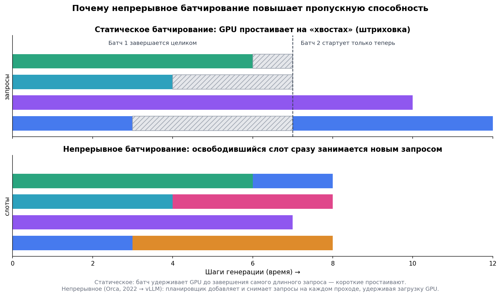

Это удерживает загрузку GPU высокой при разнородных длинах и даёт кратный прирост пропускной способности при высокой конкуренции — одно из ключевых отличий современного сервера от наивного цикла.

## 22.5 Deep Dive: prefill против decode и дизагрегация

Инференс состоит из двух фаз с *разными* вычислительными профилями:
- **Prefill** — обработка входного промпта, параллельная по токенам; *ограничена вычислением* (compute-bound).
- **Decode** — авторегрессивная генерация по одному токену; *ограничена памятью* (memory-bound), так как каждый шаг читает весь KV-кэш.

При совмещении фаз на одном устройстве возникает *интерференция*: добавление нового prefill в активный батч вытесняет идущий decode, задерживая генерацию токенов и вызывая всплески межтокенной задержки (ITL). Два ответа:
- **Chunked prefill** (Sarathi, Agrawal et al., 2023) — дробит длинный prefill на части и совмещает с decode, ограничивая пиковую память; ценой небольшого роста p50 TTFT достигается заметно лучший p95.
- **Дизагрегированный сервинг** (DistServe, Zhong et al., 2024; Splitwise, Patel et al., 2024) — физически разносит prefill и decode на *разные* GPU, устраняя интерференцию и позволяя подобрать оборудование под профиль каждой фазы (compute-bound против memory-bound). Стал распространённым приёмом и поддержан vLLM и SGLang.

```mermaid
flowchart LR
    Req["Запрос"] --> P["Prefill-GPU:<br/>обработка промпта (compute-bound)"]
    P -->|передача KV-кэша| D["Decode-GPU:<br/>авторегрессивная генерация (memory-bound)"]
    D --> Out["Ответ (стриминг)"]
```

## 22.6 Квантизация для инференса

Квантизация *инференса* отличается от QLoRA (§21.4): та вводит адаптеры поверх квантованной базы *для обучения*, здесь же цель — сжать *развёрнутые* веса, чтобы уменьшить память и ускорить чтение (decode ограничен памятью, §22.5). Форматы:
- **AWQ и GPTQ**[^t-awq] — методы 4-битной пост-тренинговой квантизации весов; AWQ учитывает значимость активаций. 4-битная квантизация приводит крупную модель к одному GPU: например, Llama-3-70B с 4×A100 (FP16) — к единственному GPU с AWQ.
- **FP8** — естественный формат для H100/H200 с нативными FP8-тензорными ядрами; сохраняет качество при минимальной калибровке.
- **FP4 (NVFP4/MXFP4)** — микромасштабируемые 4-битные плавающие форматы с нативной аппаратной поддержкой в поколении NVIDIA Blackwell (B100/B200/GB200, 2024–2025); следующий за FP8 шаг по плотности, с тем же условием — подтверждать деградацию оценкой на своих задачах.
- **INT8** — целочисленная квантизация весов.
- **Квантизация KV-кэша** — отдельно от весов; на практике доступна в FP8, что дополнительно снижает главный ресурс сервинга (§22.3).

Размен — память и пропускная способность против точности: чем агрессивнее квантизация, тем больше экономия и тем выше риск деградации, поэтому выбор формата сверяют с оборудованием и допуском по качеству (и подтверждают оценкой, гл. 17).

## 22.7 Спекулятивное декодирование и префиксное кэширование

Два приёма снижают латентность и повторную работу на сервинге.
- **Спекулятивное декодирование** (§1.6, §2.3) — малая *черновая* модель предлагает несколько токенов, крупная *целевая* проверяет их за один проход, принимая совпавшие. Ускоряет генерацию, не меняя распределение выхода; выгоднее всего при *низкой* конкуренции, где важна задержка на запрос, а не суммарная пропускная способность. Безмодельные варианты (Medusa, EAGLE) обходятся без отдельной черновой модели: черновые токены порождают лёгкие дополнительные головы поверх самой целевой модели, что снимает задачу подбора согласованной пары «черновик-цель».

### Deep Dive: почему спекуляция ускоряет и не искажает

Приём эксплуатирует асимметрию из §22.5: decode memory-bound — на каждый токен модель читает *все* веса ради одного шага. Но проверить γ уже готовых токенов можно **одним** форвард-пассом: подать их как вход и получить распределения целевой модели для всех γ позиций сразу — это тот же режим, что prefill, и веса читаются один раз вместо γ. Черновая модель (в разы меньше) генерирует γ токенов быстро; целевая за один проход решает по каждому — принять или отвергнуть; на первом отвергнутом цепочка обрезается, и целевая модель сама выдаёт следующий токен.

Два вопроса определяют всё. **Первый — корректность.** Принятие устроено как rejection sampling (Leviathan et al., 2023): черновой токен `x` принимается с вероятностью `min(1, p(x)/q(x))`, где `q` — распределение черновика, `p` — целевой модели; при отказе токен пересэмплируется из скорректированного остаточного распределения `norm(max(0, p − q))`. Доказуемое свойство схемы: итоговая последовательность распределена *в точности* как при обычном декодировании целевой моделью — ускорение математически бесплатно по качеству, теряется только время на неудачные черновики.

**Второй — величина ускорения.** Пусть `α` — средняя вероятность принятия одного чернового токена (мера согласия пары «черновик-цель» на данном домене). Ожидаемое число токенов за один цикл «γ черновых + одна проверка»:

`E = (1 − α^(γ+1)) / (1 − α)`

Разбор формулы: это сумма геометрической прогрессии `1 + α + α² + … + α^γ` — вероятность, что приняты первые i токенов подряд, есть `α^i`, и каждый такой исход добавляет токен; `+1` в показателе — токен, который целевая модель выдаёт сама даже при полном отказе (поэтому E ≥ 1 всегда: хуже обычного декодирования по числу шагов стать нельзя). При `α = 0.8` и `γ = 4`: E = (1 − 0.8⁵)/(0.2) ≈ 3.4 токена за цикл — грубо втрое меньше проходов целевой модели; реальное ускорение ниже (черновик не бесплатен), типично 2–3×. Отсюда же видно, когда приём *не* работает: при слабом согласии (α ≈ 0.5 на специфическом домене) E ≈ 1.9 и выигрыш съедается накладными расходами, а рост γ при низком α почти ничего не добавляет (прогрессия сходится). Черновик подбирают/дообучают под целевой домен, а γ держат малым (2–5).
- **Префиксное кэширование на сервинге** (SGLang RadixAttention) — KV-состояние общего префикса (системный промпт, разделяемый контекст) переиспользуется между запросами, а не пересчитывается. Это серверный аналог prompt caching (§20.2), опирающийся на несмежное блочное хранение KV (§22.3).

## 22.8 Пропускная способность против латентности и масштабирование

Сервинг настраивается под целевой профиль нагрузки, и ключевой размен — *пропускная способность против латентности*. Больший батч повышает пропускную способность (амортизация загрузки весов), но увеличивает задержку отдельного запроса; спекулятивное декодирование, напротив, снижает задержку ценой пропускной способности. Для моделей, не помещающихся на один GPU, применяется *тензорный параллелизм* (веса слоя разрезаны между GPU) и *конвейерный параллелизм* (слои по разным GPU); для MoE-моделей к ним добавляется *экспертный параллелизм* (expert parallelism): эксперты раскладываются по устройствам, а токены маршрутизируются к своим экспертам через all-to-all-обмен. Для MoE это не экзотика, а базовый режим — большинство топовых открытых весов 2025–2026 (DeepSeek-V3/R1, Qwen3-MoE, Llama 4) именно MoE: память под *суммарные* параметры велика при малых активных вычислениях (§1.5), поэтому профиль шардирования и узкое место (пропускная способность интерконнекта на all-to-all) отличаются от dense-случая.

Порядок величин иллюстративен: на H100 связка непрерывного батчирования, PagedAttention и chunked prefill даёт для Llama-3.3-70B в FP8 порядка нескольких тысяч токенов в секунду при высокой конкуренции — кратно выше наивного цикла на PyTorch. При этом цифры зависят от нагрузки: при сильно варьирующихся длинах ответов больше даёт непрерывное батчирование и меньше — chunked prefill, поэтому конфигурацию сверяют с *реальным* распределением трафика, а не с синтетикой.

## 22.9 Резюме главы

Разворачивание открытой модели оправдано контролем, приватностью, стоимостью на масштабе, отсутствием привязки и кастомизацией — ценой инфраструктуры и сложности (§22.1). Сервинг ведут специализированные серверы (vLLM, SGLang, TensorRT-LLM), кратно превосходящие наивный цикл (§22.2) за счёт двух фундаментов: PagedAttention, управляющего KV-кэшем через несмежные блоки по принципу виртуальной памяти (§22.3), и непрерывного батчирования, удерживающего загрузку GPU при разнородных длинах (§22.4). Две фазы инференса — compute-bound prefill и memory-bound decode — разделяют chunked prefill и дизагрегацией, устраняя интерференцию (§22.5). Квантизация инференса (AWQ/GPTQ/FP8/INT8, а также KV-кэша в FP8) сжимает развёрнутые веса ценой точности (§22.6); спекулятивное декодирование и префиксное кэширование снижают латентность и повторную работу (§22.7). Настройка — размен пропускной способности и латентности, с тензорным, конвейерным и — для MoE — экспертным параллелизмом для крупных моделей (§22.8). Далее — глава 23: предобучение, когда недостаточно и дообучения.

*Источники.* W. Kwon et al., «Efficient Memory Management for LLM Serving with PagedAttention» (vLLM, SOSP 2023); G.-I. Yu et al., «Orca» (2022) — непрерывное батчирование; A. Agrawal et al., «Sarathi» (2023) — chunked prefill; P. Zhong et al., «DistServe» (2024) и P. Patel et al., «Splitwise» (2024) — дизагрегация prefill/decode; L. Zheng et al., «SGLang / RadixAttention» (2024); Y. Leviathan et al., «Fast Inference from Transformers via Speculative Decoding» (2023) — rejection sampling и формула ускорения (§22.7); документация vLLM (квантизация AWQ/GPTQ/FP8/INT8, тензорный параллелизм, бенчмарки на H100, 2025); §1.6 (KV-кэш, спекулятивное декодирование) и §2 настоящей книги.

**На полях главы 22**

[^t-awq]: **GPTQ** (Frantar et al., 2022) — послойная квантизация с минимизацией ошибки реконструкции через приближение Гессиана; **AWQ** — Activation-aware Weight Quantization (Lin et al., 2023) — защищает от огрубления малую долю весов, критичных по статистике активаций.

# Глава 23. Предобучение

Глава 21 адаптировала модель, глава 22 её разворачивала; настоящая глава — вершина лестницы Части VII: обучение модели *с нуля*. Для подавляющего большинства организаций это неверный выбор, и глава объясняет, что предобучение влечёт и какие законы им управляют, — чтобы архитектор мог обоснованно рассуждать о решении, даже принимая его крайне редко.

## 23.1 Что такое предобучение и когда оно оправдано

**Предобучение (pretraining)** обучает модель с нуля на огромном корпусе в режиме самоконтроля (self-supervised): модель предсказывает следующий токен (§1.2), и из этой единственной задачи возникают знания и способности. Это верхняя ступень лестницы «промптинг → RAG → дообучение → предобучение» — максимальный контроль ценой максимальных издержек.

Предобучение оправдано лишь в узких случаях: принципиально новая архитектура или модальность, не покрытая существующими моделями; язык или домен, действительно не представленный в открытых моделях; суверенные или регуляторные требования, исключающие любые внешние веса. Практически всегда для прикладных задач достаточно предыдущих ступеней: дообучение (гл. 21) меняет поведение дешевле, а RAG (Часть III) добавляет знание без обучения. Причины, по которым предобучение почти никогда не оправдано для типичной организации, — стоимость (порядки величин выше дообучения), объём и качество требуемых данных (§23.6) и специализированная экспертиза. Честный вывод: если нет одной из перечисленных узких причин, предобучать не следует.

## 23.2 Конвейер предобучения

Предобучение — конвейер из нескольких стадий:
- **Сбор данных** — корпус масштаба триллионов токенов из веба, книг, кода и специализированных источников.
- **Очистка и дедупликация** — фильтрация мусора, удаление дубликатов и близких повторов, отсев вредоносного и низкокачественного; качество и чистота данных определяют качество модели сильнее их объёма (§23.6).
- **Токенизация** (§1.3) — обучение токенизатора (BPE и родственные) и кодирование корпуса в последовательности токенов.
- **Обучение** — оптимизация предсказания следующего токена на корпусе; здесь действуют законы масштабирования (§23.3) и бюджет вычислений (§23.4).
- **Пост-обучение** — SFT и выравнивание предпочтений (гл. 21), превращающие «сырую» предобученную модель в следующую инструкциям; предобучение даёт лишь базу.

## 23.3 Deep Dive: законы масштабирования

Как распределить фиксированный бюджет вычислений между *размером модели* и *числом токенов* — центральный вопрос предобучения, на который отвечают законы масштабирования.

Ранние законы (Kaplan et al., 2020) описали степенную зависимость качества от масштаба, но склоняли к вложению большей части бюджета в *размер* модели. Их пересмотрел **Chinchilla** (Hoffmann et al., 2022): на более чем 400 обученных моделях (от 70M до 16B параметров при контролируемых бюджетах) показано, что для *compute-optimal* обучения размер модели N и число токенов D должны расти *в равной мере* — каждый как ~C^0.5 (удвоение бюджета C даёт ×√2 каждому; чтобы удвоить оба, нужен вчетверо больший бюджет, ведь C = 6ND). Отсюда эмпирическое правило **≈20 токенов на параметр**. Модель Chinchilla (70B, обученная на 1.4T токенов) превзошла Gopher (280B) при том же бюджете, но с вчетверо меньшим числом параметров и почти впятеро большим числом токенов, — прямое доказательство, что предшествующие модели были *недообучены* (GPT-3 при ~1.7 токена на параметр).

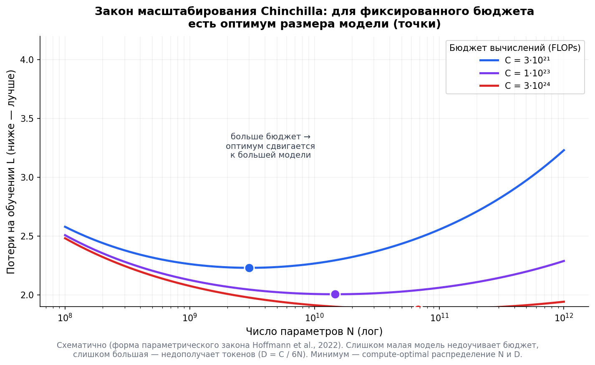

Оптимум находят тремя дополняющими методами: варьируя число токенов при фиксированном размере; варьируя размер при фиксированном бюджете (IsoFLOP); и подгоняя параметрическую поверхность потерь L(N, D) с последующим выводом оптимального распределения. Как показывает график, при фиксированном бюджете слишком малая модель недоучивает его, слишком большая — недополучает токенов, а минимум задаёт compute-optimal распределение.

## 23.4 Deep Dive: бюджет вычислений C ≈ 6ND

Вычислительная стоимость предобучения оценивается простым и практически важным соотношением: **C ≈ 6ND**, где C — вычисления в FLOPs, N — число параметров, D — число токенов (обучающих). Разберём множитель 6 по слагаемым — он не эмпирический, а выводится из устройства форвард-пасса (§1.4, Прил. A).

**Откуда 2 FLOPs.** Прямой проход — это матричные умножения, и в них каждый параметр (элемент весовой матрицы) участвует в обработке каждого токена ровно один раз: одно умножение (вес × входное число) и одно сложение (прибавить произведение к накапливаемой сумме). Умножение + сложение = 2 операции на пару «параметр × токен», итого **2ND** на весь прямой проход по всем данным.

**Откуда ×3.** Обратный проход стоит примерно *два* прямых, потому что градиент считается дважды: по *активациям* (чтобы протолкнуть ошибку дальше вглубь сети — без этого не обучить предыдущие слои) и по самим *весам* (чтобы их обновить). Каждая из двух операций — те же матричные умножения тех же размеров, что и форвард. Итого: 2ND × (1 форвард + 2 эквивалента форварда на бэквард) = **6ND**. Соотношение делает бюджет осязаемым: обучение модели уровня десятков миллиардов параметров на триллионах токенов требует порядка 10²³–10²⁴ FLOPs — от сотен тысяч до миллионов GPU-часов на дорогом кластере (для масштаба, по карточкам моделей Meta: Llama 2 70B — около 1.7 млн GPU-часов A100; Llama 3 405B — около 31 млн GPU-часов H100; в деньгах при рыночных ценах аренды — от единиц до десятков миллионов долларов за прогон, а для крупнейших моделей при списочных ценах — заметно больше), что и объясняет, почему предобучение недоступно как рутинная операция. Из C ≈ 6ND и правила 20 токенов на параметр следует и оценка данных: модель на 70B параметров требует около 1.4T токенов, модель на 175B — около 3.5T (порядка нескольких терабайт текста).

## 23.5 Deep Dive: compute-optimal против inference-optimal

Существенная и часто упускаемая тонкость: Chinchilla-оптимум минимизирует стоимость *обучения*, но не *эксплуатации*. Модель обучают однажды, а инференс выполняют многократно; поэтому для широко разворачиваемой модели выгоднее обучить *меньшую* модель на *большем* числе токенов, чем предписывает правило 20:1, — переобучение (over-training)[^t-overtrain] повышает стоимость обучения, но снижает стоимость инференса на протяжении всего срока службы.

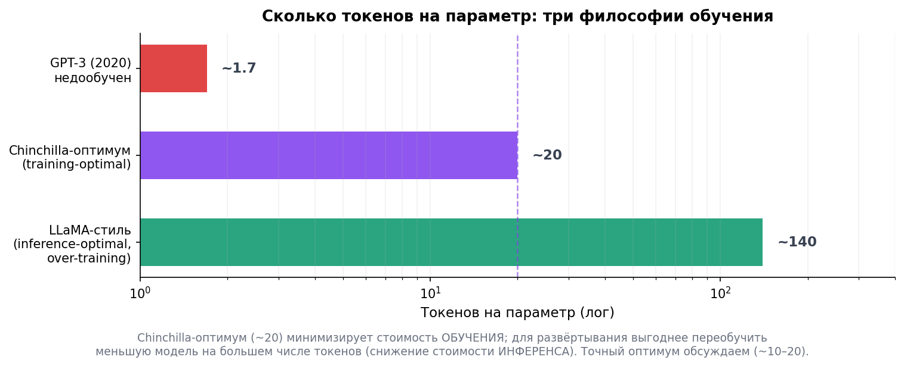

Именно так обучают модели, рассчитанные на массовое развёртывание (например, LLaMA-семейство обучалось значительно за пределами Chinchilla-оптимума). Так возникают три философии: недообучение (GPT-3, ~1.7 токена на параметр), training-optimal (Chinchilla, ~20) и inference-optimal переобучение (~100 и более). Оговорки существенны: точное значение оптимального отношения обсуждаемо (ряд последующих работ находит ~10–12), а сам закон Chinchilla выведен для decoder-only трансформера с предсказанием следующего токена — для mixture-of-experts, encoder-decoder или иных целей оценка 6ND и показатели могут не переноситься напрямую.

### Deep Dive: третья ось — вычисления во время вывода

Классические законы масштабирования делят *обучающий* бюджет между N и D. С появлением reasoning-моделей (o1, 2024; DeepSeek-R1, 2025) у масштабирования появилась третья ось — **вычисления во время вывода (test-time compute)**: на задачах рассуждения качество растёт с объёмом вычислений, потраченных на сам ответ (длина цепочки рассуждения, число сэмплов), и этот рост покупается без переобучения (§13.8). Для распределения бюджета это меняет расчёт: часть качества, которую раньше давало только увеличение N или D, теперь достижима пост-обучением (RLVR) плюс расходом на инференсе — и наоборот, для массового дешёвого инференса может быть выгоднее большая базовая модель без длинного рассуждения. Полный расчёт становится трёхмерным — предобучение × пост-обучение × инференс-бюджет; устоявшегося аналога Chinchilla для этого пространства пока нет, а практический вывод для архитектора один: считать стоимость на *задачу* (включая reasoning-токены, §2.2), а не на модель.

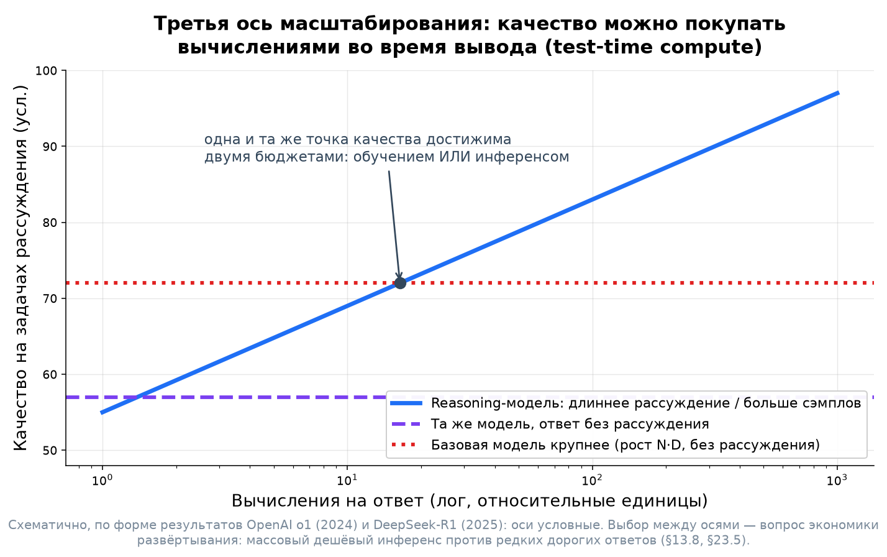

## 23.6 Данные и инфраструктура

Два практических ограничения определяют осуществимость предобучения.
- **Данные.** Требуются триллионы токенов, но их *качество* и *чистота* важнее объёма: дедупликация, фильтрация низкокачественного и вредоносного контента и отбор источников влияют на результат сильнее, чем сырой размер корпуса (§23.2). На верхних масштабах возникает опасение «стены данных» — исчерпания доступного качественного текста (количественная рамка — data-constrained scaling laws, Muennighoff et al., 2023: повторные эпохи качественных данных работают, но с быстро убывающей отдачей).
- **Инфраструктура.** Обучение не помещается ни на один узел и требует распределённого обучения на кластере из тысяч ускорителей: *data parallelism* (реплики модели на разных данных), *tensor parallelism* (веса слоя разрезаны между устройствами) и *pipeline parallelism* (слои по разным устройствам) — те же формы параллелизма, что и на сервинге (§22.8), но на масштабе обучения. Инструментальные имена, за которыми это ищут: FSDP (PyTorch), DeepSpeed ZeRO (стадии 1–3 шардирования состояния оптимизатора, градиентов и весов), Megatron-LM (тензорный/конвейерный) и их комбинация — «3D-параллелизм». Отсюда стоимость и экспертиза, ставящие предобучение вне досягаемости для большинства.

## 23.7 Резюме главы и Части VII

Предобучение обучает модель с нуля предсказанием следующего токена и стоит на вершине лестницы; для типичной организации оно почти никогда не оправдано — достаточно RAG и дообучения (§23.1). Конвейер включает сбор, очистку и дедупликацию данных, токенизацию, обучение и пост-обучение (§23.2). Распределение бюджета между размером и данными задают законы масштабирования: Chinchilla установил равное масштабирование N и D и правило ~20 токенов на параметр, показав недообученность прежних моделей (§23.3); стоимость оценивается как C ≈ 6ND (§23.4). При этом Chinchilla-оптимум минимизирует обучение, а не инференс, поэтому широко разворачиваемые модели переобучают меньшего размера на большем числе токенов (§23.5). Осуществимость упирается в качество данных и инфраструктуру распределённого обучения (§23.6).

**Итог Части VII.** Собственная модель — это спектр возрастающего контроля и издержек: адаптировать готовую (гл. 21), развернуть открытую (гл. 22) или обучить с нуля (гл. 23). Решающий принцип всей части — не подниматься по этой лестнице раньше, чем предыдущая ступень доказанно не справляется, потому что каждая ступень кратно дороже предыдущей. Далее — **Часть VIII: синтез**, где все части собираются в референсную архитектуру, организационную рамку внедрения и разбор сквозного примера с пакетом архитектурных решений.

*Источники.* J. Kaplan et al., «Scaling Laws for Neural Language Models» (2020); J. Hoffmann et al., «Training Compute-Optimal Large Language Models» (Chinchilla, NeurIPS 2022) — правило ~20 токенов на параметр, C ≈ 6ND, равное масштабирование N и D; H. Touvron et al., «LLaMA» (2023) — inference-optimal переобучение; обсуждение точного отношения и согласования Kaplan/Chinchilla (2024); материалы о курировании данных предобучения и распределённом обучении; §1.2–1.3 и §22 настоящей книги.

**На полях главы 23**

[^t-overtrain]: ≠ Ложный друг: здесь **over-training** — намеренный inference-optimal режим (меньшая модель на большем числе токенов, чем предписывает compute-оптимум), а не классический overfitting — деградация от заучивания обучающей выборки. Улучшает экономику эксплуатации, ничего не «портя».

# Часть VIII. Синтез

Части I–VII построили компоненты; Часть VIII собирает их в целое. Глава 24 сводит весь материал в единую референсную архитектуру production-системы AI-агента, глава 25 добавляет организационную обвязку внедрения — владение, приватность, регуляторику, экономику и процесс, — а глава 26 проводит сквозной пример от требований до пакета архитектурных решений. Сдвиг Части VIII — от «как устроена каждая часть» к «как всё складывается в одну работающую, наблюдаемую, безопасную и экономичную систему».

# Глава 24. Референсная архитектура

Настоящая глава — карта всей книги: как компоненты Частей I–VII складываются в одну эталонную архитектуру. Это не новый фреймворк, а систематизация — какие слои образуют production-систему AI-агента, как они взаимодействуют, где проходят границы и какие инварианты держатся сквозь всю систему. Отраслевая практика сошлась на близком слоистом делении, и излагаемая архитектура согласуется с ним.

## 24.1 Слои эталонной архитектуры

Production-система AI-агента раскладывается на слои с раздельной ответственностью:
- **Интерфейс и шлюз** — точка входа; шлюз централизует роутинг моделей, кэширование, ограничение частоты и учёт стоимости (§20.6).
- **Оркестрация** — центр управления: управляющий цикл или workflow (гл. 10–11), планирование и рассуждение (гл. 13), сборка контекста (гл. 4). Здесь принимаются решения, вызываются остальные слои и держится дисциплина надёжности (гл. 14).
- **Модель и инференс** — сама LLM, вызываемая через API или самостоятельный сервинг (гл. 1, 22).
- **Знание (RAG)** — заземление на данные: эмбеддинги, ретрив, реранжирование, векторное хранилище (Часть III).
- **Память** — состояние между шагами и сессиями: кратко- и долгосрочная, с персистентным хранилищем (§4, §13).
- **Инструменты и интеграция** — действия во внешнем мире: tool calling (гл. 12) и MCP-серверы (гл. 15).

Поверх этих слоёв действуют три **сквозные заботы**, не являющиеся слоями, но пронизывающие все: наблюдаемость и оценка (гл. 17–18), безопасность (гл. 19) и стоимость и латентность (гл. 20). Организующий принцип, подтверждённый отраслевой практикой: **оркестрация управляет всем, а модель — ограничиваемый компонент**. В частности, модель никогда не обращается напрямую к векторному хранилищу или инструментам — ретрив и вызовы опосредованы оркестрацией, что превращает их из импровизации модели в предсказуемый управляемый механизм (это же — основа безопасности, §19.6, и разграничения MCP, §15.2).

## 24.2 Полная компонентная схема

Слои и их связи в целом:

```mermaid
flowchart TB
    User["Клиент / интерфейс"] --> GW["Шлюз (§20):<br/>роутинг · кэш · rate limit · учёт стоимости"]
    GW --> ORCH

    subgraph ORCH["Оркестрация — центр управления (Части II, IV)"]
        Loop["Управляющий цикл / workflow (§10–11) · планирование (§13)"]
        Ctx["Инженерия контекста: сборка окна (§4)"]
    end

    ORCH <--> MODEL["Модель / инференс (§1, §22):<br/>API или самостоятельный сервинг"]
    Ctx --> KNOW["Знание — RAG (Часть III):<br/>эмбеддинги · rerank · векторное хранилище"]
    Ctx --> MEM["Память (§4, §13):<br/>кратко-/долгосрочная · хранилище"]
    ORCH --> TOOLS["Инструменты (§12) · MCP-серверы (§15, недоверенные)"]

    OBS["Наблюдаемость + оценка (§17–18)"] -.охватывает все слои.- ORCH
  SEC["Безопасность (§19):<br/>обособление · authz · human-gate"] -.охватывает все слои.- ORCH
```

Схема читается от точки входа вниз: запрос проходит шлюз, попадает в оркестрацию как в центр управления, которая обращается к модели, собирает контекст из знания и памяти и вызывает инструменты; наблюдаемость и безопасность охватывают все слои. Ключевое — топология: оркестрация в центре, остальные слои подчинены ей, а хранилища (векторное и памяти) и внешние инструменты (MCP) находятся за границей и недоступны модели напрямую.

## 24.3 Deep Dive: поток запроса сквозь архитектуру

Один запрос от входа до ответа связывает слои в динамику:

```mermaid
flowchart TB
    A["1. Запрос → шлюз: роутинг, проверка кэша"] --> B["2. Оркестратор: план, критерии завершения"]
    B --> C["3. Сборка контекста: ретрив (RAG) + релевантная память,<br/>обособление недоверенного"]
    C --> D["4. Вызов модели"]
    D --> E{"5. Ответ или вызов инструмента?"}
    E -->|инструмент| F["6. Валидация · authz · human-gate для необратимого"]
    F --> G["7. Исполнение (инструмент / MCP), результат в контекст"]
    G --> D
    E -->|ответ| H["8. Ответ пользователю + запись в память"]
    H --> I["Всё протоколируется и оценивается (§17–18)"]
```

- Запрос проходит шлюз: роутинг на подходящую модель (§20.3) и проверка кэша (§20.2).
- Оркестратор определяет план и критерии завершения (§10.5, §13.4).
- Собирается контекст: ретрив релевантных документов (Часть III) и релевантной памяти (§4.5), с обособлением недоверенного контента (§4.6, §19.6).
- Модель вызывается и решает: ответить или вызвать инструмент (§12.2).
- При вызове инструмента — валидация аргументов (§12.4), авторизация с правами пользователя (§12.5) и, для необратимых действий, подтверждение человеком (§10.6); затем исполнение (инструмент или MCP, §15) и возврат результата в контекст — цикл повторяется.
- При готовности — ответ пользователю и запись в память.
- Весь путь протоколируется трассами и оценивается (гл. 17–18), замыкая контур улучшения (§17.8).

## 24.4 Deep Dive: границы и инварианты

Надёжность и безопасность архитектуры держатся на нескольких инвариантах, справедливых во всех слоях:
- **Модель не имеет прямого доступа к хранилищам и инструментам.** Ретрив и вызовы опосредованы оркестрацией; это делает поведение предсказуемым и лишает инъекцию прямого пути к данным и действиям (§19.6, §24.1).
- **Недоверенный контент обособлен.** Внешние данные (документы, результаты инструментов, MCP) подаются в чётко отделённой области контекста и не смешиваются с инструкциями (§4.6, §19.1); для высокорисковых систем — карантинный контур (dual-LLM, §19.6).
- **Необратимое проходит через человека.** Действия с последствиями требуют подтверждения; компенсации — только для обратимого (§10.6).
- **Граница доверия — на оркестрации.** Оркестрация доверенная; модель — манипулируемый компонент; серверы и внешние источники — недоверенные (§15.2). Авторизация и обособление обеспечиваются детерминированными компонентами, а не доверием к модели.
- **Каждый шаг ограничен бюджетом.** Лимиты на итерации и токены на шаг и на задачу (§10.5) держат стоимость и предотвращают неограниченное потребление (§19.3, §20.6).

Эти инварианты — не свойства какого-то одного слоя, а сквозные правила; их нарушение в любом месте подрывает всю систему.

### Deep Dive: физическая топология и масштабирование

Логическая схема §24.2 разворачивается в физическую по обычным правилам распределённых систем — с одним решающим выбором: **оркестрация проектируется stateless**, а всё состояние сессии (история, план, память) живёт во внешнем хранилище (externalized state, §4.4). Тогда реплики оркестрации горизонтально масштабируются за балансировщиком без sticky-sessions, рестарт пода не теряет диалог, а пауза на human-gate (§10.6) — часами живущее состояние — переживает деплой, потому что лежит в БД, а не в памяти процесса. Долгоживущие агентные задачи оформляются асинхронно: очередь задач + воркеры, а не HTTP-запрос, держащий соединение минуты. Мультиагентность (гл. 14) не меняет внешней топологии: supervisor и воркер-агенты — логические роли внутри слоя оркестрации, исполняемые теми же репликами. Отдельным контуром масштабируется GPU-пул self-host инференса (гл. 22) — у него свои единицы масштабирования (реплики модели) и своя экономика утилизации (§2.6).

## 24.5 Сквозные заботы

Три заботы пронизывают все слои и проектируются с самого начала, а не добавляются постфактум.
- **Наблюдаемость и оценка** (гл. 17–18) охватывают каждый слой: трассы фиксируют путь запроса через все компоненты, метрики агрегируют стоимость и латентность, а оценка судит качество на тех же трассах. Без этого систему нельзя ни отладить, ни улучшать.
- **Безопасность** (гл. 19) закладывается в архитектуру с первого дня: обособление, наименьшие привилегии, human-gate и карантин — архитектурные решения, а не пост-фактум фильтры.
- **Стоимость и латентность** (гл. 20) управляются на уровне шлюза и оркестрации: роутинг, кэширование, бюджеты и атрибуция.

Их общая черта — они не локализуются в одном слое, поэтому и рассматриваются как сквозные измерения всей архитектуры.

## 24.6 Решения по слоям: сводная карта

Каждый слой требует явных архитектурных решений; сводная карта связывает их с главами:

| Слой / сквозная забота | Ключевое решение | Где в книге |
|---|---|---|
| Шлюз | Роутинг, кэш, бюджеты | §20 |
| Оркестрация | Workflow против агента; уровень автономии | §10.7, §11.8 |
| Контекст | Стратегия сборки и обособления окна | §4 |
| Модель | Уровень модели; API против self-host | §2, гл. 22 |
| Знание | Паттерн ретрива; индекс; реранжирование | Часть III |
| Память | Кратко-/долгосрочная; стратегия забывания | §4.5, §13.1 |
| Инструменты | Набор и контракты; MCP | §12.3, гл. 15 |
| Реализация | Фреймворк (Spring AI / LangChain4j) | гл. 16 |
| Оценка | Оффлайн-гейт + онлайн-мониторинг | гл. 17 |
| Наблюдаемость | Трассы, метрики, атрибуция | гл. 18 |
| Безопасность | Обособление, привилегии, human-gate | гл. 19 |
| Собственная модель | Дообучение / сервинг / предобучение | Часть VII |

Карта — не предписание конкретных значений, а перечень *решений*, которые архитектор принимает осознанно; конкретный выбор в каждой строке определяется требованиями (гл. 2, гл. 25–26).

## 24.7 Резюме главы

Production-система AI-агента раскладывается на слои: шлюз, оркестрация (центр управления), модель, знание (RAG), память, инструменты — со сквозными заботами наблюдаемости/оценки, безопасности и стоимости/латентности (§24.1). Полная схема (§24.2) показывает оркестрацию в центре, а хранилища и внешние инструменты — за границей, недоступной модели напрямую; поток запроса (§24.3) связывает слои в динамику от шлюза до ответа с контуром оценки. Архитектуру держат инварианты: модель не касается хранилищ и инструментов напрямую, недоверенное обособлено, необратимое проходит через человека, граница доверия — на оркестрации, каждый шаг ограничен бюджетом (§24.4). Сквозные заботы проектируются с первого дня (§24.5), а сводная карта связывает решения каждого слоя с материалом книги (§24.6). Далее — глава 25: организационная обвязка внедрения этой архитектуры; сквозной пример, проводящий её через конкретные требования к пакету решений, — глава 26.

*Источники.* Отраслевые референсные архитектуры агентных систем и «агентного стека» (2025–2026) — слоистое деление, принцип «оркестрация управляет ретривом, модель не имеет прямого доступа к хранилищу», наблюдаемость как сквозная забота, безопасность с первого дня; C. Richardson, «Microservices Patterns» (2018) — принципы слоёв и границ; настоящая книга (Части I–VII) как источник содержания слоёв.

# Глава 25. Внедрение в организации

Глава 24 собрала техническую архитектуру. Но платформа, обещанная подзаголовком книги — *автоматизация организации*, — упирается не только в технику: кто владеет промптами, кто платит за токены, кто отвечает перед регулятором и почему сотрудники начнут (или откажутся) этим пользоваться. Эта глава — организационная обвязка платформы: жизненный цикл AI-артефактов, точка применения политик, контур персональных данных, регуляторная готовность, экономическое обоснование и процесс внедрения. Это обзор с мостами к техническим главам, а не юридическая или управленческая консультация.

## 25.1 Почему архитектуры недостаточно

Вероятностный компонент ломает привычные организационные контракты. Качество — распределение, а не булево свойство: «работает/не работает» заменяется долей приемлемых ответов с порогом (гл. 17), и это меняет форму SLA, определение инцидента («систематически плохие ответы» — инцидент без стектрейса) и процесс разбора. Появляются артефакты, которых не было: промпты, схемы, золотые наборы, индексы, версии судей — без явно выстроенного жизненного цикла они живут в чатах и ноутбуках и деградируют молча. Наконец, действия агента (гл. 10) поднимают вопрос ответственности, который у детерминированного кода закрыт тестированием, а здесь требует уровней автономии и аудита (§10.6–10.7). Три вопроса, на которые внедрение должно ответить помимо архитектуры: **кто владеет, кто платит, кто отвечает**.

## 25.2 Владение и жизненный цикл AI-артефактов

Промпт, схема вывода, золотой набор и конфигурация ретрива — версионируемые артефакты с релизным циклом (§3.6): ревью, оффлайн-гейт по золотому набору (§17.8), канареечная выкатка, откат. Организационно это оформляется двумя реестрами.

> ### Паттерн: Prompt Registry (Реестр промптов)
>
> **Контекст.** Промпты правят все понемногу: продакт — формулировки, инженер — формат, безопасность — ограничения. Изменение в одном месте незаметно меняет поведение в другом; «какой промпт сейчас в проде и почему» никто не отвечает.
> **Проблема.** Как дать промптам жизненный цикл кода — версии, ревью, откат, атрибуцию регрессий — не превращая каждую правку в деплой приложения?
> **Силы.** Промпту нужны скорость итерации текста и дисциплина кода одновременно; правка дёшева в внесении и дорога в обнаружении — регрессия всплывает в качестве ответов, а не в компиляции.
> **Решение.** Центральный реестр: промпт хранится и версионируется отдельно от кода, у каждого — владелец, привязанный золотой набор и журнал изменений; приложение получает промпт по версии/алиасу.
> **Механика.** Изменение промпта — pull request с прогоном евалов как CI-гейтом (§17.8); выкатка — канарейкой на доле трафика с онлайн-метриками (§17.6); каждая запись телеметрии помечена версией промпта (§18.5), поэтому регрессия атрибутируется к конкретному изменению; откат — переключение версии, без пересборки.
> **Результирующий контекст.** Воспроизводимость и управляемая эволюция; промпт-инжиниринг перестаёт быть фольклором. Плата — инфраструктура и дисциплина; риск бюрократизации мелких правок (митигируется автоматизацией гейта).
> **Когда применять.** Больше одного промпта в проде или больше одного человека, меняющего их. **Когда нет.** Прототип одной команды — достаточно промптов в git рядом с кодом (§3.6).
> **Связанные паттерны.** Промпт как код (§3.6); eval-гейт (§17.8); наблюдаемость с версионными атрибутами (§18.5).
> **Источники.** Практики LLMOps по версионированию и выкатке промптов (2024–2026); §3.6 и §17.8 настоящей книги.

Второй реестр — **реестр AI-систем организации**: какие системы существуют, на каких моделях и провайдерах работают, какой класс риска несут и кто владелец (для агентов — включая их машинные учётки, NHI, §15.7). Он выглядит бюрократией ровно до первого вопроса регулятора, инцидента безопасности или смены прайса провайдера — и он же становится входом для риск-классификации (§25.5).

**Shadow AI.** Реестр описывает то, что организация о себе *знает*. **Shadow AI** — несанкционированное использование LLM вне реестра: личный API-ключ в скрипте, браузерное расширение с доступом к рабочей почте, «серая» автоматизация на no-code-платформе, сотрудник, вставляющий клиентские данные в публичный чат-бот. Это прямой наследник shadow IT, обострённый двумя свойствами LLM: порог входа ничтожен (ключ и пять строк кода), а канал утечки встроен в саму функцию — данные *по определению* уходят внешнему провайдеру. Векторы обнаружения инженерны: анализ исходящего трафика к доменам провайдеров, финансовый след (API-подписки в авансовых отчётах), периодическая амнистия («легализуй скрипт — получишь бюджет и поддержку»). Но главный рычаг — не запрет, а экономика: санкционированный путь через шлюз (§25.3) с самообслуживанием и быстрым онбордингом должен быть *дешевле и удобнее* несанкционированного, иначе теневой контур воспроизводится бесконечно.

## 25.3 Паттерн: AI Gateway как точка governance

> ### Паттерн: AI Gateway (шлюз к моделям)
>
> **Контекст.** Команды интегрируются с провайдерами напрямую: ключи расползаются по секретам команд, расходы не атрибутируются, политики приватности применяются по желанию, смена провайдера — правки в каждом сервисе.
> **Проблема.** Как применить организационные политики — доступ, бюджеты, приватность, аудит, выбор моделей — ко *всем* LLM-вызовам, не встраивая их в каждое приложение?
> **Силы.** Централизация даёт контроль, обзор и переносимость, но ставит компонент на путь каждого вызова; прямые интеграции быстры для отдельной команды, но размывают политику, расходы и аудит по всей организации.
> **Решение.** Единая точка выхода к моделям: все вызовы идут через шлюз, который аутентифицирует вызывающего, применяет политики и маршрутизирует к провайдерам.
> **Механика.** Аутентификация и атрибуция стоимости по команде/фиче/пользователю (§20.6); квоты и бюджеты с деградацией вместо обрыва (§10.5, §20.6); маскирование PII до отправки провайдеру (§25.4); маршрутизация только по одобренным направлениям (DPA[^t-dpa], резидентность — §2.6); аудит-лог запросов; централизованные тайм-ауты, ретраи и фолбэк-модели (§2.5); подмена модели без правок в приложениях (§20.3). Шлюз — естественная точка сбора телеметрии (гл. 18).
> ```mermaid
> flowchart LR
>   T1["Продукт A"] --> GW
>   T2["Продукт B"] --> GW
>   Ag["Агент C"] --> GW
>   subgraph GW["AI Gateway"]
>     Pol["аутентификация · квоты · PII-маскирование<br/>аудит · роутинг и фолбэк · атрибуция стоимости"]
>   end
>   GW --> P1["Провайдер 1 (DPA)"]
>   GW --> P2["Провайдер 2"]
>   GW --> SH["Self-host (vLLM)"]
>   GW -.-> Tel[("Телеметрия, гл. 18")]
> ```
>
> **Результирующий контекст.** Политика в одном месте; переносимость между вендорами (§16.5, §20.6); полная картина расходов. Плата: компонент на пути каждого вызова — требования к доступности и латентности как к критической инфраструктуре; риск превращения команды платформы в бутылочное горлышко процессов.
> **Когда применять.** Больше одной команды или системы; любые регуляторные требования. **Когда нет.** Один продукт одной команды — достаточно библиотеки с теми же заботами.
> **Связанные паттерны.** Model Routing / Fallback (§2.2, §2.5, §20.3); бюджеты и атрибуция (§20.6); PII-контур (§25.4); наблюдаемость (гл. 18).
> **Источники.** Chip Huyen, «AI Engineering» (2025) — платформенный слой и шлюзы; практики LLM-шлюзов (2024–2026); §20.6 настоящей книги.

## 25.4 Данные и приватность: PII-контур

Персональные данные оседают во всех слоях системы, и контур строится по местам оседания:

- **Вход в индекс (ingestion).** Обнаружение и маскирование/псевдонимизация PII *до* эмбеддинга и индексации; гриф и владелец — в метаданных фрагмента (§8.7). То, что не попало в индекс, не утечёт через ретрив.
- **Телеметрия.** Захват промптов/ответов проходит редактирующие процессоры (§18.6); полнота отладки и приватность — управляемый компромисс.
- **Провайдер.** Маршрут через шлюз (§25.3) гарантирует DPA-совместимые направления: что провайдер хранит, обучается ли на данных, где резидентность (§2.6, ADR-8 в §26.4).
- **Право на удаление (right to be forgotten).** Самое неудобное требование: данные субъекта нужно удалить из векторного индекса (в HNSW — tombstone плюс периодическая перестройка, §8.3), из кэшей (включая semantic cache, §20.2), из памяти агента (§4.5) и из датасетов дообучения (§21.8). Перечень мест оседания — прямое следствие реестра систем (§25.2); без него «удалить всё» невыполнимо.

```mermaid
flowchart LR
  Src["Документы · диалоги"] --> Mask["Обнаружение и маскирование PII<br/>(ingestion / шлюз §25.3)"]
  Mask --> Idx[("Векторный индекс<br/>+ метаданные §8.7")]
  Mask --> Prov["Провайдер (DPA)"]
  Prov --> Cache[("Кэши: prefix · semantic<br/>§20.2")]
  Loop["Цикл агента"] --> Mem[("Память агента §4.5")]
  Trace["Телеметрия §18.6<br/>(редактирующие процессоры)"]
  FT[("Датасеты дообучения §21.8")]
  RTBF["Право на удаление"] -.->|"tombstone + перестройка §8.3"| Idx
  RTBF -.-> Cache
  RTBF -.-> Mem
  RTBF -.-> Trace
  RTBF -.-> FT
```

**Как устроено само обнаружение PII.** «Обнаружение и маскирование» выше — не одна операция, а лестница из трёх техник по возрастанию охвата и цены:

1. **Детерминированные распознаватели** — регулярные выражения, словари, контрольные суммы (номер карты валидируется алгоритмом Луна, ИНН — своей контрольной цифрой). Высокая точность на *форматных* данных, нулевая — на свободном тексте: «жена Ивана из третьего подъезда» не совпадёт ни с одним шаблоном.
2. **NER-модели** (named entity recognition — распознавание именованных сущностей, классическая NLP-задача) — обученный распознаватель находит имена, адреса, организации в свободном тексте. Требует языковой поддержки: для русского нужны русскоязычные модели, англоязычный дефолт молча пропускает кириллические сущности. Открытый ориентир — **Microsoft Presidio**: комбинирует оба класса распознавателей и расширяется кастомными (внутренние идентификаторы, номера договоров).
3. **LLM-классификатор** — единственный, кто понимает *контекстную* PII («клиент, о котором говорили вчера» — тоже раскрытие), и самый дорогой. Рекурсивная ловушка: текст отправляется в LLM, чтобы найти в нём PII, — значит, этот вызов сам обязан идти на локальную или DPA-покрытую модель, иначе контур защиты и есть утечка.

Режимы отказа несимметричны, и это определяет калибровку: **false negative** — PII ушло немаскированным (комплаенс-инцидент с регуляторными последствиями); **false positive** — замаскировано лишнее (деградация качества: «свяжитесь с [PERSON] по [PHONE]» бесполезно как ответ). Поэтому целевая метрика контура — recall (гл. 9 — та же логика, что в ретриве) на исходящих из периметра направлениях, ценой precision; внутри периметра баланс мягче. И различайте операции: **маскирование** (необратимая заглушка), **псевдонимизация** (обратима по таблице соответствия — которая сама становится критичным секретом) и форматосохраняющая **токенизация** (значение заменено, формат и связи сохранены — индекс и аналитика продолжают работать).

## 25.5 Регуляторный ландшафт

Обзор рамок; детали и сроки сверяйте с актуальным состоянием — регуляторика движется быстрее книг.

- **EU AI Act** (Regulation (EU) 2024/1689) — риск-ориентированная классификация систем: недопустимый риск (запрещены), высокий (жёсткие обязанности: управление рисками, качество данных, логирование, человеческий надзор, документация), ограниченный (прозрачность), минимальный. Обязанности различаются по ролям: **provider** и **deployer**[^t-provider-deployer]; отдельный режим — для моделей общего назначения (GPAI[^t-gpai]). Сроки вступления поэтапные и пересматривались: на момент письма (середина 2026) перенос обязательств для высокорисковых систем на 2027–2028 одобрен Парламентом и Советом ЕС и ожидает публикации — график проверяйте на дату чтения.
- **Режимы персональных данных** — GDPR, 152-ФЗ и аналоги: правовое основание обработки, трансграничная передача (вызов hosted-API из другой юрисдикции — это передача, §2.6), права субъекта (→ §25.4).
- **Отраслевые надстройки** — финансы, медицина, госсектор добавляют собственные требования к объяснимости, локализации и аудиту.
- **Стандарты как каркас зрелости** — NIST AI RMF[^t-nist-rmf] (2023) и ISO/IEC 42001:2023 систематизируют управление AI-рисками; полезны как чек-листы даже там, где юридически не обязательны.

**Ответственность за автономные действия** (не юридическая консультация — карта вопросов к юристу). Доктрина для агентов ещё складывается, но два устоявшихся принципа уже применяются: ответственность принципала за действия используемого им средства (в договорном праве действия автоматизированной системы атрибутируются стороне, которая её применяет — «агент решил сам» не является защитой) и прецеденты вида Moffatt v. Air Canada (2024): трибунал обязал компанию исполнить условия, ошибочно обещанные её чат-ботом, отклонив довод, что бот — «отдельная сущность». Инженерное следствие: уровни автономии (§10.7), human-gate (§10.6) и аудит-трасса (гл. 18) — не только комплаенс, но и доказательная база должной осмотрительности при споре. Граница ролей: *какие* действия допустимо делегировать агенту в данной юрисдикции и отрасли — решает юрист; задача архитектора — чтобы система умела технически обеспечивать эти границы и доказуемо их соблюдала.

Практические следствия для архитектора: (1) реестр систем с риск-классом на входе (§25.2) — без него нельзя даже определить, какие обязанности применимы; (2) человеческий надзор уже заложен в архитектуру — human-gate (§10.6) и уровни автономии (§10.7); (3) трассировка (гл. 18) двойного назначения — отладка и доказательная база для регулятора; (4) карта мест оседания данных (§25.4).

## 25.6 Экономическое обоснование: TCO и ROI

Стоимость владения шире счёта за токены: **TCO = инференс** (гл. 2, 20) **+ инфраструктура** (retrieval гл. 8, eval-система §17.8, наблюдаемость гл. 18) **+ люди** (платформенная команда, HITL-ревьюеры §10.6, поддержка золотых наборов) **+ риск** (инциденты, комплаенс). Из этих слагаемых токены часто не самое большое — люди дороже.

Рамка ROI: ценность = сэкономленное время на задачу × ставка × объём × **доля реального использования (adoption)** — либо прямой эффект на конверсию/выручку; окупаемость = ценность − TCO. Adoption — главный неизвестный множитель, и потому оценивается не прогнозом, а **пилотом с измеримой метрикой**: baseline до внедрения, целевой прирост, критерий остановки (методология — гл. 17; механика подсчёта стоимости — worked example §2.2). Типовые ловушки: считать только токены; мерить использование (queries/day) вместо результата (закрытые задачи, время цикла); не учитывать стоимость ошибки — а именно она определяет уровень автономии и объём HITL-нагрузки (§10.6–10.7).

## 25.7 Команды и процесс внедрения

**Разделение ответственности.** Работающая конфигурация — **платформенная команда** (шлюз §25.3, eval-инфраструктура §17.8, наблюдаемость гл. 18, реестры §25.2 — «рельсы») и **продуктовые команды** (промпты, инструменты, качество ответов, продуктовая метрика — «поезда»). Платформа не пишет промпты за продукт: владение качеством ответа неотделимо от владения предметной областью.

**Стадии.** Пилот (узкий сценарий, золотой набор, baseline) → продакшен (eval-гейт §17.8, human-gate на необратимом §10.6) → масштабирование (роутинг и кэширование гл. 20, пересмотр уровня автономии §10.7). Гейт каждой стадии — метрики, а не впечатления: пилот, который «всем понравился», но не показал прироста к baseline, — это отрицательный результат.

```mermaid
flowchart LR
  P["Пилот<br/>узкий сценарий · золотой набор · baseline"] -->|"гейт: измеримый прирост к baseline"| Prod["Продакшен<br/>eval-гейт §17.8 · human-gate §10.6"]
  Prod -->|"гейт: SLO выдержаны · unit-экономика сходится"| Scale["Масштабирование<br/>роутинг и кэш гл. 20 · пересмотр автономии §10.7"]
  P -->|"нет прироста"| Stop["Честная остановка<br/>(отрицательный результат)"]
```

**Люди и доверие.** Пользователей учат *калибровке* доверия: слепое принятие ответов (automation bias) и тотальное недоверие с обходом системы одинаково убивают ценность; прозрачность — цитаты источников (§6.7) и объяснение действий — работает на калибровку. HITL-ревью — планируемая рабочая нагрузка со своими метриками (§10.6: доля одобрений как детектор ритуальности). Канал обратной связи замыкается на золотой набор (§17.8): жалоба, не ставшая eval-кейсом, потеряна.

## 25.8 Резюме главы

Внедрение = архитектура (гл. 24) × организационная обвязка: AI-артефакты получают жизненный цикл и реестры (§25.2), политики применяются в одной точке — шлюзе (§25.3), персональные данные контролируются по всем местам оседания (§25.4), регуляторная готовность опирается на реестр, человеческий надзор и трассировку (§25.5), экономика доказывается измеримым пилотом (§25.6), а процесс строится на разделении платформа/продукт со стадийными гейтами по метрикам (§25.7). Следующая глава инстанцирует техническую и организационную части в сквозном примере.

*Источники.* EU, Regulation (EU) 2024/1689 (AI Act); NIST, «Artificial Intelligence Risk Management Framework 1.0» (2023); ISO/IEC 42001:2023 — системы менеджмента ИИ; Microsoft Presidio — открытый инструмент PII-обнаружения (§25.4); Moffatt v. Air Canada (Civil Resolution Tribunal, 2024) — ответственность за чат-бот (§25.5); Google SRE Book (Beyer et al., 2016) — эксплуатационная дисциплина, бюджеты ошибок; Chip Huyen, «AI Engineering» (2025) — платформенные заботы и жизненный цикл AI-приложений.

**На полях главы 25**

[^t-provider-deployer]: Роли AI Act: **provider** — разрабатывает систему/модель и выводит на рынок; **deployer** — применяет её под своей ответственностью. Организация, встроившая hosted-модель в свой процесс, — как правило деплойер; обязанности ролей различаются.
[^t-gpai]: **GPAI** — general-purpose AI в терминологии AI Act: модели общего назначения (базовые LLM) с отдельным набором обязанностей поставщика, независимо от конечного применения.
[^t-nist-rmf]: **NIST AI RMF** — добровольный фреймворк управления AI-рисками (функции Govern / Map / Measure / Manage); юрисдикционно нейтральный чек-лист зрелости.
[^t-dpa]: **DPA** — Data Processing Agreement, соглашение об обработке данных: договор с провайдером о том, что он делает с вашими данными (объём обработки, хранение, использование для обучения, субобработчики). На диаграмме §26.5 обозначен аббревиатурой.

# Глава 26. Сквозной пример и пакет архитектурных решений

Завершающая глава применяет всю книгу к одному конкретному случаю, превращая принципы в последовательность **архитектурных решений (ADR, architecture decision records)** — стандартный формат фиксации решения вместе с его обоснованием (M. Nygard). Это делает материал операциональным: каждое решение опирается на конкретную главу, а вместе они инстанцируют референсную архитектуру (гл. 24) под заданные требования.

## 26.1 Сценарий и функциональные требования

**Сценарий.** Ассистент внутренней поддержки и операций для организации: отвечает сотрудникам на вопросы по внутренней документации (кадровые политики, ИТ-runbook'и, инженерные доки) с указанием источников и выполняет ограниченный набор действий в служебных системах.

**Функциональные требования:**
- Отвечать на вопросы, *заземляя* ответ на внутренние документы и приводя ссылки на источники.
- Искать и создавать заявки в системе поддержки (создание — действие с побочным эффектом).
- Проверять статус внутренних систем (действие только на чтение).
- Удерживать контекст в пределах диалога и помнить команду и роль сотрудника между сессиями.
- Эскалировать к человеку при неуверенности и перед чувствительными действиями.

## 26.2 Нефункциональные требования и бюджеты

Требования калибруют архитектуру (гл. 2):
- **Латентность** — интерактивная: TTFT в пределах пары секунд со стримингом (§2.3); действия-записи могут быть медленнее.
- **Стоимость** — ограниченный бюджет на диалог; внутренний инструмент, чувствительный к затратам на масштабе (§20).
- **Точность** — высокая faithfulness (заземление и ссылки), отказ или эскалация при недостаточной уверенности (Часть III, гл. 17).
- **Безопасность** — внутренние данные не должны утекать; контент документов и заявок потенциально недоверенный (риск инъекции); необратимые действия под контролем (гл. 19).
- **Приватность и резидентность** — обработка внутренних данных диктует выбор между API с соглашением об обработке данных (DPA, §25.3) и самостоятельным сервингом (Часть VII).
- **Доступность** — SLO уровня рабочего времени.

**Бюджет в числах (иллюстративно, в дисциплине §2.2).** 2000 обращений в рабочий день; средний диалог — 3 хода по ~2000 входных токенов (с RAG-контекстом) и ~300 выходных ⇒ ~6k входных + 0.9k выходных на обращение ⇒ ~12M входных + 1.8M выходных в день. При тарифе среднего яруса ($1/M вход, $4/M выход): 12 + 7.2 ≈ **$19 в день, ~$420 в месяц** до оптимизаций; кэширование системного промпта и роутинг (ADR-4, ADR-11) снижают это в разы. Число сразу решает спор ADR-8: на таком объёме self-host (аренда GPU-узла — тысячи долларов в месяц, §2.6) дороже API на порядок — и остаётся опцией по резидентности, а не по экономике.

## 26.3 Формат ADR

**ADR** фиксирует одно архитектурное решение: его *контекст* (силы и ограничения), само *решение*, его *следствия* и *отклонённые альтернативы*. Ценность формата — в явном обосновании: решение можно позже пересмотреть, понимая, почему оно было принято. Ниже — пакет ADR, покрывающий ключевые решения по слоям референсной архитектуры (§24.6).

## 26.4 Пакет архитектурных решений

**ADR-1. Оркестрация: bounded-агент, а не полная автономия.** *Контекст:* задача частично структурирована (заземлённый Q&A, ограниченные действия), но требует гибкости. *Решение:* оркестрация как ограниченный агент на основе машины состояний (§11.8, §16.4) — детерминированный путь «ретрив → ответ» с вызовом инструментов для действий и лимитом итераций (§10.5); не открытая автономия. *Следствия:* предсказуемость, отлаживаемость, меньшая стоимость; новые нетиповые запросы эскалируются. *Отклонено:* полностью автономный агент (кратная стоимость и непредсказуемость, §14.3) и чистый workflow (не покрывает вариативность запросов).

**ADR-2. Знание: RAG, а не дообучение или длинный контекст.** *Контекст:* корпус велик и часто меняется, ответы должны быть актуальны и со ссылками. *Решение:* RAG над внутренними документами (Часть III). *Следствия:* актуальное знание, обновляемое без переобучения, с цитированием; добавляется инфраструктура ретрива. *Отклонено:* дообучение (меняет поведение, а не знание, и устаревает, §21.1) и загрузка всех документов в длинное окно (U-образная деградация и стоимость, §4.3).

**ADR-3. Ретрив: гибрид с реранжированием.** *Контекст:* запросы смешивают точные термины (коды ошибок, идентификаторы политик) и семантику. *Решение:* гибридный ретрив (BM25 + плотный) со слиянием RRF и последующим реранжированием кросс-энкодером верхних кандидатов (§7). *Следствия:* устойчивость к обоим типам запросов; реранжирование добавляет латентность на малом множестве кандидатов. *Отклонено:* только плотный ретрив (пропускает точные совпадения) и отсутствие реранжирования (страдает точность).

**ADR-4. Модель: каскад по сложности.** *Контекст:* большинство запросов рутинны, часть требует рассуждения. *Решение:* роутинг по сложности — дешёвая модель для рутинного Q&A, сильная для сложных многошаговых запросов, с классификацией перед маршрутизацией (§20.3). *Следствия:* ниже средняя стоимость; классификатор сам стоит латентности и денег — его держат лёгким (эвристика или дешёвая модель, анатомия — Deep Dive §2.2) и учитывают в TTFT-бюджете (§26.2); риск ошибки классификации *молчалив* (петли обратной связи нет, §2.2) и контролируется только оценкой (гл. 17). *Отклонено:* единая сильная модель везде (стоимость) и единая дешёвая (качество).

**ADR-5. Память: окно сессии плюс профиль пользователя.** *Контекст:* нужны непрерывность в диалоге и стабильный контекст сотрудника (команда, роль) между сессиями. *Решение:* краткосрочная память — окно сообщений сессии; долгосрочная — профиль пользователя в хранилище, инжектируемый в контекст (§4.5, §13.1). *Следствия:* непрерывность и персонализация при ограниченном объёме; нужна политика забывания. *Отклонено:* отсутствие памяти (повторы) и полная память всех прошлых диалогов (стоимость и приватность).

**ADR-6. Инструменты: минимальный набор, чтение и запись раздельно, через MCP.** *Контекст:* нужны поиск заявки и статус (чтение) и создание заявки (запись). *Решение:* курированный минимальный набор (§12.3); низкорисковые чтения и отдельно — запись под контролем (ADR-7); интеграция по MCP там, где есть стандартный сервер, с отношением к серверам как к недоверенным (§15.7). *Следствия:* малая поверхность атаки, ясные контракты. *Отклонено:* широкий доступ к инструментам (excessive agency, §19.4).

**ADR-7. Безопасность: обособление, наименьшие привилегии, human-gate на записи.** *Контекст:* совпадение приватных данных, потенциально недоверенного контента (документы, заявки) и инструмента-записи — конфигурация, близкая к lethal trifecta (§12.5, §19.4). *Решение:* обособление недоверенного контента от инструкций (§4.6); авторизация инструмента правами запрашивающего сотрудника (§12.5); подтверждение человеком (human-gate) на создании заявки и любом изменяющем конфигурацию действии (§10.6); применение правила двух — не сочетать приватные данные, недоверенный контент и автономную запись без гейта. *Следствия:* инъекция не может незаметно создать заявку или увести данные; небольшое трение на записи. *Отклонено:* опора на одни guardrails (обходятся адаптивной атакой, §19.5).

**ADR-8. Развёртывание модели: API с соглашением об обработке данных, self-host как опция.** *Контекст:* приватность внутренних данных, умеренный масштаб, ограниченная ML-инфраэкспертиза. *Решение:* старт на управляемом API под соглашением об обработке данных; самостоятельный сервинг открытой модели на vLLM (гл. 22) — задокументированная опция при ужесточении требований резидентности или росте масштаба; предобучение и дообучение на старте не применяются (§21.1, §23.1). *Следствия:* быстрый старт при малой инфранагрузке; зависимость от вендора смягчается переносимостью на уровне шлюза (§16.5, §20.6). *Отклонено:* self-host с первого дня (издержки без доказанной нужды) и предобучение (§23.1).

**ADR-9. Оценка: оффлайн-гейт золотого набора плюс онлайн-мониторинг.** *Контекст:* недетерминизм, недопустимость регресса, необходимость ловить дрейф. *Решение:* золотой набор представительных запросов с порогами faithfulness и корректности как CI-гейт перед изменениями промпта, модели или инструментов; онлайн reference-free мониторинг (faithfulness, доля отказов, качество ретрива) на сэмпле трафика; LLM-судья, валидированный против человеческой разметки, с зафиксированной версией (§17.4). *Следствия:* защита от регрессий и обнаружение дрейфа; затраты на eval-инфраструктуру и калибровку. *Отклонено:* только ручные проверки (не масштабируются и не ловят регрессии, §17.1).

**ADR-10. Наблюдаемость: трассы OpenTelemetry GenAI и атрибуция стоимости.** *Контекст:* многошаговость и недетерминизм требуют отладки и разнесения затрат. *Решение:* инструментирование по семантическим соглашениям OpenTelemetry для GenAI (§18.4); дерево спанов на запрос; метрики токенов, стоимости и латентности с атрибуцией по команде и пользователю (§18.5); захват содержимого опционален и с редакцией ввиду приватности (§18.6). *Следствия:* отлаживаемость и разнесение стоимости; дисциплина хранения телеметрии и редакции.

**ADR-11. Стоимость и латентность: шлюз с кэшированием и бюджетами.** *Контекст:* чувствительность к стоимости на масштабе и интерактивная латентность. *Решение:* LLM-шлюз, централизующий роутинг (ADR-4), prefix caching стабильного системного промпта и префикса, semantic caching частых типовых ответов (stateless), бюджеты токенов на диалог и стриминг для TTFT (§20). *Следствия:* существенное снижение стоимости (§20.7) и отзывчивость; дисциплина инвалидации кэша при обновлении документов и FAQ.

**ADR-12. Реализация: Spring AI при существующем Spring-ландшафте.** *Контекст:* организация эксплуатирует Spring Boot и хочет соответствия экосистеме и единой наблюдаемости. *Решение:* Spring AI — ChatClient и advisor'ы (RAG, память, safeguard), MCP-клиент и сервер, наблюдаемость через Micrometer, узловой подход машины состояний для контроля (§16.4). *Следствия:* соответствие экосистеме и минимальная интеграция; управление ритмом релизов фреймворка. *Отклонено:* LangChain4j (жизнеспособен; отклонён здесь лишь по соответствию Spring-ландшафту, §16.6).

## 26.5 Инстанцированная архитектура

Пакет ADR инстанцирует референсную архитектуру (§24.2) под сценарий:

```mermaid
flowchart TB
    User["Сотрудник (чат)"] --> GW["Шлюз: каскад моделей · кэш (prefix + semantic FAQ) · бюджет на диалог"]
    GW --> ORCH

    subgraph ORCH["Оркестрация (Spring AI, машина состояний)"]
        Loop["Bounded-агент: ретрив → ответ · вызов инструментов · лимит итераций"]
        Ctx["Контекст: обособление недоверенного контента"]
    end

    ORCH <--> MODEL["Модель: управляемый API (DPA); self-host vLLM — опция"]
    Ctx --> KNOW["RAG: гибрид BM25+dense · rerank<br/>внутренние документы"]
    Ctx --> MEM["Память: окно сессии + профиль пользователя (команда/роль)"]
    ORCH --> TOOLS["Чтение: статус · поиск заявки (low-risk)<br/>Запись: создание заявки (human-gate) — через MCP"]

    OBS["Наблюдаемость OTel GenAI + оценка (золотой набор + онлайн)"] -.- ORCH
    SEC["Безопасность: обособление · authz по правам пользователя · human-gate · правило двух"] -.- ORCH
```

Каждый компонент схемы — след конкретного ADR; вместе они образуют полную, обоснованную архитектуру, а не набор разрозненных выборов.

## 26.6 Эволюция системы

Архитектура не статична, и та же лестница, что вела через всю книгу, управляет её развитием. Система начинается с наименьшей достаточной сложности — заземлённого Q&A с ограниченными действиями — и усложняется лишь по мере доказанной потребности, подтверждённой оценкой (гл. 17): к мультиагентности переходят, только когда одиночный агент доказанно не справляется (§14.1); к дообучению — когда промптинг и RAG исчерпаны (§21.1); к самостоятельному сервингу — когда API перестаёт удовлетворять требованиям (§22.1); к предобучению — практически никогда (§23.1). Каждый такой переход оформляется новым ADR, надстраивающимся над прежними и сохраняющим обоснование эволюции.

## 26.7 Резюме главы и книги

Конкретный сценарий, проведённый от функциональных и нефункциональных требований (§26.1–26.2) через пакет из двенадцати архитектурных решений (§26.4), инстанцирует референсную архитектуру под заданные ограничения (§26.5) и задаёт траекторию её эволюции по принципу наименьшей достаточной сложности (§26.6). Каждое решение опирается на конкретную главу — что и было целью книги: не каталог приёмов, а связная дисциплина проектирования.

**Итог книги.** Путь пройден от модели как компонента (Часть I) через укрощение её интерфейса (Часть II) и заземление знания (Часть III) к организации действия агентными паттернами (Часть IV), интеграции в архитектуру (Часть V), эксплуатации в продакшене (Часть VI) и владению собственными моделями (Часть VII), собранным в единую референсную архитектуру, организационную рамку внедрения и обоснованный пакет решений (Часть VIII). Сквозной принцип всей книги — **вероятностный компонент, встроенный в детерминированную дисциплину**: модель недетерминированна и манипулируема, поэтому надёжность, безопасность и экономичность обеспечиваются архитектурой вокруг неё — ограничениями, обособлением, оценкой и наблюдаемостью, — а не доверием к самой модели. Математический субстрат всех рассмотренных механизмов вынесен в Приложение A.

*Источники.* M. Nygard, «Documenting Architecture Decisions» (2011) — формат ADR; настоящая книга (Части I–VII) как основание всех решений пакета; S. Willison, «The Lethal Trifecta» (2025) и Meta, «Agents Rule of Two» (2025) — рамка безопасности ADR-7 (введены в §12.5, §19.4); C. Richardson, «Microservices Patterns» (2018) — дисциплина архитектурных решений и границ.

# Приложения

# Приложение A. Линейно-алгебраический субстрат

## A.1 Зачем это приложение

Главы Части I дают архитектуру и её следствия; это приложение — *вычислительный субстрат* под ней. Чтобы быть архитектором, понимающим последствия (стоимость, память, что делает железо), нужно осознавать базовые операции, из которых собран форвард-пасс. Это не вывод трансформера с нуля (для этого — CS336/Raschka), а **словарь операций** и то, как модель к ним сводится.

## A.2 Тензор — это многомерный массив

Сразу снимем терминологическую путаницу. **Тензор** в ML (PyTorch/TensorFlow) — это просто **многомерный массив** чисел, ничего более. Это *не* тензор из физики/дифференциальной геометрии и *не* тензорное произведение (§A.5). Характеристики:
- **shape** (форма) — размеры по каждой оси, напр. `(batch, seq, d_model)`.
- **ndim** (порядок; в ML-фреймворках его же иногда называют «rank») — число осей (0 — скаляр, 1 — вектор, 2 — матрица, 3+ — тензор-массив). Не путать с **рангом матрицы** из линейной алгебры (размерностью образа, числом от 0 до min(строк, столбцов)): именно в этом втором смысле «ранг» используется в LoRA (§21.3) и в rank(A⊗B) (§21.5). У любой матрицы ndim = 2 независимо от её линейно-алгебраического ранга; далее в приложении для числа осей используется слово «порядок».
- **dtype** — тип: float32; float16/**bf16** (у bf16 экспонента как у float32 при меньшей мантиссе — тот же диапазон, меньше точность, потому он устойчивее в обучении); int8 и ниже — квантизация (гл. 22).

Типичные тензоры LLM: эмбеддинги `(batch, seq, d_model)` — 3-мерные; матрица весов `(d_in, d_out)` — 2-мерная; scores attention `(batch, heads, seq, seq)` — 4-мерные.

## A.3 Основные операции (словарь)

- **Поэлементные (element-wise):** `+`, `*`, функции активации (ReLU, GELU, SiLU). Применяются к каждому элементу; операнды одной формы (или через broadcast).
- **Broadcasting:** правило автоматического «растягивания» осей размера 1 для совместимости форм (напр., прибавить вектор `(d,)` к матрице `(seq, d)`). Понимание broadcast критично для чтения кода LLM.
- **Матричное умножение (matmul):** `(m×k)·(k×n) → (m×n)`. Суммирование по общей оси `k` — это **контракция**. Стоимость `O(m·k·n)`. Основная операция модели. Вторая характеристика, кроме FLOPs, — **арифметическая интенсивность**: сколько операций (FLOPs) приходится на каждый байт, прочитанный из памяти. Числа для осязаемости (H100, FP16): пиковая производительность ~989 TFLOPS при пропускной способности памяти ~3.35 ТБ/с; их отношение ≈ **300 FLOP/байт** — «точка баланса» карты: чтобы вычислители были заняты, на каждый прочитанный байт должно приходиться ~300 операций. Теперь decode с батчом 1: это умножение матрицы на вектор, каждый вес (2 байта в FP16) читается ради одной пары «умножение + сложение» — 2 FLOPs / 2 байта = **1 FLOP/байт**. Один против трёхсот: вычислители простаивают ~99.7% времени, шаг decode упирается в скорость чтения весов, а не в счёт. Prefill же обрабатывает все токены промпта одним батчевым matmul — прочитанный один раз вес используется по разу на каждый токен входа, интенсивность растёт с длиной промпта, и карта наконец считает. Так «снизу», из двух паспортных чисел ускорителя, выводится всё противопоставление memory-bound decode против compute-bound prefill (§22.5).
- **Батчевый matmul (bmm):** matmul, применённый по батч-оси: `(b×m×k)·(b×k×n) → (b×m×n)`. Так модель обрабатывает *батчи* и *многоголовое* внимание (каждая голова/пример — свой matmul параллельно). **Операции LLM — это батчевые matmul, а не одиночные** — важно для интуиции про утилизацию GPU (§1.6).
- **einsum (эйнштейнова свёртка / контракция):** общая нотация тензорных контракций через индексы. Напр., `QKᵀ` по головам пишут как `einsum("bhqd,bhkd->bhqk", Q, K)`: суммирование по общему индексу `d` (размерность головы), сохранение `b,h,q,k`. Чтение по буквам: `b` и `h` есть в обоих операндах и в результате — батчевые оси (независимые повторы); `d` есть в обоих, но отсутствует в результате — по ней суммируем; `q` и `k` — собственные оси операндов, образующие оси результата. Удобная запись любых matmul/контракций. **Контракция понижает или сохраняет порядок тензора** (суммирует по индексу) — запомните для §A.5.
- **softmax:** превращает вектор чисел в распределение вероятностей (экспонента + нормировка) по заданной оси. Используется в attention (веса) и на выходе (§1.7).
- **Нормализация (LayerNorm / RMSNorm):** нормирует значения по оси признаков (стабилизирует обучение, §1.4). RMSNorm дешевле (только масштаб, без вычитания среднего).
- **reshape / view / transpose:** переорганизация осей без изменения данных — «сантехника» кода (напр., разрезать `d_model` на `(h, d_head)` для многоголового внимания и собрать обратно).
- **Конкатенация (`torch.cat`):** склейка нескольких тензоров встык вдоль выбранной оси: `[576, 4096]` и `[20, 4096]` при `dim=0` дают `[596, 4096]`. В отличие от поэлементного `+` выше, не требует совпадения размера по оси склейки — только по всем остальным; и не смешивает значения, а сохраняет каждый операнд в собственных позициях. Так собирается мультимодальная последовательность из текста и визуальных патчей (§1.2).

**≠ Ложный друг: «свёртка».** В русской технической литературе это слово обозначает три *разные* операции; при чтении переводных текстов их обязательно разводить:

- **Контракция (tensor contraction; рус. «свёртка тензоров», «эйнштейнова свёртка»)** — суммирование произведений по общему индексу, как в matmul и einsum выше; понижает или сохраняет порядок тензора. Именно она — операция форвард-пасса LLM, и именно поэтому основным термином в книге выбрана «контракция», а не «свёртка».
- **Convolution («свёртка» из CNN и обработки сигналов)** — протаскивание ядра-фильтра скользящим окном по входу с суммированием перекрытий. Математически другая операция: основа свёрточных сетей (CNN), в трансформерном блоке её нет.
- **Fold / reduce («свёртка списка» из функционального программирования; `Stream.reduce` в Java)** — последовательная агрегация коллекции бинарной операцией. К линейной алгебре отношения не имеет, но в инженерном тексте встречается под тем же русским словом.

Далее в приложении «свёртка» всюду означает первое — контракцию.

## A.4 Как трансформерный блок сводится к этим операциям

(Полная трассировка с размерностями — в deep-dive §1.4.) Кратко, блок = последовательность:
- **Линейный слой** = matmul (проекции Q/K/V, выходная, две в FFN).
- **Attention scores** = батчевый matmul (`QKᵀ`) → масштаб → **softmax** → батчевый matmul (`·V`).
- **FFN** = matmul → активация (поэлементно) → matmul.
- **Residual** = поэлементное сложение; **норма** = нормализация.
- **reshape/transpose** — разрезание/сборка голов между шагами.

Итог: весь форвард-пасс — это **батчевые матричные умножения (контракции)**, перемежаемые softmax, нормализацией и поэлементными нелинейностями. Никаких тензорных/кронекеровых произведений (§A.5) в нём нет. Обратный проход — те же matmul с транспонированными операндами; его примерно двойная цена относительно прямого и даёт множитель 3 (один форвард + два эквивалента на бэквард) в формуле C ≈ 6ND (§23.4).

## A.5 Кронекерово и тензорное произведение: где они реально (и где НЕТ)

Отдельный раздел, потому что слова «тензор» и «тензорное произведение» звучат так, будто именно они лежат в основе трансформера, — и это ожидание стоит разобрать явно.

**Определение.** **Тензорное произведение** *повышает порядок*: произведение объектов порядков `p` и `q` имеет порядок `p + q` (например, два вектора дают матрицу). Его матричная форма — **произведение Кронекера** `⊗`: порядок результата остаётся 2, но размеры перемножаются, `(m×n) ⊗ (p×q) → (mp×nq)`. В обоих случаях из меньших объектов *строится бо́льший*. Числовой пример: `A` размера 2×2 ⊗ `B` размера 3×3 → матрица 6×6 — каждый элемент `aᵢⱼ` замещается целым блоком `aᵢⱼ·B` (четыре блока 3×3 в сетке 2×2). На нём же видна мультипликативность ранга: rank(A) = 2, rank(B) = 3 → rank(A⊗B) = 2·3 = 6 — полный ранг из 4 + 9 = 13 хранимых чисел, тогда как у обычного произведения двух матриц ранг не превышает меньшего из рангов сомножителей (§21.5 эксплуатирует именно эту разницу).

**Ключевое противопоставление с matmul.** Форвард-пасс трансформера построен на **контракции** (matmul/einsum), которая порядок *понижает или сохраняет* — суммирует по общему индексу. Тензорное произведение — *обратное* по духу: оно порядок *повышает*. Поэтому:

> **В форвард-пассе LLM нет ни тензорного, ни кронекерова произведения.** Attention, линейные слои, FFN — это контракции, а не произведения. «Тензор» здесь = массив; операции над ним = контракции. Это не пропущенный фундамент архитектуры — их там просто нет.

```mermaid
flowchart LR
  subgraph K["Контракция — то, из чего состоит форвард-пасс"]
    A1["(m×k) · (k×n)"] -->|"суммирование по общей оси k"| A2["(m×n) — порядок не растёт"]
  end
  subgraph TP["Тензорное произведение — живёт в PEFT и сжатии (Часть VII)"]
    B1["вектор (p) ⊗ вектор (q)"] -->|"осей становится больше"| B2["матрица (p×q) — порядок растёт"]
  end
```

**Где Кронекерово/тензорное произведение *реально* появляется в ML** (адъяцентные темы, все — в Части VII):
- **PEFT: Kronecker-адаптеры** (напр., KronA) — альтернатива LoRA, где обновление весов представлено кронекеровым произведением малых матриц → **Часть VII (fine-tuning)**.
- **Сжатие моделей: тензорные разложения** (Tensor-Train, Tucker, CP) — представить матрицу весов/эмбеддингов произведением меньших тензоров ради компрессии → **Часть VII (сжатие/serving)**.
- **Оптимизация 2-го порядка: K-FAC** (Kronecker-Factored Approximate Curvature) — аппроксимация кривизны кронекеровыми факторами (тема обучения, не форвард-пасса).

Итог: эти операции живут в *дообучении и сжатии* (Часть VII), а не в ядре форвард-пасса, — и разбираются там, где работают.

## A.6 Практический мост: зачем это архитектору

Смысл приложения — не математика ради математики, а то, что из этих операций следует всё, чем управляет архитектор:
- **Стоимость/FLOPs** доминируются matmul → ускорители (GPU/TPU) — это по сути матричные умножители, и утилизация меряется в matmul-throughput (§1.6).
- **`seq²`** в attention-matmul — корень квадратичной цены длинного контекста (§1.4, §1.8).
- **Размеры весовых матриц** = число параметров = память под веса (§1.6, гл. 21).
- **Батчевость** операций объясняет, почему батчинг повышает утилизацию GPU (§1.6, continuous batching).

Понимание модели как «стека батчевых matmul, обёрнутых attention и нелинейностями», даёт тот базовый уровень, из которого следствия (стоимость, латентность, память, выбор железа) *выводятся*, а не заучиваются.

*Источники.* S. Raschka, «Build a LLM from Scratch» (2024) — реализация этих операций; Stanford CS336 — resource accounting и архитектуры; документация PyTorch (matmul, einsum, broadcasting). Для Части VII: работы по KronA, Tensor-Train/Tucker-разложениям, K-FAC.

# Приложение B. Указатель паттернов

Все паттерны книги одним списком — для справочного чтения. Полная карточка (Контекст → Проблема → Силы → Решение → Механика → Результирующий контекст → Когда → Связанные → Источники) — в указанном разделе.

**Устойчивость и экономика вызова**

| Паттерн | Проблема, которую решает | Где |
|---|---|---|
| Model Routing / Cascade | Платить фронтир-цену только за фронтир-задачи | §2.2, §20.3 |
| Fallback Model | Пережить отказ или деградацию провайдера | §2.5 |
| AI Gateway | Применить политики (доступ, бюджеты, PII, аудит) ко всем вызовам разом | §25.3 |

**Управление контекстом и вывод**

| Паттерн | Проблема | Где |
|---|---|---|
| Context Compaction | Длинная сессия не влезает в окно, обрезать — потерять решения | §4.4 |
| Sliding Window · Externalized State · Context Caching | Мини-паттерны бюджета окна | §4.4 (каталог) |
| Retrieval-based Memory (эпизодическая/семантическая/процедурная) | Состояние за пределами окна с извлечением релевантного | §4.5 |
| Validate-then-Retry (Reask) | Невалидный вывод без доступа к логитам | §5.5 |
| Two-step generate-then-format | Жёсткая схема душит рассуждение | §5.5 |

**Извлечение (RAG)**

| Паттерн | Проблема | Где |
|---|---|---|
| Naive RAG | Базовая линия: заземлить ответ на корпус | §7.2 |
| Hybrid Search | Семантика слепа к точным терминам, лексика — к смыслу | §7.3 |
| Reranking | Нужное достали, но не в top-k | §7.4 |
| Трансформация запроса (rewriting, HyDE, декомпозиция) | Вопрос пользователя ≠ хороший поисковый запрос | §7.5 |
| GraphRAG | Вопросы о связях, а не о похожести | §7.7 |
| Agentic RAG | Одного прохода поиска недостаточно | §7.8 |
| Adaptive RAG | Не всякому запросу нужен дорогой конвейер | §7.9 |

**Агенты и оркестрация**

| Паттерн | Проблема | Где |
|---|---|---|
| Prompt Chaining | Фиксированная последовательность шагов | §11.2 |
| Routing | Неоднородный вход с различимыми категориями | §11.3 |
| Parallelization (Sectioning / Voting) | Независимые части; надёжность через избыточность | §11.4 |
| Orchestrator-Workers | Декомпозиция известна только в рантайме | §11.5 (демо — Предисловие) |
| Evaluator-Optimizer | Итеративное качество при наличии критерия | §11.6 |
| Human-in-the-Loop Gate | Необратимое действие от недетерминированного компонента | §10.6 |

**Стратегии рассуждения** (механизмы цикла, не карточки): ReAct — §13.3; Plan-and-Execute — §13.4; Reflection/Reflexion — §13.5; Tree-of-Thought — §13.6. Координация мультиагентных систем (supervisor / handoff / network / hierarchical) — §14.2.

**Организационные**

| Паттерн | Проблема | Где |
|---|---|---|
| Prompt Registry | Промптам нужен жизненный цикл кода | §25.2 |
| AI Gateway (governance-роль) | См. выше | §25.3 |

Сквозные защитные механизмы (не карточки, но именованные практики): обособление недоверенного контента — §4.6; правило двух и taint-tracking — §12.5; dual-LLM/карантинный контур и песочница исполнения — §19.6; уровни автономии L0–L3 — §10.7.

# Приложение C. Анатомия одной траектории

Главы книги разбирают систему по слоям; это приложение собирает слои обратно — прослеживает **один конкретный запрос** через систему из главы 26 (внутренний ассистент, 12 ADR, архитектура §26.5) от нажатия Enter до записи в журнале. Все абстракции книги — сборка контекста, ретрив, ACI, human-gate, трасса, бюджет — встречаются здесь в одном осязаемом примере. Числа согласованы с бюджетом §26.2 и иллюстративны.

**Запрос.** Сотрудник пишет ассистенту: *«После обновления ноутбук не подключается к VPN. Что делать? Если нужен новый токен доступа — заведи заявку».* Диалог займёт два хода: ответ по базе знаний и создание заявки через гейт.

## C.1 Поток запроса

```mermaid
sequenceDiagram
    participant U as Сотрудник
    participant G as Шлюз (§25.3)
    participant O as Оркестрация
    participant R as Ретрив (гл. 7–8)
    participant M as Модель
    participant T as ITSM-инструмент

    U->>G: вопрос про VPN + просьба о заявке
    G->>G: аутентификация · квота · PII-скан
    G->>O: запрос + идентичность пользователя
    O->>O: сборка контекста (кэшированная система + профиль)
    O->>R: гибридный поиск по базе знаний (RBAC-фильтр)
    R-->>O: top-5 фрагментов (rerank из top-50)
    O->>M: система (кэш) + профиль + фрагменты + вопрос
    M-->>U: ответ с шагами и цитатами (стриминг)
    U->>O: «не помогло, заводи заявку»
    O->>M: история + инструкция
    M-->>O: tool_use: create_ticket(категория, описание)
    O->>U: human-gate — черновик заявки на подтверждение
    U-->>O: подтверждено
    O->>T: исполнение с правами пользователя (§12.5)
    T-->>O: тикет IT-4711 создан
    O->>M: результат инструмента
    M-->>U: «Заявка IT-4711 создана, срок — завтра»
```

## C.2 Бюджет по шагам

| Шаг | Токены (вход / выход) | Латентность | Стоимость* |
|---|---|---|---|
| Шлюз: аутентификация, квота, PII-скан | — | 15 мс | — |
| Сборка контекста: система 420 (кэш-хит §20.2) + профиль 130 + инструкции 110 | — | 25 мс | — |
| Ретрив: эмбеддинг запроса → dense+BM25 → RRF → rerank top-50→5 | — | 180 мс | ~$0.0001 |
| Ход 1, генерация: вход 2 050 / выход 340, TTFT 0.9 с, стриминг | 2 050 / 340 | 7.6 с (восприним. ~0.9 с) | $0.0030 |
| Ход 2, решение об инструменте: вход 2 600 (420 — из кэша) / tool_use 90 | 2 600 / 90 | 1.1 с | $0.0026 |
| **Human-gate: черновик заявки → подтверждение** | — | 24 с (ожидание человека) | — |
| Инструмент: создание тикета правами сотрудника | — | 400 мс | — |
| Финальный ответ: вход 160 (результат инструмента) / выход 160 | 160 / 160 | 2.1 с | $0.0008 |
| **Итого диалог** | **~4.8k / 0.6k** | **~11 с машинных + 24 с человек** | **~$0.0065** |

\* Тариф среднего яруса ($1/M вход, $4/M выход — иллюстративный ярус, не тариф Claude: там выходной токен дороже входного ровно впятеро, §2.5), системный префикс — из кэша по ~10% цены. Против бюджета §26.2 (≈$0.0096 на обращение) — сходится с запасом; человеческое ожидание гейта в латентность системы не входит, но входит в SLA процесса (§10.6).

## C.3 Что записала наблюдаемость

Дерево спанов этой трассы (семантика — §18.3–18.4):

```mermaid
flowchart LR
  C["conversation<br/>usr-4711 · 2 хода · $0.0065"] --> T1["turn 1 · 7.8 с"]
  C --> T2["turn 2 · 27.8 с"]
  T1 --> A1["gateway.auth · 15 мс"]
  T1 --> A2["context.assemble · 25 мс<br/>cache_hit=420 ток"]
  T1 --> A3["retrieval · 180 мс<br/>top50→rerank→5 · RBAC-фильтр"]
  T1 --> A4["gen_ai.chat · 7.6 с<br/>in 2050 · out 340 · TTFT 0.9 с"]
  T2 --> B1["gen_ai.chat · 1.1 с<br/>tool_use: create_ticket"]
  B1 --> B2["hitl.gate · 24 с<br/>approved · by=usr-4711"]
  B2 --> B3["tool.execute · 400 мс<br/>as_user=usr-4711 · IT-4711"]
  B3 --> B4["gen_ai.chat · 2.1 с · финал"]
```

По этой трассе видно всё, чему учили главы 10–20: цитаты в ответе позволяют проверить faithfulness (§9.2); действие исполнено правами пользователя, а не агента — спутанного заместителя нет (§12.5); гейт записал, *кто* одобрил (§10.6); стоимость атрибутирована пользователю и функции (§18.5, §20.6).

## C.4 Замыкание контуров

Жизнь запроса не заканчивается ответом. Эта трасса: (1) попала в **онлайн-выборку** — reference-free судья оценил faithfulness ответа хода 1 (§17.6); (2) кандидат в **золотой набор** — вопрос про VPN после обновления оказался новым классом, SME разметит эталон (§9.3, §17.8); (3) вошла в **метрики** — расход токенов, доля кэш-попаданий, время в очереди гейта (§25.7: доля одобрений как детектор ритуальности). Один запрос — три контура обратной связи; система, у которой эти контуры замкнуты, улучшается от собственного трафика.

# Приложение D. Пре-флайт чек-лист архитектора

Одна страница перед выводом LLM-системы в продакшен — выжимка книги в форме проверки. Каждый пункт ссылается на раздел с обоснованием; пункт без галочки — осознанно принятый риск, а не забытый.

**Контракты**
- [ ] НФТ-спецификация функции заполнена: качество, латентность, стоимость, деградация (§2.7)
- [ ] Схема вывода объявлена, пост-валидатор включён, reask настроен (§5.4–5.5)
- [ ] Тайм-аут на каждом сетевом вызове; ретраи с джиттером; фолбэк-модель или деградация (§2.5)
- [ ] Действия агента идемпотентны по ключу операции (§2.5, §10.4)

**Контекст и данные**
- [ ] Недоверенный контент структурно обособлен и помечен как данные (§4.6)
- [ ] Бюджет окна раскидан явно, резерв под вывод учтён (§1.8); компакция и память включаются по порогу (§4.2, §4.4–4.5)
- [ ] PII маскируется до индексации и до провайдера; телеметрия редактируется (§25.4, §18.6)
- [ ] Право на удаление реализуемо по всем местам оседания (§25.4)

**Действия и безопасность**
- [ ] Набор инструментов курирован; метаданные риска проставлены (§12.3, §12.5)
- [ ] Авторизация — правами пользователя в точке исполнения (§12.5)
- [ ] Совокупность инструментов проверена на lethal trifecta; правило двух соблюдено или стоит гейт (§12.5, §19.4)
- [ ] Сторонние MCP-серверы — недоверенные: OAuth, пиннинг одобренных описаний инструментов (§15.7)
- [ ] Human-gate на необратимом; тайм-аут гейта — безопасный отказ (§10.6)
- [ ] Лимиты итераций и токенов на шаг и на задачу (§10.5)
- [ ] Чек-лист защиты в глубину пройден целиком (§19.7), включая dual-LLM-карантин для высокорисковых контуров и песочницу для исполнения кода (§19.6)

**Ретрив (если есть RAG)**
- [ ] Контроль доступа применяется на ретриве, recall проверен с включёнными фильтрами (§8.6–8.7)
- [ ] План переиндексации при смене эмбеддера; стратегия удаления из индекса (§8.8, §8.3)

**Оценка и наблюдаемость**
- [ ] Золотой набор существует, версионируется, включает «вопросы без ответа» (§9.3)
- [ ] Судья валидирован против человека (каппа), версия зафиксирована (§17.4, §9.4)
- [ ] Eval-гейт стоит в CI на изменения промпта/модели/инструментов (§17.8)
- [ ] Трассы пишутся по semconv; стоимость атрибутируется по функции и арендатору (§18.3–18.5, §20.6)
- [ ] Размер выборки для решений о релизе посчитан, а не угадан (§17.7)

**Организация**
- [ ] Система внесена в реестр с риск-классом и владельцем (§25.2, §25.5)
- [ ] Промпты в реестре с владельцем и привязкой к золотому набору (§25.2)
- [ ] Маршруты к провайдерам — только DPA-одобренные, через шлюз (§25.3)
- [ ] HITL-ревью запланировано как рабочая нагрузка; метрика ритуальности включена (§25.7, §10.6)
- [ ] Пилот имеет baseline, целевой прирост и критерий остановки (§25.6)

# Приложение E. Консолидированная библиография

Секционные списки «*Источники*» остаются основным местом атрибуции (там указано, *что именно* взято из работы); здесь — сводный список для навигации. Группировка: книги → статьи и препринты → индустриальные материалы, документация и стандарты.

**Книги и курсы**

- Alammar J., Grootendorst M. «Hands-On Large Language Models» (2024) — гл. 1.
- Beyer B. et al. «Site Reliability Engineering» (Google SRE Book, 2016) — гл. 2, 17, 25.
- Dibia V. «Designing Multi-Agent Systems» (2025) — гл. 10–11, 14.
- Hohpe G., Woolf B. «Enterprise Integration Patterns» (2003) — гл. 11.
- Huyen C. «AI Engineering» (2025) — сквозной источник инженерной рамки.
- Lambert N. «RLHF Book» (2025) — гл. 13, 21.
- Nygard M. «Release It!» (2-е изд., 2018) — гл. 2; «Documenting Architecture Decisions» (2011) — гл. 26.
- Raschka S. «Build a Large Language Model (From Scratch)» (2024) — гл. 1, Прил. A; «The Big LLM Architecture Comparison» (2025) — гл. 1.
- Richardson C. «Microservices Patterns» (2018) — Предисловие, гл. 10–11, 14, 24, 26.
- Stanford CS336 «Language Modeling from Scratch» — гл. 1, 23, Прил. A.

**Статьи и препринты**

- Agarwal R. et al. «On-Policy Distillation... (GKD)» (2023) — §21.7.
- Agrawal A. et al. «Sarathi» (2023) — §22.5.
- Asai A. et al. «Self-RAG» (2023) — §7.8.
- Aumüller M., Ceccarello M. «The Role of Local Intrinsic Dimensionality in Benchmarking Nearest Neighbor Search» (SISAP, 2019) — §8.2.
- Besta M. et al. «Graph of Thoughts» (2023) — §13.6.
- Beurer-Kellner K. et al. «Design Patterns for Securing LLM Agents against Prompt Injections» (2025) — §19.6.
- Beyer K., Goldstein J., Ramakrishnan R., Shaft U. «When Is "Nearest Neighbor" Meaningful?» (ICDT, 1999) — §8.2.
- Bhatt M. et al. «ETDI» (2025) — §15.7.
- Cemri M. et al. «Why Do Multi-Agent LLM Systems Fail?» (MAST, 2025) — §14.4.
- Chen Z. et al. «Exploring the Meaningfulness of Nearest Neighbor Search in High-Dimensional Space» (2024) — §8.2.
- Cormack G. et al. «Reciprocal Rank Fusion Outperforms Condorcet…» (SIGIR 2009) — §7.3.
- Dao T. et al. «FlashAttention» (2022) — §1.4.
- DeepSeek. «DeepSeek-V3 Technical Report» (2024) — §1.5; «DeepSeek-R1» (2025) — §13.8.
- Dettmers T. et al. «QLoRA» (2023) — §21.4.
- Edalati A. et al. «KronA» (2022) — §21.5.
- Es S. et al. «RAGAS» (2023) — гл. 9.
- Ethayarajh K. et al. «KTO» (2024) — §21.6.
- Faysse M. et al. «ColPali» (2024) — §7.6.
- Fedus W. et al. «Switch Transformers» (2021) — §1.5.
- Frantar E. et al. «GPTQ: Accurate Post-Training Quantization» (2022) — §22.6.
- Gao Y. et al. «Retrieval-Augmented Generation for LLMs: A Survey» (2023) — гл. 6–7, 9.
- Gou J. et al. «Knowledge Distillation: A Survey» (2021) — §21.7.
- Gu Y. et al. «MiniLLM» (2023) — §21.7.
- Hardy N. «The Confused Deputy» (1988) — §12.5.
- Hinton G., Vinyals O., Dean J. «Distilling the Knowledge in a Neural Network» (2015) — §21.7.
- Hoffmann J. et al. «Training Compute-Optimal LLMs» (Chinchilla, 2022) — §23.3–23.5.
- Holtzman A. et al. «The Curious Case of Neural Text Degeneration» (2019) — §1.7.
- Hong K., Troynikov A., Huber J. «Context Rot» (Chroma Research, 2025) — §1.8, §4.3.
- Hou X. et al. «MCP: Landscape, Security Threats, and Future Research Directions» (2025) — гл. 15.
- Hu E. et al. «LoRA» (2022) — §21.3.
- Huang J. et al. «LLMs Cannot Self-Correct Reasoning Yet» (2024) — §13.5.
- Jégou H. et al. «Product Quantization for Nearest Neighbor Search» (2011) — §8.3.
- Jeong S. et al. «Adaptive-RAG» (2024) — §2.2, §7.9.
- Johnson J. et al. «Billion-scale Similarity Search with GPUs» (FAISS, 2017) — §8.3.
- Kamradt G. «Needle In A Haystack» (2023) — §4.3.
- Kaplan J. et al. «Scaling Laws for Neural Language Models» (2020) — §23.3.
- Khattab O., Zaharia M. «ColBERT» (2020) — §7.4.
- Kim S. et al. «An LLM Compiler for Parallel Function Calling» (2023) — §13.4.
- Kim Y., Rush A. «Sequence-Level Knowledge Distillation» (2016) — §21.7.
- Jimenez C. et al. «SWE-bench: Can Language Models Resolve Real-World GitHub Issues?» (2024) — §17.5.
- Kojima T. et al. «LLMs are Zero-Shot Reasoners» (2022) — §3.4.
- Kudo T. «Subword Regularization» / SentencePiece (2018) — §1.2.
- Kusupati A. et al. «Matryoshka Representation Learning» (2022) — §1.3.
- Kwon W. et al. «Efficient Memory Management for LLM Serving with PagedAttention» (2023) — §1.6, гл. 22.
- Leviathan Y. et al. «Fast Inference from Transformers via Speculative Decoding» (2023) — §1.6, §22.7.
- Lewis P. et al. «Retrieval-Augmented Generation for Knowledge-Intensive NLP Tasks» (2020) — гл. 6.
- Liu N. et al. «Lost in the Middle» (2023) — §1.8, §4.3.
- Liu S. et al. «DoRA» (2024) — §21.5.
- Liu X. et al. «AgentBench: Evaluating LLMs as Agents» (2023) — §17.5.
- Longpre S. et al. «Entity-Based Knowledge Conflicts in QA» (2021) — §6.7.
- Malkov Y., Yashunin D. «Efficient and Robust ANN Search Using HNSW» (2016/2018) — §8.3.
- Mialon G. et al. «GAIA: A Benchmark for General AI Assistants» (2023) — §17.5.
- Mikolov T. et al. «word2vec» (2013) — §1.3.
- Muennighoff N. et al. «MTEB» (2022) — §1.3, §7.6; «Scaling Data-Constrained Language Models» (2023) — §23.6.
- Nogueira R., Cho K. «Passage Re-ranking with BERT» (2019) — §7.4.
- Ouyang L. et al. «InstructGPT» (RLHF, 2022) — §21.6.
- Packer C. et al. «MemGPT» (2023) — §4.5.
- Panickssery A. et al. «LLM Evaluators Recognize and Favor Their Own Generations» (2024) — §17.4.
- Parasuraman R., Riley V. «Humans and Automation: Use, Misuse, Disuse, Abuse» (1997) — §10.6.
- Park J. et al. «Generative Agents» (2023) — §4.5.
- Patel P. et al. «Splitwise» (2024) — §22.5.
- Peng B. et al. «YaRN» (2023) — §1.4.
- Perez F., Ribeiro I. «Ignore Previous Prompt» (2022) — гл. 19.
- Rafailov R. et al. «Direct Preference Optimization» (2023) — §21.6.
- Rebedea T. et al. «NeMo Guardrails» (2023) — §19.5.
- Robertson S., Zaragoza H. «The Probabilistic Relevance Framework: BM25 and Beyond» (2009) — §7.3.
- Reimers N., Gurevych I. «Sentence-BERT» (2019) — §1.3, §7.4.
- Rumbelow J., Watkins M. «SolidGoldMagikarp» (2023) — §1.2.
- Saito S. et al. — verbosity bias LLM-судьи (2023) — §17.4.
- Sanh V. et al. «DistilBERT» (2019) — §21.7.
- Santhanam K. et al. «PLAID» (2022) — §7.4.
- Schulman J. et al. «Proximal Policy Optimization» (2017) — §13.8, §21.6.
- Sennrich R., Haddow B., Birch A. «Neural Machine Translation of Rare Words with Subword Units» (BPE, 2016) — §1.2.
- Shao Z. et al. «DeepSeekMath» (GRPO, 2024) — §13.8, §21.6.
- Shazeer N. et al. «Outrageously Large Neural Networks» (MoE, 2017) — §1.5.
- Shi L. et al. «Judging the Judges: Position Bias in LLM-as-a-Judge» (2024/2025) — §17.4.
- Shinn N. et al. «Reflexion» (2023) — §13.5.
- Sprague Z. et al. «To CoT or not to CoT?» (2024) — §3.4.
- Su J. et al. «RoFormer» (RoPE, 2021) — §1.4.
- Subramanya S. et al. «DiskANN» (2019) — §8.3.
- Sumers T. et al. «Cognitive Architectures for Language Agents» (CoALA, 2023) — §4.5.
- Tam Z. et al. «Let Me Speak Freely?» (2024) — §5.3.
- Thakur N. et al. «BEIR» (2021) — §9.3.
- Touvron H. et al. «LLaMA» (2023) — §23.5.
- Tyen G. et al. «LLMs Cannot Find Reasoning Errors, but Can Correct Them» (2024) — §13.5.
- Traag V., Waltman L., van Eck N. «From Louvain to Leiden: Guaranteeing Well-Connected Communities» (2019) — §7.7.
- Vaswani A. et al. «Attention Is All You Need» (2017) — §1.4.
- Veličković P. et al. «Softmax is not Enough (for Sharp Size Generalisation)» (arXiv 2024; ICML 2025) — §4.3.
- Wallace E. et al. «The Instruction Hierarchy» (2024) — §3.2.
- Wang L. et al. «Plan-and-Solve Prompting» (2023) — §13.4.
- Wang X. et al. «Executable Code Actions Elicit Better LLM Agents» (CodeAct, 2024) — §12.6.
- Wang X. et al. «Self-Consistency Improves Chain of Thought Reasoning» (2022) — §3.4, §11.4.
- Wataoka K. et al. «Self-Preference Bias in LLM-as-a-Judge» (2024) — §17.4.
- Weber R., Schek H.-J., Blott S. «A Quantitative Analysis and Performance Study for Similarity-Search Methods in High-Dimensional Spaces» (VLDB, 1998) — §8.2.
- Wei J. et al. «Chain-of-Thought Prompting Elicits Reasoning in LLMs» (2022) — §3.4.
- Willard B., Louf R. «Efficient Guided Generation for LLMs» (Outlines, 2023) — §5.3.
- Xiao G. et al. «Efficient Streaming Language Models with Attention Sinks» (StreamingLLM, 2023) — §1.2, §4.3.
- Xu P. et al. «Retrieval Meets Long Context LLMs» (2023) — §6.7.
- Yao S. et al. «ReAct» (2022) — §13.3; «Tree of Thoughts» (2023) — §13.6.
- Yu G.-I. et al. «Orca» (2022) — §22.4.
- Yue Y. et al. «Does Reinforcement Learning Really Incentivize Reasoning Capacity in LLMs Beyond the Base Model?» (2025) — §13.8.
- Zhang B., Sennrich R. «RMSNorm» (2019) — §1.4, Прил. A.
- Zheng L. et al. «Judging LLM-as-a-Judge with MT-Bench and Chatbot Arena» (2023) — гл. 9, 17.
- Zheng L. et al. «SGLang: Efficient Execution of Structured Language Model Programs» (RadixAttention, 2024) — гл. 22.
- Zhong Y. et al. «DistServe» (2024) — §22.5.
- Zhou S. et al. «WebArena: A Realistic Web Environment for Building Autonomous Agents» (2023) — §17.5.

**Индустриальные материалы, документация, стандарты**

- Anthropic: «Building Effective Agents» (2024) — гл. 10–12; инженерные материалы о context engineering (2024–2025) — гл. 4; «Contextual Retrieval» (2024) — §7.6; отчёт о мультиагентной research-системе (2025) — §14.3; context management API (2025) — §4.4; «Code execution with MCP» (2025) и «Agent Skills» (2025) — §12.6; системная карта Claude Opus 4.5 (2025) — §19.5; спецификация Model Context Protocol, редакции 2025-06-18 и 2025-11-25 — гл. 15.
- Google: анонс Agent2Agent (2025) — §15.6; DeepMind, CaMeL (2025) — §19.6; Microsoft Research, GraphRAG и LazyGraphRAG (2024) — §7.7; Microsoft Presidio (открытый инструмент PII-обнаружения) — §25.4.
- Letta: sleep-time compute — фоновая консолидация памяти агента (2025) — §13.1.
- Linux Foundation: Agentic AI Foundation (2025), A2A Project, MCP Registry — гл. 15.
- Meta: «Agents Rule of Two» (2025) — §12.5, §19.4; «Llama 4» (2025) — §1.5; карточки моделей Llama — §23.4.
- OpenAI: «Learning to Reason with LLMs» (o1, 2024) — §13.8; документация по промптингу, structured outputs, function calling — гл. 3, 5, 12.
- OWASP: «Top 10 for LLM Applications» (2025), «Top 10 for Agentic Applications» (редакция 2026) — гл. 12, 14, 19.
- OpenTelemetry: Semantic Conventions for Generative AI (GenAI SIG, с 2024) — гл. 18.
- Invariant Labs: разборы tool poisoning и rug pull (2025) — §15.7.
- Karpathy A. «Let's Build the GPT Tokenizer» (2024) — §1.2.
- Willison S. — блог: prompt injection и различение с jailbreaking, lethal trifecta, dual-LLM (2022–2025) — гл. 12, 19.
- Платформы eval и наблюдаемости (Langfuse, LangSmith, Arize Phoenix, Braintrust, DeepEval) — гл. 17–18.
- Регуляторика и стандарты: Regulation (EU) 2024/1689 (AI Act); NIST AI RMF 1.0 (2023); ISO/IEC 42001:2023 — гл. 25; RFC 8693 (OAuth 2.0 Token Exchange) и RFC 8707 (Resource Indicators) — §15.7; SPIFFE/SPIRE (workload identity) — §15.7; Moffatt v. Air Canada (CRT, 2024) — §25.5.
- Документация: pgvector, vLLM, llama.cpp (GBNF), XGrammar, Spring AI, LangChain4j, PyTorch; τ-bench (Sierra, 2024) — гл. 17; ann-benchmarks — §8.3; тарифные страницы провайдеров — гл. 2, 20.
